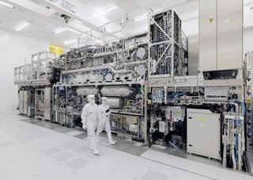
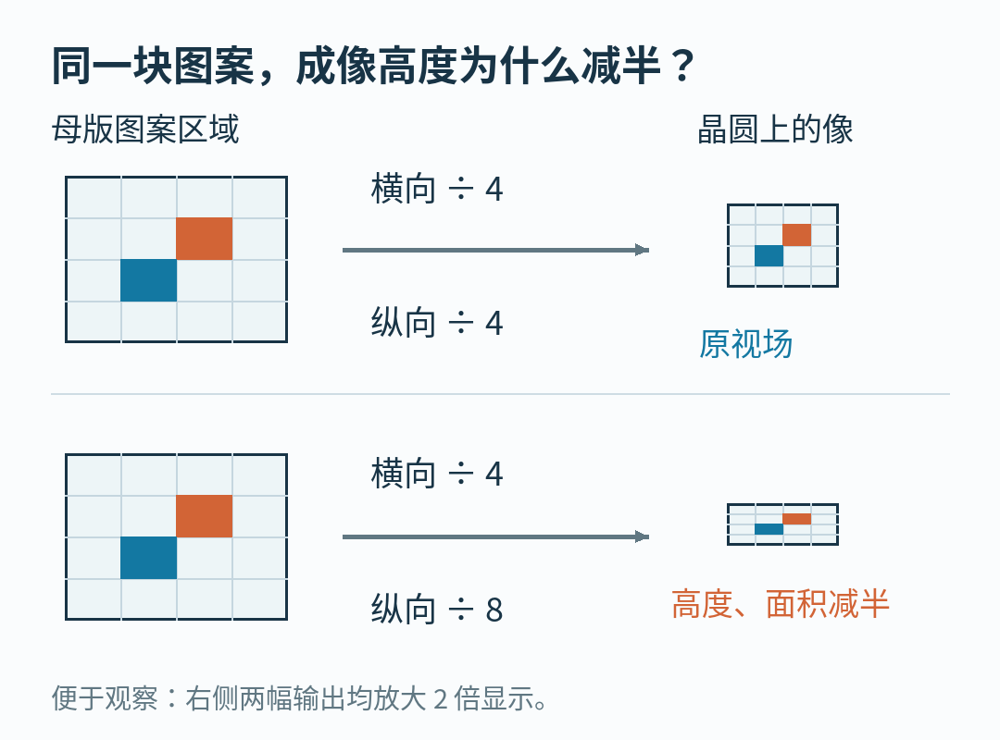
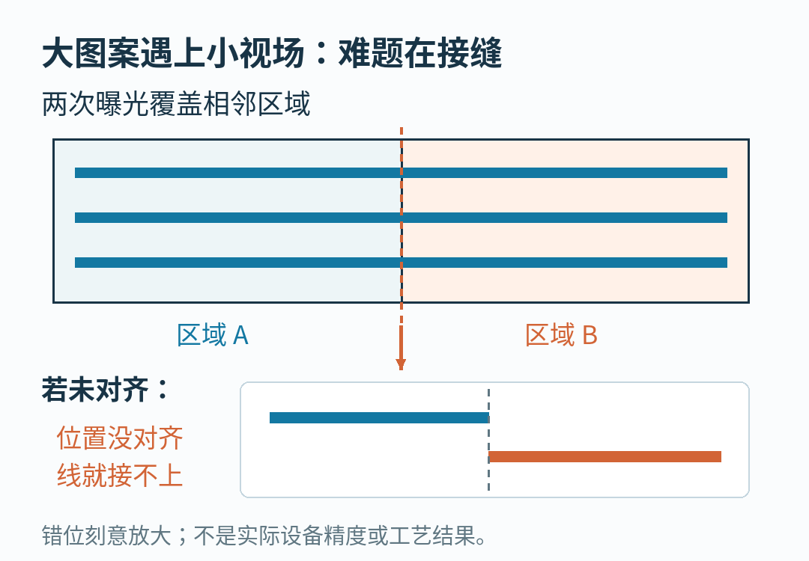

# 芯片越做越小，ASML 和台积电为什么要把“底片”做大？

造芯片有个容易让人会错意的动作：为了在硅片上印出更小的图案，工程师可能得先把机器里的“底片”做大。

这里的底片叫光罩，也叫掩模版。它带着要转印的电路图案；光刻机用光学系统把图案缩小，投到涂有感光材料的晶圆上。晶圆是用来制造芯片的圆形薄片，光罩则是机器反复读取的图案母版，两者不是同一块东西。

2026 年 9 月 8 日，光刻设备商 ASML 与芯片制造商台积电宣布，要推动行业从现有的 6 英寸光罩走向更大的 12 英寸光罩。这是一项面向未来的联合计划：目标包括 2031 年建立试验线，以及为 2033 年先进工艺生产准备相应系统。[1]

乍看像是在换一张大纸。可两家公司为什么要提前多年，拉上整条供应链一起换？

答案藏在一个很具体的交换里：**光刻机获得更高分辨率时，一次能印下的面积，可能反而变小。**

## 先别急着缩小，得把两条线分清

想象一张电路图，上面有两条挨得很近的细线。把它缩印，线之间的缝也一起缩小。某个时刻，光学系统不再能把它们清楚地区分开，原本分开的结构可能糊在一起。

这与电脑里把图片缩小不同。电脑可以保存理想的边界，制造设备却必须让真实的光和材料把边界做出来。

光刻技术有两只重要的调节旋钮。一个是光的波长：使用更短的波长，有利于分辨更细的结构。另一个是数值孔径，简称 NA：它描述光学系统收集和聚焦光的能力。条件相近时，NA 越大，能够分辨的细节就越小。[2]

ASML 的 EUV 光刻机使用 13.5 纳米波长的极紫外光。所谓 High NA EUV，沿用这一波长，重点把 NA 从上一代 NXE 平台的 0.33，提高到 EXE 平台的 0.55。[3]

可以用厂商给出的光刻分辨率关系，抓住变化的方向：最小特征尺寸与波长成正比，与 NA 成反比；另外还有一个与具体工艺有关的系数。只改变 NA、其他条件保持不变时，0.33 除以 0.55 等于 0.6。这个教学计算说明的是分辨率公式里的比例，不能拿来宣称某颗芯片已经缩小四成，更不能直接换算成算力或功耗。[2]

芯片是许多层结构叠起来的。不同层的尺寸要求不同，并不需要全部交给同一种光刻设备。ASML 对制造流程的介绍也明确区分了更精细层使用 EUV、其他层继续使用 DUV 的做法；DUV 是波长更长的深紫外光刻路线。[4]

因此，一台更先进的设备走进工厂，通常不是把原来所有机器一次性赶出去。工程师要决定它在哪些层值得用，又该怎样接进已有流程。

ASML 媒体库展示的 High NA 光刻系统。设备需要共同工作的远不止一个光源。©ASML

## 光不是穿过镜头，而是在镜面之间接力

先补一块与普通相机不同的背景。

极紫外光很容易被材料吸收，普通透镜不适合拿来一路聚焦它。因此 EUV 光刻使用特别制作的多层反射镜，光路处在真空环境中。光罩本身也参与反射，不能简单想成一张让光穿过去的透明胶片。[3][5]

“换更大、更精密的镜子”因而不是一个孤立的采购动作。镜面尺寸和光束角度改变后，光照到光罩的方式也会变，整个光学链条必须一起成立。

ASML 在 2024 年介绍第一代 High NA 系统时，解释过一个设计难题：提高 NA 后，光在光罩处的角度会让反射变得困难。一条思路是把两个方向的缩小倍率都提高，但那会迫使行业更早更换更大的光罩。[6]

当时采用的折中方案，是让两个方向采用不同倍率：一个方向缩小 4 倍，另一个方向缩小 8 倍。这叫变形光学。它让系统继续使用传统尺寸的光罩，也带来了下一道算术题。

## 同一张母版，为什么只印得下半幅？

先把光罩上可用的图案区域，暂时看成一个矩形。

如果横向和纵向都缩小 4 倍，投到晶圆上的长、宽分别变成原来的四分之一。如果横向仍缩小 4 倍，纵向改为缩小 8 倍，那么输出的宽度不变，高度只剩先前的一半。

面积自然也剩一半。

这里说的是在相同图案区域下比较缩小倍率，不是拿光罩外框尺寸直接除出晶圆上的成像尺寸。真实光罩还有边缘、标记和其他工程要求。

对同一块母版图案区域，纵向缩小倍率翻倍，输出高度减半。颜色标记用来追踪同一位置，不是实际电路。

ASML 对 EXE 平台的说明确认：这种变形光学使曝光视场成为 NXE 的一半。曝光视场，就是一次图案转印能够覆盖的区域。要把一整片晶圆铺满，就需要更多次曝光。[6]

它不等于“新机器速度减半”。每次曝光之间如何移动，移动得多快，光源与工艺需要多少时间，都会影响总吞吐量。ASML 同时改进了晶圆和光罩的运动平台，正是为了补偿小视场带来的负担。不能只拿面积比，替工厂算出最终产能。

另一个容易误会的地方是图案会不会被压扁。

如果把没有调整的同一张图，横向缩四倍、纵向缩八倍，当然会变形。实际设计要按光学系统的映射预先安排光罩图案，目标仍是在晶圆上得到正确结构。图中的矩形只是帮助看懂视场为什么变小，不是说成品晶体管被机器随意挤扁了。

## 小视场遇上大芯片，接缝就成了一道题

一个较小的图案完全放得进视场时，半幅的代价主要体现在如何排布与扫描。但如果要制造的单块图案跨过一次曝光能覆盖的边界，事情就更麻烦。

一种思路是分开曝光，再把相邻区域接起来。这就是拼接。可以把它想成分两次描一条横跨两张纸的线：两张纸各自画得很清楚，还不够；接缝两侧的位置也得对得上。

这个比喻只解释对齐要求。真实光刻中的拼接牵涉工艺与图案设计，不能靠把两张照片在软件里拖齐来解决。更不能把光刻拼接与把多颗小芯片封装在一起混为一谈：后者改变的是芯片组合方式，前者处理的是图案曝光边界。

两块区域都清晰，不代表接缝自动连得上。图中放大了错位，只说明拼接问题，不表示设备误差大小。

这也就能读懂 9 月公告中的目标了：ASML 与台积电希望更大的光罩提高生产效率，并解除拼接方面的限制。[1]

但公告没有给出可以套到所有产品上的成本降幅，也没有把 12 英寸光罩系统描述为已经量产。大光罩带来的好处，在这里应当读作两家公司的工程目标和预期，而不是已经兑现的成绩单。

## 把一张板子变大，需要多少人一起改？

这一回，两家公司没有只宣布一台孤零零的新机器，而是发起面向产业伙伴的合作。光罩供应商和其他设备伙伴被放进同一张计划表里。[1]

这背后的逻辑可以从物体的流转来理解：母版要被制造、检查、运输、装入机器，并在曝光时被精确控制。只要尺寸换了，任何仍按旧尺寸设计的交接点，都可能成为下一道问题。这是对产业协作必要性的工程解释，并不是公告已经逐项承诺的改造清单。

从这个角度看，2024 年保留传统光罩尺寸的决定很有意思。工程团队明明知道更大的母版是一条路，却先选择了一种能与现有体系兼容的光学方案，让 High NA 先往前走。

到了 2026 年，大光罩进入更长期的联合路线图。两步并不矛盾：先让一项技术接得进现有工厂，再考虑怎样松开这次兼容留下的限制。

软件世界也常遇到相似问题。新接口如果要求所有上下游同时升级，最漂亮的设计未必最容易落地。只是芯片工厂里的接口，可能是一块必须在真空中精确运动的实体母版；这里没有“发个补丁，所有设备明早一起更新”那么轻巧。

这个类比不能替代制造细节，但它能说明为什么一项看起来属于光学的进步，最后会成为供应链协作问题。

## 看路线图时，别把三个日期揉成一个

这份公告里，台积电计划从 2030 年开始把 High NA 用于先进工艺的大规模制造；联合计划则瞄准 2031 年的 12 英寸光罩试验线，以及 2033 年的相关先进工艺生产准备。[1]

所以，“台积电计划采用 High NA”和“12 英寸光罩生态到位”是两件相关但不同的事。High NA 可以先使用现有光罩，并不需要等大光罩全部准备好才开始。

这些都是截至 2026 年 10 月 8 日能够从该公告确认的计划。公告本身也把未来采用、时间和预期收益列为前瞻性陈述。它们提供了方向，不提供交付保证。

同样，设备的光学分辨率、芯片工艺节点的名字、实际芯片的性能，也不能互相代换。能印得更细，是制造者获得了一种能力；如何使用它，还要放回器件、互连、设计和生产流程里判断。

回到开头那个反常识的动作：芯片越做越小，母版为什么反而要变大？

因为工程师同时在追两件事：让细节更清楚，让每次工作覆盖的面积仍然划算。分辨率向前一步，可能把难题推到视场、运动、拼接和协作上。大光罩的故事，就发生在这些难题交接的地方。

## 参考资料与图片说明

1. [ASML 与台积电：大尺寸光罩联合计划，2026-09-08](https://investor.asml.com/news-releases/news-release-details/asml-and-tsmc-announce-initiative-pioneer-industry-transition-large-format-photomasks-high-na-euv)。用于事件、阶段和时间表；收益均为参与公司的预期。
2. [ASML：光刻分辨率的 Rayleigh 关系](https://www.asml.com/en/technology/lithography-principles/rayleigh-criterion)。用于波长、NA 与最小特征尺寸的关系。
3. [ASML：EUV 光刻系统](https://www.asml.com/en/products/euv-lithography-systems)。用于平台区别、光罩与真空光路。页面中历史量产预期未作为本文当前事实。
4. [ASML：芯片怎样制造](https://www.asml.com/en/technology/all-about-microchips/how-microchips-are-made)。用于分层制造与不同光刻路线的分工。
5. [ASML：透镜与反射镜](https://www.asml.com/en/technology/lithography-principles/lenses-and-mirrors)。用于 EUV 反射光学背景。
6. [Christine Middleton / ASML：High NA EUV 的五件事，2024-01-25](https://www.asml.com/en/company/stories/2024/5-things-high-na-euv)。用于变形光学与半幅视场的历史设计解释，不把文中旧路线图视作当前进度。

首图来自 [ASML 媒体库](https://investor.asml.com/news/media-library)，©ASML。媒体库允许署名的编辑用途，并限制促销或商业用途；本图限本文非商业编辑语境使用，不表示获得面向所有平台和用途的素材授权。其余两图为根据文中几何关系独立绘制的教学示意，无设备实测或晶圆照片含义。原图与原创图表分别遵循其注明的权利边界。

资料查阅日期：2026 年 10 月 8 日。本文使用 AI 辅助资料研究、写作与制图；没有声称访问工厂或实测光刻设备。
