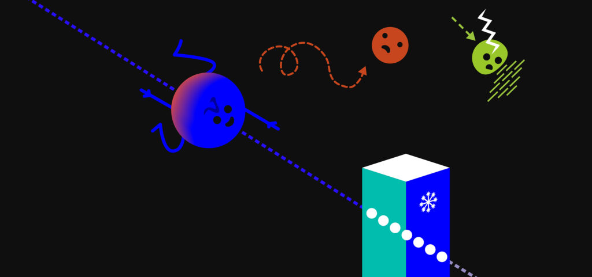
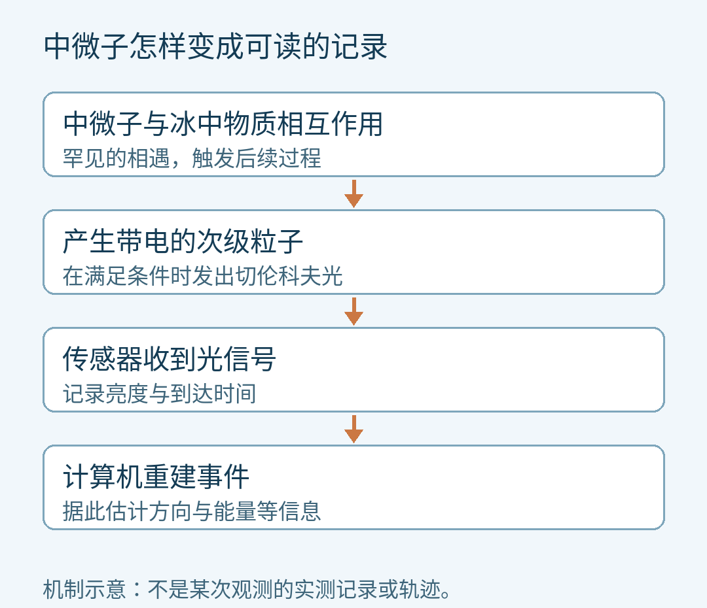
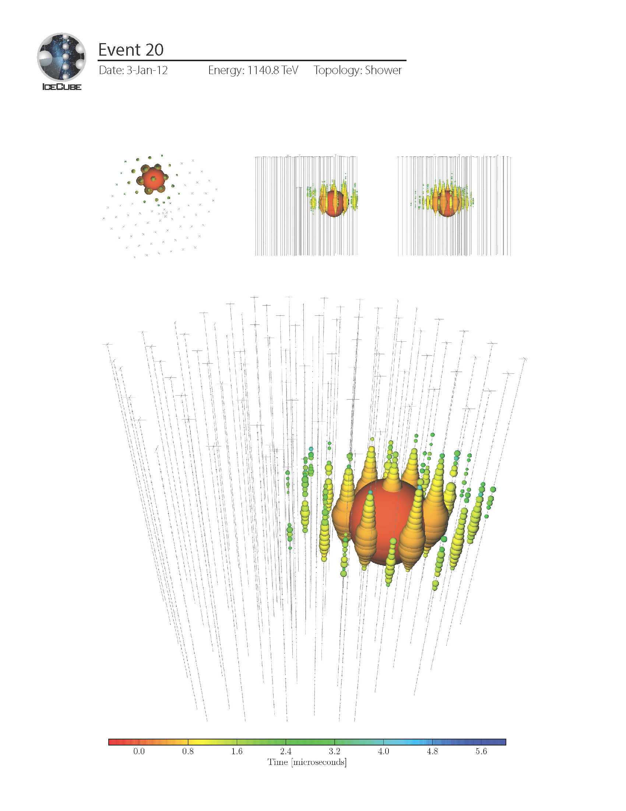

# 今年的诺贝尔物理学奖，为什么把我们带到南极冰下？

看宇宙，我们通常会想到把望远镜对准天空。IceCube中微子天文台却把光传感器埋进南极深冰，让大约一立方公里的冰成为探测器的一部分。[1][2]

2026年10月6日，瑞典皇家科学院宣布，将本年度诺贝尔物理学奖授予弗朗西斯·哈尔岑（Francis Halzen），表彰他对IceCube天文台，以及发现天体物理起源的高能中微子所作的决定性贡献。[1]

这则新闻里，最值得停下来想一想的，是“冰”和“天文台”怎么会出现在同一句话中。

冰并没有把遥远星系的风景映出来。研究者在等一种很难留下痕迹的粒子，偶尔在这里露一次面。

## 一个太擅长路过的信使

中微子是一种不带电、质量极小的基本粒子。它很少与物质发生相互作用，可以穿过大片物质而不被留下；不带电，也让它不会像带电粒子那样被磁场拐弯。[3]

瑞典皇家科学院为本届物理学奖制作的示意插图：不同来客与物质、磁场的相遇方式并不一样。

这让中微子具有一种特别适合“送信”的性质：它可能把遥远天体剧烈活动的线索带到地球，方向信息也能较好地保留下来。

但优点立刻变成了探测难题。一个一路不理会障碍物的信使，到了你的仪器面前，凭什么突然停下来？

答案不能靠劝，只能靠增加相遇的机会。

IceCube用上巨大体积的冰，里面有大量可以参与相互作用的物质。绝大多数中微子仍然穿行而过，研究者等待的是罕见的那一次。[1][3]

这里的“捕捉”，也不是把中微子装进瓶子。中微子与冰中的物质相互作用后，会产生带电的次级粒子；这些粒子能在冰中发出切伦科夫光，传感器记录的正是这份间接证据。[2]

名字可以稍后再记，先抓住三步：中微子发生相互作用，产生带电粒子，带电粒子在冰中留下光。

仪器收到的是次级粒子发出的光；方向与能量还需要重建。

切伦科夫光出现的条件，是这些粒子跑得比光在冰中的传播速度更快。这里比较的是“冰里的光速”，没有粒子超越真空光速这回事。[2][3]

## 为什么偏偏选择这么难施工的地方

如果只是需要很多物质，为什么要去南极？

因为还要看得见那一点微弱的光。IceCube需要足够大、足够透明、稳定而黑暗的介质。南极深处的冰提供了这样的环境，既有的科考站又让人员与设备获得支持。[3]

代价是施工窗口很短。瑞典皇家科学院的科普背景介绍写道，现场工作需要利用南极短暂的夏季。团队用热水融出深孔，再把串着传感器的长缆放进去。[4]

这不是往冰里埋一部相机，再等它传回漂亮照片。

IceCube原始深冰阵列有5160个光学探测模块，分布在86条串列上，主要位于地表以下1450米至2450米。它们记录光信号与到达时间，地面计算机再据此重建事件的方向、能量等信息。[2]

可以借一个很有限的比喻：如果很多人分散在黑暗的大厅，各自记下什么时候看见了闪光，把记录汇总起来，就多了推断闪光过程的线索。真正的重建还要考虑光在冰中的传播，绝不是把最亮的点当作宇宙来源。

而且，传感器被冻住以后，维修人员不能随时把它取出来换零件。IceCube的官方问答说明：模块部署前需要仔细测试，冻结后仍可通过线缆远程排查电子问题、更新软件，却无法再直接接触它们。[3]

所以，这项工作的浪漫，也包含非常务实的一面：能不能把孔打好，能不能在结冰前完成部署，能不能让一个留在深冰里的仪器长期可信。

## 看见了，还要问：它从哪里来？

最容易被新闻标题略过的，是“有信号”和“知道来源”之间那段路。

IceCube也会面对来自地球大气过程的背景信号。一次探测有多亮，并不能单独证明它来自遥远星系。

2013年，IceCube团队发表了对28个高能候选事件的分析。它们的整体性质难以用纯大气背景解释，支持存在来自地球之外的高能中微子成分；当时，具体的天体来源尚未确定。[5]

这里的判断，来自一组事件与背景预期的比较。它不是“看见一个亮点，就宣布发现一座宇宙发动机”。

想看看真实记录长什么样，可以打开[IceCube公开的事件图库](https://icecube.wisc.edu/gallery/28-very-high-energy-events-published-in-science-november-2013/)。其中的Event 20记录于2012年1月3日。那些彩色点是探测数据的可视化，不是望远镜拍到的星空照片。[6]

真实事件可视化：Event 20，2012年1月3日。多视角展示同一次事件，彩色点标出探测信号；底部颜色刻度对应时间。它不是一张星空照片。

下一步需要其他望远镜一起参与。

2017年9月22日，IceCube发出一次高能中微子事件警报，把方向坐标交给全球天文观测者。后续观测发现，一座编号为TXS 0506+056的耀变体在伽马射线波段活跃。2018年发表的研究，将这座活跃星系与高能中微子来源联系起来，给出了相互支持的证据。[7]

耀变体可以先理解为一种喷流大致朝向我们的活跃星系；伽马射线则是能量很高的光。一个仪器发现粒子线索，其他仪器去看那个方向的光，不同消息才逐渐拼成同一个天体事件。[8]

这比“某个天才用一块冰看穿宇宙”慢得多，也有意思得多。

哈尔岑获得的荣誉背后，是把一种大胆的探测想法变成长期观测能力的过程。冰要合适，仪器要可靠，分析要经得起背景检验，其他天文台还要能接住警报。

这次诺奖没有宣布宇宙中的高能粒子之谜已经解完。它提醒我们，发现有时从改变“看”的方式开始：除了接收光，还可以接收那些几乎不肯留下痕迹的来客。

而要看见它们，人类先在冰下学会了耐心。

## 来源与进一步探索

[1] 瑞典皇家科学院：[2026年诺贝尔物理学奖官方公告](https://www.kva.se/en/news/the-nobel-prize-in-physics-2026/)，2026年10月6日；并与[IceCube当日公告](https://icecube.wisc.edu/news/awards/2026/10/francis-halzen-icecube-principal-investigator-wins-2026-physics-nobel-prize/)交叉核对授奖对象与理由。

[2] IceCube：[探测器与建设介绍](https://icecube.wisc.edu/science/icecube/)。文中5160个模块、86条串列指原始阵列，不是2025—2026升级后的所有设备总数。

[3] IceCube：[官方问答](https://icecube.wisc.edu/about-us/faq/)。本文只采用其中中微子、冰与模块维护相关说明。

[4] 瑞典皇家科学院：[2026年物理学奖科普背景](https://www.kva.se/en/prizes/nobel-prizes/ice-at-the-south-pole-reveals-cosmic-particle-accelerators/)。

[5] IceCube：[2013年分析及数据发布](https://icecube.wisc.edu/data-releases/2013/11/search-for-contained-neutrino-events-at-energies-above-30-tev-in-2-years-of-data/)；[研究摘要](https://user-web.icecube.wisc.edu/~mmadsen/other%20resources/222_display/Links/2013Nov_hese_science_pg1.pdf)。

[6] IceCube：[2013年研究所用事件的公开可视化图库](https://icecube.wisc.edu/gallery/28-very-high-energy-events-published-in-science-november-2013/)。本文链接真实记录，不把原创机制图当成实测图。

[7] IceCube：[2018年联合观测结果](https://icecube.wisc.edu/news/press-releases/2018/07/icecube-neutrinos-point-to-long-sought-cosmic-ray-accelerator/)。

[8] NASA：[Using All of Our Senses in Space](https://science.nasa.gov/universe/stories/quick-reads/using-all-of-our-senses-in-space/)，提供耀变体与多信使观测的背景。

资料核对截至2026年10月8日。AI辅助资料整理与写作；原创图为机制示意；另保留官方诺奖插图与IceCube真实事件可视化，署名及用途限制见文末。获奖消息指10月6日公布的授奖决定。

## 图片署名与用途

素材：©Johan Jarnestad/The Royal Swedish Academy of Sciences；https://www.kva.se/en/news/the-nobel-prize-in-physics-2026/；Nobel news reporting / educational use; no modification; no advertising https://www.kva.se/en/news/the-nobel-prize-in-physics-2026/

素材：IceCube Collaboration；https://icecube.wisc.edu/gallery/28-very-high-energy-events-published-in-science-november-2013/；IceCube gallery personal / educational / informational / noncommercial use https://icecube.wisc.edu/press-guide/

第三方图片用于本文的非商业教育与诺奖报道语境，保留原署名与用途限制；详见[图片与来源说明](sources.md)。这些图片不适用正文的 CC BY 4.0 许可。
