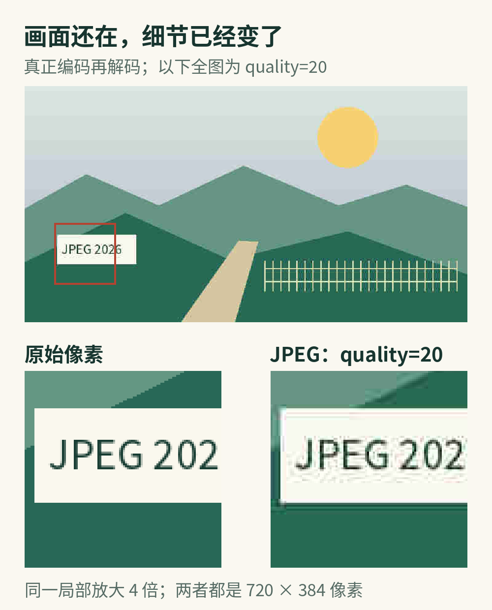
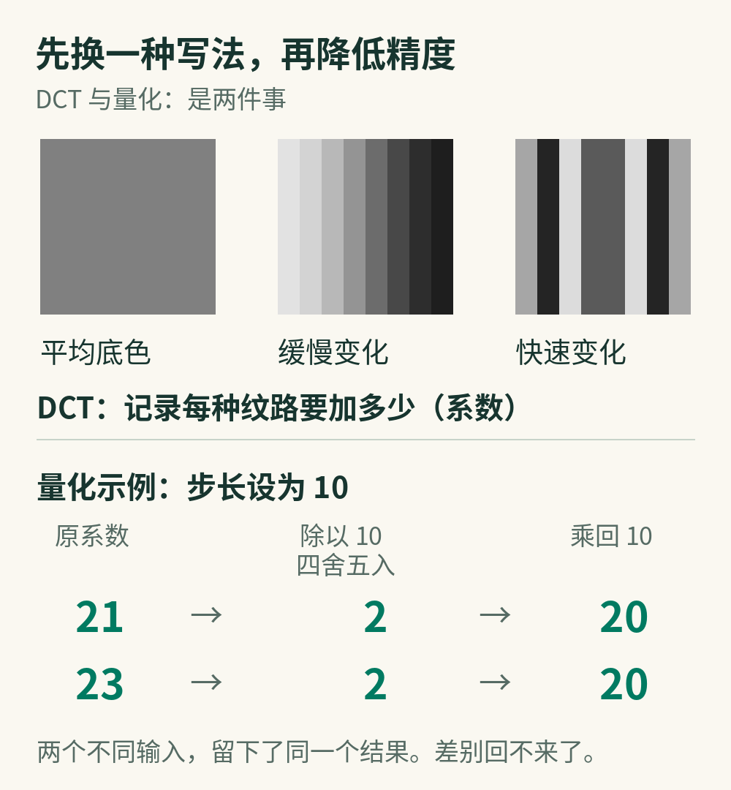
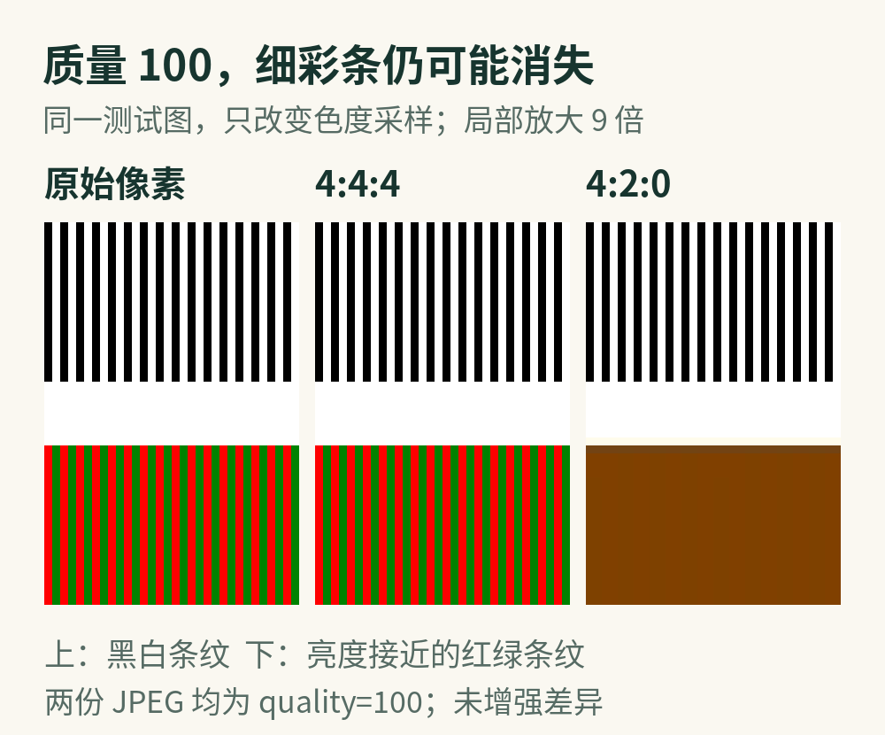

# JPEG 把照片里的什么扔掉了？

一张照片另存为 JPEG，文件可以小一大截，像素宽高却完全没变。树还在，脸还在，窗外的天空也在。

那么，省下的那些字节原来装着什么？

JPEG 是一种压缩数字图像的技术，日常遇到的 .jpg 照片通常用的是它的有损压缩方式。“有损”说得很直白：解码后得到的像素，不保证与输入时一模一样。本文讲的就是这条常见路线；[JPEG 标准也包含其他模式](https://jpeg.org/jpeg/)，不能把整个家族都等同于有损压缩。

它最值得琢磨的地方，不是把数据藏得更好，而是做了一次取舍：**不必把每一处差别都记得同样精确，画面仍可能足够好用。**

不过，什么叫“足够”，照片不会替我们决定。

## 像素没少，细节怎么就变了？

先看一个可以核对的小实验。

本文用程序画了一张包含渐变天空、山坡、细线和小字的合成测试图，再真正编码为 JPEG、解码出来比较。没有缩小图片，也没有模拟压缩痕迹。

在同一套编码设置中，质量参数从 95 改为 20，文件从 48,533 字节降到 13,185 字节。两份图仍然都是 720 × 384 像素。这里的质量数值是编码器参数，不是“保留了原图百分之多少”。

低质量版本里的山和太阳依然清楚可辨；把同一块小字放大，字边已经多了毛刺，牌子周围出现了原来没有的色带。

像素数不变，小字和牌子边缘却变了。两张局部取自同一位置，均放大 4 倍。

这张图刻意混合了平缓区域和尖锐边缘，用来暴露机制，不代表真实照片的总体压缩表现。实验用 Pillow 12.3.0、libjpeg-turbo 3.1.4.1，关闭色度降采样，两份文件都不启用渐进编码或额外编码优化。

这里藏着第一个容易混淆的地方：**像素数量，和像素是否准确，是两回事。**

解码器仍然交出同样多的格子，只是格子里的颜色变了。就像把一幅画重新画在同样大小的方格纸上，方格一个不少，并不意味着每笔都照原样回来。

为什么这种改动往往先伤到细节，而画面的大体样子还在？得看看 JPEG 怎样描述一小块图。

## 一块天空，值得逐点报数吗？

假设要描述一小块晴空。

一种办法是挨个报出每个像素的数值。另一种办法是先说：这一块整体差不多这么亮，左边略亮一点，往右缓缓变暗，另外还有一点细碎的起伏。

第二种说法，已经接近 JPEG 下一步做的事。

先只看明暗：JPEG 把这一层数据切成 8 × 8 的小块，用一组规定好的明暗纹路来表达它们：有铺满整块的底色，有缓慢变化的宽纹路，也有变化很快的细纹路。每种纹路配一个数，表示它在这一块里占多少分量。这个数叫系数。

负责完成转换的数学工具，叫离散余弦变换，简称 DCT。这里的“频率”不是刷新率，而是明暗在空间里变化得有多快。

要紧的是，**DCT 本身不是删细节的那把剪刀。** 一个小块输入 64 个数，变换后仍是 64 个系数。理想数学条件下，保留全部精确信息，可以反过来还原；实际计算则有有限精度带来的误差。[Wallace 对 JPEG 的原理解说](https://ijg.org/files/Wallace.JPEG.pdf)专门区分了变换和随后发生的损失。

换一种写法有什么用？

平滑天空里，那些忽明忽暗的细纹路往往只占很少分量。换成系数后，“重要变化集中在哪儿”就更容易处理。它还没把行李扔掉，只是先把行李摊开了。

接下来才轮到真正的取舍。

## 精度一旦合并，就没有回头路

JPEG 会把系数除以各自的步长，再取最接近的整数。这个过程叫量化。

不妨用一个教学例子：某个系数是 23，步长取 10。23 除以 10 得到 2.3，取整后只保存 2。解码时乘回 10，得到的是 20。

那原来的 3 去哪儿了？没有藏在文件的某个角落，它就是没被记下来。

更关键的是，原系数如果是 21，经过同样的步骤，也会得到 2，再还原为 20。解码器看到这个结果，已经无从判断最初到底是 21 还是 23。

不同输入变成同一个输出，这就是不可逆。

上：几种不同粗细的纹路。下：教学例子中，21 和 23 经过量化后无法再区分。

上图下半部是便于心算的示例，不是从测试图里抽取的真实系数。真实 JPEG 为一个块里的各个系数配有量化步长，并不是所有位置都统一除以 10；[T.81 标准的 A.3.4 节](https://www.w3.org/Graphics/JPEG/itu-t81.pdf)给出了量化与反量化的定义。

较粗的步长，让更多相近数值挤进同一个格子，也会让许多较小系数变成零。常见设置会对细密变化保留较少精度，但并不是看见“高频”就一刀全删：某个系数留下多少，取决于它自身大小和对应步长。

这也解释了 JPEG 的脾气。大块平缓的明暗可以保留得不错；小字、斜线、毛发等细节包含较急的变化，压得狠了，损失更容易显眼。把这些变化按粗糙的数值重新拼回去，边缘可能发虚、出现波纹；相邻小块的还原结果接不上时，方块边界也会露出来。

JPEG 并不认识“这是人的眼睛，所以要特别珍惜”，也不知道一个很小的数字是不是整张图最重要的信息。它处理的是局部信号；语义上的重要，未必等于压缩时容易保住。

## 还有一条省法：颜色不必记得一样密

到这里，还有一件事没有发生在前面的实验里：色度降采样。

常见彩色 JPEG 编码会先把 RGB 转成另一种表示：一路记录明暗，另外两路记录颜色相对明暗的差异。它们通常写作 Y、Cb、Cr；可以先把它想成“一张明暗底图，加两张颜色说明”。这是帮助理解的比喻，不是文件里真的存了三幅可直接叠放的照片。

为什么要这样拆？因为视觉对细小明暗结构和细小颜色变化的敏感程度并不相同。在许多观看条件下，颜色信息可以记得疏一些，画面仍然看起来不错。这也是 [libjpeg-turbo 对色度采样的说明](https://raw.githubusercontent.com/libjpeg-turbo/libjpeg-turbo/main/src/turbojpeg.h)采用的出发点。

例如 4:2:0：在与 2 × 2 个亮度样本对应的区域里，每一路色度只保留一个样本。显示时再把较稀的色度补回所需尺寸。4:4:4 则不做这一步降采样。

这和量化有明确区别：量化是把变换系数记得粗一点；色度降采样是把颜色在空间上记得疏一点。实际编码中，后者通常先于分块 DCT 发生。

也正因为它们是两回事，把质量滑块拉满，不一定能解决彩色细字的问题。

第二个实验专门把这个差别放大：一组是每像素交替的黑白条纹，另一组是亮度接近、颜色不同的红绿条纹。两份 JPEG 的质量参数都设为 100，只把色度采样从 4:4:4 改为 4:2:0。

结果很直观：黑白条纹还在，红绿细条在 4:2:0 版本里却几乎融成了一片棕色。差异没有经过后期增强。这是刻意构造的极细条纹压力测试，不是普通照片都会遭遇的程度。

同为 quality=100，4:2:0 仍抹平了这组极细红绿条纹。局部放大 9 倍，未做差异增强。

所以，“质量 100”并不等于“逐像素无损”。[libjpeg-turbo 的使用说明](https://raw.githubusercontent.com/libjpeg-turbo/libjpeg-turbo/main/doc/usage.txt)明确提醒：即使量化表被设为全 1，色度采样和舍入仍可能带来损失。不同软件的质量滑块如何映射到这些设置，也不能只凭同一个数字判断。

## 最后打包时，就不必再丢了

量化之后，许多系数变成了零。这给文件进一步缩小创造了条件。

对常见的基线 JPEG 来说，系数会按规定顺序排列；连续的零可以紧凑地记，常出现的符号用较短的编码表示。最后这类步骤叫熵编码，它压缩的是已经得到的符号，不需要继续改动画面。[T.81 对熵编码的定义](https://www.w3.org/Graphics/JPEG/itu-t81.pdf)本身就是无损的。

这不是措辞上的区别。本文还对质量 95 的测试图多做了一次编码：只打开优化编码选项，文件从 48,533 字节降到 43,294 字节，解码后的 RGB 像素逐字节相同。

因此，看到文件变小，不能立即断言“又损失了一些画质”。有时是舍弃了信息，有时只是把已有信息写得更省。反过来，把一张已经受损的图另存成更大的文件，也不会自动找回那些已经合并的差别。

## 真正该保留的，是选择余地

理解 JPEG，不是为了替每一张图片选出一个神奇的质量数字，而是为了知道什么时候可以让步，什么时候不该让算法替你让步。

如果图片只是按固定尺寸放在网页里供人浏览，传输更快、占用更小本身就有价值。可以在最终展示尺寸下看整体，再放大检查人脸、小字、纹理和边缘，让具体用途决定能够接受的损失。

如果后面还要裁切、修图，或者必须读出图里的细节，就该保留未经这次有损导出的源文件。今天缩在角落里不显眼的一块，明天可能就是要单独放大的主体。

文字截图、表格和线稿尤其值得换一种想法：它们的价值常常恰好就在锐利边缘和精确色块上。需要像素原样保留时，应选择明确的无损保存方式，而不是期待 JPEG 的最高质量参数许下它没有许下的承诺。

还有一个小区别值得记住：复制文件、下载同一份文件，不会因为“多传了一次”自动变糊；解码之后再次做有损编码，才可能再引入变化，即使没有主动修改画面。平台究竟做了什么，要看它实际有没有重编码。

JPEG 的聪明，是发现了很多差别不必每次都原封不动地带走。我们的判断，则是知道这一次，哪些差别恰好不能丢。

## 参考与实验说明

- [JPEG 官方：JPEG 1 概览](https://jpeg.org/jpeg/)。用于确认本文讨论的编码模式范围。
- [ITU-T T.81：数字静态图像压缩标准](https://www.w3.org/Graphics/JPEG/itu-t81.pdf)。重点参照 4.3、A.3.4 与基线编码相关条款。
- [Gregory K. Wallace：The JPEG Still Picture Compression Standard](https://ijg.org/files/Wallace.JPEG.pdf)。参照变换、量化及其精度边界的解释。
- [libjpeg-turbo：使用说明](https://raw.githubusercontent.com/libjpeg-turbo/libjpeg-turbo/main/doc/usage.txt)与[色度采样接口说明](https://raw.githubusercontent.com/libjpeg-turbo/libjpeg-turbo/main/src/turbojpeg.h)。用于核对质量参数、采样和编码优化的含义。
- [Pillow：JPEG 读写参数](https://pillow.readthedocs.io/en/stable/handbook/image-file-formats.html#jpeg)。用于核对本次实验的参数入口。

资料查阅与实验执行日期：2026 年 10 月 8 日。本文图片由原创合成输入实际编码所得，机制图为另行绘制的教学示意；原始图片、编码文件、参数记录和复现脚本随稿保存。测试不是人眼画质评测，也没有把文件大小差异推广为真实照片的固定压缩率。

本文使用 AI 辅助资料研究、写作与制图脚本制作；没有虚构拍摄经历或亲身观察。
