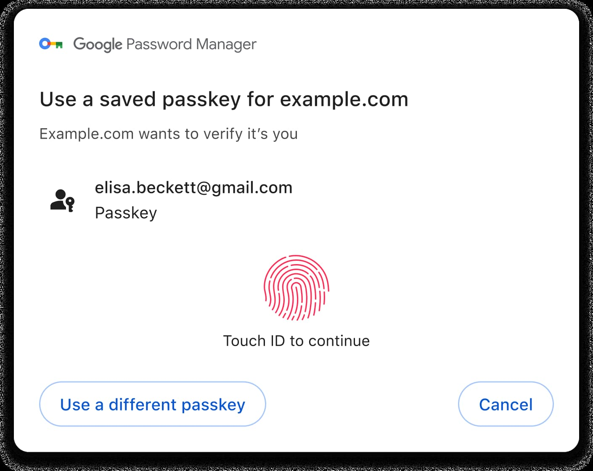
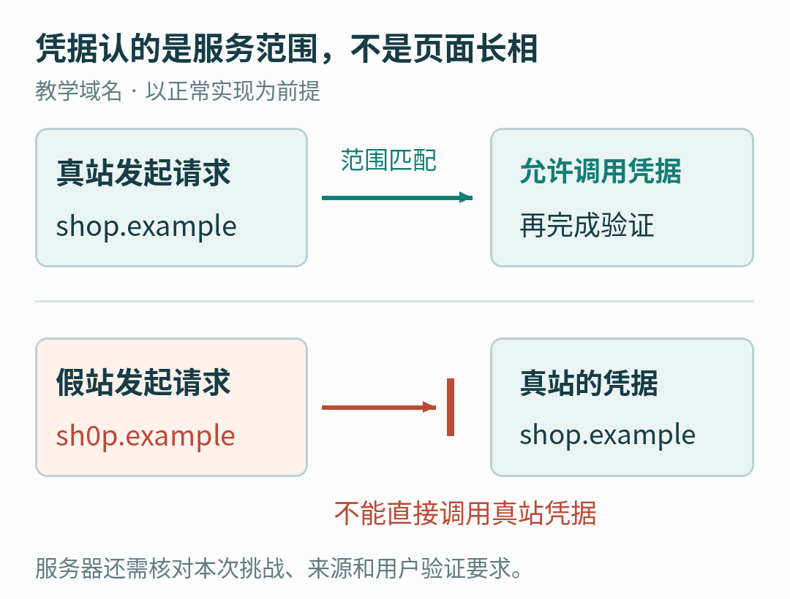
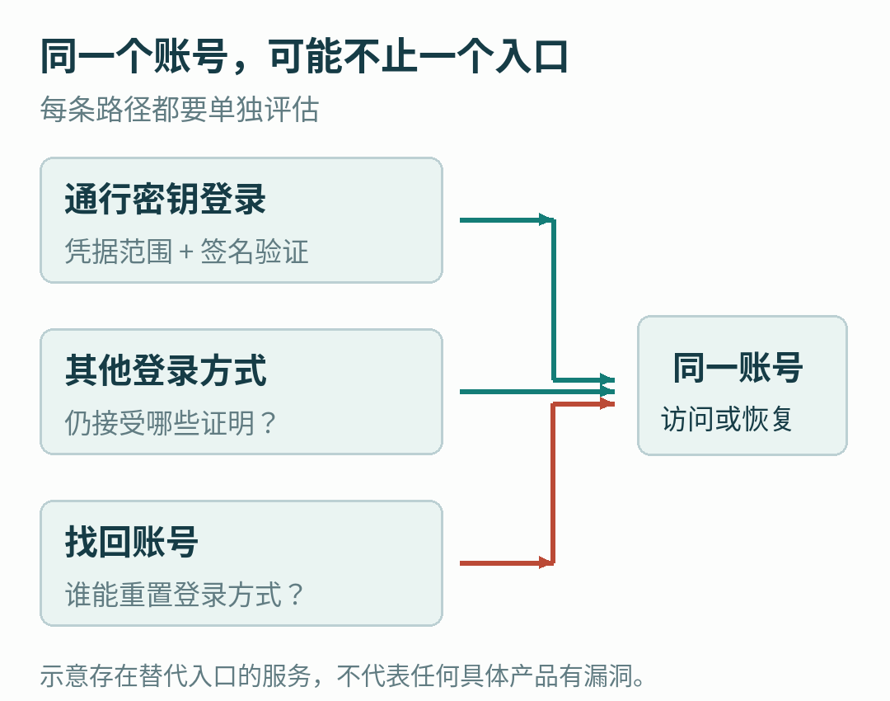

# 通行密钥为什么不怕假登录页，却还得认真对待“找回账号”？

登录网页时，手机让你按一下指纹。页面没有让你输入密码，账号就进去了。

这时很容易产生一个疑问：网站是不是收走了我的指纹，拿它当新密码？

如果这次登录用的是通行密钥，也就是 passkey，发生的事情并不是这样。通行密钥是一种与账号和网站或应用关联的数字凭据。指纹、面容或设备 PIN，通常只是让设备确认“现在允许使用这份凭据”；网站收到的，是设备生成的一份密码学证明。[1]

这个差别，决定了它为什么能够挡住一大类假登录页，也决定了它挡不住什么。

2026 年 5 月，推动这项技术的行业组织 FIDO 联盟估计，全球已经有 50 亿份通行密钥在使用。这个数字来自公开数据与联盟内部部署数据的综合估算，不能当成 50 亿个人，更不是 50 亿个彻底摆脱密码的账号。[2]

同年 8 月 25 日，制定网页技术标准的 W3C 发布了 WebAuthn Level 3 正式推荐标准。WebAuthn 是让网站调用这类公钥凭据的浏览器接口；标准往前走了一步，并不意味着每个网站的全部登录和恢复流程也同时升级了。[3]

要看清通行密钥的价值，最好先把一次登录拆开。

## 指纹在本地，网站看见的是证明

先认识一对容易被误解的名字：公钥与私钥。

它们是数学上关联的一对密钥。私钥用来生成数字签名，公钥用来检查签名是否正确。知道公钥，并不能实际推算出对应私钥。这里的“签名”也不是屏幕上画出来的姓名，而是针对一份数据计算出来的结果。

创建通行密钥时，网站登记公钥与相关凭据标识，私钥由负责保管和使用凭据的认证器管理。认证器可以是设备上的组件，也可以来自外接的安全设备。[1][4]

等到下次登录，网站出一道新的随机“题目”，叫挑战。设备经过必要的用户确认，用私钥对包含这次挑战在内的数据生成签名。网站再用登记的公钥检查，同时核对这是不是自己刚发出的那次挑战、来源是否被允许，以及需要的用户验证是否完成。[4]

重点是：**网站不需要接收私钥，也不需要收到你的指纹，才能验证这次登录。**

WebAuthn 规范明确把生物识别用于本地用户验证，不把生物特征交给登录服务。PIN 也是设备或凭据管理器的解锁手段，不能直接理解成网站原有密码的短版本。[4]

Google 文档中的 Touch ID 登录界面。系统是在请求本地验证；这张来源截图不表示本文实际登录过该网站。

不过，“私钥不交给登录网站”与“私钥永远不能离开这台设备”是两句话。后面会看到，能够同步的通行密钥，恰恰需要把受保护的密钥材料带到其他设备上。

## 密码为什么可以被转交，通行密钥却认门？

假设你常用的商店是 shop.example。有人做了一个外观一模一样的 sh0p.example，把字母 o 换成数字 0。这里都是教学用的虚构域名。

如果你在假页面输入密码，骗子拿到的是一段能继续提交给真网站的口令。页面再漂亮，也改变不了这段文字已经交给了谁。

一次性验证码增加了攻击难度，但不一定结束这种转交。假页面可以在有效时间内，把用户刚输入的验证码继续递给真网站。Mozilla 的开发者文档用这种实时中转，说明了常见一次性验证码与抗钓鱼认证的区别。[5]

通行密钥加入了另一层约束：凭据有自己所属的服务范围。WebAuthn 把这个服务标识称为 RP ID，通常由域名表示；浏览器不能因为页面画得像商店，就允许它随便调用另一个服务的凭据。服务器还要检查响应里的来源信息，也就是 origin。[4]

所以，在正常实现与设备环境下，假商店不能仅靠换一张皮，就让浏览器拿真商店的通行密钥替它登录。

页面外观可以复制，服务范围不能靠复制页面取得。示意中的两个域名都不是实际商店。

这里的“认门”，不是设备在识别网页里的商标，也不是某个 AI 觉得页面不像真的。它依据的是协议中的域名范围、来源及密码学验证。具体允许哪些域名和关联站点，由规范与部署共同约束，不能简单理解成比较整条网址是否逐字一样。

前面的随机挑战又解决了另一件事：把上次登录时的有效响应重新发一遍，不应当算一次新的有效登录。服务端必须核对本次挑战，而不是看见一个曾经正确的签名就放行。[4]

这两层经常被揉成一句“密钥很安全”，其实分别回答了两个问题：你在替哪个服务证明身份？你证明的是哪一次请求？

## 没有密码，并不等于没有保管人

用了通行密钥，问题从“这串字符该怎么记”变成了“这份凭据存在哪儿，我怎样重新拿到它”。

有的凭据绑定在特定设备上。有的由支持同步的凭据管理器保管，可以在允许的设备之间使用。两种方式都可以提供通行密钥登录，但换设备和丢设备时的体验并不相同。[6]

Google 的说明提供了一个具体例子：使用 Google 密码管理器保存的通行密钥会进行端到端加密同步；在新环境中解密使用，需要满足相应账号登录和屏幕锁或密码管理器 PIN 的要求。不能把“云端有备份”理解成谁登录账号就一定能立即拿到明文密钥，也不能据此假定所有管理器采用完全相同的恢复方案。[6]

还有一种容易混淆的场景：电脑上没有这份通行密钥，手机上有，用户让手机帮助完成登录。这是跨设备认证，并不等于密钥已经复制进电脑。Google 的文档把跨设备使用与同步存储分开介绍。[1]

这也是为什么“我换了一台手机”不是一个只有标准答案的问题。你换的是持有凭据的设备，还是已经同步好的一个使用入口？旧设备还在不在？保管凭据的服务能不能恢复？目标网站有没有别的已登记凭据？

这些细节看似没有密码学那么酷，却决定了人在真的需要登录时，能不能进门。

## 正门换了锁，为什么还要看侧门？

现在把问题放回网站这一边。

假设一个网站已经支持通行密钥，但用户仍可以点“改用密码”，再通过一种容易被转交的验证码完成登录。攻击者未必需要攻击新凭据；他可以继续诱导用户选择旧入口。

再假设“找回账号”能够在较弱的验证后，重置登录方式或登记新的凭据。那么攻击者的目标，就可能从骗走日常登录证明，变成骗过恢复流程。这两种情况是教学假设，不是对某个具体产品存在漏洞的指控。

FIDO 联盟在 2025 年发布的迁移白皮书，正是把日常登录、替代认证和账号恢复放在同一条路线中讨论。报告由 Mercari 的 Tatsuya Karino 主编；[Mercari](https://careers.mercari.com/en/about/) 是经营线上交易平台的公司。它讨论的问题很实际：已有用户习惯了旧入口，服务不能只顾增强认证，也必须处理被锁在门外和迁移摩擦。[7]

通行密钥保护的是它参与的那条认证路径。其他登录与恢复入口如果仍然存在，也各有自己的验证要求。

因此，评估一个账号的保护，不能只数设置页里有没有通行密钥按钮。更有用的问题是：启用后，哪些操作要求它？哪些入口仍接受其他证明？恢复成功后，谁有权添加或替换凭据？

这并不是说网站应立刻删除所有备用入口。没有可靠替代方案就关门，可能把真正的用户也挡在外面。FIDO 提出的分阶段迁移，本来就是为了同时处理保护强度与可用性。那份白皮书是迁移指导，并不是一份证明所有现有产品都存在相同问题的漏洞报告。[7]

## 登录成功之后，还有另一种凭据

有时，“我用了通行密钥，账号为什么还会出问题”甚至与刚才的签名过程无关。

网站一般不会让用户每打开一页都按一次指纹。完成登录后，浏览器通常会持有一份会话凭据，例如会话 Cookie，让后续请求继续被识别为已登录用户。

如果这种凭据是“持有就能用”的类型，并被恶意软件或其他攻击手段窃取，攻击者可能绕过重新登录这一步。通行密钥没有被算破，身份验证后的通行证却出了问题。[8]

FIDO 在另一份 2025 年白皮书里，把设备绑定会话等机制放在通行密钥旁边讨论，原因就在这里。强认证与保护登录后的会话，是互相补充的工作。本文不据此判断某个浏览器当前已经部署了哪项会话技术，也不把白皮书里的方向当作所有网站的现状。

我们可以用一个不那么精确、但容易记住的比喻：进楼时查证件，进楼后发通行证。前者做得更好，并不会自动让后者永远安全。

## 真正改变的，是谁负责辨认那扇门

通行密钥有意思的地方，是把一部分很难长期做好的判断，从人手里移到了协议里。

人可以疲倦，可以忙，可以把两串很像的域名看岔。让浏览器按照凭据所属范围处理登录，能减少“用户必须每次都及时发现假页面”的依赖。它仍需要正确实现、可信设备与妥善的凭据保管，但确实改变了传统口令容易被转交的条件。

与此同时，人在丢手机、换电脑、忘记本地 PIN 时仍然需要一条回来的路。产品团队必须把这条路做清楚，而不能用一个安全的登录按钮，替整个账号生命周期交差。

下次再看见指纹提示，可以把它理解为一个更具体的动作：设备正在允许某份凭据，为某个服务的这次请求作证。

至于这个账号最终有多难被接管，还要继续问一句：除了这扇门，别人能从哪里进来？

## 参考资料与图片说明

1. [Google：通行密钥概览](https://developers.google.com/identity/passkeys)。用于凭据、用户验证、跨设备使用的解释；页面标注更新日期为 2026-10-01。
2. [FIDO 联盟：2026 年通行密钥报告发布说明，2026-05-07](https://fidoalliance.org/fido-alliance-reports-accelerating-global-passkey-adoption-on-world-passkey-day-2026/)。50 亿为联盟估算，不是独立人口统计。
3. [W3C：WebAuthn Level 3 正式推荐标准公告，2026-08-25](https://www.w3.org/news/2026/web-authentication-an-api-for-accessing-public-key-credentials-level-3-is-now-a-w3c-recommendation/)。
4. [W3C：WebAuthn Level 3](https://www.w3.org/TR/webauthn-3/)。参照 RP ID 定义、挑战验证、来源验证与本地生物识别说明；正文省略协议字段细节，不作为实现指南。
5. [MDN：Phishing](https://developer.mozilla.org/en-US/docs/Web/Security/Attacks/Phishing)。用于密码、一次性验证码和通行密钥的钓鱼边界比较。
6. [Google：Android 与 Chrome 的通行密钥支持](https://developers.google.com/identity/passkeys/supported-environments)。用于保管与同步的产品实例，不推广成所有提供商的行为。
7. [FIDO：Passkeys: The Journey to Prevent Phishing Attacks，Part 3，2025-03](https://fidoalliance.org/wp-content/uploads/2025/03/Passkeys-The-Journey-to-Prevent-Phishing-Pt3.pdf)。参照迁移、替代入口、外部提供商与恢复边界；作者所属机构不表示本文获得该机构背书。
8. [FIDO：DBSC/DPOP as Complementary Technologies to FIDO Authentication，2025-05-20](https://fidoalliance.org/white-paper-dbsc-dpop-as-complementary-technologies-to-fido-authentication/)。用于登录与会话凭据的区别。

首图为 Google 开发者文档的原始界面截图，来源见资料 6，按该页 [CC BY 4.0](https://creativecommons.org/licenses/by/4.0/) 声明署名使用，未修改像素；不同版本的实际界面可能变化。其余两图为原创关系示意，虚构域名仅用于解释，未演示攻击或执行真实登录。

查阅日期：2026 年 10 月 8 日。本文使用 AI 辅助资料研究、写作与制图，没有访问个人账号、采集凭据或运行攻击实验。
