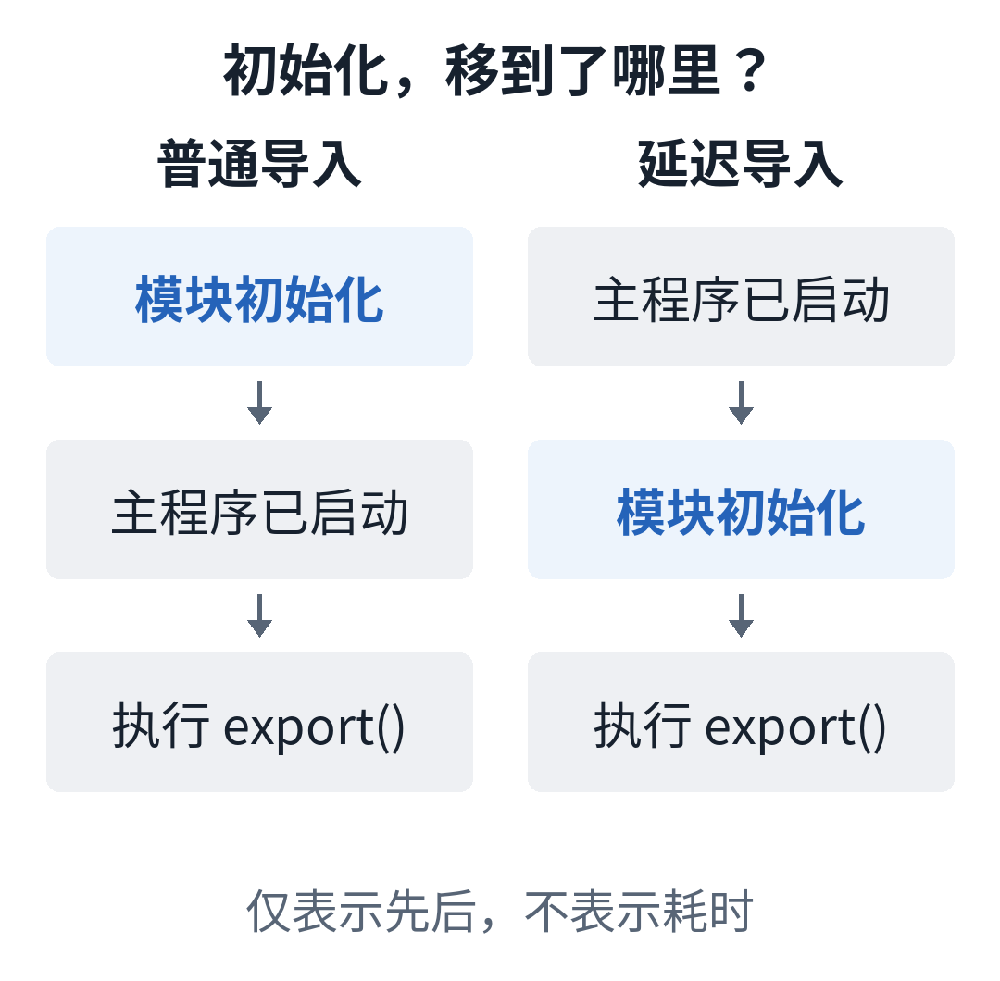

# Python 3.15 的 lazy import：启动省下的时间，后来谁来付？

假设你维护一个 Python 命令行工具，既能检查配置，也能导出报表。用户只敲了一个 `--help`，程序却先把报表相关的依赖加载了一遍，然后才告诉他命令怎么用。

这类等待很冤：用户还没决定要做什么，程序已经替所有可能的任务做了准备。

Python 3.15 新增的 `lazy import`，就是给这种准备工作换一个发生时间。它叫“延迟导入”：先声明要用哪个模块，等代码真正使用导入的名字时，再加载模块。普通 `import` 的默认行为不因此改变。[1][2]

这项变化也出现在最近的发版插曲里。10 月 2 日，Python 官方发布了额外的 3.15.0rc3，原因包括临近发布时出现的延迟导入阻断问题。截至本文查阅资料的 10 月 8 日，正式版计划在 10 月 9 日发布；rc3 仍是候选预览版，官方不建议用于生产环境。[1]

比“又多了一个关键字”更值得弄清楚的是：**如果导入晚一点发生，哪些工作可以不做，哪些问题也会跟着晚一点出现？**

## 模块还在，只是先别叫醒它

Python 导入一个尚未加载的模块时，会执行模块顶层的代码。那里可能只是定义函数，也可能包含初始化动作。导入还可能继续触发其他导入。[2][3]

过去可以把 `import` 移进函数，等函数被调用再执行。这是已有的办法。`lazy import` 提供的变化是：依赖声明仍可以集中放在文件顶部，实际加载却等到第一次使用。[2][3]

看一个教学例子。下面两个文件依据 3.15 文档编写，本次没有在 3.15 解释器中执行；后面的输出顺序是按文档推导的，不是实测记录。假定使用默认导入模式，也没有其他代码提前导入同一个模块。

`report_backend.py`：

```python
print("报表模块开始初始化")


def export():
    print("报表已导出")
```

`demo.py`：

```python
lazy import report_backend

print("主程序已启动")
report_backend.export()
```

按文档语义，预期顺序是：

```text
主程序已启动
报表模块开始初始化
报表已导出
```

关键在最后一行调用之前：读取 `report_backend` 这个名字，才触发模块加载。解释器先执行模块顶层的初始化代码，再继续调用 `export()`。[4]

如果把 `lazy import` 换成普通 `import`，模块初始化会先于“主程序已启动”。如果这次运行根本没有走到 `report_backend.export()`，也没有其他地方触发该模块导入，这部分加载工作就可以不发生。



同一份初始化工作，发生在不同位置。图中间距仅表示先后顺序。

这里改变的是工作顺序。它没有让报表逻辑本身计算得更快，也没有给模块开一个后台线程偷偷预热。

## `--help` 可能受益，第一次导出仍要等

把例子放回那个命令行工具，收益就清楚了：帮助命令不使用报表模块，可以绕过它的导入；导出命令真正需要它，第一次使用时仍然要完成加载。

PEP 810，也就是记录这项语言设计的提案，明确把多子命令工具列为动机场景：一条帮助命令不应该先加载这次根本不会用到的一大批依赖。[3]

据此，一个实际的评估办法是分开测两件事：

- 帮助、版本查询这类轻路径，启动等待有没有减少？
- 真正执行任务的路径，从进程启动到第一次任务完成，总共花了多久？

只测到“主程序已启动”这一行，很容易把后移的等待当成消失的等待。长时间运行、最终会用上全部依赖的服务，也不能直接套用轻量命令的收益判断。

还有个容易误会的细节：`lazy from report_backend import export` 并不是只加载 `export` 这一个函数。首次使用它时，仍要加载并执行整个模块，然后取出对应的名字。[3][4]

所以，这项能力最先值得问的问题是：“本次执行到底会用到哪些模块？”

## 延后的不只有成本，还有错误和副作用

设想 `report_backend` 根本不存在。

普通导入会在执行导入语句时失败。延迟导入会把这次失败推到第一次使用那个名字的位置。程序已经打印“主程序已启动”，不代表报表依赖已经检查完毕。[2][4]

这会影响错误处理放在哪里。如果某项依赖必须在启动时就被确认可用，保留普通导入往往更符合这个要求。也别直接把 `lazy import` 塞进原有的 `try/except`：3.15 的语法不允许在这类块里写显式延迟导入。[4]

比异常更隐蔽的是副作用，也就是导入时顺便发生的状态变化。

例如，一个插件模块在顶层把自己的类加入全局注册表。主程序导入它之后，不使用这个模块的名字，而是去注册表里找插件。这种“导入即注册”的模式，PEP 810 专门提醒过。[3]

如果把那次导入改成延迟导入，模块代码尚未执行，注册动作也还没发生。主程序可能看到一个没填好的注册表，而不是立刻得到导入错误。

这种情况不能只靠改一个关键字解决。可以保留那次普通导入；如果准备重整初始化流程，PEP 给出的方向是明确执行插件发现或初始化，让必要动作有一个可见的调用入口。[3]

**依赖是晚一点用，还是必须先完成某个动作？这两个问题，要分开回答。**

## 先改一条路径，别先改所有 import

对准备尝试 3.15 的项目，我更倾向于从一条可测量的轻路径开始。这是基于上述行为边界的工程建议，不是本文已经跑出的性能结论。

先找出启动时加载、该路径却用不到的模块；检查它们有没有注册、修改全局状态等初始化职责。再选择少量导入改动，同时测试轻路径、首次真正使用，以及依赖缺失时的报错位置。

还要留意语法范围：显式 `lazy import` 用在模块层级，不能放进函数或类体；星号导入和 `__future__` 导入也不能这样延迟。[4]

如果代码还要支持旧 Python 版本，直接写新语法会遇到兼容性问题。3.15 文档提供了一个过渡办法：在模块中用 `__lazy_modules__` 列出要延迟导入的完整模块名，导入语句仍保留普通写法。旧版本中它仍按普通导入执行。[3][4]

本文没有测量任何项目的提速比例，也没有验证这套示例的实际运行输出。此时最值得带回项目里的，是一个检查导入的视角：**这次运行没用到的准备工作，可以不急着做；启动时必须完成的事情，则需要明确保证。**

下次看到一个连 `--help` 都要等的工具，可以先问：它到底在替哪个还没开始的任务做准备？

## 参考资料

[1] Python 官方发布页：[Python 3.15.0rc3](https://www.python.org/downloads/release/python-3150rc3/)，2026-10-02。

[2] Python 官方文档：[What’s new in Python 3.15 · Explicit lazy imports](https://docs.python.org/3.15/whatsnew/3.15.html#pep-810-explicit-lazy-imports)。

[3] Pablo Galindo Salgado 等：[PEP 810 – Explicit lazy imports](https://peps.python.org/pep-0810/)。提案采用 CC0 / 公有领域许可；本文的场景解释与代码示例为重新编写。

[4] Python 语言参考：[Lazy imports](https://docs.python.org/3.15/reference/simple_stmts.html#lazy-imports)。

资料查阅日期：2026-10-08。版本状态与计划日期以该日读取的官方页面为准。
