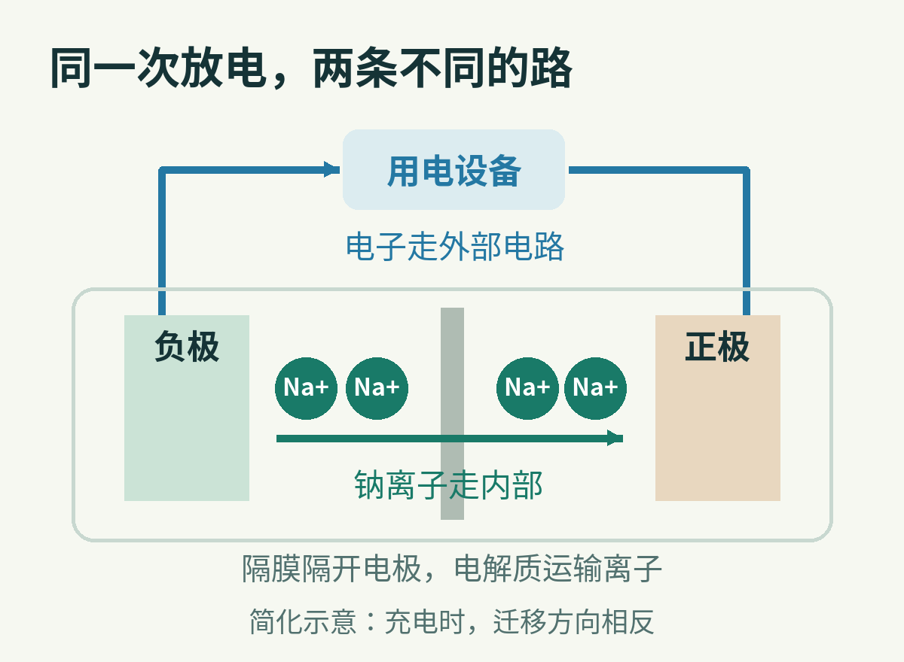
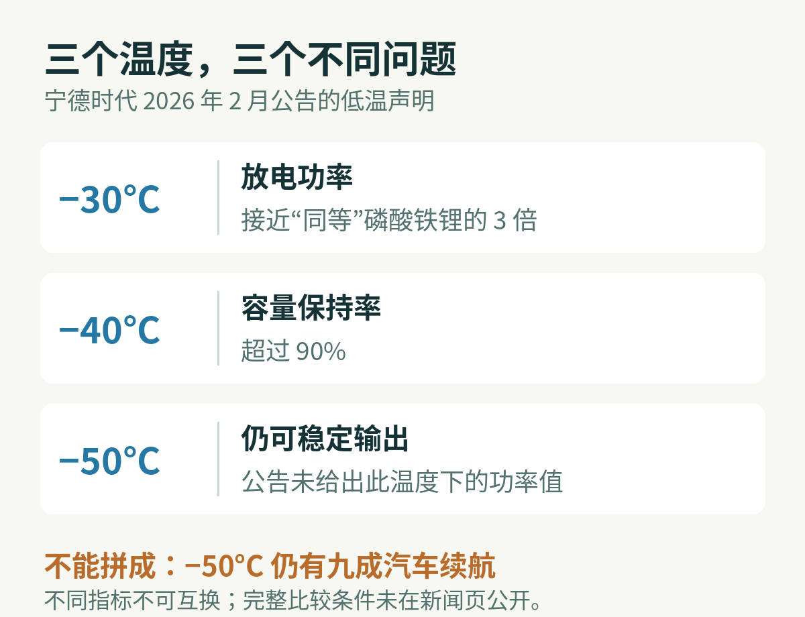
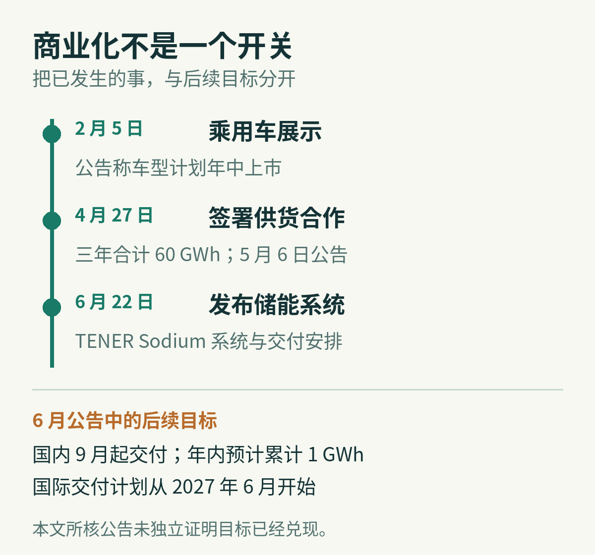

# 钠电池为什么先盯上寒冬与储能电站？

假设要买两组电池：一组装进每天背着走的设备，另一组放在院子里，白天存电，晚上放电。前者多重一点，每天都得承担；后者多占一点地方，或许还能接受。

同样是“电池好不好”，换了使用地点，答案就变了。

钠离子电池是一类可反复充电的电池。它与今天常见的锂离子电池思路相近，用带电的离子在两边电极之间往返，把电能存成化学能，再释放出来。区别在于，往返的主要载流离子换成了钠离子，容纳它的材料也要重新选择。

因此，讨论钠电池最有意思的问题，并不是“钠什么时候彻底取代锂”，而是：**哪些地方，愿意为钠的长处，接受它的取舍？**

2026 年，电池厂商宁德时代给出了两个很具体的方向：寒冷地区的汽车，以及把电存下来供电网使用的储能系统。但这两条路线走到了哪一步，需要把发布会、供货合同与实际交付分开看。

## 离子换了，整间房子都得跟着改

先打开电池的“房门”。

一只电芯里有正极、负极，以及供离子通过的电解质。隔膜把两边电极隔开，避免它们直接接触，同时允许离子通过。放电时，钠离子在电池内部从负极一侧移向正极一侧；电子则经外面的电路走过去，沿途让电机或者其他设备工作。充电时，外部电源把这个过程推回去。[美国能源部的电池说明](https://www.energy.gov/science/doe-explainsbatteries)解释的正是这种内外两条通路。

离子与电子走不同的路，外部设备才有机会取得能量。图中只画放电方向，充电时主要迁移方向相反。

这个结构意味着，电池并不是把某种元素装满盒子就成了。电极材料要能接纳离子，也要能把它交还出来；电解质要运输离子，同时尽量不与周围材料发生有害反应。

钠离子比锂离子大，合适的“住处”并不相同。锂电池常用的石墨负极，不能原封不动搬到常规钠离子体系里。许多钠离子方案改用硬碳：一种内部结构不像石墨那样整齐的碳材料。它不是随便烧出一块炭，而是要控制微观结构，让钠能够有效存入，也能再取出来。[PNNL 研究人员的硬碳研究](https://www.pnnl.gov/publications/low-defect-and-low-porosity-hard-carbon-high-coulombic-efficiency-and-high-capacity)就指出，某些缺陷会困住钠，影响第一次充放电时能收回多少电荷。

这也是“钠到处都有，所以钠电池必然便宜”跳过的一步。原料丰富，是一个好起点；把它做成纯度稳定的材料，再做成一致、耐用的电芯，是另一门生意。

2026 年 4 月 21 日，宁德时代在技术发布中列出的钠电量产难点，包括水分控制、硬碳产气、铝箔黏接和负极体系。这些问题不像能量密度那样容易变成广告里的大数字，却决定一条产线能否反复做出合格产品。公司当时说，[钠新电池将在 2026 年底进入全面量产](https://www.catl.com/en/news/6811.html)。这是进度承诺，不能倒过来理解成那天已经完成全面量产。

## 电池的“轻”，为什么到了电站就没那么贵？

谈电池性能时，常见单位是 Wh/kg，意思是每千克能储存多少瓦时的能量。它回答的是“同样重量装下多少电”，不是“瞬间能输出多大功率”。

提高能量密度，一直是钠离子路线需要攻克的问题之一。美国能源部的技术评估指出，这类体系在能量密度等性能上仍有挑战；材料组合和制造工艺的进展，会改变具体产品的位置。因此，不能只看到“钠”这个字，就替一款电池确定名次。

对汽车而言，重量和空间都紧张。电池变重，车要带着它走；体积变大，又可能挤占座舱或底盘空间。因此，提高能量密度很有价值。

对固定储能电站，问题的权重不同。电池柜不会跟着每一度电上路。只要场地、运输和安装允许，多一些重量或体积未必致命。电站更关心长期能交付多少电、途中损失多少、维修是否方便，以及建设和运行合起来要花多少钱。

这不等于电站不在乎能量密度。土地、柜体、基础施工和运输仍然要钱。区别是：它可以在更多维度上做交换，不必每次都让“更轻”获胜。

[美国能源部 2023 年的钠电技术评估](https://www.energy.gov/sites/default/files/2023-09/6_Technology%20Strategy%20Assessment%20-%20%236%20Sodium%20Batteries_508.pdf)把电芯以外的集成、功率设备、建设和运维成本一并纳入。这份早期评估不能充当 2026 年产品报价，却揭示了一个仍然重要的计算方法：**便宜的材料，不自动等于便宜的储能。**

假设两套系统买来时一样贵，其中一套每次充放电损失更多，或者更早需要换电池。多年下来，真正送出去的每度电，成本就可能更高。这是用于理解账本的假设，不是对某款钠电产品的测算。

所以，循环寿命不能只看“多少次”。还要问每次放电多深、温度如何、充放电速度多快，以及容量衰减到什么程度算寿命结束。本文引用的宁德时代 2026 年储能公告没有给出可供同条件比较的完整循环寿命测试表，不能替它补出一个“比锂长几倍”的结论。

## 为什么寒冷可能成为优势场景？

把电池搬到寒冷地区，问题又变了一次。

在电池里，能量存着，并不代表可以按需要的速度取出来。低温会使电解质中的离子运输、电极界面的电荷转移等环节变得困难，输出电压与可用容量都可能受到影响。电池还要能充回去，因此低温放电做得好，也不能直接推出低温快充同样好。

钠离子体系给研究者另一组可选的电极、电解质和界面组合。有的组合能在低温下表现突出，但这不是钠元素自带的一张“免冻通行证”。[关于低温钠离子电池的研究综述](https://www.mdpi.com/2079-4991/14/19/1604)同样讨论了低温下容量、倍率和寿命面临的限制。具体表现必须落到完整电芯设计与测试条件上。

这时再看新闻里的数字，就有了判断它们的位置。

2026 年 2 月 5 日，长安汽车与宁德时代在内蒙古牙克石展示钠离子电池乘用车。按[当时的官方公告](https://www.catl.com/en/news/6720.html)，钠新电池能量密度最高为 175 Wh/kg；低温方面，公告给出三种不同说法。

这三行是不同条件下的厂商声明，不是一项实验的连续曲线。“容量保持”也不等于汽车冬季续航保持。

在 −30°C，公告称放电功率接近其所称同等磷酸铁锂电池的三倍。磷酸铁锂也是锂离子电池的一种常见正极路线。这里比的是输出功率，不是储存的电量。

在 −40°C，公告称容量保持率超过 90%；在 −50°C，则称仍能稳定输出功率。后一个说法没有同时给出对应的功率数值。公开新闻页也没有附完整测试协议，包括各项比较所用的电流、初始荷电状态和容量基准等细节。

因此，这些数字值得关注，但还不是一次可以复算的横向评测。更不能拼成“在 −50°C 还能保留九成续航”。汽车续航还受暖风、速度、路况以及电池管理方式影响。

寒冷之所以可能成为钠电的切入口，逻辑就在这里：对每天需要在低温中出门的人，稳定拿到电，可能比常温下纸面上多装一点电更重要。这个判断解释了产品为何选择这种场景，不替任何车型保证实际表现。

## 从一只好电芯，到一座肯买单的电站

钠电的另一道门槛，是客户愿不愿意围绕它建设整个系统。

宁德时代与海博思创的合作提供了一个观察窗口。[海博思创是一家储能系统企业](https://www.hyperstrong.com/en/about-us/profile)，工作不只是买电芯，还包括把电池组织成能够交付、控制和运行的储能系统。宁德时代 5 月 6 日发布的公告说，两家公司在 4 月 27 日签署合作协议，涉及[三年合计 60 GWh 的钠离子电池供应](https://www.catl.com/en/news/6812.html)。GWh 是能量单位，用于表达这里的供货规模。

重要的不是把数字读得更响，而是看清它的性质：这是跨三年的协议，不是已经并网投运的电站容量。

到 6 月 22 日，宁德时代发布 TENER Sodium 储能系统。公司提出的设计取向里，有一项比宣传语更值得细看：让钠离子与磷酸铁锂系统共用平台和占地布局。[按其公告](https://www.catl.com/en/news/6861.html)，同一平台可兼容两种电池体系。

这背后是一种务实的公司选择。客户未必想为一种新化学体系，把熟悉的工程设计全部推倒重来；如果外部接口和布置更容易衔接，采用新电池的障碍就可能减少。这是对产品取舍的解释，并不意味着电芯可以由现场人员随意互换。

同时，公司为钠电较宽的电压变化范围配置了专用调压系统。电芯、电压转换、控制和散热必须一起工作。一个实验室里表现不错的电芯，只有进入系统后仍能稳定交付，才完成了另一半证明。

时间线上既有已发生的发布与签约，也有公告给出的后续目标。它们不能合并成一个“已经全面落地”。

6 月公告给出的安排是：中国客户首批交付计划从当年 9 月开始，全年累计出货预计达到 1 GWh，国际交付计划从 2027 年 6 月开始。本文截至 2026 年 10 月 8 日所核对的这些公告，没有提供足以独立确认上述交付目标已经兑现的记录。日期到了，并不等于任务自动完成。

## 钠要争取的，未必是同一张冠军证书

2026 年这些动向，最值得注意的变化，是钠电开始同时回答不同客户的问题。

汽车用户问：天气很冷的时候，我还能拿到多少可用的电？储能客户问：这座站在多年运行里，能稳定送出多少电？电池厂还要回答：我能否按约定的规模，持续生产质量一致的产品？

这几道题没有一张共同的排行榜。最高能量密度、最低原料价格、最好低温表现、最长寿命，也不是只要把最漂亮的数字凑到一起，就会出现在同一只电池上。

钠离子电池的机会，是在某些约束下，把这份取舍做得更合适。寒冬与储能电站值得关注，正因为它们把“合适”的标准重新排了一遍。

下一步值得等的，不只是另一场发布会的数字，而是可核对的交付、清楚的测试条件，以及足够长时间的真实运行记录。

## 参考资料

- [美国能源部：DOE Explains… Batteries](https://www.energy.gov/science/doe-explainsbatteries)。电池的离子与电子通路。
- [美国能源部：Sodium Batteries Technology Strategy Assessment，2023 年 7 月](https://www.energy.gov/sites/default/files/2023-09/6_Technology%20Strategy%20Assessment%20-%20%236%20Sodium%20Batteries_508.pdf)。钠离子体系与储能系统成本边界。
- [PNNL：钠离子材料简介](https://www.pnnl.gov/available-technologies/nanomaterials-sodium-ion-batteries)及[碳负极综述](https://www.pnnl.gov/publications/charge-storage-mechanism-performance-roadmap-toward-high-specific-energy-sodium-ion)。离子大小与石墨适配的限制。
- [PNNL：硬碳负极的缺陷、孔隙与首次库仑效率研究，2018 年](https://www.pnnl.gov/publications/low-defect-and-low-porosity-hard-carbon-high-coulombic-efficiency-and-high-capacity)。材料结构与钠储存。
- [Sodium-Ion Battery at Low Temperature: Challenges and Strategies，2024 年](https://www.mdpi.com/2079-4991/14/19/1604)。低温限制与改进方向。
- 宁德时代 2026 年一手公告：[2 月 5 日长安合作](https://www.catl.com/en/news/6720.html)、[4 月 21 日技术发布](https://www.catl.com/en/news/6811.html)、[5 月 6 日储能合作协议](https://www.catl.com/en/news/6812.html)、[6 月 22 日 TENER Sodium 发布](https://www.catl.com/en/news/6861.html)。产品数据和进度均按厂商声明处理。

资料核对日期：2026 年 10 月 8 日。配图为依据上述资料重新绘制的机制与口径示意，没有进行电池性能实测。本文使用 AI 辅助研究、写作和制图，未虚构采访或亲身体验。
