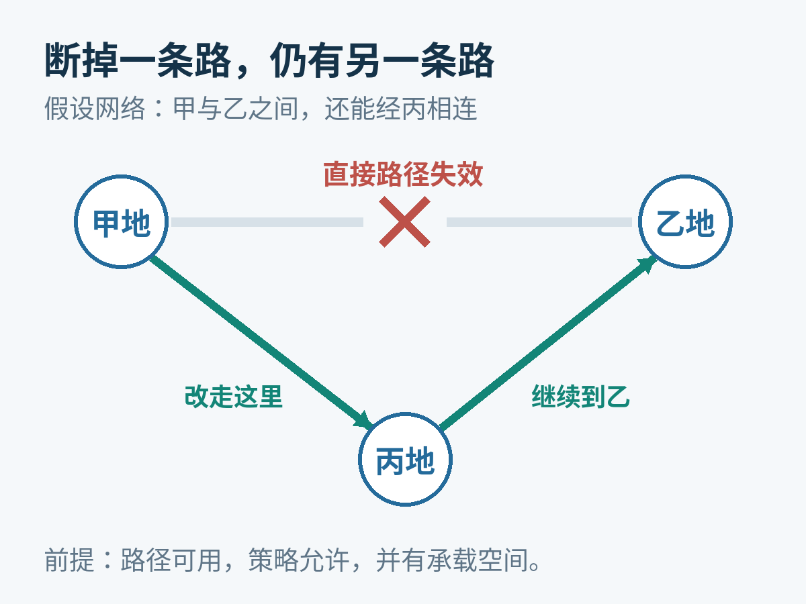
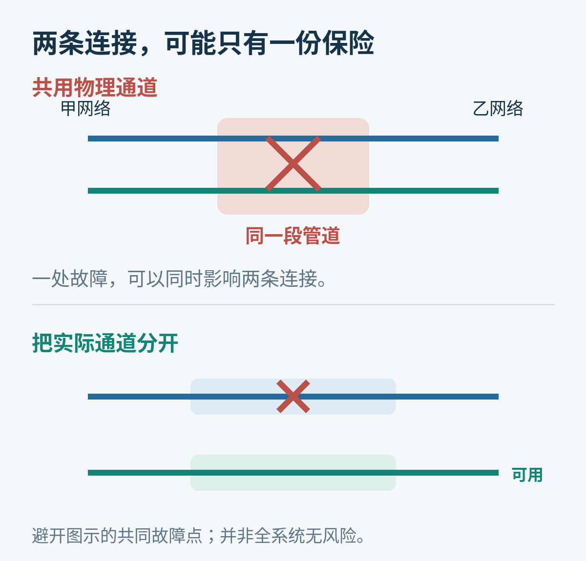
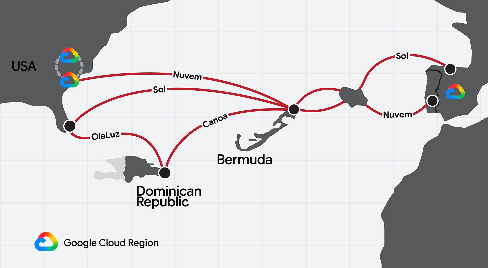
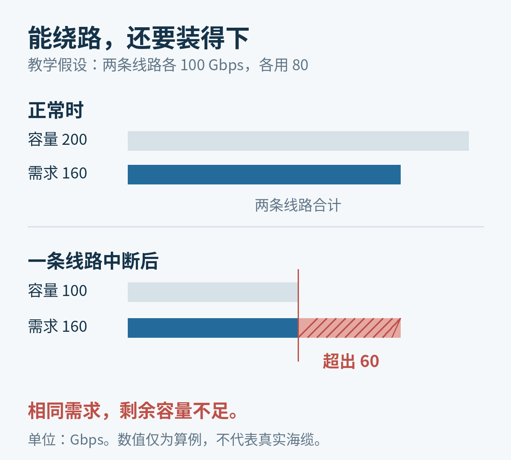

# 海底光缆断了，互联网为什么有时还能绕路？

2022 年 1 月，汤加附近发生海底火山喷发。卫星拍到的画面很快传遍世界，外界却没那么容易知道岛上的具体情况：连接汤加与外界的海底光缆受损了。

[国际电信联盟后来记录](https://www.itu.int/hub/2022/02/restoring-connectivity-tonga-internet/)，当时那是汤加唯一的对外海缆。汤加相关部门向该组织求助，最初靠的是一通卫星电话。

这和另一类断缆新闻形成鲜明对照：电缆已经坏了，很多用户却没有明显感觉。为什么同样是海底断了一根线，结果会差这么多？

海底通信光缆，是铺在海床上、连接不同陆地点的通信线路。它把数据变成光信号，送进细细的玻璃光纤，跨过海洋再接回陆地网络。它是互联网的重要物理基础，但不是一条连接全世界的总线。

**互联网能绕过的，是一条失效的路径；它不能绕出一条原本不存在的路。** 而即使另一条路存在，也未必有足够的位置，容纳突然转来的全部流量。

## 海底放着的，不是一根超长网线

光缆里的光纤负责传信号。跨洋距离很长，沿途还需要光放大器，把逐渐变弱的信号放大。两端的登陆站装有光传输设备，也提供海底放大器需要的电力。[Google 对海缆结构的说明](https://cloud.google.com/blog/products/infrastructure/are-internet-subsea-cables-susceptible-to-solar-storms?hl=en)把这些部分画在了同一个系统里。

所以，能不能通信，不只取决于玻璃有没有断。登陆站、供电和陆地接续网络，同样属于整条路径。

提高海缆能力，也不只是让光“跑得更快”。2026 年 9 月 21 日，Meta 发布了名为 Petal 的跨大西洋海缆计划，连接法国与美国，目标容量为 1 Pbps，也就是每秒 1,000 太比特，预计 2029 年投入服务。这里说的是规划中的系统容量，不是今天已经交付给某个用户的网速。

[Meta 工程团队解释](https://engineering.fb.com/2026/09/21/connectivity/petal-petabit-transoceanic-subsea-cable/)，他们选择在一根光纤里设置两个导光的“芯”，让同一根玻璃纤维拥有更多传输通道，而不是只沿用增加普通光纤数量的办法。

这是制造光纤用的预制棒，内部两条芯在照片中可见；它还会被拉成很细的光纤，并不是成品海缆的粗细。

这项选择要处理芯与芯之间的信号串扰，还要配套放大器和供电设计。它说明制造者正在努力从同一套海底设施里获得更多容量。

但“装得更多”与“断了还能走别处”，是两种不同的能力。即使一根缆里有很多光纤，一次切断整根缆的事故仍可能让这些通道一起失效。

## 数据包在哪里拐弯？

想象一个简化网络：甲地与乙地有一条直接连接，另有一条经过丙地的线路。

平时流量可以走直路。如果直路中断，而甲—丙—乙这条路径仍然可用，网络就有机会调整转发，让后续数据沿它到达乙地。这是教学示意，不对应某条真实海缆，也不是我们做过的断缆实验。

绕路发生在仍可用的网络上，不是光信号到了断口后，自己跳进旁边一根电缆。

完成这件事的方式不只一种。运营商可以在传输系统里预先安排保护路径，也可以在自己的骨干网里改变流量走向。如果变化需要传递到不同运营网络之间，BGP 这样的路由协议就会参与。

BGP 可以理解为不同网络之间交换“哪些目的地可以经由我到达”的规则。某条路变得不可用，相应信息可以撤回；设备再从允许使用的可行路径里选择。它交换的主要是网络可达性信息，不是一幅带海床经纬度的地图。[BGP 的标准 RFC 4271](https://www.rfc-editor.org/rfc/rfc4271.html)明确包含路由撤回、选择以及策略的作用。

这也解释了两个常见误会。

第一个是“互联网总会自动找到全世界最短的路”。实际上，线路之间有互联安排，网络也有自己的选路策略。地图上画着一根电缆，不代表你的运营商随时有权、也有能力把流量搬上去。

第二个是“能绕路就不会中断”。发现故障、更新转发状态和恢复应用通信，都可能花时间。已经丢失的数据不会因为找到新路而复活；采用 TCP 这类可靠传输协议的连接，还要通过确认和重传等机制补回缺失的数据。新的路径，也可能更长、更拥挤。

因此，断缆后的表现可以是完全不可达，也可以是短暂卡顿、部分服务变慢，或者对用户几乎没有影响。不能把某次顺利切换当成所有网络的共同保证。

## 画了两条线，为什么还可能一起断？

最容易误判的地方，是把网络图上的两条线，当成现实中的两条独立道路。

假设一家企业向两家供应商各买了一条跨海连接。合同有两份，网络接口也有两个，但两条服务底下，可能共用同一根海缆、同一座登陆站，或者靠岸后经过同一段陆地管道。

这个假设不是指控某家公司，而是说明：**采购关系不同，不足以证明物理风险已经分开。**

上面看起来有两条连接，却共用一段物理通道；下面把通道分开，才避开图示的同一个故障点。两种画法都不代表真实施工路线。

网络工程把这种“一处出事，几条链路可能一起受影响”的关系称为共享风险。[IETF 的 RFC 8001](https://www.rfc-editor.org/rfc/rfc8001.html)讨论的，就是如何描述共享风险链路组，帮助安排真正不同的路径。

对海缆来说，地理位置尤其重要。同一片近岸水域、同一个登陆点，可能把看似分开的线路重新绑在一起。国际海缆保护委员会这个由行业参与的组织，也把[地理分散的线路与登陆点](https://www.iscpc.org/news/media-enquiries/)列为增强网络韧性的办法。

2026 年 8 月 11 日，Google 公布 Americas Connect，新增 Alisios、Canoa、OlaLuz 三套海缆，并结合其他既有投资与新增支线。它的叙述重点不只是“再多铺几根”，还包括把线路连接成有多条路径的网络。

其中，Canoa 计划连接多米尼加共和国与百慕大，再与 Nuvem、Sol 等海缆互联，把加勒比地区接向北美和欧洲。

Google 2026 年 8 月公布的规划示意。红线展示网络连接关系，不表示图中所有项目都在公告当天投运。

[这张官方图](https://cloud.google.com/blog/products/infrastructure/introducing-americas-connect/)值得多看一会儿：不同方向的线在一些地点交汇，又通向不同的登陆点。一个岛屿可以既是终点，也是把区域接入更大网络的中转点。

不过，仅凭公开示意图还无法算出故障时能保住多少业务。图上没列出每段可用容量、具体铺设间距、客户互联安排，也没有展示完整的陆地网络。它证明的是建设者在安排哪些连接，不是一份保证永不停机的证书。

## 还有路，不等于还能像原来一样快

现在假设物理路径已经分开，切换也成功了。还剩下一个很朴素的问题：剩余道路装得下吗？

用一组刻意简化的数字来算。两条线路各有 100 Gbps 容量，平时各承担 80 Gbps 流量。总需求是 160 Gbps，总容量是 200 Gbps。

断掉一条，另一条虽然还在，容量却只有 100 Gbps。即便能够理想地重新调度，它也容纳不了全部 160 Gbps 的需求。

教学算例，非运营商实测。转移路径解决“往哪走”，备用容量解决“能走多少”。

超出的需求可能表现为排队、限速、丢包和重传，具体如何发生取决于设备与协议。图中的差额不是在宣称某条真实线路会损失多少用户流量。

这就是备用容量的价值。平时没有用满，并不一定是浪费；有些余量是在为故障后的接管做准备。当然，建设者也要为这份保险付钱，不能只把它写成一个软件开关。

因此，Meta 的高容量路线与 Google 的多路径建设，回答的是相互关联的两道题：前者尝试让线路承载更多，后者增加连接的选择。它们可以互相帮助，却不能互相替代。

## 路由可以变，海里的断口仍要有人去接

流量绕开以后，坏掉的电缆不会自行恢复。如果另一条路径再出问题，网络剩下的余地可能更小。因此，“业务恢复了”和“维修完成了”是两条不同的时间线。

[国际海缆保护委员会的维修说明](https://iscpc.org/documents/?id=142)描述了这项实物工作：岸上设备帮助定位故障，维修船驶向相应海域，借助抓钩或水下设备回收电缆，把受损部分替换、接续，再放回海床。调度船舶、获得所需许可和现场施工，都不是一条路由更新能代劳的。

也不该一看到断缆，就先假设发生了蓄意破坏。按该委员会公开的行业统计，全球每年约有 150—200 次海底通信电缆故障，其中约 70%—80% 来自意外的人类活动，主要是捕鱼和船锚。自然灾害与设备故障也是原因；具体事故仍要具体调查。

回到汤加。国际电信联盟的记录里，恢复关键通信的一步，是找到气象部门已有的卫星终端，调整指向，接入卫星带宽。对外通信不是靠一句“互联网会自动绕路”回来，而是靠可用设备、带宽与现场协作一点点重建。

卫星可以是非常重要的补充路径。那个故事证明了应急通信的价值，却不能被改写为卫星当时已经完整接替全国海缆业务。

互联网之所以有时经得住断缆，是因为有人在事故之前，把别的路铺好、接好，并留下了能接管流量的空间。它的韧性看起来像软件的灵活，最终却离不开海床上那些昂贵、具体、需要维护的连接。

## 参考资料

- [Google：Americas Connect，2026 年 8 月 11 日](https://cloud.google.com/blog/products/infrastructure/introducing-americas-connect/)。新线路及环状连接计划。
- [Meta：Inside Petal，2026 年 9 月 21 日](https://engineering.fb.com/2026/09/21/connectivity/petal-petabit-transoceanic-subsea-cable/)。系统容量、双芯选择及 2029 年投运目标。
- [Google：海缆与太阳风暴](https://cloud.google.com/blog/products/infrastructure/are-internet-subsea-cables-susceptible-to-solar-storms?hl=en)。本文仅使用其中对光纤、放大器与岸端供电的结构说明。
- [RFC 4271：BGP-4](https://www.rfc-editor.org/rfc/rfc4271.html)、[RFC 8001：共享风险链路组信息](https://www.rfc-editor.org/rfc/rfc8001.html)、[RFC 9293：TCP](https://www.rfc-editor.org/rfc/rfc9293.html)。可达性、路由策略、共同故障与可靠传输。
- [国际海缆保护委员会：媒体问答](https://www.iscpc.org/news/media-enquiries/)及[电缆与渔业说明手册](https://iscpc.org/documents/?id=142)。故障原因、地理分散与维修过程。
- [国际电信联盟：Restoring connectivity in Tonga，2022 年 2 月 10 日](https://www.itu.int/hub/2022/02/restoring-connectivity-tonga-internet/)。汤加断缆与卫星应急通信记录。

图片来源：双芯光纤预制棒图来自 Meta Engineering 的 Petal 文章，图中对象为住友电工预制棒；大西洋路线图来自 Google Cloud 的 Americas Connect 文章。其他配图为原创机制示意与明确标注的教学算例。

资料核对日期：2026 年 10 月 8 日。本文使用 AI 辅助研究、写作和制图，没有执行真实海缆故障测试，也未虚构现场采访。
