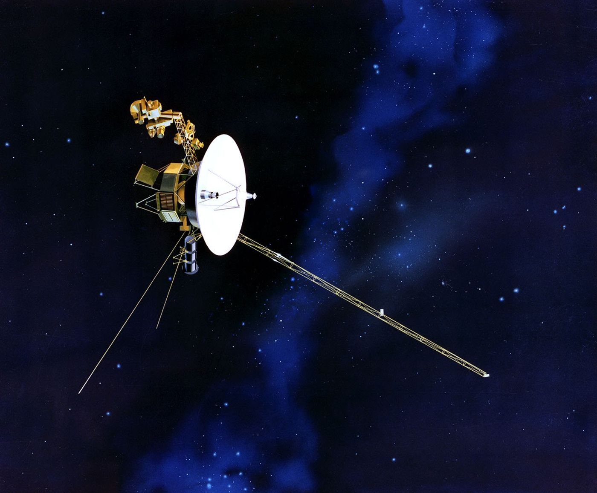
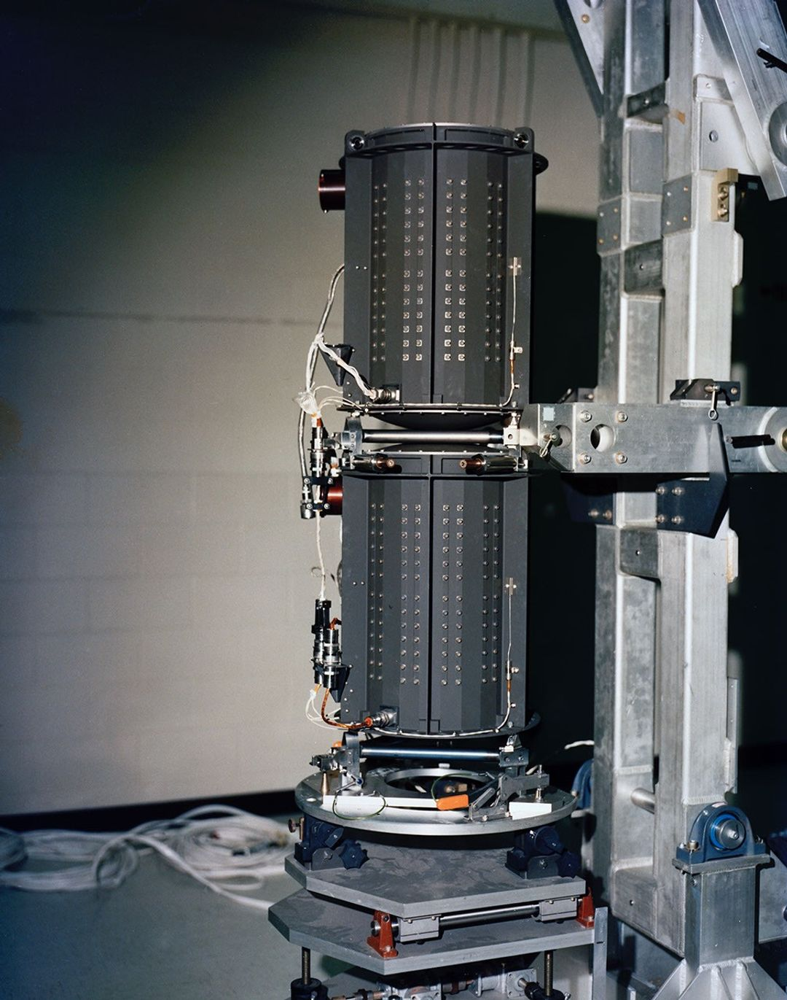
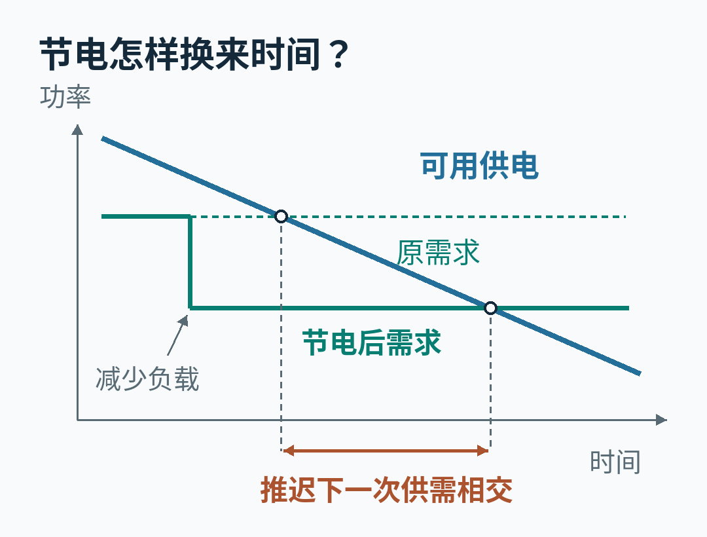

# 旅行者号怎样从电力预算里，再挤出一年？

要让一艘科学探测器继续工作，工程师有时得先让它少做一点科学。

旅行者 1 号和 2 号，是美国国家航空航天局（NASA）在 1977 年发射的两艘无人探测器。它们最初去近距离考察外行星，如今已经越过太阳风主导区域的边界，进入星际空间。它们带回来的不再主要是行星照片，而是沿途粒子、磁场和等离子体波动的测量。

2026 年 4 月 17 日，地面的任务团队向旅行者 1 号发出了关机指令。被关掉的低能带电粒子仪，已经近乎连续工作了 49 年。任务负责人 Kareem Badaruddin 在[当天的公告](https://science.nasa.gov/blogs/voyager/2026/04/17/nasa-shuts-off-instrument-on-voyager-1-to-keep-spacecraft-operating/)里解释：谁都不愿意关闭科学仪器，但这是当时维持探测器运行的最佳选择。

到了 8 月，旅行者 2 号却获得了一种不同的喘息机会。[8 月 4 日的任务公告](https://science.nasa.gov/blogs/voyager/2026/08/04/nasa-engineers-help-prolong-voyager-2s-science-mission/)确认，一套重新安排用电设备的方案已经实施成功，预计能让它的三台科学仪器额外一起工作至少一年，推迟原本在 2026 年底前就要进行的下一次仪器关停。

同一场电力危机，一边要舍弃一种观测，一边又设法保住全部现役仪器。这中间的区别，藏在一张越来越难平衡的电力预算表里。

碟形天线负责与地球通信，科学仪器则分布在机身和支臂上。这是艺术概念图，不是在星际空间拍摄的照片。

## 每年少掉的 4 瓦，意味着什么？

先把“快没电”想得准确一点。

旅行者号的电源是三台放射性同位素热电发生器，简称 RTG。里面的钚-238 在自然衰变时持续放热；热电转换部件利用温差发电，向航天器供电。这种电源可以远离阳光工作，转换过程没有需要转动的机械部件。[官方电源资料](https://science.nasa.gov/planetary-science/programs/radioisotope-power-systems/power-radioisotope-thermoelectric-generators/)解释了它的工作方式。

但是，稳定不等于永不衰减。钚产生的热量逐渐减少，转换装置的效率也会随时间下降。旅行者任务的公开资料给出的近年量级是：**每艘探测器每年可用的电功率约少 4 瓦。**

“瓦”表示的是每一刻能供应多少功率，不是一个剩余电量百分比。只要机上设备合计需要的功率高于电源当时能提供的功率，即使核燃料仍在放热，系统也会遇到麻烦。

可以把它理解成一个每年都在缩水的运行额度。通信、计算机、保持朝向的控制系统、加热器、科学仪器，都得从同一个额度里取电。关掉其中一项，能降低需求，却不能让钚停止衰变、把省下来的电存回核燃料。

旅行者任务的 RTG 硬件。电源把衰变产生的热转为电，因此发电不依赖照到航天器上的阳光。

为什么少用几瓦，就值得如此费力？

时任旅行者项目经理 Suzanne Dodd 在 [2022 年的一次访谈](https://www.nasa.gov/podcasts/small-steps-giant-leaps/small-steps-giant-leaps-episode-98-voyager/)里给过一个直观量级：一些加热器需要约 4 到 6 瓦；如果能关掉一个 4 瓦的加热器，就相当于抵消了大约一年的供电衰减。

这是一笔理解问题的近似账：在其他条件不变、供电继续按这个量级下降的前提下，少用 4 瓦，就把下一次“供不应求”往后推大约一年。它不是精确的寿命公式，更不能用来反推今年的新方案到底省了多少瓦。

供电仍在下降，节电把需求线向下移，使两条线更晚相交。这是关系示意，不是旅行者号的遥测曲线。

## 为什么不能把加热器统统关掉？

最容易想到的节电办法，是先关掉不直接产出科学数据的设备。旅行者团队早就这样做了，但“辅助设备”并不等于“可有可无”。

2019 年，团队关闭了旅行者 2 号宇宙线仪的一台加热器。这台仪器负责探测高能粒子。在[当年的任务报道](https://www.nasa.gov/missions/voyager-program/a-new-plan-for-keeping-nasas-oldest-explorers-going/)中，团队初步确认，它降到约零下 59 摄氏度后仍在返回数据，比发射前测试到的零下 45 摄氏度还低。

这件事很容易被读成“原来加热器不需要”。实际意义更窄：这台老仪器在那个温度下表现出了超出既有测试范围的耐受能力，给团队留下了一点继续工作的空间。不能据此把其他部件的温度限制一并抹掉。

特别是推进器的燃料管路。

旅行者号需要用小推进器调整朝向，让天线继续对准地球。倘若管路冻住，影响的不只是某台仪器的温度：探测器可能失去正确朝向，地面也就可能无法继续给它发指令或接收数据。2019 年的报道把这条依赖关系说得很清楚。

所以，电力预算旁边一直还有一份热量预算。降低用电需求时，必须同时确认关键位置不会冷到无法运行。少开一个设备，也可能少掉它原来提供的热量；“关掉它能省几瓦”只是问题的一半。

这就是为什么把加热器、计算机、仪器分别列成一张耗电排行榜，还不足以决定关闭顺序。工程师要保住的是能够一起工作的系统。

## 连安全余量，也要重新估价

除了关闭设备，团队还重新审视过留给保护机制的电力。

[2023 年的一次调整](https://www.nasa.gov/missions/voyager-program/voyager-2/nasas-voyager-will-do-more-science-with-new-power-strategy/)中，旅行者 2 号开始使用原先为电压保护机制预留的一小部分供电能力，把它用于维持科学仪器运行。

电压大幅波动可能损伤仪器，所以预留这部分能力本来是有道理的。启用新策略后，电压不再像原来那样受到严格调节。团队当时判断，长期飞行记录显示电气系统仍较稳定，新增风险可以接受，并继续监测电压变化。

这不是凭空“发现了一块备用电池”，也不是发电机突然变强。更准确地说，原先必须留给保护机制的份额，被允许拿来承担正常工作。

同一个安全选择，在任务早期和晚期，可能有不同答案。当科学仪器已经面临立即停机，放宽一部分保护余量也可能值得。但这需要针对具体系统的证据，不能概括成“关闭保护就能延寿”。

2023 年那篇报道还曾预计，可以把一次仪器关停推迟到 2026 年。后来实际发生的关停安排已有变化。读这类持续几十年的任务，日期很重要：旧报道里的预测，是当时做决策的背景，不能当成后来已经实现的结果。

## 关掉仪器后，为什么还留着半瓦电机？

2026 年 2 月 27 日，旅行者 1 号在一次预定的滚转动作中，出现了意料之外的电力下降。到这时，余量已经非常薄。再发生下降，就可能触发欠压故障保护，由航天器自行关闭部件；后续恢复又是一项耗时、有风险的操作。

任务团队选择抢先减少负载。

4 月决定关闭的低能带电粒子仪，英文缩写是 LECP，用来测量包括离子和电子在内的带电粒子。它与专门看更高能粒子的宇宙线仪有所重叠，但并不是同一台设备，也不是可以任意替换的一种读数。

关闭顺序也不是临时按照“哪台最费电”挑出来的。[4 月公告](https://science.nasa.gov/blogs/voyager/2026/04/17/nasa-shuts-off-instrument-on-voyager-1-to-keep-spacecraft-operating/)说明，多年前，科学和工程团队就一起商定过逐步关停的顺序；对旅行者 1 号来说，这次轮到了 LECP。

这里有一个值得停下来的细节：团队关闭了仪器，却让其中一个小电机继续转。

这个电机负责带动传感器转向不同方向，只耗约 0.5 瓦。让它保持工作，可以为将来一旦腾出更多电力、尝试重新启用仪器，保留较好的机会。**省电并不总是把一个设备彻底切断；有时要为恢复能力付一点持续成本。**

对写程序的人，可以把它类比为一次经过设计的功能降级：停止主要工作，但保留某些恢复所需的状态。不过，硬件电机不等于软件进程，这个类比只能帮助理解取舍，不能推出它以后必然能重新启动。

还有距离带来的约束。4 月公告给出的通信条件是，关闭指令要飞行约 23 小时才能到达旅行者 1 号，随后关停过程本身约需 3 小时 15 分钟。这里的 23 小时只是单程。地面不能像调试桌边的一块开发板那样，改完一个设置就立刻看到结果。

4 月的关停预计给一号争取约一年喘息时间。这一年，也是继续完善另一套方案的时间。

## “Big Bang”没有更换电源，它改了用电方式

那套方案被团队起了一个很响亮的名字：“Big Bang”。

这里没有爆炸。名字来自一次成组实施的调整：同时关闭某些通电设备，改用耗电更少的替代方式，并确保航天器仍然足够温暖，能够继续工作。

地面当然没有去几百亿公里外更换零件。公开说明描述的是对机上设备使用方式的调整。至于具体切换了哪些部件、各项省下多少瓦，[8 月公告](https://science.nasa.gov/blogs/voyager/2026/08/04/nasa-engineers-help-prolong-voyager-2s-science-mission/)没有给出足够细节，因此不能把它画成一份已经公开的接线改造图。

但结果的边界相当清楚：团队已经在旅行者 2 号上成功腾出了电力。没有这项操作，它原本需要在 2026 年底前再关掉一台科学仪器；现在，三台现役仪器预计可以额外一起运行至少一年。

**这次争取到的，是保留三种观测的时间，不是一张保证整艘航天器再活一年的保单。** 电源仍在衰减，其他老化部件也不会因为电力安排改变而变新。

一号和二号的进度不能混在一起。4 月的方案安排中，团队先选二号，因为它稍多一些电力余量，也更靠近地球，是风险较低的试验对象。到了 8 月 4 日，公告确认二号完成，而一号的相同调整仍计划在随后几个月实施。

截至本文 10 月 8 日核查，旅行者官方任务博客列出的最新相关更新仍是这则 8 月公告。本文不把一号的计划写成已经完成，也不把 LECP 的潜在重启机会写成已经恢复观测。

一号保留两台科学仪器，二号保留三台。图据 4 月 17 日更新的仪器状态表，并与 8 月 4 日任务公告核对；“Big Bang”在二号上的成功，推迟了下一次关停。

## 多保住一台仪器，多得到的是什么？

一艘探测器“还在发信号”，与“还能做哪些科学”，是两件需要分别回答的事。

[任务状态表](https://science.nasa.gov/mission/voyager/where-are-voyager-1-and-voyager-2-now/)列出的现役仪器中，两艘都有磁强计和等离子体波仪：前者测量磁场，后者探测等离子体中的波动。等离子体是含有自由带电粒子的气体；测量其中的波动，可以提供与单纯数粒子不同的信息。二号还保留宇宙线仪，继续测量高能粒子。

这些测量放在一起，才能从不同侧面描绘航天器身边的空间。关掉一台仪器，其他仪器未必会停止工作，但观测会少掉一个维度。

旅行者 1 号在 2012 年进入星际空间，2 号在 2018 年进入。它们越过的日球层，是太阳不断吹出的粒子和磁场形成的巨大区域。两艘探测器目前是人类仅有的、在这片边界之外实际运行的航天器。[任务概览](https://science.nasa.gov/mission/voyager/mission-overview/)解释了这段从行星探访到星际测量的转变。

因此，再多一年不只是让计时器上的数字继续增加。探测器会走到新的地方，也会记录环境随时间的变化。今天丢掉的那段现场观测，不能等到明年给另一台望远镜补一个拍摄任务，就原样拿回来。

旅行者团队正在做的，是一连串有代价的选择：让某台仪器承受更冷的环境，把一小部分保护余量交给科学观测，关闭一个主要功能却留住重启机会，再把若干设备一起切换到更节省的工作安排。

最值得记住的，并不是“老机器总能挤出潜力”。而是每次节省，都要回答同一个具体问题：**少用这一点电以后，温度、通信、控制和科学观测，还能不能一起成立？**

只要答案还能是“可以”，来自星际空间的下一份数据，就仍值得等待。

## 参考资料与图片出处

- [NASA 任务公告，2026 年 8 月 4 日：二号完成新的节电调整](https://science.nasa.gov/blogs/voyager/2026/08/04/nasa-engineers-help-prolong-voyager-2s-science-mission/)。本文最新进展的主要来源。
- [NASA 任务公告，2026 年 4 月 17 日：一号关停 LECP](https://science.nasa.gov/blogs/voyager/2026/04/17/nasa-shuts-off-instrument-on-voyager-1-to-keep-spacecraft-operating/)。用于关停原因、通信延迟、电机保留与后续计划。
- [Voyager 任务状态及仪器表](https://science.nasa.gov/mission/voyager/where-are-voyager-1-and-voyager-2-now/)、[航天器资料](https://science.nasa.gov/mission/voyager/spacecraft/)、[任务概览](https://science.nasa.gov/mission/voyager/mission-overview/)。用于硬件、仪器功能和任务背景；动态状态以有明确日期的更新为准。
- [2019 年电力与热管理报道](https://www.nasa.gov/missions/voyager-program/a-new-plan-for-keeping-nasas-oldest-explorers-going/)、[2023 年供电策略报道](https://www.nasa.gov/missions/voyager-program/voyager-2/nasas-voyager-will-do-more-science-with-new-power-strategy/)。用于说明此前的工程取舍，历史预测不作为当前状态。
- [Suzanne Dodd 的 2022 年访谈](https://www.nasa.gov/podcasts/small-steps-giant-leaps/small-steps-giant-leaps-episode-98-voyager/)、[RTG 工作原理资料](https://science.nasa.gov/planetary-science/programs/radioisotope-power-systems/power-radioisotope-thermoelectric-generators/)。用于每年功率衰减量级、加热器用电及电源机制。
- 旅行者号概念图：NASA/JPL-Caltech，见 8 月 4 日公告。RTG 照片：NASA/JPL-Caltech，见[硬件图片页](https://science.nasa.gov/resource/voyagers-radioisotope-thermoelectric-generator-rtg-2/)。Courtesy NASA/JPL-Caltech；按 [NASA 媒体使用指南](https://www.nasa.gov/nasa-brand-center/images-and-media/)与 [JPL 图片使用政策](https://www.jpl.nasa.gov/jpl-image-use-policy/)用于新闻与知识说明，不表示 NASA、JPL 或 Caltech 对本文的认可。
- 电力关系图和仪器对照图为本文绘制；关系图没有使用遥测数据，仪器状态来自上述公开资料。

资料核查日期：2026 年 10 月 8 日。本文使用 AI 辅助资料研究、写作和图表制作，由本文作者承担解释责任；不代表 NASA 的审阅或立场。
