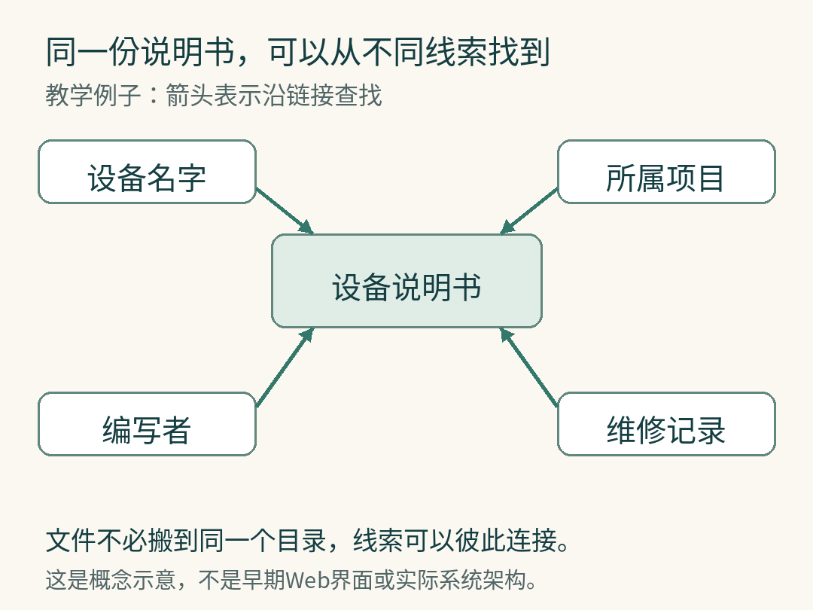

# 万维网的起点：别让知识跟着同事一起离开

一位新同事来了，想弄清楚某个项目为什么这样设计。他找到了文件，却不知道该看哪份；问到了人，才发现最熟悉那段历史的人已经走了。

这段概括，听起来像今天的办公室日常。1989年，蒂姆·伯纳斯-李（Tim Berners-Lee）在一份提案里记录的，正是这类困扰。[1]

他当时在欧洲粒子物理研究机构CERN工作。后来由他发明的万维网，就是我们用浏览器打开网页、沿链接继续阅读的那套系统。它诞生时要解决的问题，很有人情味：人来人往，知识怎样留下来，还能被下一个人找到？

## 文件留下了，线索却断了

伯纳斯-李的提案叫《信息管理：一个提案》。他观察到，CERN的合作关系远比组织架构图复杂：人、设备、软件和项目不断变化，信息有时已经记下，却找不到了。[1]

存储和找到，是两回事。

想象一份设备说明书。这是一个教学例子：按部门归档，它属于仪器组；按用途归档，它又属于实验项目。新同事可能只知道设备名字，维修的人可能只知道故障编号。目录总得挑一条路，人的问题却会从不同方向进来。

再添一个问题：这份说明书是谁写的？那个人还参与了什么项目？项目又依赖哪些设备？

如果每走一步都要退出当前目录、重新找人，文件再齐全，知识也像被拆散的拼图。

伯纳斯-李提出用链接组织信息。用今天的语言说，就是让一份资料能指向另一份资料，让人可以沿着关系走下去。[1]

从设备、项目、编写者或维修记录，都可以找到相关说明书。

我们现在觉得链接平常，是因为已经习惯了这种便利：读到一个名字，点进去；遇到一种工具，再点进去。读者不必先学会作者把所有资料放在哪个柜子里。

## 先让它工作，再让别人也用得上

到1990年底，第一台Web服务器和第一个浏览器已经在CERN运行。服务器是提供网页的那一端，浏览器是取来并显示网页的那一端。伯纳斯-李在自己的NeXT电脑上写程序，也用它托起最初的网站。[2]

这台电脑上有一张红字手写提示。CERN的历史介绍保留了那句话：“This machine is a server. DO NOT POWER IT DOWN!!”意思是：这是服务器，别关机。[2]

[查看 CERN 原站的 NeXT 电脑照片](https://home.cern/science/computing/the-birth-of-the-web/short-history-web/)（© CERN；该照片未收录在公开仓库中）

承载早期Web服务的NeXT电脑，机箱上仍能看到提醒不要关机的贴纸。照片请在原站查看，贴纸文字见正文。

这个细节很可爱。今天再宏大的网络，在那个时刻也需要有人提醒路过的同事：这台机器还在为别人干活。

不过，能在自己的电脑上跑起来，还不等于别人用得起来。

最初的浏览器运行在NeXT电脑上，可这种机器并不是人人都有。CERN的学生实习生Nicola Pellow编写了更简朴的行模式浏览器，帮助这套系统走向不同计算机。1991年8月，伯纳斯-李在互联网新闻组里介绍了WWW软件。[2]

这里有一个容易忽略的先后关系：互联网已经存在。万维网把网页和链接带到这张网络上，并不是凭空造出了整个互联网。

也因此，Web能否扩展，取决于另一种能力：不同的人能不能各自做自己的那一部分，最后仍然连得起来。

## 1993年的签字，给了后来者什么

1993年4月30日，CERN把一组Web软件放入公共领域。签署相关文件的是时任研究主任Walter Hoogland和行政主任Helmut Weber。[3]

这不是“伯纳斯-李一个人把全世界的网页送给大家”的传奇。CERN列明的范围，是基本行模式客户端、基本服务器，以及通用代码库。[4]

这一区分很重要。一个网页所写的文章、所用的照片，仍然可能受版权保护；开放基础软件，也不会让网络服务的机器和运营成本消失。

真正得到放行的，是使用、复制、修改和分发这组软件的空间。[3][4]

不妨把自己放在当时一个想尝试Web的开发者位置上。技术上，他需要知道怎样让程序工作；制度上，他还需要知道能不能改、能不能发给同事、能不能据此继续做东西。

后面这些疑问如果没有答案，代码即使摆在眼前，也未必敢用。明确的开放安排，减少的是参与者反复征求许可的障碍。这是本文对这次选择的理解，不是对“如果当年收费会怎样”的历史实验。

Web后来的扩展当然还有其他条件。好用的浏览器、越来越多的信息，以及愿意加入的开发者，都参与其中。把全部成功归于一纸文件，会让真正的协作过程再次隐身。

## 开放，也需要认真写下规则

故事并没有在“免费”两个字上结束。

1994年，接手CERN Web技术团队的François Flückiger与法律部门讨论后，选择为新版服务器软件采用开放许可：CERN保留版权，允许免费使用和修改，并要求保留归属声明。[4]

这不是把1993年的决定简单收回。它说明“让大家放心使用”还需要可以传递、可以遵守的规则。拿到一份副本的人，应当知道自己有哪些权利，也知道哪些义务会跟着副本继续走。

从这个角度再看最初的提案，前后两段故事恰好接得上。

链接在回答：你怎样从手头的信息，找到另一个人的知识？

开放安排在回答：你找到这套工具以后，能否接着使用、修改和建设？

一个处理信息之间的连接，一个处理参与者之间的信任。它们都在减少一种等待：等别人来告诉你路怎么走。

今天，我们未必需要再发明一个万维网。但在写项目说明、留下来源链接、说明软件如何使用的时候，仍会面对同一道小题：后来的人，能不能少猜一步？

伯纳斯-李当年看见的麻烦，并没有随着浏览器的普及而消失。我们只是终于有了一种更好的工具，去接住那些本来可能随人离开的知识。

## 延伸阅读

[1] Tim Berners-Lee：[1989年信息管理提案](https://www.w3.org/History/1989/proposal.html)。本文概括其问题意识与链接思路，不复刻原文图示。

[2] CERN：[A short history of the Web](https://home.cern/science/computing/the-birth-of-the-web/short-history-web/)。包括早期服务器、浏览器与1991年软件传播记录。

[3] CERN：[30 years of a free and open Web](https://home.cern/30-years-free-and-open-web/)，2023年4月30日。可在原页面查看1993年签署文件。

[4] CERN：[Licensing the Web](https://home.cern/science/computing/the-birth-of-the-web/licensing-web/)。说明1993年软件范围与1994年许可变化。

本文为历史主题原创解读，资料核对截至2026年10月8日。AI辅助资料整理与写作；文中归档场景及关系图为教学示意，未虚构人物对白或内心活动。

## 图片署名与用途

素材：© CERN；https://home.cern/science/computing/the-birth-of-the-web/short-history-web/；CERN educational and informational media terms https://copyright.web.cern.ch/

CERN 照片依[原站媒体条款](https://copyright.web.cern.ch/)提供查看链接；公开仓库不保存、转供该图片，也不向读者授予再使用权。原创关系图随文保留。
