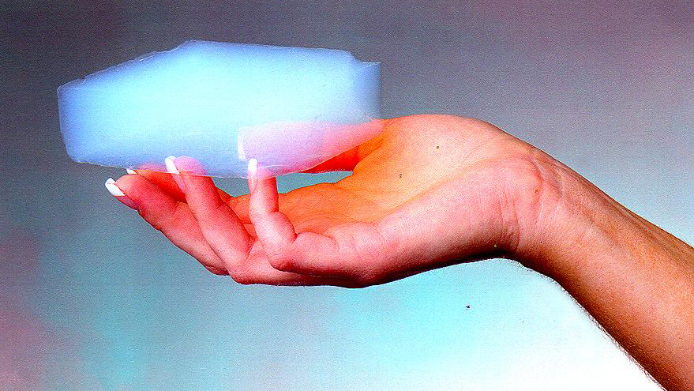
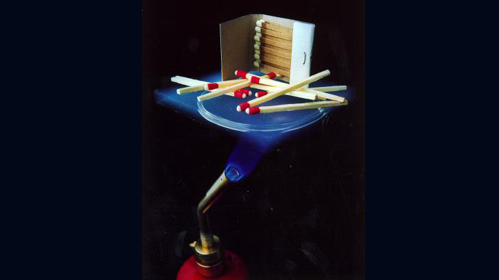
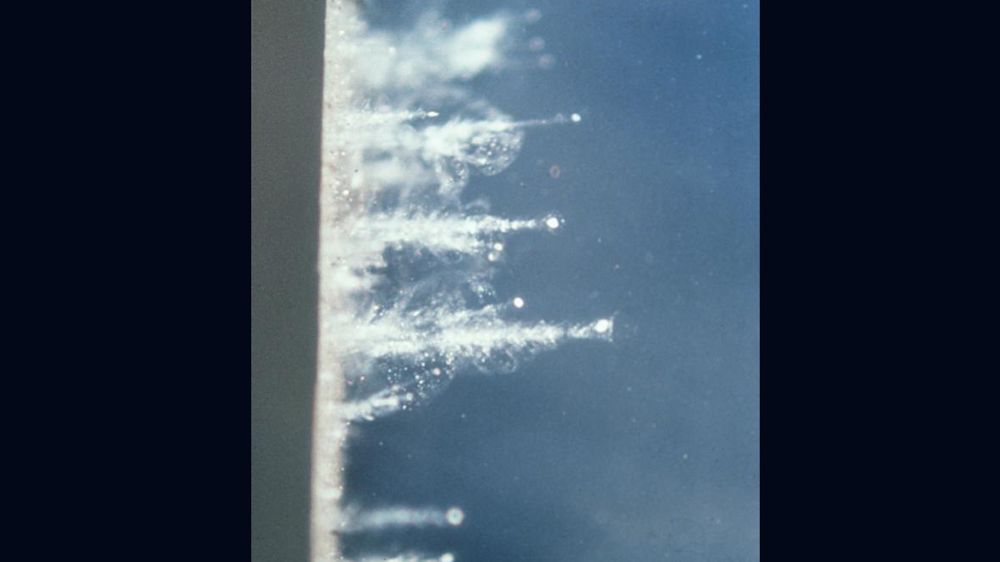
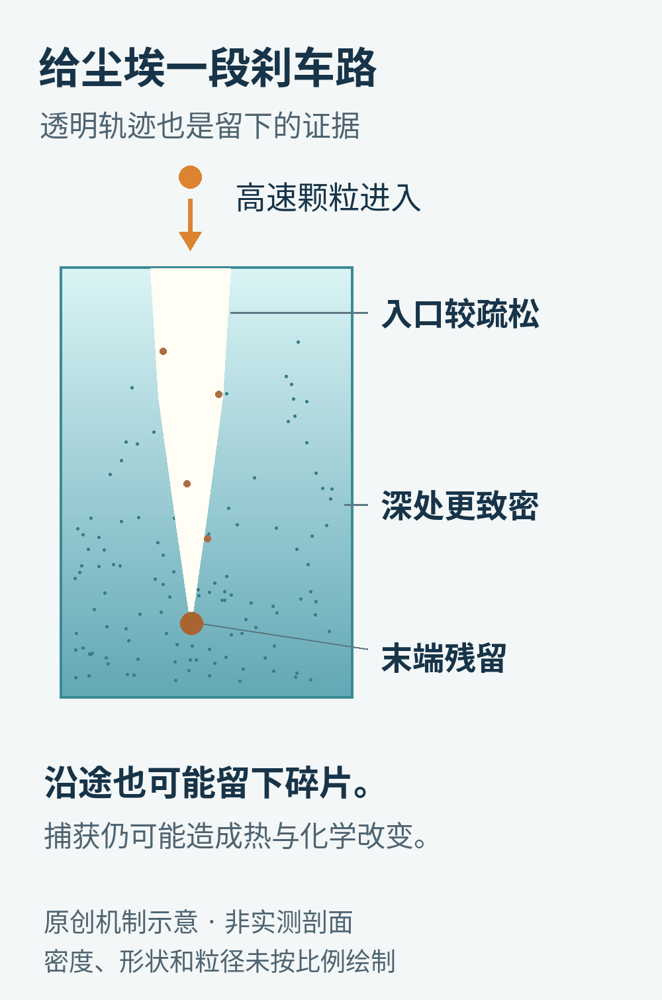
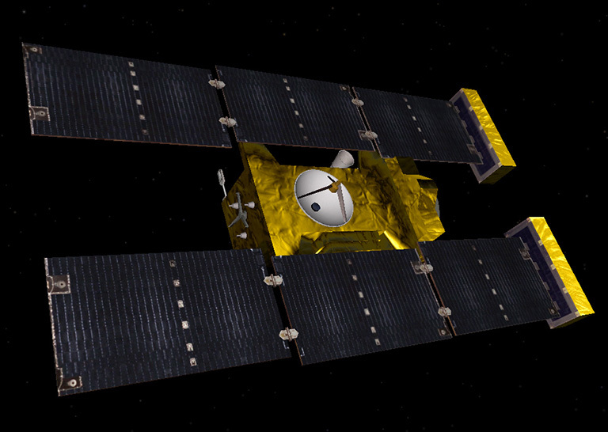
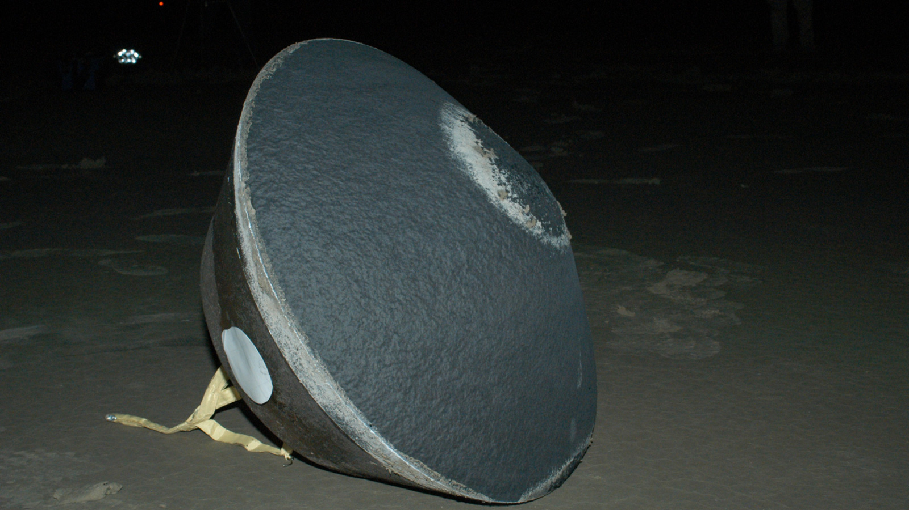
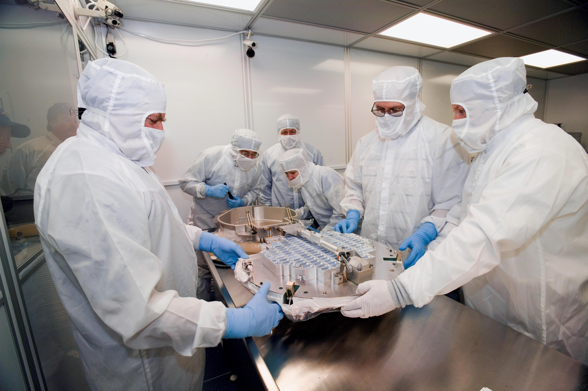
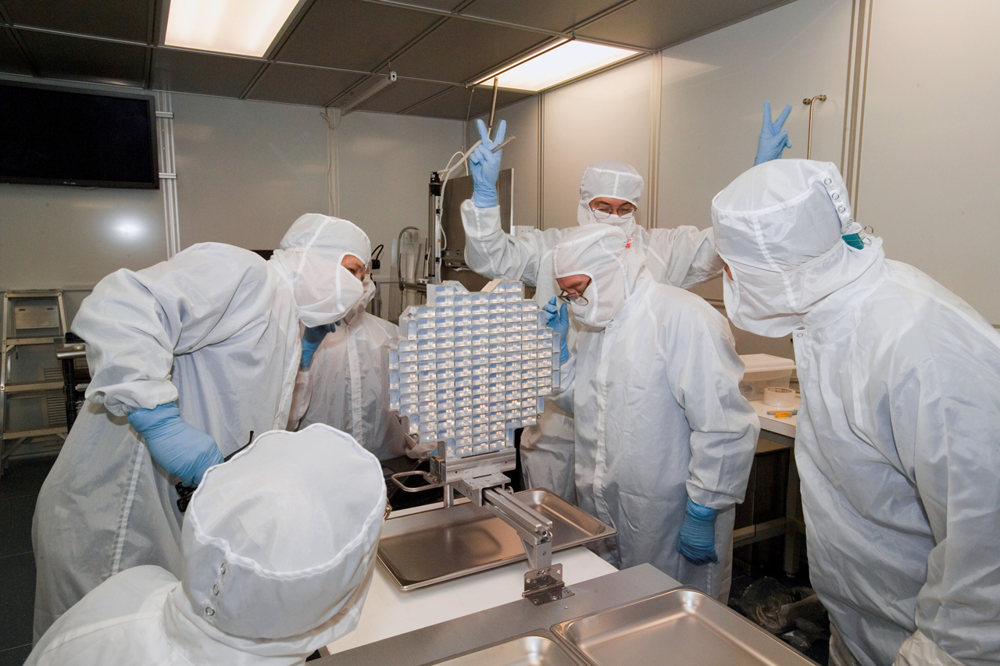

# 一块几乎空的“玻璃”，怎么接住每秒6公里的彗星尘？

把一粒灰尘留在桌面上，很容易。让它以每秒约6公里的速度飞来，再把它收进一个盒子，事情就完全变了。

这样的一次相遇，可能让灰尘破碎、熔化，甚至变成气体。可科学家偏偏想把它带回地球：他们要研究的是灰尘原本的矿物和化学成分，不能只收到一次撞击留下的焦痕。

2004年1月2日，NASA“星尘”号（Stardust）飞越维尔特2号彗星附近，收集从彗星逸出的尘粒。它没有伸出坚硬的铲子，而是打开了一块看起来像烟、摸起来却有固体骨架的材料：气凝胶。2006年1月15日，这批样本随返回舱降落在美国犹他州。[1](https://science.nasa.gov/mission/stardust/)

这是一篇关于已完成任务的技术回看。理解它的关键，不在“材料有多硬”，而在于怎样给一粒高速尘埃安排一条足够温和的刹车路。

气凝胶可以像一小团蓝色烟雾，但这团“烟”有固定形状。照片中的手也给出了它的直观尺度。

## 名字里有“胶”，为什么看起来像玻璃？

气凝胶不是一种唯一的化学物质，更不是装在瓶子里的气体胶水。这个名字描述的是一类结构：由很少的固体构成疏松网络，网络之间有大量孔隙。

星尘号使用的是二氧化硅基气凝胶。二氧化硅也是玻璃的重要成分，但把一片普通玻璃和气凝胶放在一起，差别不主要来自化学式，而来自内部怎样“搭架子”。

一块实心玻璃的大部分空间被固体占据；气凝胶更像一座极其稀疏、细密的立体脚手架。JPL在2002年介绍这项技术时，用99.8%的体积为空隙来展示某种超低密度气凝胶的特点。[2](https://www.jpl.nasa.gov/news/ideas-that-gel/) 这个数字不代表每一种气凝胶，更不能直接当成星尘号每一层收集材料的统一密度。

“几乎空”也不等于“什么都没有”。正是那一点连续的固体骨架，让整块材料能保持形状、被固定在金属格子里，也让闯进来的尘粒不断遇到阻力。

同样的多孔结构还让它适合隔热：热量沿固体传导的路径少了，孔隙中的气体运动也受到限制。但隔热能力并非无限，材料的配方、密度、厚度与使用环境都重要。不能从一张展示照推导出“任意温度下都能保护东西”。

JPL的隔热展示照片：火焰在气凝胶下方，火柴放在上方。这说明材料的一个用途，不是可照搬的家用防火安全试验，也不是星尘号收集尘埃的现场。

## 尘粒这么小，为什么还需要刹车？

日常经验容易把“小”和“没什么破坏力”连在一起。但撞击带来的问题，还取决于速度。

动能随速度的平方增长。保持质量不变，速度翻倍，动能就变为四倍；需要停下的距离如果很短，能量也只能在很短的路程里释放。这是这里用到的基本力学关系，并非星尘号某个试验的拟合曲线。

把鸡蛋接进手里时，人会顺着运动方向稍微向后收手。鸡蛋最终仍停下了，但减速过程被拉长，瞬间的受力减轻。这种直觉能帮助理解气凝胶的任务：尽可能把“撞在一堵墙上”，改造成“穿过一段逐渐阻拦它的路”。微米尘粒的高速撞击还有破碎、升温和材料相互作用，不能把接鸡蛋的比喻当作完整物理模型。

星尘号尘粒相对收集器的撞击速度约为6.1公里/秒。[3](https://doi.org/10.1111/j.1945-5100.2012.01347.x)、[3·2](https://arxiv.org/abs/2307.02014) 人们并不是想用一块神奇材料取消这些动能，而是想让它以尽量不毁掉科学信息的方式耗散掉。

## 入口轻一点，深处再多拦一点

星尘号收集器中的气凝胶做成了密度梯度：面向来流的一侧密度较低，往里逐渐变高。[2](https://www.jpl.nasa.gov/news/ideas-that-gel/)

这种安排有一个清楚的目的。粒子刚到时速度最高，先让它遇到较少的固体；深入之后，它已经损失了部分能量，再用较密的材料继续减速。如果入口就是一块致密硬面，第一次接触便可能非常剧烈；如果始终太稀，粒子又可能不能在有限厚度内停住。

粒子经过的地方，会留下细长或鼓胀的轨迹。较结实的颗粒可能形成像胡萝卜一样的长痕；松散团聚体则可能碎开，留下更复杂的结构。星尘号首席研究员Donald Brownlee在2005年的任务访谈里，就强调了不同轨迹能透露颗粒强度和结构的线索。[4](https://www.jpl.nasa.gov/audio/stardust-heading-home/)

气凝胶中的穿入痕迹。它们展示的是粒子在材料内留下的路径，不是把几千公里的航天器轨迹缩小塞进一块玻璃。

这里还有一个经常被略过的细节：透明很有用。

假如收集材料完全不透明，科学家即使知道里面有颗粒，也得先想办法找它，挖的过程中又可能损坏周围证据。气凝胶让显微镜能够沿着轨迹寻找残留物，许多科学信息就藏在路径和终点的关系里。

原创机制示意，非实测剖面、未按比例绘制。粒子与气凝胶相互作用时可能破碎、烧蚀或散布在轨迹沿途；末端的一颗粒子不一定代表最初来访者的全部。

## 一副“网球拍”，为什么有两面？

实际收集器看起来有点像网球拍：一块带网格的金属框架，里面填着一格格气凝胶。这样做既方便支撑脆弱的材料，也便于后续给不同样本区域编号。

星尘号有两个不同的采样目标。一面在飞越彗星时面向彗星尘埃，另一面在任务的其他阶段收集候选星际尘埃。航天器通过姿态与采集时间的安排，让不同来路的颗粒尽量进入相应的收集面。[2](https://www.jpl.nasa.gov/news/ideas-that-gel/)

“彗星尘”和“星际尘”不能混为一谈：前者有一个明确的近期来源天体，后者需要结合轨迹、成分等证据，判断它是否来自太阳系之外。进入同一台航天器，不会自动赋予每一颗尘埃相同的身世。

星尘号的官方概念图。它展示的是航天器整体外形，不是在飞越彗星时拍到的外部照片。

飞越后，收集器要折回样本舱，封存好，再经历回程。回到地球的只是样本返回舱，主航天器并没有随它一同烧进大气层；主航天器后来还执行了另一次彗星飞越任务。[1](https://science.nasa.gov/mission/stardust/)

## 把样本带回来，只完成了一半

返回舱落在犹他州的试验与训练场后，样本被送往约翰逊航天中心处理。[5](https://www.jpl.nasa.gov/news/nasas-stardust-sample-return-was-10-years-ago-today/) 整件事并不是打开盖子，把一把漂亮砂粒倒进盘子里。

2006年1月15日，犹他州现场的星尘号样本返回舱。它把飞越彗星时获得的材料带回了地面实验室。

细小颗粒可能在轨迹末端，也可能有物质沿途散落。研究人员需要定位、记录，再把包含目标和轨迹的一小块气凝胶取出。为此发展的“keystone”取样方式，可以把完整的撞击轨迹装进一块小体积气凝胶里，尽量减少对旁边收集材料的破坏。[6](https://arxiv.org/abs/astro-ph/0312460)

可以把它想成考古时连同周围土层一起取走一件易碎物，但这里的“土层”也要进入科学分析。孤立地挑出一颗亮晶晶的颗粒，可能丢掉周边那些告诉我们它如何碎裂、损失了什么的线索。

约翰逊航天中心的真实检查场景。圆形、分格的收集器与周围人员形成尺度对照；研究对象很小，保存和定位它的设备却不能省。

## “软着陆”，并不保证原样无损

2002年的任务前介绍，曾用非常乐观的说法描述气凝胶会保存颗粒原本的形状和化学成分。任务完成后，研究者已经能更仔细地说明这件事的边界。

高速捕获仍会改变一些样本：颗粒会烧蚀、破裂，易挥发成分可能损失，气凝胶自身也可能参与反应。2012年发表的一项研究，结合三维轨迹成像和X射线荧光分析，尝试估计原始撞击颗粒的性质以及损失的物质。[3](https://doi.org/10.1111/j.1945-5100.2012.01347.x)、[3·2](https://arxiv.org/abs/2307.02014) 它恰好说明，“看见留下来的东西”与“知道来时全部是什么”之间，还有一段推断距离。

另一个问题是污染。研究地外有机物时，最怕的是把地球上或收集器中本来就有的东西误认成彗星带来的。2010年的污染评估论文检查了多种可能来源，指出原始气凝胶中的碳及其在撞击中的变化需要特别处理；研究人员通过材料对照、组成和同位素等线索加以区分。[7](https://www.nasa.gov/wp-content/uploads/2019/09/sandford_et_2010.pdf)

同位素可以粗略理解为同一种元素的不同“重量版本”。它们的比例有时能为材料的经历提供线索，但也不能跳过其他证据，见到一个异常数字就宣布发现了生命。

因而，好的采样材料有两项责任：尽量留下原物；让研究者有办法理解自己改变了原物的哪些部分。气凝胶的透明轨迹，正好同时服务了这两件事。

## 一粒尘埃，怎么改变对彗星的看法？

样本带回后，一个重要收获是：寒冷彗星里的固体，并不全是一直待在低温环境里的原始颗粒。

JPL在2016年的十周年回顾中，介绍了样本中高温形成矿物所带来的图景：早期太阳系的材料曾在不同环境之间迁移、混合，最后进入彗星。[5](https://www.jpl.nasa.gov/news/nasas-stardust-sample-return-was-10-years-ago-today/) 所以，把彗星叫作“古老冰箱”可以建立第一步直觉，但不能以为冰箱里的每一种材料都在那里诞生。

NASA任务页中的团队照片。举起胜利手势的是星尘号首席研究员Donald Brownlee；原图注还列出Mike Zolensky、Friedrich Horz和Peter Tsou。这里记录的是样本归来的真实时刻。

一份返回样本的价值，也不只兑现于第一篇论文。航天器能带哪些仪器出门，会受质量、电力和飞行时间限制；样本进入地面收藏后，研究者却可以随着分析方法进步，重新向它提问。当然，每一次可能消耗样本的实验都需要谨慎安排。

这使气凝胶的意义超出了“抓到一粒灰”。它把原本只会从探测器前掠过的瞬间，变成了可以多年检查的一份实物证据。

一块看起来几乎没有东西的材料，最重要的本领，是给高速来客留出一段距离，也给后来的科学留下继续追问的余地。

图片来源：[气凝胶](https://www.jpl.nasa.gov/news/ideas-that-gel/)与[航天器、团队](https://science.nasa.gov/mission/stardust/)，Courtesy NASA/JPL-Caltech、NASA；[返回舱](https://www.jpl.nasa.gov/news/nasas-stardust-sample-return-was-10-years-ago-today/)，NASA；[收集器](https://science.nasa.gov/photojournal/inspecting-a-canister-and-sample-collector/)，NASA/JSC。中文示意为本文原创。
