# 沉船里有一台两千年前的计算机：它用齿轮，把时间推向未来

它看上去像一块被海水咬坏的石头。绿褐色的表面凹凸不平，几层薄片黏在一起；靠近了看，才发现边缘露出的不是裂纹，而是一圈整齐的齿。

这就是安提基特拉机械的残片。一台古希腊人制造的天文计算装置：把日期往前转，太阳、月亮和其他天体的显示便跟着改变，还能查出某些月份可能发生的日食、月食。没有电，也没有软件，计算关系藏在青铜齿轮里。

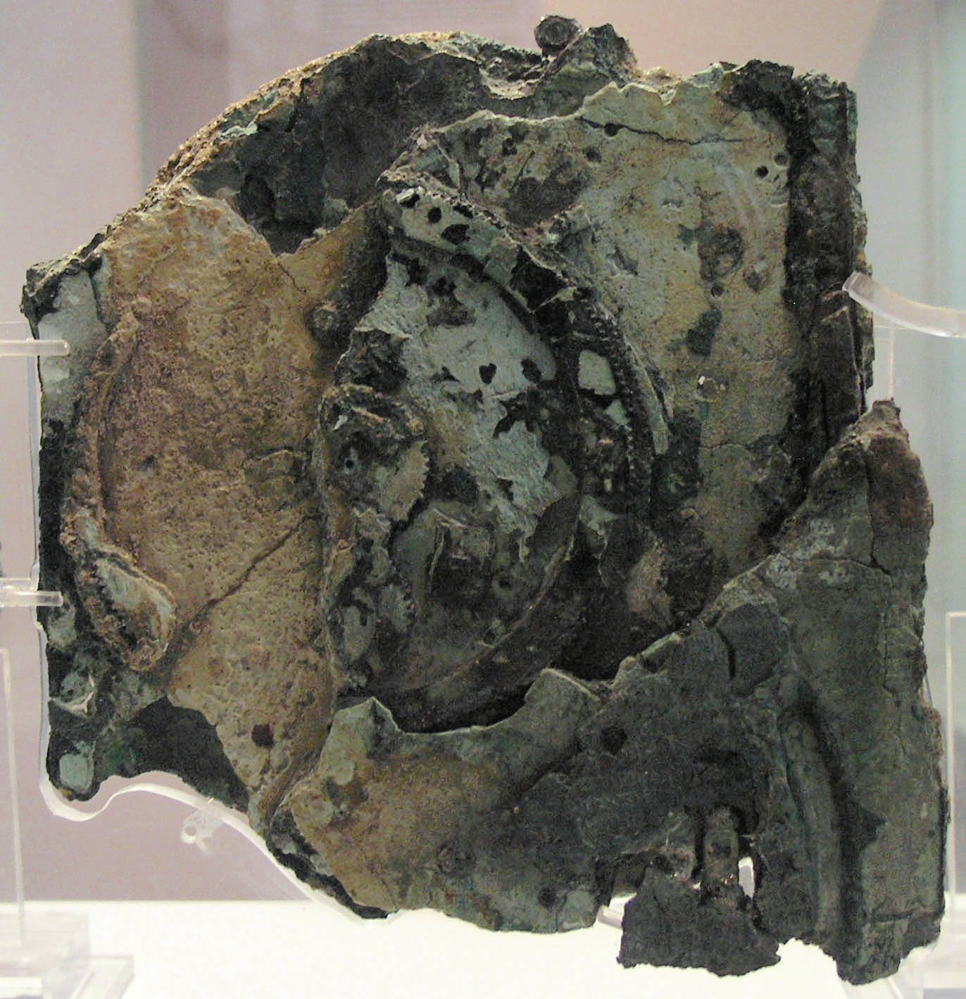

A残片背面，现藏雅典国家考古博物馆。齿轮已无法像原来那样运转，叠在一起的结构却保留下来。

1900—1901年，希腊海绵潜水员参与了安提基特拉岛附近沉船的打捞。那艘船大约在公元前75年至前50年间沉没，船上有雕像、珠宝、玻璃器皿，也有这件后来不断改写人们认识的机械。博物馆将装置的制造年代放在公元前2世纪；准确的制造时间与制作者，仍不能从现存证据中锁定。

安提基特拉岛的波塔莫斯港。机械以发现它的岛屿命名；照片展示当地地貌，并非沉船打捞现场。

两千多年后，留下的是82块残片、30个可辨认的齿轮，以及大约三分之一的原装置。研究者的任务很像接到一个极端的维修项目：机器坏了，零件少了大半，图纸没有，说明书还压在锈蚀的金属里面。

但理解它最迷人的部分，并不必先破解每个残片。我们可以从一个问题开始：**齿轮只会转，为什么它能预报天空？**

## 先把一个分数，做成两只轮子

设想两只啮合的齿轮，大轮24齿，小轮12齿。大轮转一圈，24个齿依次经过接触处；小轮必须接完这24个齿，因此转两圈，而且方向相反。

这不是大轮“告诉”小轮一个数字。两只轮子的形状，已经把“乘以2”做成了约束。

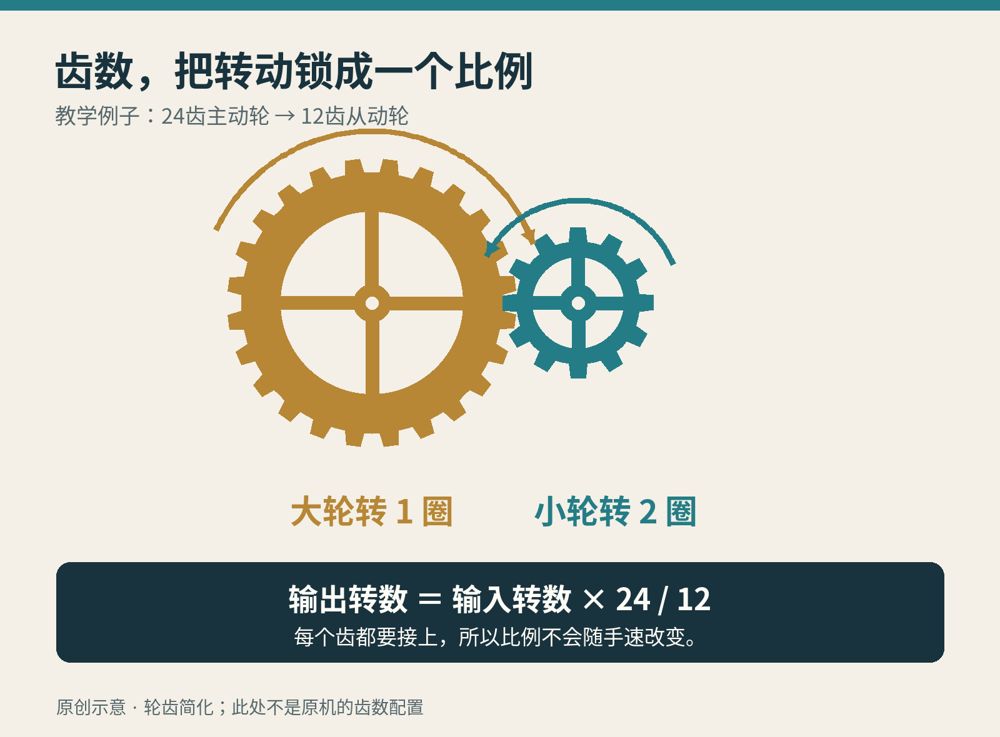

原创教学示意：只演示齿数与转数的关系，齿形经过简化，不是安提基特拉机械的具体齿轮复原。

再让第二根轴上的另一只齿轮驱动下一根轴，比例就能接着相乘。若第一段让转速变成2倍，第二段变成三分之一，最后得到的便是原来的三分之二。复杂的分数，可以拆成几段适合制造的小整数关系。

只要给第一根轴的转动一个含义，例如“这一段转角代表一年”，输出轴的角度就不再只是角度，而能代表另一个周期走到了哪里。

要让它对应真实日期，还得先把输入与显示对准一个已知的起点。齿数规定的，是从这个起点往后，它们怎样一起变化。

安提基特拉机械的本事正在这里：**输入的是人为推进的时间，内部传递的是比例，输出的是天文模型在那个时刻给出的结果。** 它不是等到未来自己到来才走到那一格；人可以把它先转过去。

叫它“计算机”，指的是这种用机械执行计算的能力。它是为天文问题制造的专用装置，不能像今天的电脑一样随意换个程序去处理照片或写文章。

## 太阳过了一年，月亮为什么没有刚好走完十二个月？

我们最熟悉的两个周期，并不整齐地咬合。

从一次新月到下一次新月，平均约29.53天。十二次这样的月相循环，约354天，比一个太阳年短约11天。若历法永远一年只放十二个月，同一个月份就会逐渐滑向另一个季节。

古代天文学家知道一个很好用的近似：**19个太阳年，差不多等于235个朔望月。** “朔望月”就是这里从新月回到新月的周期。这一关系通常称为默冬周期。

十九年每年先放十二个月，只得到228个月；再加入七个月，就得到235个月。它让按月亮计数的历法，能够长期跟上季节。

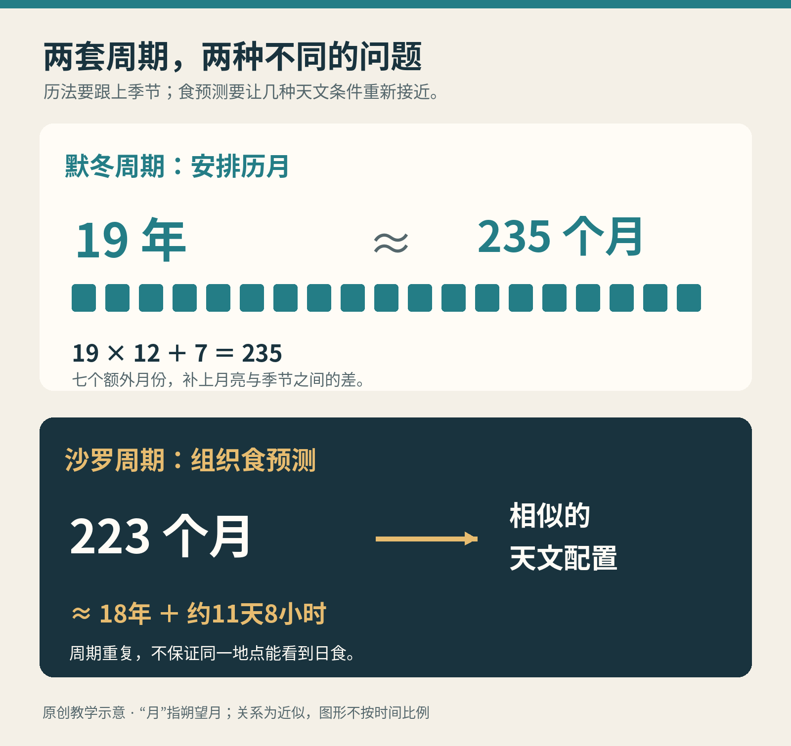

两种周期回答不同的问题：235个月把历月与季节重新接近；223个月把食发生所需的几种天文条件带回近似重复。它们不是同一张表。

装置背面的上方大表盘，把235个月排在五圈螺旋上。螺旋的好处很朴素：同一块板面上，能放下比单圈更多的月格。转动装置，指针便沿着这份历法推进。

另一件事也值得分开：月亮在星空中到了哪里，与它今天是满月还是新月，并不是同一个问题。月相取决于太阳与月亮的相对方向；因此，机械不仅要表示各自的位置，还要从两者的相对运动中取得月相。重建中的黑白小球，就把这个关系变成了可见的圆缺。

齿轮在这里没有发现自然规律。人先从观察中找到周期，再把周期写进齿数与传动关系。机器使这份知识能够被反复调用。

## 预报一次食，需要让几只“钟”重新相遇

如果每次新月都是月亮来到太阳那一边，为什么日食不月月发生？

因为月亮的轨道平面相对地球绕太阳的轨道平面倾斜了约5度。多数新月时，月亮会从太阳方向的上方或下方错过。除了月相合适，还得接近两个轨道平面的交线，才可能形成食。

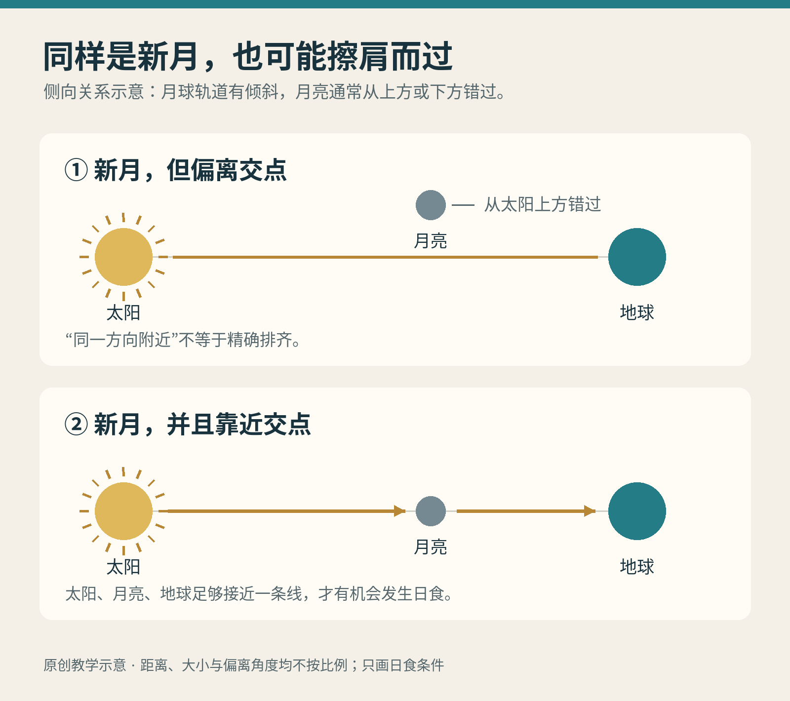

原创教学示意，角度和尺度均有夸张。上图表示新月时从太阳方向附近错过；下图表示接近交点时，三者才可能排齐。

[沙罗周期](https://eclipse.gsfc.nasa.gov/SEsaros/SEsaros.html)把几种循环联系起来：经过223个朔望月，月相、月亮接近交点的位置，以及它离地球远近的状态，都大致回到相似组合。这个间隔约为18年又11天8小时，具体跨越的日历天数还受闰年分布影响。

安提基特拉机械背面下方的大表盘，就是一个223个月的四圈螺旋。某些月格带有食的符号及时间等信息。它不是宣称“每隔223个月才发生一次食”，而是用一个周期组织一整套可能发生食的月份。

可以把它理解成机械驱动的天文查表：齿轮负责把输入的时间送到相应位置，刻在表盘上的符号负责告诉使用者该读出什么。

但“天象重复”也不等于“同一地点再看一遍”。多出来的约8小时，让地球又转了约三分之一圈，下一次日食的可见地区会明显移动。装置另有一个覆盖三个沙罗周期的小表盘，用来给食的时刻加上0、8或16小时的修正。它的预测能力很惊人，却不能被说成一台随时能报出任意城市日食路径的现代软件。

## 锈蚀里面，居然还藏着说明书

今天能说到这个程度，靠的不只是猜齿轮。

2005年的微焦点X射线计算机断层扫描，让研究者能够在不拆开残片的情况下，一层层观察内部结构；配合表面成像，许多被腐蚀层遮住的细小文字也重新显现。刻字谈到周期、历法和显示方式，像是从机器腹中找回了部分使用说明。

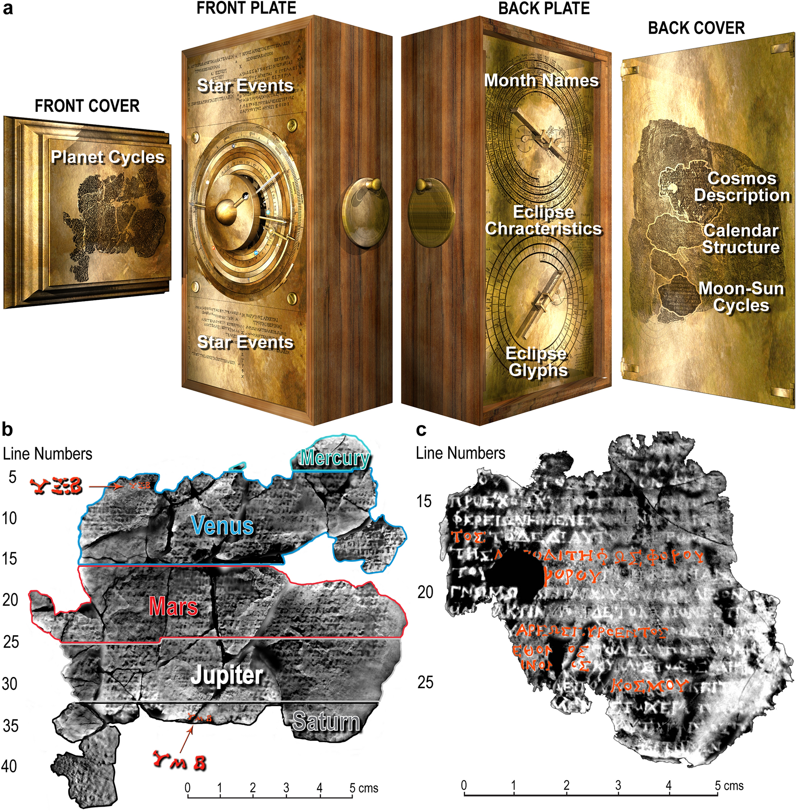

论文图1。上方是帮助定位铭文的计算机复原；下方是真实残片的CT拼合图。前盖描述行星周期，后盖文字则谈到整个天体显示。

文字与零件互相限制。一段文字说有某种显示，机械就必须有办法把运动送过去；一根残存支柱占着某个位置，重建者也不能为了让齿轮好看，假装它不存在。

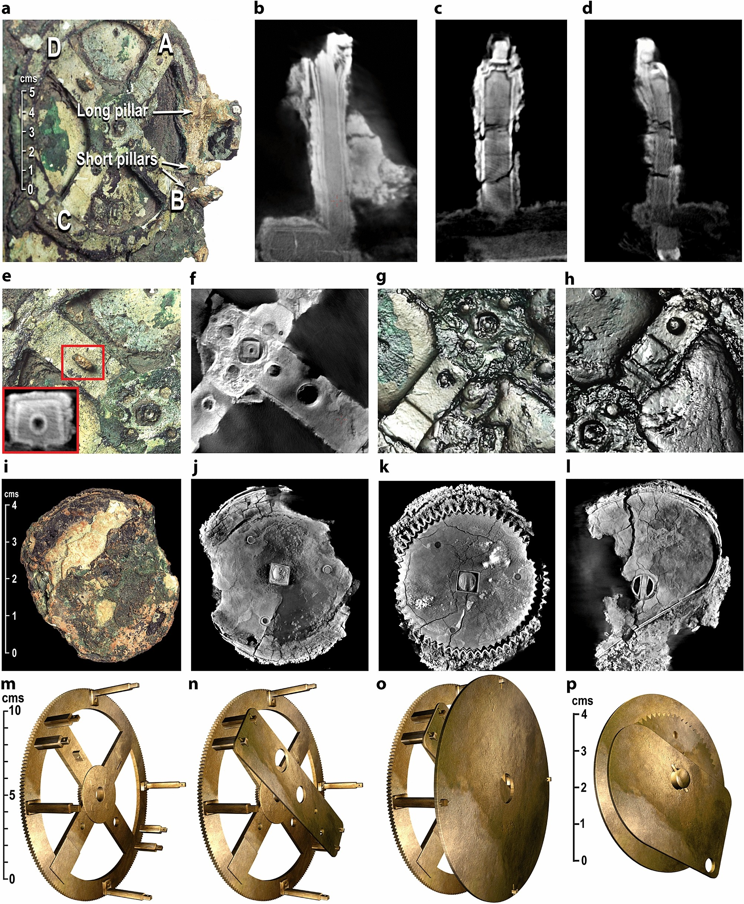

论文图4。a至l是残片与成像证据，m至p是作者提出的结构复原。上方细小的孔洞、支柱和轴承位置，都是下方模型必须交代的约束。

不过，残存比例决定了难度。背面历法与食预测的关键结构有较强证据支持，正面的行星齿轮却遗失得更多。让模型“能转”，只是第一关；还得让它符合留下来的文字、孔洞、空间和制造方式。

2021年，一组研究者在《Scientific Reports》提出了新的[正面宇宙显示模型](https://www.nature.com/articles/s41598-021-84310-w)。这项工作给出的是一种受证据约束的重建方案。作者自己也明确承认：不能声称它就是原物的复制品。

## 一个462年的数字，怎样塞进小小的齿轮堆？

行星又带来一层麻烦。站在地球上看，它们在恒星背景前的移动会时快时慢，有时甚至像倒着走。只让一根指针匀速旋转，不能表现这些变化。

古希腊天文学用“一个圆周运动叠加另一个圆周运动”的模型描述这类现象。机械上，既让小齿轮自己转，又让承载它的结构绕着转，再用销钉和槽把运动传给输出，就有机会产生变速、停顿和回摆。

而铭文给重建者出了更具体的题：金星部分读出了462年，土星部分读出了442年。结合天文学解释，它们分别对应金星289个会合周期、土星427个会合周期。这里的“会合周期”，指行星相对太阳的配置重新出现的周期，不是它绕太阳公转一周。

这些漫长周期不是让使用者耐心等462年，而是规定短时间内也要遵守的速度关系。正如把一张地图缩小，整段关系仍可以被压在手边。

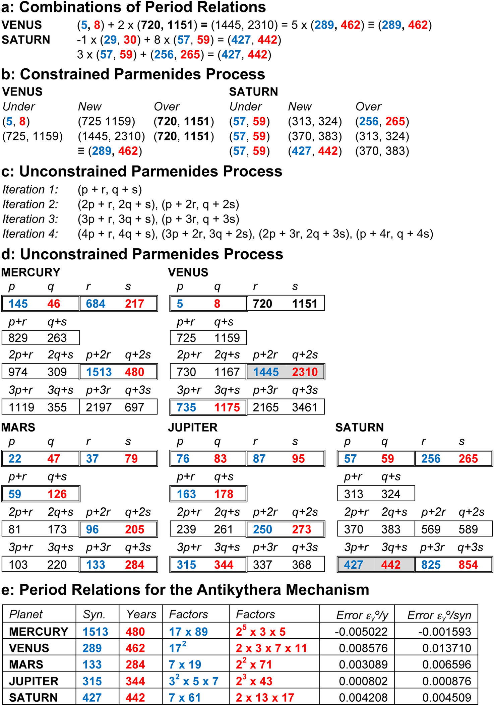

论文图2。蓝色数的是会合周期，红色数的是年数。可重点看底部金星一行：289与462可以分解为较小的因数，从而有机会分配到多个齿轮中。整张表展示的是2021年作者的推导方案。

289等于17×17；462等于2×3×7×11。这意味着设计者不必直接制造一只462齿的大轮，而能考虑由较小齿数的多级传动组合比例。研究者还要求几套机构尽量共用齿轮，否则纵然数学成立，盒子也装不下。

这是一种很有工程味的筛选：既要接近天象，也要能制造，还得省空间。作者提出了一条可能得到这些周期的数学路径，但没有古人的工作笔记证明他们当年一定按这条路线思考。

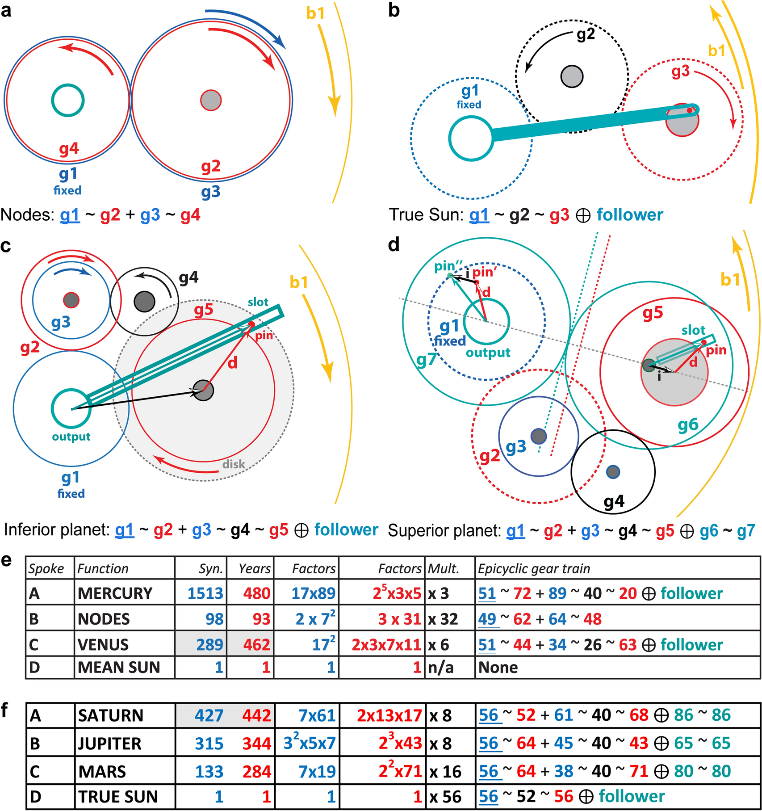

论文图3。青绿色的杆与销槽负责把复合圆周运动传成变化的输出；c、d分别展示两类行星机构。图中数字是模型的齿数配置，不是全都从出土齿轮上直接数出来的。

## 把一套天空，接到同一个中心

即使每个天体都算对了，还剩一个很实际的问题：怎么把它们的运动送到正面，而不让所有轴撞在一起？

2021模型采用一层套一层的空心管轴，分别连接显示圆环。可以想象几根粗细不同、互相套着的吸管，每一根都能独立转动；中间再穿过月亮的轴。

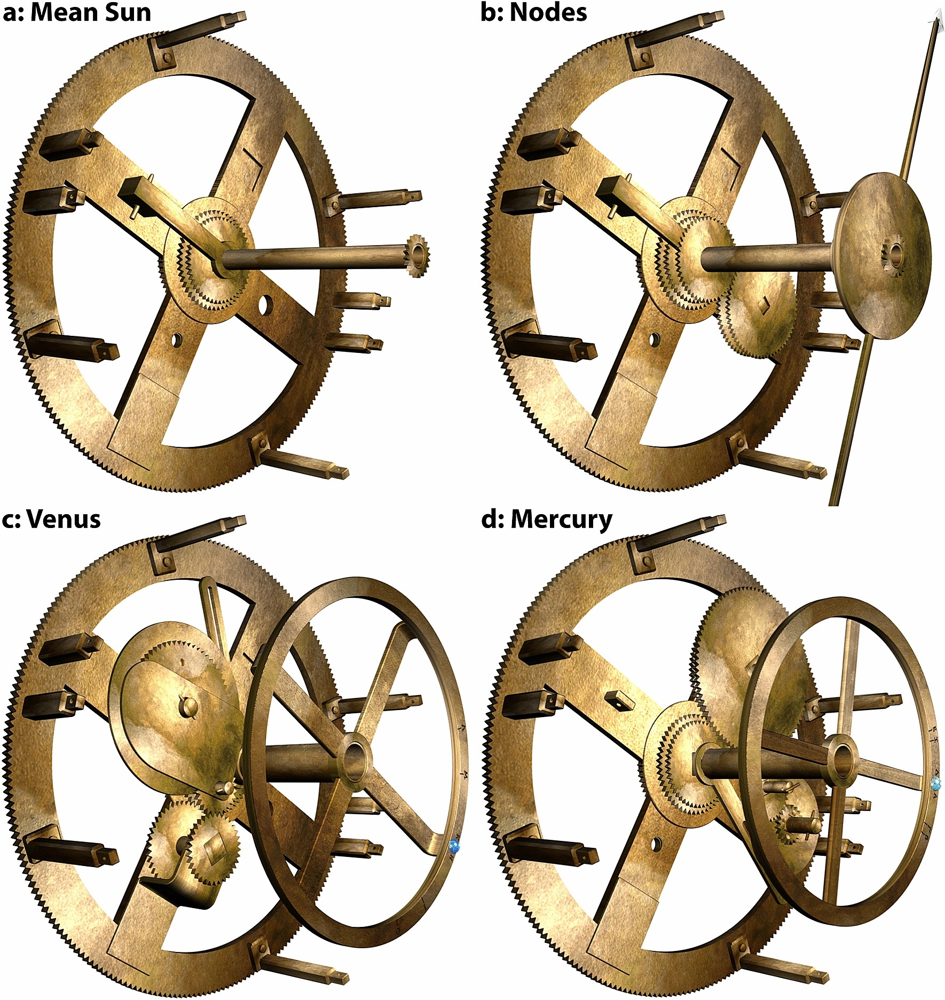

论文图5展示不同输出如何安装在主驱动轮附近。右上角的交点机构和双头“龙形指针”属于作者提出的假设性配置，没有直接实物证据证明原机有这根指针。

有些模型选择能够解释之前令人困惑的残件。例如D残片上的63齿轮、圆盘与板件，被作者解释为金星机构的一部分。这个解释必须同时满足天文比例、结构位置与尺寸，不能只靠“外形很像”。

另一些部分，尤其太阳与外行星的传动，缺乏直接保存下来的齿轮证据，重建空间就更大。下图很漂亮的层叠结构，应当读作研究者给出的解题方案，而不是考古现场拿出来的一整台机器。

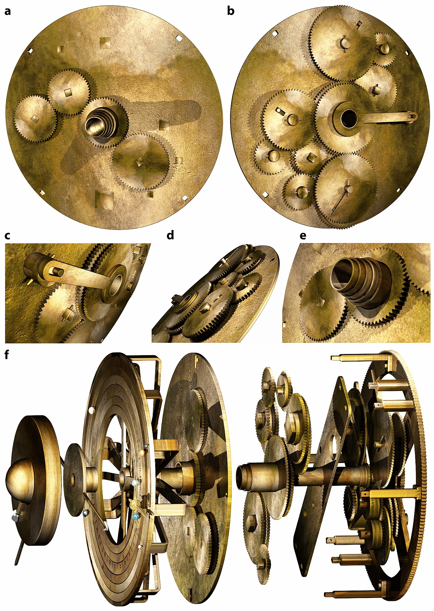

论文图6。右侧局部可看见套管输出；下方爆炸图将紧密的层叠结构拉开，显示齿轮、支承板与圆环之间如何连接。

最后，这些管轴把不同的运动送到同一块正面。模型以地球为中心，依照古代宇宙秩序排列月亮、水星、金星、太阳、火星、木星、土星。圆环上的小球标示它们的位置。

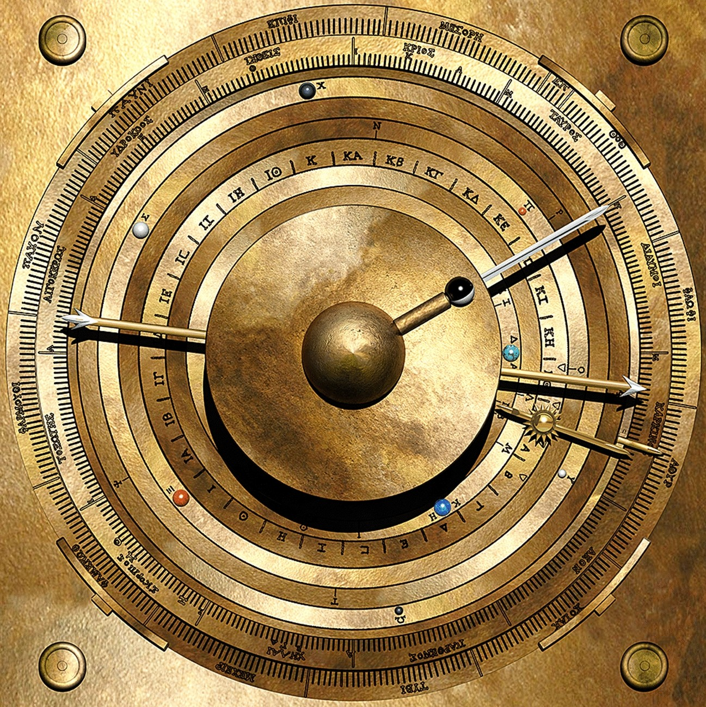

论文图7：2021年计算机模型的正面显示。金色外观、圆环及小球让计算结果变得直观；它不是出土原物的照片。

这张盘面还提出了一个有意思的使用方式：当指针走到特定标记，使用者可以按字母去找相应文字，读到某颗行星处于怎样的状态。

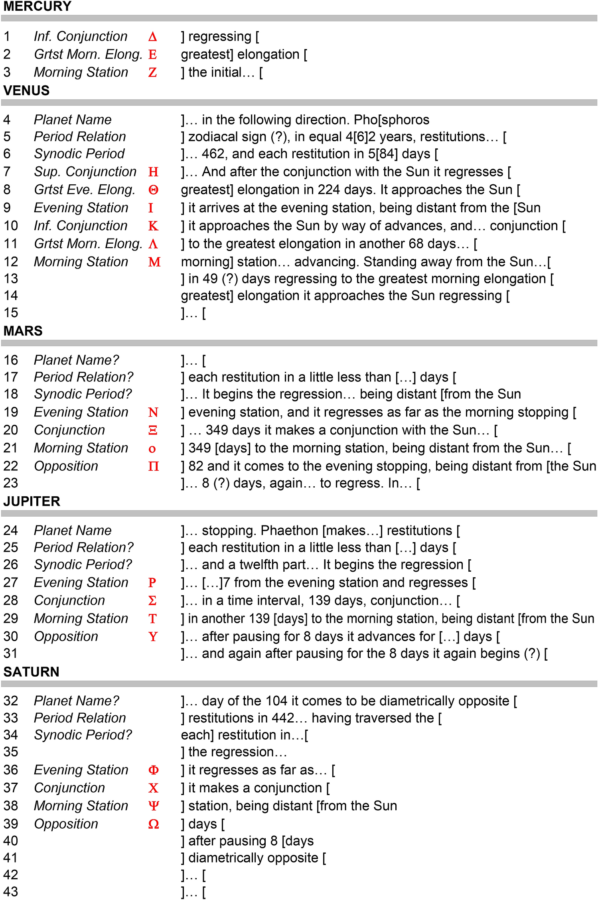

论文图8。黑色文字呈现残存铭文的译读与内容提示，红色字母是作者补出的索引方案。关键行首已经缺失，因此这种“表盘标记对应文字”的设计仍是假说。

能把模型做得自洽，与能证明历史上只有这一种模型，是两回事。保留这条边界，并不会让它变得不神奇；恰恰让那些真正从青铜里读出来的东西更有分量。

## 真正留下来的，是一种把知识做成机器的办法

安提基特拉机械最打动人的地方，不只是“古人比想象中聪明”。这个说法太容易让故事止步于惊叹。

更具体的进步是：长期观察得到的周期，可以变成数的比例；数的比例，可以变成齿轮之间的约束；约束再经过传动，就让一个人的手势，同时推动多份天文关系。

使用者不必在每次查询时重做整套推算。规律已经被装进了机器。

海水摧毁了许多零件，也留下了这个足够清楚的想法：**未来尚未发生，但只要世界表现出可以认识的秩序，人就能先造出一个模型，把时间转过去看看。**

资料与延伸阅读：[雅典国家考古博物馆](https://antikythera-mechanism.namuseum.gr/en/archaeologist/)、[研究团队的周期说明](https://antikythera-mechanism.gr/faq/astronomical-questions/what-are-the-metonic-and-callipic-cycles)、[2021年论文](https://www.nature.com/articles/s41598-021-84310-w)、[NASA的食周期说明](https://eclipse.gsfc.nasa.gov/SEsaros/SEsaros.html)。

图片来源：论文图1—8由Tony Freeth等作者提供，见[原论文](https://www.nature.com/articles/s41598-021-84310-w)，依[CC BY 4.0](https://creativecommons.org/licenses/by/4.0/)使用，原图未改动；CT数据鸣谢Nikon X-Tek Systems，表面成像数据鸣谢Hewlett-Packard。残片照片：Marsyas，Soerfm调整亮度，[原页](https://commons.wikimedia.org/wiki/File:NAMA_Machine_d%27Anticyth%C3%A8re_4.jpg)，[CC BY 2.5](https://creativecommons.org/licenses/by/2.5/)，本文未改动。港口照片：AlMare，[原页](https://commons.wikimedia.org/wiki/File:Antikythera_Potamos.jpg)，[CC BY-SA 3.0](https://creativecommons.org/licenses/by-sa/3.0/)，未改动。三张教学示意为本文原创。
