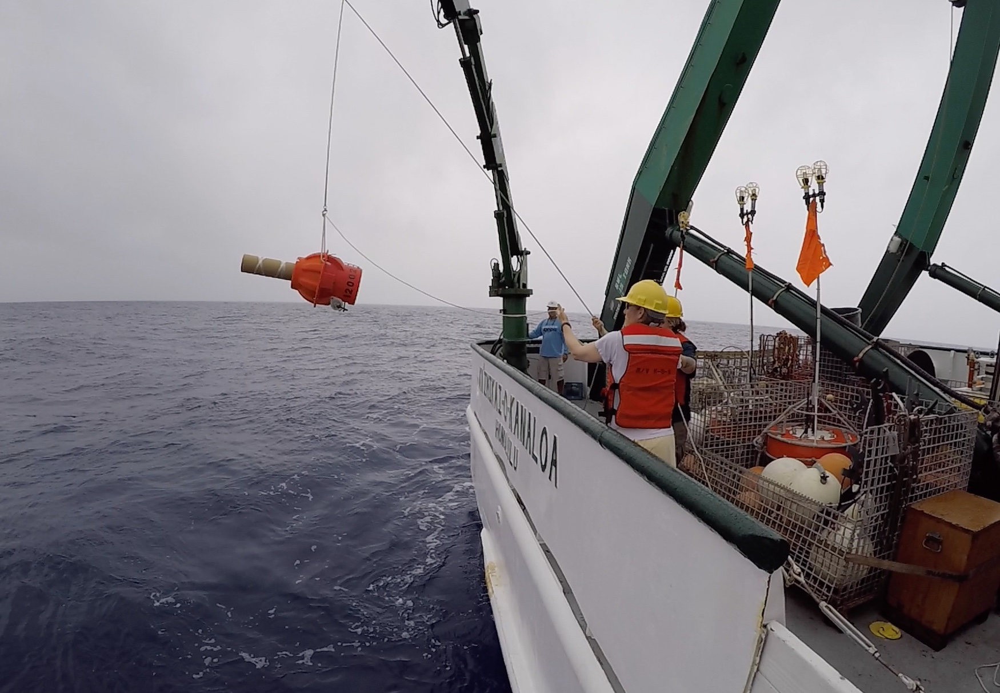
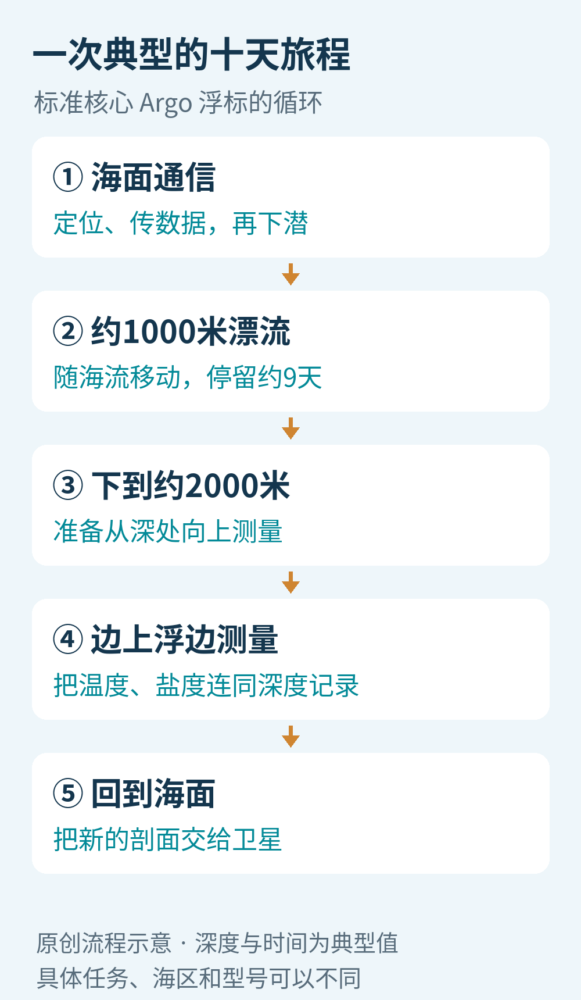
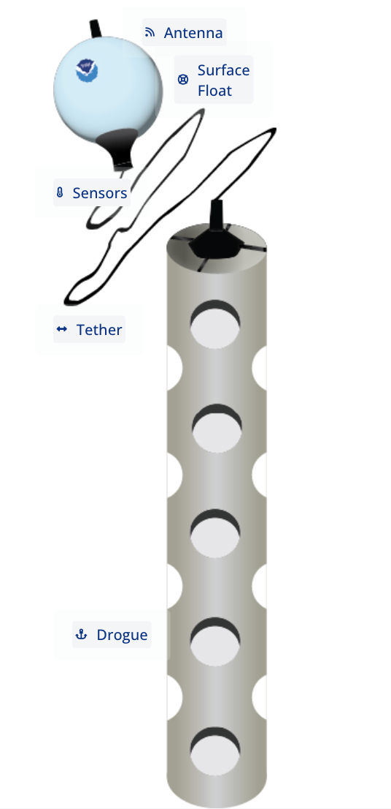
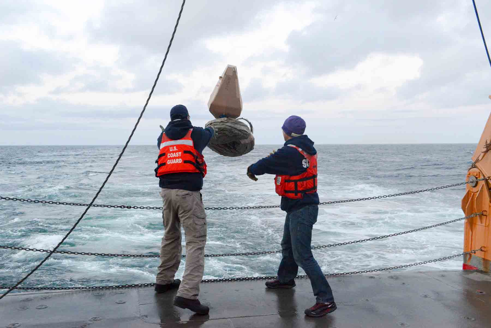
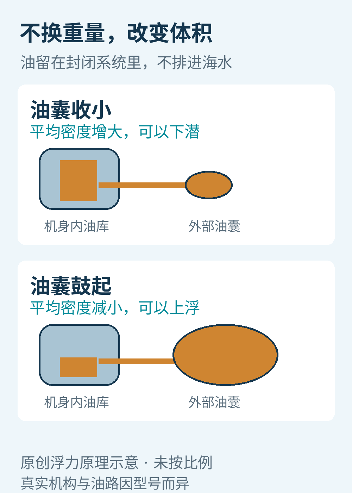
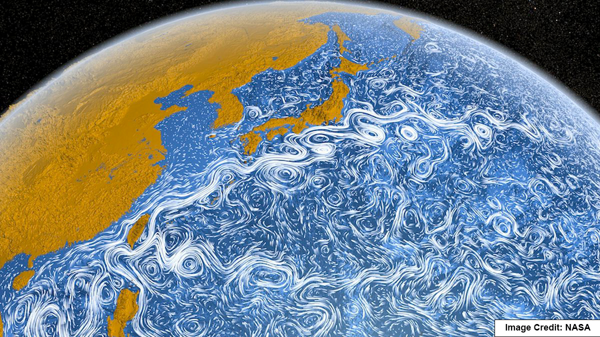
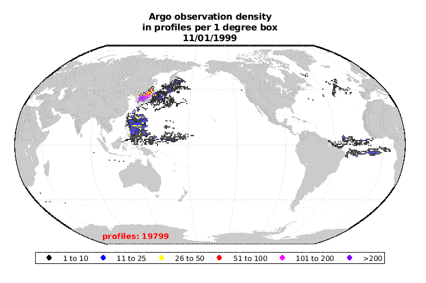
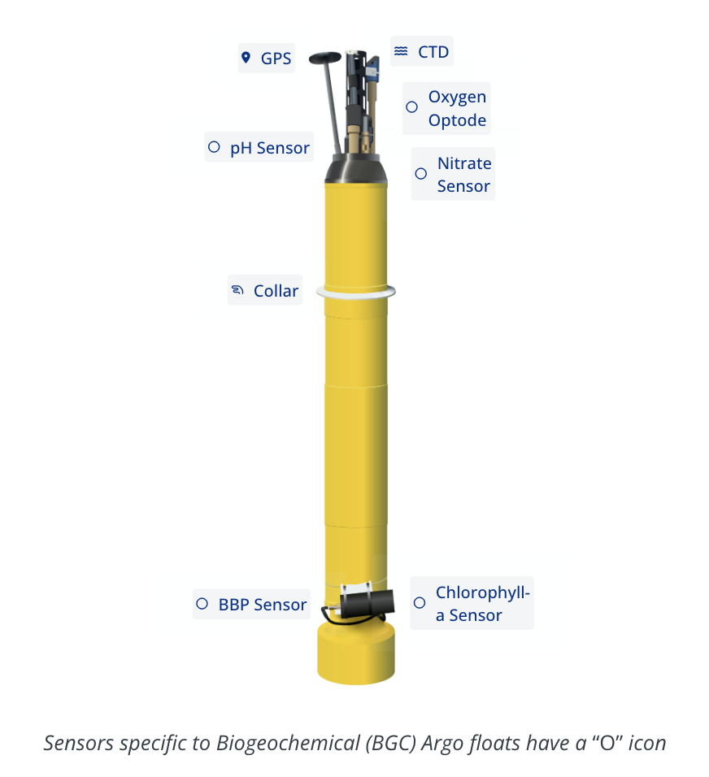

# 十天才露一次面，这些海洋机器人怎样给地球量体温？

海面今天有多暖，卫星能帮我们看。可如果想知道海面下一千米的水温，或者一片海域究竟存了多少热量，就不能只看最上面那一层。

把温度计吊在船后当然是一种办法。问题是，海洋太大，船不可能一直守在每个地方。遇到冬季风浪，一些最值得测量的海区，也恰恰最难长期停留。

Argo选择了另一种工作方式：把仪器放进海里，让它自己下潜、漂流、测量，再定期浮上来报告。它不追着鱼群跑，也不寻找海底宝藏，最常做的事只是安静地重复一次上下往返。

正是这种看起来有点“慢”的机器人，帮人类补上了海面以下的一大片观测空白。

2018年，研究人员从R/V Kaʻimikai-O-Kanaloa部署Deep SOLO浮标。照片中的深海型号与常见圆筒形核心Argo外观不同，但都通过自主升降取得海水剖面。来源：NOAA；图片不是本文实拍。[1](https://www.noaa.gov/news/argo-crown-jewel-of-ocean-observing-systems-turns-25)

## 一个“浮标”，为什么大部分时间不浮在海面？

中文里说浮标，很容易想到海面上随波起伏的圆球。Argo的典型成员更准确地说是“剖面浮标”：它把不同深度的一组测量连起来，让我们看见水体从上到下的结构。

以标准核心Argo任务为例，一次循环大约十天。浮标先下到约1000米，在那里随海流漂移大约九天；随后进一步下到约2000米，再一边上浮，一边记录电导率、温度和压力。到了海面，它取得位置，通过卫星发送数据，然后开始下一轮。[2](https://argo.ucsd.edu/how-do-floats-work/)

这些是典型任务参数，不是所有浮标必须执行的统一时刻表。研究目的、设备型号和海区不同，循环可以调整。

本文原创流程示意。海面通信发生在循环的衔接处；“十天”包括整个典型循环，并非先在1000米待满十天，再额外进行全部测量。

想象你只知道一栋楼顶层的温度，显然不能据此判断地下室是否闷热。海洋也有垂直结构：表面受日照、蒸发和风的影响，下面的水可能与表层差别很大。浮标的一次上浮，就是沿着这栋“水楼”做一遍检查。

不过，它走过的不是固定楼梯。海流会带它移动，升降过程中也会漂移。因此，一条剖面是带有时间、位置与采样路径的测量，不能理解成海里一根永不移动的温度柱。

## 海面上的圆球，是另一位同事

还要分清一种常见设备：Global Drifter Program使用的海面漂流浮标。它把浮体留在水面，用绳索连接下方的海锚，让上层海流带动设备。它适合观察海面附近的流动与环境，并不按Argo的方式往返2000米。[5](https://www.aoml.noaa.gov/technologies-advancing-physical-oceanography/)

NOAA原图。上方是海面浮体和天线，下方带孔结构是海锚（drogue），中间由绳索连接。这张图用来区分两类“浮标”，不是Argo内部结构。

NOAA同一原文中的部署照片。工作人员投放的是海面漂流浮标，收拢的海锚与绳索随后展开。它与Argo互补：一个侧重海面附近，另一个进入水体取得垂直剖面。

## 没有螺旋桨，它怎么决定上浮还是下潜？

关键是一小套浮力调节机构。

典型设计把油装在一个封闭系统里：机身内有油库，外面有柔性油囊。泵把油从内部送进外部油囊，油囊鼓起来，整个浮标排开的海水体积变大，而自身质量基本不变。平均密度随之降低，它就更容易上浮。反过来，收回油囊里的油，体积减小，浮标可以下潜。[2](https://argo.ucsd.edu/how-do-floats-work/)

这里没有把油排进海里，也没有不断吞进海水来增重。它是在同一套系统内部移动油，用有限的体积变化调整浮力。

本文原创示意。油囊的大小变化经过夸张，未按真实比例；实际泵、油路和耐压结构随型号而异。

这是一种很适合长期观测的取舍。浮标不需要像潜艇那样持续推动自己沿航线前进，水平方向主要交给海流；电池则用于泵、传感器、控制器和通信。少做一些主动运动，才有机会把工作时间延长到以年计算。[2](https://argo.ucsd.edu/how-do-floats-work/)[3](https://argo.ucsd.edu/about/argos-environmental-impact/)

代价也很清楚：研究人员不能随手在地图上点一个位置，就让它立即游过去。Argo提供的是不断积累的观测网络，而不是一支可以随叫随到、精确编队的水下无人机队。

## 测温之外，为什么还要测“咸不咸”？

浮标上常见的CTD，是电导率、温度和深度测量系统的简称。严格说来，它测的是压力，再结合海水条件换算深度；盐度则由电导率、温度与压力等求得。[2](https://argo.ucsd.edu/how-do-floats-work/)

海水含有溶解的离子，能够导电。咸淡变化会影响导电能力，但温度和压力也会影响读数，所以不能拿一次电导率测量直接等同于“盐有多少”。几个传感器需要一起工作。

温度与盐度共同帮助描述海水密度。在海里，密度差关系到水层如何分布、混合和运动。比如，较淡的表层水可能改变上下层交换的条件；只记录温度，就容易漏掉另一半故事。

Argo也因此能与卫星形成互补。卫星从上方观测海面高度等信息，浮标进入水体，帮助解释表面变化下面发生了什么。名称Argo与Jason卫星的呼应，正来自希腊神话中伊阿宋乘坐的阿尔戈号船。[1](https://www.noaa.gov/news/argo-crown-jewel-of-ocean-observing-systems-turns-25)[4](https://argo.ucsd.edu/about/)

NOAA文章采用的NASA洋流可视化。白色纹路是把流动关系画出来的可视化效果，不是从太空直接拍到的白色海水，也不是Argo浮标的运动轨迹。[5](https://www.aoml.noaa.gov/technologies-advancing-physical-oceanography/)

## 想知道海洋存了多少热，为什么必须往下看？

两片海的表面都可能是28℃，但一片只是很薄的表层暖，另一片的暖水却延伸到更深处。仅凭相同的海面温度，无法判断它们储存的热量相同。

这就像两杯温度相同、体积不同的水。温度告诉我们冷热状态，热量还与有多少水有关。海洋问题更复杂，因为温度随着深度和位置变化；研究者必须结合许多剖面，对不同厚度、不同区域的水进行估计。[4](https://argo.ucsd.edu/about/)[6](https://argo.ucsd.edu/science/argo-and-climate-change/)

这些信息与我们生活的联系并不遥远。海水储热影响它与大气之间的能量交换；海水变暖后体积膨胀，也会影响海平面。Argo数据与卫星、船舶等观测结合，可以帮助研究这些过程，并进入海洋和天气预测系统。[5](https://www.aoml.noaa.gov/technologies-advancing-physical-oceanography/)[6](https://argo.ucsd.edu/science/argo-and-climate-change/)

但浮标不是直接吐出一个“全球海洋热量”的数字。仪器得到的是分散的现场测量，研究者还需要处理季节变化、空间空白、不同仪器误差和统计不确定性。海洋热量的长期变化，是测量与分析共同完成的结果。

NOAA原始动图，完整保留229帧。图中日期从1999-11-01推进到2018-10-31，颜色表示每个1度网格中的累计剖面数，不是海温，也不是2026年正在工作的浮标数量。它展示的是观测记录如何逐步铺开。[5](https://www.aoml.noaa.gov/technologies-advancing-physical-oceanography/)

这张图最重要的变化不是颜色越来越鲜艳，而是许多原本缺少持续记录的开阔海区，开始拥有了可反复比较的数据。观测不再只能沿着少数船舶航线展开。[7](https://argo.ucsd.edu/about/observing-system/)、[7·2](https://doi.org/10.3389/fmars.2020.00700)

## 数据传回来了，就可以直接拿来画气候趋势吗？

还不行。海上的传感器会经历长期浸泡与压力变化，读数可能缓慢漂移。一个看似细小的盐度偏差，放进跨年份、跨海区的比较里，可能变成不能忽略的问题。

Argo因此有不同时间尺度的数据质量控制。较快发布的数据服务于需要及时了解海况的应用；之后，专家会用更长时间的记录、邻近浮标和船测资料继续检查，必要时调整传感器漂移，并给出质量标记与误差估计。[8](https://argo.ucsd.edu/data/data-faq/)

可以把这理解成两种不同的需求：天气预报需要尽快拿到可用信息，研究缓慢的长期变化则需要更仔细地排查细小系统偏差。后者不是简单地等数据“变老”，而是有额外的信息和人工判断加入。

因此，下载了一个开放数据文件，不等于已经得到适合任何用途的最终答案。变量是否经过调整、质量标记是什么、误差有多大，都是数据本身的一部分。Argo开放的不只是结果，也包括让使用者判断结果能否使用的线索。[8](https://argo.ucsd.edu/data/data-faq/)

## 更深、更冷，还想测到海里的化学变化

最初核心Argo的约2000米观测范围，已经深入海洋，但海底在很多地方还远得很。Deep Argo把部分浮标的能力扩展到4000米或6000米等级，需要能承受更高压力的外壳、浮力系统和传感器。[1](https://www.noaa.gov/news/argo-crown-jewel-of-ocean-observing-systems-turns-25)[9](https://argo.ucsd.edu/how-do-floats-work/technological-innovations/)、[9·2](https://argo.ucsd.edu/expansion/deep-argo-mission/)、[9·3](https://argo.ucsd.edu/faq/)

另一路扩展是BGC-Argo，也就是生物地球化学Argo。它在温盐压力之外，搭载更多传感器，测量氧、pH、硝酸盐等指标，帮助研究海水中的生命环境与化学过程。不同配置各有取舍，不能认为每一只Argo都带着完整的“化学实验室”。[5](https://www.aoml.noaa.gov/technologies-advancing-physical-oceanography/)[9](https://argo.ucsd.edu/how-do-floats-work/technological-innovations/)、[9·2](https://argo.ucsd.edu/expansion/deep-argo-mission/)、[9·3](https://argo.ucsd.edu/faq/)

NOAA原图。上端标出定位、CTD、氧、pH、硝酸盐等传感器，下端还标有光学测量部件；带小圆圈的标签表示BGC附加传感器。图中丰富的配置不代表所有核心Argo的标配。[5](https://www.aoml.noaa.gov/technologies-advancing-physical-oceanography/)

极区则提出另一道题：上面如果是海冰，浮标不能像平时一样顺利冒头。部分浮标会利用接近表面的温度等信息判断冰风险，停止上浮，将数据暂存在内部，等有机会安全浮出后再传送。这样能减少撞冰，却也意味着一些剖面无法立即发送，更缺少当时的卫星定位。[10](https://argo.ucsd.edu/expansion/polar-argo/polar-argo-technical-challenges/)

这些扩展并不是把原有机器换个名字。每增加一种测量能力，都会带来新的校准、耗电、存储与解释问题。让一种传感器在船上工作，和让它在海里独自工作数年，是两种不同的难度。

## 最安静的机器人，也需要持续维护

NOAA在2024年12月回顾Argo运行25年的历史时，记录了它从1999年前后起步、逐步形成国际网络的过程。[1](https://www.noaa.gov/news/argo-crown-jewel-of-ocean-observing-systems-turns-25) 到本文2026年10月9日查核资料时，Argo仍在公开提供数据和技术说明。本文没有把某张网页上的历史设备数量，当成今天实时在线的总数。

浮标会耗尽电池，也可能损坏或搁浅。多数不具备自主返航能力，回收要看位置、船只机会和成本；长期网络因此需要不断补充设备，并认真对待留在海中的材料与环境影响。[3](https://argo.ucsd.edu/about/argos-environmental-impact/)

它的价值，最终也不取决于某一次下潜是否足够惊险。一个剖面只是某个地方、某个时间的记录；成千上万次重复，跨越不同季节和年份，才让海洋深处的变化逐渐有迹可循。

每隔十天露一次面，看起来像很久才报一次平安。对于理解一颗被海洋覆盖的星球，这种长期、耐心、能互相校验的工作方式，恰恰十分重要。

图片来源：[NOAA/AOML](https://www.aoml.noaa.gov/technologies-advancing-physical-oceanography/)（洋流可视化署名NASA）及[NOAA部署照](https://www.noaa.gov/news/argo-crown-jewel-of-ocean-observing-systems-turns-25)；中文示意为本文原创。
