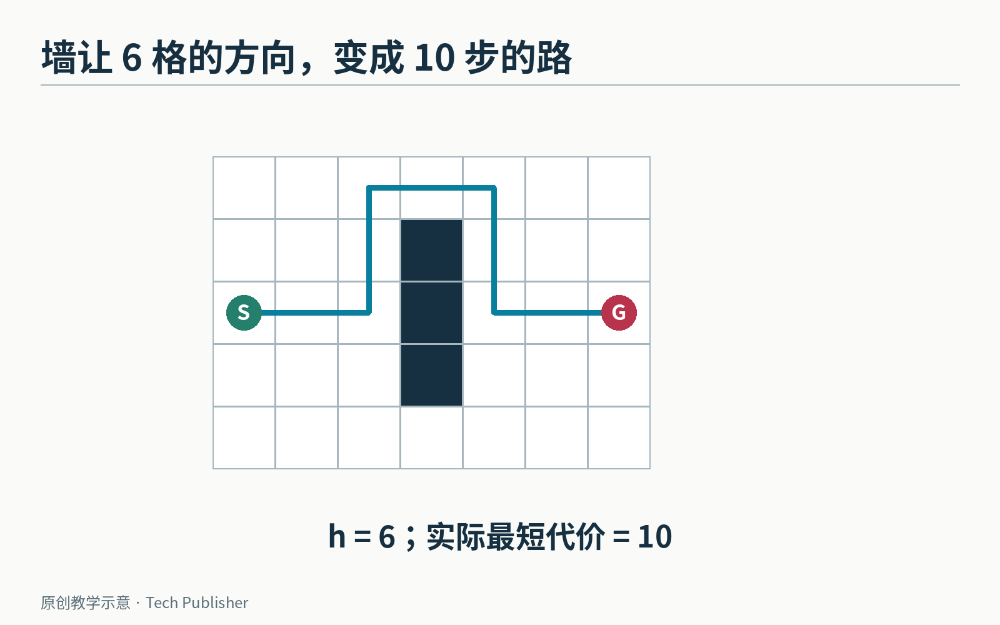
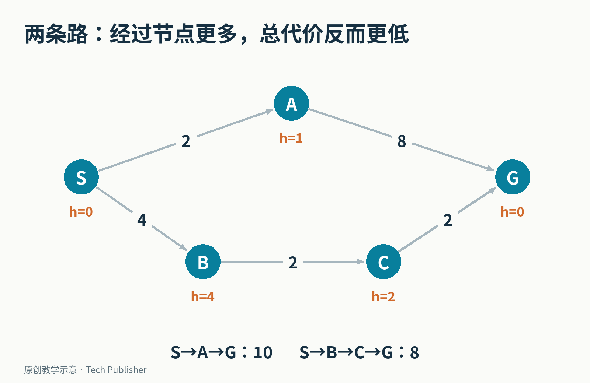
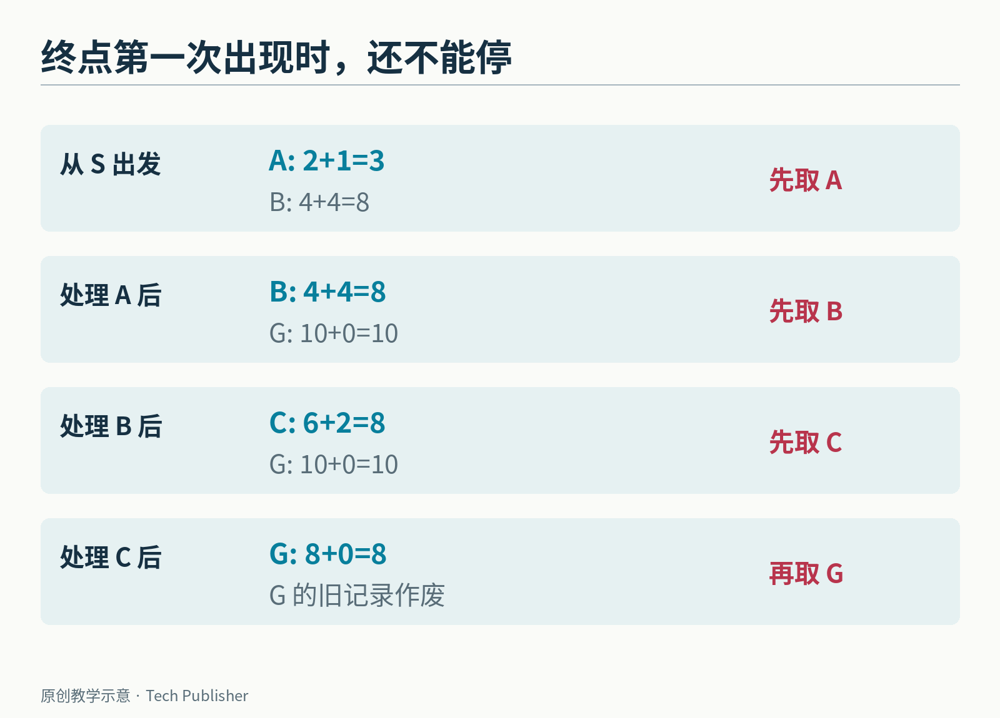
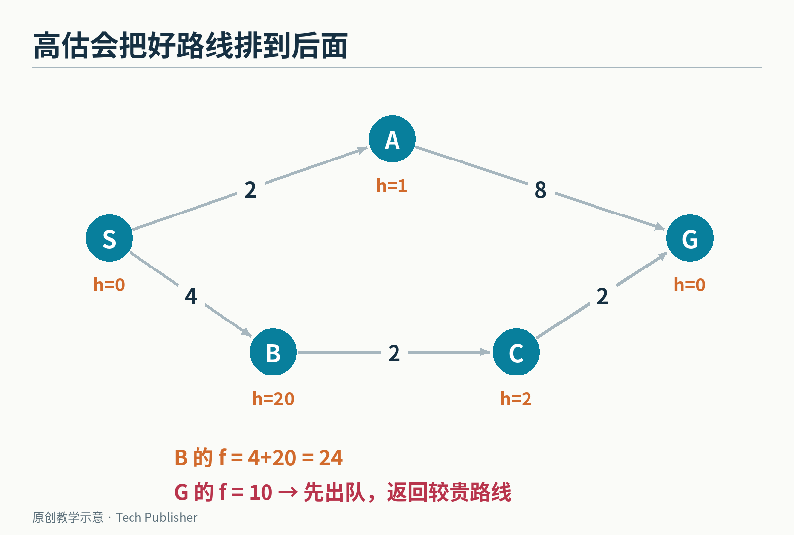
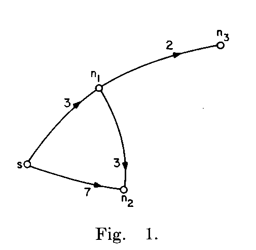
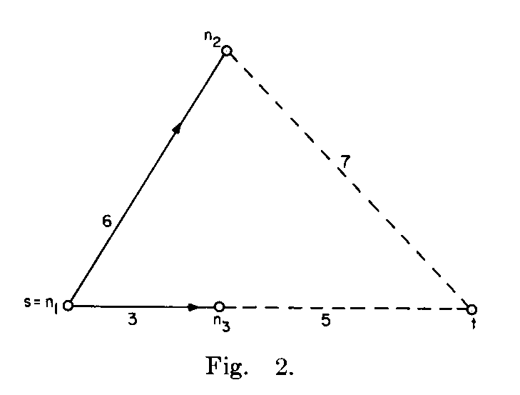

# A* 为什么敢猜前面的路，还能保证找到最短路？

游戏角色要去地图另一端。朝目标直走，看起来最省事；可一堵墙挡住了去路，最近的方向可能把它带进一条很长的死胡同。

另一个极端是完全不看目标，从起点向四面八方细细搜过去。这通常能找到路，却可能花很多力气探索根本不值得去的地方。

**A* 是一种寻找最低代价路径的搜索算法。它同时看两件事：已经付出了多少代价，以及接下来至少还要付出多少。**

它的聪明之处，不是拥有一张会预言答案的地图。恰恰相反，它允许自己估计得不准确，只给估计立下一条重要规矩：如果想保住最优答案，就别把剩下的代价说得过高。


*原创地图：仅能上下左右走，每步代价为 1。起终点直线方向相隔 6 格，但墙迫使路线绕行，最短需要 10 步。*

## 先把地图变成一笔账

搜索里的“图”，不是指一张插画，而是一组地点和连接关系。

地点叫节点；能从一个节点走到另一个节点的连接叫边；走这条边需要的时间、距离或体力，叫代价。游戏里一个节点可以是地砖，也可以是可行走区域中的一个路口。

下面使用一张特意简化的单向路线图。字母 S 是起点，G 是终点；每条箭头旁的数字是通过它的代价。

有两条路线：S→A→G，代价为 2＋8＝10；S→B→C→G，代价为 4＋2＋2＝8。

第二条经过的节点更多，总代价却更低。因此，**最少拐几个弯、最少走几条边，与最低总代价，并不总是一回事。**


*原创教学图。实线箭头上的数是实际边代价；节点旁的 h 是对剩余代价的估计。两者不能混算。*

再给各地点准备一个估计值 h：A 估成 1，B 估成 4，C 估成 2，终点 G 当然为 0。为了完整，起点 S 的估计设为 0。

这些估计并不都精确。A 到终点明明要 8，我们只估了 1；B 经过 C 到终点要 4，恰好估中。它们共同满足“没有高估”。

这样的 h 被称为**可采纳的启发式**。启发式就是帮助搜索安排先后次序的领域知识；“可采纳”在这里有严格条件，并非听起来合理就算。

## 为什么只盯着 h，会走进更贵的路线？

如果只看谁“离终点似乎更近”，从 S 出发就会先选 A，因为 h(A)＝1，小于 h(B)＝4。

走到 A，发现终点 G 的 h＝0，于是立刻选它。最终找到总代价 10 的路线，却错过总代价 8 的那条。

这类只按剩余估计排序的做法叫贪心最佳优先搜索。它可能很快找到一条路，却没有把已经花掉的钱算进去。

A* 给每个候选地点维护两项：

- g：目前已知，从起点到这里的最低代价
- h：从这里到终点的估计代价

再把两项相加：**f＝g＋h**。每次先处理 f 最小的候选地点。

这里的“处理”，意思是取出一个候选，检查它的邻居能否通过这条新路线变得更便宜。算法通常维护一份待处理清单，而不是只记住角色眼前那一个位置。

## 四步看完，答案为什么从 10 改成了 8

从 S 出发，候选清单里有 A 和 B：

A 的 g＝2、h＝1，所以 f＝3；B 的 g＝4、h＝4，所以 f＝8。先处理 A。

通过 A，我们第一次发现终点 G，总代价为 10。**但是现在不能停。** 清单上还留着 B，它的 f＝8，表示那条方向仍有希望用更低代价到达终点。

接着处理 B，发现 C。到 C 已经花了 6，估计还要 2，因此 f(C)＝8。仍然比终点当前那笔 10 更值得先检查。

处理 C，得到一条到 G 的新路线，总代价为 8。于是更新终点的账和上一站。之后 G 以 f＝8 从待处理清单里被取出，搜索才结束。


*每一格是一轮处理之后的候选状态。“第一次发现终点”与“终点作为最小 f 候选被取出”是不同的停止条件。*

这也是实际写代码时常见的分界：遇到终点就返回，可能把一个本来正确的 A* 写成会提前下结论的版本。

## 一个偏乐观的猜测，为什么能保护正确答案？

先限定讨论范围：地图对应有限的图，所有边代价非负；终点的 h 为 0；h 不高估；发现更便宜的路线时，允许更新并重新处理节点。

假设真正最便宜的路线总代价是 8。

只要这条路线还没有全部处理完，沿途总有一个值得继续探索的候选点。在它上面，“已经花掉的代价”加“不过分夸大的剩余估计”，不会超过 8。

那么，一个总代价为 10 的终点，就不可能在这些 f≤8 的候选点之前成为最小项。它必须等着，直到可能更便宜的路线被检查。

这就是关键保证：**乐观估计可能让你白查一些地方，却不会因为把好路线估得太贵而过早放弃它。**

反过来，把刚才的 h(B) 从 4 改成 20，B 的 f 就变成 24。A 那条代价 10 的终点可能先被取出，于是更好的路线被错过。一个“方向感更强”的猜测，如果强得没有边界，就会伤害正确性。


*只改 B 的估计，真实道路完全不变。f(B)＝24 让代价 10 的终点抢先出队；问题出在估计，不在地图。*

算法的原始理论来自 Peter Hart、Nils Nilsson 与 Bertram Raphael 的[1968 年论文](https://ai.stanford.edu/~nilsson/OnlinePubs-Nils/PublishedPapers/astar.pdf)。论文讨论的“最优性”还有搜索效率等更细的含义，不能把它一句话扩张成“A* 在所有情况下都检查最少节点”。这里保证的是在所列条件下得到最低代价路线。


*1968 年原论文图 1：到 n₂ 的路线最初记为 7；经 n₁ 后，代价可更新为 3＋3＝6。这与本文教学图是两个不同的例子。*

## 地图上的 h 从哪里来？

在只能横竖走、每步至少花 1 的方格地图上，可以先忽略墙，只数横向差几格、纵向差几格，再相加。这叫**曼哈顿距离**。

开头图里，起点与终点横向相差 6 格、纵向相差 0 格，h＝6。墙可能让真实路线更长，却不可能让“只能横竖走”的角色少走这 6 步，所以它是一个安全的低估。

如果允许斜走，而且斜走一格也只花 1，就不能继续机械地使用这个估计。例如右上方相邻的一格，实际一步能到，曼哈顿距离却算成 2，已经高估了。

同理，地图有传送门，或者你优化的是时间而 h 使用没有换算的米数，都需要重新审视估计。**启发式必须与移动规则和代价单位相配。**

还有一个实用性质叫“一致性”：从某点直接估到终点的代价，不应大于“先走到邻居的真实代价＋从邻居估到终点的代价”。写成式子是 h(n)≤c(n,m)＋h(m)。


*原论文图 2 用另一张图讨论一致性：实线是已经展开的部分，虚线延伸到目标 t。若起点估为 8、到 n₂ 的边代价为 6、n₂ 的剩余估计为 1，就出现 8＞6＋1 的不一致。*

可以把它看成估计也遵守一种三角不等式。满足一致性时，一个节点以最小 f 取出后，通常就不必再因更便宜的路线而重开。只有“不高估”但不一致时，关闭节点不再重开，会破坏一些实现的正确性。

下面的例子干脆不永久关闭节点，保留“更便宜就更新”的能力。代码中的图，就是前面的五个字母，不依赖游戏引擎：

```python
from heapq import heappop, heappush

graph = {"S": [("A", 2), ("B", 4)],
         "A": [("G", 8)], "B": [("C", 2)],
         "C": [("G", 2)], "G": []}
h = {"S": 0, "A": 1, "B": 4, "C": 2, "G": 0}
queue = [(0, 0, "S")]
best, parent = {"S": 0}, {}

while queue:
    _, cost, node = heappop(queue)
    if cost != best[node]:
        continue
    if node == "G":
        path = [node]
        while path[-1] in parent:
            path.append(parent[path[-1]])
        print(" -> ".join(reversed(path)), cost)
        break
    for nxt, edge in graph[node]:
        candidate = cost + edge
        if candidate < best.get(nxt, float("inf")):
            best[nxt], parent[nxt] = candidate, node
            heappush(queue, (candidate + h[nxt], candidate, nxt))
else:
    print("没有可达路线")
```

本地执行输出为 S -> B -> C -> G 8。清单中可能保留已经过时的旧记录，所以取出时要检查它是否仍等于当前最优代价。这个例子展示搜索逻辑，没有包含实时地图变化、角色碰撞体大小与动画控制。

## 它原本要帮谁找路？

A* 的历史与 SRI 的 Shakey 机器人项目紧密相连。Shakey 不是一辆只按固定顺序执行动作的遥控小车；它的研究目标包括感知环境、规划路线、移动简单物体。

[SRI 的项目历史](https://www.sri.com/hoi/shakey-the-robot/)把这项研究记在 1966 至 1972 年间。它需要把“我想去那里”变成一串可执行动作，路径搜索因此成为实际问题的一部分。


*Shakey 机器人实物，2023 年摄于计算机历史博物馆。照片展示的是保存下来的设备，不是当年的实验过程。*

游戏角色继承了同一类难题，但一条最优路径还不是完整的行动能力。角色有宽度，路口会拥堵，敌人可能移动，道路可能刚刚被堵住。搜索只能对它拿到的图和代价负责；图建错了，算法会很认真地给出一条在模型里正确、在场景里却走不通的路。

A* 也不保证永远快。如果 h 全为 0，它就退化为按已知代价向外扩展的 Dijkstra 搜索；如果大量方向看起来一样有希望，清单仍可能很大。

它给开发者的并非一个神奇猜测，而是一种有约束的使用猜测的方法：让经验帮助安排先后，让完整的代价账保护最后的答案。

<small>图片来源：Shakey 实物照片为 [The wub / Wikimedia Commons](https://commons.wikimedia.org/wiki/File:SRI_Shakey_robot,_1969,_Computer_History_Museum.jpg)，[CC BY-SA 4.0](https://creativecommons.org/licenses/by-sa/4.0/)，原图未修改。论文两图来自 [Hart、Nilsson、Raphael，1968，图 1–2](https://ai.stanford.edu/~nilsson/OnlinePubs-Nils/PublishedPapers/astar.pdf)，原扫描图局部提取。其余为本文原创教学图。</small>
