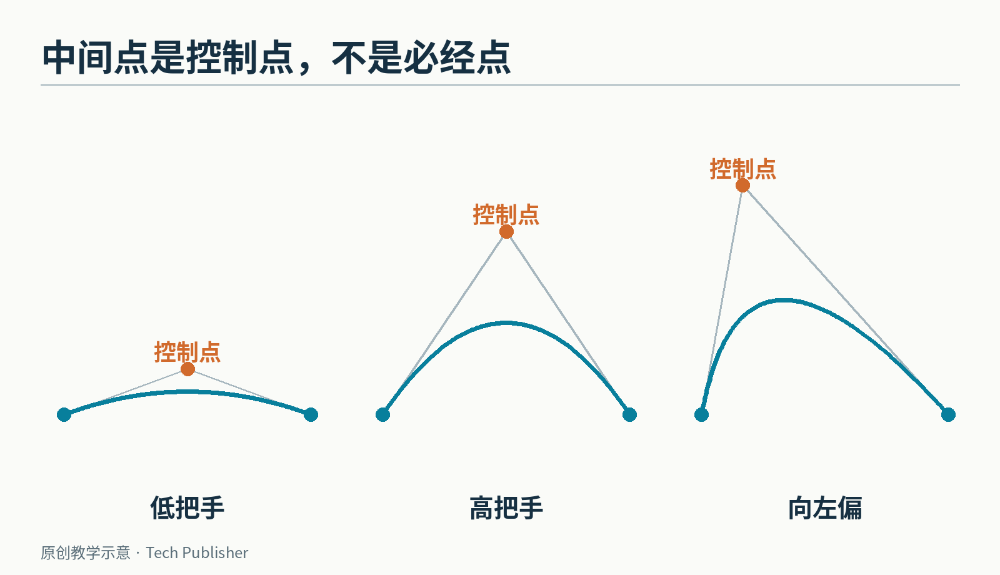
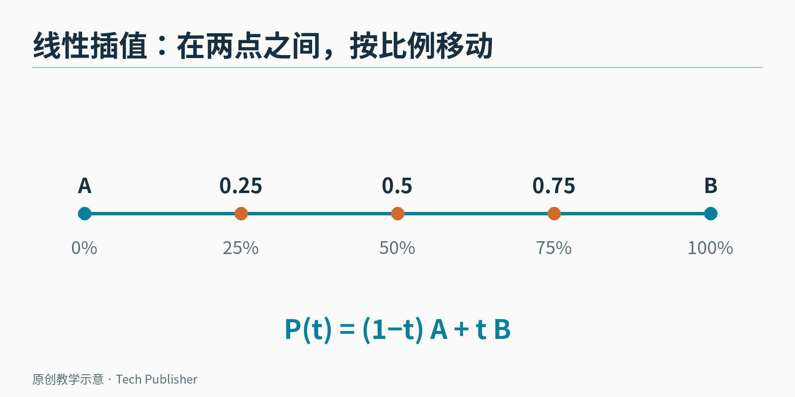
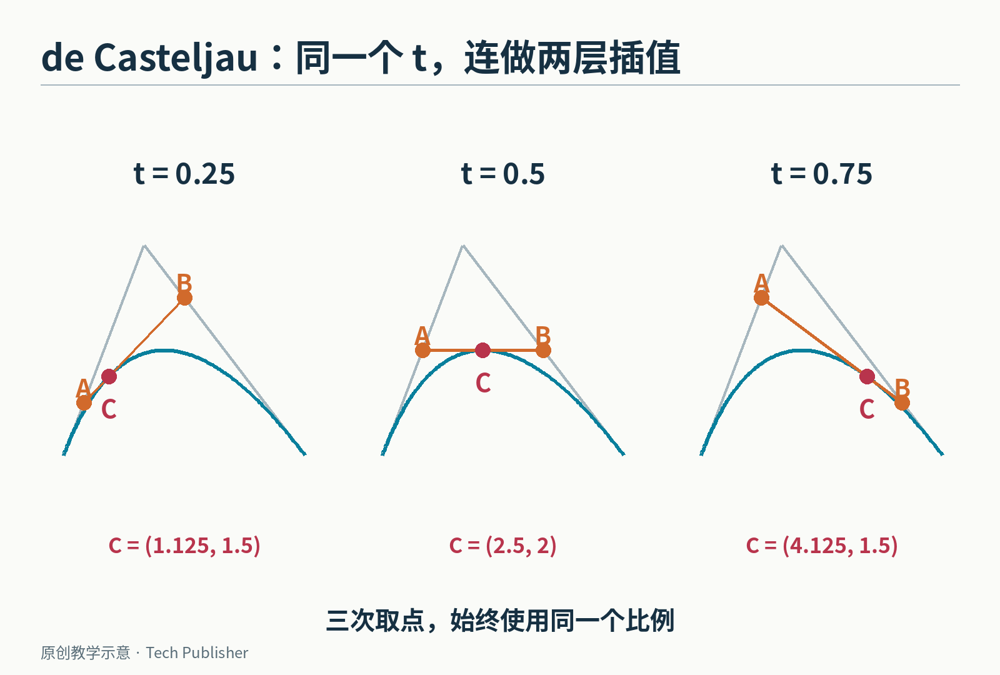
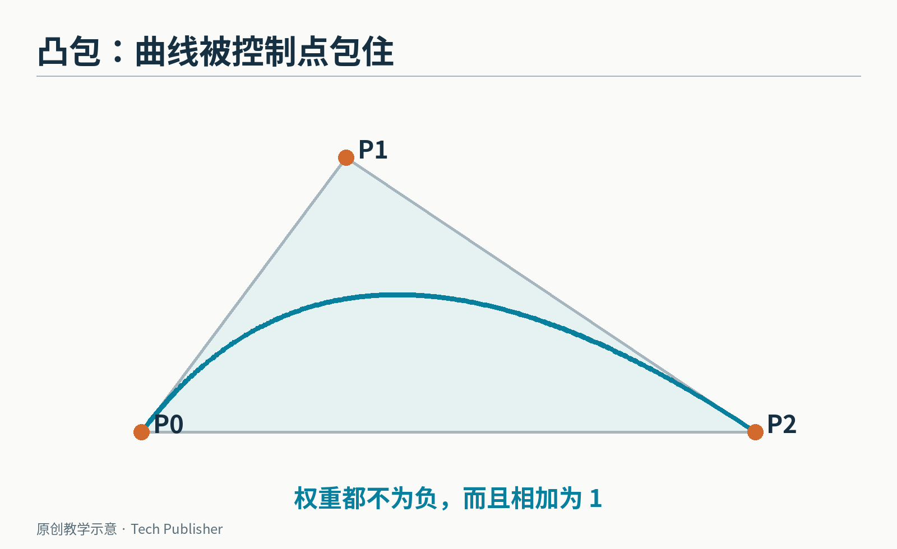
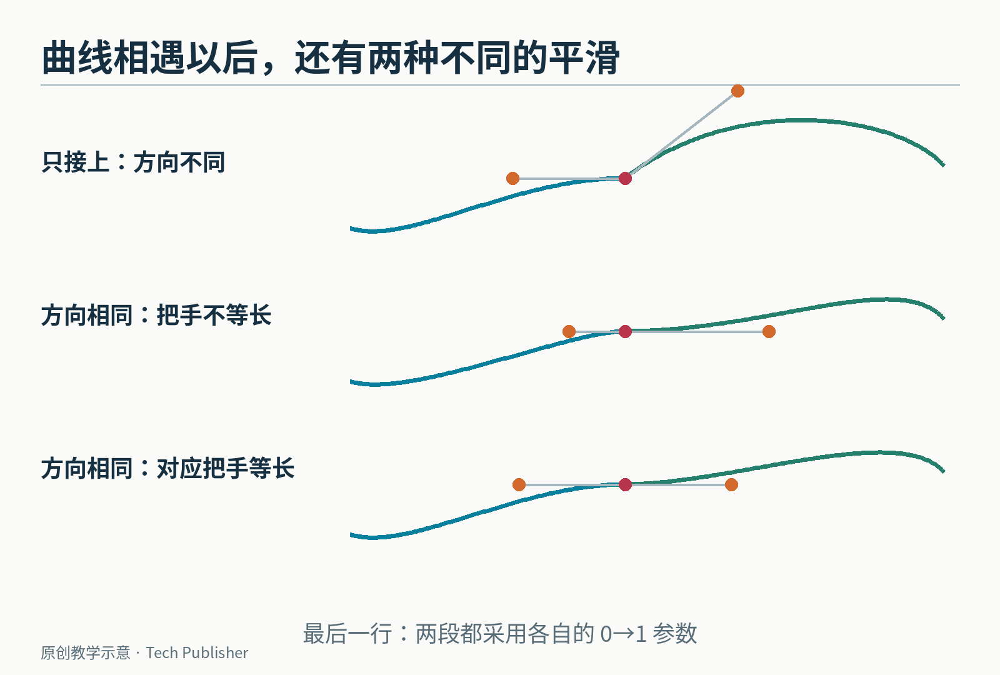
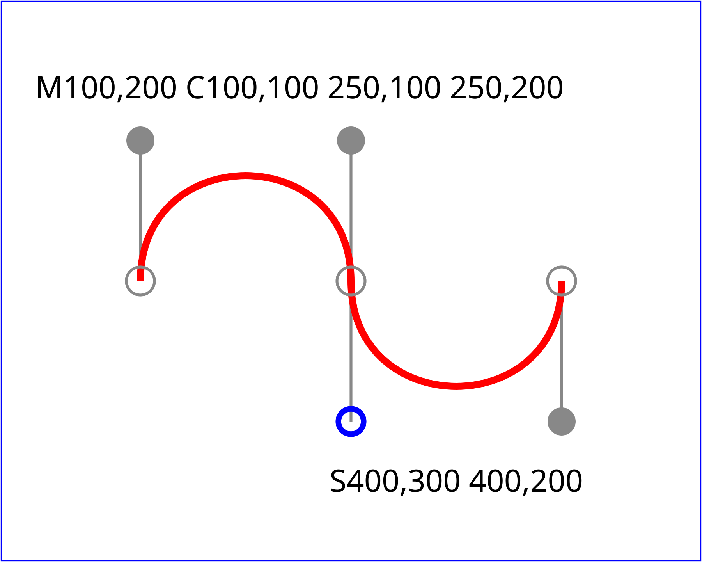
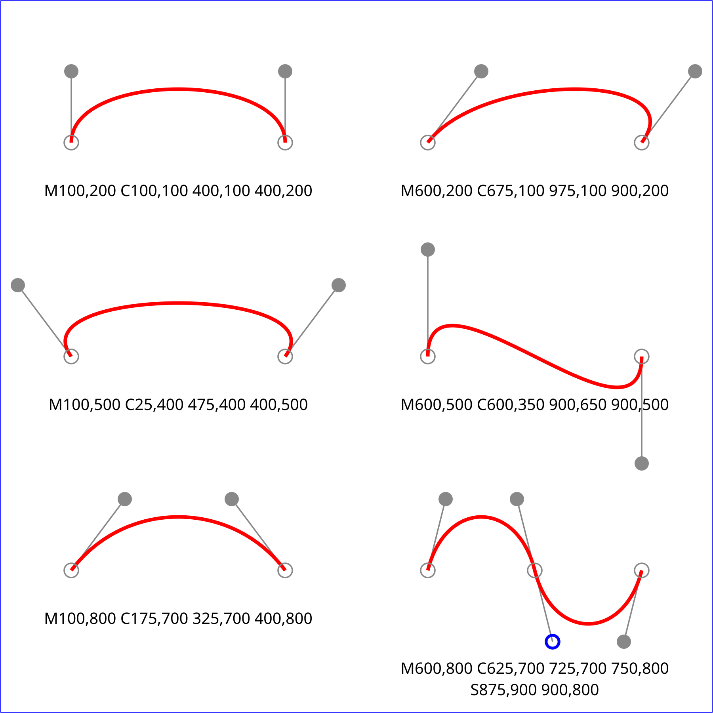
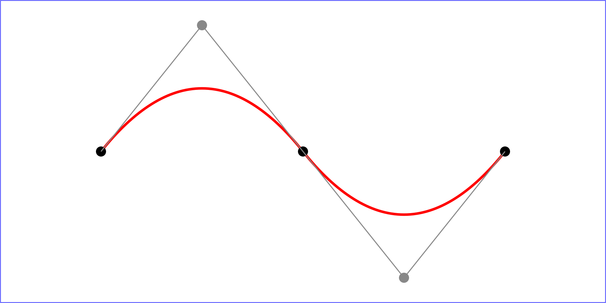

# 鼠标拖的那根“把手”，为什么能拽弯一条线？

在矢量绘图软件里画一条弧线，常会出现两个端点、几根细线和可以拖动的把手。

奇怪的地方在于：把手移到上方，曲线跟着鼓起来，却不一定穿过把手。你似乎没有直接拖曲线，而是在旁边安排几个点，让曲线自己找到形状。

这背后常用的是**贝塞尔曲线：用少量控制点，连续算出一整条曲线的数学表示。** 它不存下轮廓上每一个像素，而是存下“怎样生成轮廓”。

最出人意料的部分是，生成这种弯线，可以从一件非常直的事情开始：沿线段走一段路。

*原创示意：端点保持不动，只移动中间控制点。虚线是控制关系，实线才是生成的曲线。*

## 先沿着一条直线走

假设 A 在 0，B 在 10。用一个从 0 到 1 的数 t 表示进度：t＝0 时在 A，t＝1 时在 B，t＝0.3 时在 3。

它的写法是：

P(t)＝(1−t)A＋tB。

这叫**线性插值**，意思是按比例在两个值之间取一个值。如果 A、B 是平面上的点，对横坐标、纵坐标分别做同样的计算即可。

例如 A＝(0，0)，B＝(2，4)，t＝0.5，结果就是中点 (1，2)。没有额外的弯曲规则，也没有复杂的曲线公式。

*从 A 到 B，t 决定走过的比例。图中 0.25、0.5、0.75 是参数，不是三个不同的控制点。*

现在保留这条规则，但多做一层。

## 三个点，怎样“插”出一条曲线？

摆三个点：P₀＝(0，0)，P₁＝(2，4)，P₂＝(6，0)。P₀、P₂ 是起点和终点，P₁ 是中间控制点。

在 P₀ 到 P₁ 的线段上，按进度 t 找到 A；在 P₁ 到 P₂ 的线段上，也按同一个 t 找到 B。最后，再在 A 到 B 之间按同一个 t 找到 C。

当 t 从 0 慢慢走到 1，C 的轨迹就是一条二次贝塞尔曲线。

这里必须强调“同一个 t”。如果前两次取中点、第三次随意取另一个比例，得到的就不是下面这条曲线的同一个位置。

拿 t＝0.5 实算：

- A 是 P₀、P₁ 的中点，得到 (1，2)
- B 是 P₁、P₂ 的中点，得到 (4，2)
- C 是 A、B 的中点，得到 (2.5，2)

所以曲线走到参数一半时，坐标是 (2.5，2)，并没有走到控制点 (2，4)。控制点负责影响方向与形状，本来就不要求成为曲线途经的地点。

*每一栏都从原来三个点出发；橙色 A、B 同步移动，红色 C 再在它们之间移动。t＝0.5 的坐标与正文计算一致。*

这套逐层插值的方法叫 **de Casteljau 算法**。读作什么不影响使用，关键是记住它做了什么：相邻点两两插值，点数每层少一个，直到只剩最后一个点。

若把刚才三次插值展开，就得到：

C(t)＝(1−t)²P₀＋2t(1−t)P₁＋t²P₂。

这不是另一种神秘规则，只是把 A、B 的算式代进 C，然后合并同类项。

t＝0.5 时，三个权重是 1/4、1/2、1/4。于是横坐标为 0×1/4＋2×1/2＋6×1/4＝2.5，纵坐标为 0×1/4＋4×1/2＋0×1/4＝2。几何作图与代数计算给出同一答案。

## 为什么拖得再远，它也不会随意飞出去？

在 0≤t≤1 的范围里，这三个权重都不小于零，而且相加等于 1。

所以 C 始终是三个控制点的一次“加权平均”。它可以靠近某个点，但不能越出包住三个点的三角形。这是贝塞尔曲线的一个重要性质：曲线位于控制点形成的**凸包**里。

凸包可以想成把橡皮筋套在这些点外面，绷紧后包住的区域。对于更多控制点，区域未必是三角形，但这条性质仍然成立。

*浅色三角形是这三个点的凸包。曲线留在其中；控制点本身则未必都落在曲线上。*

这也解释了把手的效果：你改变的不是某个孤立像素，而是许多位置使用的一份权重来源。中间控制点向上移动，一段曲线都会受到影响。

“受到影响”也有范围。对一条独立贝塞尔曲线，移动一个控制点通常会影响整段形状；它不像用橡皮擦只改一个极小局部。实际绘图软件因此常把长轮廓分成许多短段。

## 为什么常见的是四个点、两根把手？

在前面的三个点之间，再增加一个控制点，就能得到三次贝塞尔曲线。做法依然相同：4 个点插值成 3 个，再变成 2 个，最后变成 1 个。

四个点里，P₀、P₃ 是端点；P₁ 决定离开起点时的方向，P₂ 决定接近终点时的方向。这使两端可以分别控制，不必共用一个中间点。

对三次曲线，起点处的变化率是 3(P₁−P₀)，终点处则是 3(P₃−P₂)。不必先学微积分也能读出几何意思：曲线刚离开起点时，朝第一根把手的方向走；到达终点前，沿第二根把手指向终点的方向靠近。

*原创示意：连接只保证两段相遇；非零把手共线且位于连接点两侧，能让方向接上；若相邻两段都使用 0 到 1 的参数，还需对应把手等长才能让一阶变化率也接上。*

这解释了绘图软件为什么常让节点两侧的把手保持一条直线：上一段进入节点的方向，与下一段离开节点的方向一致，连接处就没有明显折角。

但“方向接上”和“速度接上”是两件事。如果用 t 驱动物体沿曲线运动，两侧把手方向一致、长度却相差很大，物体经过连接点时，参数速度仍可能突然改变。

曲线的几何平滑，与动画的时间平滑，需要分别检查。

## 从汽车造型，到网页的一条路径

贝塞尔曲线的工业背景，与把连续外形写成可以计算的数有关。汽车设计需要的不只是屏幕上的好看轮廓，还包括能供制造过程使用的形状描述。

Pierre Bézier 在雷诺的工作，与 Paul de Casteljau 在雪铁龙的工作，是这段历史的重要部分。不能因为曲线叫“贝塞尔”，就把另一位研究者从故事中抹去。

[2012 年 Pierre Bézier 奖的授奖说明](https://cg.cs.tsinghua.edu.cn/spm/bezier_award/Paul%20de%20Faget%20de%20Casteljau.htm)特别表彰了 de Casteljau，并引述 Bézier 本人的回顾：雪铁龙早在 1958 年已关注计算机辅助设计，但公司的发表政策影响了 de Casteljau 早期成果的传播。这是一段有并行研究和发表时差的历史，并非某天忽然出现了唯一的发明者。

今天，[W3C 的 SVG 路径规范](https://www.w3.org/TR/SVG2/paths.html#PathDataCubicBezierCommands)直接规定了三次与二次贝塞尔命令。SVG 是一种用形状和坐标描述图像的格式；放大时可以重新绘制轮廓，而不是只把原来的像素块放大。

*规范示例中的 C 命令给出控制点；S 命令会按上一段的把手自动求出一个对称控制点。灰线显示这些关系。*

*同是三次曲线，控制点的相对位置能产生拱形、S 形等不同轮廓。图中点的位置比命令的字母更值得先看。*

*Q 命令只需要一个中间控制点；T 命令利用对称关系，接出下一段二次曲线。以上三图由规范原始 SVG 渲染成 PNG，原 SVG 一并保留。*

例如起点是 (0，0)，使用 Q 2 4 6 0，就是把中间控制点设为 (2，4)，终点设为 (6，0)。这正是本文开头那道算题。

需要注意，网页常见坐标的纵轴朝下。把正的 y 值画在屏幕上，方向可能与课本里纵轴朝上的图相反；曲线的算法并没有变。

## 好控制，不等于什么都能精确表示

还有两个容易混在一起的问题。

第一，t 走得均匀，沿曲线经过的距离通常不均匀。比如本文的二次曲线，参数从 0 到 0.25，和从 0.25 到 0.5，走过的弧长未必相同。要让物体匀速移动，通常需要估算弧长，再把“走了多远”换回相应的 t。

第二，普通多项式贝塞尔曲线不能精确画出一段非平凡的圆弧。用四段三次曲线画圆，可以非常接近，但仍是近似。需要精确圆弧时，可以使用圆弧命令，或带权重的有理曲线；不能把软件看起来圆润的显示效果当作数学上的完全相同。

一个简短的理由是：若有限次多项式 x(t)、y(t) 在一整段上满足 x²＋y²＝r²，左边最高次项的系数来自两个平方，不可能互相抵消，除非 x、y 都是常数。普通多项式曲线因此无法沿着圆走出非零长度的一段。

贝塞尔曲线的价值，不是包办所有形状，而是让“少量可拖动的点”与“一条连续、可计算的轮廓”之间建立了可靠联系。

下次拖那根把手时，可以想起它真正改变的东西：一层层沿直线移动的点，最后共同画出了一条弯线。

<small>图片来源：三幅 SVG 示例来自 [W3C SVG 2 §9.3.6–9.3.7](https://www.w3.org/TR/SVG2/paths.html#PathDataCubicBezierCommands)，Copyright © 2026 World Wide Web Consortium，依据 [W3C 文档许可](https://www.w3.org/copyright/document-license-2023/)保留原图；规范状态：2026-10-06 Candidate Recommendation Snapshot。其余为本文原创教学图。</small>
