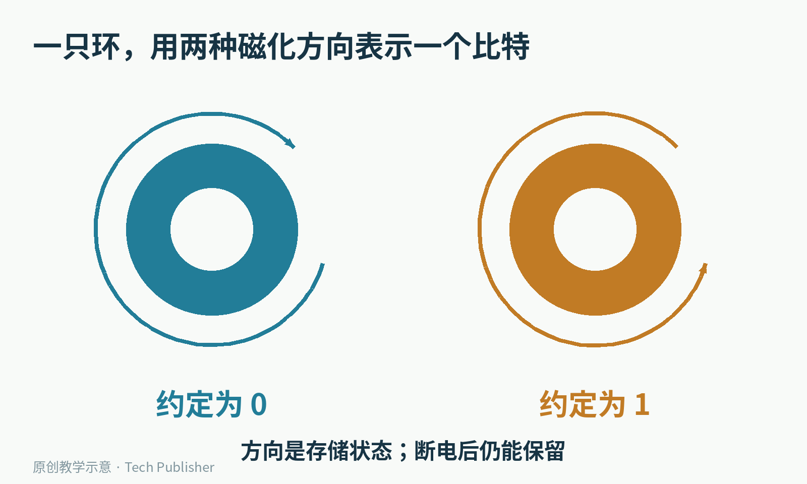
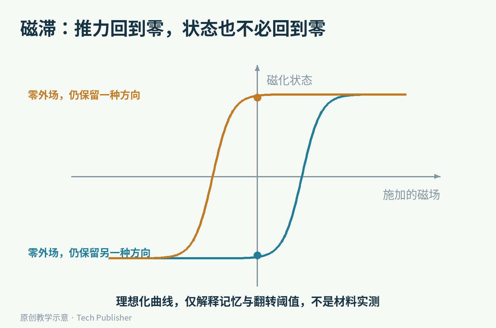
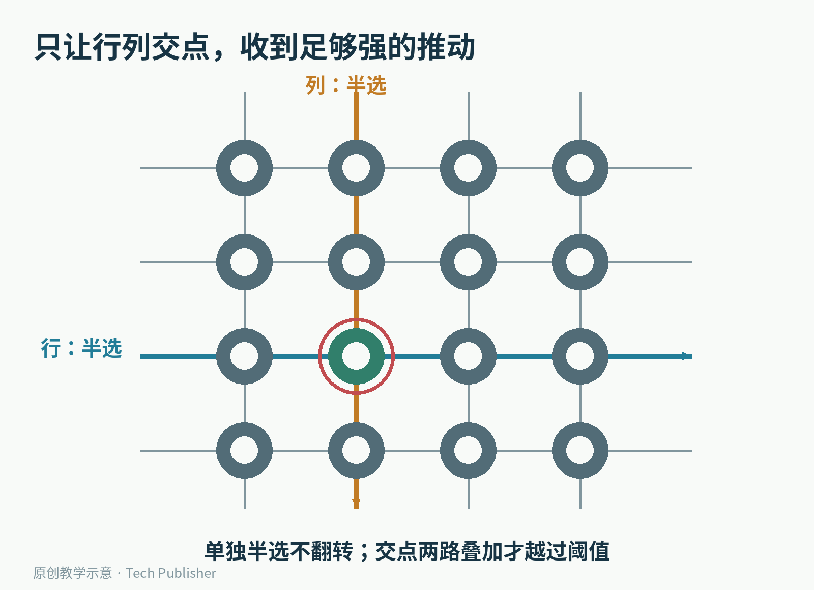
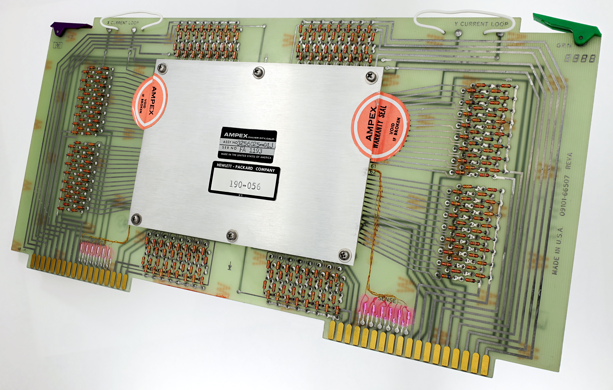
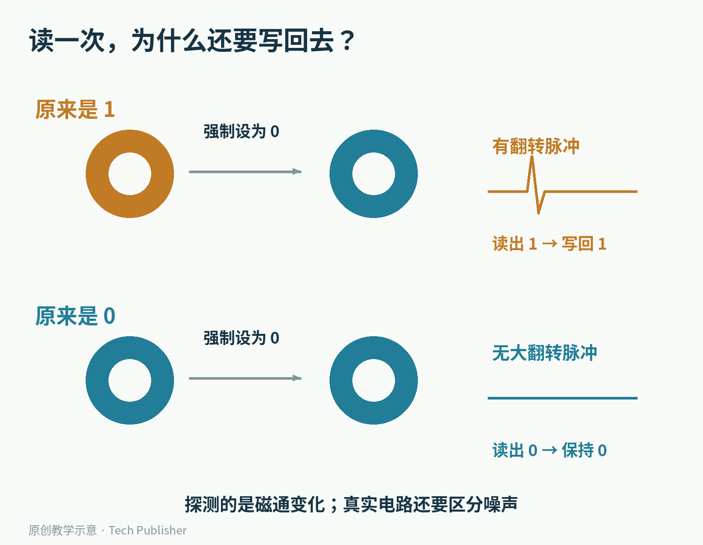
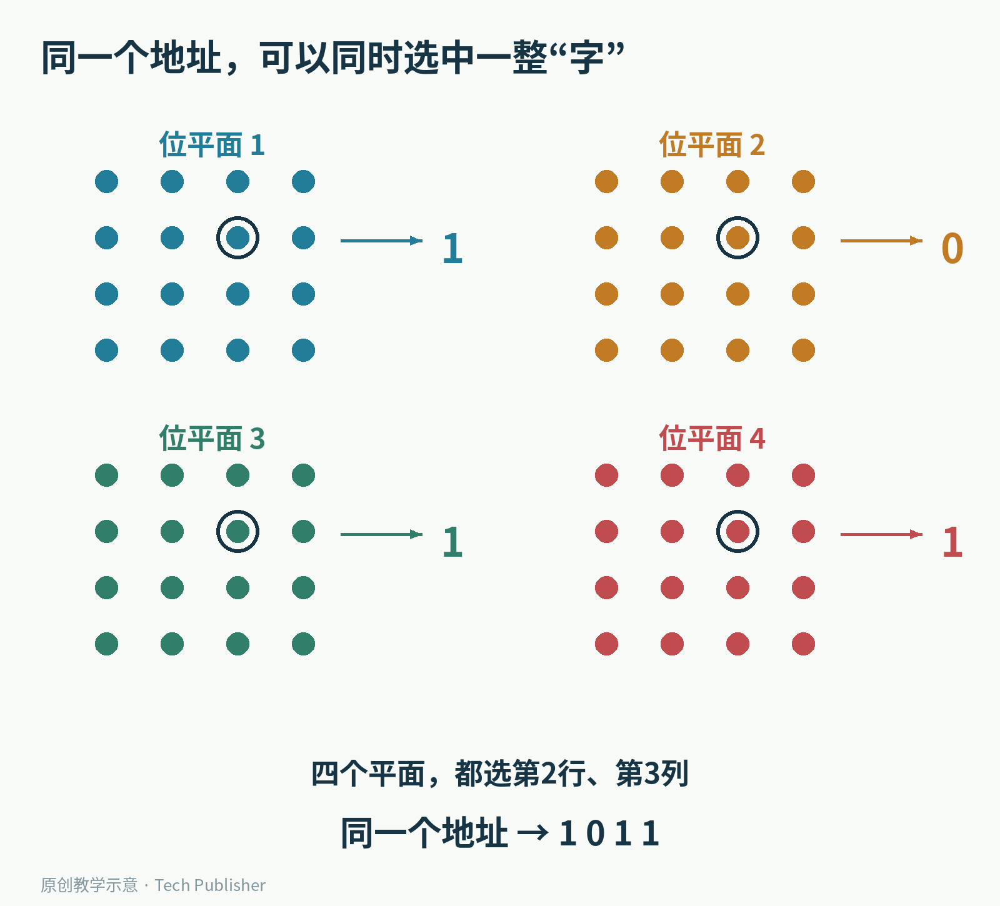
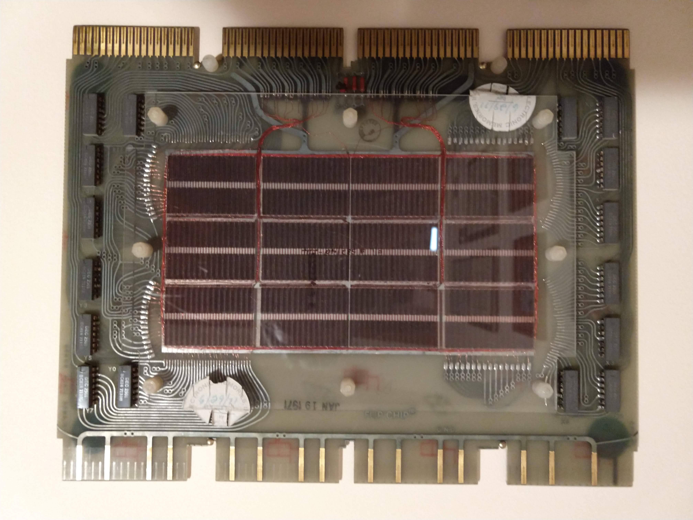
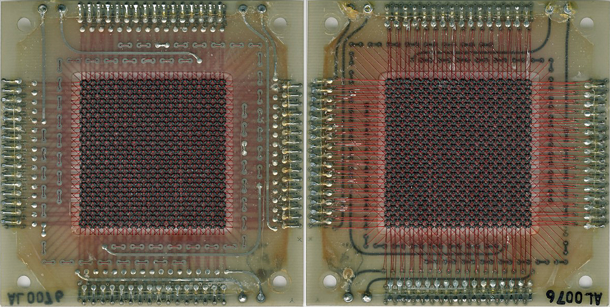
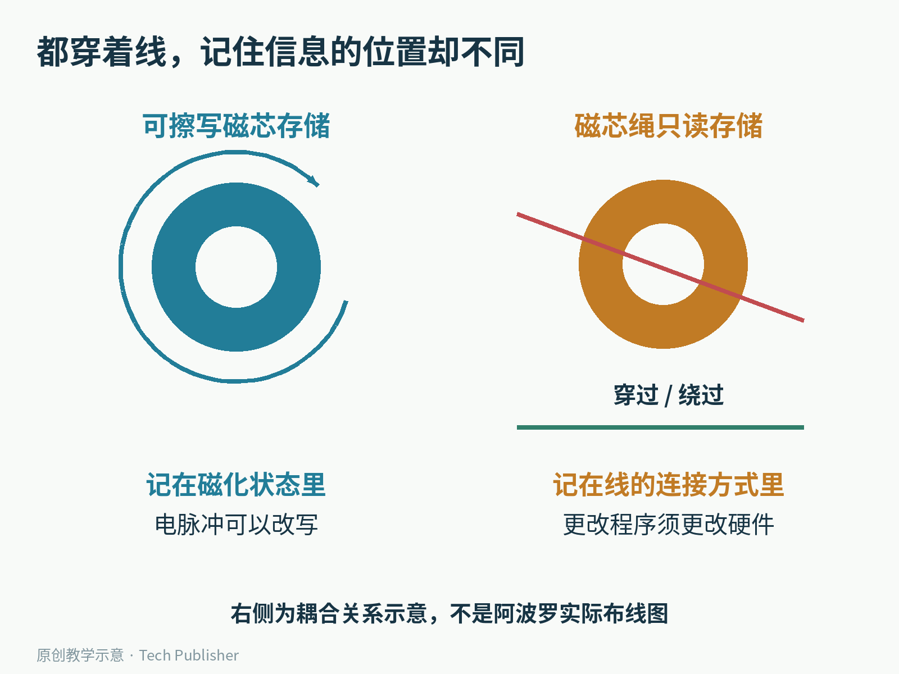

# 计算机的内存，曾经是一张穿满小铁环的网

把一块老式计算机内存放大，看到的可能不是密密麻麻的晶体管，而是许多微小的深色圆环。铜线穿过环心，横向、纵向交织，像一张极其精密的网。

这不是给电路做装饰。**每一只环，都曾替计算机记住一个0或1。**

它叫磁芯存储器。这里的“芯”不是今天所说的芯片，而是一枚用磁性材料制成的小环。在半导体内存普及之前，这种看上去带着手工气息的结构，曾经是许多计算机的主存。

HP 9101A扩展存储单元的磁芯微距照片。每个环心里都有导线穿过；放大后看到的“网眼”，正是存储结构的一部分。

它有一个很不符合直觉的特点：电源关掉，里面的信息可以留下；可是按照常见方式读一次，原来的状态反而会被改变。

一块“断电不忘、读取却会破坏内容”的内存，究竟怎么工作？

## 要存住一个比特，先找一种不会自己跑掉的状态

计算机里的0和1，需要落到真实的物理状态上。纸上的两个符号，只是我们替状态起的名字。

对于传统磁芯存储器，这两种状态是沿着环形磁路的两种相反磁化方向。你可以把其中一种约定为0，另一种约定为1。哪种叫0并不神秘，真正重要的是能否稳定地区分和控制它们。

注意：圆环不是像指南针一样整体转动。变化的是材料内部的磁化状态。外形看起来完全相同，两只环也可能记着不同的比特。

原创示意。箭头表示沿环形路径的磁化方向，不表示小环发生机械旋转。

怎么改变它？让穿过磁芯的导线流过电流。电流产生磁场，如果推动足够强，就能使磁芯翻转到另一种磁化状态。

怎么让它记住？选用具有合适“磁滞”特性的材料。这个词说的是：材料现在的状态，取决于它经历过什么，不能只看此刻施加的磁场是多少。外部磁场撤掉以后，材料仍可以保留剩余磁化。

理想化磁滞曲线。横向的推动回到零，纵向的磁化状态仍可停在两种不同位置。此图解释记忆与翻转阈值，不是某种磁芯的实测材料曲线。

门如果一松手就自动回到中间，很难只靠它的位置记住信息。磁芯的妙处，是把“刚才往哪边推过”留下来，又允许下一次足够强的电脉冲把它改掉。

当然，这只是直觉入口。真正的工程还要考虑温度、磁芯的一致性、脉冲幅度和持续时间，不是拿任意一只磁性圆环都能拼出可靠内存。

## 每个环都接一套开关，电线会不会比存储器还大？

只有一个比特时，事情不难。问题是计算机需要成千上万个比特。

如果每只磁芯都配一套独立的驱动电路和专属线路，外围设备很快就会把存储阵列淹没。磁芯存储真正关键的一步，是用共享线路选择某一只环。

想象一个4×4的教学阵列。四条行线、四条列线分别穿过磁芯。选中一条行线，只给这行的磁芯一份不足以翻转它们的推动；选中一条列线，也只给一份不足以单独翻转的推动。

**只有这条行与这条列的交点，同时收到两份推动。** 在设计好的电流方向、脉冲条件和材料阈值下，它才跨过翻转门槛。其他位于同一行或同一列的磁芯，只被“半选”，应当维持原状态。

原创4×4教学阵列。蓝色行线和金色列线各给一份半选推动，红圈处才同时收到两份。实际产品还需额外的感测、抑制或相关控制线路，图中只突出地址选择。

这叫重合电流选择，也常被称为符合电流选择。可以把它想成两把钥匙共同开一扇门：任何一把单独经过，都不足以打开。

这个想法节省了寻址所需的线路，但“半份”不是一句口号。如果材料差异太大，有的磁芯收到半选电流就翻了，有的收到完整选通电流仍不翻，系统就会写错位置。因此磁芯制造、筛选和驱动电路，是同一件事的不同部分。

HP 9101A里的磁芯模块。微距照片让人看见单个比特，完整模块则提醒我们：阵列周围还必须有连接、封装与配套电路。

## 读内存，为什么像一次“先擦掉再问”？

一只环的磁化方向不能直接从外形看出来。常见磁芯内存采用的办法，是看它在一次受控操作中有没有发生翻转。

先约定要把被选中的磁芯推到0状态，然后观察穿过磁芯的感测线。

如果它原来是1，变成0时，磁通会发生明显变化，感测线上出现相应电压脉冲。如果它原来已经是0，就不会出现同样的完整翻转信号。电路据此判断刚才存的是1还是0。

这里用到的是电磁感应：感测线响应的是磁通的变化，而不是给静止磁化状态拍一张照片。实际电路还得把有效翻转信号与半选扰动、噪声等区别开。

原创机制图。两种起始状态都被推到0，但只有原来是1的情况产生完整翻转信号。图中脉冲仅表示有无翻转差别，不是示波器实测波形。

代价也立刻出现了：不管刚才读到了什么，磁芯现在都变成了0。原先的1被读取过程改掉了。

于是一次完整的读取周期，要把读出的结果暂时放到电路里，再按需要写回磁芯。对于上层程序，它仍表现为“读了一次内存”；在底层，这个动作却可能包含“改变状态、感测、恢复”几个步骤。

这就是“破坏性读出”的含义。它不是每读一次就磨损坏一个小环，也不是电脑读完资料就自动删文件，而是读取方法会改变所读单元的磁状态，必须由硬件把信息恢复。

也因此，“断电不丢”需要准确理解。稳定存放时，磁芯不依赖持续供电维持状态；但如果电源恰好在读出与恢复之间中断，仍要考虑如何避免数据损失。非易失不等于整个系统在任意时刻拔电都万无一失。

## 一个环只有一位，计算机怎样一次读出一个数？

把所有小环排成一片，只解决了地址的一个层面。计算机通常还希望一次读取一个“字”：若干个比特共同构成一个处理单位。

一个直观做法，是让多个位平面共享同一组地址。第一个平面提供这一地址的第1位，第二个提供第2位，以此类推。选择同一行、同一列，就可以在多个平面上同时找到相应的比特，再把它们拼成一个字。

原创教学例子：每个平面有16个地址，四个平面各贡献一位，因此可以存16个4位字。它说明位与字的关系，不是某一型号的实际内部布局。

如果写入的字是1011，就不能让每个位平面都无差别地变成1。不同实现会配合抑制线等电路，在不该写1的位平面抵消选通作用。地址选择和写入哪一个值，是两个必须配合的问题。

实际产品的线路组合和布局有多种版本，不能拿一幅最简四线示意图，认定所有磁芯模块内部都长得一样。

下面这个PDP-8/E模块，就是一件真实产品：其照片说明记录了49,152个磁芯，对应4,096个12位字。看似细密的纹路背后，是可以逐位数清的容量。

PDP-8/E的一个磁芯模块。49,152个环并不是49,152字节，而是49,152位；存储容量必须先看机器的字长和计数单位。

## 1953年的转折：可靠性也能成为速度的一部分

磁芯内存不是由某个人在某一天，凭空独立发明出来的。计算机历史博物馆列出的早期贡献者包括Frederick Viehe、王安、Jan Rajchman、Jay Forrester等人，他们从不同方向研究磁性材料与信息存储。

在MIT的Whirlwind，也就是“旋风”计算机项目中，Forrester团队面对的是实时计算的要求。这里的实时不是今天广告里泛指“很快”，而是计算结果要赶得上外部系统的变化；内存频繁出故障，会直接破坏这件事。

计算机历史博物馆记载，1953年8月，Whirlwind用32×32、共1,024个磁芯的阵列展示了这类内存的优势，替代了此前问题较多的静电存储技术。重合电流选择，把材料的双稳态变成了可以扩展的随机访问存储。

“随机访问”也不是随机挑一份数据。它指能按地址访问指定位置，不必像读取一长卷磁带那样，先沿途经过许多不相关内容。

从这一点看，小环只是最容易看见的部分。让它成为有用内存的，是一整套协作：材料负责保留状态，线路负责选地址，脉冲负责改写，感测电路负责读出，控制时序负责把数据恢复。

一个可靠的比特，从来不是一个孤立零件的功劳。

从一块小型磁芯平面的两面，可以看见环阵列、穿线与外部接点怎样连成整体。这幅照片只用于观察一般磁芯存储结构，不用于识别具体计算机型号。

## 阿波罗的“编织程序”，和这种内存是不是一回事？

网上讲阿波罗计算机，常会出现“程序是用线编出来的”这句话。它有真实背景，但也很容易把两种不同存储方式混在一起。

阿波罗制导计算机既有可擦写的磁芯存储，也有存放固定程序的磁芯绳存储。两种方式都用到磁芯和导线，但信息究竟藏在哪里，有一个关键区别。

可擦写磁芯内存把信息记在磁化方向里，电脉冲可以改写。磁芯绳只读存储则利用导线是否穿过某个磁芯、是否与其耦合等连接关系编码固定信息；同一个芯可以与多条线路配合。

两者都能出现“线穿过环”的外观，却不是同一种存储机制。前者改状态，后者改连接方式。要更改固定程序，不能只发一个普通的写内存指令，还需要对应的硬件制作与检查流程。

原创概念对照。右侧只解释“穿过或绕过”的耦合关系，不是完整磁芯绳电路，更不是说一个芯只能存一个程序位。

因此，把所有磁芯内存都叫成“手工把软件织进去”，会漏掉它作为可改写主存的那段更广泛的历史。也不能仅凭一张穿线照片，就判断眼前的是RAM还是固定程序存储。

## 它为什么还是被芯片替代了？

磁芯能保留信息，也能按地址快速访问，为什么后来退出了主流计算机内存？

因为好技术也要面对制造方式的竞争。磁芯、穿线、焊接、驱动和感测电路，都需要成本与空间。随着容量增长，要让更多环和导线可靠地排列、连接、筛选，工程负担并不会消失。

半导体技术则沿着另一条路线进步：在晶圆上批量制造越来越密集的存储单元。到了1970年代，半导体内存逐渐取代磁芯，主存不再需要由这么多可以在微距照片中辨认的小环组成。

这并不意味着“磁性记忆”失去了价值，而是这个时代的具体实现，被另一种更适合扩大规模的实现超过了。非易失与可改写仍然重要，成本、速度、功耗、密度和制造良率也同样重要。

今天再看这张铁环网，最动人的地方并不是“以前的人多么能将就”。它展示了一种相当精巧的工程判断：先找到一个稳定的物理状态，再用阈值和共享线路把它变成可选、可读、可写的地址空间。

在比特缩进几乎看不见的芯片以前，计算机曾经把这套逻辑，清清楚楚地穿在一只只小环里。

参考资料：[计算机历史博物馆：Whirlwind与磁芯内存](https://www.computerhistory.org/storageengine/whirlwind-computer-debuts-core-memory/)、[磁芯存储专题](https://www.computerhistory.org/revolution/memory-storage/8/253)、[Forrester的重合电流存储专利](https://patents.google.com/patent/US2736880A/en)、[MIT课程历史访谈研究](https://courses.csail.mit.edu/6.972/Core%20Report.html)、[史密森尼：阿波罗磁芯绳存储](https://airandspace.si.edu/stories/editorial/rope-mother-margaret-hamilton)。

图片来源：Mister rf，[HP模块](https://commons.wikimedia.org/wiki/File:HP_9101A_extended_memory_unit.-_magnetic_core_memory_module.jpg)、[微距原图](https://commons.wikimedia.org/wiki/File:HP_9101A_extended_memory_unit.-_magnetic_core_memory_module_-_macro_detail.jpg)，[CC BY-SA 4.0](https://creativecommons.org/licenses/by-sa/4.0/)；RoySmith，[PDP-8/E模块](https://commons.wikimedia.org/wiki/File:PDP-8_core_memory.jpg)，CC BY-SA 4.0；Jonathan H. Ward，[磁芯平面正反面原图](https://commons.wikimedia.org/wiki/File:Apollo_1024_bit_core_memory_module.jpg)，[CC BY-SA 3.0](https://creativecommons.org/licenses/by-sa/3.0/)。照片完整保留画面，必要轻压缩仍按原许可提供；机制图为原创教学示意。
