# 不把身体切开，CT 怎么算出里面的一片？

医院里的 CT 机看起来像一个很大的圆环。人躺在检查床上，从圆环中间经过，屏幕上就能出现身体内部一层层的图像。

这里最奇妙的地方，是探测器并没有直接“拍到那一片”。它接到的，只是一束束 X 射线穿过身体以后，还剩多少的信号。切片图像是计算出来的。

CT 的中文名称是计算机断层成像。“断层”指把内部结构按薄层来表示，不是真的切开身体。要理解它，我们可以先把身体换成一个只有四格的小盒子，自己当一次计算机。

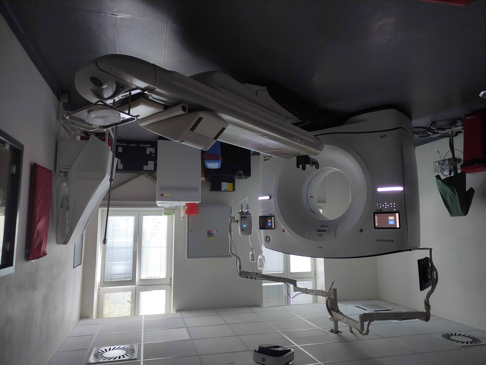

这是捷克 Slaný 的一台 CT 设备。圆环里装着射线源、探测器和相关机械装置；外壳让它们看起来像一个安静的整体。

## 一张影子，为什么不够？

设想一个密封盒子，内部有四个格子。格子里的数字，表示它对某种“探测光”的阻挡程度。为了先看清逻辑，我们暂时制定一条玩具规则：光穿过一排格子时，探测器给出这一排数字的总和。

现在从左边看。上排读数是 3，下排读数是 7。你能知道里面是什么吗？

上排可能是 1 和 2，也可能是 2 和 1。下排可能是 3 和 4，也可能是 2 和 5。很多不同的内部结构，会留下相同的“影子”。

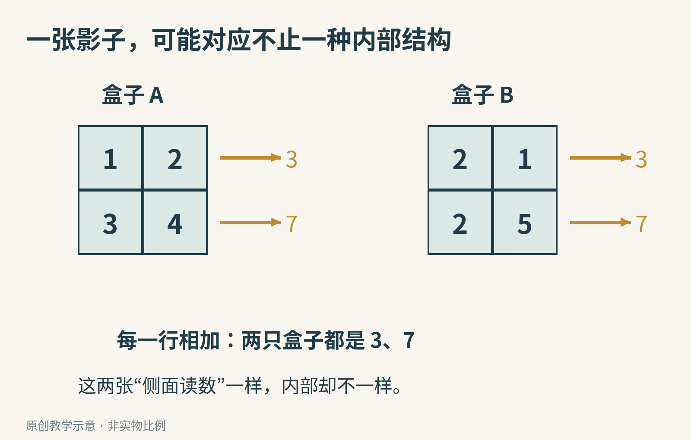

真正的普通 X 光照片也会遇到类似困难：同一路径上的结构叠在了一起。某处的变化来自前面、后面，还是两处共同作用？一个方向的测量不容易分清。

最自然的办法是绕到另一边，再看一次。

## 横着看、竖着看，居然还是不够

给四个格子起名字：上面两个叫 a、b，下面两个叫 c、d。横着测，得到 a＋b＝3、c＋d＝7；竖着测，得到 a＋c＝4、b＋d＝6。

四个未知数、四条读数，听起来刚好够了。但下面两个盒子，仍然同时符合它们。

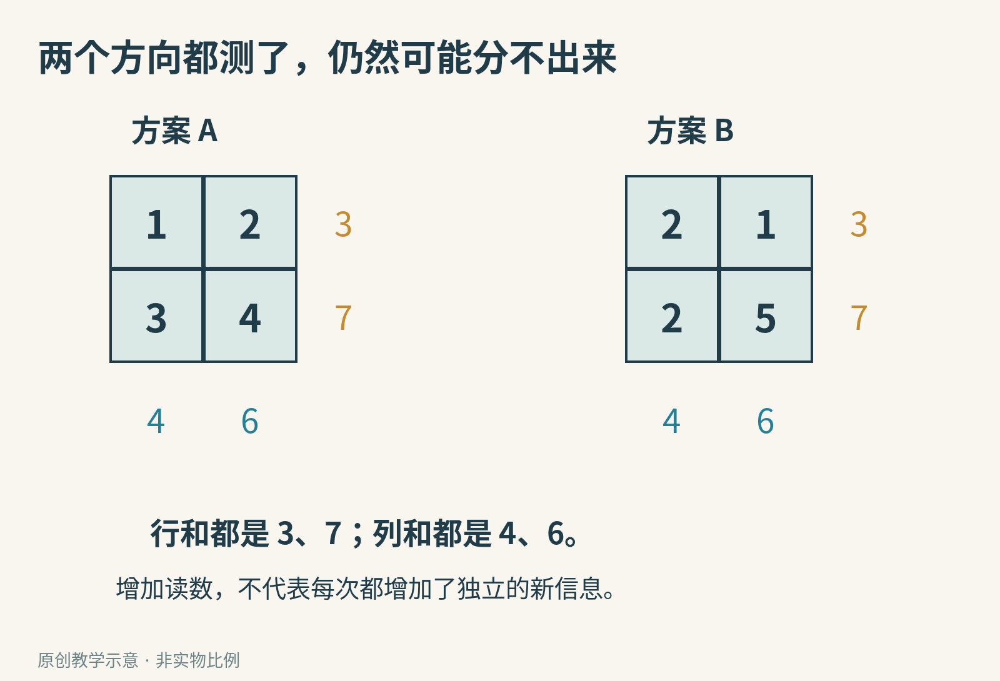

为什么四条信息没能锁定四个数字？因为它们有重复的部分。

两行加起来，总数是 10；两列加起来，总数也是 10。知道两行和第一列，就已经能算出第二列。表面有四条读数，其中一条却没有增加独立的新信息。

这是一种很重要的科学直觉：仪器给出的数字更多，不一定意味着你知道得更多。关键是新测量有没有从不同方向，排除旧测量分不开的情况。

## 加一个斜方向，答案开始露出来

假设再得到一条额外信息：左上格和右下格的和是 5。

左边方案的 1＋4＝5，右边方案的 2＋5＝7。只多问了一个合适的问题，就能排除右边那个候选。

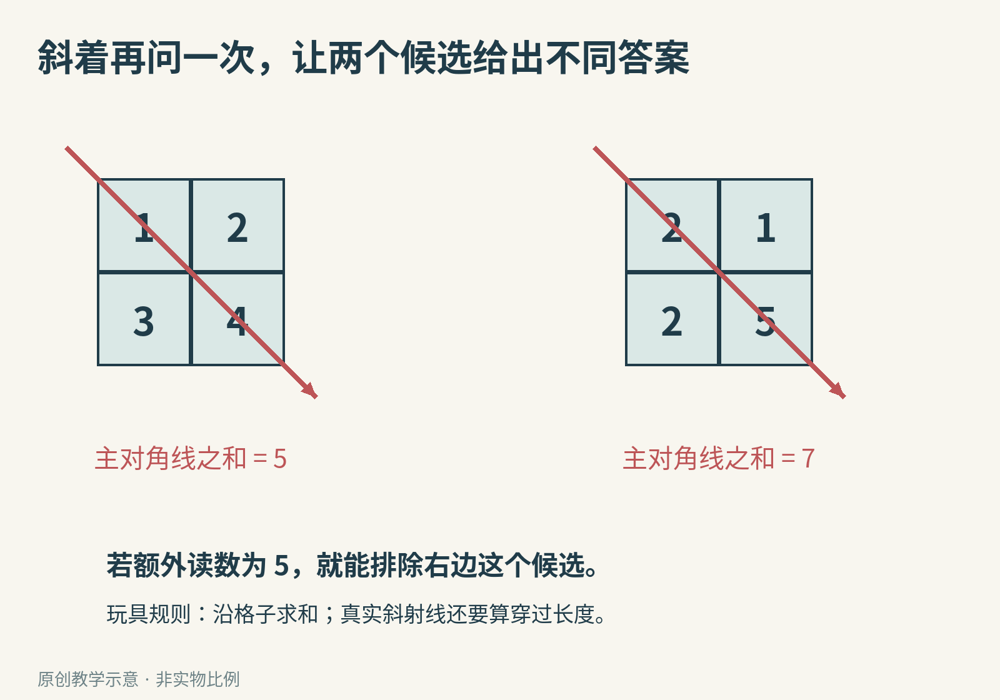

你甚至可以把四格全部解出来，不需要大学数学。

由上排总和，b＝3−a；由左列总和，c＝4−a。下排总和是 7，所以 d＝7−c＝3＋a。最后代入新的条件 a＋d＝5，就得到 a＋3＋a＝5，也就是 a＝1。

剩下的 b、c、d，自然分别是 2、3、4。

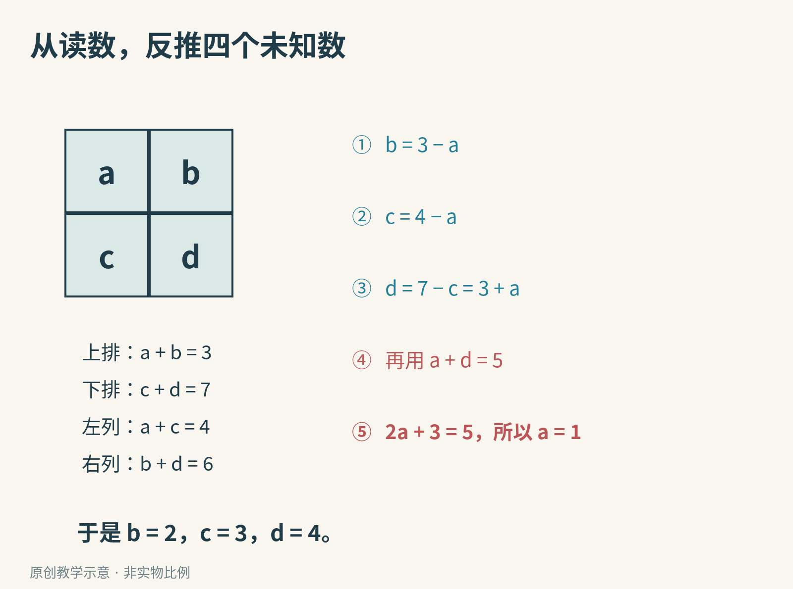

这是本文构造的教学模型。我们已实际运行枚举程序核对：若四格都取 0 到 7 的非负整数，仅用行和、列和，有四组候选；加入主对角线和等于 5 后，只剩 1、2、3、4 这一组。

这个小例子说明了“从多个方向的测量反推内部”的想法，但还不是一台 CT。真实斜射线穿过不同格子的距离不同，不能把每个经过的格子都不加区别地算一次；真实材料的数值也不是只能取整数。

## 真正的 X 射线，并不是沿路做小学加法

实际探测器测的是剩余射线强度。相同的材料多放一层，通常会让剩下的射线再减少一定比例，而不是每层都机械地减去同一个数。

可以用“每层都让一半通过”的假想材料建立直觉：100 份入射，穿过一层剩 50，穿过两层剩 25。两层的作用是连续相乘，不是把 50 减两次。

但如果我们改问“总共经历了几次减半”，结果又可以相加：一层记 1，两层记 2。数学中的对数，能完成这类把乘法关系转换成加法关系的工作。

CT 的基础物理模型里，经过校准并作相应变换的测量，可以对应到一条射线路径上衰减作用的累积。衰减就是射线穿过物质后变弱。每一小段贡献多少，既与材料有关，也与射线在其中走了多长有关。

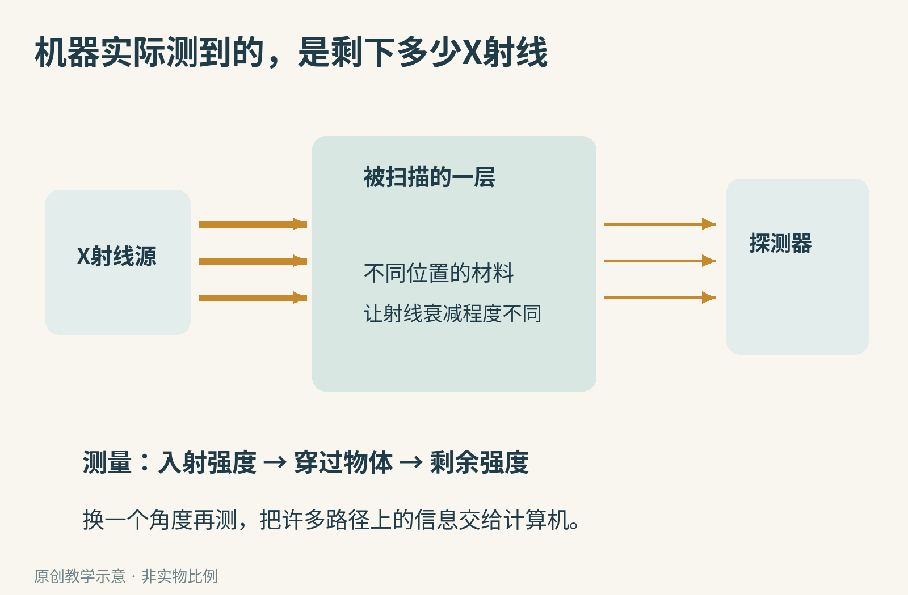

因此，前面的格子加法没有白做。它把复杂问题的骨架留下来了：许多路径的累积信息已经知道，内部每一处的贡献还不知道，我们要反过来求它们。

想继续深入时，可以读研究者 Kak 与 Slaney 的[断层成像教材](https://www.slaney.org/pct/pct-toc.html)。本文只借这个桥梁建立直觉，不要求你先掌握对数和积分。

## 圆环里面，谁在绕着谁转？

按美国国立生物医学成像与生物工程研究所 NIBIB 的[介绍](https://www.nibib.nih.gov/science-education/science-topics/computed-tomography-ct)，常见 CT 设备的 X 射线源会绕着被扫描对象运动，对面的探测器接收透过的射线。圆环里的旋转组件，帮助机器从许多方向采集数据。

下面是一台设备打开外罩后的照片。现在你能看到，它并不是一部藏在圆洞里的普通相机。

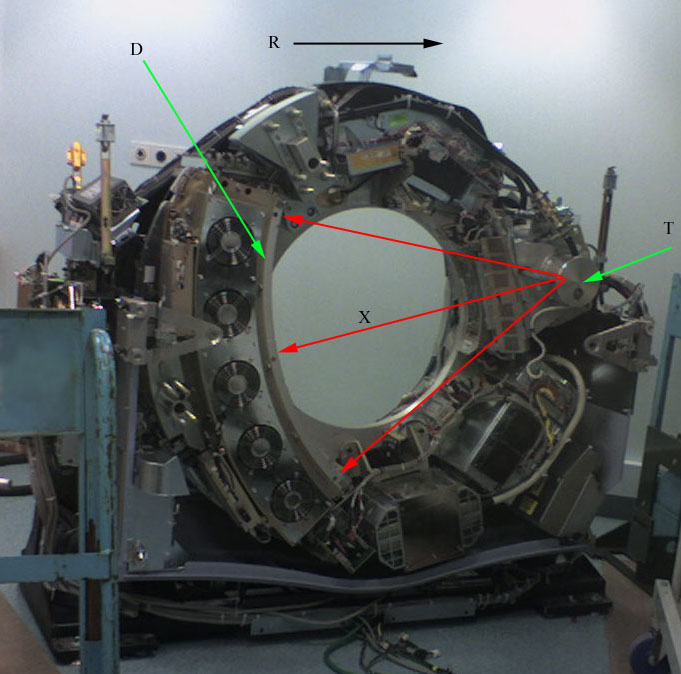

计算机把这些测量组织起来，寻找能与它们尽量一致的内部图像。这类从结果推回原因的问题，叫作逆问题：已知内部去预测测量，是正向；已知测量去恢复内部，是逆向。

把身体表示成很多小格子，每个格子要估计一个数，就可以理解“计算量从哪里来”。格子越多，未知数越多；射线路径越多，约束也越多。真实算法并不只是把课本方程组放大，还要处理扫描几何、信号校准、噪声和重建速度。

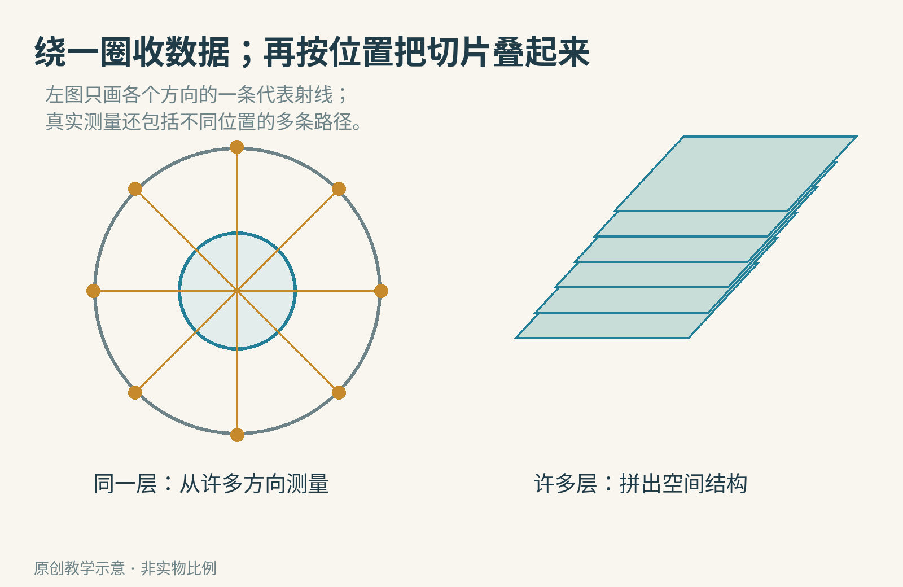

多个位置的切片可以叠起来，形成三维表示。现代设备的扫描方式很多，例如检查床一边移动、旋转组件一边转动的螺旋扫描；所以不能把“转一圈、停一下、只产出一片”当成所有机器的固定步骤。

你在科普视频里看到的立体骨骼或器官，往往还经过了分割和三维显示。分割就是把图像里属于不同结构的部分标出来。

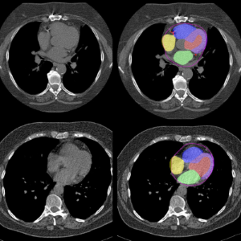

这幅来自 NIBIB 所介绍研究的示意，把计算得到的结构涂成不同颜色。颜色是为了帮助识别，不是人体内部真的发出这些彩色光。形成图像、标出器官、判断临床意义，是相互关联但不同的步骤。

## 这个想法，怎样从纸上走进医院？

20 世纪 70 年代，工程师戈弗雷·豪恩斯菲尔德参与开发的 EMI 扫描器，把计算重建做成了可用于临床的设备。1979 年，他与物理学家艾伦·科马克共同获得诺贝尔生理学或医学奖，获奖工作是计算机辅助断层成像的发展。

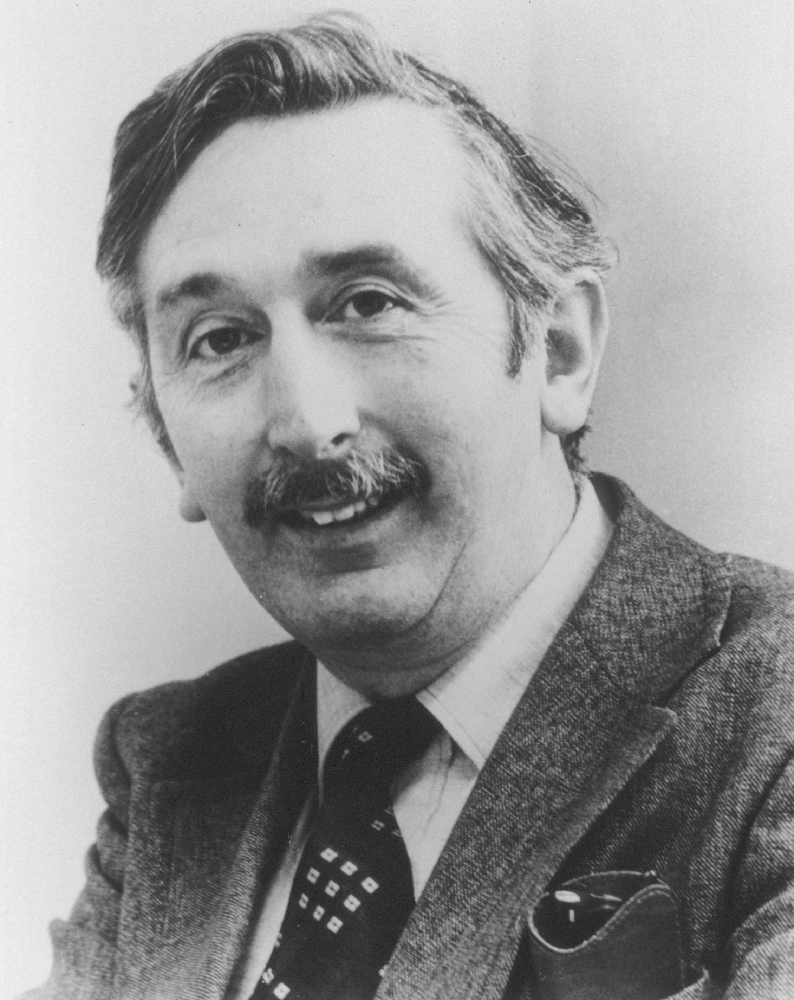

豪恩斯菲尔德的贡献提醒我们，解决问题并不总是找到一种“看得更透的眼睛”。有时是换一种提问方式：单张照片把信息叠在一起，那就采集一组互相补充的测量，再让计算机把它们拆开。

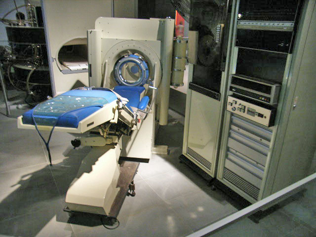

这张照片中的早期 EMI 头部扫描设备，与今天医院的圆环外观不同，但都体现了同一条合作关系：探测器负责可靠测量，计算机负责把多个角度的信息重建成图像。

## 能算出一幅图，不代表什么都知道了

回到四格盒子。如果我们只保留横向和纵向测量，却要求程序一定输出一组数字，它当然可以选出一个答案。但另一个答案也许同样符合数据。

真实扫描也要面对类似的限制。角度不足会让内部结构更难区分；探测器读数有随机波动；被扫描对象运动后，不同时刻的测量也可能不再对应同一个静止结构。这些都可能造成模糊或伪影。伪影指的是成像过程产生、却容易被误看成物体结构的图像特征。

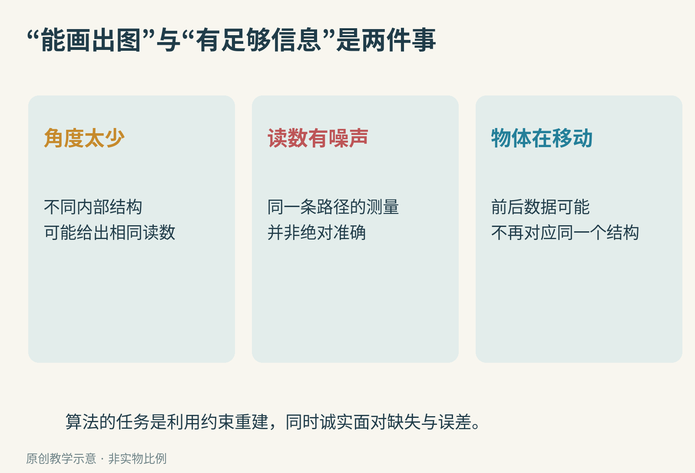

算法还可以引入先验条件，比如“图像某些区域应当较平滑”。这样能帮助稳定求解，但条件本身也会影响结果。不能因为最后得到一张清楚的图，就忘了询问它用了哪些测量、依赖哪些假设。

CT 使用电离辐射，检查也有相应风险与获益判断。是否需要检查、采用什么方案，应由医疗专业人员结合具体情况决定；本篇是成像原理课，不提供个人诊断或检查建议。动手探索只用纸笔、普通可见光或数字模型，不制造 X 射线装置。

## 现在，轮到你出题

在纸上画四格，偷偷填入四个 0 到 7 的整数。把两行、两列的和交给同学，先不告诉内部数字。

请对方找到两组都符合读数的答案。如果只能找到一组，不妨换一组内部数字再试：某些取值加上“非负整数”的限制，本来就会缩小候选范围。

接下来，你只能多提供一条信息。选择“再告诉一次四格总和”，还是“告诉主对角线的和”？在我们的例子里，前者没有新信息，后者才帮上忙。

再追问一步：如果把四格扩大成九格，只知道三行和三列，情况会怎样？一条对角线一定够吗？先找反例，再猜需要什么测量。

这时你已经走进了 CT 背后的核心问题：我们究竟要怎样观察，才能让不同的内部世界，不再留下同样的影子？

图片来源：[现代设备](https://commons.wikimedia.org/wiki/File:CT_Slan%C3%BD_01.jpg)，Palu，[CC BY-SA 4.0](https://creativecommons.org/licenses/by-sa/4.0/)；[内部结构](https://commons.wikimedia.org/wiki/File:Ct-internals.jpg)，ChumpusRex，[CC BY-SA 3.0](https://creativecommons.org/licenses/by-sa/3.0/)；[早期 EMI](https://commons.wikimedia.org/wiki/File:Emi1010.jpg)，Philipcosson（Bubba73 调亮版本），公有领域；[豪恩斯菲尔德](https://commons.wikimedia.org/wiki/File:Godfrey_Hounsfield.jpg)，美国国家医学图书馆藏，作者不详，公有领域标记；[分割示意](https://www.nibib.nih.gov/science-education/science-topics/computed-tomography-ct)，Slomka laboratory，[CC BY 4.0](https://creativecommons.org/licenses/by/4.0/)。上述图画面未裁改，必要的文件大小适配另有记录；其余为原创教学示意。历史参考[1979年诺贝尔奖官方资料](https://www.nobelprize.org/prizes/medicine/1979/summary/)。
