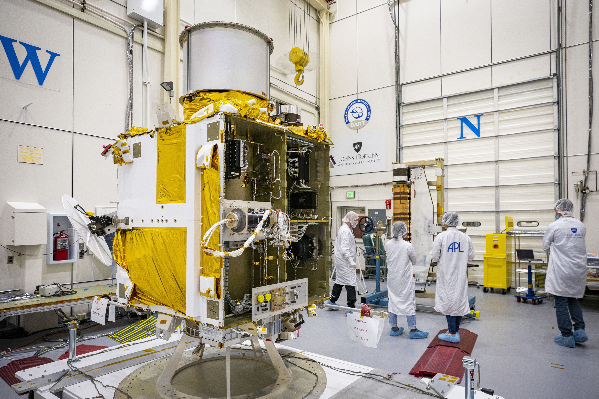
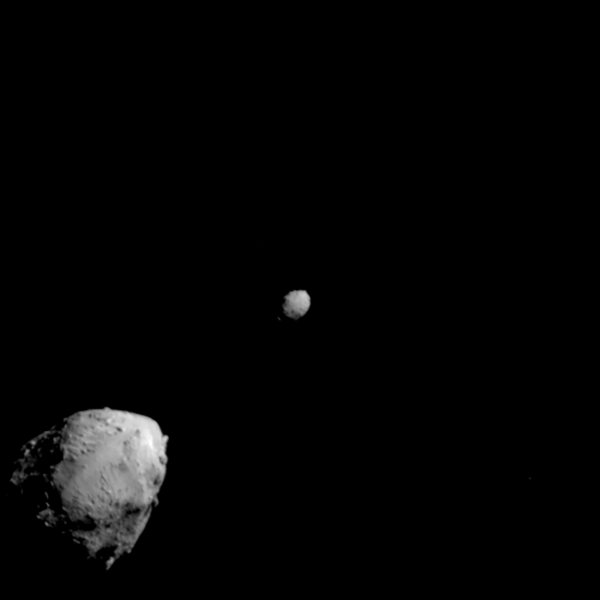
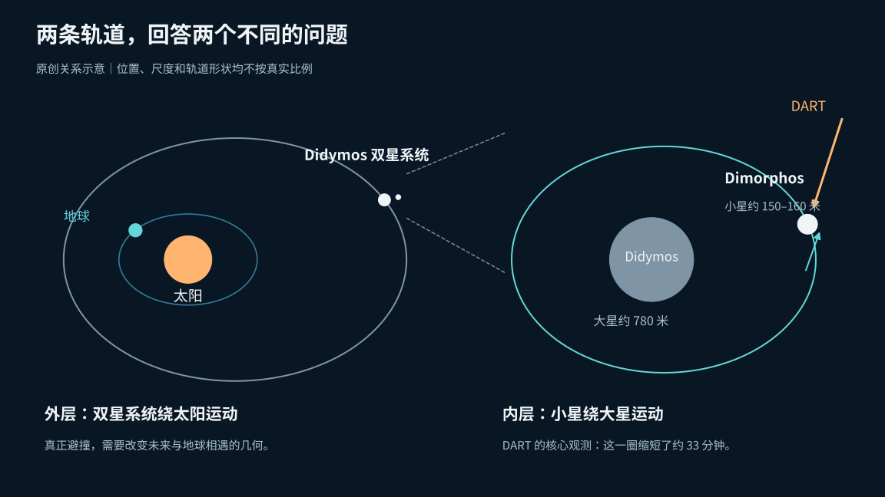
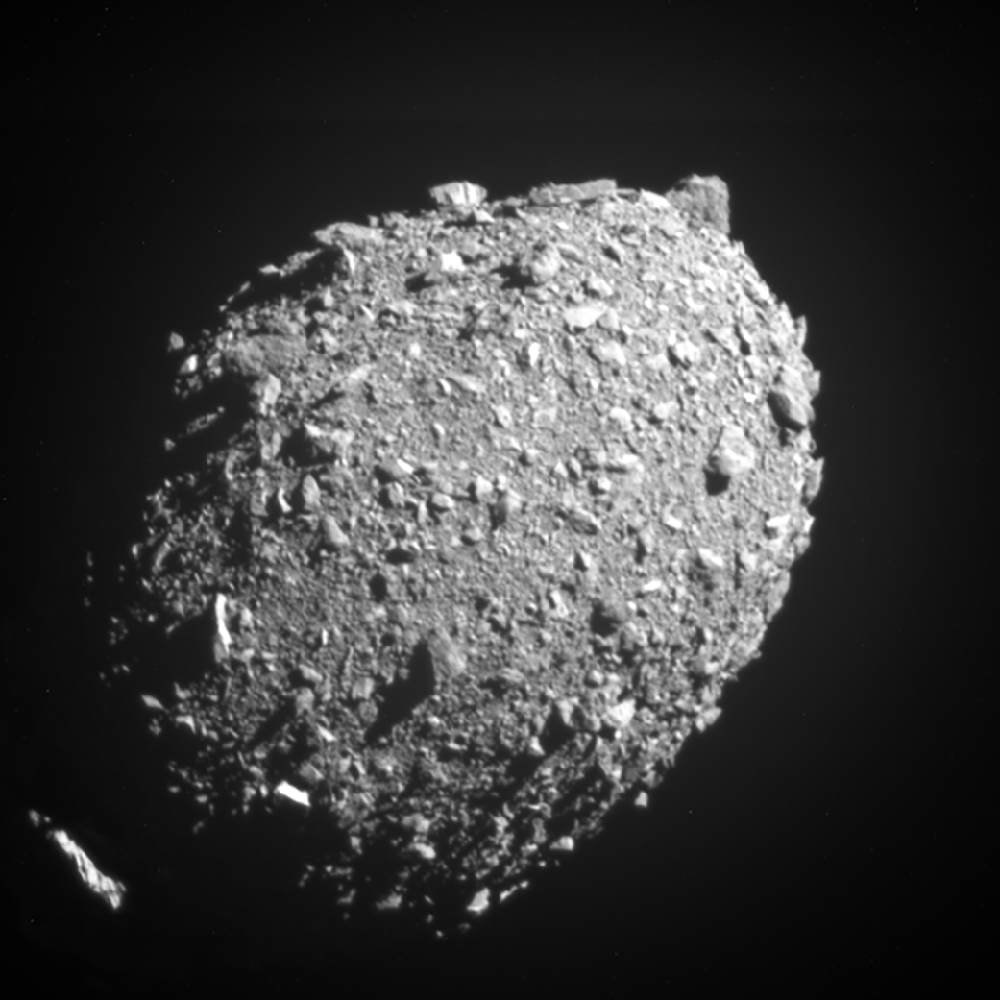
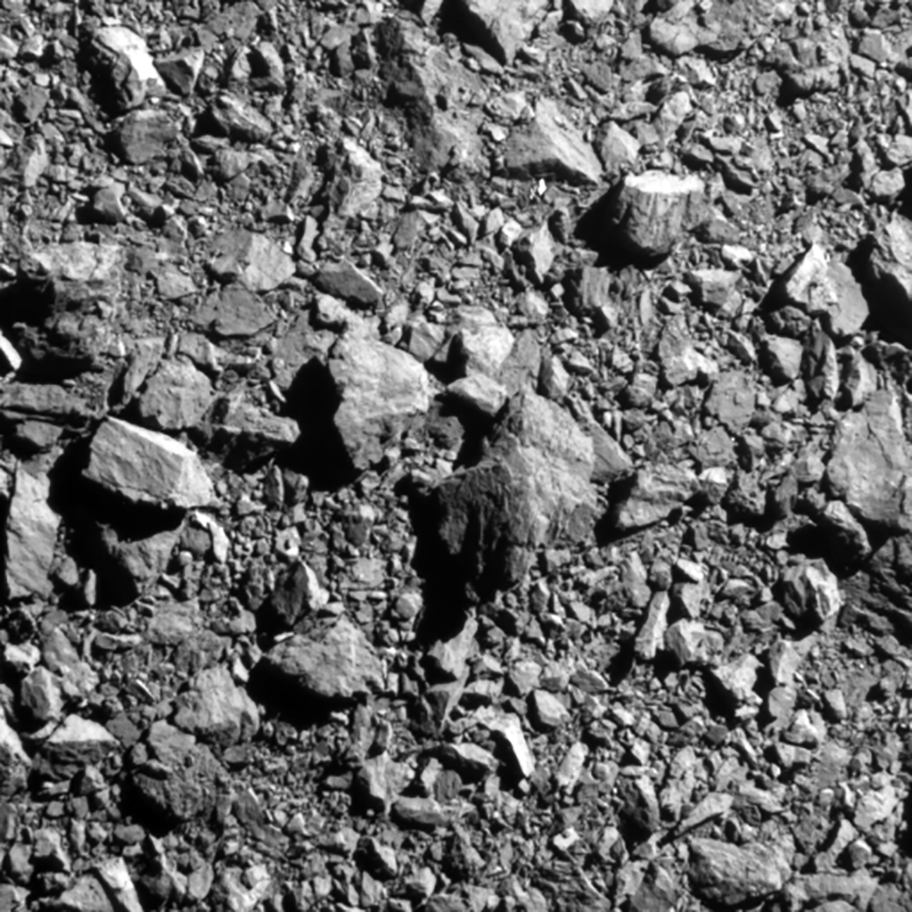
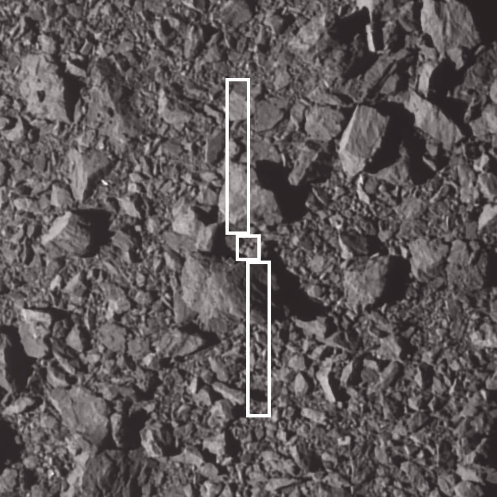
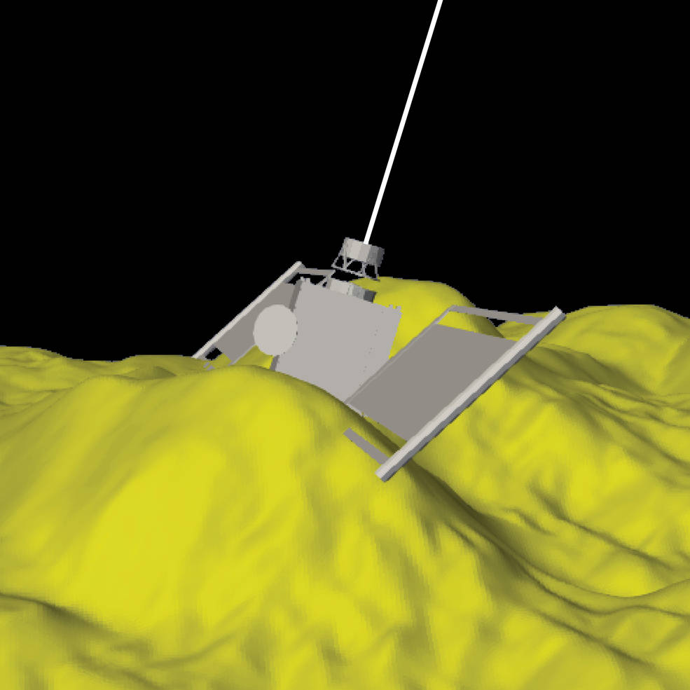
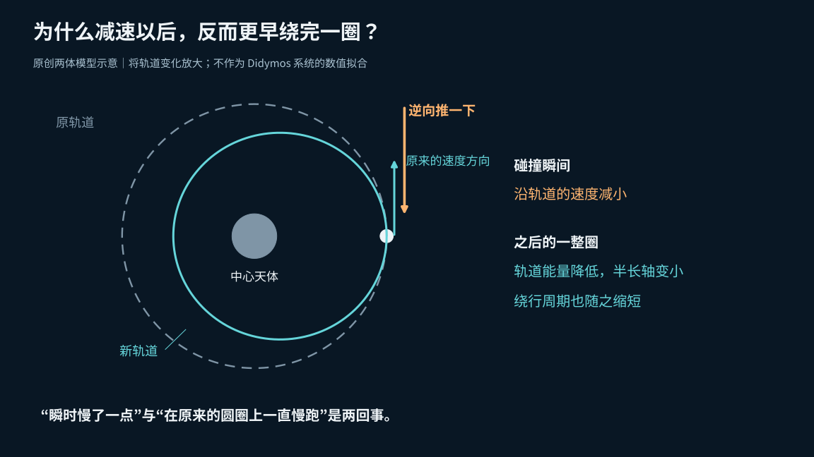
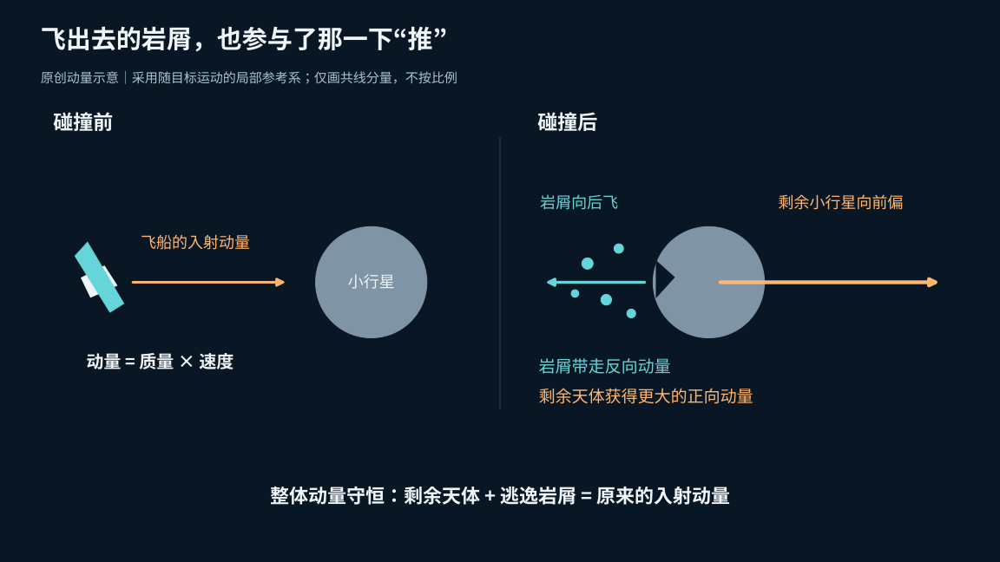
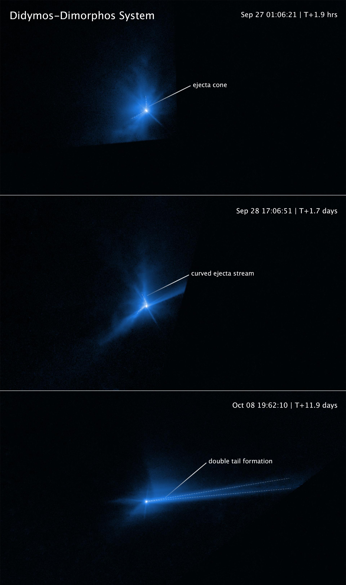

# 撞偏小行星，先拨快它的钟：DART 的一撞究竟改变了什么

一艘不到一吨的飞船，怎样推动一颗一百多米宽的小行星？答案里最容易被漏掉的，恰好是那些被撞飞的石头。

DART 是美国航天局 NASA 的一次行星防御试验：把无人航天器当作高速撞击器，主动改变小行星的运动。2022 年 9 月 26 日 23:14 UTC，它撞上了 Dimorphos。撞击前后的天文观测显示，这颗小行星绕同伴转一圈的时间，缩短了约 33 分钟。[试验结果论文](https://arxiv.org/abs/2303.02077)

这个结果有明确的分量，也有明确的边界。DART 证明了人类能够瞄准一颗小天体，用撞击改变它的轨道；它并没有完成一次“把即将撞上地球的天体救回来”的实战。目标原本就不威胁地球，试验选用的还是一对互相绕行的小行星。[试验背景](https://www.jpl.nasa.gov/edu/resources/teachable-moment/the-science-behind-nasas-first-attempt-at-redirecting-an-asteroid/)

要理解这场试验，值得沿着三个问题往下追：改的是哪条轨道？那么小的一艘飞船，推力为什么够用？这一次成功，能给下一颗小行星提供多大保证？

*本文回看 2022 年的撞击试验及后续研究，资料核对截至 2026 年 10 月 8 日，不作为当天新闻。*

*DART 的真实硬件。金色包覆的本体两侧装着尚未展开的太阳翼；它最终需要把相机、导航、供电与推进系统一起送到碰撞位置。*

## 一颗小行星，也可以是一只可以校时的钟

DART 的目的地有两个名字。较大的 Didymos 直径约 780 米；较小的 Dimorphos 是它的卫星，尺度约 150—160 米。后一个范围是为了给出大小直觉：不规则天体可以按不同轴长或者等效直径描述，不能把一张近似球形的示意当成精确形状。[任务报告](https://ntrs.nasa.gov/api/citations/20230015804/downloads/DART%20Final%20Technical%20Report.pdf)、[接近目标的原始影像说明](https://www.nasa.gov/solar-system/darts-final-images-prior-to-impact/)

*碰撞前约两分半，较大的 Didymos 在左下，DART 瞄准的 Dimorphos 在右上。此时相机距目标系统约 920 千米；这是两颗天体还能同时完整进入画面的最后一幅影像。*

这套系统存在两个层次的运动：两颗天体作为一个整体绕太阳运行；在系统内部，Dimorphos 又绕 Didymos 运行。严格说，两者都绕共同质心运动，只是大星的摆动小得多。

**“轨道缩短 33 分钟”说的是里面的这一圈。** 它不是整对天体绕太阳一年的变化，更不是小行星飞向地球的倒计时减少了 33 分钟。

选择双小行星的妙处，就在于它自带一只可以反复读数的钟。撞击前，Dimorphos 绕大星一圈约需 11 小时 55 分钟；撞击后约为 11 小时 22 分钟。望远镜不必一直分辨出两块石头的轮廓，也能利用周期性的亮度变化追踪它。[轨道周期研究](https://arxiv.org/abs/2303.02077)

当观测方向合适时，小星经过大星前后，遮挡或者进入阴影，会让整个系统的亮度出现变化。把这些变化发生的时刻连起来，就能读出绕行周期。再与雷达数据交叉比较，可以检查这只“钟”是否真的走快了，而不是把一次偶然的亮暗误认成轨道改变。

*两个尺度上的问题不同。DART 用双星内部的周期变化，检验撞击能否有效改变天体运动；真正的地球避撞任务，则需要计算天体与地球未来怎样相遇。位置和尺度均为示意。*

这个设计让一次很小的速度变化，有了清楚、可重复测量的结果。它也提醒我们：测出了内部绕行的变化，不能直接把同一个“33 分钟”搬到任何一颗危险天体上。

## 第一步不是撞得够猛，而是先认对那颗小石头

在最后的高速接近中，DART 不能靠地面人员看着直播逐帧遥控。它需要自己从图像里识别目标，再修正飞行方向。

承担“眼睛”角色的是 DRACO，一台兼用于科学成像与导航的相机。处理图像、判断目标位置并引导接近的软件叫 SMART Nav。远处的双星起初只是光点，随后才能分开，航天器还要在两者之间选中较小的 Dimorphos。最终任务报告记录，DART 以约 6.1 千米/秒的相对速度撞上目标，撞击时质量为 579 千克。[任务报告](https://ntrs.nasa.gov/api/citations/20230015804/downloads/DART%20Final%20Technical%20Report.pdf)

*撞击前 11 秒，约 68 千米外的 Dimorphos。这是最后一幅容纳了整颗小星的画面；真实表面远比光滑球体复杂。*

这一步验证的是一项工程能力：面对事先没有近距离勘察过的小目标，航天器能否完成自主末端制导。它不是只要把发射方向算准，就可以静候命中的长距离投石。

随着距离迅速缩短，图像里的一块块岩石也从“地貌纹理”变成了碰撞对象。这里没有均匀平整的靶板：飞船本体、细长太阳翼，以及不同大小的石块，会以不同方式接触。

*最后一幅完整传回的图像拍于撞击前约两秒，距离约 12 千米，画面对应约 31 米宽的地表。照片中的块状结构是实际岩石，不是模拟生成的碎片。*

研究团队把航天器外形叠回最后的地表图像，又根据这些图像重建局部地形，判断撞击落在了哪里。这些重建把“一个点撞另一个点”的简化问题，重新放回了有尺寸、有表面起伏的真实世界。

*白色轮廓表示航天器及两片太阳翼在撞击区的投影。附近最大的石块约 6.5 米宽；底图由 DART 在撞击前三秒拍摄。*

*这是利用照片建立的数字地形与航天器位置重建，不是撞击现场摄影。它显示：本体落在两块大石之间，太阳翼则接触到了两边的岩块。*

两张重建图并不直接告诉我们最终能偏转多少，却说明了为什么真实撞击必须测量，不能只用飞船质量和一个理想球体就包办所有答案。[撞击重建与研究概述](https://www.nasa.gov/science-research/planetary-science/nasas-dart-data-validates-kinetic-impact-as-planetary-defense-method/)

## 速度减小了，为什么一圈却变短了？

“绕完一圈更快”容易让人联想到加速。DART 的结果却相反：2023 年的动力学研究根据周期变化推得，Dimorphos 沿原来轨道运动方向的速度分量，在撞击瞬间减小了约 2.70 毫米/秒。[动量研究](https://arxiv.org/abs/2303.03464)

关键在于，轨道不是钉死在太空里的跑道。

先用一个简化的两体模型建立直觉：一颗小天体原本沿近圆轨道绕大天体运行，忽然受到一个逆着运动方向的推力。它在那个位置的速度降低，轨道能量也降低；接下来它不再沿原来的圆圈走，而是进入一条半长轴更小的椭圆轨道。

半长轴可以粗略理解为椭圆轨道的总体大小。在中心天体质量不变的两体模型里，轨道周期的平方与半长轴的立方成正比。所以轨道整体缩小，绕一圈所需的时间也缩短。

“碰撞瞬间慢了一点”，与“在同一条跑道上全程慢跑”，是两回事。沿新轨道向内运动时，引力还会继续改变它的速度。

*把轨道变化放大之后，可以看清两件事同时成立：撞击处的瞬时速度降低，之后那一整圈的周期也缩短。实际研究还要处理两颗不规则天体的引力、姿态与轨道耦合。*

真实的 Didymos 系统比这个教学模型复杂。2023 年公布的早期结果为周期缩短 **33.0 ± 1.0 分钟**，这里的误差范围采用论文的 3σ 表述。2024 年的一项后续研究把观测时间拉长，给出了约 **33 分 15 秒**的变化，还发现撞击后的轨道与形状变化需要一起建模。[早期周期论文](https://arxiv.org/abs/2303.02077)、[后续轨道与形状研究说明](https://www.nasa.gov/missions/dart/nasa-study-asteroids-orbit-shape-changed-after-dart-impact/)

这两个数字不应该被拼成一次“测量错误”。它们对应不同阶段、不同精度的分析；后来的工作还追踪了撞击后继续发生的轨道演化。对于理解机制，“约 33 分钟”已经足够。对于任务设计，则必须知道数字对应哪个时期、什么模型，以及多大的不确定性。

## 推动小行星的，不止飞船本身

如果只把 DART 想成一颗粘在靶子上的弹丸，就会漏掉这次试验最重要的部分。

动量等于质量乘以速度，而且有方向。飞船很轻，但相对速度很高，因此能带入可观的动量。碰撞后，目标的速度变化还要由它自身的质量决定：同样的一下，对较轻天体的影响通常更大。

不过，高速撞击还把目标表面的物质抛进了太空。这些飞出的尘埃、岩屑和石块，统称为**抛射物**。当大量物质向某一侧离开时，剩下的小行星会得到反方向的反冲。

可以用一个有边界的类比：人在光滑冰面上朝前扔出一块石头，自己会朝后退。这里没有人在主动投掷，能量来自飞船的碰撞；但“抛出去的东西带走动量，剩下的物体获得反冲”这一点是相通的。

*在随目标运动的局部参考系里，飞船朝右撞入；岩屑向左逃逸，剩余天体就能获得比入射动量更大的向右动量。把剩余天体和岩屑合起来计算，总动量仍然守恒。*

这不意味着凭空制造了动量，也不意味着撞击越“粉碎”就必然越好。碎片的数量、速度、方向，以及多少物质真正逃离系统，都会影响最终效果。散射到不同方向的动量还会互相抵消；落回来的物质，则可能继续参与后续演化。

“扬起很多灰”与“在有用方向上产生很大的反冲”，不是同一个测量。

哈勃空间望远镜拍到的变化，让抛射物不再只存在于公式中：早期尘埃呈锥状扩展，后来出现受双星引力影响的弯曲结构，细小尘埃又在太阳辐射压作用下拉出长尾。这些画面同时说明，尘埃离开撞击点之后，还会继续被环境塑形。[哈勃观测图与说明](https://science.nasa.gov/asset/hubble/didymos-dimorphos-system-after-dart-impact/)

*从上到下分别是撞击后约 1.9 小时、1.7 天和 11.9 天。锥状抛射物逐渐弯曲，并发展出尘埃尾；蓝色来自对灰度观测的配色，不代表肉眼所见的真实颜色。*

## “增强了 3.6 倍”后面，必须跟着条件

研究者用希腊字母 **β** 表示动量增强因子。最直观的共线简化图像是：β 接近 1，抛射物反冲带来的额外贡献很小；β 大于 1，反冲帮助撞击器多推了一把。

正式定义还要指定方向。2023 年的动量论文以**净抛射物动量的方向**为参照，对相应的动量分量作比较。实际撞击、抛射方向与轨道速度并不完全共线，不能把一个简化标量式当成完整的三维计算。

论文给出的常被引用的结果是 β 约为 **3.6**。但这以 Didymos 和 Dimorphos 的体密度都取 **2400 千克/立方米**为前提；当研究者让 Dimorphos 的体密度在 **1500—3300 千克/立方米**之间变化时，β 的预期值约在 **2.2—4.9**之间。[原始动量论文](https://arxiv.org/abs/2303.03464)

为什么密度会影响这个结论？轨道观测约束了速度变化，而动量变化还需要乘上质量。图像可以帮助估计体积，却不能直接称出内部有多少物质；同样的外形，如果内部空隙更多，质量就会不同。

所以，“3.6 倍”既不是相机直接拍出的一个读数，也不是所有小行星都能领取的固定加成。它是把轨道、形状、抛射物方向与质量假设放进模型之后得到的结果。

更重要的是，β 也不是“成功概率”，更不是“能保护的地球面积”。它回答的是这次撞击把动量传得多有效。能否让未来的天体错过地球，还要继续算时间、轨道和相遇几何。

## 真正的避撞，为什么常常要提前很多年？

行星防御的目标通常不是让一颗小行星当场拐一个肉眼可见的大弯，而是让它在未来某个关键时刻，出现在与原先预测不同的位置。

一个纯教学算例可以说明时间的重要性。假设两个物体之间一直保持 **1 毫米/秒**的相对速度差，而且忽略引力造成的后续变化，那么一天后的距离差只有约 **86 米**；十年后却会积累到约 **316 千米**。这只是“距离差 = 速度差 × 时间”的直线算例，绝不是 DART 的实际绕日偏转量，也不能拿来判断地球已经安全。

真实轨道会弯曲，运动速度会变化，还可能经历行星近距离的引力作用。工程师需要把一次冲量传播到未来，计算它究竟怎样改变到达时刻和交会位置，而不是把每秒几毫米直接乘几年就作出防御承诺。

预警时间也不全是供微小偏移积累的时间。它还要容纳持续观测、轨道确定、任务设计、航天器制造、合适的发射窗口和飞行过程。任务报告讨论动能撞击的适用性时，把充分预警作为关键条件，通常涉及多年到数十年。[DART 最终技术报告](https://ntrs.nasa.gov/api/citations/20230015804/downloads/DART%20Final%20Technical%20Report.pdf)

这就是为什么“已经会撞小行星了”，并不会降低提前发现它们的重要性。探测与偏转解决的是同一条防线上的不同问题：没有发现目标，就没有可执行的轨道；没有时间和可达的飞行路线，撞击器也无法凭空出现在正确位置。

## 一次成功之后，还剩下哪些必须重新回答的问题？

DART 把一个关键想法推进到了真实尺度的实验：自主命中成立，轨道改变成立，抛射物反冲的重要性也有了观测约束。接下来需要防止的，是把这些结论扩成没有条件的万能方案。

**第一，新的目标可能完全不同。** 体积、质量、孔隙、材料强度、表面巨石、自转和撞击角度都会影响结果。同样大小的撞击器，换一颗天体，不保证得到同样的 β 或速度变化。

**第二，命中不等于完成避撞。** 有用的改变需要出现在正确方向，并经过后续观测确认。实际防御面对的是未来的交会风险，不能只凭飞船失联或者出现尘埃云就宣布地球安全。

**第三，DART 不是对所有威胁尺寸、所有预警时长的测试。** 它只实施了一次特定条件下的动能撞击。把它的结果用于别的目标，需要新的测量与模型；如果发现得太晚，或者目标太难抵达，不能从这次成功直接推出同样的方案仍然够用。

后续任务的价值，也正在这些尚未被称准、看清和解释透的地方。欧洲航天局的 Hera 是一艘前往这对小行星开展近距离调查的探测器，已于 2024 年 10 月 7 日发射；截至本文资料核对时，任务页面列出的会合时间仍为 **2026 年 11 月**，所以不能把它尚待返回的近距离结果写成既成事实。测量 Dimorphos 的质量、地形及撞击后的系统状态，有助于收紧模型里的不确定性。[Hera 任务概览](https://www.esa.int/Space_Safety/Hera/Hera_mission_overview)、[任务时间信息](https://www.esa.int/Space_Safety/Hera)

DART 最值得记住的画面，或许不只是越来越近的石块。还应加上另一幅：撞击结束之后，望远镜继续等着一个周期性的亮度变化，研究者重新读取那只小行星时钟。

飞船带去了动量，飞出的岩屑又增加了反冲，轨道把微小的速度变化变成了可测量的时间差。人类因此多了一项经过真实试验的能力。至于下一次该怎样使用它，答案仍然必须从“目标是什么、还有多久、往哪推”重新算起。

图片来源：[航天器](https://www.nasa.gov/solar-system/dart-gets-its-wings-spacecraft-integrated-with-innovative-solar-array-technology-and-camera/)，NASA/Johns Hopkins APL/Ed Whitman；[末端影像](https://www.nasa.gov/solar-system/darts-final-images-prior-to-impact/)与[撞击区重建](https://www.nasa.gov/science-research/planetary-science/nasas-dart-data-validates-kinetic-impact-as-planetary-defense-method/)，NASA/Johns Hopkins APL；[哈勃图](https://science.nasa.gov/asset/hubble/didymos-dimorphos-system-after-dart-impact/)，NASA/ESA/STScI/Jian-Yang Li (PSI)，处理：Joseph DePasquale (STScI)；中文示意为本文原创。
