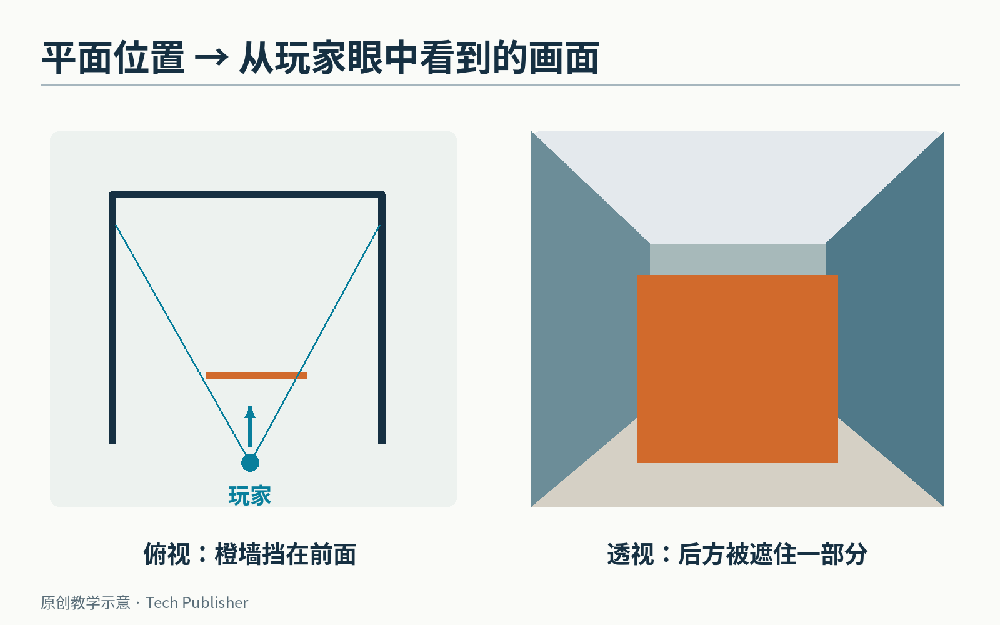
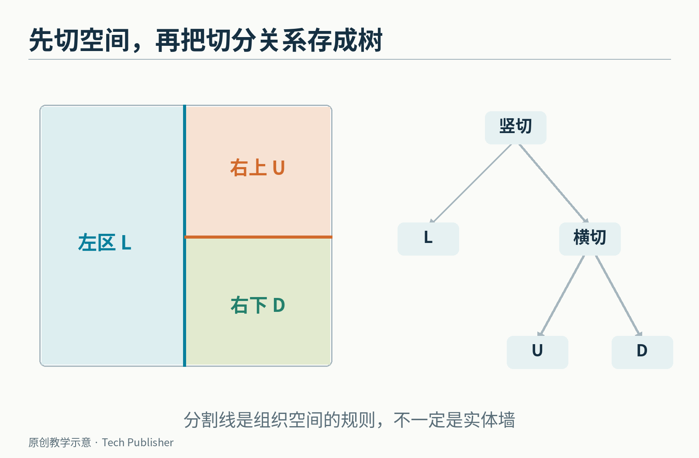
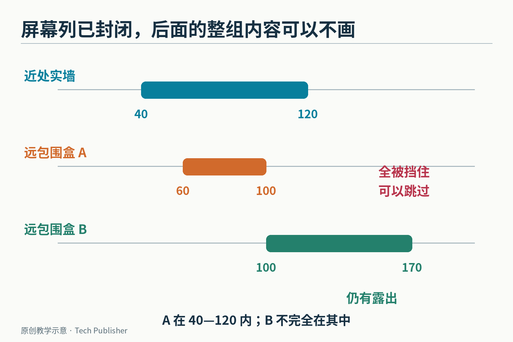
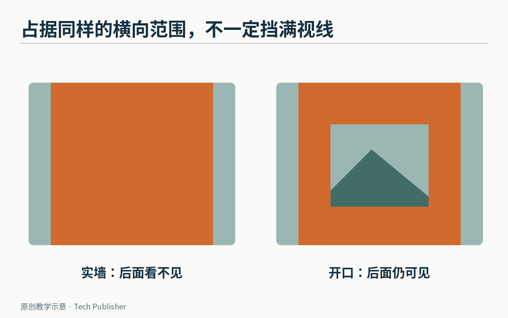

# 《Doom》怎样少画一堵墙：把空间切成一棵树

站在走廊拐角前，隔壁房间可能已经装满了墙、门和敌人。可是屏幕上，你只能看见挡在面前的那一部分。

游戏引擎面对的问题不是“世界里有什么”，而是更苛刻的一句：**从玩家此刻的位置看，哪些东西值得拿来画？**

1993 年的《Doom》是一款第一人称射击游戏。玩家看到有远近、有高度的房间，而电脑要不断把地图转换成一张二维画面。它的经典渲染方案，离不开 BSP，也就是二叉空间分割：用一条条分割线，把平面空间递归切成小块，再把这些关系组织成树。

这里先拆掉一个容易产生的误会：BSP 不是凭空造出立体感，也不等于“把每面墙按离玩家的距离排一遍”。它首先解决的是空间组织与可见性处理的顺序。


*本文原创的简化场景。左侧俯视图和右侧画面只表示相同的前后遮挡关系，不是按比例计算的投影；这不是《Doom》截图，也没有使用游戏贴图。*

## 为什么一张平面地图，也能让人走进高低错落的房间？

先看《Doom》的地图表示。在 id Software 公开的[地图结构定义](https://github.com/id-Software/DOOM/blob/master/linuxdoom-1.10/doomdata.h)里，顶点主要记录 x、y；一个 sector，也就是共享某些属性的区域，记录地板高度、天花板高度、纹理和光照等信息。

想象建筑平面图上的一片区域：给它一个地板高度和一个天花板高度，再把边界立起来，就能形成有高度的室内空间。相邻区域地板高度不同，可以出现台阶；改变天花板或地板高度，可以形成门与升降台等效果。

所以，“很多组织工作在平面里完成”不等于“游戏没有高度”。它是对场景表示施加了约束，换取更容易计算的结构。

这种经典表示也有边界：同一片 x、y 区域不能直接用普通 sector 结构表示任意上下叠放的两间独立房间，原版也不支持随意倾斜的地板。后来端口、地图技巧或别的引擎能做的事，不能倒写成 1993 年原方案自带的能力。

下面讨论的代码，是官方仓库里的 Linux Doom 1.10 源码，1997 年公开。它提供了理解经典算法的直接材料，不等于我们在本地运行过 1993 年的 DOS 版本。

## 一条分割线，为什么有资格成为树的根？

在俯视图上选一条直线。所有空间都被它分成两侧：一侧的东西放进一个组，另一侧放进另一个组。

再给每一组选择分割线，继续划分。重复下去，就得到一棵二叉树：每个内部节点存一条分割线，每个节点最多分出两个子分支。

最后的叶子对应小块区域，叫 subsector，子区域。它是 BSP 切分后的几何单位，与先前存地板高度、光照属性的 sector 不是同一个概念。一个 sector 可以涉及多个 subsector。


*原创简化地图。先用竖直线切成左右两半，再把右半边横切；右侧树里的分支与左侧真实空间一一对应。分割线并不一定是一堵实体墙。*

麻烦来了：如果一面墙跨过分割线，应该放哪边？

不能只看墙的中点，然后整面扔到一侧。那样树里声称“都在这一边”的空间关系就不再成立。

处理方法是把墙段在交点处分开，形成两个小段，分别进入两侧。《Doom》源码把这种参与 BSP 的线段称为 seg；地图中原来用于编辑的整条边，则是 linedef。这也解释了为什么一个看起来完整的墙面，内部可能被拆成多个渲染片段。


*切分的是用于组织与渲染的线段，不是把玩家看到的墙挖出一道缝。分割前后，墙的几何位置没有改变。*

这些工作主要由地图预处理阶段完成，结果作为地图数据的一部分保存。玩家每转一次头，运行时不需要把整张地图重新切一遍。

## 站在哪一边，先走哪一枝

有了树，每一帧开始时，只需问：玩家位于当前分割线的哪一侧？

例如分割线是 x＝4，玩家 x＝2，便在左侧；玩家 x＝6，便在右侧。对于倾斜直线，可以用二维向量的叉积符号判断。

若分割线从 A 指向 B，玩家在 P，计算：

(Bx−Ax)×(Py−Ay)−(By−Ay)×(Px−Ax)。

结果的正负区分两侧，零表示在线上。把 A、B 的方向调换，正负也会调换，因此程序必须对自己的方向约定保持一致；算法不依赖哪一侧一定叫“正面”。


*树的切分不变。玩家跨过分割线，访问两侧的先后次序就改变了。这里的“近侧”指玩家所在的半空间，不是用墙的中心距离进行排序。*

官方的 [R_RenderBSPNode 函数](https://github.com/id-Software/DOOM/blob/master/linuxdoom-1.10/r_bsp.c#L520-L580)显示了核心顺序：先访问玩家所在一侧；再检查另一侧的包围盒是否仍可能可见；有可能，才继续访问。

把源码的含义写成教学伪代码，就是：

```text
访问一个节点：
    如果是叶子：处理这块区域的墙段
    否则：
        判断玩家位于分割线哪一侧
        先访问这一侧
        若另一侧的包围盒仍可能出现在画面中：
            再访问另一侧
```

先处理近侧，有什么价值？它能更早知道画面哪些位置已经被挡住。随后面对远处的东西，就有机会直接跳过。

## 少画的关键，是“这里已经被挡满了”

先把屏幕想成从左到右排列的一列列像素。某堵近墙投影后，占据屏幕横向第 40 到第 120 列。

如果这是一堵把后面完全挡住的实墙，程序就能记录：这个横向范围已经封闭。

后来另一块远处区域的包围盒投影，只落在第 60 到第 100 列。它整个落入已封闭范围，继续进去检查墙段也不会增加可见内容，于是这一分支可以省掉。


*原创教学投影，列号为假设值。远区域若完全藏在已封闭区间内，可以剪枝；只遮住一部分，则仍要继续检查。*

包围盒是包住一组几何对象的简单外框。它可以让程序用便宜的测试，先排除一整组明显不可能可见的内容，而不是挨个检查每面墙。

但这个测试是保守的：“可能看见”，不等于“里面每面墙真的看见”。包围盒比实际物体更宽松，只能用于排除，不会替后续渲染完成所有判断。

反过来，也不能把每条投影过的墙都当成封死视线的实墙。如果两个区域之间有门洞，上半截是墙、下半截可以望过去，远处仍可能从开口里露出来。

源码因此把封闭墙段与可穿过视线的墙段分开处理；地板、天花板和带透明部分的对象，也有各自的处理逻辑。**BSP 提供访问顺序，投影与裁剪决定哪些部分最终留下。**


*同样占据一个横向范围，整堵实墙与留有窗口的墙不能做相同的遮挡标记。右图远景还能从中部开口出现。*

这也是它与“先把整幅画画完，再把远墙覆盖掉”的差别：有些东西在进入昂贵的绘制过程之前，就被证明没有必要画了。

## 不要把一棵树说成整个引擎

在官方源码的[主渲染流程](https://github.com/id-Software/DOOM/blob/master/linuxdoom-1.10/r_main.c)里，BSP 墙面遍历之后，还有地板、天花板以及遮罩对象等阶段。因此，“《Doom》靠 BSP 渲染”是一句有用的概括，却不是完整的执行说明。

同样，BSP 并不天然保证所有工作都是对数级。切分如果不理想，树可能很深；墙段切得过碎会增加数据；一个开阔场景里大量区域同时可见，能够省掉的东西也会减少。

它尤其适合“场景大体静止，可以提前整理”的局面。若整面墙不停改变平面位置，原先分组关系可能失效。原版门常通过改变高度开合，便与主要在 x、y 平面预先切分的组织方式相容。

这里有一种很值得保留的工程思路：**不要只问怎样把一个动作做快，还要问什么时候可以证明这个动作根本不用做。**


*John Carmack，摄于 2009 年 QuakeCon。照片比《Doom》的开发晚了多年，用于人物识别。*

Carmack 在[1997 年随源码发布的说明](https://github.com/id-Software/DOOM/blob/master/README.TXT)中，也没有把实现写成不可改进的神作。他回顾了渲染顺序、视线检测等可重新设计之处，说明公开代码仍是一套具体时代、具体约束下的取舍。

从一张平面地图，到屏幕里看起来连续的世界，中间有大量细节。但 BSP 最值得先看懂的，只需要一句话：提前把空间关系整理好，运行时就能按观察位置找到合适顺序，并尽早排除被遮住的分支。

那堵没有被画出来的墙，往往和被画出来的墙一样，参与成就了流畅的画面。

<small>图片来源：[John Carmack 肖像](https://commons.wikimedia.org/wiki/File:John_Carmack_at_QuakeCon_2009.jpg)由 Drew “Prognar” Campbell 拍摄，[CC BY 2.0](https://creativecommons.org/licenses/by/2.0/)，原图未修改。其余为本文原创机制示意，不是游戏截图。</small>
