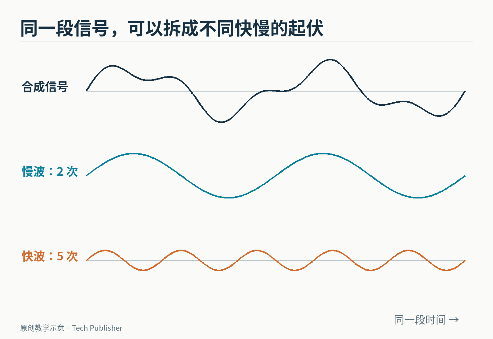
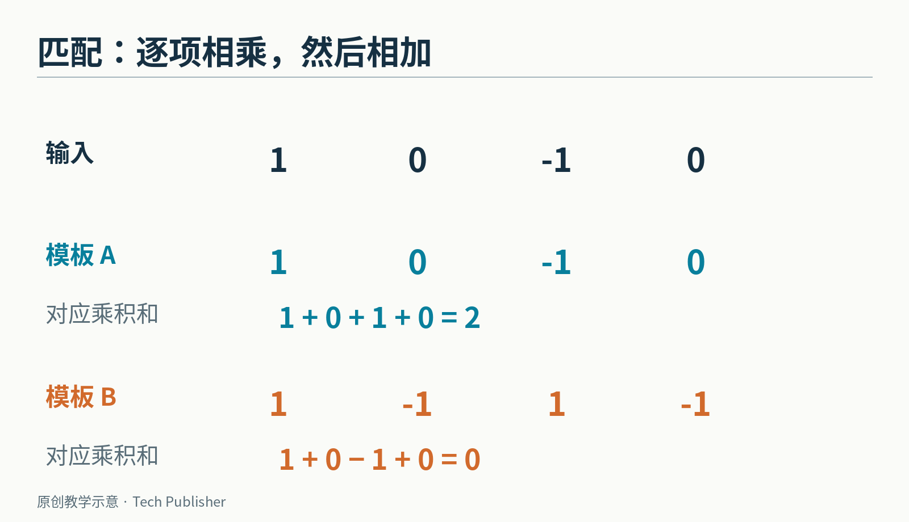
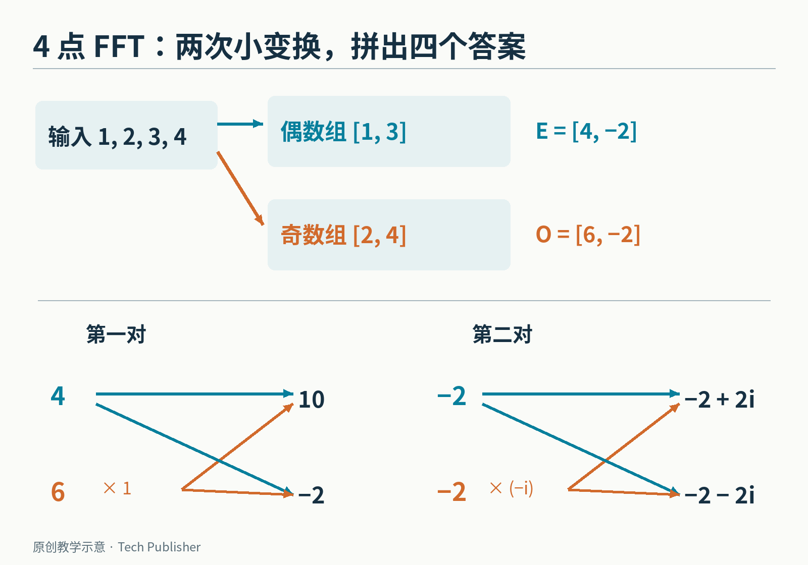
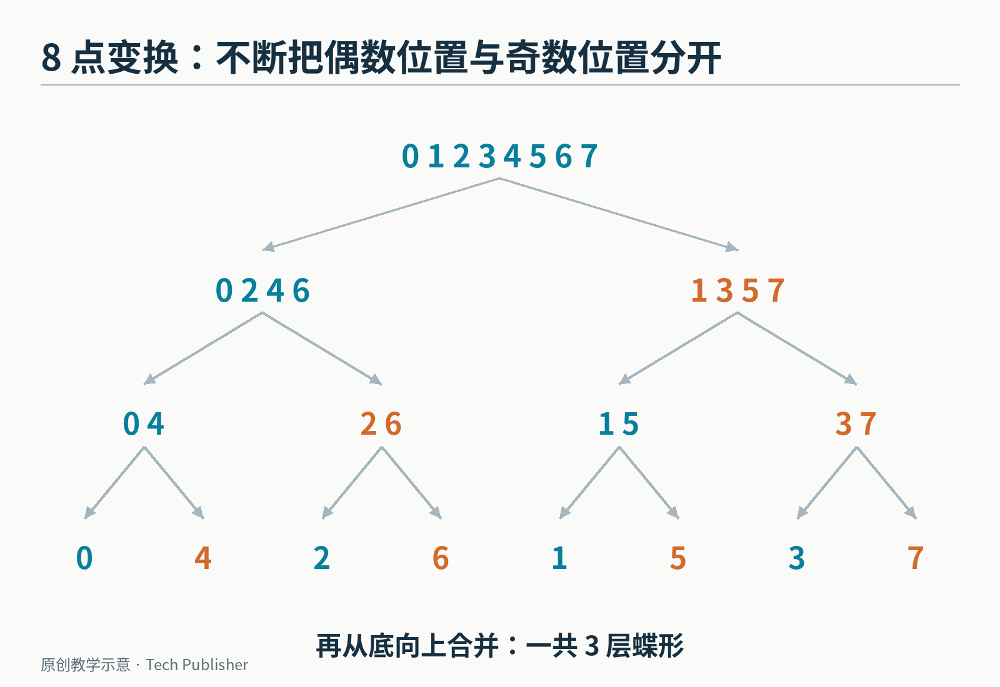
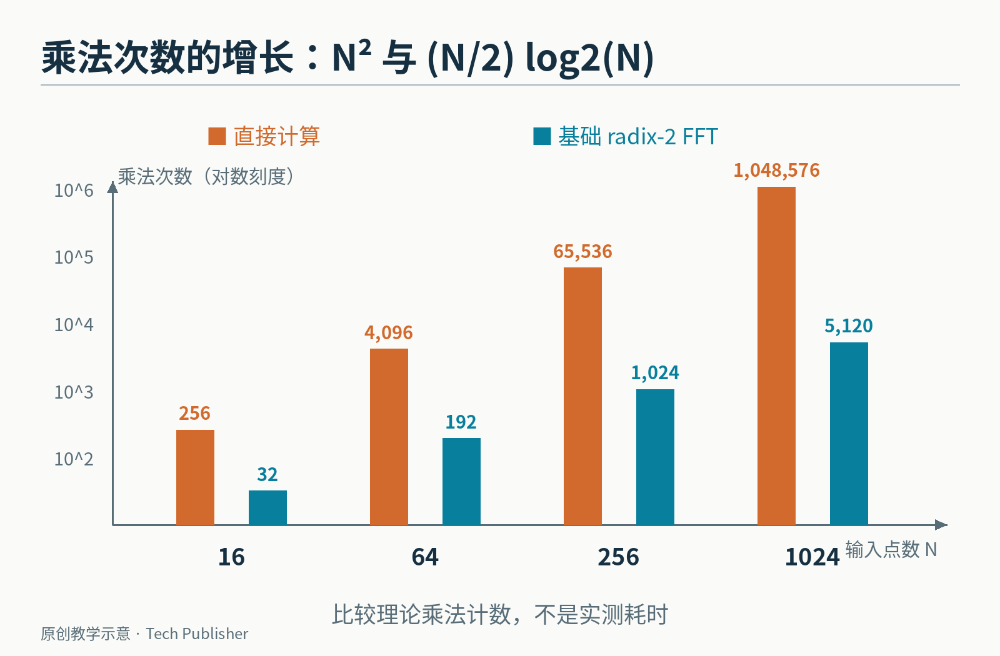
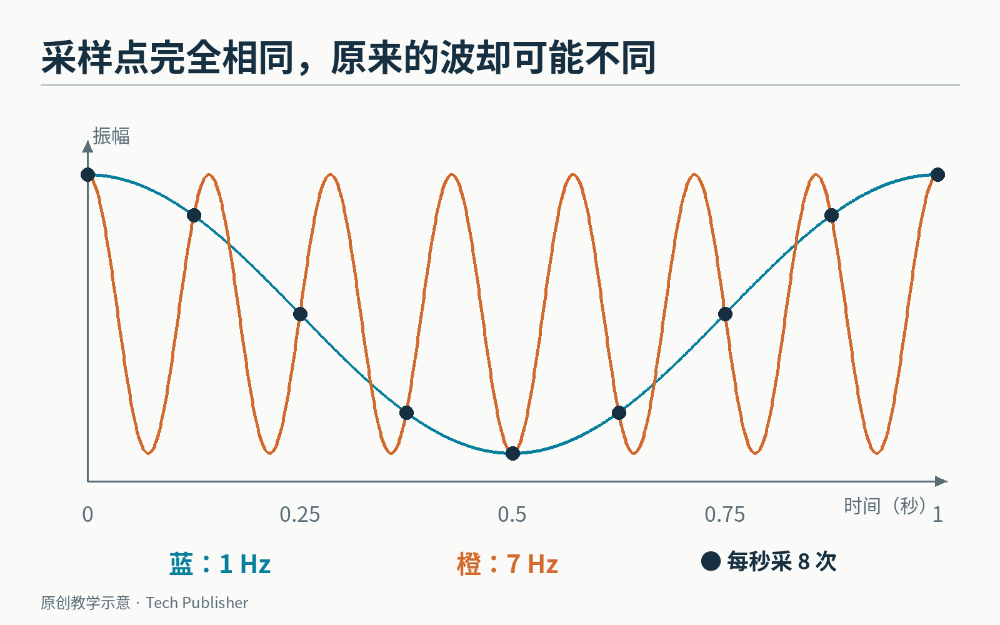

# 一百万次计算，怎样变成五千次？FFT 没有删掉任何声音

把一段录音交给电脑，它拿到的不是“钢琴声”或“人声”，而是一串数字：在一个个时刻，麦克风测到的振动有多大。

现在反过来问：这串数字里，哪些振动频率更强？调音器要回答它，研究地震波的人也要回答它。

**离散傅里叶变换，简称 DFT，是把一串等间隔采样值，改写成一组频率成分的方法。快速傅里叶变换 FFT，则是一类更省计算的做法。两者计算的目标相同。**

它的“快”很特别：没有先删掉微弱的声音，没有把答案故意算粗，也没有要求换一台电脑。它重新安排了计算，让已经做过的工作不必反复做。


*原创教学信号：同一段时间里，慢波振动两次，快波振动五次；最上面的曲线是两者相加。它不是实录音频。*

## 先别急着“快速”：电脑怎样认出一种频率？

假设只记录四个点，得到 1、0、−1、0。把它画出来，是一个“先正、再零、再负、再零”的起伏。

准备一张同样长的检查模板，也是 1、0、−1、0。把对应位置相乘，再把结果相加：

1×1＋0×0＋(−1)×(−1)＋0×0＝2。

正对正、负对负，都贡献正数。两个起伏对得上，结果就积累起来。

再换一张模板：1、−1、1、−1。这次相乘相加得到 0。原信号第一项贡献了 1，第三项贡献了 −1，恰好抵消。

这就是频率分析的一块基本积木：**用不同快慢的标准波形去匹配数据，看看哪些匹配能留下较大的结果。** 下面这个例子没有噪声，也刻意让周期对齐，方便看清抵消。


*同一份数据，遇到不同模板，乘积和可以是 2，也可以是 0。匹配不等于只看曲线“像不像”，它有明确的算式。*

但只准备一种起始位置的模板还不够。同样的振动如果晚一点开始，峰和谷就会移动。一个频率需要同时检查两种相差四分之一周期的模板，通常用余弦和正弦表示。

这两份结果可以装进一个复数：a＋bi。这里的 i 满足 i²＝−1；在这篇文章里，把复数先理解成“同时保存两个方向的数”就够了。它让转动、相加和相乘写起来紧凑，并不是给声音添加了一个虚构的维度。

[NumPy 的官方说明](https://numpy.org/doc/stable/reference/routines.fft.html)使用的 DFT 约定，是把每个样本乘上按频率旋转的权重，再把它们相加。正变换的符号和归一化方式并非只有一种，下面的算例采用相同的负号约定。

如果输入有 N 个点，需要求出 N 个频率位置的结果；每个结果都直接遍历 N 个输入，工作量就按 N² 增长。

1024 个点，直接照公式算，要列出 1024×1024＝1,048,576 个复数乘法项。这还没算加法。

## 转折不在声音里，在“偶数位置”和“奇数位置”里

先用四个普通数字算一次：输入为 1、2、3、4，位置编号从 0 开始。

不要按前半段、后半段切。取位置 0、2，得到偶数位置组 1、3；取位置 1、3，得到奇数位置组 2、4。

两个数的 DFT 特别容易：一个结果是相加，一个结果是相减。因此：

- 偶数组算出 E＝[4，−2]
- 奇数组算出 O＝[6，−2]

这四个数怎么拼回原来的四个结果？

第一个频率位置，奇数组不需要转动：4＋6＝10。与它配对的另一个位置，只把加号变成减号：4−6＝−2。

剩下的一对，奇数组的 −2 需要乘 −i，变成 2i。于是结果分别是 −2＋2i、−2−2i。

完整答案按频率编号排好，就是：

**[10，−2＋2i，−2，−2−2i]。**


*同一对中间结果参与一次相加、一次相减。连线交叉的这一小组计算常被叫作“蝶形”。图中所有数值来自同一个四点例子。*

为什么可以这样拼？关键有两步。

第一，偶数位置的旋转权重每次跨两格，相当于在一个只有 N/2 格的新圆上逐格移动。奇数位置也能整理成同样的小问题，只是整体多了一次转动。

第二，频率编号再向后移动 N/2 时，偶数组的权重不变，奇数组的权重恰好反号。因此一次拼接可以同时产出前、后两个答案。

把“多转动一次”的权重记作 W，就可以写成：

X[k]＝E[k]＋W×O[k]

X[k＋N/2]＝E[k]−W×O[k]

这里 k 从 0 到 N/2−1；每一对 k 使用自己的 W，不能把所有 W 当成同一个常数。N＝4、k＝1 时，它正好是前面用到的 −i。

这一步没有抛弃任何样本。E 和 O 来自全部偶、奇位置，拼接又把两部分重新合在一起。

## 少算一次只是开始，反复拆才改变数量级

8 个点可以拆成两个 4 点问题；4 点继续拆成两个 2 点问题；最后到单个数，它的变换就是它自己。

然后从底向上合并。每层都有 N/2 个蝶形，层数是 log₂N：8 个点有 3 层，1024 个点有 10 层。


*原创拆分图。索引不是随意打乱，而是每一层都在当前序列中再分偶数位置与奇数位置。*

于是，基础 radix-2 FFT 的复数乘法次数按 (N/2)×log₂N 计。radix-2 指每次分成两份；这是 FFT 家族里的一种，不是所有 FFT 只能处理 2 的幂。

对 1024 点，这个计数是 512×10＝5120；复数加减法是 1024×10＝10240。某些乘数是 1、−1 或 ±i，还能进一步简化。

**标题里的“一百万变五千”，比较的是直接公式的乘法项数与这种基础蝶形实现的乘法次数，不是拿秒表测出的电脑加速比。** 内存访问、向量化、函数开销和输入类型，都会影响实际运行速度。


*同一套计数口径下的理论工作量。纵轴采用对数刻度，不能把柱高直接读成倍数。*

可以把它理解为一笔越来越合算的整理费。数据很少时，准备和拆分也要成本；数据很大时，免掉重复工作才显出威力。

这段 Python 只展示计算关系，不是生产环境里最快的实现。输入长度限定为 2 的幂，例子已本地执行：

```python
import cmath

def fft(x):
    n = len(x)
    if n == 1:
        return x
    e, o = fft(x[::2]), fft(x[1::2])
    z = [cmath.exp(-2j * cmath.pi * k / n) * o[k]
         for k in range(n // 2)]
    return ([e[k] + z[k] for k in range(n // 2)] +
            [e[k] - z[k] for k in range(n // 2)])

for z in fft([1, 2, 3, 4]):
    print(round(z.real, 6), round(z.imag, 6))
```

输出的实部、虚部分别为 10.0 0.0、−2.0 2.0、−2.0 0.0、−2.0 −2.0。浮点计算会有微小舍入误差；数学上的等价，不意味着每个二进制位都与另一种计算顺序一致。

## 1965 年的突破，为什么也是一次重新发现？

这套算法通常与 James Cooley 和 John Tukey 的名字连在一起。他们的论文发表于 1965 年 4 月，主题正是怎样让机器高效计算复数傅里叶级数。

[两人在 1993 年的回顾](https://garfield.library.upenn.edu/classics1993/A1993MJ84400001.pdf)讲了一个很有人情味的细节：1963 年，Richard Garwin 留意到 Tukey 在会议间写下的傅里叶计算想法，随后把这个问题带到 IBM，推动 Cooley 编程实现。

Garwin 最初向 Cooley 描述的任务涉及氦-3 中自旋排列的三维变换。回顾文章同时说明，他还关心利用地震信号监测核试验所需的大量频谱计算。把这段历史缩成“为了某一个目的，两个人突然发明 FFT”，会漏掉应用需求、推广者和已有数学之间的联系。


*纽约州 Yorktown Heights 的 IBM Thomas J. Watson 研究中心，照片摄于 2010 年。这是后来拍摄的建筑实景，不是 1960 年代算法开发现场。*

更有意思的是，论文发表后，人们陆续找到了更早的相关工作，包括 Danielson 与 Lanczos 的方法，以及高斯遗稿中的线索。Cooley 在[1987 年的亲历回顾](https://archive.computerhistory.org/resources/access/text/2024/06/102739347-05-0002-acc.pdf#page=114)里特别强调，算法传播跨过学科边界，才让许多人意识到它能解决自己手头的计算瓶颈。

1965 年的重要性，不必依靠“历史上从来没人想到过”来成立。一个想法被整理成适合电子计算机反复执行的算法，被写成程序、发表、解释并用于不同领域，本身就能改变它在世界上的作用。

## FFT 算得快，却不能补回没有采到的信息

假设每秒只采样 8 次。一个每秒振动 1 次的余弦，和一个每秒振动 7 次的余弦，在这些采样时刻可以给出完全相同的数字。

这叫混叠：不同的连续信号，在采样后变得无法区分。把 FFT 再加速一千倍，也无法单靠这串数字判断原先是哪一种信号。


*两条连续曲线不同，黑色采样点却重合。这里特意选择相位对齐的余弦，说明信息丢失发生在采样时。*

另外，录音只截取有限时长，频率也未必刚好落在分析格点上，结果可能散到相邻频率位置。这类问题涉及采样、观察窗口和信号本身，不是“把算法换快一点”就会消失。

FFT 真正了不起的地方，是在问题和答案都不变时，找到一种不重复劳动的计算秩序。它没有让声音变简单，而是让电脑不必为同一份结构付很多次钱。

<small>图片来源：研究中心实景为 [Chris Samuel / Wikimedia Commons](https://commons.wikimedia.org/wiki/File:IBM_Thomas_J_Watson_Research_Laboratory_and_outside_entrance.jpg)，[CC BY 2.0](https://creativecommons.org/licenses/by/2.0/)，原图未修改。其余为本文原创教学图。</small>
