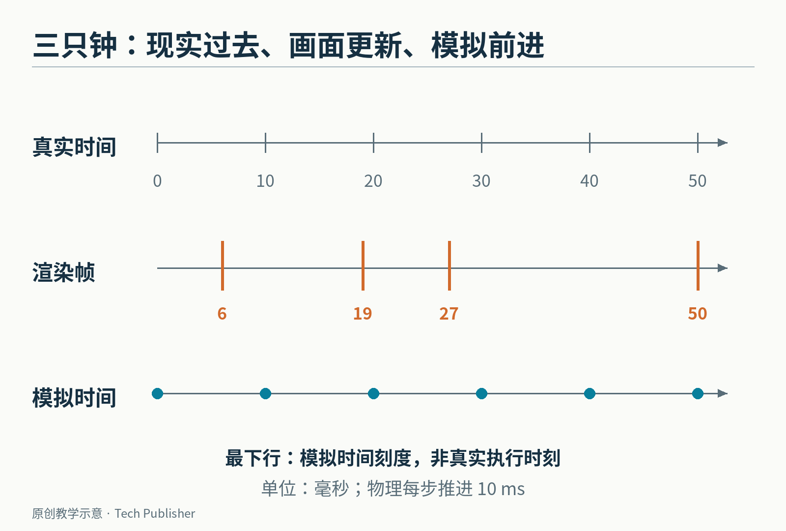
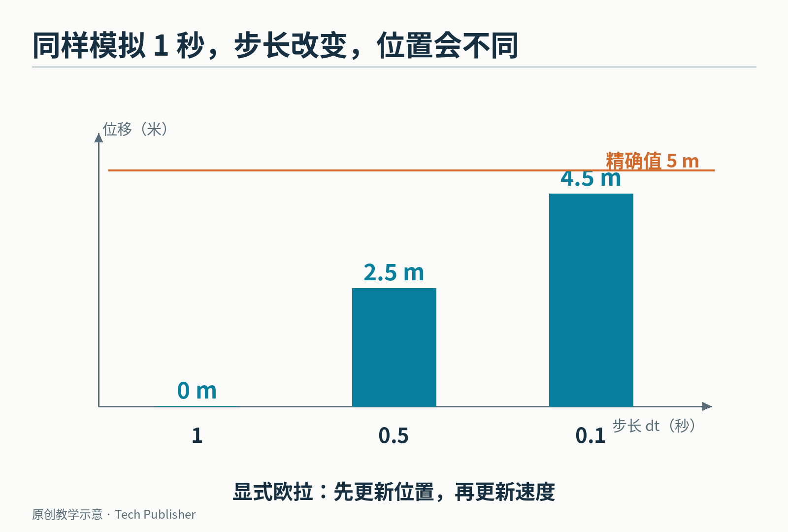
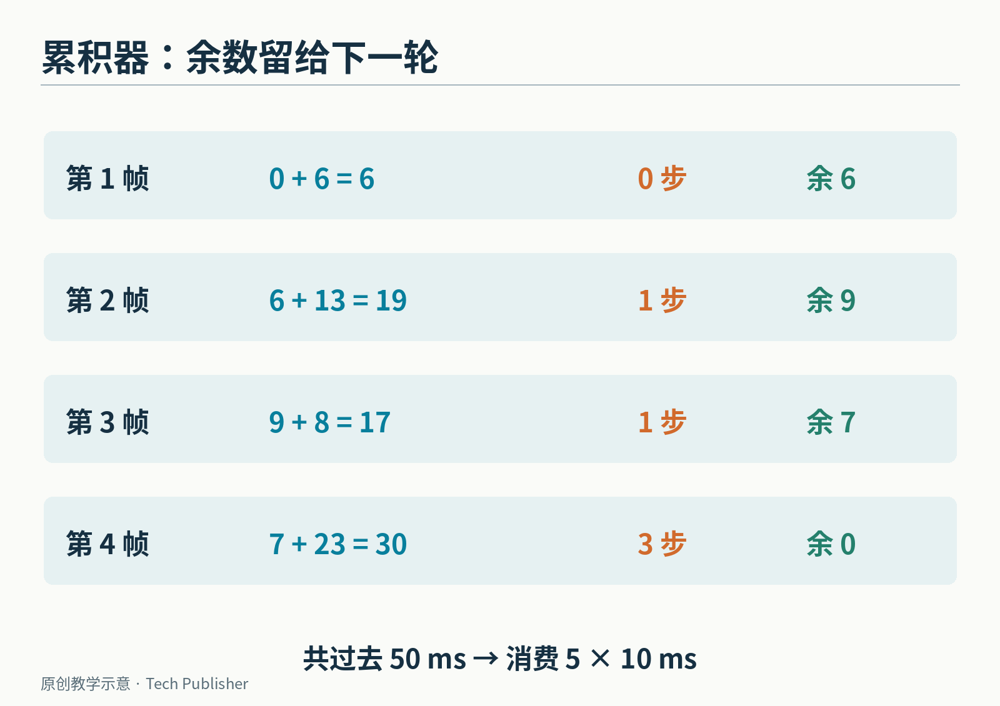
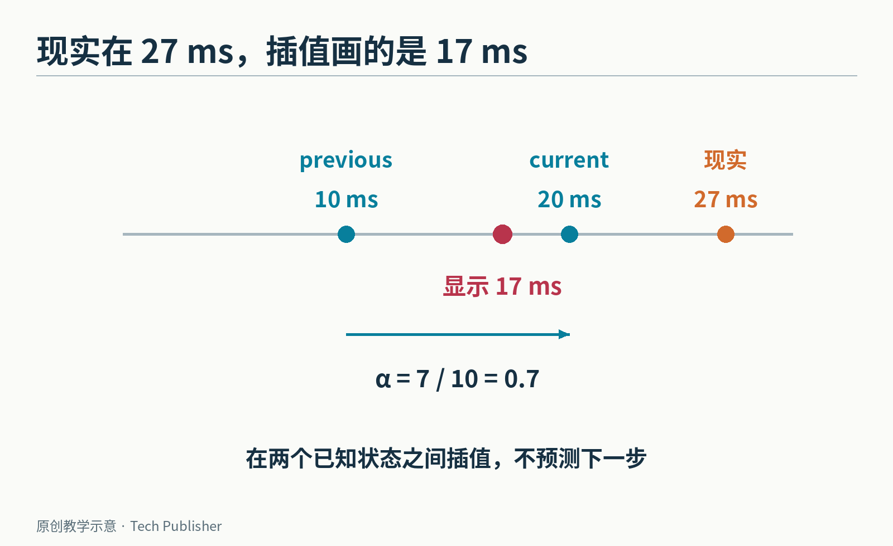
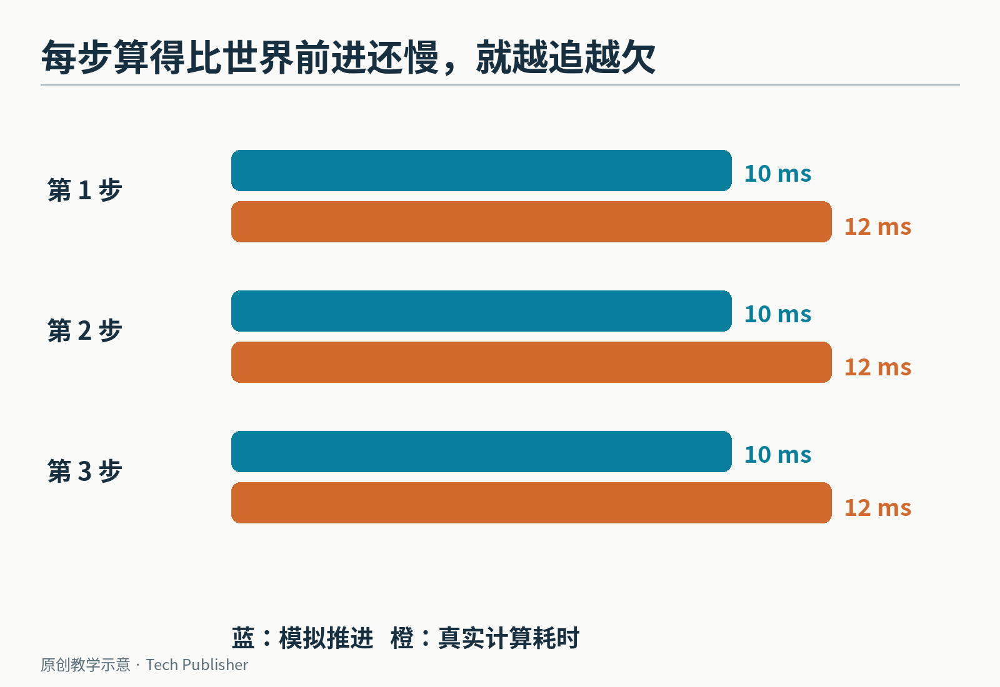

# 画面变成 144 帧，球为什么不该跳得更高？

假设一款游戏每画一帧，就把角色向右挪 3 个像素。在每秒 30 帧的电脑上，角色一秒走 90 像素；换到每秒 144 帧，它一秒走 432 像素。

这显然不是玩家想要的升级。显示器变快，不应该让游戏世界里的时间也加速。

于是开发者把移动写成“速度×这次经过的时间”。对匀速运动，这个修正很有效。但如果有重力、弹簧、碰撞，把每一帧实际耗时直接丢给物理计算，问题还没有结束。

**固定时间步，指模拟世界每次都前进同样长的一小段时间；渲染画面则可以按另一种节奏更新。** 这篇文章要拆开的，就是这两只经常被绑在一起的钟。


*原创示意：最下行是模拟时间刻度，不是物理更新在现实中实际执行的时刻。渲染间隔可以忽长忽短，物理模拟仍按等长步推进。一次渲染之间，可以发生零次、一次或多次物理更新。*

## “乘上经过时间”，为什么还不够？

先用一颗没有碰撞的小球做算题：从静止开始，沿一个方向以 10 米/秒²的恒定加速度运动，总共模拟 1 秒。

连续运动的精确答案是位移 5 米，末速度 10 米/秒。这只是教学设定，不是在复现某个引擎的实测。

现在选一种最直接的近似计算方法：先用当前速度更新位置，再更新速度。

x ← x＋v×dt

v ← v＋a×dt

dt 就是这一次模拟前进了多久。这种顺序叫显式欧拉法。它假定在这一小段时间里，位置可以先按段首速度推进。

若整秒只走一步，初始速度是 0，所以位置一动不动；速度随后变成 10。最终得到位移 0 米。

若拆成两步，每步 0.5 秒：第一步位置仍是 0，速度变成 5；第二步位置增加 5×0.5＝2.5，速度变成 10。最终位移 2.5 米。

若拆成十步，每步 0.1 秒，计算结果为 4.5 米。总模拟时间都是 1 秒，末速度也都相同，但位置不同。


*原创数值实验：只改变 dt，其他条件相同。这里展示的是显式欧拉法的误差，不能直接套成所有物理引擎的表现。*

为什么？因为加速中的小球，段内速度持续变大。每次都用段首速度推进位置，相当于把一条上升的速度曲线，用偏矮的台阶代替。步子越长，漏掉的面积越大。

对这个特意简化的恒加速度例子，每步漏掉的位移是 a×dt²/2；1 秒内有 1/dt 步，合起来的误差是 5dt 米。

换一种积分方法，误差规律会不同。比如先更新速度、再更新位置的半隐式欧拉法，在这个例子里会得到另一侧的误差；真实游戏引擎还要处理约束求解、接触和阻尼，不能从这一道算题推导出它们的完整行为。

但它已经说明一个足够重要的事实：**模拟同样长的总时间，不代表随意拆步都得到同样结果。**

## 既然步长固定，慢电脑岂不是跟不上？

如果强行规定“画一帧，物理就走 1/60 秒”，电脑只画出 30 帧时，现实过了一秒，游戏世界只过了半秒。反过来，画到 144 帧就会跑太快。

解决办法不是重新绑死二者，而是加一个**累积器**：记录已经过去、但还没被物理模拟消费掉的时间。

每次渲染循环测得经过时间后，把它加进去。只要累积器里够一个固定步长，就做一次物理更新，再扣掉这个步长。剩下不足一步的时间留到下一轮。

这套解释在 Glenn Fiedler 于 2004 年发表的[《Fix Your Timestep!》](https://gafferongames.com/post/fix_your_timestep/)中被系统讲清楚。它处理的是长期存在的游戏循环问题，和某一代高刷显示器并不绑定。

下面不用每秒 60 次，而故意选更好心算的 **10 毫秒一步**。假设连续四次画面更新之间，分别过去 6、13、8、23 毫秒：

- 第一次存入 6 毫秒，不够一步，物理更新 0 次，余 6
- 第二次又来 13，加上原来的 6，共 19；走 1 步，余 9
- 第三次又来 8，共 17；走 1 步，余 7
- 第四次又来 23，共 30；走 3 步，余 0

现实一共过去 50 毫秒，物理也恰好走完 5 个 10 毫秒。它没有要求每次画面都配一个物理步。


*每一行都把上一轮余数带过来。这里的 0、1、1、3 是每轮物理更新次数，不是画面帧率。*

这段完整的 Python 教学代码已本地执行。用整数毫秒，是为了让例子不被浮点尾差干扰；真实程序还要选择合适的计时精度。

```python
step_ms = 10
accumulator = 0
simulation_ms = 0

for elapsed in [6, 13, 8, 23]:
    accumulator += elapsed
    steps = 0
    while accumulator >= step_ms:
        simulation_ms += step_ms
        accumulator -= step_ms
        steps += 1
    print(steps, simulation_ms, accumulator)
```

每行输出依次是“本轮步数、已模拟毫秒、剩余毫秒”：

```text
0 0 6
1 10 9
1 20 7
3 50 0
```

## 多出来的那 7 毫秒，画面怎么办？

来到第三次画面更新时，现实已过 27 毫秒，物理刚算到 20 毫秒。累积器里余下 7，不够走下一步。

最直接的画法，是把 20 毫秒那个状态原样显示。这样没有乱改物理，但如果显示比模拟快，同一个位置可能连续画几次，再突然跳到下一个位置，运动看起来会抖。

常用的办法是保留最近两个物理状态：10 毫秒时的 previous，以及 20 毫秒时的 current。然后根据余数做插值。

比例 α＝余数/步长＝7/10＝0.7。

显示位置＝(1−α)×previous＋α×current。

假设小球每 10 毫秒向右走 1 像素，previous 在 1，current 在 2，显示位置便是 0.3×1＋0.7×2＝1.7 像素。


*物理最新状态在 20 毫秒，插值显示对应这段匀速例子中的 17 毫秒。它没有预测 27 毫秒的未来位置。*

这个数字揭示了必须讲清楚的代价：**在这种“前一状态到当前状态”的插值方案下，稳定运行时显示时间会落后目标时间一个物理步长。** 此例现实是 27 毫秒，显示对应 17 毫秒，差 10 毫秒；模拟最新状态本身则只落后 7 毫秒。

这不是写错了公式。我们用已经知道的两个状态，换取稳定的视觉过渡，而不是猜下一个还没算出的状态。

也可以外推，利用速度预测未来位置，减少这种延迟。但碰撞、突然转向或网络修正一来，预测就可能不对，需要回拉。插值与外推各有代价。

此外，插值位置应当只用于显示，不能随手塞回权威物理状态，再参与下一步计算。不然刚刚分开的两只钟，又被一份显示数据绑了回去。

## 真正危险的不是掉一帧，而是越追越落后

假设模拟世界前进 10 毫秒，电脑却需要花 12 毫秒才能算完。

你本来就欠着时间，补算又消耗更多真实时间，于是下一轮欠得更大、需要补更多步。Fiedler 把这种追赶越追越慢的情况称为“死亡螺旋”。


*假设每个 10 毫秒物理步要耗费 12 毫秒真实计算时间。此图只是成本关系，不是某款引擎的基准测试。*

累积器只负责记账，不能制造算力。要让系统恢复追赶能力，通常需要让单步计算明显短于它代表的时间，给偶发卡顿留下余量。

也可以限制每帧最多补多少步，但随后必须决定如何处理剩余时间：继续留着，可能长期延迟；丢掉一部分，游戏时间就不再完全跟随现实；降低模拟负担，又可能牺牲精度或内容。

有的示例会把一次过大的 elapsed 截断，例如窗口被拖住或程序暂停很久之后。这是主动放弃补算整段停顿，并非无损恢复。开发者应该明确自己选择的是暂停世界、慢下来，还是补齐时间。

## 固定步长保护了什么，又没有保护什么？

[Box2D 当前的模拟文档](https://box2d.org/documentation/md_simulation.html)也建议使用固定时间步，并以 1/60 秒为常见高质量选择；文档另外提供 sub-step，也就是把一个主时间步进一步细分的设置。具体步长和细分数，仍要与场景、成本和稳定性一起选择，不能把 60 当成物理定律。

固定 dt 至少让每一步的数值条件稳定下来。测试同一段输入时，不必再同时猜测“这次是不是因为画面恰好卡了几下”。

但它不是三张保证书。

**不是永不穿墙。** 物体在一步内移动得很远，仍可能跨过一堵薄墙；更小时间步、连续碰撞检测等方法可能仍然必要。

**不是自动跨平台完全一致。** 相同输入和 dt 只是条件的一部分，浮点运算、对象处理顺序、随机数和并行行为，也可能影响复现。

**不是输入与网络问题都解决了。** 按键应该落在哪一个物理 tick，服务器与客户端怎样对应同一步，仍需要明确定义。tick 就是一次离散的模拟更新。

回到开头那颗球：144 帧意味着眼睛每秒有更多机会看见它，不应该意味着重力每秒多工作 84 次。

固定时间步真正分开的，是“世界怎样前进”与“我们多久看它一眼”。把这件事分清楚，画面快慢才不必顺手改写游戏里的物理。

<small>图片来源：全部为本文原创教学示意与数值图；时间步原理参考 [Glenn Fiedler](https://gafferongames.com/post/fix_your_timestep/)及 [Box2D 官方文档](https://box2d.org/documentation/md_simulation.html)。</small>
