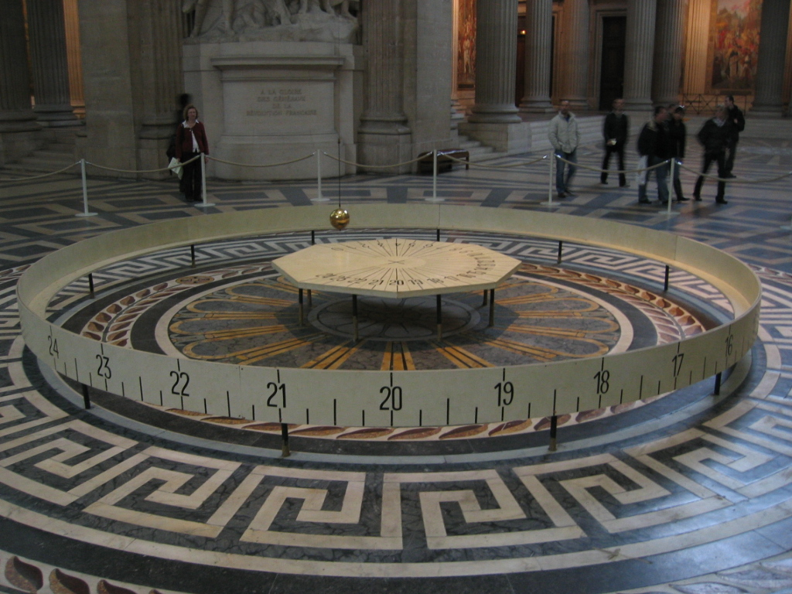
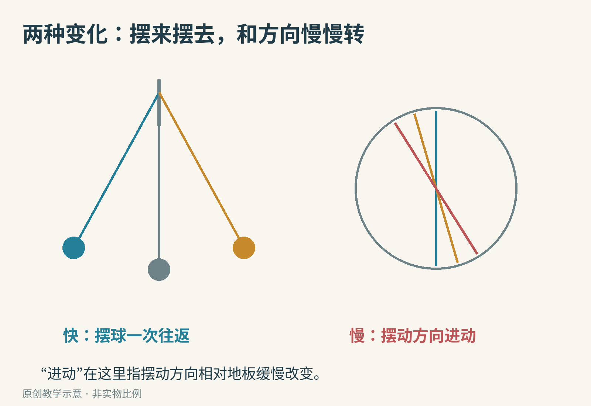
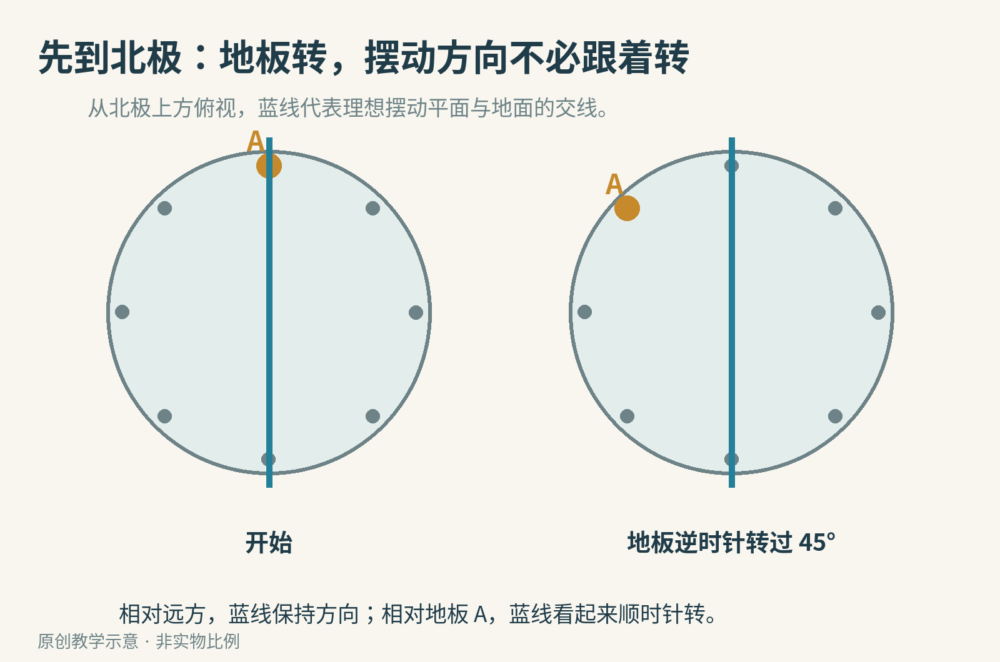
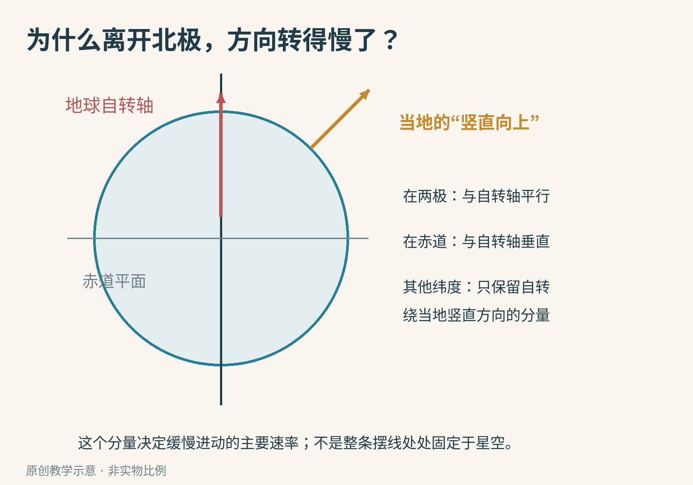
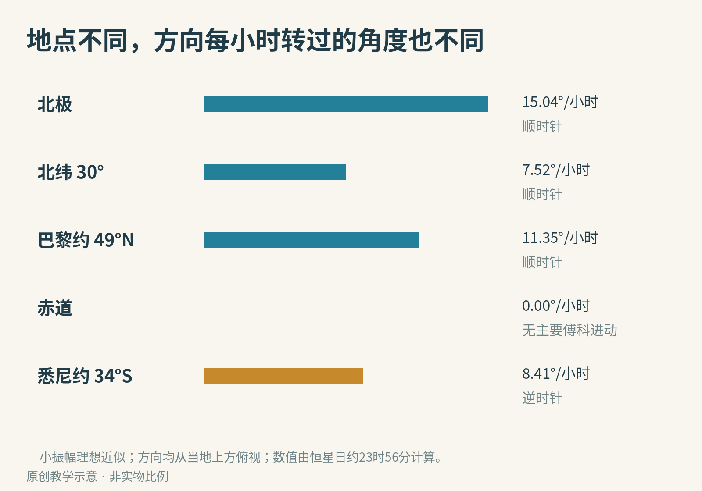
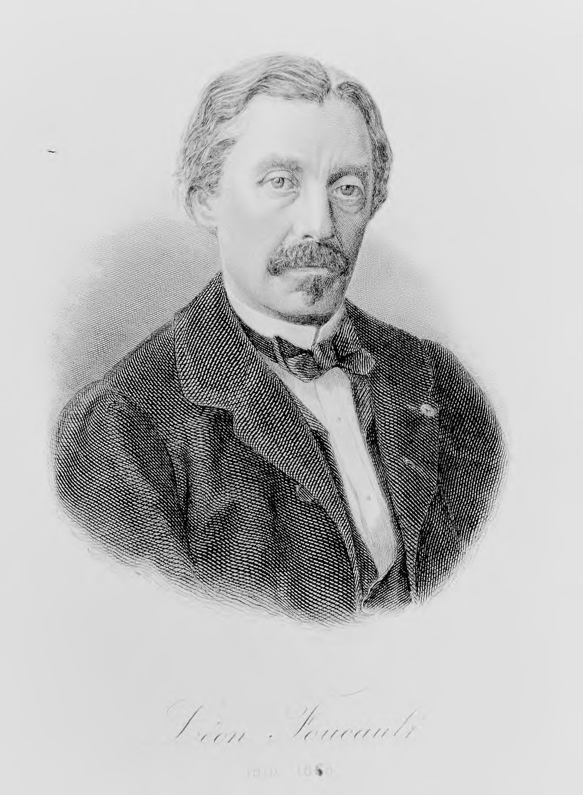
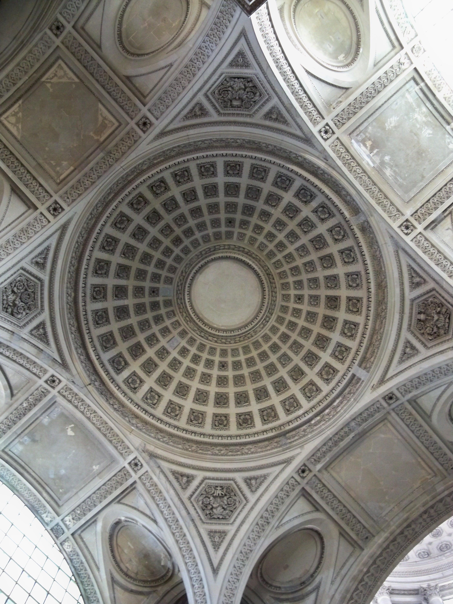
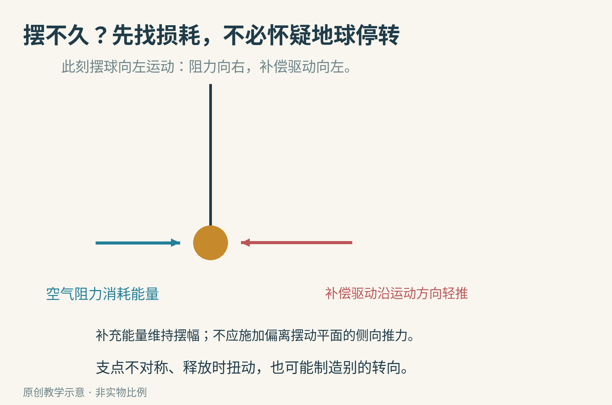
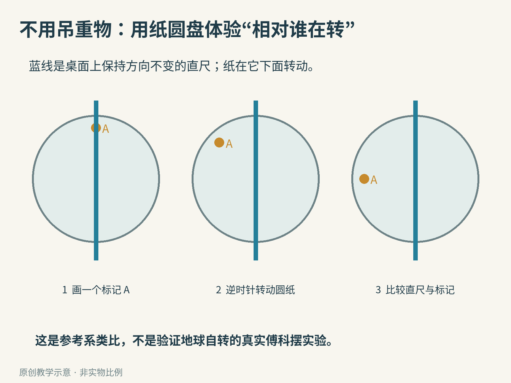

# 地球正在转，为什么博物馆里的一颗摆球能把它“抓现行”？

走进某些科学博物馆，你会看到一颗沉重的金属球，挂在很长的细线上，慢慢地来回摆动。地上可能围着一圈刻度，或者一排会被摆球依次碰倒的小标记。

如果只看半分钟，它像一只放大了的钟摆。多等一会儿，你会发现摆球经过的方向变了：最初朝着这个刻度，后来却对准了另一个。

这叫傅科摆。它最有名的本领，是让我们不用望远镜、不看太阳星星，也能在室内观察到地球自转的效果。

这张照片拍于巴黎先贤祠。地面刻度提供了一个固定在建筑物上的参照；摆球相对这些刻度的变化，才是我们要追踪的线索。

## 先别把两种“转”混在一起

摆球首先会左右往返：向一侧升高、落下、经过最低处，再到另一侧。这是普通摆动。

傅科摆展示的还有另一种慢变化：整条摆动方向相对地面缓缓改变。这种方向的慢转，叫作进动。一个是“球走了一趟”，一个是“这一趟走的方向变了”。

这两件事的时间尺度差很多。长摆一次往返可能需要十几秒；摆动方向绕地面转一整圈，却可能需要一天多。

因此，不能看见摆球正在左右动，就以为已经看到了地球自转；也不能因为一分钟里方向变化不明显，就认为实验没有效果。

## 把博物馆搬到北极，故事就容易看清了

先做一个思想实验：把理想的摆挂在北极正上方。这里的“理想”，是暂时忽略空气阻力、支点不对称、释放时扭动等干扰。

我们从北极上方俯视。地球绕着自转轴逆时针转，博物馆的地板也跟着转。

与此同时，一旦摆球沿某个竖直平面摆起来，在这个理想模型中，它没有理由自动跟着地板把摆动方向一起扭过去。重力使它来回摆动，但不需要把摆动平面绕竖直方向拖着旋转。

于是出现一幅很特别的画面：相对远方的方向，摆动平面大致保持不变；下面的地板，却从它底下转过去。

如果你站在地板上，把建筑物当作“不动的世界”，看到的就反过来了：地板似乎没动，摆的方向在顺时针转。

这就是参考系的重要性。参考系，可以先理解成“你拿什么当作不动的背景”。同一段运动，从远方看与站在地板上看，描述会不同；把背景说清，两种描述才不会互相打架。

在北极，理想摆动方向相对地面转一圈的时间，约等于地球相对远方恒星自转一圈的时间：23 小时 56 分。日常常用“约 24 小时”来估算；两者的小差别，与地球同时绕太阳公转有关。

## 可巴黎不在北极，为什么也能看到？

北极的解释很直观，但有一个关键条件：那里的当地竖直方向，恰好与地球自转轴平行。

搬到其他纬度，情况改变了。巴黎地面上的“正上方”，并不平行于地球自转轴。地球转动时，摆的支点和当地竖直方向也在改变，不能再把北极的解释原封不动套过来，说“全球任何地方的摆动平面都永远固定在星空里”。

可以用一个箭头建立直觉。把地球的自转画成沿自转轴的箭头，再问：其中有多少是沿当地竖直方向的？这个分量，决定理想小振幅傅科摆缓慢进动的主要速率。

在北极，两者平行，这个分量最大。到赤道，两者垂直，沿当地竖直方向的分量为零。其他纬度介于两者之间。

更精确地说，进动速率的大小约为“地球自转速率 × |sin φ|”。这里 φ 是当地纬度，sin 是正弦函数，在这里充当把自转分量取出来的比例：0° 的正弦是 0，30° 是 0.5，90° 是 1；竖线表示只取大小，不把南北方向的正负号带进去。

例如北纬 30°，这个比例是二分之一，所以方向转动只有北极的一半快。按恒星日计算，约每小时转 7.52°，转一整圈约需 47 小时 52 分。

巴黎约在北纬 49°，理想近似下约每小时转 11.35°，一圈约 31.7 小时。悉尼约在南纬 34°，约每小时转 8.41°，但从当地上方俯视，方向是逆时针。

这张图里最值得停下来看的，是赤道。地球在那里当然也在自转，但理想小振幅模型的主要傅科进动率是零。因此，“没有这种进动”不能被当作“地球不转”的证据。测量结果必须连着实验所在的位置一起理解。

## 1851 年，为什么要用那么长的一根线？

1851 年，法国物理学家莱昂·傅科在巴黎展示了这个实验。新南威尔士大学物理教学资料记载，他在先贤祠穹顶下悬挂了一根约 67 米长的线，以及约 28 千克的摆球。

这是莱昂·傅科的历史肖像版画，来自 1878 年出版的文集图像，不是实验现场照片。傅科摆以他命名，但现代博物馆里的装置也有自己的结构和维护设计。

长线首先使摆的节奏变慢。同样不大的左右位移，对于长摆来说，对应的摆角更小，更接近我们刚才讨论的理想小振幅条件。

更大的装置也让持续观察方向变化更方便。人们需要的是一个能摆足够久、支点稳定、不同方向尽量对称的系统，才能把地球引起的慢变化，从其他小干扰里分出来。

这不是说“球越重，自转信号就越强”。在简单摆的小振幅近似中，往返周期主要由线长和当地重力决定，质量并不直接出现在周期公式里。重摆在实际装置中有助于降低某些干扰的相对影响，但不会让地球转得更快。

## 博物馆偷偷给它“推一把”，实验还算数吗？

摆球每次摆动，都会因空气阻力、支点损耗等原因失去一点能量。放着不管，摆幅会逐渐缩小，最终不再适合展示。

有些博物馆会用电磁驱动补上这些损失。史密森尼学会对其历史装置的[说明](https://www.si.edu/spotlight/foucault-pendulum)介绍了这样一种方法：传感器判断摆的位置，电磁铁在合适时刻沿运动方向轻轻补充能量。

关键不在于“有没有电”，而在于驱动有没有改变我们正在测量的方向。合适的驱动只为维持摆幅，不应该额外制造一个想要展示的转向。

也有不用电磁驱动的装置。[新南威尔士大学的傅科摆](https://animations.physics.unsw.edu.au/jw/foucault_pendulum.html)就是一个例子：它一次释放后可以摆动数小时，观察者用固定参照线比较方向。它的观察发生在南半球，看到的进动方向也与巴黎相反。

这两个例子一起说明，科学实验不是要求“什么都不补偿”，而是要知道补偿在改变什么，并证明它没有伪造你想测的量。

## 怎样知道方向变化不是手抖造成的？

如果释放时顺手扭了一下，摆球可能走椭圆；支点如果在某个方向更容易弯曲，也可能让摆动产生偏好。气流、建筑振动和安装不对称，同样会进入观察。

大学的[进一步推导](https://www.animations.physics.unsw.edu.au/jw/pendulumdetails.html)特别讨论了这些问题：有限摆幅、椭圆轨道以及支点和释放的不对称，都能带来额外变化。

因此，一个小摆在房间里随便晃几分钟，方向变了，并不能直接证明你测到了地球自转。要让结论站得住，还得比较预期的方向、当地纬度对应的速率，以及干扰是否足够小。

这不削弱傅科摆的美。相反，它让这颗球从“神奇展品”变成了真正的测量仪器：不是只展示一个变化，而是展示一种可以计算、比较、排除其他原因的变化。

## 在桌面上，先体验“相对谁在转”

不必模仿博物馆吊起重球。一个更安全的练习，是剪一张圆纸，或直接用圆形纸片，在边缘画上 A 标记，再在它上方放一把保持方向不变的直尺。

缓慢逆时针转动纸片，同时保持直尺相对桌面不转。现在分别扮演两个观察者：一个把桌面当背景，一个假装自己站在纸片的 A 标记上。

对桌面上的观察者，直尺没有改变方向；对随纸片一起转的观察者，直尺相对 A 在顺时针转。

这是一个参考系类比，不是真正的傅科摆，也不能用来验证地球自转。本文没有宣称完成过实体摆实验；文中不同纬度的进动数值已按理想公式计算核对。

用纸笔继续探索时，可以问：

- 如果把圆纸反方向转，直尺相对 A 的变化怎样反过来？
- 北纬 30° 与南纬 30°，变化快慢有什么相同，方向有什么不同？
- 若一个真实装置的进动明显快于当地理论值，应该先检查哪些额外转向来源？

下次经过博物馆的一颗摆球，可以先选定一个地面标记，再隔一段时间回来比较。不要碰摆线、越过护栏，也别只追着球来回看。

真正有意思的变化，可能不是它刚刚走到了哪里，而是你脚下那个看似不动的世界，已经悄悄换了方向。

图片来源：[先贤祠摆球与刻度](https://commons.wikimedia.org/wiki/File:Pendule_de_Foucault.jpg)，Arnaud 25，作者释入公有领域；[先贤祠穹顶](https://commons.wikimedia.org/wiki/File:Panth%C3%A9on_-_coupole.jpg)，Marianne Casamance，[CC BY-SA 3.0](https://creativecommons.org/licenses/by-sa/3.0/)；[傅科历史肖像](https://commons.wikimedia.org/wiki/File:Portrait_Leon_Foucault_1860.jpg)，作者不详，1878 年文集收录，公有领域。以上画面未裁改；其余为原创教学示意。科学说明参考 [Smithsonian](https://www.si.edu/spotlight/foucault-pendulum) 与 [UNSW Physics](https://animations.physics.unsw.edu.au/jw/foucault_pendulum.html)。
