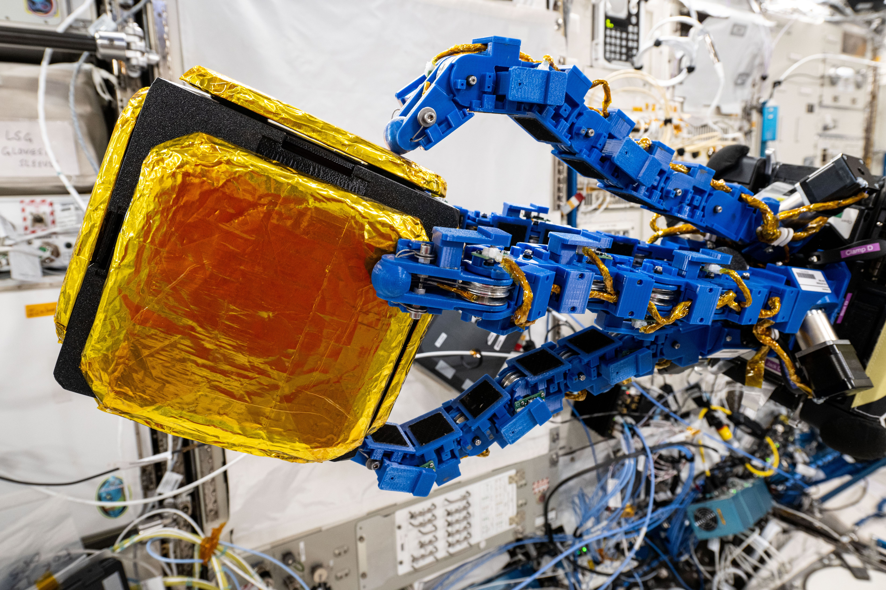
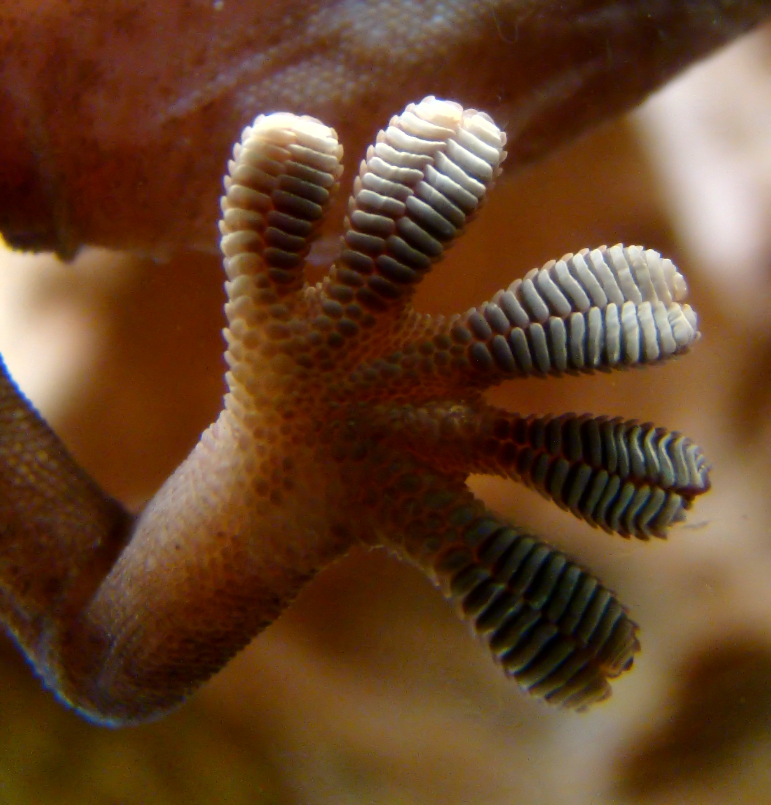
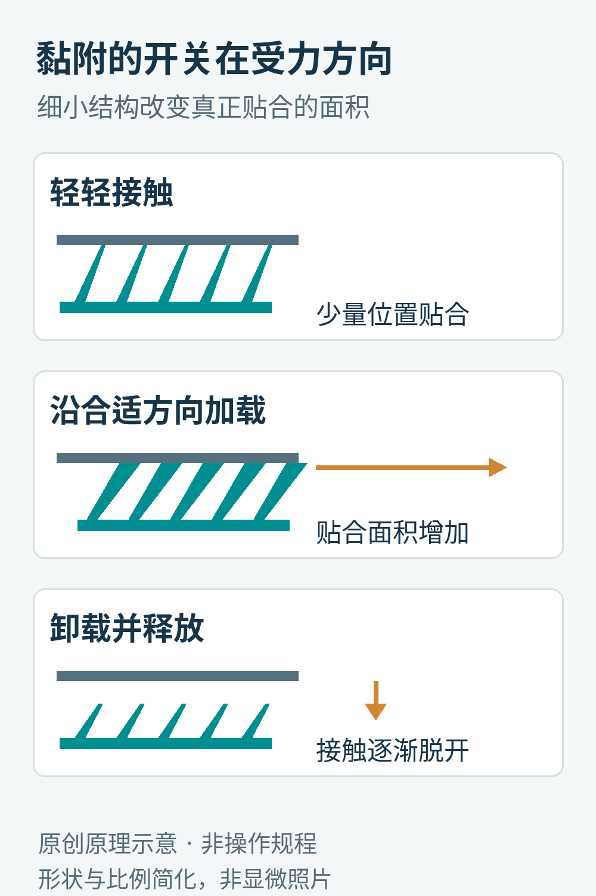
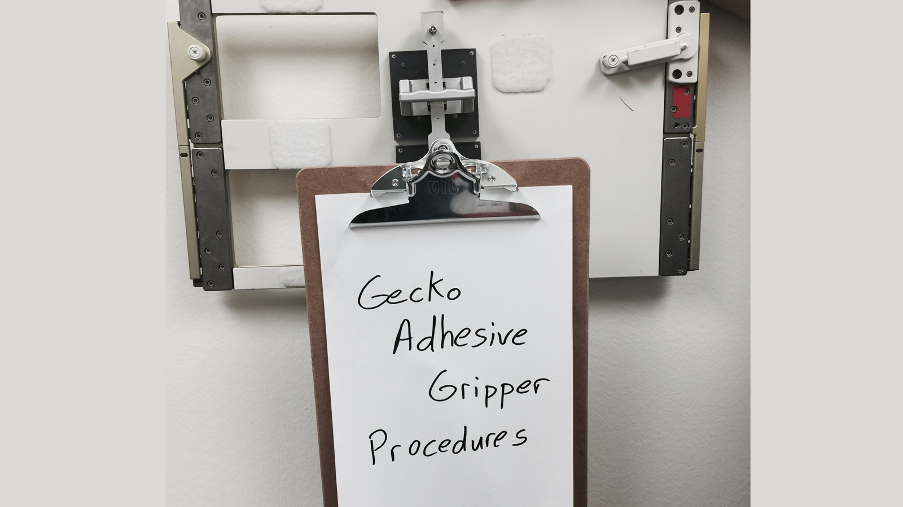
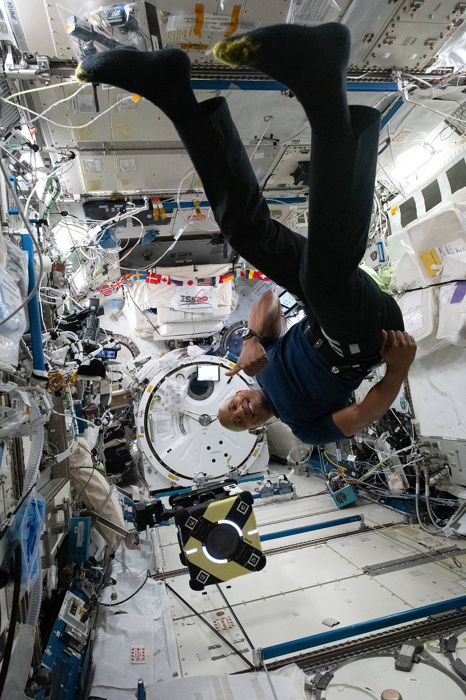
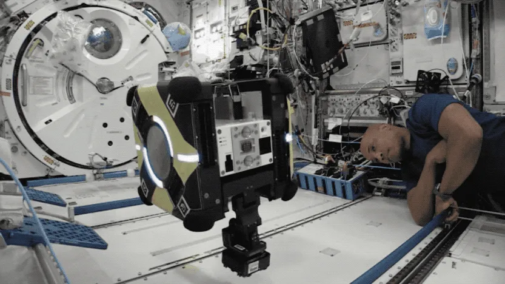
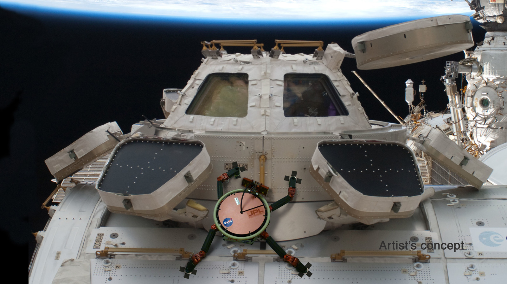

# 壁虎脚底的“开关”，为什么适合太空抓手？

在地面捡一个盒子，你可以把手伸过去，夹紧，再提起来。在空间站里，盒子如果正浮着，这个动作就没那么简单：手还没夹住，轻轻一碰，它可能已经飘走了。

2025年2月4日，国际空间站里出现了这样一个场景：安装在Astrobee自由飞行机器人上的蓝色触手状机械臂，围住一个用来做实验的“捕获方块”。NASA在2月6日公布了照片，说明它演示的是自主探测与捕获技术，可为未来的在轨服务和碎片处理提供研究基础。[1](https://www.nasa.gov/image-article/robot-gets-a-grip/)、[1·2](https://www.nasa.gov/blogs/spacestation/2025/02/04/robotics-demonstration-air-and-water-quality-checks-aboard-orbital-lab/)

这组机械臂的一条技术线索，藏在地球上常见的壁虎脚底：通过微小结构和受力方向，控制什么时候黏住、什么时候松开。

2025年2月4日的空间站舱内实验照片。目标是用于测试的捕获方块，不是在舱外清理到的废弃卫星；蓝色触手状结构和目标之间的接触，是整项技术的核心。

## 壁虎脚上的“纹路”，还不是最小的秘密

壁虎脚底看起来像有一排排褶皱。继续放大，还能看到大量细毛，细毛末端又分出更小的接触结构。

它们的作用，并不是像钩子一样，必须挂住墙上的大凹槽。玻璃看起来平滑，壁虎也能行走；关键是让脚底材料充分贴近表面，在大量微小接触位置上积累作用力。[2](https://www.nasa.gov/technology/tech-transfer-spinoffs/new-commercial-robot-copies-geckos-toes/)

壁虎行走在玻璃上时的脚掌近照。肉眼可见的是趾垫的层状结构，真正参与细密接触的微结构还要小得多，不能把这张普通照片当作显微镜图。

这里常出现一个术语：范德华力。可以先把它理解成中性原子、分子之间，由电荷分布与极化产生的一类较弱相互作用。在足够近的距离上，这种作用不能忽略；离得稍远，它就迅速变弱。[2](https://www.nasa.gov/technology/tech-transfer-spinoffs/new-commercial-robot-copies-geckos-toes/)

为什么桌面上的一把塑料尺不会像壁虎一样牢牢黏住玻璃？问题之一是“看起来接触”和“真正足够近”并不一样。硬物表面放在一起，微观上常常只有少量凸起碰到了对方。壁虎脚底分层、细密而能顺应表面的结构，提高了有效接触的机会。

好比用一整块硬板去贴一面略有起伏的墙，板和墙之间总有空隙；换成许多细小、可分别顺应起伏的接触端，贴合就更容易。这个比喻解释的是接触几何，不意味着壁虎脚上的每根细毛都像机械弹簧那样工作。

## 黏得住，为什么还能走得动？

如果脚永远黏得很紧，走一步就得把自己从墙上猛拽下来，那不会是一种好用的运动方式。

仿生抓手因此特别重视“方向”。它的细小结构有倾斜方向：接触后沿合适方向施加切向载荷，结构弯曲、贴合，有效接触面积增大；卸去载荷或改变释放动作，黏附就会减弱。[2](https://www.nasa.gov/technology/tech-transfer-spinoffs/new-commercial-robot-copies-geckos-toes/)[3](https://pubmed.ncbi.nlm.nih.gov/33157899/)、[3·2](https://doi.org/10.1126/scirobotics.aan4545)

切向，就是沿着表面。你把手掌放在桌上，向下按是法向动作，沿桌面推是切向动作。对于这种抓手，切向拉动并非抓稳后的偶然结果，而可能是激活黏附的重要步骤。

它有点像一枚机械开关，只是开关不是电路上的按钮，而是细小结构的受力状态。“开”时要能传递力，“关”时又要容易脱离。重复使用之所以有吸引力，正因为抓手不必每次涂一层新胶，也不需要先给每个目标贴上配套材料。

原创机制示意，未按微观比例绘制。画面强调接触和切向加载的关系；真实抓手还有多片黏附垫、传力机构与释放控制，不是一排放大的橡胶毛就能直接执行任务。

这种设计也有边界。灰尘可能隔开接触面，表面粗糙度和曲率会改变能贴上的面积，载荷方向不对可能提前剥离。不能把“无需胶水”理解成“什么表面、任何角度都能牢牢黏住”。

## 太空里，吸盘为什么常常帮不上忙？

吸盘的直觉很熟悉：把内部气体挤出去，让外部空气压力把它压在表面上。在有空气的舱内，这种原理可以工作；在接近真空的舱外，缺少足够的外部气压，常规吸盘就失去了依靠。

磁铁也有自己的适用材料。机械手指往往需要一个能夹住的边缘，或者能从两侧包围目标。一个宽大、光滑、没有专门把手的物体，未必给它这种条件。

干黏附提供了另一条路线：只要合适的接触区域能贴上去，就可能从表面施力。2017年的机器人研究将可控制的仿壁虎黏附、负载分配系统和可顺应的腕部结合起来，针对微重力下的大尺寸平面、曲面物体进行抓取与释放测试。[3](https://pubmed.ncbi.nlm.nih.gov/33157899/)、[3·2](https://doi.org/10.1126/scirobotics.aan4545)

这里最容易误读的是“抓住一个很重的物体”。在微重力环境里，物体不需要像地面那样由抓手持续托住重量，但它的质量和惯性还在。让一个100公斤物体改变速度，仍然需要力；接触点偏离质心，还可能使它开始旋转。

因此，漂亮的黏附材料只是第一步。抓手要靠近目标，减小相对速度，吸收接触瞬间的动能，再平稳接管它的运动。只强调“黏得多牢”，会漏掉一大半实际问题。

## 先让夹板不乱飘，再走向自由飞行机器人

这条研究路线并非一下子跳到抓废弃卫星。2015年的JPL介绍中，一个很朴素的用法，是把夹板等物品固定到空间站内壁上。

普通魔术贴需要两面配对。仿壁虎抓手的设想，则是让宇航员面对一个合适表面，就能安装一个可拆卸的固定点。[4](https://www.jpl.nasa.gov/news/gecko-grippers-moving-on-up/) 小小一块夹板，已经包含了接触、承载、释放和重复使用这几个关键动作。

JPL在2015年展示的夹板固定原型。背景是与美国舱段内部同类的备用面板，是地面展示照片；它说明抓手如何形成一个临时安装点。

再往前，抓手可以成为机器人的“停靠脚”。Astrobee是用于空间站舱内研究的平台，靠电动风扇在空气中移动，也可利用抓握装置固定位置。[1](https://www.nasa.gov/image-article/robot-gets-a-grip/)、[1·2](https://www.nasa.gov/blogs/spacestation/2025/02/04/robotics-demonstration-air-and-water-quality-checks-aboard-orbital-lab/) 有了更多可用的停靠表面，机器人就不必为了维持姿态一直进行同样的悬浮控制。

2020年公开的设计论文，介绍了为Astrobee开发仿壁虎抓手及其地面实验。论文中的硬件已送往空间站，不能因此把论文的地面结果称为在轨验证。[5](https://arxiv.org/abs/2009.09151) 到2021年5月，NASA才发布了宇航员Victor Glover在空间站里配合Astrobee测试这类黏附技术的图文记录。[6](https://www.nasa.gov/image-article/sticking-around-astrobee-tests-gecko-inspired-adhesives-space/)

宇航员Victor Glover与名为Honey的Astrobee。设备与人的同框，让自由飞行机器人和抓握附件的大小更容易理解。这是2021年公布的实验场景。

NASA记录的舱内实验动图。它展示舱内测试动作，不能据此推断舱外追踪、抓捕和离轨处置均已完成。

## 到了真实微重力，材料之外的问题出现了

2023年NASA总结相关空间站研究时指出，黏附材料表现符合预期，但以后应用仍需要注意完整接触、备用黏附片、接触偏差和动能吸收；传感器也需要告诉系统，什么时候所有黏附片已经接触，可以施加张力。[7](https://www.nasa.gov/missions/station/iss-research/science-in-space-robotic-helpers/)、[7·2](https://ieeexplore.ieee.org/document/9783137)

为什么“所有片都接触”如此重要？想象四条腿的凳子，只有一条腿先吃到了全部力，剩下三条并不会自动替它分担。黏附垫也有类似的负载分配问题：一块很强的小垫，直接复制成四块，不必然得到四倍可靠的系统。接触时序、垫片之间的连接和整个腕部的顺应性，都影响实际承载。

这也是仿生技术有意思的地方。自然界提供了一个值得学习的接触策略，但工程师需要重新设计制造方法、传感、驱动和控制，才能把策略安进一个机器人。最终设备看起来更像机械臂，完全不需要长成一只壁虎。

JPL在2015年给出的LEMUR机器人概念图，想象它借助仿壁虎抓握在空间站外部工作。这是用途设想，不是已经执行过该任务的照片。

## 从空间站到工厂，哪些地方真的用得上？

同样的接触问题也存在于地面。例如一块带孔的电路板，吸盘可能很难形成合适的密封；太阳能板或玻璃又可能希望从平整表面拿起，避免复杂的边缘夹持。

NASA在2020年的技术转移报道中，记录了相关技术进入商业抓手的过程，并把这些光滑工件列为应用场景。[2](https://www.nasa.gov/technology/tech-transfer-spinoffs/new-commercial-robot-copies-geckos-toes/) 本文不把报道中的当年负载、回本周期或在售型号当成2026年的采购结论。实际能否使用，仍取决于工件表面、清洁程度、姿态与节拍。

看这些演示时，更有用的问题是：它抓的是什么材料？接触前有没有对准？力沿哪个方向传递？谁判断已经抓稳？放开时会不会把目标推走？

截至2026年10月9日核对到的上述资料，能够支持舱内黏附与捕获演示、相关论文和技术转移的故事；不能把它们合并成一条“已经在轨清理大量太空垃圾”的战绩。

壁虎给机器人的启发，不只是把东西黏得更牢。它把一个常被当成被动接触的界面，变成了可以通过方向来控制的动作：靠近、贴合、受力，再适时松开。

图片来源：[JPL](https://www.jpl.nasa.gov/news/gecko-grippers-moving-on-up/)，Courtesy NASA/JPL-Caltech；[2025实验照](https://www.nasa.gov/image-article/robot-gets-a-grip/)，NASA/Suni Williams；[2021照片与动画](https://www.nasa.gov/image-article/sticking-around-astrobee-tests-gecko-inspired-adhesives-space/)，NASA。壁虎脚掌：[Bjørn Christian Tørrissen](https://commons.wikimedia.org/wiki/File:Gecko_foot_on_glass.JPG)，[CC BY-SA 3.0](https://creativecommons.org/licenses/by-sa/3.0/)，未修改；中文示意为本文原创。
