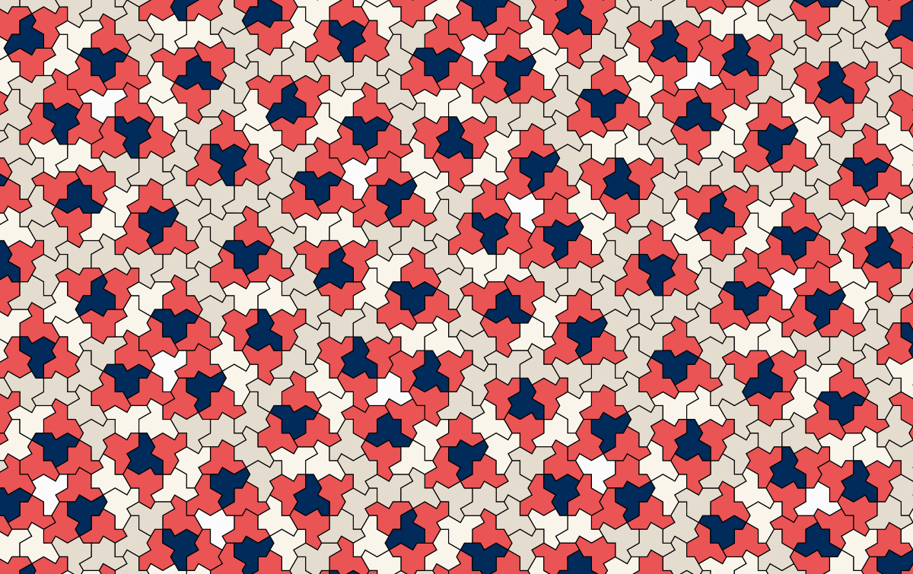
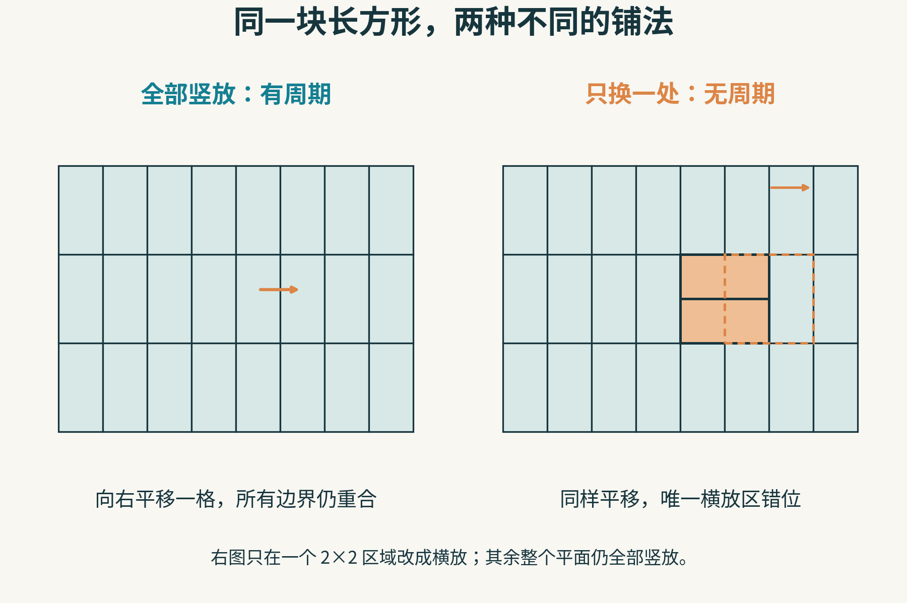
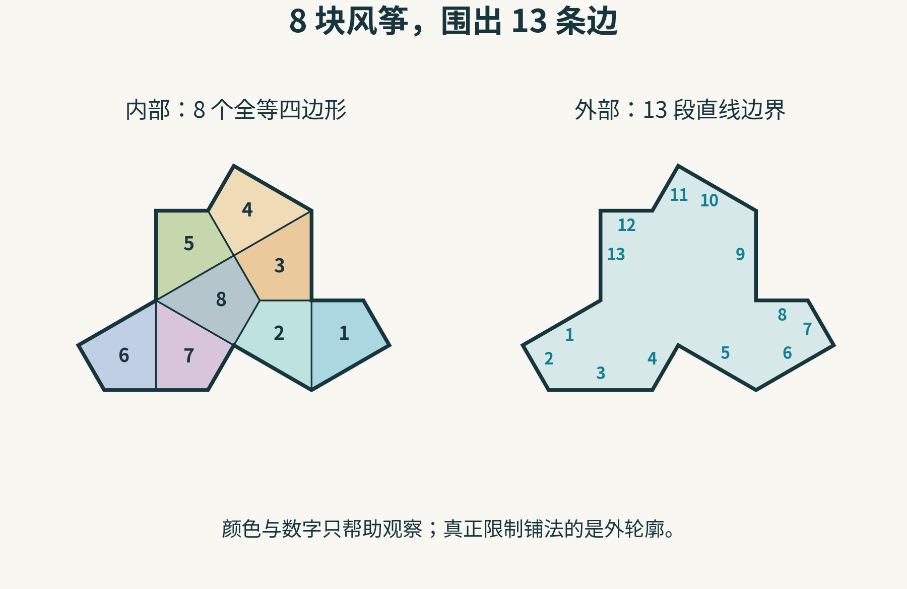
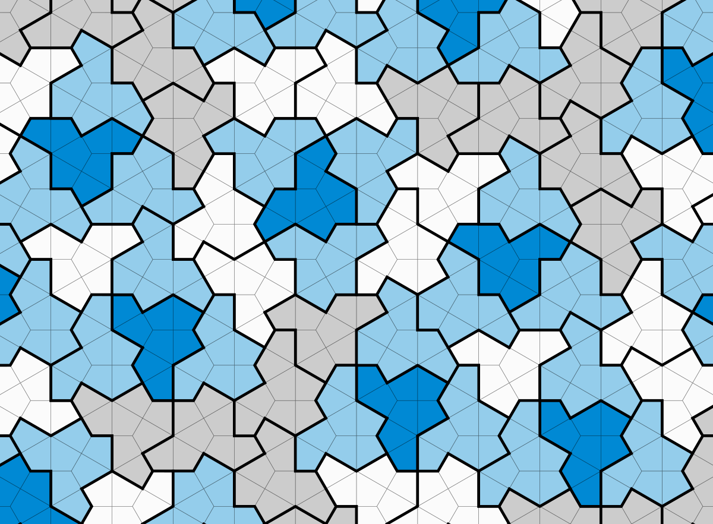
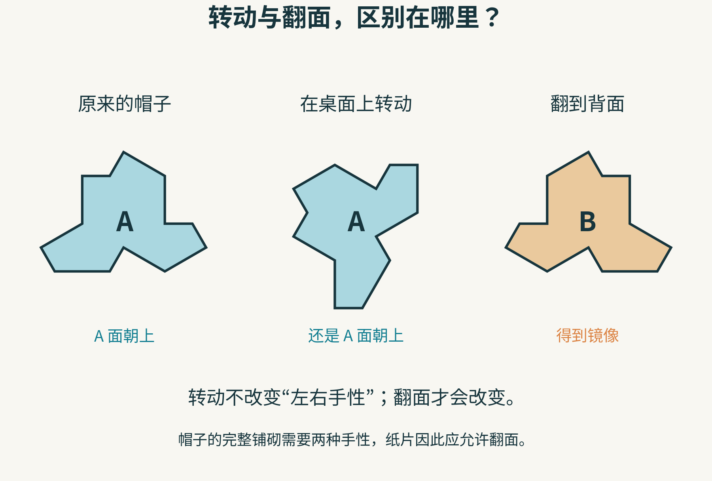
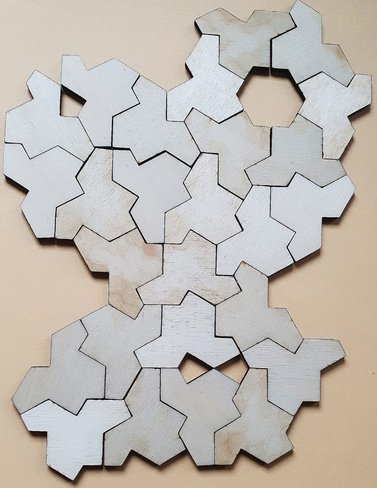
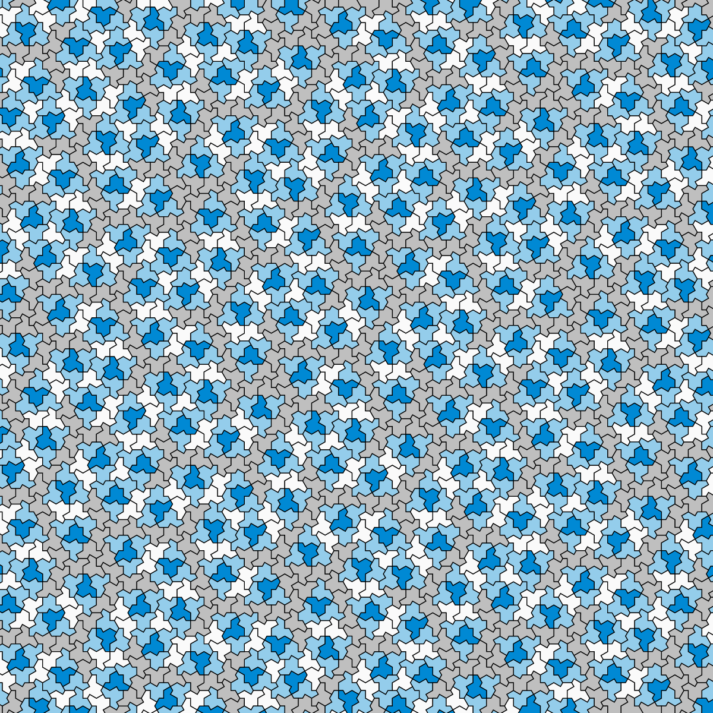
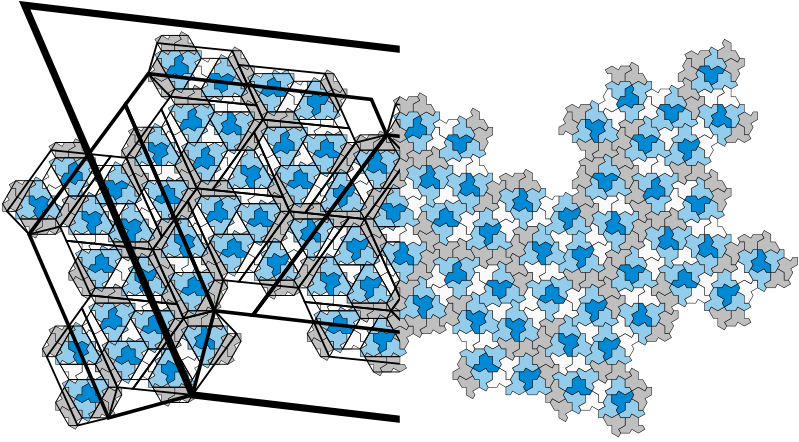
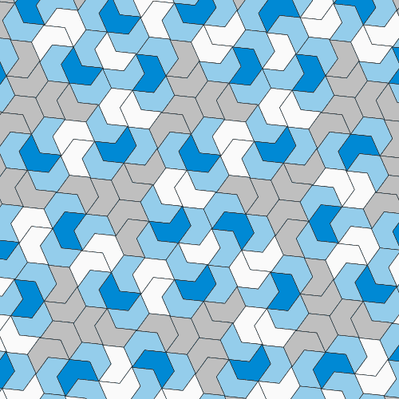
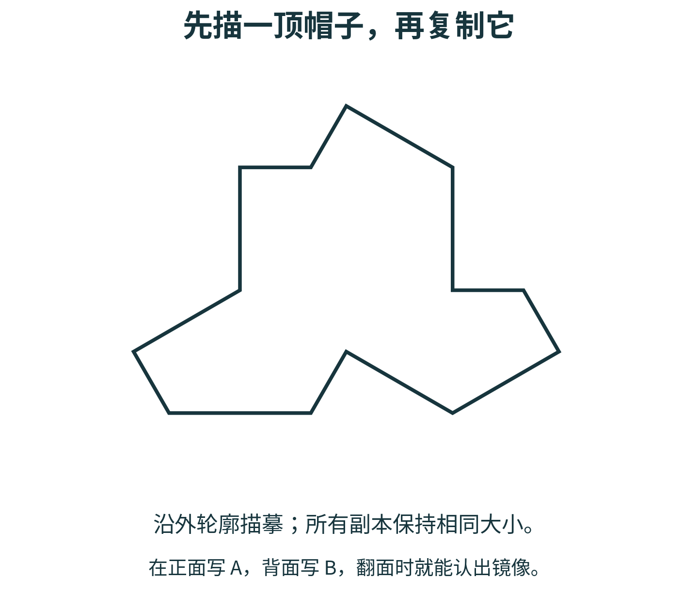

# 能铺满整个平面，却铺不出周期花纹：这顶“帽子”到底怪在哪里？

假设你要给一间没有尽头的教室铺地板。瓷砖只有一种形状，大小完全相同，不能重叠，也不能留下缝隙。你可以搬动、转动它们；如果瓷砖正反两面都能使用，也可以翻面。

拿正方形来铺，这件事似乎没有悬念：一排接一排，向右走一块砖的距离，脚下的拼缝又是同一副模样。

但下面这些像小帽子的多边形，提出了一个反直觉的问题：**有没有一种瓷砖，确实能把无限平面铺满，却无论怎么铺，都不能得到具有平移周期的花纹？**

有。2023 年，David Smith、Joseph Samuel Myers、Craig S. Kaplan 和 Chaim Goodman-Strauss 公布了这样的“帽子”拼块；相关论文于 2024 年发表。它的特殊之处，藏在轮廓里，不需要在边上另外写“只能与某种颜色相接”之类的规则。

先找出一顶完整的帽子，再看看它周围的邻居。所有瓷砖都是同一种形状的副本，其中包括翻面后的镜像；颜色只是帮助我们观察。

不过，“没有周期”很容易被误听成“任何图案都不会再出现”。这两句话相差很远。要理解帽子的本领，我们得先把“重复”拆开来看。

## 1. 找到一样的小花纹，算不算发现了周期？

想象有两张无限大的透明纸，上面印着完全相同的铺砖图。把它们先重叠，再将上面一张朝某个方向平移一段距离，不转动，也不翻面。

如果移动后，每一块砖、每一条拼缝仍与下面的图完全重合，而且移动距离不为零，那么这张铺砌就有了一个**平移周期**。

关键词是“整个图”，不是“有几个地方对上了”。平移的方向可以是横向、纵向或斜向；距离也可能比眼前这张图片大得多。本文说“非周期铺砌”，指的就是没有任何非零平移能让整张无限铺砌与自己重合。

我们用一种更熟悉的砖试试：长为 2、宽为 1 的长方形。

第一种铺法，把它们全部竖着放，排成整齐的列。整张图向右平移 1 个单位，仍然严丝合缝。这是一种周期铺砌。

第二种铺法，先照第一种铺满平面，只选中一个 2×2 的小正方形：取出里面并排的两块竖砖，换成上下叠放的两块横砖。除此以外，无限平面的其余地方都不改。

原创教学例子。两幅图都只画了一个有限窗口；右边的规则是“全平面只改这一处”，不是在画面外继续重复橙色区域。

右图为什么没有平移周期？因为它只有这两块横着放的砖。假如整个铺砌平移后能与自己重合，这个唯一的横放区域也必须回到原处。任何非零平移都会把它搬走，所以办不到。

这说明一件重要的事：**做出一张非周期的铺砖图，并不等于找到了一种非周期铺砌块。**

长方形砖既能采用左边的周期铺法，也能采用右边的非周期铺法。右边是我们选择了一种特殊安排，不是砖的形状禁止了所有周期。

现在可以分清三个对象了：

- **周期铺砌**：一种已经铺好的无限图案，有非零平移能让全图重合。
- **非周期铺砌**：一种已经铺好的无限图案，没有这样的平移。
- **非周期铺砌块**：说的是砖的本领。它能铺满平面，而且它允许的每一种完整铺砌都没有平移周期。

帽子属于最后一种。它不只是让你“可以选择不重复”，而是让你无法拼出周期铺砌。

## 2. 把帽子拆开，里面藏着什么？

帽子不是一个带着曲线的复杂轮廓。它是一个有凹口的多边形，沿外边界数一圈，一共有 13 条边。

如果在里面补上辅助线，又能把它分成 8 个全等的“风筝形”四边形。“全等”表示形状和大小都相同，可以通过移动、转动或翻面彼此重合。

左边数内部小块，右边数外轮廓。内部的某些边拼到一起后消失了，另一些相邻线段会连成一条直边，所以不能用“8×4”计算帽子的边数。

这里的 8 个小风筝，是理解和构造轮廓的工具。真正拿来铺地板的是整顶帽子，不能把每顶帽子拆散后重新拼成别的形状。

你也不必给它涂上指定的颜色。把图中的蓝色、灰色都擦掉，铺砌规则仍然成立：砖之间不能重叠，不能留下空隙，除此之外，外轮廓本身就足够施加限制。

粗线是一顶顶帽子的边界，细线是组成它们的风筝网格。先跟着一条粗线走完一圈，再数这顶帽子里的八个小风筝。

一个凹口旁边，需要邻居伸出合适的部分；某几条边一旦贴在一起，又会限制下一块可以朝哪个方向放。限制从一个邻居传到另一个邻居，最终影响到远处。

这并不意味着“只要有凹口就会非周期”。大量有凹口的拼块仍然可以拼出周期花纹。帽子的厉害之处，需要由整套几何关系来证明，不能凭外观判断。

## 3. 先别急着剪：帽子需要翻面

拿一只左手手套，在桌上怎么旋转，它也不会变成右手手套。帽子的轮廓有类似的“左右手性”：单靠在平面内平移、转动，无法把它变成自己的镜像。

纸片可以解决这个问题，因为你可以把它翻过来。

在纸片正面写 A，背面写 B。转动纸片时仍看见 A；翻面后看见 B，轮廓也变成镜像。

帽子的所有完整平面铺砌都必须混合使用这两种手性。因此，本文开头允许“翻面”的条件不是随口补上的便利，而是这项结果的重要组成部分。

在通常的平面铺砌约定中，允许平移、旋转和反射，镜像与原形算作同一种形状。所以它被称为**单一形状的非周期铺砌块**，英文是 aperiodic monotile。

如果你要把它做成只有一面上釉的陶瓷砖，事情就多了一步：普通瓷砖不能把背面当正面使用，制作时需要考虑左右两种朝向。数学里的“同一种形状”，不等于现实生产中只有一个朝向的零件就足够。

只用 A 面朝上的纸帽子拼不下去，也不能据此反驳论文。那已经换了实验规则。

## 4. 一个发现，为什么不能停在“我拼了很大一片”？

论文介绍，Smith 在探索不同形状的铺砌性质时，主要通过手工尝试，并借助拼图软件研究帽子。他可以拼出很大的区域，却找不到一个明显能周期复制的基本单元。

这是值得追究的线索，但还不是答案。

实体拼块让“转动、翻面、试一个邻居”变得很直观。这张照片是有限拼图，画面中也有尚未填满的孔洞；它呈现动手探索的样子，并不承担无限铺砌的证明。

为什么一大片拼图还不够？因为边缘始终可以暂时敞开。某个摆法可能连续扩展很多圈，最后才被一个无法补上的缺口卡住。另一方面，你试过的摆法没有周期，也不代表另一种还没试过的摆法没有周期。

可以把研究者要回答的问题拆成两个：

**问题一：能不能真正铺满整个无限平面？**

需要说明拼图不是扩展到某一圈就不得不停下，而是存在能够持续扩展、覆盖任意远处的构造。

**问题二：会不会存在另一种周期铺法？**

需要排除所有合法的完整周期铺砌，而不只是排除已经试过的几十种或几百万种。

第一问是“至少有一种可行”。第二问是“任何一种周期安排都不可行”。两者的逻辑方向不同，缺一不可。

这也是数学探索中很有用的提醒：**反复试验可以把我们带到一个好猜想面前，却不能自动替我们跨过“所有”和“无限”。**

## 5. 可我明明看到了相同的小花纹

现在回头看开头的暖色图，你可能已经找到几个长得一样的小组合：某顶帽子旁边，邻居的朝向和另一处很相似，甚至完全一样。

这没有推翻非周期性。两小片区域一样，只说明局部图案重复。要得到周期，必须找到一个固定平移，让同样的对应关系在整个无限平面上同时成立。

就像两页文章里都出现了同一个词，并不意味着把整篇文章移动几个字，全部内容就都能重合。

观察画面中央的三臂结构：这里可以看见局部的三重旋转关系。旋转与平移是不同的动作，有局部旋转对称并不等于全图具有平移周期。

非周期也不等于随机。随机摆放一堆帽子，多半会产生重叠和空洞；合法铺砌必须遵守非常严格的几何条件。

更合适的说法是：这里存在秩序，但这种秩序不能被压缩成“取一个固定单元，沿固定方向不断平移复制”的办法。

还有一个观察上的陷阱：当你把一张图片缩得很小，细节会被压成模糊的色块；本来不同的区域，也可能看上去差不多。判断数学上的重合，要比较实际的砖边界和位置，不能只凭“远看像一样”。

## 6. 证明的线索：小帽子会被迫组成更大的结构

怎样才能从有限的边界规则，谈到无限平面？论文给出了两条不同的证明路线。这里沿着其中的层级路线，理解它要完成的工作，不把几段直觉当成完整证明。

先看作者的这张图。黑色大轮廓把许多帽子之间的更大尺度关系显现了出来。

帽子的研究不只是在问“下一块摆哪里”，还会把小块组成的结构当作新的对象，继续观察更大尺度。

### 第一步：把一些帽子认成“组块”

在论文中，研究者先从帽子的邻接关系中辨认出四类组块，并用简化的轮廓来记录它们。这些中间对象叫作 metatiles，可以理解成“用来研究的组合砖”。

它们不是另外加入了四种真的瓷砖。地板仍然只由原来的帽子构成；组块是给若干帽子之间的组织关系加上记号。

重要的也不是研究者“愿意怎样分组”。他们必须证明：任何合法的完整帽子铺砌，都受这些组块关系约束，而且每一块的归属能被唯一确定。

### 第二步：让组块再组成更大的组块

接着，组块之间还能形成更大一层的结构。再往上一层，又能重复这一类构造。这里重复的是组块的邻接组织方式，不应理解成“一些小帽子恰好拼成一顶放大的帽子”。

甚至原论文中的中间组块，也不全是逐层严格放大得到的相似图形：它们的轮廓会变化，但组织关系保持相容。这正是为什么不能拿随手画的套娃图，冒充实际的帽子替换规则。

沿着作者给出的构造，可以得到一列互相相容、不断向外增长的铺砌片段。它们不是只往一个方向长成窄条，而是覆盖的范围向任意远处扩展。论文据此建立存在完整平面铺砌的结论。

### 第三步：说明周期会与“唯一归属”冲突

只会把图案一层层分组，还不够。普通方格纸也能按 2×2、4×4、8×8 分组，但它显然有周期。

区别在于，方格纸上的这些大框是人后来选的：把分组起点换一格，照样能分。帽子的证明需要的是由形状强迫出来、可以唯一辨认的层级。

左边表示同一块帽子在不同尺度上的归属，右边表示假设存在平移周期后，大组块与其平移副本可能交叠。椭圆和方框只是逻辑示意，不是论文中的真实组块轮廓。

假设真的存在一个非零平移周期。把整张铺砌照这个平移搬动，砖的安排完全不变，那么从这些砖唯一辨认出来的组块结构，也应该被保留下来。

然而，层级会产生越来越大的组块，而假设中的平移距离是固定的。到了足够大的尺度，就能找到与其平移副本发生内部交叠的大组块。交叠处的小块将同时落入两种不同的同层归属，这与前面证明的唯一性冲突。

这条路线的难点，恰恰藏在“所有合法铺砌都必须服从这些组块关系”以及“归属唯一”之中。不能省掉这两步，只留下“有层级，所以不重复”的口号。

作者为其中的局部情形分析使用了计算机辅助枚举，并用两套独立实现进行交叉检查。它要检查的是证明中规定的情形范围，不是让电脑随机拼很多次，发现没有周期就宣布成功。

论文还给出了另一条关于几何不相容性的证明路线。我们没有在这里展开它。读懂本节，得到的是一张“证明在解决哪些障碍”的路线图，而不是替代原论文的证明。

## 7. 会变形的帽子，与后来的 Spectre

帽子还有一位会“变身”的亲戚。作者发现，改变构造中的两组边长，可以让形状连续变化，同时保留相关的邻接结构。下面的动画展示了这类变化。

追踪同一位置的一块砖，看它的边怎样伸长、缩短。动画中的瓷砖形状确实在改变，它不是让同一顶帽子在原地转动。

但有一个必须说清的例外：**动画里的每一种形状，并不都只能非周期铺砌。** 这一家族包含一些允许周期铺砌的特殊形状，包括两组参数相等时的 Tile(1,1)，以及其中一组参数降到零的两个端点形状。

这里的“允许周期铺砌”也不表示动画当前展示的那一种安排突然变成了周期铺砌。它是在说：换用那个特殊形状以后，另外还存在周期的铺法。

这与前面长方形砖的例子是同一道逻辑关卡：看到一个排列的性质，不能直接当成这个形状所有排列的性质。

镜像条件后来也有了新的进展。同一研究团队在 2023 年公布后续工作，论文于 2024 年发表。他们从 Tile(1,1) 出发修改边界，得到称为 **Spectre** 的形状家族。

Spectre 可以只用平移和旋转来实现非周期铺砌，不需要混入镜像块。这是与帽子不同的后续结果，不能倒过来说“原来的帽子也无需翻面”。

还有一层容易混淆：没有修改边界的 Tile(1,1)，在禁止翻面的条件下也会强迫非周期，但一旦允许镜像，它可以周期铺砌。Spectre 的修改正是为了让形状本身承担相应限制。给一个规则另加禁令，与把限制做进边界，是两回事。

## 8. 给自己一张纸，把问题变成实验

不必购买专门的拼块，也不必接触激光切割机。纸、铅笔、尺子，以及适合自己使用的剪刀，就能开始。如果不方便剪，也可以描摹，或者使用网页里的虚拟拼块。

把这张轮廓打印出来或照着描摹。同一次实验中的所有副本保持相同大小，不要为了堵住缝隙，把某一块拉长或剪掉一个角。

**先准备十几到几十块同样的纸帽子。** 在正面写 A，背面写 B。用剪刀时沿轮廓慢慢剪；需要帮助就请老师或家长协助。不用美工刀，也不用自己操作切割或加热设备。

接下来可以做三轮探索。

### 第一轮：只问“这个邻居能不能放？”

先从文中的近景图选一顶帽子，再仿照它周围两三块邻居的摆法。留意哪一次要旋转，哪一次必须翻到背面。

不要一上来就追求铺出漂亮的大图。先把两块之间的边界真正对齐，不重叠、不留缝，再向外扩展。若纸片剪裁稍有误差，先区分这是加工误差，还是形状的朝向放错了。

遇到死路，可以退回去换一种安排。一个有限摆法走不通，说明这次选择需要调整；它并不说明帽子无法铺满平面。

### 第二轮：找“重复”，然后提高要求

从你的拼图中选三四块组成一个小图案。试着在别处找到同样的组合。

找到之后，记录两处之间移动的方向和距离，再检查更大一圈邻居。原来对得上的几块，扩大观察范围后是否仍全部一致？

你会体会到两种问题的差别：“我找到了同样的一小片”和“这个位移能让整幅图都重合”。有限拼图只能帮助你检验已经看到的范围，不能据此宣布发现或排除了无限平面的周期。

### 第三轮：看构造怎样长大

打开作者的[交互式帽子铺砌工具](https://cs.uwaterloo.ca/~csk/hat/app.html)，观察不同构造层级的图案。也可以使用作者推荐的 [Mathigon 虚拟拼块页面](https://mathigon.org/polypad/8kVqVH2Mor6JTQ)，手动移动、转动和翻转帽子。

观察时给自己留三个具体问题：

- 我能否从杂乱的朝向中，认出反复出现的邻居组合？
- 把颜色隐藏或忽略以后，我还能靠边界找回这些组合吗？
- 当图案变大，我看见的是一个固定小单元被整齐复制，还是不同尺度的组块关系？

可以给每次尝试拍一张照片，写下“这一处为什么要翻面”“这个缺口为什么不能塞进去”。这样的记录比单写“很神奇”更有价值，因为下一次你能据此继续追问。

## 9. 最值得带走的，不只是这顶帽子

帽子的故事让“局部”和“整体”发生了碰撞：一条边只与眼前的邻居接触，整套边界关系却能排除无限平面上的所有平移周期。

它也提醒我们留意一句话究竟说了多强的结论：

“我没找到周期”，说的是一次搜索。

“这张无限铺砌没有周期”，说的是一个数学对象。

“这种砖的每一种完整铺砌都没有周期”，才说出了帽子的本领。

下次看到一片看似有规律的花纹，可以先不急着问“它重复吗”，而问一个更精确的问题：**重复的是哪一小片，允许什么动作，需要对齐多大的范围？**

从这一问开始，一张纸上的拼图，就能通向关于无限的数学。

资料与延伸阅读：[作者的帽子项目页](https://cs.uwaterloo.ca/~csk/hat/)、[《An aperiodic monotile》论文](https://escholarship.org/uc/item/3317z9z9)、[Spectre 后续研究页](https://cs.uwaterloo.ca/~csk/spectre/)。帽子论文作者：David Smith、Joseph Samuel Myers、Craig S. Kaplan、Chaim Goodman-Strauss；2023 年公布，2024 年发表于 Combinatorial Theory。

图片来源：帽子项目页的四幅静态图及一幅动画由上述四位作者提供，按 [CC BY 4.0](https://creativecommons.org/licenses/by/4.0/) 使用；动画为适配文件大小上限减少调色板颜色，保留原尺寸、全部帧及时间顺序。实体拼块照片：[Aschroet / Wikimedia Commons](https://commons.wikimedia.org/wiki/File:Bunch_of_connected_hat_tiles.jpg)，[CC0 1.0](https://creativecommons.org/publicdomain/zero/1.0/)。五幅中文教学图为本文制作，其中帽子与风筝的几何依据原论文图 1.1 重新绘制。
