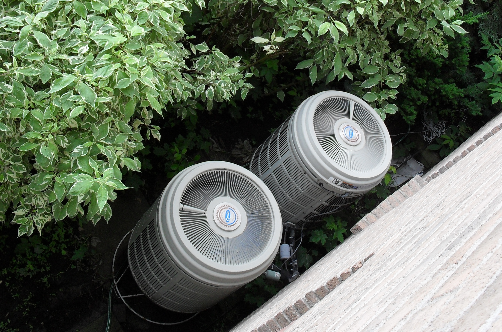
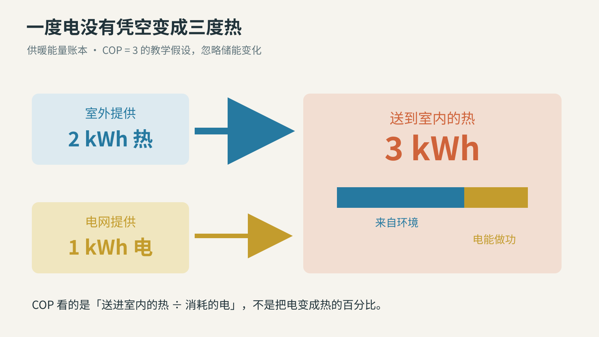
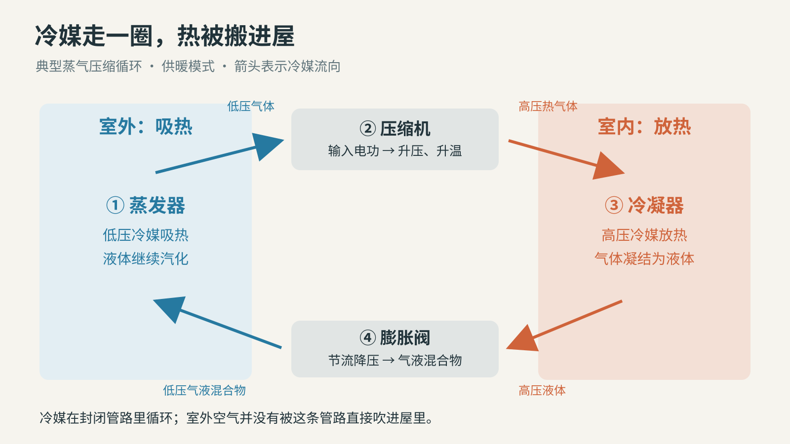
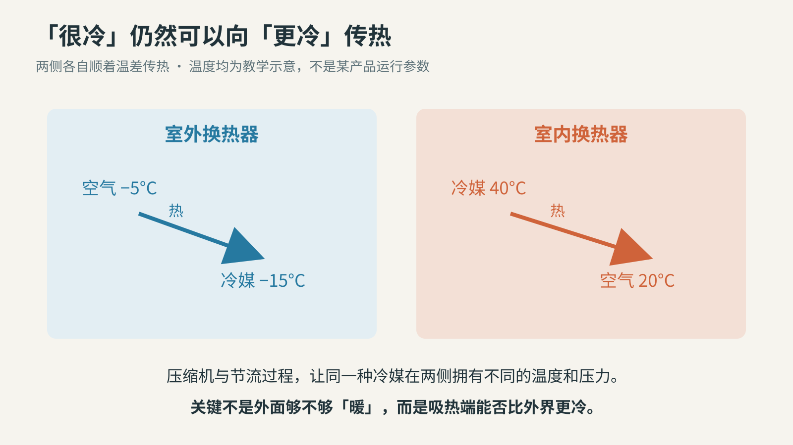
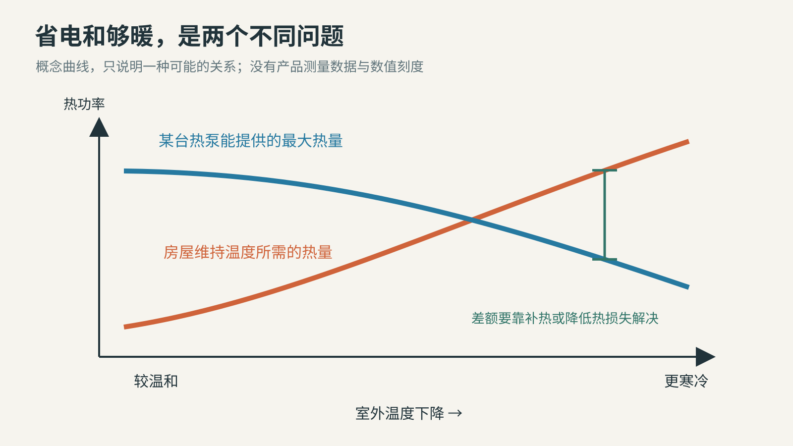
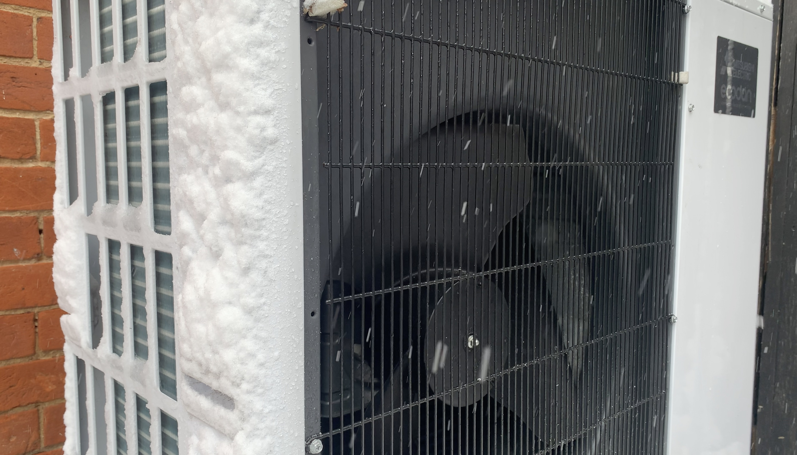
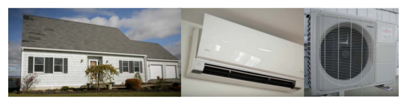

# 一度电，怎么搬来三度热？热泵没有和物理定律讨价还价

同样插上电，电暖器把电变成热，热泵却可能给屋里送来比耗电量多出几倍的热。乍看像是广告里的算术魔术：花了一份，怎么拿到三份？

热泵是一种搬运热量的机器。冰箱和空调都属于这类技术；能够制热的空调，则把原本用来往外排热的过程反过来，让室内成为收热的一端。本文讨论最常见的电驱动、蒸气压缩式空气源热泵：它从室外空气取热，再送进屋里。[1](https://www.energy.gov/cmei/buildings/articles/cold-climate-air-source-heat-pumps-innovative-technology-stay-warm-winter)

关键不在于它把电用到了百分之三百，而在于账本上还有另一个付款者：室外环境。

这是热泵的室外部分。风扇让空气经过换热器，热量通过冷媒管路进出；机器并不需要把室外空气直接送进房间。

## 一份电、两份环境热，合起来才是三份

先用一笔刻意简化的教学账来理解。

假设一台热泵在某段时间消耗1千瓦时电，也就是通常说的一度电；同时从室外取得2千瓦时热量。忽略设备内部储能变化，在这个理想化的系统边界内，它可以向室内送出3千瓦时热量。

第三份热不是机器偷偷创造的。输入的一度电和搬来的两份热，恰好合起来等于输出。热泵照样遵守能量守恒，只是电表没有替你计量从空气里拿来的那部分。

这是COP等于3的教学例子，不是对某台机器、某个季节的实测承诺。

描述这件事的指标叫COP，中文通常译作性能系数。供暖COP是送出的热量与耗电量之比；按同一运行条件下的热功率、电功率相除，得到的也是同一个比值。美国ENERGY STAR产品标准明确把它定义为这种比率。[2](https://www.energystar.gov/products/air_source_heat_pumps/key-product-criteria)

这和电暖器的“电转热效率”不是一回事。后者问电能里有多少在你需要的位置变成热，前者问花一份电能驱动搬运，最后送来了几份热。

因此，说“热泵效率超过100%”虽常见，却容易把不同账本混在一起。说“这段工况下，1度电送来了3度热”，更接近实际问题。它也提醒我们继续问：这段工况究竟有多冷？辅助电热有没有算进去？风机、循环泵的用电又算在哪里？

## 搬热的不是空气，而是一圈不断变换状态的冷媒

只说“搬运”还不够。热本来会自发地从较暖的一边流向较冷的一边。要让室外较冷的环境给室内供暖，热泵需要付出电功，并把过程拆成两个局部都能成立的换热过程。[3](https://betterbuildingssolutioncenter.energy.gov/sites/default/files/attachments/87812.pdf)、[3·2](https://research-hub.nlr.gov/en/publications/decarbonizing-building-thermal-systems-a-how-to-guide-for-heat-pu/)

执行这项任务的是冷媒，一种在系统工作压力下适合反复汽化、凝结的物质。它在封闭管路中循环，不是每次制热都烧掉一批。下面沿着供暖时的一圈走一遍：

第一站是室外换热器。低压冷媒的温度低于流经它的室外空气，因而能够吸热，液体部分继续汽化。这里叫蒸发器，“蒸发”说的是冷媒，不是把外面的空气蒸干。

第二站是压缩机。它对冷媒气体做功，使压力和温度上升。电能在这里帮助系统建立一个关键条件：冷媒要热到足以向室内放热。

第三站是室内换热器。高温、高压的冷媒把热交给室内空气，随后凝结成液体，所以这里叫冷凝器。室内风机把热送开；若系统用水输送热量，接收热量的也可以是水。

第四站是膨胀阀。冷媒经过节流，压力降低，部分液体闪蒸，形成更冷的气液混合物，再回到室外吸热。阀门不是一台发电涡轮，也不是靠“放出冷气”给室外降温；它让冷媒回到适合下一次取热的状态。[3](https://betterbuildingssolutioncenter.energy.gov/sites/default/files/attachments/87812.pdf)、[3·2](https://research-hub.nlr.gov/en/publications/decarbonizing-building-thermal-systems-a-how-to-guide-for-heat-pu/)

两个换热器承担相反任务，压缩机和膨胀阀把高、低压力两侧接成一圈。图省略了控制与辅助部件。

有了这幅图，空调制冷与热泵制热的亲缘关系就很清楚：把热送到哪一边，决定了我们觉得哪边被加热、哪边被冷却。可逆系统通过换向阀改变冷媒经过换热器的方式，室内、室外两侧交换蒸发器和冷凝器的角色。[3](https://betterbuildingssolutioncenter.energy.gov/sites/default/files/attachments/87812.pdf)、[3·2](https://research-hub.nlr.gov/en/publications/decarbonizing-building-thermal-systems-a-how-to-guide-for-heat-pu/)

## 零下的空气，为什么还有热可以拿？

“外面都零下了”是人体感受，不是热量库存归零。

摄氏零度不是分子停止运动的温度。更直接地说，零下5摄氏度的空气，仍然比零下15摄氏度的冷媒暖。让它们隔着换热器接触，热就能从前者流向后者。

下面的温度全是教学假设：室外空气−5°C、吸热端冷媒−15°C；室内空气20°C、放热端冷媒40°C。室外一侧，热从空气流向冷媒；室内一侧，热从冷媒流向空气。两个地方都没有要求热自己从冷处跳到热处。整圈搬运之所以能够持续，是压缩机在付出功。[3](https://betterbuildingssolutioncenter.energy.gov/sites/default/files/attachments/87812.pdf)、[3·2](https://research-hub.nlr.gov/en/publications/decarbonizing-building-thermal-systems-a-how-to-guide-for-heat-pu/)

比较对象要选对：室外空气不必比房间暖，只需比吸热端冷媒暖。图中温度不对应任何产品参数。

这也解释了为什么冬天站在制热中的室外机风口附近，可能感到更冷：系统从那股空气里拿走了热。它没有在创造寒冷，就像冰箱没有往食物里灌入一种叫“冷”的东西。

不过，“有热可取”不等于“取起来总一样省力”。需要跨越的温差越大，搬运的难度通常越高。室外更冷、室内要求更热时，同一系统的COP往往会下降；真实表现还取决于冷媒、压缩机、换热器和控制策略。[3](https://betterbuildingssolutioncenter.energy.gov/sites/default/files/attachments/87812.pdf)、[3·2](https://research-hub.nlr.gov/en/publications/decarbonizing-building-thermal-systems-a-how-to-guide-for-heat-pu/)

## 寒冷带来两道考题：省不省电，够不够暖

判断低温表现，不能只看COP。

COP高，说明每份电能换来的热量较多；制热量大，才说明单位时间能送来足够多的热。它们有关联，却不是同一个指标。

假设房屋此刻每小时散失6千瓦时热量，热泵只能补回4千瓦时，即使这4份热来得很省电，室温仍会下降。这个例子没有对应某种型号，只想说明：房屋需要多少，与机器能送来多少，必须放到同一张图上比较。

曲线只展示一种可能的关系。具体交点必须用当地设计温度、建筑热损失和该型号性能表确定，不能从这张图读取。

ENERGY STAR的寒冷气候热泵要求正好把两件事分开写：在指定测试方法下，5°F，约−15°C时，COP至少为1.75；此时制热量至少达到47°F，约8.3°C工况下标称制热量的70%。这些是美国该认证的具体门槛，不是所有热泵的通用性能，也不保证任何房子装上去都足够暖。[2](https://www.energystar.gov/products/air_source_heat_pumps/key-product-criteria)

注意这里没有“零下15度仍保持全部制热能力”的承诺。认清试验温度、容量比例与耗电比，往往比记住一句“适合寒冷地区”更有用。

雪中的真实设备建立的是使用环境的直觉，单凭照片不能判断室外温度、COP或这户人家的取暖效果。

## 一层霜，也会改写那笔漂亮的账

室外换热器既然要比空气更冷，就可能让空气中的水分在表面凝结、结霜。霜层会妨碍空气流过，也会降低换热能力。于是热泵需要除霜。[4](https://www.energy.gov/cmei/buildings/articles/radiation-defrosting-technique)、[4·2](https://www1.eere.energy.gov/buildings/publications/pdfs/building_america/low_temp_air_source_heat_pump.pdf)

一种常见做法是短暂反向运行，把热送回室外换热器来融霜。这段时间系统不能像平常那样持续向屋内送热，有的设备还会启动辅助电加热。具体触发方式、时间和补热安排随产品而异，不能把一次看到室外机冒汽，直接诊断成故障。[4](https://www.energy.gov/cmei/buildings/articles/radiation-defrosting-technique)、[4·2](https://www1.eere.energy.gov/buildings/publications/pdfs/building_america/low_temp_air_source_heat_pump.pdf)

这就是为什么实验室在稳定工况下给出的COP，不能直接乘满整个冬天。真正的季节账本还会收入启停、除霜、待机、辅助加热，以及不同天气下运行时长的变化。

2023年公开的一项美国国家实验室现场研究，就没有只抄机器铭牌。研究者以5秒间隔采集空气侧和功率测量，用来辨认实际制热能力、COP、辅助加热与除霜运行；同时检查住宅和风管，以估算房屋热需求与设备选型是否匹配。[5](https://research-hub.nlr.gov/en/publications/field-validation-of-air-source-heat-pumps-for-cold-climates/)

这个研究方法本身很有启发：热泵不是孤立工作的白色箱子。它是房屋、管路、气候与控制共同组成的系统的一部分。

这张2017年的住宅与设备拼图，把室外机、房屋和室内末端放在一起；它并非新的实测结果。

## 省电以后，为什么账单未必按同样比例缩小？

一旦从机器走到家庭，至少有三本账需要分开。

第一本是热量账：为了维持同样室温，房屋需要补进多少热。更好的保温、更少的漏风，可以直接减少这笔需求。换一台更会搬热的机器，不会自动补好漏风的门窗。

第二本是电量账：同样的供热需求，系统消耗多少电。这里要看实际季节表现，不能只拿一个温和天气下的COP当全年成绩。[1](https://www.energy.gov/cmei/buildings/articles/cold-climate-air-source-heat-pumps-innovative-technology-stay-warm-winter)[5](https://research-hub.nlr.gov/en/publications/field-validation-of-air-source-heat-pumps-for-cold-climates/)

第三本才是费用账。若原来用电阻取暖，在相同电价和供热量下，减少耗电自然有利于降低运行费用；若原来烧燃气、燃油，则必须把不同能源价格和旧系统表现一起比较。购置、安装、维护和必要的配电改造又是另外的成本。美国能源部的采购指导同样强调：要用全寿命周期的节省来比较前期投入，而不是只看设备效率。[6](https://www.energy.gov/cmei/femp/purchasing-energy-efficient-residential-air-source-heat-pumps)

如果关心减排，还得再往外画一层边界：现场没有燃烧，并不等于发电环节没有排放；冷媒生产、泄漏和回收也不能因为机器用电就消失。热泵能把单位供热所需的购入能源压低，这是它的重要优势，但不能把一台设备的COP直接写成某个家庭的减排比例。[3](https://betterbuildingssolutioncenter.energy.gov/sites/default/files/attachments/87812.pdf)、[3·2](https://research-hub.nlr.gov/en/publications/decarbonizing-building-thermal-systems-a-how-to-guide-for-heat-pu/)

把这些条件讲清楚，并不是否定热泵。恰恰相反，它让真正的价值从口号里浮出来：很多供暖需求不一定非得把高品质电能直接消耗成热，我们可以用其中一部分做功，调动周围已经存在的热。

## 下次看到“高效热泵”，可以多问哪几句

不必先记住一长串英文缩写，先把问题落到你的房屋与冬天：

- 标出的COP对应什么室外温度、什么出风或供水条件？
- 最冷的设计工况下，这台机器还能送来多少热？房屋同时需要多少？
- 除霜与辅助加热怎样运行？季节能耗有没有把它们算进去？
- 安装条件、风管或水路、保温和电价，是否支持宣传里的节省？

这些问题也解释了热泵为什么既熟悉又值得重新认识。它的亲戚一直在厨房和窗外工作，只是我们习惯把冰箱理解为“造冷”，把暖气理解为“造热”，很少把两端放在同一张图里。

把另一端画出来，算术就不神奇了：一度电可以帮助搬来几度热，前提是那几度热原本就在别处，而搬运的条件允许。

图片来源：[DOE住宅设备图](https://www.energy.gov/cmei/buildings/articles/cold-climate-air-source-heat-pumps-innovative-technology-stay-warm-winter)；[室外机](https://commons.wikimedia.org/wiki/File:Heat_Pump.jpg)，Kristoferb，[CC BY-SA 3.0](https://creativecommons.org/licenses/by-sa/3.0/)；[雪中室外机](https://commons.wikimedia.org/wiki/File:Ecodan_outdoor_unit_in_the_snow.jpg)，PeterEastern，[CC BY-SA 4.0](https://creativecommons.org/licenses/by-sa/4.0/)，两照均未修改；中文示意为本文原创。
