# 一面不能换的坏镜子，怎样在太空里被“修好”？

1993年12月，一群宇航员抵达哈勃空间望远镜旁边。他们要解决的问题，听起来像一场维修噩梦：这架已经在太空里工作的望远镜，最重要的一面镜子磨错了。

那不是一块能拧下来带回去重做的小零件。哈勃的主镜直径2.4米，藏在望远镜内部。它负责收集遥远天体的光，是整套光学系统的起点。可最后，宇航员既没有换掉主镜，也没有在轨道上重新打磨它。

**他们让这面形状不对的镜子继续工作，然后在光到达相机之前，把错误抵消掉。**

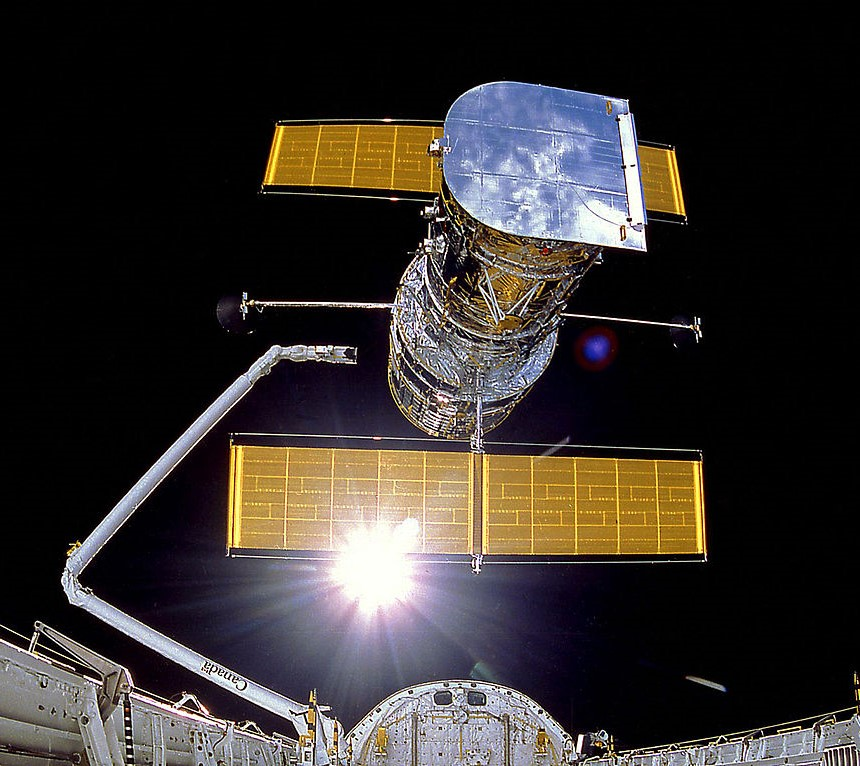

1990年4月，哈勃被部署到太空。圆筒里装着的不只是相机，还有集光、稳定指向、供电、通信和科学仪器等一整套系统。

## 放到大气层外，为什么还是模糊？

哈勃是一座绕地球运行的天文台。把望远镜搬到太空，不只是为了靠近星星：对银河系乃至更远的目标来说，这点距离几乎可以忽略。真正重要的是绕开地球大气的扰动和遮挡。

地面望远镜向上看，星光要穿过不断变化的空气。不同温度、密度的气团会改变光的传播，星星于是闪烁，细节也被抹开。太空望远镜有机会得到更稳定的像，还能观察一些难以穿过大气的光。

但“没有大气干扰”不等于“任何镜子都能成像”。望远镜仍须让来自同一个方向的光，经过不同位置反射后，在仪器里恰当地会合。

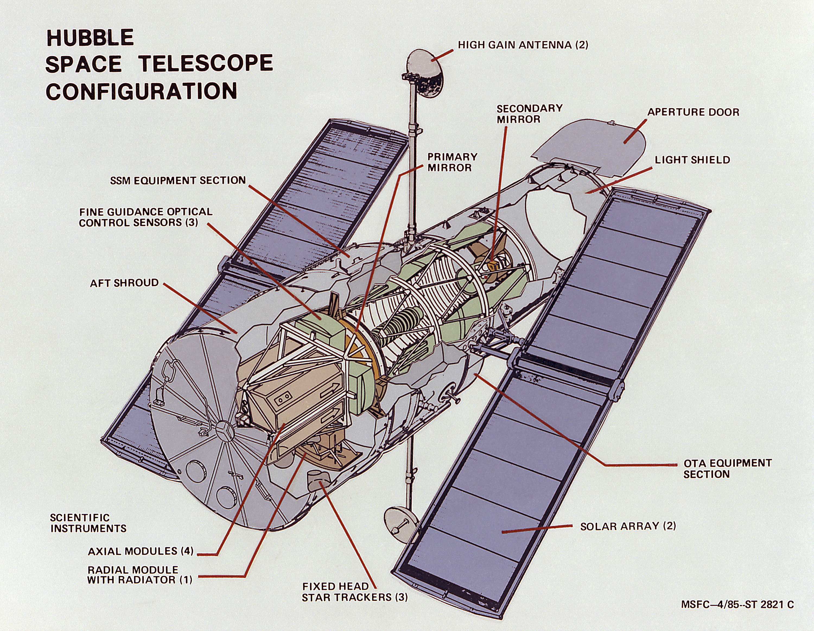

NASA的1985年哈勃配置剖面图。主镜、次镜和后端科学仪器必须组成一条配合准确的光路；航天器外壳完整，不代表内部每个环节都正确。

1990年4月24日，哈勃发射。两个月后，NASA在6月27日宣布望远镜存在问题：两台成像相机都出现了相似的失真。

这条线索很重要。如果只有一台相机模糊，可以先怀疑那台相机；两台都呈现同一种特征，就要沿着它们共用的光路向前找。调查最终指向主镜：它的外缘比设计要求更平。

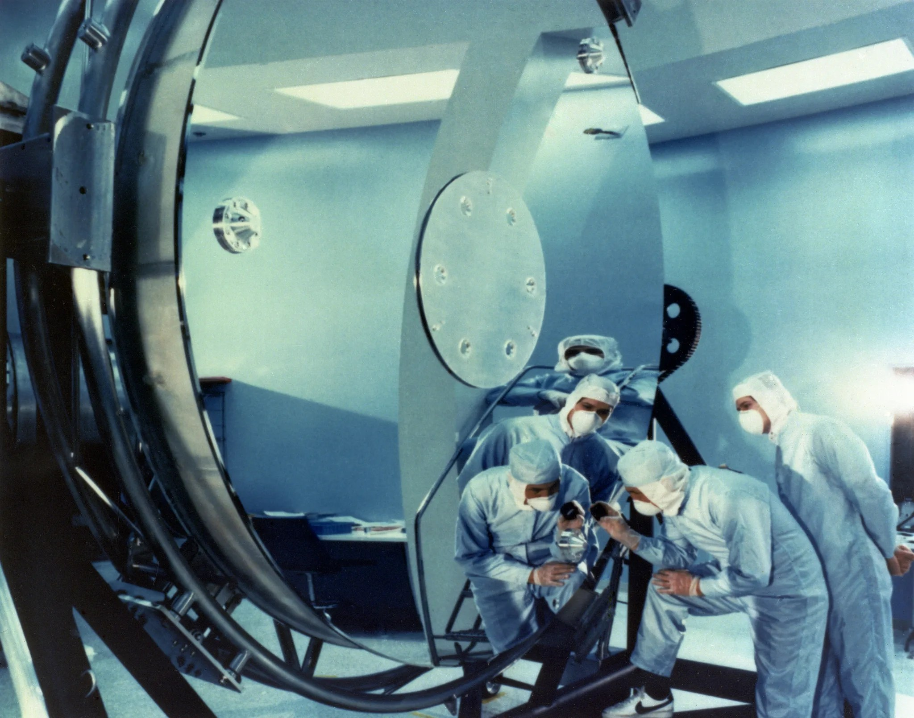

主镜旁的工作人员给出了尺度。这里要控制的不是“这面镜子看起来圆不圆”，而是整个反射面的细微形状是否符合设计。

## 错的不是镜子有多光滑，而是量它的尺

镜子表面可以非常光滑，同时拥有错误的曲率。这就像一块制作精良的拼图，边缘毫无毛刺，却来自另一盒拼图：工艺精细不能弥补目标本身错了。

哈勃主镜的制造需要一种名叫“零位校正器”的光学测试装置。名字不必记住，可以把它理解为一把专门为复杂镜面制作的光学尺：让测试光以规定方式经过镜面和校正器，观察是否还存在偏差。

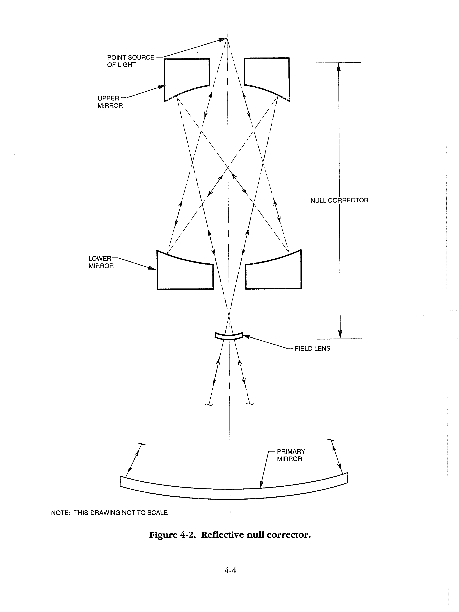

这就是那把“光学尺”的结构：图中上、下两面小反射镜与一片场透镜组成校正器，最底下那面大镜子才是待测主镜。光沿规定路径来回传播；小元件的相对位置一旦错了，作为检验基准的光路也随之改变。NASA调查报告Figure 4-2，原图不按比例绘制；它是光学结构图，不是装置照片。

如果校正器安装正确，制造团队就能据此一步步逼近目标镜面。麻烦在于，这把尺本身装错了。NASA调查发现，测试装置中的透镜相对于反射镜的位置偏了约1.3毫米。镜面加工者于是依据一个错误标准，把主镜打磨得“符合读数”，却不符合望远镜的真正需要。

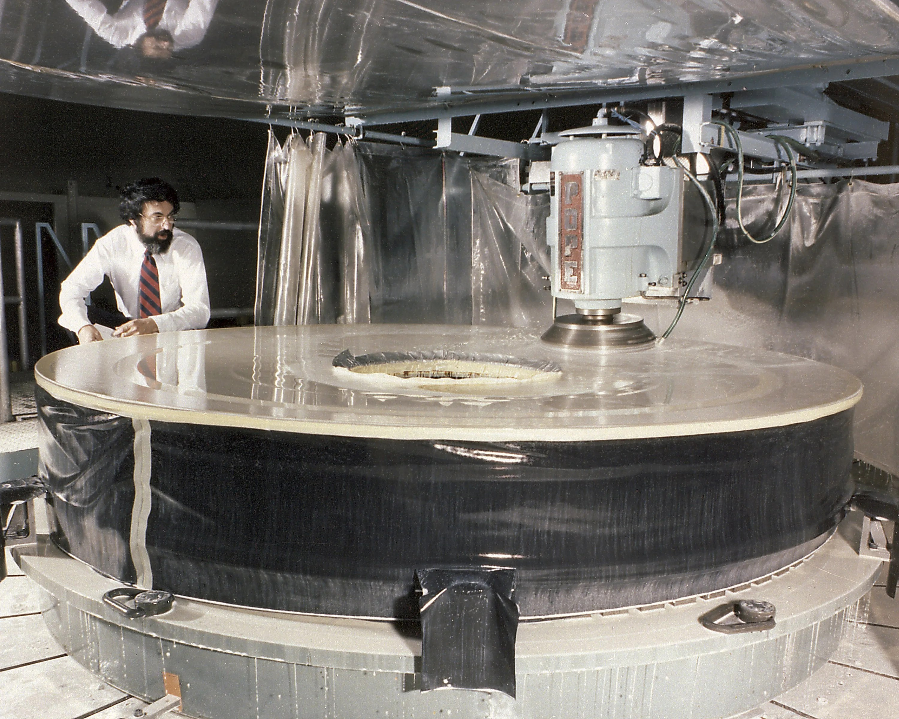

1979年的主镜加工现场。这里的失败不能归结为“最后没擦干净”：错误进入了加工和检验共用的基准。

一个有用的区别是：**1.3毫米指测试装置里的间距错误，不是主镜表面磨错了1.3毫米。** 把两者混在一起，会完全误解这次事故的尺度。

更难堪的是，后来回查资料发现，曾有其他测试结果与主要测试装置不一致。NASA的历史研究记载，这些异常没有得到应有的追究。它不是一则“某个人手一抖，大家都没办法”的故事，而是一次检验体系没能拦住错误的事故。

对做软件的人，这种情况并不陌生：实现与测试一起误解了需求，就可能出现测试全绿、结果却错的系统。这里的类比只用于理解，不意味着光学验收与软件测试可以直接互换。

## 模糊不是一层可以擦掉的雾

想象一颗很远的恒星。对望远镜来说，它接近一个点光源。理想系统也不会把它变成数学上无限小的点，光的波动和仪器本身会形成一定的光斑；但大量光应当集中在预期的小范围内。

球差把事情弄坏了。通过镜面不同区域的光，不能按照设计一起聚拢。单颗星的光被分散到更宽的区域，相邻天体的信号就更容易混在一起。

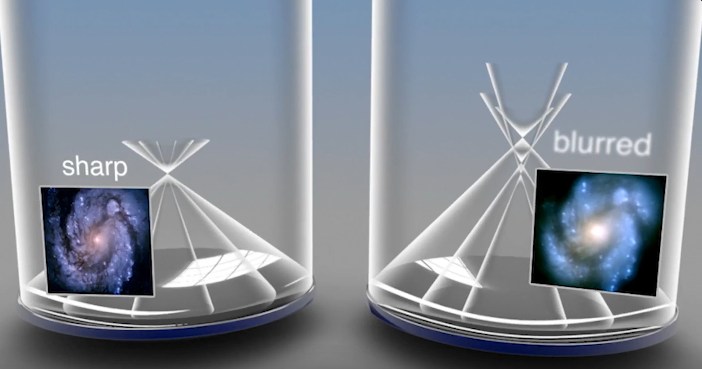

左侧的光聚到同一处，右侧不同区域的光没有在同一处会合。这是理解球差的简化光路图，并非按比例绘制的哈勃内部结构。

“那就移动相机，重新对焦呢？”

普通失焦可以通过移动接收位置改善，因为所有光只是还没到达共同的最佳位置。球差更麻烦：不同区域的光各有不同的最佳会合位置。你往前或往后移动，可能照顾了一部分光，同时让另一部分更糟。

“那就拍完以后用软件变清楚呢？”

这并非完全不行。如果知道点光源怎样被摊开，就可以尝试反向计算，估计原来的图像。哈勃修复之前也并非完全不能做科学。但逆向处理会受到噪声、信号重叠和探测能力限制：并不是所有失去的细节都能毫无代价地找回来。

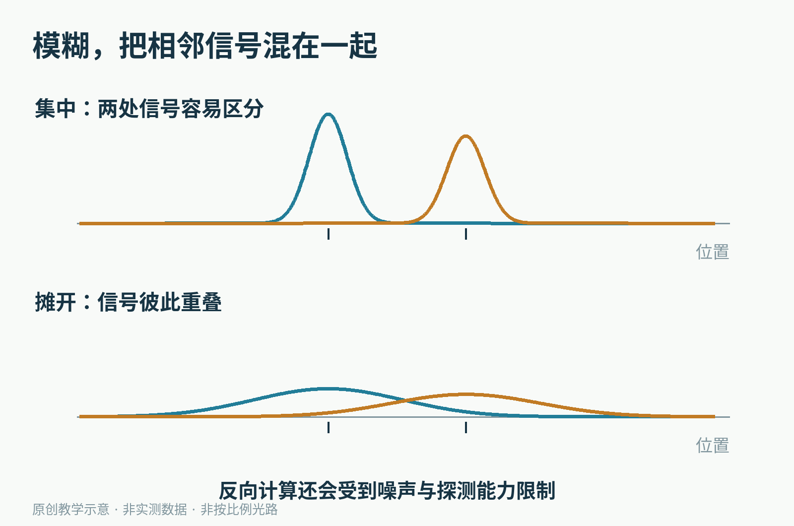

原创教学示意。两处相邻信号经过模糊后发生重叠；这不是哈勃实测数据，也不是对它真实光斑的拟合。它解释的是为什么“已经混在一起”比“整体挪了位置”更难处理。

所以，最理想的补救位置是探测器之前：**让光在被记录下来以前，就先恢复正确的聚拢关系。**

## 修复的是整条光路，不是原来的那块玻璃

这次事故还留下了一个可以利用的条件：主镜并非随机破损，它的错误具有可测量、相对稳定的形状。

如果每个位置都在随意变形，就很难制作固定的补偿元件。但一旦知道不同区域的光究竟错了多少，就可以设计另一组光学表面，让它们引入方向相反的偏差。

可以把这理解为一段“早到、晚到不一致”的光波，被后面的元件重新调整了相对路程。这里并非把光暂停在某处等待，而是通过光学表面的形状改变传播路径。前一段留下的误差，和后一段专门设计的补偿叠加，接近原本需要的效果。

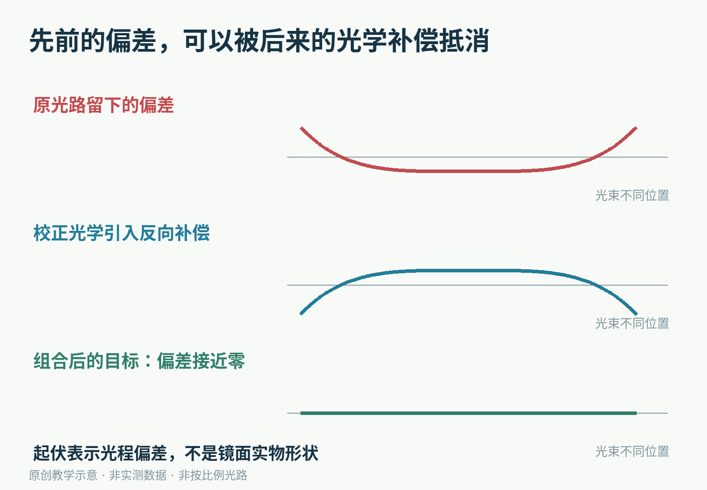

原创概念示意。纵向起伏表示光程偏差，而非镜子的真实外形；补偿曲线须针对原误差设计，不能用任意一面镜子替代。

这就是“给哈勃戴眼镜”这个比喻好用的地方：不改变原来的眼睛，也能改善到达成像面的光。它不精确的地方在于，哈勃得到的主要是反射式校正光学系统，并不是把两块普通眼镜片绑在望远镜前端。

工程师准备了两条并行路线。

第一条是换相机。新的广域行星相机2，简称WFPC2，在自己的内部光学系统中加入校正。它不需要等别人把全部来光统一修好，而是处理进入自己这一路的光。

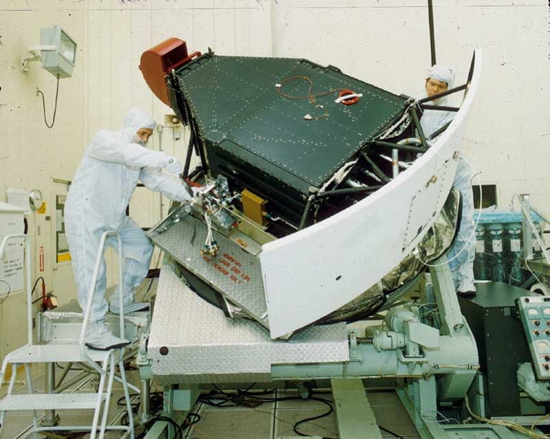

在喷气推进实验室接受测试的WFPC2。相机内部光学系统经过重新设计，以补偿主镜的缺陷。

第二条是为另外三台科学仪器加装共用的校正装置COSTAR。它是一套能够展开小镜面的机构，将校正光学元件送到这些仪器的入光路径上。

这也解释了一个常被省略的代价：哈勃内部没有凭空多出来的空位。安装COSTAR，要先拆掉高速光度计。它不是在“什么都不牺牲”的条件下救回其他仪器。

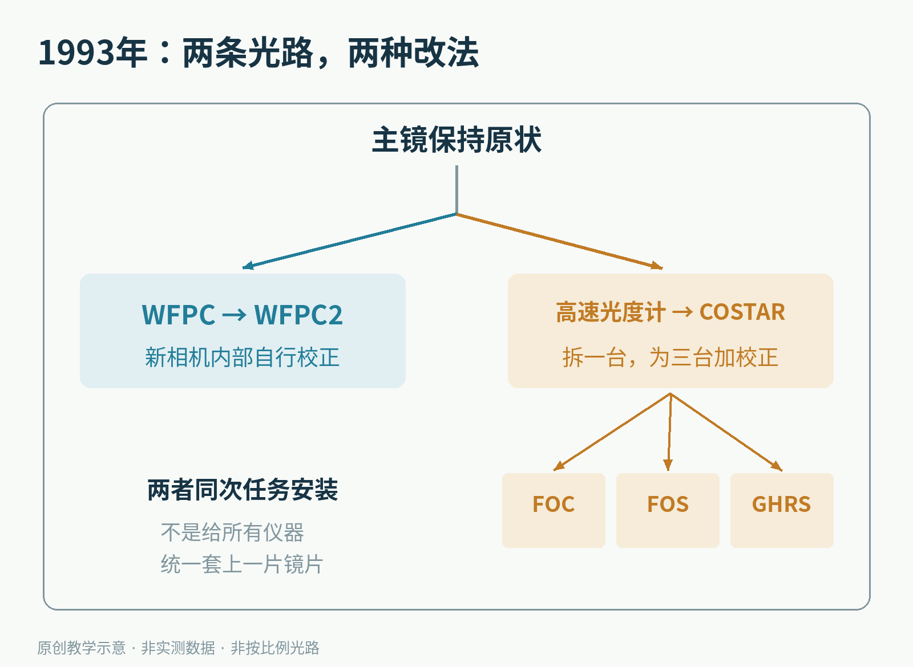

原创位置关系示意，不按实物比例。WFPC2自带校正；COSTAR占用原高速光度计的位置，为另外三台仪器补偿。FOC是暗天体相机，FOS是暗天体光谱仪，GHRS是高分辨率光谱仪。两条路线不能混成“COSTAR修好了所有相机”。

## 太空维修不是把零件漂过去

1993年12月2日，奋进号航天飞机搭载STS-61任务机组发射。七名宇航员组成的团队，既有人负责机械臂和飞行操作，也有两组人员轮流出舱。

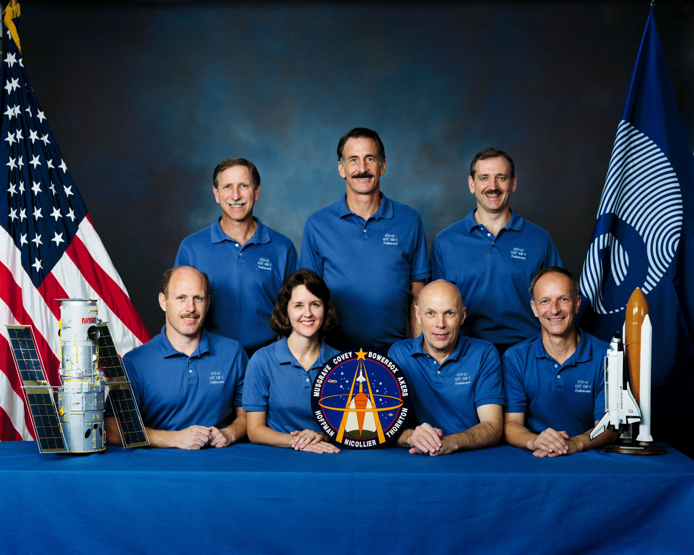

STS-61机组。前排从左至右：肯尼思·鲍尔索克斯、凯瑟琳·桑顿、斯托里·马斯格雷夫、克洛德·尼科利埃；后排从左至右：理查德·科维、杰弗里·霍夫曼、托马斯·埃克斯。

他们首先要让航天飞机与哈勃会合，用机械臂抓住它，再固定在货舱里的支撑结构上。所谓“失重”，并不意味着大型物体没有惯性，更不意味着宇航员可以随手把沉重的仪器推到一个精确位置。

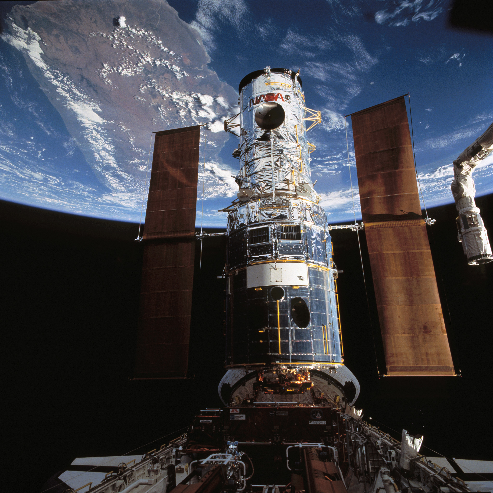

在这幅真实照片里，哈勃成为一座临时太空车间的中心。固定结构、机械臂和宇航员共同构成维修条件。

任务共进行了五次太空行走。除了光学校正，机组还更换太阳能电池阵、陀螺仪等部件。望远镜要拍清天体，既要把光聚好，也要稳定地指向目标；这两件事都不能缺。

第三次出舱期间，霍夫曼和马斯格雷夫换装WFPC2。第四次出舱，桑顿与埃克斯拆下高速光度计，安装COSTAR。尼科利埃在舱内操纵机械臂，帮助人员与设备移动到位。

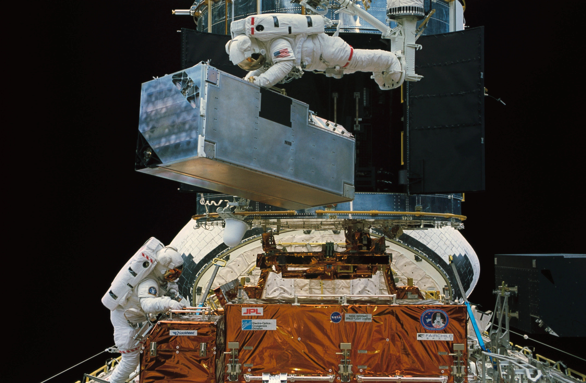

桑顿固定在机械臂末端的脚限位装置上，移动COSTAR；埃克斯在左下方协助。这张照片里真正被搬运的，是能展开校正镜的仪器包，不是哈勃主镜。

哈勃之所以还有这次机会，与它最初就考虑在轨维修有关。可打开的仪器舱、可更换的模块、可供抓取和固定的结构，在正常运行时不那么引人注目；等到事情出错，它们才显出价值。

修复能力并不是在故障发生以后，单靠一个聪明点子临时附加上去的。

## 最后，答案出现在同一颗星上

修好了没有，不能由安装螺栓都拧紧来证明。真正的验收，还得回到光本身。

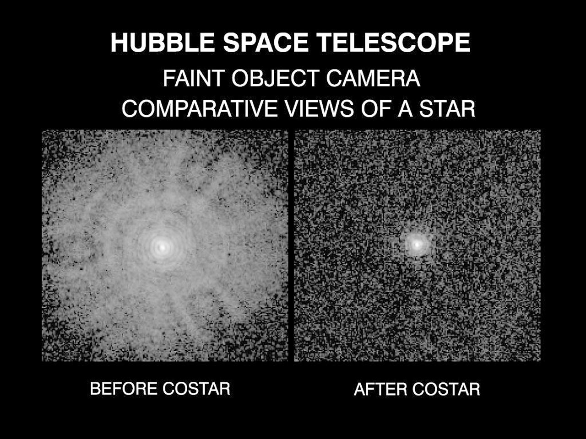

暗天体相机拍摄的恒星Melnick 34。修复前后对照显示，原先散开的星光重新集中起来。图片由NASA、ESA及COSTAR团队提供。

另一个著名对照来自M100星系的中心区域。相同的天空，经过改进后的系统，显出先前难以分辨的结构。

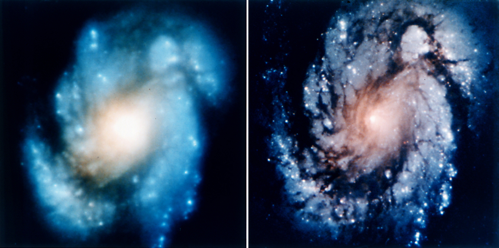

左侧是原WFPC，右侧是WFPC2。它展示的是整个更换与校正之后的成像改善，不应把所有差别都归到单独一块校正镜上。

故事还有一个颇有意味的尾声。后来安装的新科学仪器都把校正光学元件纳入自身设计。2009年，COSTAR被拆回地球，让出位置给新的仪器。这个曾经救场的装置，最终因为它解决问题的办法被下一代系统吸收，而不再需要单独存在。

主镜的原始形状并没有因此变成正确的形状。改变的是围绕它工作的系统。

哈勃这段历史最值得记住的，不是“任何失败最后都能成功”。许多错误没有这么幸运的补救条件。它留下的是几个更具体的判断：量得准，才有可能补得准；要允许独立证据质疑共同基准；设计时给维修留下接口，故障后才有选择。

而那群宇航员带上太空的，也不只是一副“眼镜”。他们带去了一条新的光路，让一面不能更换的坏镜子，重新参与了对宇宙的准确观察。

参考资料：[NASA：哈勃主镜缺陷](https://science.nasa.gov/mission/hubble/observatory/design/optics/hubbles-mirror-flaw/)、[NASA：STS-61首次维修任务](https://www.nasa.gov/history/30-years-ago-sts-61-the-first-hubble-servicing-mission/)、[NASA历史研究：哈勃维修任务](https://www.nasa.gov/history/SP-4219/Chapter16.html)、[1990年光学系统调查报告](https://ntrs.nasa.gov/api/citations/19910003124/downloads/19910003124.pdf)。

图片来源：NASA，[主镜与修复对照原页](https://science.nasa.gov/mission/hubble/observatory/design/optics/hubbles-mirror-flaw/)、[1985年结构图原页](https://science.nasa.gov/image-detail/hubble-space-telescope-configuration-mix-ref-msfc-4-85-st-2821c-2/)、[机组与维修现场原页](https://www.nasa.gov/history/30-years-ago-sts-61-the-first-hubble-servicing-mission/)；Melnick 34对照署名NASA、ESA、COSTAR Team。三幅中文机制图为原创教学示意。原始照片未裁切，必要格式转换保留完整画面。
