# 火星空气这么稀薄，机智号为什么还能飞？

把一架普通小无人机送到火星，给电池充满电，按下起飞键，会发生什么？

先别急着回答。火星表面的气体密度，大约只有地球海平面的百分之一。旋翼还是那副旋翼，转过一圈，能推动的空气却少得多。

但在 **2021 年 4 月 19 日**，一架质量只有 1.8 千克的小直升机真的离开了火星地面。它叫机智号（Ingenuity），由美国国家航空航天局 NASA 的团队研制，是一次探索“能不能在另一个星球上进行动力、受控飞行”的技术实验。

第一次，它升到约 3 米高，悬停约 30 秒，再落回地面。整段飞行只有 39.1 秒。没有载人，也没有飞越山谷，却跨过了一道从未有人跨过的门槛。[首飞记录](https://www.nasa.gov/news-release/nasas-ingenuity-mars-helicopter-succeeds-in-historic-first-flight/)

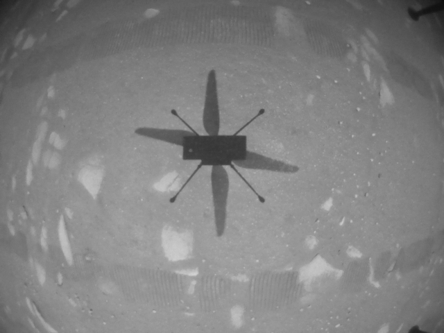

首飞时的真实照片：机智号的导航相机向下拍摄，影子落在火星杰泽罗陨石坑的地面上。画面里的碎石，后来会成为理解它如何飞稳的关键。

它没有找到一种“不需要空气”的特殊飞法。相反，它把一个问题拆得很仔细：**空气少了，怎样仍然获得足够的力？离地以后，又怎样知道自己正在往哪里飘？**

## 旋翼到底在托住什么？

先把旋翼想成绕轴运动的机翼。

当叶片以合适的角度穿过空气时，会改变周围的压力和气流。对于悬停的整副旋翼，一个有用的整体图景是：它持续把空气向下加速，空气则给旋翼向上的力。

这股向上的力足够托住机身，直升机才能悬停。它不必先像固定翼飞机那样沿跑道加速，因为转动的叶片已经在相对空气运动。

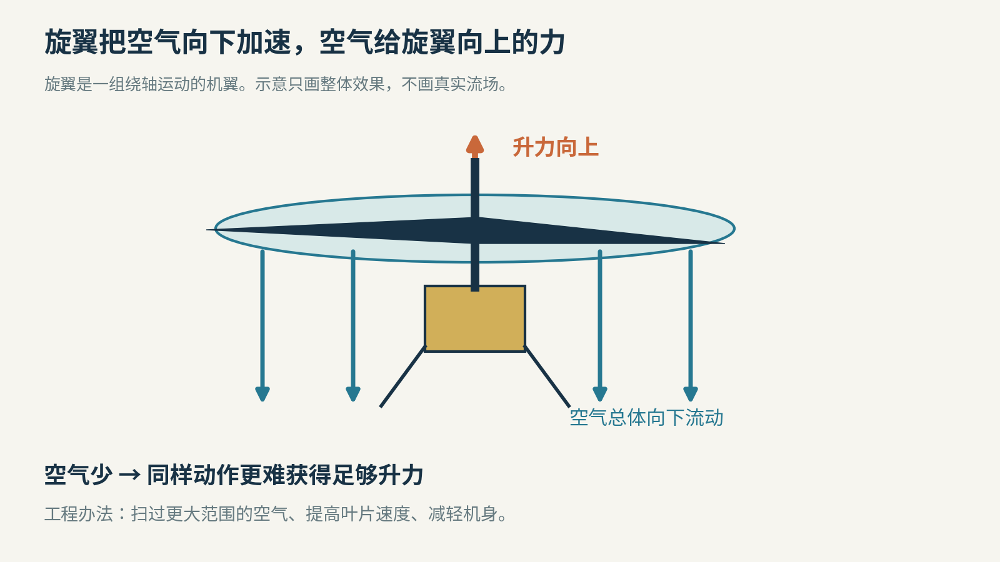

原创教学示意。箭头表示整体作用方向，不是机智号周围真实流场的测量结果。

空气看不见，却有质量。相同大小的一团气体，密度越低，里面包含的气体质量越少。用同样的叶片、以同样的速度做相似动作，能获得的空气动力通常也会减小。

所以问题不是“火星有没有空气”。火星有大气，主要成分还是二氧化碳。困难在于，它太稀了。

机智号用电动机驱动旋翼，不需要吸入氧气来燃烧燃料。不过，电动机不需要氧气，不等于旋翼不需要气体。把这套办法搬到几乎没有大气的月球，情况就完全不同：再快地转，也缺少足够的周围气体来产生升力。

## 火星重力小，不能把困难抵消吗？

确实能帮一点，但远远不够。

火星表面重力大约是地球的 38%。同一架飞行器放到那里，需要托住的重力变小了。但空气密度下降到了地球海平面附近的约 1% 这个数量级，两者变化的幅度很不一样。[NASA 火星概况](https://www.jpl.nasa.gov/news/press_kits/insight/landing/facts/mars-at-a-glance/)

原创比较图。两组条形分别以各自的地球数值为 100，不能把“密度”和“重力”的绝对数值直接相减。

这里也要分清质量和重力。机智号在地球的质量是 1.8 千克，到了火星仍然是 1.8 千克。少掉的是星球对它向下的拉力，不是电池、电机和机身突然少了一大半。

高中物理里，可以用一个有条件的近似抓住方向：

**其他条件相近时，升力与气体密度、叶片相对空气的速度平方有关。**

例如，先把叶片形状、面积和升力系数（表示叶片在当前姿态下产生升力的能力）视为不变，密度降为原来的 1%，速度只提高一倍，升力也只恢复到原来的约 4%。速度的平方帮了忙，却还没补回缺口。[NASA 升力方程说明](https://www1.grc.nasa.gov/beginners-guide-to-aeronautics/lift-equation/)

如果再把需要托住的重力设为地球的 38%，这个简化模型会给出约 √38，也就是 6.2 倍的速度比例。但这只是纸上比较，不是“所有地球直升机到了火星都要转快 6.2 倍”的设计结论。

真实旋翼的叶片上，不同位置速度不同；改变转速，还会改变气流状态、阻力、振动和结构受力。机智号也不是把一架现成无人机直接提速，而是从一开始就围绕火星设计。

## 为什么小小机身，要顶着那么大的旋翼？

看看它的样子，答案已经写在比例里。

机身大约只有纸巾盒那么大，旋翼直径却约有 **1.2 米**。上下两副旋翼共四片碳纤维叶片，沿同一根轴、朝相反方向转动。

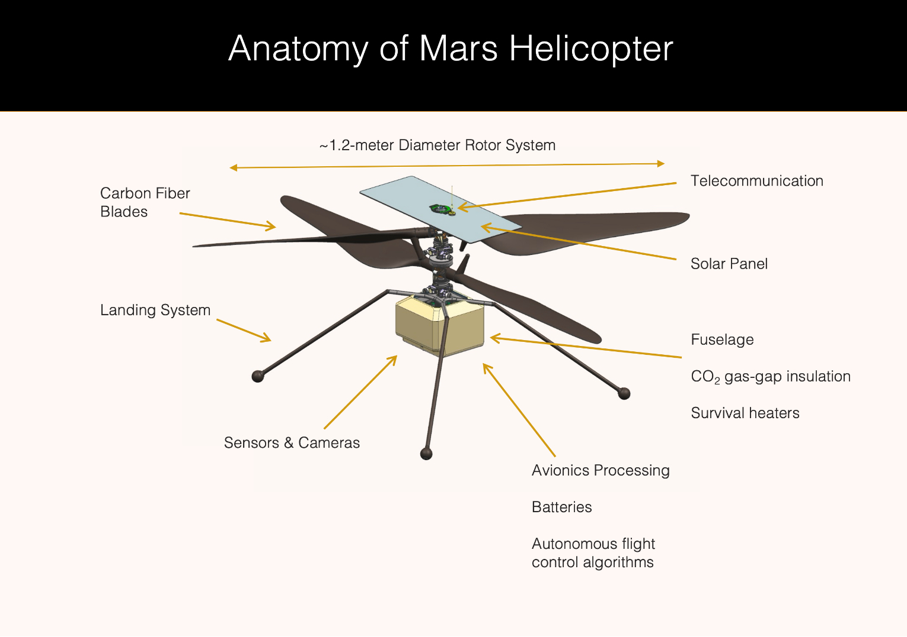

NASA/JPL 的结构示意图。最上面是太阳能板，下方是两层旋翼；金色小机身里装着电池、计算机、传感器和保温、加热部件。机身很小，旋翼扫过的范围却很大。

这样的比例，有三个互相配合的理由。

**第一，让旋翼扫过更大范围的空气。** 空气稀薄，就尽量不要只在一个很小的范围里做功。较大的旋翼盘面，是获得足够升力的一部分条件。

**第二，让叶片快速穿过空气。** 着陆前的设计介绍给出的转速约为每分钟 2400 转；NASA 随后的飞行分析记载，早期实际飞行使用每分钟 2537 转。它不是整个任务期间固定不变的一个数。[飞行控制分析](https://science.nasa.gov/blog/what-were-learning-about-ingenuitys-flight-control-and-aerodynamic-performance/)

每分钟 2400 转，就是每秒约 40 圈。用 1.2 米的直径估算，叶尖一秒绕过的路程约为 151 米。这个数说的是叶尖绕轴运动的速度，不是整架直升机向前飞行的速度。

**第三，尽量减轻需要被托住的东西。** 机智号是技术验证机，没有携带一套沉重的科学仪器。机身里的每样东西，都要与有限的质量、电量和空间争位置。

上下反向转动还有好处：两副旋翼施加给机身的反作用扭矩可以相互抵消，避免机身被单副旋翼带着持续反转。

不过，“转得快”解释的是它怎样获得飞行所需的能力，并不等于它靠不断猛加转速来操纵。机智号飞行时主要像传统直升机一样，**改变叶片的桨距，也就是叶片的倾斜角度**，来调节升力和姿态。它与许多通过改变各个电机转速来控制的消费级多旋翼无人机，并不是同一种操纵方式。

## 真正的考场，先被装进一个大罐子

纸上算得通，还不能说明实物飞得稳。

NASA 的喷气推进实验室 JPL 位于美国加利福尼亚州。团队在那里使用一座直径约 7.62 米的空间模拟舱，先抽走原有空气，再充入适当的稀薄二氧化碳，模拟火星大气。

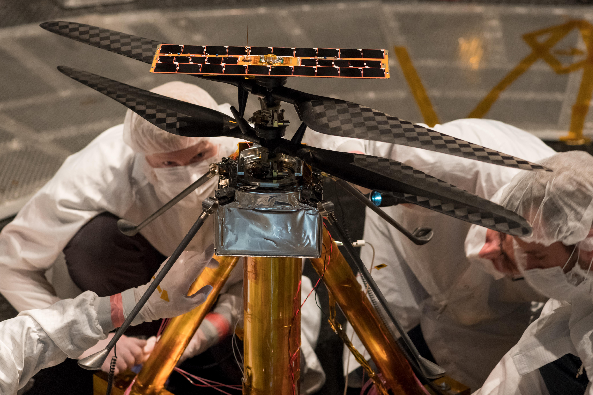

2019 年 2 月 1 日，团队在 JPL 的空间模拟舱内检查将送往火星的飞行实物。旁边的工作人员让这架小直升机的实际尺度变得直观。

但抽气不能让地球重力变小。为此，工程师还要用一套电动吊索系统，从上方持续分担一部分重量，近似模拟较弱的火星重力。

注意，这不是把“低密度”和“低重力”混为一谈。一个靠改变舱内气体来模拟，另一个靠向上的拉力来模拟，两件事必须分别处理。

2019 年的飞行实物测试只需离地约 5 厘米，就能收集当时所需的数据。低低地飞起来，也可以回答很难的问题：旋翼、机身、传感器和控制程序，是否真的能一起稳定工作？[地面测试记录](https://www.jpl.nasa.gov/news/nasas-mars-helicopter-completes-flight-tests/)

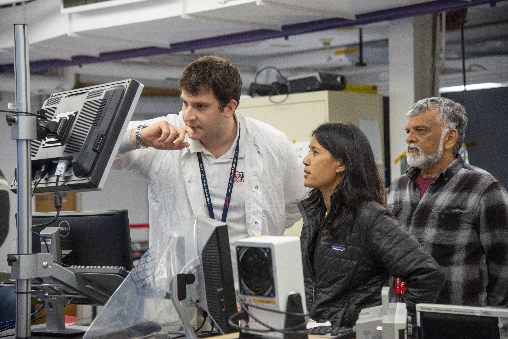

2019 年 1 月 18 日的测试现场。从左到右是 Teddy Tzanetos、MiMi Aung 和 Bob Balaram；当时分别参与测试指挥、项目管理与总工程师工作。他们观察的是模拟舱里的飞行测试，不是火星上的实时遥控画面。

模拟舱仍然不是整个火星：它有边界，能模拟的地形、风和飞行距离也有限。地面测试为任务争取把握，真正的环境仍要等到火星去面对。

## 它不是一路扇着翅膀，从地球飞到火星

机智号只负责抵达火星表面之后的短距离飞行。跨越行星之间的旅程，需要另一整套运输和着陆设备。

它搭乘“毅力号”火星车前往火星，在旅途中收拢在车底。毅力号是一辆无人驾驶的探测车，比机智号大得多；到达后，它还要成为小直升机与地球之间的重要通信中转站。

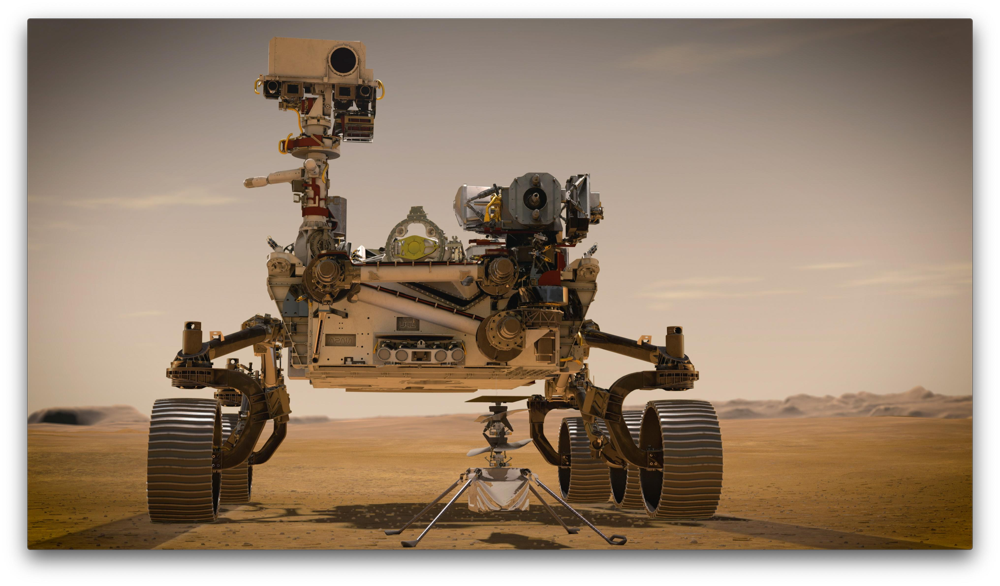

官方艺术概念图，用来展示毅力号与机智号的外形、尺度和任务搭配。它不是两者在火星上的合影。

在发射前，它们又被装入包含巡航级、背罩、隔热盾和下降级等部件的航天器系统。大气进入、减速和安全着陆，并不由机智号的旋翼承担。

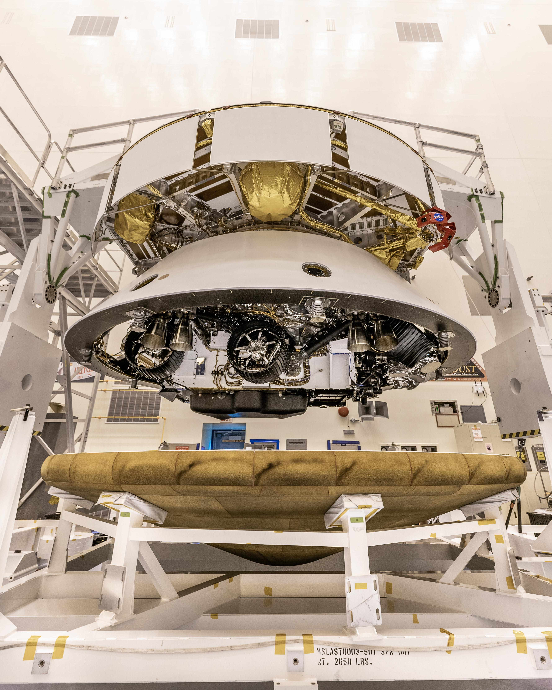

2020 年 5 月 28 日，佛罗里达州肯尼迪航天中心的真实组装照片。上方圆盘是巡航级，钟形背罩内装着下降级与火星车，下方铜色部件是即将合上的隔热盾。

到了火星，还不能随手“把飞机拿下来”。专门的释放系统要把车底收拢的直升机转到合适方向，让起落架展开，再把它放到地面。

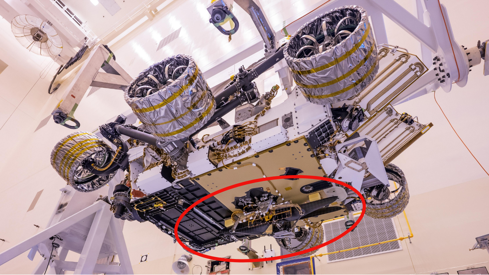

火星直升机释放系统的官方图。它解决的是“如何把旅途中牢牢固定的小飞机安全放到地面”，与旋翼如何产生升力是两个不同问题。

离开车底后，机智号靠顶部太阳能板给锂离子电池充电。电池既要支持短时间的大功率飞行，也要给计算机等设备供电，并帮助关键部件熬过寒冷的夜晚。

因此，给它装一块更大的电池，并不自动意味着能飞得更久。电池更重，需要更多升力；更大的旋翼和电机又可能继续增重。工程师要解的是一组互相牵连的问题。

## 最重要的眼睛，为什么朝着地面？

假设你隔着很长的网络延迟玩飞行游戏：等看到飞机向右歪了，发出的纠正指令很久以后才能到，飞机早已不在原处。

机智号面对的更极端。首飞时，火星与地球之间无线电信号的单程传播时间要十几分钟，而一次飞行只用了不到 40 秒。人不可能在地球上盯着视频，及时替它纠正每一次晃动。

所以地面团队提前发送飞行计划，真正执行时，由机上的计算机和传感器自行保持稳定、估计运动并完成着陆。

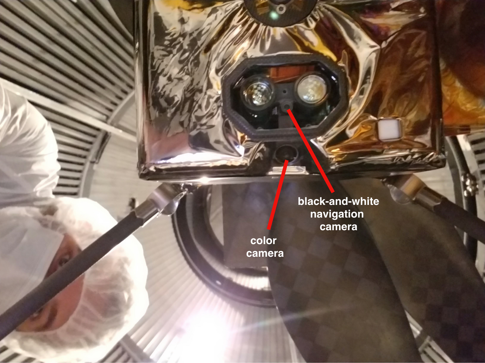

机智号底部的真实照片，红箭头是官方标注。中央黑色八角形框内，两枚较大的光学窗口属于激光测高器；它们之间稍下方的小圆形部件是黑白导航相机。八角形框下方、靠机身边缘的圆形部件是彩色相机。

两部相机有不同分工。彩色相机负责拍摄地形影像；朝下的黑白相机，则为导航提供地面特征。

你可以把它理解成这样：前一张照片里，一块石头在画面中央；下一张照片里，它移到了左边。如果还能确认这是同一块石头，结合相机高度和机身姿态，就能帮助判断直升机正在怎样移动。

相机还要与其他传感器合作。激光测高器帮助测量离地高度；惯性测量单元感知加速度和转动。只有把不同线索放在一起，才更容易分清“我平移了”和“我只是倾斜了”。

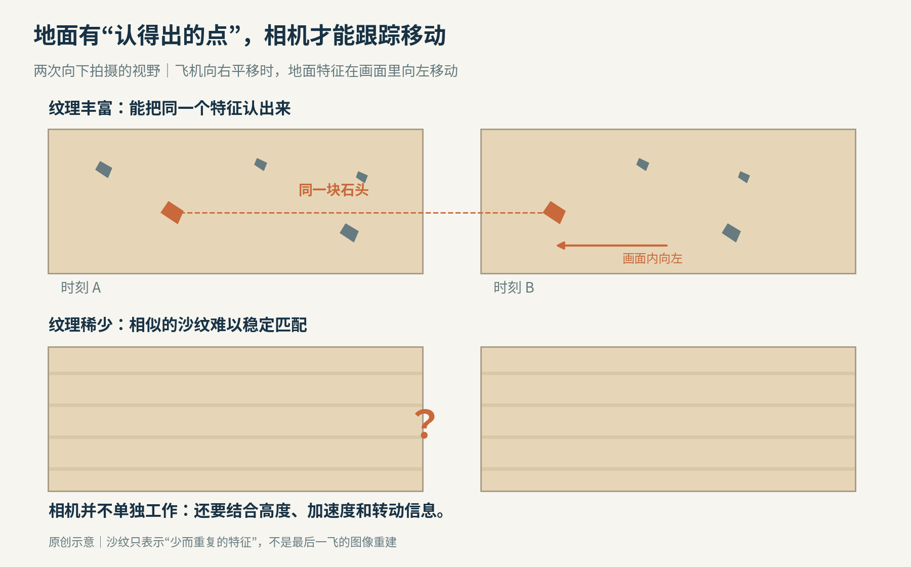

原创视觉导航示意。上方两张图里，同一块橙色石头在各自画面中的位置不同；虚线表示匹配关系，右图箭头表示它在画面内向左移动。下方的重复浅纹理很难提供同样清楚的参照。

这也解释了开头那张黑白照片为什么重要：那些不起眼的小石块，并不只是景色。对视觉导航来说，它们能成为判断运动的参照物。

自主飞行也不等于不需要地面团队。飞行计划、状态检查、数据分析，以及下一次选择去哪里，仍需要工程师和其他探测器参与。

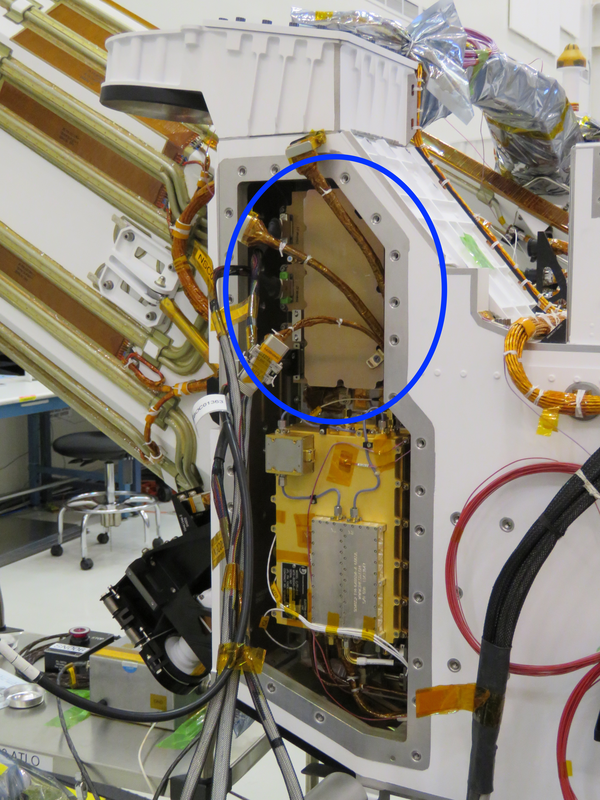

毅力号上的通信基站，官方标注以蓝圈标出。它保存、转发机智号的数据和指令；通信中转的存在，并不意味着地球上的人能实时操纵每一个动作。

## 它最后为什么停飞？答案不只在空气里

到这里，很容易得出一句过于乐观的话：只要旋翼够大、够快，火星飞行就解决了。

问题是，速度并不能无限增加。

更高的转速会要求电机和电气系统提供更多能力，也会增加旋翼结构的负担。叶尖接近当地声速时，空气动力特性还会明显改变。振动、温度、电量和控制精度，都可能先成为限制。

火星空气也不是永远保持一个数。NASA 团队在 2021 年 9 月解释，季节变化让杰泽罗的气体密度进一步下降，他们因此安排更高转速的测试。早期首飞实测密度约为每立方米 0.0165 千克，相当于地球海平面附近的约 1.3%；“约 1%”适合建立数量级直觉，不能代替每次飞行的环境数据。[季节与转速](https://science.nasa.gov/blog/flying-on-mars-is-getting-harder-and-harder/)

而机智号最后一次飞行，暴露了另一条边界：**能产生升力，不等于能可靠地知道自己的运动状态。**

**2024 年 1 月 18 日**，它进行了第 72 次、也是最后一次飞行。那次任务原本是一次短暂的垂直起落，用来检查飞行系统并拍摄周围环境。旋翼受损后，它无法再飞。

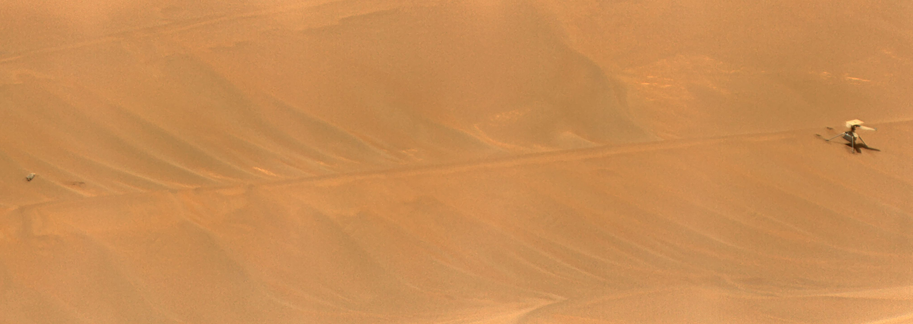

毅力号在 2024 年 2 月 24 日拍到的终航地点。机智号在右侧沙纹高处附近，一块桨叶残片位于它西侧约 15 米处，在画面左侧。这是事故后的真实影像。

NASA/JPL 在 **2024 年 12 月 11 日公布的调查说明**中，把导航系统无法提供准确数据，列为触发事故链条的最可能原因。

它最初的视觉导航设计，适合有丰富碎石纹理、相对平坦的地面。最后一次飞行所在区域却布满较陡、纹理相对少的沙纹。飞行数据表明，起飞约 20 秒后，导航系统找不到足够多的地面特征来跟踪。

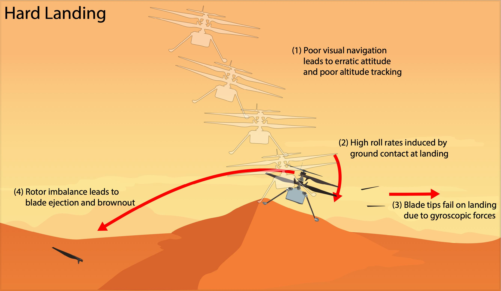

NASA 的事故过程示意，不是现场连拍。图中展示的是调查认为最可能发生的过程：带着较大的水平速度接地，在沙坡上猛然改变姿态，继而损伤旋翼。

调查提出的最可能过程是：导航误差使机智号落地时仍有较大的水平速度；撞上沙纹斜坡后，机身迅速俯仰、翻滚，高速旋转的桨叶承受了超出设计范围的载荷，四片叶片都在靠近外端的薄弱部位断裂。随后的剧烈振动，又使其中一片剩余叶片从根部脱落。

这是依据有限遥测与事后照片重建的解释。NASA 明确说，现有数据容许不止一种情形，因此不能把“最可能的过程”写成已经完整拍下、排除了其他可能性的唯一真相。[终航调查说明](https://www.jpl.nasa.gov/news/nasa-performs-first-aircraft-accident-investigation-on-another-world/)

它原本只计划进行最多五次试飞，最终完成了 72 次飞行、累计飞行超过两小时。这样的结局，既没有抹去它的成功，也提醒后来者：火星上的天空和地面，必须一起考虑。

## 不造无人机，也能在桌上摸到这个问题

我们在普通教室里，没法随手把空气密度降到火星水平，更不能用一个纸模型证明火星直升机的性能。

但可以安全地体验一件与它密切相关的事：**没有合适的参照物，单靠图像会丢失什么信息？**

准备纸、笔和四张用来遮挡的纸就够了，不需要电机、刀片，也不用从高处投掷东西。

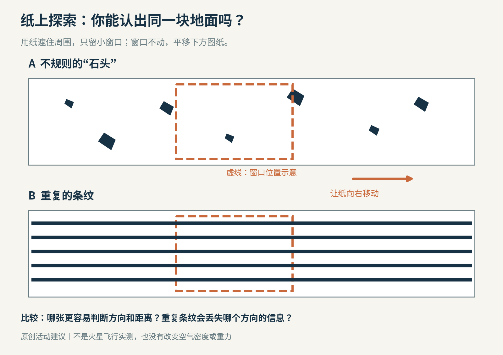

原创活动图。可以照着画出两种“地面”，再用纸遮住周围形成窗口。虚线只是窗口位置示意，不需要沿线剪裁。

1. 在第一张纸上画几块形状、位置各不相同的“石头”。第二张纸只画平行、等间距的长条纹。
2. 用遮挡纸留下一个小窗口，遮住图案纸的边缘。观察窗口里的图案，然后请同伴在下方缓慢平移图案纸。
3. 先只看第一张：你能否认出同一块“石头”？它在窗口里向哪个方向移动？移动距离大约是窗口宽度的几分之几？
4. 再看第二张：分别沿着条纹方向、垂直条纹方向移动。哪一种移动难以看出来？如果一次恰好移动了一个条纹间距，又会怎样？
5. 在条纹里加一个不重复的小圆点，再试一次。新增加的点，帮你找回了什么线索？

这是一项活动建议，本文没有实际进行实体测试，也不提供虚构的测量结果。它要探索的是图像中的方向与匹配歧义，不是复现机智号的导航软件或最后一次事故。

你还可以做一个纸上追问：如果气体密度又降低了，但电机不能继续提速，工程师还能改什么？旋翼尺寸、叶片形状、机身质量、飞行时间，哪个改动又会带来新的代价？

机智号最值得带走的，并不是“转得足够快，一切皆有可能”。

而是它把一个看起来像单一问题的挑战，拆成了可以逐一研究的条件：有多少空气可用，怎样获得向上的力，怎样供电和保温，怎样判断运动，又怎样把自己安全地放回地面。

那 39.1 秒的首次飞行，正是这些条件第一次在另一个星球上同时成立。

图片来源：主要原文与结构、释放系统图见 [JPL 机智号航天器介绍](https://www.jpl.nasa.gov/news/press_kits/ingenuity/landing/mission/spacecraft/)；机身底部见 [PIA23969](https://science.nasa.gov/resource/bottom-of-ingenuity-mars-helicopter/)，毅力号与机智号概念图见 [PIA23962](https://www.jpl.nasa.gov/images/pia23962-portrait-of-perseverance-and-ingenuity-artists-concept/)，通信基站见 [NASA 原图页](https://science.nasa.gov/resource/mars-helicopter-base-station-on-perseverance-rover/)，以上署名 NASA/JPL-Caltech。巡航与着陆硬件见 [PIA23925](https://www.jpl.nasa.gov/images/pia23925-one-last-earthly-look/)，署名 NASA/JPL-Caltech/KSC。

图片来源：[首飞影子](https://www.nasa.gov/news-release/nasas-ingenuity-mars-helicopter-succeeds-in-historic-first-flight/)、[模拟舱实物](https://science.nasa.gov/resource/inspecting-mars-helicopter/)、[测试团队](https://science.nasa.gov/resource/monitoring-the-mars-helicopter/)，署名 NASA/JPL-Caltech，团队照摄影 T. Wynne；[终航地点及调查示意](https://www.jpl.nasa.gov/news/nasa-performs-first-aircraft-accident-investigation-on-another-world/)，地点照署名 NASA/JPL-Caltech/LANL/CNES/CNRS，事故示意署名 NASA/JPL-Caltech。团队照为适应单图大小限制而压缩，未裁切；四幅教学图与封面为本文原创示意。
