# 四条规则，怎么在方格纸上造出一台计算机？

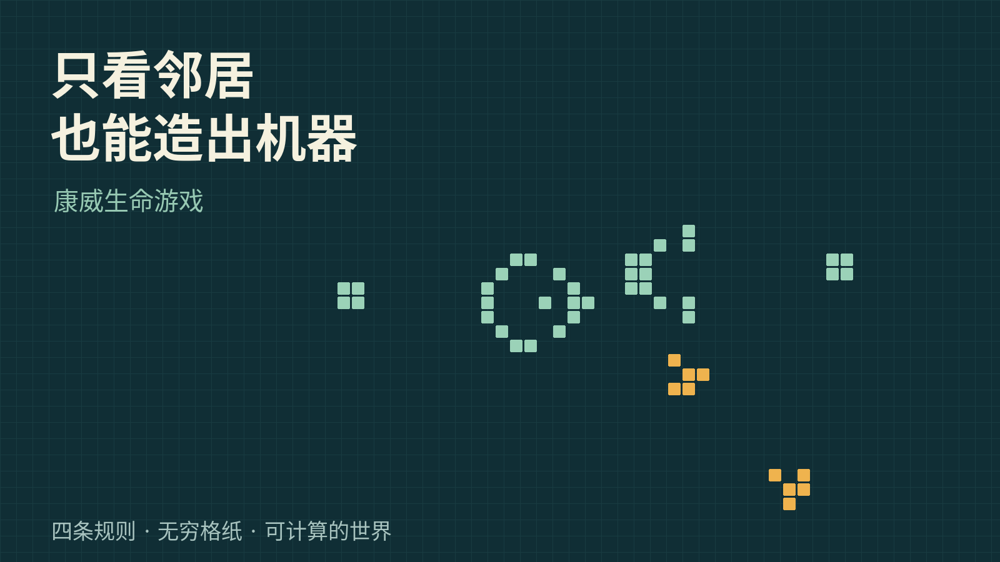

给一张方格纸涂黑五个格子，再按同一套规则不停重画。几轮之后，这五个格子组成的图案开始向右下方“走”。

没有一条指令叫“向右下移动”。更没有程序在识别飞船、给它安排路线。每个格子只做一件事：数一数周围有几个活邻居，然后决定自己下一刻是亮还是灭。

这就是康威生命游戏：一种在网格上运行的数学模型，属于“细胞自动机”。所谓细胞，可以只是屏幕上的一个小方格；所谓游戏，也没有轮流落子的对手。人负责摆出初始图案，之后由规则接管。

令人着迷的地方在后面：同一套规则不仅能让图案移动，还能制造不断发射图案的“枪”，甚至拼成会处理信息、执行程序的计算机。

## 方格纸上的世界，先把规则说清

约翰·霍顿·康威是一位热爱游戏的数学家。1970年10月，马丁·加德纳在《科学美国人》的“数学游戏”专栏里介绍了生命游戏，让这个方格世界走进了更广泛的视野。[普林斯顿大学的纪念文章](https://www.princeton.edu/news/2020/04/14/mathematician-john-horton-conway-magical-genius-known-inventing-game-life-dies-age)也记下了这段往事。

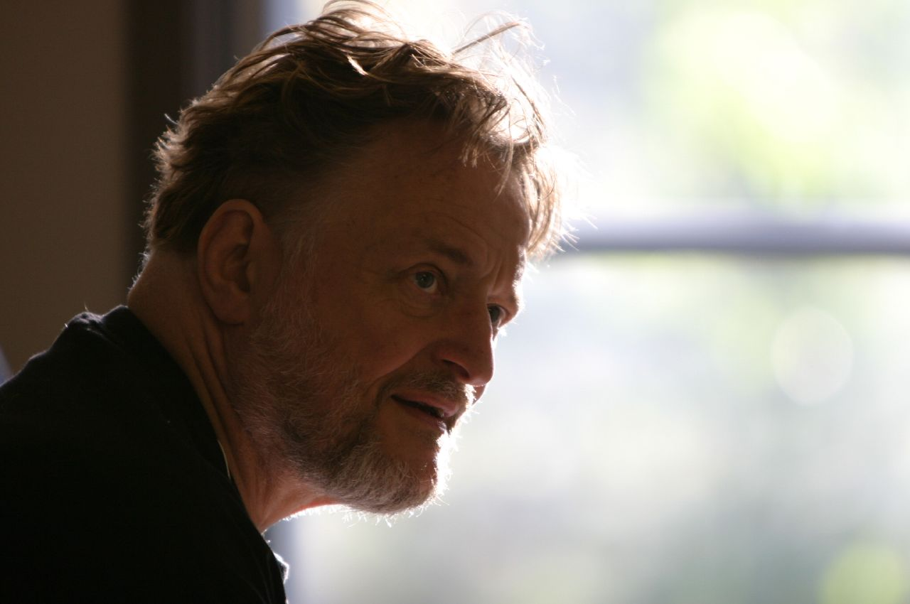

康威，2005年。方格纸上的“生命”只是他广泛数学工作的一部分。

先把故事中的格纸设成无限大。每个格子只有两种状态：活着，或者空着。一个格子的邻居有八个，包括上下左右，也包括四个斜角；它自己不算。

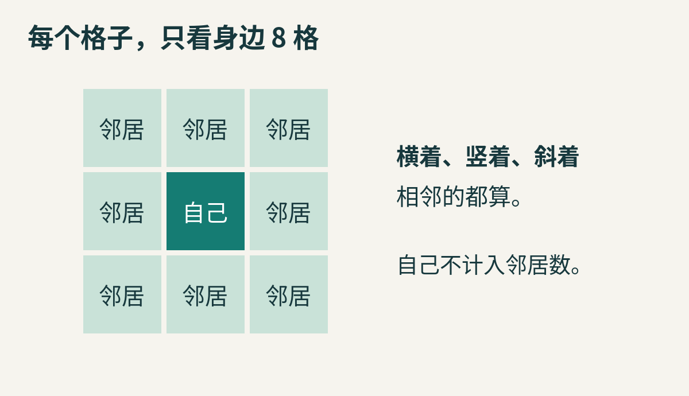

每经过一个时间步，叫作“一代”，所有格子一起更新：

- 活格子的活邻居少于2个，下一代变空
- 活格子有2或3个活邻居，下一代继续活着
- 活格子的活邻居多于3个，下一代变空
- 空格子恰好有3个活邻居，下一代出生；否则仍为空

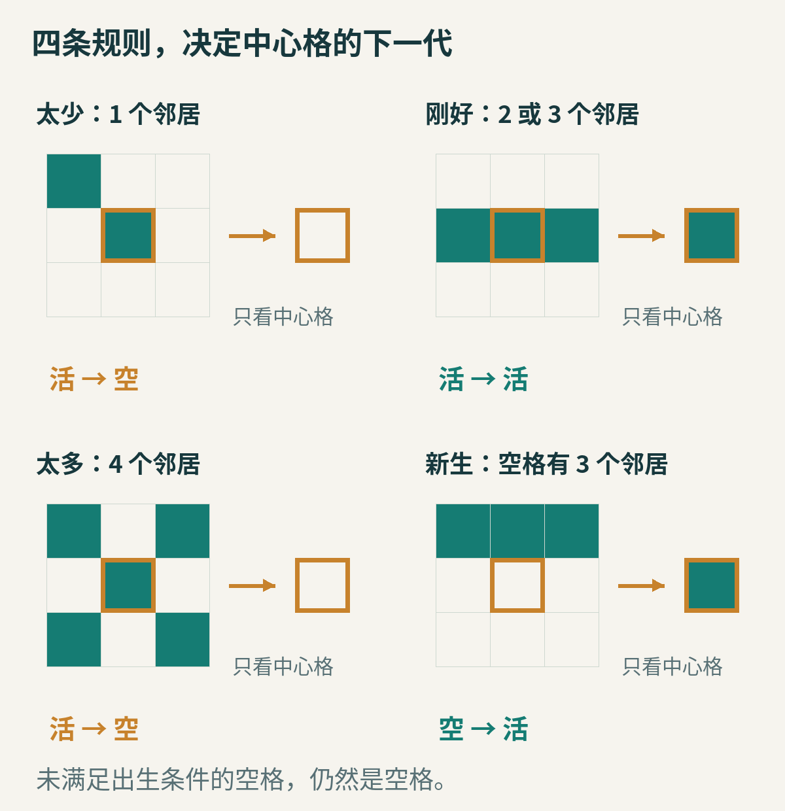

金框标出正在判断的中心格。右边只表示这个中心格的结果，不代表周围其他格子的下一代。

这里的“孤独”“拥挤”“出生”是方便记忆的比喻。我们没有模拟营养、基因或真实细胞，也没有从生物实验中推导出这些数字。它首先是一套人为选定、可以严格计算的规则。

还有一个极重要的小字：**同时更新。**

所有格子必须读取同一张“旧照片”，算完以后再一起换成新照片。不能先改左边，再让右边读取已经改过的邻居。那会变成另一个系统。

## 三个格子，已经足够出现节奏

把三个活格子横着排成一行。

左右两端各只有一个活邻居，会消失。中间那个有两个，会留下。中间格的正上方和正下方虽然原来空着，却各能看到三个活邻居，于是出生。

结果是一条竖线。再来一代，它又回到横线。

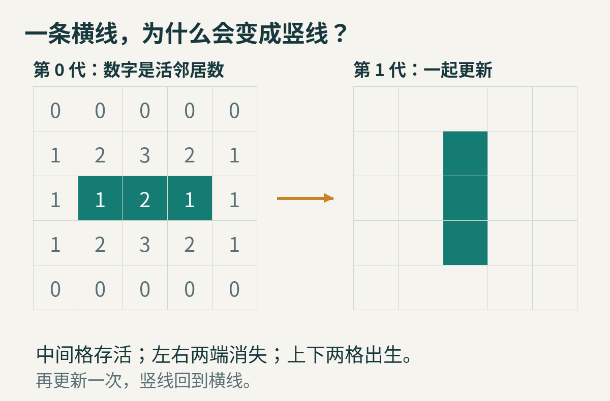

左图数字是每格周围的活邻居数。原来空着的格子也必须参与判断，否则永远不会有新生。

这个图案叫“闪烁器”：两代以后恢复原样，周期是2。更一般地，隔固定代数在原位置重复的图案，叫振荡器。

另一些图案连姿势都不换。例如四个活格子排成2×2方块，每格都有三个活邻居，周围又没有能触发出生的空格，所以它会一直保持原样。这种图案叫静物。

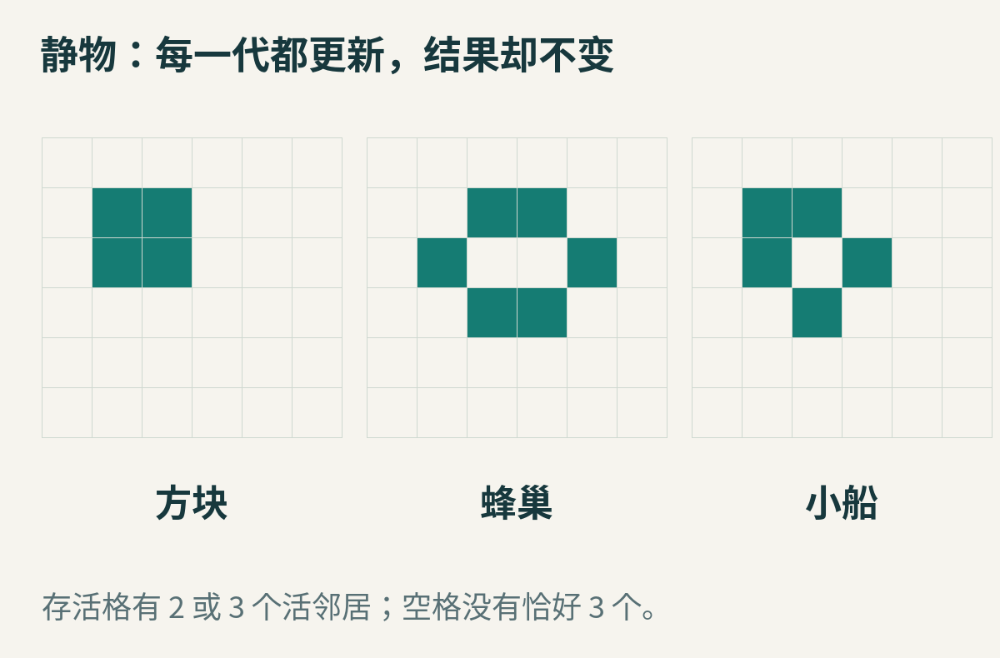

三种静物都遵守相同规则。它们看起来没动，不是因为程序漏算了，而是每次计算都得到相同结果。

到这里，世界还很像一台小钟表：有的东西不动，有的来回摆。不过，只要把五个活格子摆成下面的形状，局面就变了。

## 没有移动指令，为什么图案会“走”？

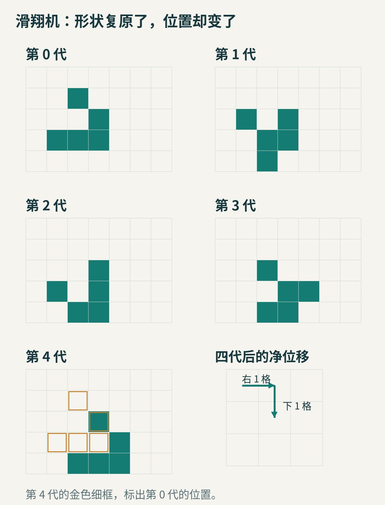

前四次更新中，图案不断变形。到第4代，它恢复了第0代的朝向与形状，却整体向右、向下各偏移一格。

因为规则在格纸上的每个位置都一样，这个过程还会重复。再过四代，它又向右下方走一格。这样的移动图案称为“飞船”，其中这只五格小飞船叫滑翔机。

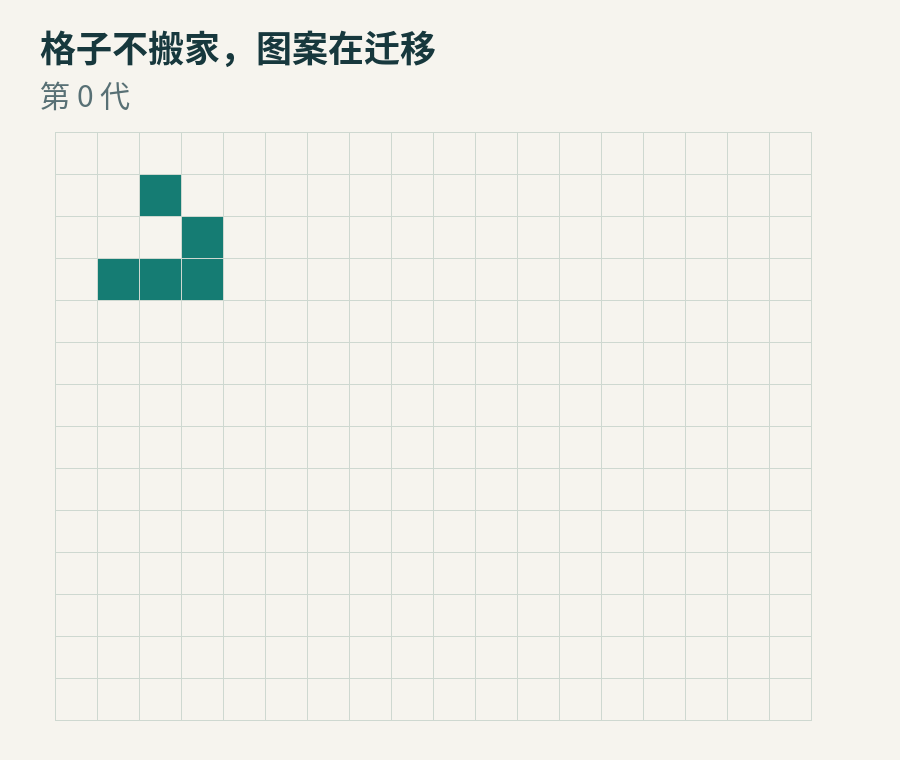

这是逐代计算得到的动画。固定某一个格子看，它只会亮或灭；沿着整个轮廓看，才会看到移动。

因此，移动的是一种能不断重建自己的排列，不是一群格子离开原来的位置。很像观众依次起身形成的人浪：每个人待在自己的座位附近，波形却能绕过看台。

这个区别让事情有了新的可能。只要滑翔机能稳定穿过空白区域，它就可以把某件事“发生了”的消息带到远处。原本只有局部邻居的世界，开始拥有跨越距离的信号。

## 一台枪，推翻了“迟早会停”的直觉

一个滑翔机可以永远走，但活格子并不会因此越来越多。它始终只有五格，只是换了位置。

更大胆的问题是：从有限个活格子出发，能否让活格子的数量没有上限地增长？注意，这要求真正不断产生新东西。仅仅飞得越来越远，还不够。

1970年11月，比尔·高斯珀发现了第一种这样的有限图案：高斯珀滑翔机枪。这项发现还赢得了康威为无限增长问题开出的50美元奖励。历史与构造过程见 Johnston 和 Greene 的[《生命游戏：数学与构造》第一章](https://github.com/nathanieljohnston/game-of-life-book/blob/master/early_life.tex)。

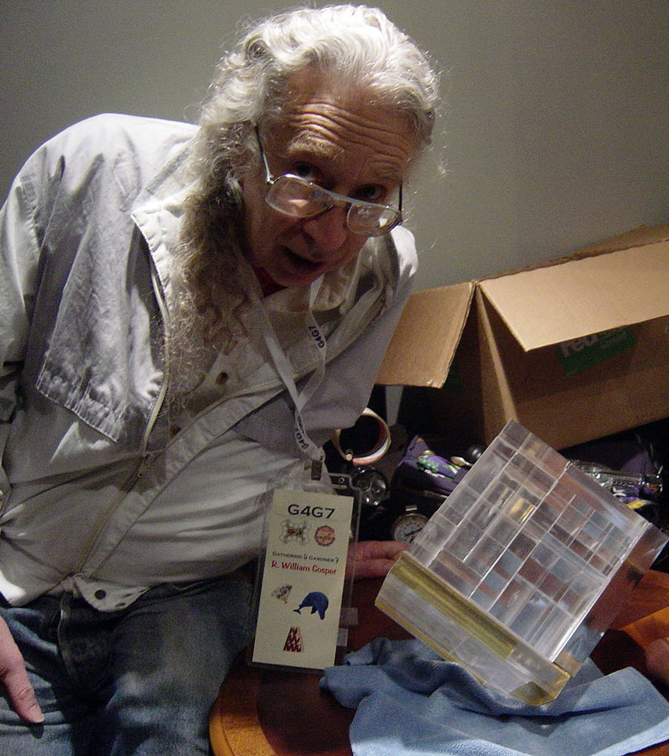

比尔·高斯珀。照片摄于2006年的 Gathering for Gardner 数学交流活动。

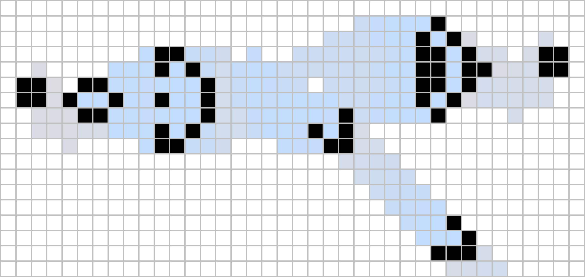

教材原图中的黑格是当前活格。蓝、灰底色帮助追踪演化，不是额外的细胞状态。这张图选取的时刻与下方动画起点不同。

这台“枪”不是规则以外安装的装置。它本身也只是格子：两个会往返变化的结构配合两端的方块，恰到好处地相互作用，在重复过程中放出滑翔机。

摆放位置与时间相位都要对。两团相似图案随便挤在一起，得到的可能只是毁坏，远不是自动化工厂。

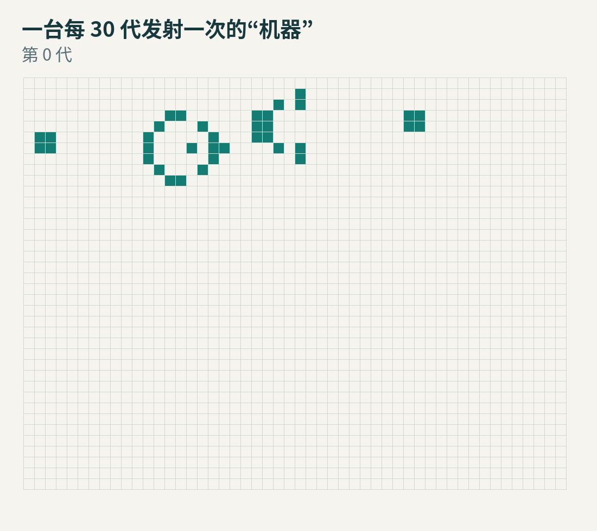

绿色和金色只是为了区分画面区域；所有活格遵守同一套规则。动画演示第0至120代，随后回到起点重播。

它的枪身每30代恢复一次，同时多发射一个滑翔机。这意味着局部在循环，整个世界却没有回到原样：已经飞走的东西还在路上，新的又被造出来了。

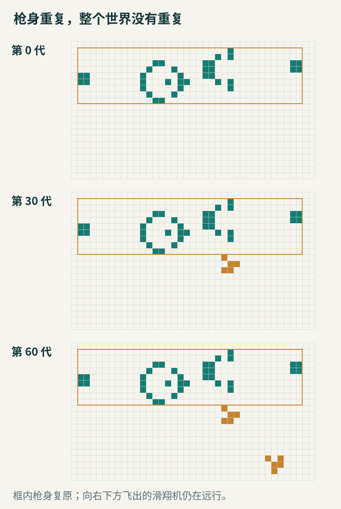

金框中的枪身相同，框外的滑翔机数量在增加。本例从36个活格开始，第30代有41个，第60代有46个。

在无限、没有其他图案干扰的空白格纸上，新滑翔机可以一直离开，不回来撞坏枪身，于是增长持续下去。手机屏幕或电脑窗口的边缘，只是我们观察的边界；如果程序真的在那里删除格子或把它绕回另一侧，讨论的条件就变了。

## 从飞行的图案，到0和1

滑翔机能传信，滑翔机枪能提供有节奏的脉冲。离计算还差一步：这些信号必须能相互影响。

我们可以先约定一种编码：在某条路线、某个预定时刻出现滑翔机，代表1；本该出现的位置留空，代表0。这里的“预定时刻”很重要。没有时钟，你分不清0和“信号还没来”。

接下来，让一股固定会到来的脉冲，与输入路线交叉。选择合适的路线和相位，两个滑翔机相撞后可以完全消失。

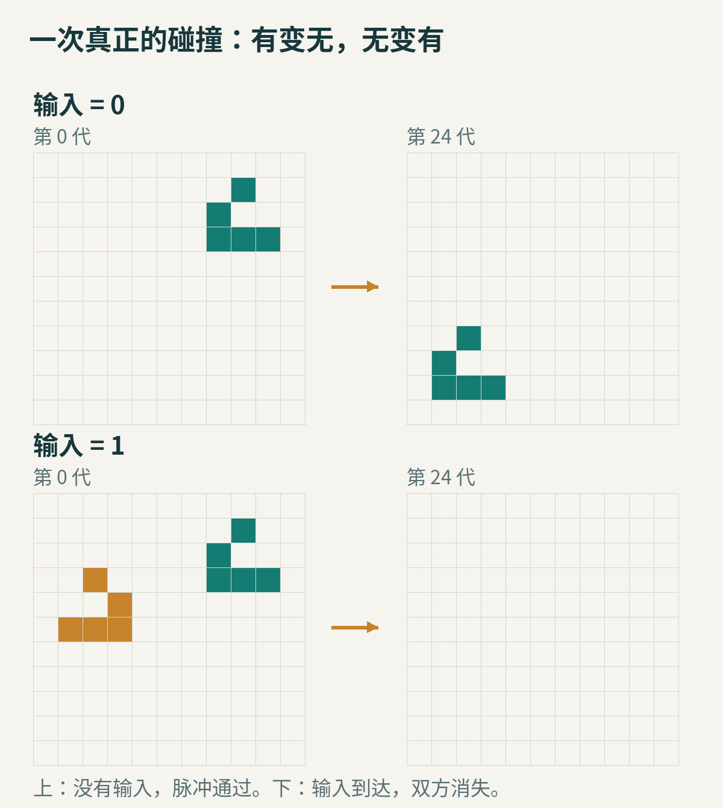

上排没有金色输入，绿色脉冲继续走；下排加入金色输入，两者在第12代完全消失，第24代仍为空。

这就得到一个“取反”的基本反应：输入为0时，输出有脉冲，是1；输入为1时，固定脉冲被消掉，输出是0。

不是每一种碰撞都这样。换个位置、错开一代，可能会留下静物、生成别的飞船，或爆出一团复杂碎片。因此，真正可用的电路必须精确安排空间、节奏，以及剩余图案的去向。

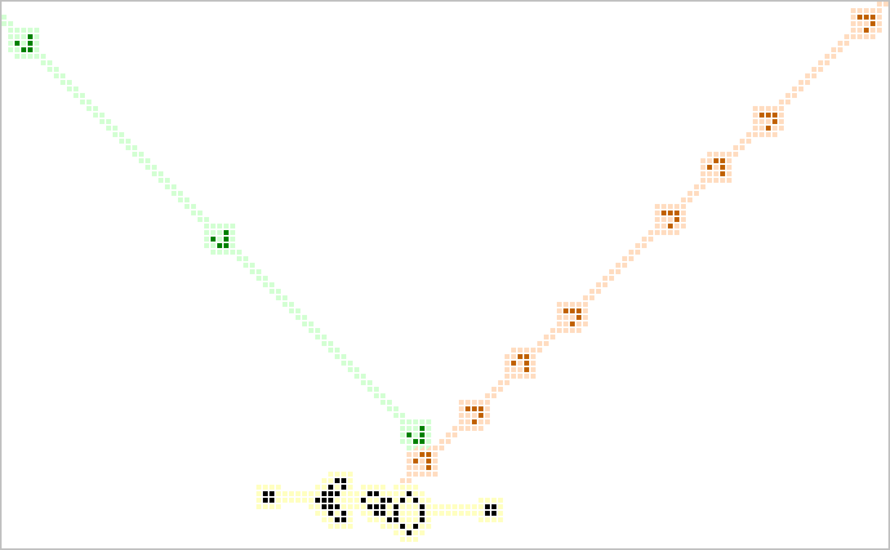

这是作者提供的真实电路图：下方黄色区域是枪，左上绿色路线送入稀疏信号；相撞后，右上橙色输出流中相应的位置变成空缺。浅色轨迹用于说明路线，并非这一刻全都活着。

继续添加能转向、复制、保存和读取信号的结构，就有机会把局部碰撞组织成完整计算。就像一只晶体管还不是电脑，一次取反也不是通用计算的证明；关键在于这些部件能否稳定连接起来。

## 先算清7＋5，再谈“能做任何计算”

Johnston 和 Greene 的教材展示了一台实实在在的生命游戏加法机。它的任务是把两个寄存器里的7和5相加。寄存器，可以先理解为机器存放数字的位置。

它采用的思路很朴素：从第一个数里拿走1，给第二个数加上1；不断重复，直到第一个数变成0。最终留下0和12。

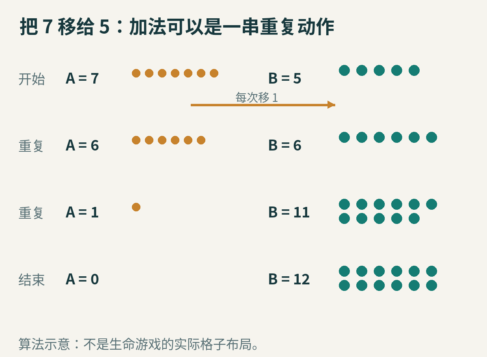

圆点表示数值。这是算法层面的教学示意，不是实际的生命游戏格子布局。

在这种机器里，数字可以由一个小方块的位置来表示。特定滑翔机组合把方块推远或拉近，就相当于改变数值；另外的结构负责判断它是否已经回到代表0的位置。

把这些能力接起来，才会出现下面这幅像电路板一样的图。

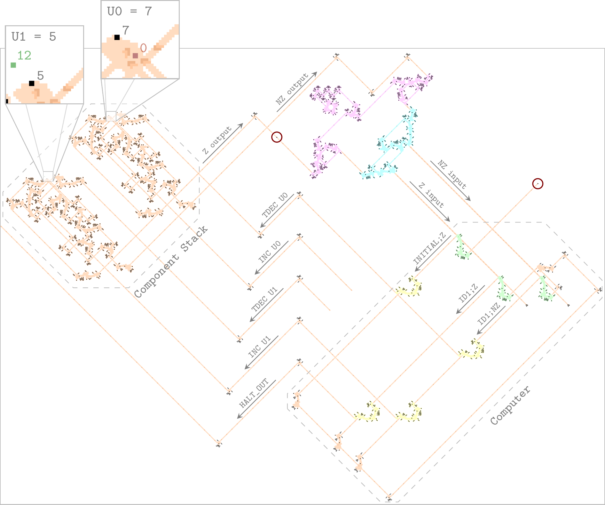

作者原图：左侧是保存和修改数字的部件，上方紫色区域参与时钟控制，右下方负责状态与指令。左上两个放大框标出寄存器从7到0、从5到12的变化。细节可放大查看。

这不是把“7＋5＝12”几个字画在格纸上，也不是外部程序看见某个图案后偷偷替它做加法。加减、判断和信号传递，都由初始图案在同一套生命规则下完成。这个机器实例和代码可在[教材第九章](https://github.com/nathanieljohnston/game-of-life-book/blob/master/universal_computation.tex)找到。

生命游戏具有“图灵完备性”：给它适当构造的初态、可按需扩展的空间和足够时间，它原则上可以模拟通用计算。

这里说的是**构造能力**，不保证速度、体积或实用性，更不是说随便撒一把格子就会自动长出智能。加法机是一个帮助我们理解的具体实例；普遍的计算能力来自更完整的构造论证。

## 自己写一个世界，核心只要这几行

下面这段 Python 3 代码是一份完整的教学实现，只依赖标准库。它用坐标集合保存活格子，没有人为设定有限棋盘，也不会把越界的图案绕回来。

```python
from collections import Counter


def next_generation(alive):
    neighbors = Counter()
    for x, y in alive:
        for dx in (-1, 0, 1):
            for dy in (-1, 0, 1):
                if dx != 0 or dy != 0:
                    neighbors[x + dx, y + dy] += 1

    return {
        cell for cell, count in neighbors.items()
        if count == 3 or (count == 2 and cell in alive)
    }


glider = {(1, 0), (2, 1), (0, 2), (1, 2), (2, 2)}
alive = glider.copy()
for _ in range(4):
    alive = next_generation(alive)

print(len(alive))
print(alive == {(x + 1, y + 1) for x, y in glider})
```

本地运行结果是：

```text
5
True
```

第一个结果说它仍是五个活格子，第二个说它恰好等于初始图案向右、向下各平移一格。代码没有“滑翔机”这种特殊类型，也没有移动命令，只有数邻居和同时更新。

这也是生命游戏最有力量的地方：规则里没有飞船，没有枪，更没有寄存器；这些名字，是我们观察很多格子跨越时间的行为之后，才加上去的。

简单规则并不保证简单结果。但从简单到复杂之间，也没有凭空跨过去的一步。滑翔机让信号能走，枪让信号能不断产生，碰撞让信号能改变，存储与反馈让动作能被组织。机器，是这样一点点出现在格纸上的。

图片来源：[康威照片](https://www.flickr.com/photos/thane/20366806/)与[高斯珀照片](https://www.flickr.com/photos/thane/422771165/)均由 Thane Plambeck 摄影，依 [CC BY 2.0](https://creativecommons.org/licenses/by/2.0/) 使用，保留所下载版本，未另行修改。教材枪、取反电路与加法机原图来自 Nathaniel Johnston、Dave Greene 的[作者仓库](https://github.com/nathanieljohnston/game-of-life-book)，依 [CC BY 4.0](https://creativecommons.org/licenses/by/4.0/) 使用；加法机由原PDF转为PNG，未改内容。其余为本文原创教学图与按生命规则计算的动画。
