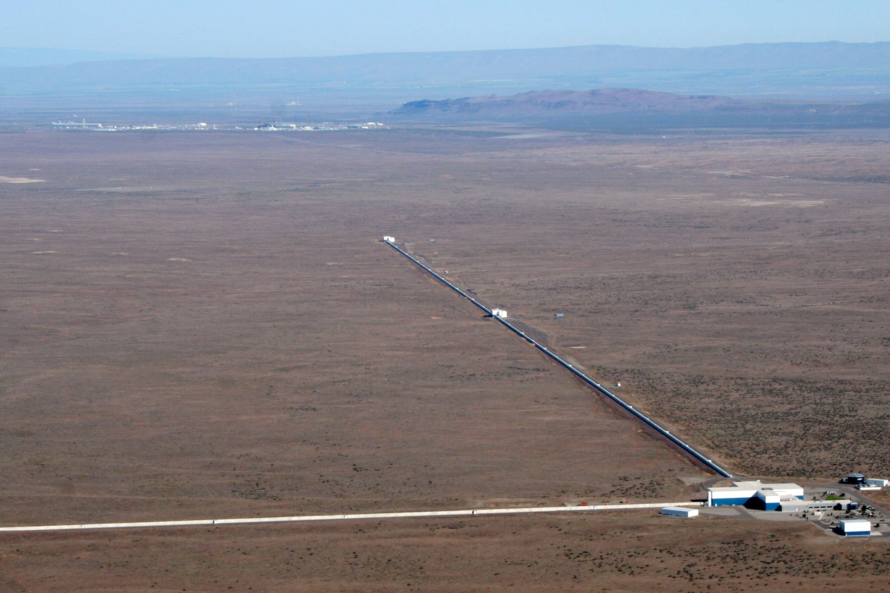
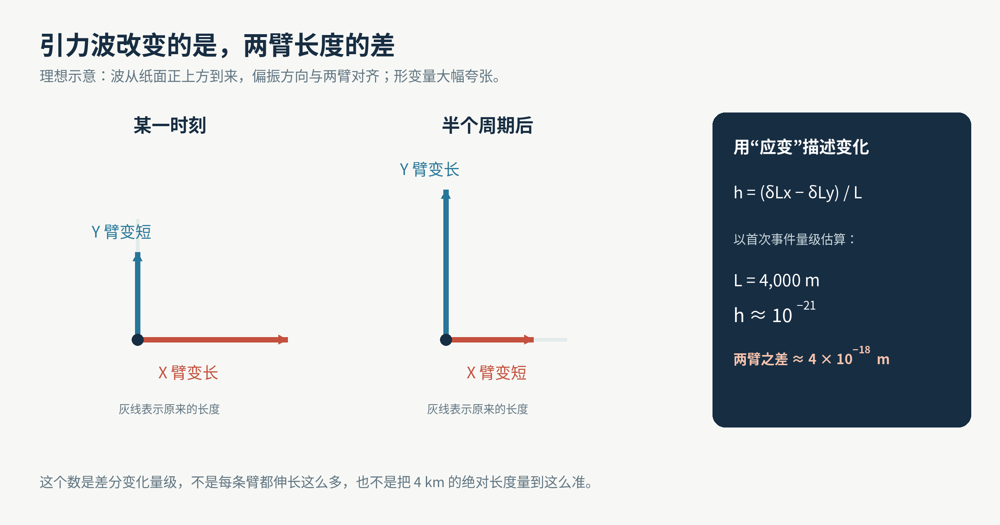
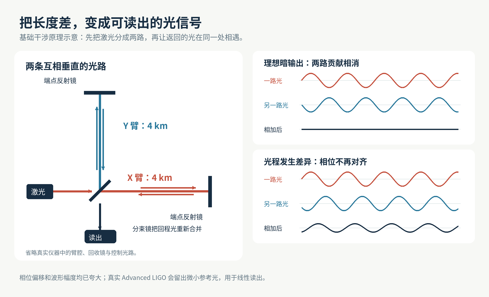
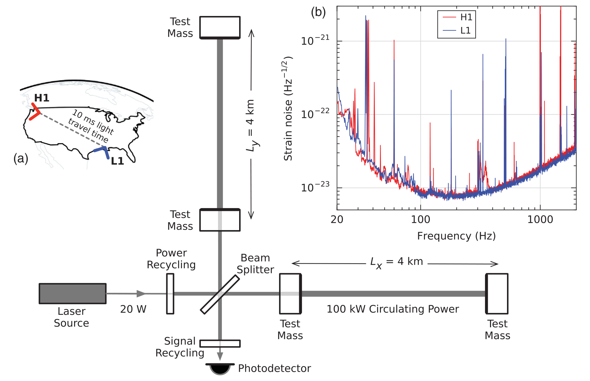
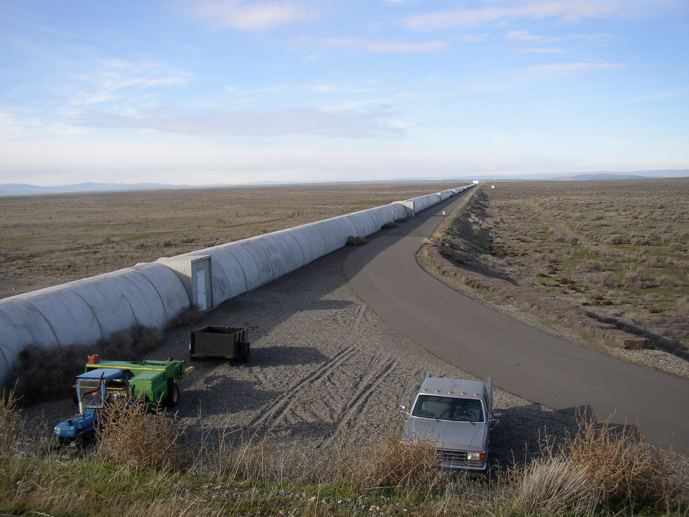
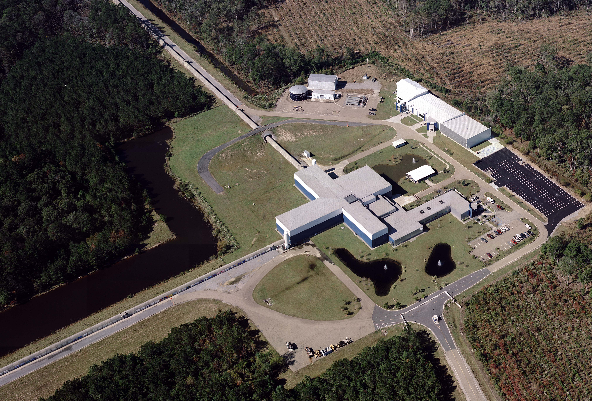
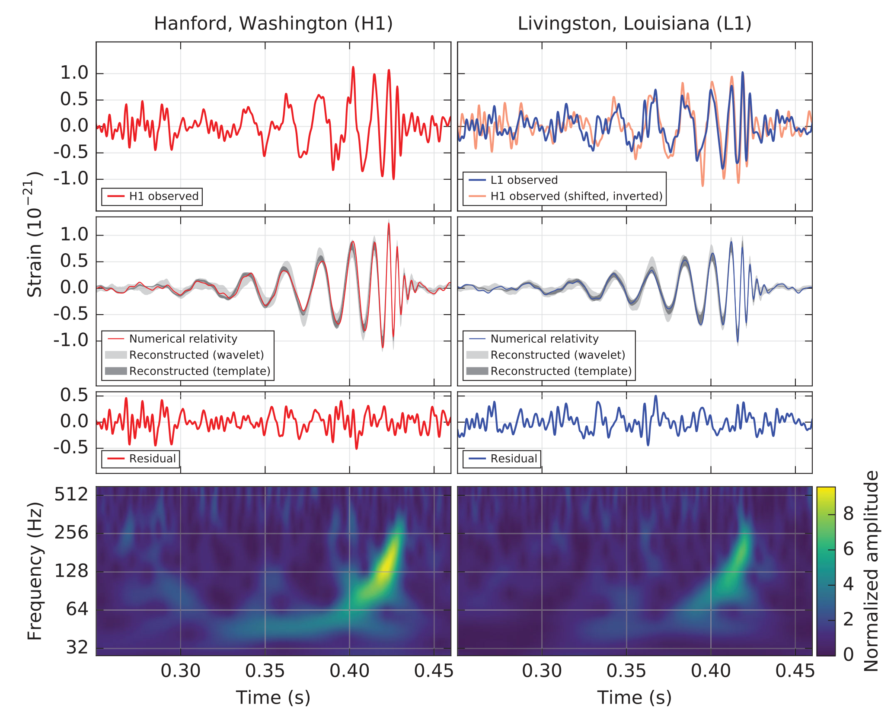
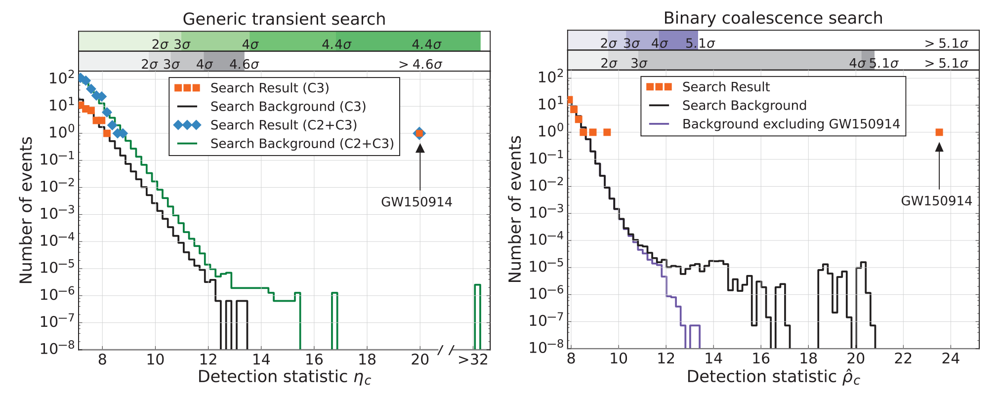
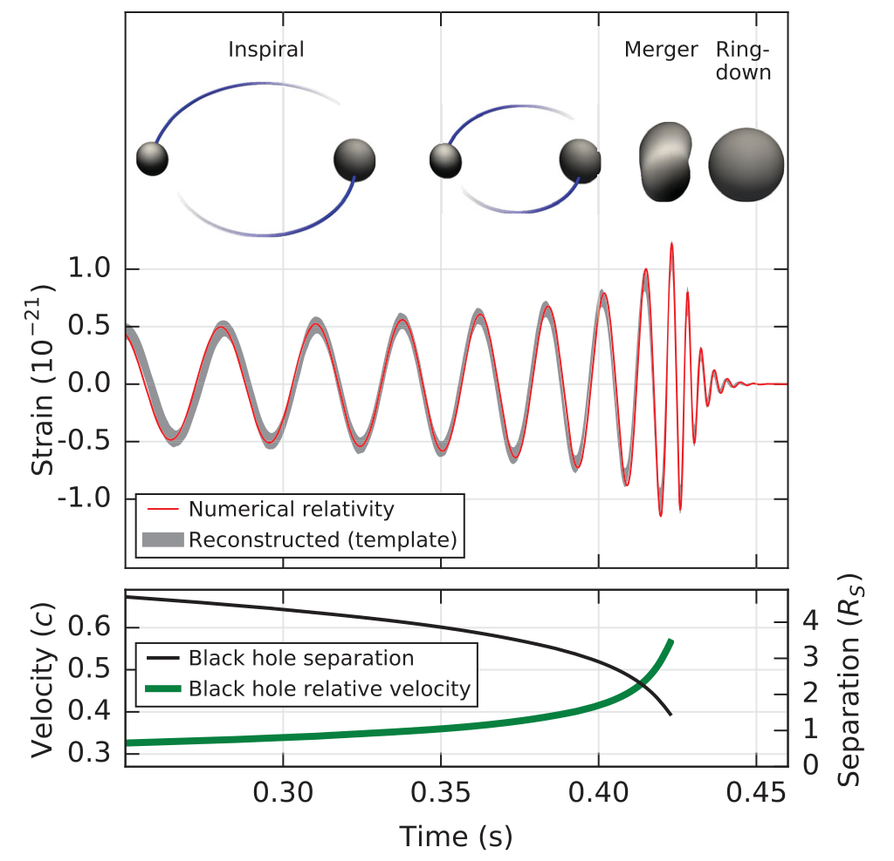

# 两条四公里的光路，怎样量出比质子还小的伸缩？

从空中看，LIGO 不太像天文台。没有指向天空的巨大镜筒，只有两条细长的建筑，在地面上拼出一个直角，向远处延伸。

它是一种用激光比较距离的引力波探测器。两条臂各长 4 公里，里面的镜子和光束，要共同回答一个极其苛刻的问题：遥远天体掀起的时空波动经过地球时，这两个方向上的距离，有没有发生不同的变化？

*美国华盛顿州的 LIGO 汉福德站。两条互相垂直的长臂不是望远镜的支架，而是测量装置本身；照片拍摄于 2008 年。*

2015 年 9 月 14 日，LIGO 在华盛顿州汉福德和路易斯安那州利文斯顿的两台探测器，记录到了一段短促的信号。2016 年 2 月 11 日，LIGO 科学合作组织与 Virgo 合作组织公布了结果：人类首次直接探测到引力波，来源是两个黑洞的并合。

这是一次已有完整论文、数据分析与工程说明的历史观测。回头看它，最值得追问的未必是黑洞有多猛烈，而是另一端的仪器：地球一直在震动，空气一直在流动，镜子本身也有热运动，一台建在地面上的机器，凭什么认出如此微小的距离变化？

答案从一个选择开始。LIGO 没有尝试造出一把刻度细到不可思议的直尺。它把问题改成了：**两束原本有共同节拍的光，走过不同的路，再次相遇时，还能不能对上？**

## 先分清：它量的是变化，不是四公里的绝对长度

如果让普通测量工具告诉我们，两点之间的距离恰好是 4,000 米，再精确到小数点后许多位，误差很快就会失去控制。温度、地面沉降、材料的膨胀，都会来添乱。

LIGO 关注的是两条臂的长度差随时间怎样变化。

把一条臂的变化记作 δLx，另一条记作 δLy，LIGO 读出的核心量对应 δLx − δLy。再除以 4 公里的臂长，就得到一个没有单位的比例，叫作“应变”，通常写成 h。这是引力波在这台探测器上的投影响应，并不意味着所有朝向的仪器都会得到同样的数值。

对一种便于理解的情况，波垂直穿过探测器平面，偏振方向又恰好与两臂对齐，一条臂会变长，另一条会变短；过半个周期，变化方向对调。两条垂直的臂，正好能把这种差别比较出来。

*两臂的相反变化会在相减时叠加。图中伸缩幅度被大幅夸张；真实响应还取决于波的来向和偏振。*

首次事件 GW150914 的峰值应变约为 10⁻²¹。把这个量级乘以 4,000 米，得到的差分长度变化约为 4 × 10⁻¹⁸ 米，比质子的尺度还小得多。[1](https://arxiv.org/abs/1602.03837)、[1·2](https://doi.org/10.1103/PhysRevLett.116.061102)、[1·3](https://creativecommons.org/licenses/by/3.0/)

这里有两个容易被跳过的限定：这不是说每一条臂都伸长了这么多，也不是说 LIGO 把四公里的绝对长度测到了这一精度。它是在特定频率范围内，追踪两条长光路之间极微小、随时间摆动的差异。

这就像我们未必能准确说出两支音叉各自振动了多少次，却可以通过它们合在一起的拍频，敏锐地察觉两者有没有偏离。类比的重点是“比较”，并不是说 LIGO 使用音叉。

## 让光自己做比较

激光不只是很亮的光。对这台仪器来说，更重要的是它的波具有稳定、可比较的相位。可以把相位理解为一个周期里的位置：此刻到了波峰，还是走到了波谷？

LIGO 的基本骨架是一台迈克耳孙干涉仪。中央的分束镜把同一束激光分成两路，一路沿 X 臂前进，另一路转过直角沿 Y 臂前进。它们被远端镜子反射，返回中央，再由分束镜重新合并。

光波叠加时，电场可以加强，也可以抵消。这种叠加叫作干涉。仪器把一个输出端调整到接近“暗端口”：两条路径对这个端口贡献的光场，几乎互相抵消。

*左边说明光走哪两条路，右边说明为什么光程差能变成输出变化。图示的是基本原理，省略了臂内储光结构；真实相位变化远小于图中画出的偏移。*

引力波经过时，两条路径的传播条件发生不同的变化。光再次汇合时，相位关系就有了微小偏移，输出光随之变化。光电探测器负责把这种变化变成电信号。

这并不要求镜子移动足足一个激光波长，才算跨过一格“刻度”。波长规定的是光场重复一轮的尺度；相位可以连续变化，仪器可以读出一轮中的极小一部分。真正限制精度的是噪声、光的统计涨落和仪器稳定性，而不是“波长以下一律看不见”。

还有一个工程细节：真实 Advanced LIGO 并不是让输出永远完全漆黑，再等待突然冒出的光。它会保持一个极小、受控的偏离，让少量参考光到达读出端，与携带信号的光相互干涉，帮助把微小变化线性地读出来。设计论文称之为直流或零差读出。[2](https://arxiv.org/abs/1411.4547)

也不能把激光想成一把完全不受引力波影响的神奇尺子。光本身沿时空传播，它的相位同样会受到影响。LIGO 最终比较的是两束光沿不同路径返回同一处后的相位关系；引力波对两个方向的作用不同，这种差别不会因为“光也受影响”就自动消失。

## 为什么已经有四公里，还要让光来回跑？

在同样的应变下，基线越长，可比较的距离变化越大。四公里因此不是为了让设备看起来壮观，而是在为微小信号争取测量空间。

但只让光跑一趟，还不够。

真实 LIGO 的每条臂都不止一面远端镜子。靠近中央和远端的两面镜子共同形成光学谐振腔，也叫法布里–珀罗腔。恰当频率的光在两镜之间反复往返，连续进入的光场在腔内相干积累，再有一部分光返回读出系统。

这不是把一条四公里的管子悄悄变成上千公里长的建筑，而是增加光与这条测量基线相互作用的时间。发现论文对当时仪器的描述是：臂腔把引力波对光相位的作用增强约 300 倍。[1](https://arxiv.org/abs/1602.03837)、[1·2](https://doi.org/10.1103/PhysRevLett.116.061102)、[1·3](https://creativecommons.org/licenses/by/3.0/)

中央附近还有“功率回收镜”，把原本会返回激光方向的光送回仪器，提高内部光功率；“信号回收镜”则参与调整仪器对不同信号频率的响应。反复储光也不是次数越多就无限好，仪器仍须足够快地响应随时间变化的波。增强微弱信号与保持合适带宽，要一起设计。

*发现论文中的真实仪器示意。Test Mass 是构成臂腔的镜子，Beam Splitter 是分束镜；左侧小图标出两站位置，右上角曲线显示不同频率处的噪声。图中功率数字描述首次事件时期，不能当作今天所有运行状态的统一参数。*

这张图还透露了一个重要事实：探测器没有一个脱离条件、放之四海而皆准的“最小可测长度”。右上角曲线横轴是频率，纵轴是折算成应变的噪声幅度谱密度，单位带有每根号赫兹；它不是某一瞬间的应变，也不能直接与波形图的峰值比大小。曲线较低的频段，仪器通常更有优势。

因此，“比质子还小”能传达震撼，却不能替代完整的测量说明。我们还要问：信号以什么频率变化，持续多久，仪器在那一段频率里有多吵？

## 镜子为什么不直接牢牢钉在地上？

因为地面从来没有真正安静过。

车辆、风、海浪引发的地面运动，以及远处的地震，都可能让仪器的部件发生位移。把镜子固定得很结实，只会让它更忠实地跟着地面动。

LIGO 采取了相反的办法：尽量让关键镜子在测量方向上接近自由的测试质量，同时用多层系统隔开地面传来的扰动。

*真实的多级悬挂装置。下方的大圆形光学组件不是直接固定在真空腔壁上，而是由上方的悬挂链支承。*

首次发现使用的 Advanced LIGO 测试镜，每面约重 40 千克，采用熔融石英材料。它们位于四级摆悬挂链的末端。对高于摆自身共振频率的某些地面振动，多级悬挂能逐级削弱向下传递的运动。

这种隔离有适用频率，并不是把任何振动都“吸收干净”。所以悬挂装置外面，还有主动隔振平台：传感器测量平台与地面的运动，执行器通过反馈作出修正。主动隔振与被动悬挂一起工作，才为镜子提供足够安静的环境。[1](https://arxiv.org/abs/1602.03837)、[1·2](https://doi.org/10.1103/PhysRevLett.116.061102)、[1·3](https://creativecommons.org/licenses/by/3.0/)[3](https://www.ligo.caltech.edu/page/vibration-isolation)

这也解释了一个看似矛盾的要求：镜子要尽量自由，却不能放任不管。两臂的光腔需要保持共振，镜子角度需要正确，光束不能跑偏。控制系统得不断修正工作点，同时不把过多控制噪声带进真正要测量的频段。

而且，即使周围完全不动，镜子也不是绝对安静的。材料、悬挂纤维和光学镀膜会带来热噪声。读出光的光子数存在统计涨落，会形成散粒噪声；光压的涨落也会扰动镜子。提高激光功率能帮助压低某些读出噪声，却会让另一些问题更值得警惕。[2](https://arxiv.org/abs/1411.4547)

LIGO 的精度来自一连串配套的选择，没有哪一个神奇部件可以单独包办。

## 长臂里面为什么要抽成真空？

从地面近看，LIGO 的长臂像一条通向远处的低矮廊道。外面的混凝土围护结构主要负责保护，激光真正走过的，是内部的钢制真空管道。

*汉福德站北向长臂，摄于 2006 年。可见的是保护真空管道的外部结构，不是让激光在露天传播的轨道。*

如果四公里光路里都是空气，温度和密度变化就会改变光的传播，气体分子也会散射光。那些变化与“光程变了”长得太像，都会污染我们想读出的相位。

因此，关键光学部件在超高真空环境中工作。首次发现论文记载，容纳臂内光束的管道直径约为 1.2 米，压力维持在 1 微帕以下。[1](https://arxiv.org/abs/1602.03837)、[1·2](https://doi.org/10.1103/PhysRevLett.116.061102)、[1·3](https://creativecommons.org/licenses/by/3.0/)

真空解决的是一类问题，隔振解决的是另一类问题；它们都不能代替仪器校准。

光电探测器输出的是电信号，论文展示的却是应变，两者之间必须有可信的换算。LIGO 会用经过调制的校准激光，通过光压轻轻推动测试镜，测量系统怎样响应，再建立从读出信号到应变的关系。校准还需要监测和交叉检查。所谓“测到极小的伸缩”不能只来自屏幕上的一条漂亮曲线，它得有一整条可追溯的测量链。[1](https://arxiv.org/abs/1602.03837)、[1·2](https://doi.org/10.1103/PhysRevLett.116.061102)、[1·3](https://creativecommons.org/licenses/by/3.0/)[4](https://arxiv.org/abs/1602.03845)

## 为什么第二台要放到三千公里外？

即便完成上述工程，一台仪器里出现一段漂亮的波形，仍不足以宣布发现。

它可能是附近某个部件突然抖了一下，也可能是电子系统的一次异常。与其在同一个场地再摆一台，共享大量环境扰动，LIGO 把另一台放到了相距约 3,000 公里的地方。

*路易斯安那州的 LIGO 利文斯顿站，2006 年航拍。它与汉福德站处在不同的地理环境中，分别记录本地噪声和可能来自同一宇宙事件的信号。*

这一距离有两重作用。首先，两个场地的大量局地噪声不同：一辆车经过利文斯顿，不应该在汉福德制造同样的仪器响应。其次，真正横扫地球的引力波，应该能在两地留下彼此一致的记录，时间差受光速传播约束。

两站之间的光行时大约是 10 毫秒。所以“同时探测”不是要求两个时间戳完全相等，而是允许与来向相符的传播延迟。GW150914 先到达利文斯顿，约 6.9 毫秒后到达汉福德。数据采集使用 GPS 时间同步，时序还用额外的时钟系统核验。[1](https://arxiv.org/abs/1602.03837)、[1·2](https://doi.org/10.1103/PhysRevLett.116.061102)、[1·3](https://creativecommons.org/licenses/by/3.0/)

两条曲线也不必一模一样。探测器朝向、噪声和对波的响应都要考虑。论文为了让两站记录更容易目视比较，对其中一条曲线做了时间平移和符号翻转；这不是“两次观测本来就完全重合”。

*从上到下依次是两站应变记录、与重建波形的比较、减去模型后的残差，以及信号频率随时间升高的轨迹。为了展示，数据经过 35—350 Hz 带通滤波，并去掉了强仪器谱线；它不是未经处理的原始电压截图。*

看最下面一行，会比一开始就盯住所有波峰更直观：亮起来的轨迹向右上方走，意味着信号的频率随时间上升。两站都记录到了相应的演化。

但两地符合仍只是必要的证据之一。某些大范围环境事件可能同时影响两站，所以团队还检查了环境传感器和仪器辅助通道。地震仪、磁场传感器、麦克风等在这里的用途，是监视地球和机器正在制造什么干扰，而不是替引力波“录音”。针对首次事件的检查，没有发现能够解释这段信号的环境或仪器异常。[5](https://ligo.org/science-summaries/GW150914Detchar/)

## 最难的反问：噪声会不会碰巧长成这样？

不能回答“它看起来很像黑洞，所以一定是黑洞”。我们还得知道，噪声偶然拼出同等级候选事件的机会有多大。

研究人员采用了一种很有工程味道的办法：**故意让两个探测器的数据在时间上错开，错得比两站间的光行时大得多，再重新搜索巧合。**

这样做破坏了同一真实宇宙事件应有的时间对应，却保留了各自数据中的大量噪声特征。反复改变错位量，就能估计互不相关的局地噪声随机撞到一起，会制造怎样的背景。它不能自动排除两站真正相关的环境干扰，所以前面的环境检查仍然不可少。

团队没有只押注一种寻找方式。一类搜索使用广义相对论预测的双致密天体并合波形，在不同质量、自旋等参数下构造模板，寻找数据与模板的匹配。另一类搜索对具体天体波形的假设更少，重点寻找两站中时间与频率结构相容的短暂异常。GW150914 同时被这两类方法找到。[1](https://arxiv.org/abs/1602.03837)、[1·2](https://doi.org/10.1103/PhysRevLett.116.061102)、[1·3](https://creativecommons.org/licenses/by/3.0/)[6](https://ligo.org/science-summaries/gw150914cbc/)

*横轴是各搜索方法用于排序候选事件的统计量，越往右通常越显著；纵轴是事件数。橙色标记代表候选事件，背景曲线来自噪声估计。两张图的统计量不同，不能拿横轴数值直接互比。*

双星并合模板搜索给出的误报率上限，是平均每 203,000 年少于一次。较少依赖具体波形的主要瞬变搜索，也独立给出了很高的显著性，但数值不同：前者的显著性大于 5.1σ，后者为 4.6σ，都是在各自噪声背景下衡量事件有多罕见。[1](https://arxiv.org/abs/1602.03837)、[1·2](https://doi.org/10.1103/PhysRevLett.116.061102)、[1·3](https://creativecommons.org/licenses/by/3.0/)

“二十万年”不是说 LIGO 已经运行了二十万年，也不是承诺未来二十万年绝不出错。它是用分析期内的噪声数据、时间错位和搜索统计方法估计出的误报率上限，带着这些方法的条件。首次发现论文实际使用的是一段约 16 天的两站共同有效观测数据来完成这项分析。

真正有说服力的，是几条证据汇到一起：仪器在正常工作；环境监测没有找到足够的干扰；远隔两地的记录相容；不同搜索方法都找到了它；噪声背景很难制造同等显著的事件。没有哪一条可以被一句“曲线长得像”替代。

## 那一声“啾”，到底是什么？

通过测量和排查，研究人员最终面对的是一段随时间变化的应变。它还携带了关于源头的信息。

两个黑洞绕转时，可以通过引力波带走能量，轨道逐渐收缩，运动加快。接近并合时，信号的频率和幅度迅速上升；合并后的黑洞再逐渐稳定下来。首次事件的整体波形，与广义相对论对这一过程的预测相符。

*上方的黑洞是数值模拟的视界示意，并非相机拍到的黑洞照片。红色波形展示理论模型与重建信号的关系；下方是模型描述的间距与相对速度演化。*

把这一段数据转换成扬声器能够播放的信号，就能听见那声著名的、音调向上滑动的“啾”。因为信号涉及的频率落在人耳可听范围附近，声化特别能帮助人直观体会它的加速过程。有些演示还会改变播放频率，让声音更容易听清。

但这不是黑洞附近的空气声穿过宇宙，被地球上的麦克风录了下来。穿过地球的是引力波；LIGO 记录的是光学测量所反映的应变；最后让空气振动、进入耳朵的，是播放这些数据的扬声器。[7](https://ligo.org/detections/gw150914/)

这个区别并不会削弱那声“啾”的意义，反而让它更具体：它是两条四公里光路、悬挂着的镜子、超高真空、反馈控制、时间同步与统计检验，共同翻译出来的宇宙信息。

LIGO 最惊人的地方，也因此不只是“小”。它没有先把整个地球变得绝对安静，再去等一个信号；它学会了让许多不同来源的变化，在不同环节暴露身份。

于是，地面上的两座 L 形建筑，才有资格对遥远的宇宙说：这一次的伸缩，我们认出来了。

图片来源：[论文四图](https://doi.org/10.1103/PhysRevLett.116.061102)，B. P. Abbott et al.（LIGO Scientific Collaboration and Virgo Collaboration），Observation of Gravitational Waves from a Binary Black Hole Merger，Phys. Rev. Lett. 116, 061102 (2016)，[CC BY 3.0](https://creativecommons.org/licenses/by/3.0/)，图内内容未修改。

[汉福德航拍](https://commons.wikimedia.org/wiki/File:LIGO_Hanford_aerial_05.jpg)、[利文斯顿航拍](https://dcc.ligo.org/LIGO-G0900706/public)（Joe Giaime）与[悬挂装置](https://www.ligo.caltech.edu/image/ligo20150731j)，Courtesy Caltech/MIT/LIGO Laboratory；[长臂照片](https://commons.wikimedia.org/wiki/File:Northern_leg_of_LIGO_interferometer_on_Hanford_Reservation.JPG)，Umptanum，[CC BY-SA 3.0](https://creativecommons.org/licenses/by-sa/3.0/)，未修改；中文示意为本文原创。
