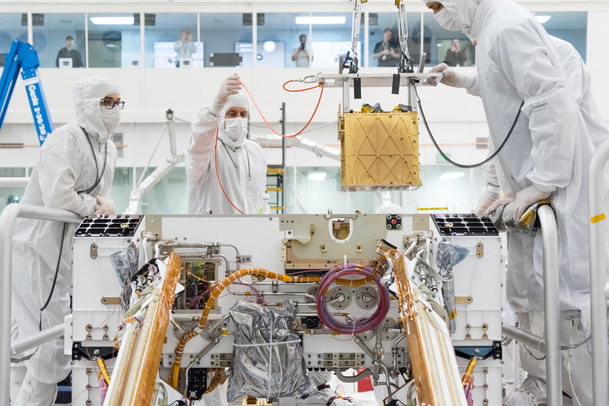
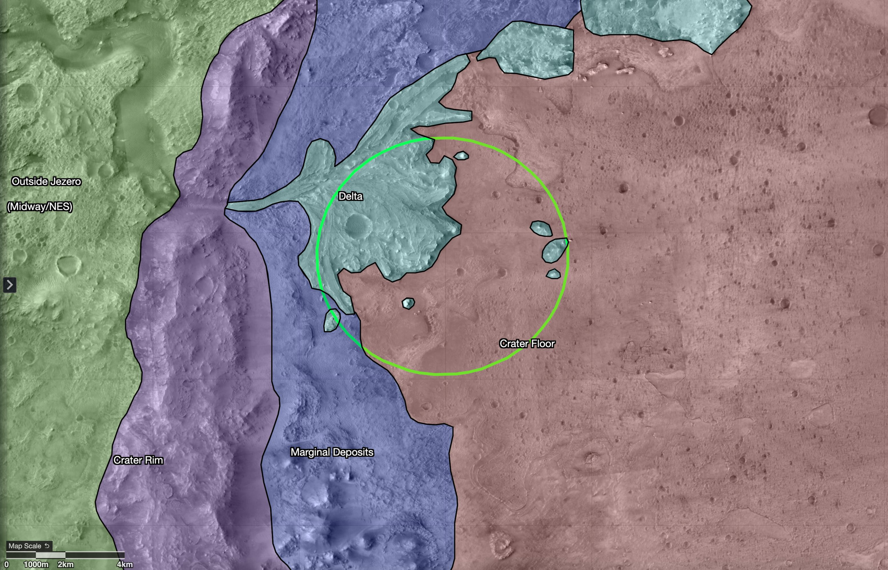
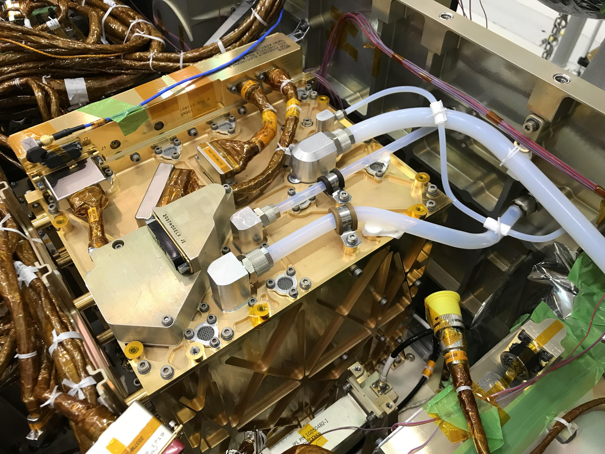
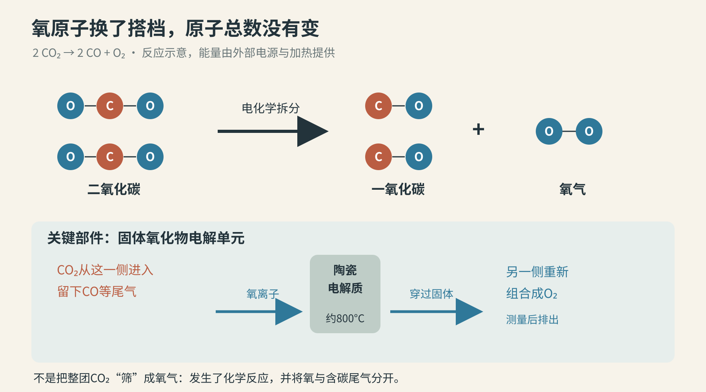
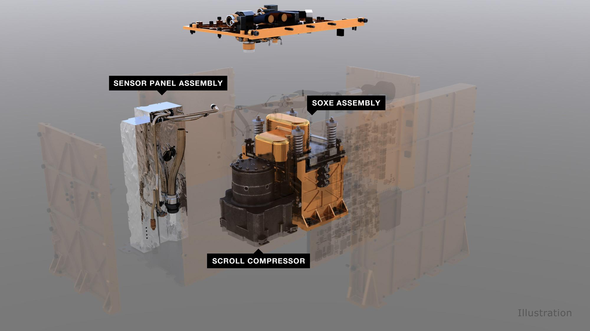
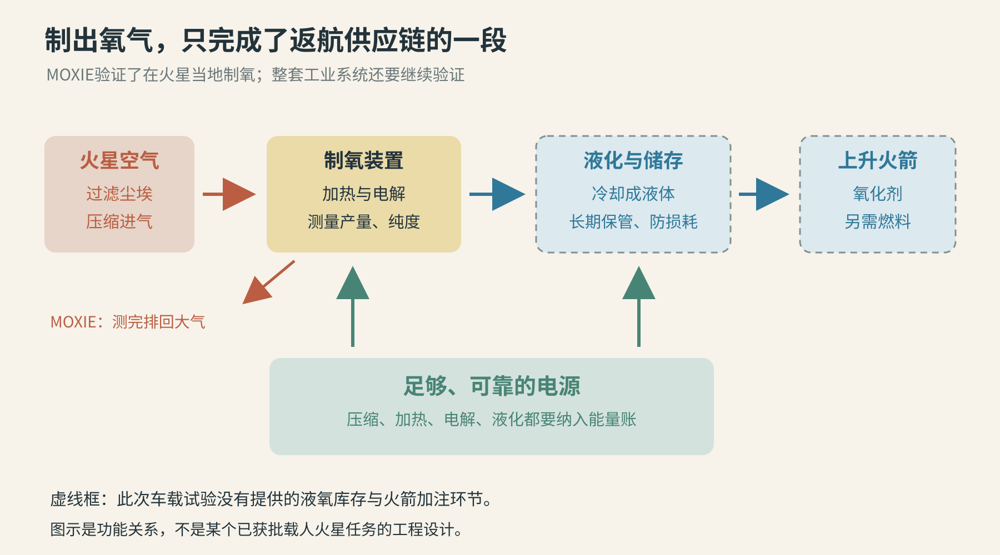

# 火星上那122克氧气，真正想解决的是返航

把一台小机器送到火星，让它从当地空气里制出氧气。最容易浮现的画面，是宇航员终于可以摘下头盔，深吸一口气。

MOXIE做的并不是这件事。它是装在“毅力号”火星车里的制氧技术验证装置：吸入火星大气，用电化学过程把二氧化碳中的一部分氧分离出来。它没有把火星空气改造成可以呼吸的大气，也没有给人供应过氧气。

它最重要的远期用途，甚至不是让人呼吸，而是让火箭有东西可用。

2023年9月6日公布的任务总结记录：MOXIE在火星完成16次制氧运行，累计得到122克氧气。这个结果发生在2021至2023年的任务期间，不是2026年刚刚出现的新突破。[1](https://www.nasa.gov/missions/mars-2020-perseverance/perseverance-rover/nasas-oxygen-generating-experiment-moxie-completes-mars-mission/)

122克听起来很少。理解这个实验，恰好要同时承认两件事：它证明的事情很重要，它还没有完成的事情也很多。

2019年的安装现场。金色盒子就是MOXIE，人的手和车体让它的尺寸变得直观：这是搭车去火星的小型验证设备，不是整座制氧工厂。

## 火箭需要的氧气，比一口呼吸更沉

地球上的汽车可以从空气中取得燃烧所需的氧。火箭飞出大气后不能指望这件事，必须携带能与燃料反应的氧化剂。对于采用液氧的推进系统，氧气就是需要另装进罐子的一大份货物。

“燃料”和“氧化剂”共同构成推进剂。MOXIE制的是氧气，不能因为它服务于火箭，就把它写成“在火星上造出了完整燃料”。它并不生产甲烷，也没有给一枚火箭加过注。

这份区别有重量。2020年的任务背景介绍采用过一组载人上升任务估算：让四人从火星表面升空，需要约7吨燃料，以及约25吨氧气。那是特定任务设想中的数量，不是所有火星火箭的统一配方。[2](https://www.nasa.gov/solar-system/moxie-could-help-future-rockets-launch-off-mars/)

无论未来设计如何调整，工业规模的氧化剂都不适合仅靠“再多带几个氧气瓶”来解决。每多往火星表面运一吨东西，地球出发时的运载、途中推进和火星着陆系统，都要承担相应负担。

于是问题从“氧气从哪来”变成了“能不能把需要运的成品，换成一套能在当地生产它的设备”。这就是原位资源利用，英文简称ISRU：利用目的地已有的物质，减少从地球运过去的东西。[1](https://www.nasa.gov/missions/mars-2020-perseverance/perseverance-rover/nasas-oxygen-generating-experiment-moxie-completes-mars-mission/)[3](https://doi.org/10.1126/sciadv.abp8636)、[3·2](https://science.ku.dk/presse/nyheder/2022/iltfabrik-til-bemandede-missioner-paa-mars-bestaar-foerste-store-test/Hoffman-etal-2022-SciAdv-MOXIE-sciadv.abp8636__1_.pdf)

MOXIE选择的原料并不需要挖矿。火星大气虽然稀薄，却有约95%是二氧化碳。碳和氧已经在眼前，只是以不适合直接供人呼吸、也不适合直接当液氧装罐的分子形式结合在一起。[3](https://doi.org/10.1126/sciadv.abp8636)、[3·2](https://science.ku.dk/presse/nyheder/2022/iltfabrik-til-bemandede-missioner-paa-mars-bestaar-foerste-store-test/Hoffman-etal-2022-SciAdv-MOXIE-sciadv.abp8636__1_.pdf)

## 小工厂的地址，在一辆火星车里面

毅力号于2021年2月18日降落在耶泽罗陨石坑。MOXIE跟着它来到火星，但它的工作不靠轮子：移动平台提供了早期搭载机会，也给实验带来了体积、电力和散热的限制。[3](https://doi.org/10.1126/sciadv.abp8636)、[3·2](https://science.ku.dk/presse/nyheder/2022/iltfabrik-til-bemandede-missioner-paa-mars-bestaar-foerste-store-test/Hoffman-etal-2022-SciAdv-MOXIE-sciadv.abp8636__1_.pdf)

这与在地球上找一片空地、接好电网再安装制氧设备，是很不一样的处境。车上其他仪器还要工作，热不能随意向邻居排，实验也无法毫无限制地连续运行。

这是2020年公布的着陆区规划图。绿色椭圆是当时的预计着陆范围，不是今天火星车的位置；它把制氧实验放回了真实的火星地形中。

MOXIE本体外壳约23.9×23.9×30.9厘米。装进车里以后，它不像一间带烟囱的工厂，更像一只被管线、隔热材料和电子设备围住的金色箱子。[3](https://doi.org/10.1126/sciadv.abp8636)、[3·2](https://science.ku.dk/presse/nyheder/2022/iltfabrik-til-bemandede-missioner-paa-mars-bestaar-foerste-store-test/Hoffman-etal-2022-SciAdv-MOXIE-sciadv.abp8636__1_.pdf)

这个尺度限制并不是故事的背景板，它直接决定了实验要先回答哪些问题：能否从当地空气稳定取料，能否把反应条件控制好，能否确认出来的确实是足够纯的氧气。

粗白管输送含二氧化碳的进气，较细管路连接产氧检测与排气环节。外壳的金色涂层也承担热辐射管理的任务。[4](https://science.nasa.gov/photojournal/moxie-all-tucked-in/)

## 它不是过滤器，而是在重新安排原子

把火星空气吸进来，再把氧气筛出来，听起来像一台复杂一点的空气净化器。但二氧化碳里的氧不是可以从缝里漏出来的小颗粒。要得到氧气，必须发生化学反应。

MOXIE先让进气经过滤尘装置，再用压缩机提高压力，把气体送到高温电解单元。工作温度约800°C。这里的高温不是为了把整辆火星车烤热，而是为了让电解材料在合适条件下工作。[2](https://www.nasa.gov/solar-system/moxie-could-help-future-rockets-launch-off-mars/)[3](https://doi.org/10.1126/sciadv.abp8636)、[3·2](https://science.ku.dk/presse/nyheder/2022/iltfabrik-til-bemandede-missioner-paa-mars-bestaar-foerste-store-test/Hoffman-etal-2022-SciAdv-MOXIE-sciadv.abp8636__1_.pdf)

在固体氧化物电解单元里，二氧化碳参与电极反应，产生一氧化碳和氧离子。陶瓷电解质能够传导氧离子；它们到另一侧重新组合成氧分子。把总反应简写，就是：

2 CO₂ → 2 CO + O₂。

两份二氧化碳，得到两份一氧化碳和一份氧气。图中碳原子、氧原子的总数没有变化；改变的是谁和谁结合。电能与热管理让这个分离过程得以进行，机器没有凭空制造氧元素。[3](https://doi.org/10.1126/sciadv.abp8636)、[3·2](https://science.ku.dk/presse/nyheder/2022/iltfabrik-til-bemandede-missioner-paa-mars-bestaar-foerste-store-test/Hoffman-etal-2022-SciAdv-MOXIE-sciadv.abp8636__1_.pdf)

上半图数的是原子，下半图说明氧怎样与含碳气流分开。真实装置还包含电极、密封、加热、控制和检测部件。

这里还有一条重要的工程界线：电压不是越高越好。2022年的研究说明，控制条件要能驱动制氧，同时避免不希望出现的碳沉积。后者可能损害电解单元。因此，提高产量不能简化成“把电再开大一点”。[3](https://doi.org/10.1126/sciadv.abp8636)、[3·2](https://science.ku.dk/presse/nyheder/2022/iltfabrik-til-bemandede-missioner-paa-mars-bestaar-foerste-store-test/Hoffman-etal-2022-SciAdv-MOXIE-sciadv.abp8636__1_.pdf)

对于普通读者，记住“热、压力、电压、气体成分都要合适”已经足够。工厂与化学方程式之间的距离，正藏在这些持续受控的条件里。

图中Scroll Compressor是压缩进气的装置，SOXE Assembly是电解组件，Sensor Panel Assembly负责检测。这是官方结构插图，不是拆机照片。

## 为什么金色外壳值得看一眼

800°C放在一辆精密机器内部，首先是一个如何不伤到邻居的问题。

任务资料介绍了几种具体安排：耐高温的镍合金部件负责气体换热，气凝胶帮助保温，外层薄金涂层反射红外热辐射，减少热量向周围部件传播。[2](https://www.nasa.gov/solar-system/moxie-could-help-future-rockets-launch-off-mars/)[5](https://www.jpl.nasa.gov/news/nasas-perseverance-mars-rover-extracts-first-oxygen-from-red-planet/)

这时再看前面的安装实拍，金色就不只是“航天器很高级”的视觉符号了。它服务于一道很实际的边界：反应区要热，车体其他地方不该跟着一起热。

同样，压缩机也不是把气体吸进来就算完成工作。火星大气状态会随时间、昼夜和季节变化；入口条件改变，流量与运行参数也要相应调整。只在一个舒服的地面条件下成功一次，不能证明到了火星仍然可靠。[3](https://doi.org/10.1126/sciadv.abp8636)、[3·2](https://science.ku.dk/presse/nyheder/2022/iltfabrik-til-bemandede-missioner-paa-mars-bestaar-foerste-store-test/Hoffman-etal-2022-SciAdv-MOXIE-sciadv.abp8636__1_.pdf)[6](https://science.nasa.gov/blog/moxie-celebrates-2-years-on-mars-discoveries-and-work-left-to-do/)

这解释了为什么一台产量不大的设备，值得在不同条件下反复运行。实验真正积累的除了氧，还有对边界的认识：哪些参数可以保持，哪些要调，哪些测量足以发现系统正在偏离目标。

## 122克是总产量，12克每小时是另一件事

关于MOXIE，最常被放在一起的两个数字，实际回答着不同问题。

122克，是16次运行累计制出的氧气总量；12克每小时，是任务总结报告的最高产氧速率，对应纯度达到98%或以上。前者是总账，后者是某些运行条件下的速度。它们不能合并成“MOXIE一直以12克每小时工作了两年”。[1](https://www.nasa.gov/missions/mars-2020-perseverance/perseverance-rover/nasas-oxygen-generating-experiment-moxie-completes-mars-mission/)

它也不是一台不间断运行到停机的迷你工厂。论文记录的2021年最初七次产氧运行，单次制氧约一小时到一个半小时；加热准备等过程另有时间。2021年4月20日首次制氧，论文表中记为约5.4克。[3](https://doi.org/10.1126/sciadv.abp8636)、[3·2](https://science.ku.dk/presse/nyheder/2022/iltfabrik-til-bemandede-missioner-paa-mars-bestaar-foerste-store-test/Hoffman-etal-2022-SciAdv-MOXIE-sciadv.abp8636__1_.pdf)[5](https://www.jpl.nasa.gov/news/nasas-perseverance-mars-rover-extracts-first-oxygen-from-red-planet/)

任务总结中的最后一次运行发生在2023年8月7日，得到9.8克氧气。把这些日期和数字放回各自的位置，故事会更准确：这是跨越不同环境条件的一系列技术试验，不是一座稳定供应氧气的仓库。[1](https://www.nasa.gov/missions/mars-2020-perseverance/perseverance-rover/nasas-oxygen-generating-experiment-moxie-completes-mars-mission/)

纯度数字也不能越界。“制出了高纯氧”不等于“已经交付了可直接接到宇航服上的生命保障系统”。持续监测、可靠性、安全储存，以及与具体用氧设备的接口，都是完整系统的问题。

最能体现这一点的细节是：MOXIE测完产量和纯度后，会把气体排回火星大气。那122克不是正在火星车里等候未来宇航员领取的一瓶氧。[2](https://www.nasa.gov/solar-system/moxie-could-help-future-rockets-launch-off-mars/)[4](https://science.nasa.gov/photojournal/moxie-all-tucked-in/)

## 从金色盒子到氧气工厂，还隔着什么

MOXIE证明了一段过程可以在火星工作，但返航供应链需要更多环节一起成立。

第一是规模与持续性。克级每小时的验证装置，要走向为任务积累吨级氧气的设备，不能只复制一个外壳更大的版本。长期运行的老化、维护、控制与环境适应，都要有相应证据。2022年论文明确把连续运行寿命列为后续要研究的问题，而非已经在火星完成的验证。[3](https://doi.org/10.1126/sciadv.abp8636)、[3·2](https://science.ku.dk/presse/nyheder/2022/iltfabrik-til-bemandede-missioner-paa-mars-bestaar-foerste-store-test/Hoffman-etal-2022-SciAdv-MOXIE-sciadv.abp8636__1_.pdf)

第二是电源和热管理。产氧、进气压缩、维持反应条件都需要能量。若未来还要把氧气变成液体以便储存和使用，又增加了一段制冷任务。一台设备能在有限电力下完成试验，并不能自动证明一座大工厂的全天候能源供应已经解决。

第三是把产物留住。2023年的任务总结把下一步描述为包括制氧、液化和储存的完整系统。只有持续产出并可靠地存下来，氧气才真正变成任务可以调用的资源。[1](https://www.nasa.gov/missions/mars-2020-perseverance/perseverance-rover/nasas-oxygen-generating-experiment-moxie-completes-mars-mission/)

实线设备段说明MOXIE验证的核心过程；虚线框提示尚需补齐的供应链。未来火箭还需要燃料，氧气只是推进剂的一部分。

还有一层常被略过的改变：把成品货物换成工厂，也是在把一部分任务风险换成设备风险。少带一大批氧气的前提，是制氧系统在需要的时候确实已经产出足够库存。这不是原实验替未来任务作出的保证，而是由供应关系自然引出的工程问题。

所以，判断这种技术，不宜只问“有没有氧气”，也不宜一看122克就断言“没有用”。更有价值的问题是：它已经把哪些不确定性变成了可测量、可控制的事实？还剩哪些必须在把人的返航交给它之前解决？

MOXIE没有让火星突然宜居。它做了一件范围更小、也更扎实的事：在另一颗行星的真实环境里，证明当地一份原本不能直接使用的物质，可以经过受控过程变成有用产品。

那122克氧气的意义，不在于它够谁呼吸多久，而在于它让“从地球带过去”，第一次有了一个经过火星现场试验的替代思路。

图片来源：[安装照](https://science.nasa.gov/photojournal/this-is-one-mars-rover-with-moxie/)、[设备细节](https://science.nasa.gov/photojournal/moxie-all-tucked-in/)、[结构图](https://science.nasa.gov/photojournal/components-of-moxie-illustration/)，Courtesy NASA/JPL-Caltech；[耶泽罗地图](https://science.nasa.gov/photojournal/map-of-regions-around-mars-jezero-crater/)，NASA/JPL-Caltech/USGS/University of Arizona；中文示意为本文原创。
