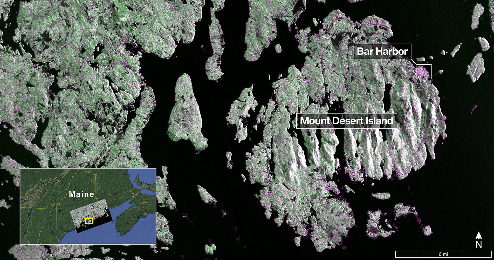
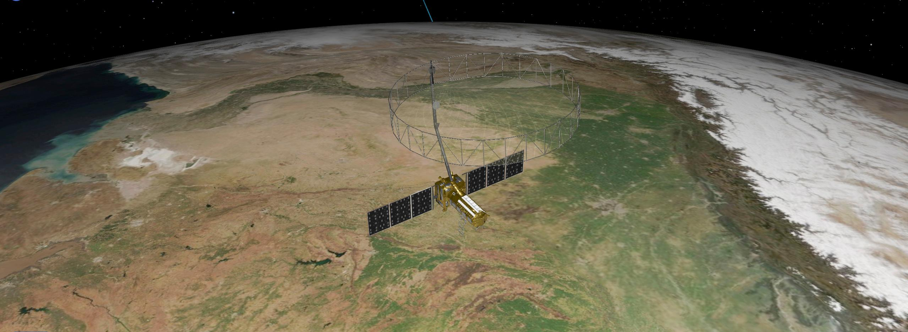
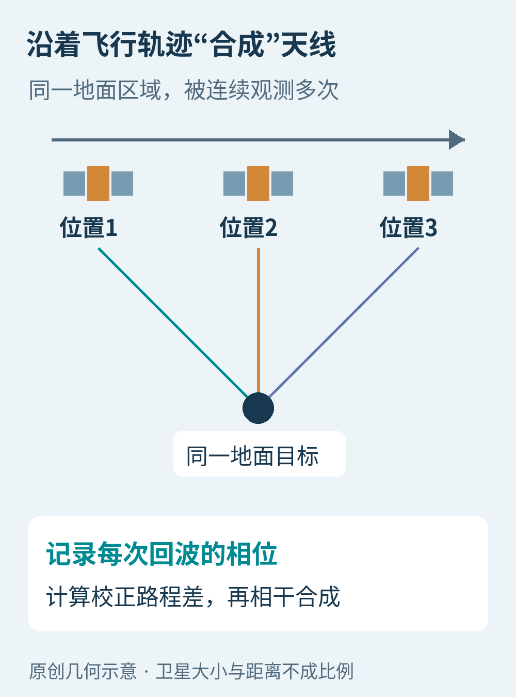
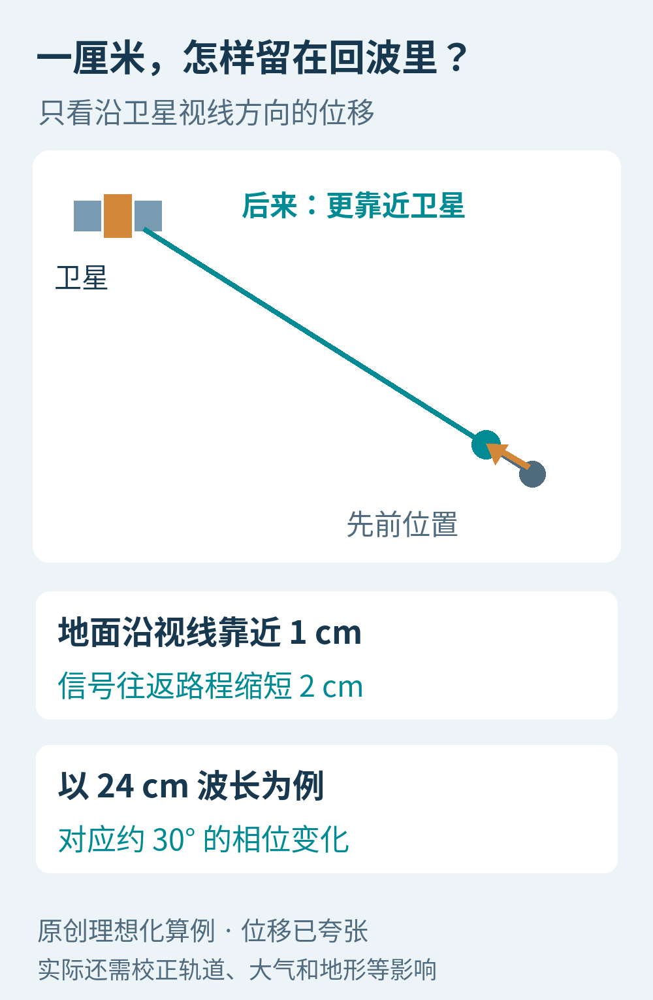
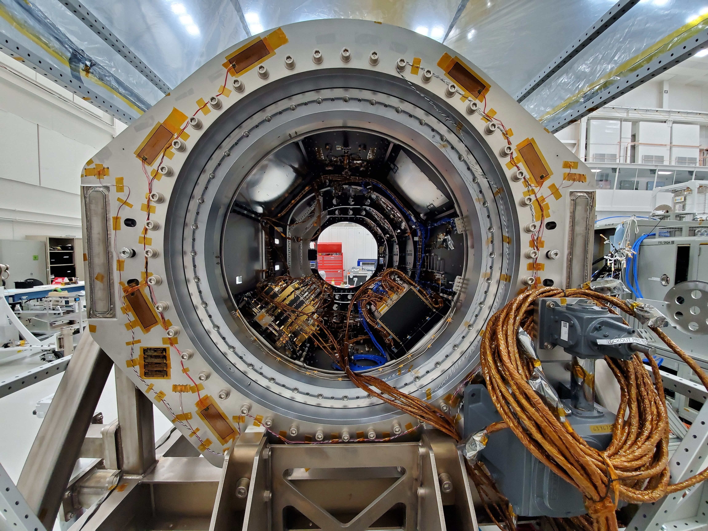
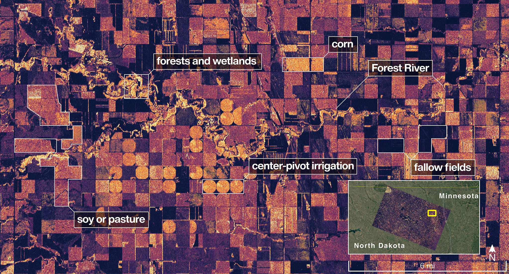
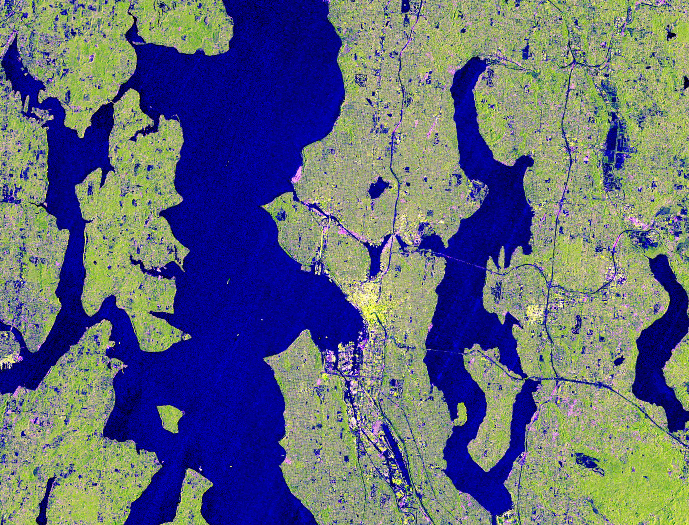

# 地面只挪了一厘米，七百多公里外的卫星怎么看见？

这张缅因州海岸图，有一种不太像风景照的颜色：树林泛绿，城镇和一些规则表面泛着洋红，水面接近黑色。

它来自NISAR，一颗由NASA与印度空间研究组织ISRO合作研制的雷达卫星。数据取得于2025年8月21日，NASA/JPL在9月25日公布。那时，卫星仍处于发射后的调试阶段。[1](https://www.jpl.nasa.gov/news/nasa-isro-satellite-sends-first-radar-images-of-earths-surface/)

Mount Desert Island位于美国缅因州海岸。左下角是定位图，右侧标出Bar Harbor。颜色用来表达雷达回波差异，并非人眼看到的自然颜色。Credit: NASA/JPL-Caltech。

如果把它只当作一颗“拍得更清楚”的卫星，就会错过更有意思的部分：NISAR还要比较同一片地面在不同时间的变化，尝试量出肉眼很难察觉的移动。

问题来了：一张图连路边的小物件都未必分得开，怎么可能测出地面只挪了一厘米？答案藏在雷达回波里一种普通照片没有保留下来的信息：相位。

## 它先向地球发出信号，再听回声

普通相机主要接收外界已经存在的光。成像雷达则主动发出电磁波，记录信号多久回来、回来多少，以及返回波形处在振荡周期的哪个位置。[2](https://science.nasa.gov/mission/nisar/get-to-know-sar/)

回波的时间可以帮助判断距离；强弱则与表面几何、粗糙程度、水分和材料性质等有关。平静水面有时像一面斜放的镜子，把大部分能量反射到别处，卫星收到的回波就弱。粗糙地表可能把更多能量散回卫星方向。

因此，雷达图里的“亮”和“暗”，不能直接翻译成我们日常看到的浅色和深色。图里的一块紫色，也不等于现实中真的长着紫色树木。

它的另一项好处是不用等太阳照亮地面。NISAR使用的微波能够穿过云层，白天、夜间和多云条件下都可以观测。[3](https://www.jpl.nasa.gov/press-kits/nisar/mission-overview/science/) 对经常被云遮住的湿地、山地和热带地区，这能补上光学观测的时间缺口。

但“能穿过云”不是万能透视。它不会像科幻设备那样，看清地下每条管道或房间里每个人。信号能与哪些物体相互作用、能穿透多深，取决于波长、介质、水分和结构。[2](https://science.nasa.gov/mission/nisar/get-to-know-sar/)[3](https://www.jpl.nasa.gov/press-kits/nisar/mission-overview/science/)

## 卫星上那面大圆盘，还不够大吗？

NISAR有一面直径约12米的网状天线反射器。展开后，它比卫星主体显眼得多。[1](https://www.jpl.nasa.gov/news/nasa-isro-satellite-sends-first-radar-images-of-earths-surface/)

NASA/JPL-Caltech于2025年3月发布的艺术概念图，表现反射器、支撑臂与太阳能板的相对布置。不是另一颗卫星拍到的在轨实照。[4](https://science.nasa.gov/photojournal/nisar-in-orbit-over-northeastern-india-artists-concept/)

对于雷达来说，要把相邻方向上的东西分得清，天线尺寸很重要。可卫星离地面很远，能装进火箭的天线又有限；只凭一副真实天线的瞬时观察，分辨能力仍受限制。

合成孔径雷达SAR利用了卫星正在运动这一点。卫星沿轨道飞行，同一个地面区域会落进多次雷达照射范围。每次位置略有不同，回波的路程也不同。

如果把这些回波直接叠起来，它们可能互相抵消。处理系统需要根据卫星运动和目标几何，校正路程带来的相位变化，再把有关信号相干地组合。这样，就能在飞行方向上获得相当于更长观测孔径的效果。[2](https://science.nasa.gov/mission/nisar/get-to-know-sar/)

本文原创原理图。三个图标表示同一颗卫星先后经过的位置，不是三颗卫星编队。连续回波远不止三次；距离和天线大小未按比例。

“合成”不是凭空把模糊照片锐化，也不是让AI猜出地面纹理。它利用的是已经测到的多次回波和明确的波动规律。天线并没有真的伸长，长出来的是可以组合使用的观测信息。

## 分开两个物体，和量出一个区域移动，是两回事

图像分辨率问的是：地面两个靠得很近的目标，能不能在图里分开？

形变测量问的则是：同一个稳定区域，这一次返回的波，相比上一次有了怎样的相位变化？

这两个问题需要的信息不同。就像你未必能看清远处钟表的细小花纹，却仍可能准确比较它连续两次滴答的时间。这个比喻只说明“辨认细节”和“比较变化”不是同一件事，不是说雷达在听声音。

电磁波有波峰、波谷，周期性地振荡。相位可以理解成一只不断转圈的指针：此刻转到了哪一个角度。地面与卫星之间的距离变化，会改变信号往返路程，进而改变收到回波时这根“指针”的位置。[5](https://science.nasa.gov/mission/nisar/interferometry/)、[5·2](https://assets.science.nasa.gov/content/dam/science/missions/nisar/nisar-jpl/pdf/NISAR_FINAL_9-6-19.pdf)

做一个理想化算例：如果地面沿卫星视线方向靠近1厘米，信号来回走的路就短了2厘米。以约24厘米的波长计算，这是一个完整波长的十二分之一，对应约30度的相位变化。

本文原创示意与算例，位移已夸张。这里只解释几何关系，不表示任意地面单个像素都能直接获得1厘米精度；真实测量还要处理噪声、地形、轨道和传播环境等影响。

将同一区域不同时间的SAR数据进行干涉处理，就是InSAR。那些常见的彩虹条纹图，通常是在展示相位差，而不是给地面“染色”。[5](https://science.nasa.gov/mission/nisar/interferometry/)、[5·2](https://assets.science.nasa.gov/content/dam/science/missions/nisar/nisar-jpl/pdf/NISAR_FINAL_9-6-19.pdf)

还有一个小陷阱：指针转完一圈，会回到原位。单靠一个相位值，不能直接知道它总共转了几圈。研究者需要结合空间上的连续性、时间序列和其他信息，处理这种周期性歧义；变化过大、回波失去相关性时，也可能无法可靠恢复结果。

## 它看到的是朝自己靠近，还是竖直下沉？

雷达首先敏感的是视线方向上的距离变化。这个方向通常斜着指向地面，不是竖直向下。

一片地面向上抬升，可能让它更靠近卫星；地面水平移动，也可能产生类似的距离变化。仅凭一个观测方向，不能自动把所有位移都解释成“下沉了多少”。结合升轨、降轨及地面定位等资料，才更有机会约束不同方向的运动。[5](https://science.nasa.gov/mission/nisar/interferometry/)、[5·2](https://assets.science.nasa.gov/content/dam/science/missions/nisar/nisar-jpl/pdf/NISAR_FINAL_9-6-19.pdf)[6](https://nisar.jpl.nasa.gov/mission/observation-strategy/)、[6·2](https://science.nasa.gov/mission/nisar/applications/)

空气也会影响传播。水汽变化、电离层扰动、轨道估计和地形残差，都可能在相位里留下痕迹。研究者看到一片颜色变化，首先要判断它是不是目标真的动了，而不是急着给出结论。

植被随风摇动、农田收割、积雪状态改变，也可能让前后两次回波难以保持相干。这并不意味着这些地区完全没有信息，只是不能照搬稳定裸地的处理方式。

所以，所谓“厘米级变化”，说的是在合适观测与处理条件下的测量能力，不能等同于全天候、全球每个点、每一次经过都保证厘米级结果。

## 两种波长，给地表提不同的问题

NISAR搭载L波段和S波段两套雷达。当前NASA任务页给出的波长分别约24厘米和9.4厘米；两套仪器来自NASA和ISRO，使用共同的反射器。[3](https://www.jpl.nasa.gov/press-kits/nisar/mission-overview/science/)[7](https://science.nasa.gov/mission/nisar/)、[7·2](https://hyp3-docs.asf.alaska.edu/nisar-docs/availability-overview/)

波长不同，和地物相互作用的方式就会不同。较长的L波段能够穿过部分树冠，与较粗的枝干以及下方表面相互作用；S波段对较小的植被结构和某些积雪水分变化提供互补信息。[3](https://www.jpl.nasa.gov/press-kits/nisar/mission-overview/science/)

NASA任务官网提供的雷达载荷洁净室照片。它展示真实硬件与连接结构，并非概念渲染；不能仅凭这一个视角辨认每条线缆的功能。Credit: NASA/JPL-Caltech。[7](https://science.nasa.gov/mission/nisar/)、[7·2](https://hyp3-docs.asf.alaska.edu/nisar-docs/availability-overview/)

这类似于观察同一个人时，既记录外形，也测量体温：多一种测量方式，增加的是可互相补充的线索，不是保证所有问题自动得到答案。遥感研究仍需要模型、地面样本和独立验证。

2025年8月23日的L波段观测，9月25日发布。图中标出Forest River附近的湿地、树林、不同农田，以及圆形中心支轴灌溉地块。颜色用于突出回波差异，不是玉米、大豆的自然颜色，也不是单凭颜色就能确定作物种类。Credit: NASA/JPL-Caltech。[1](https://www.jpl.nasa.gov/news/nasa-isro-satellite-sends-first-radar-images-of-earths-surface/)

对农业而言，重复观测有机会帮助追踪作物结构、生长与土壤湿度的变化；对湿地和森林，则能补充积水、植被结构等信息。这里最有价值的往往不是一张孤立的漂亮图，而是同一片区域在不同时间的可比较记录。[3](https://www.jpl.nasa.gov/press-kits/nisar/mission-overview/science/)

## 为什么要一遍遍经过同一个地方？

监测缓慢沉降，需要知道它有没有持续发生；研究冰川运动，需要看它的变化而非一张静态轮廓；在地震或火山活动之后，前后对比可以帮助识别地表哪里发生了变化。[6](https://nisar.jpl.nasa.gov/mission/observation-strategy/)、[6·2](https://science.nasa.gov/mission/nisar/applications/)

NISAR采用约12天的重复轨道周期，为重复观测提供稳定框架；升轨、降轨从不同几何看地面，具体覆盖还取决于纬度、观测计划与雷达工作模式。[1](https://www.jpl.nasa.gov/news/nasa-isro-satellite-sends-first-radar-images-of-earths-surface/)[6](https://nisar.jpl.nasa.gov/mission/observation-strategy/)、[6·2](https://science.nasa.gov/mission/nisar/applications/) 这不意味着每隔十二天，人们才第一次知道哪里发生了灾害，也不意味着每个地点始终有同样数量的有效观测。

它更像一套持续积累的地表记录，与地震台网、地面测量、气象资料和其他卫星协同。灾后观察地表变形有现实价值；据此直接宣称可以准确预报下一次地震的时间、地点和规模，则跨过了现有证据。

## 从第一张图，到真正可以使用的数据

NISAR于2025年7月30日发射。2025年8月取得首批雷达图像，属于调试阶段；第一张图证明仪器开始返回有意义的观测，却不能独自证明全部科学产品已经验证完成。[1](https://www.jpl.nasa.gov/news/nasa-isro-satellite-sends-first-radar-images-of-earths-surface/)[7](https://science.nasa.gov/mission/nisar/)、[7·2](https://hyp3-docs.asf.alaska.edu/nisar-docs/availability-overview/)

截至2026年10月9日查核，NASA官网将任务标为科学阶段，并写明：L波段provisional数据产品已于2026年7月20日发布，产品完成校准，但只在全球有限地点进行过验证。官网也提供ISRO经Bhoonidhi门户发布S波段数据的信息。[7](https://science.nasa.gov/mission/nisar/)、[7·2](https://hyp3-docs.asf.alaska.edu/nisar-docs/availability-overview/)

西雅图地区的伪彩色雷达影像，普吉特海湾与华盛顿湖等水体和城市区域形成对比。官网用它引导数据发布信息；本文不把数据发布日期当作这张图的采集日期。[7](https://science.nasa.gov/mission/nisar/)、[7·2](https://hyp3-docs.asf.alaska.edu/nisar-docs/availability-overview/)

“校准”和“验证”听起来接近，却回答不同的问题。校准是把仪器的读数放到一致、可解释的尺度上；验证还要与可信参考观测比较，检查不同地点、条件下的产品到底表现怎样。有限地点通过检查，不等于所有地貌、所有季节都已经得到同等充分的验证。

因此，想使用这些开放资料的人，需要同时阅读产品说明、已知问题与质量信息，而不是把“已发布”理解为没有任何限制。普通读者也可以用这个尺度判断新闻：图片是哪天取得的？数据处理到了哪一步？报道说的是已实现结果，还是任务希望达到的能力？

地面的一厘米，并不会在普通地图上突然变成一个清晰的小格子。它是通过反复发射与接收、保留相位、比较时间，再排除其他影响，才逐渐成为可以解释的测量。

这颗卫星的特别之处，正是在同一片大地看似没变的时候，还愿意再看一遍。

图片来源：[首批雷达图](https://www.jpl.nasa.gov/news/nasa-isro-satellite-sends-first-radar-images-of-earths-surface/)、[轨道概念图](https://science.nasa.gov/photojournal/nisar-in-orbit-over-northeastern-india-artists-concept/)及[任务官网](https://science.nasa.gov/mission/nisar/)，NASA/JPL-Caltech；中文示意为本文原创。
