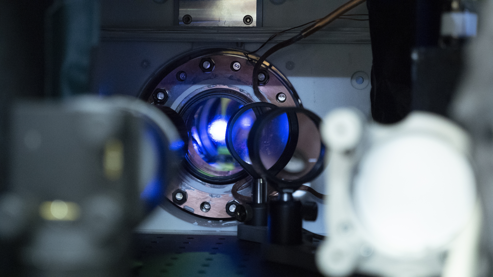
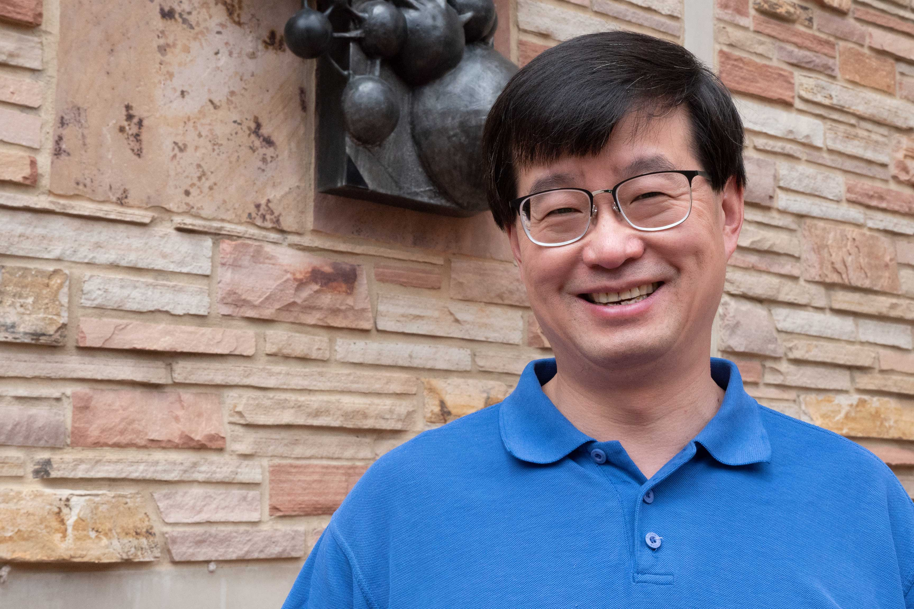
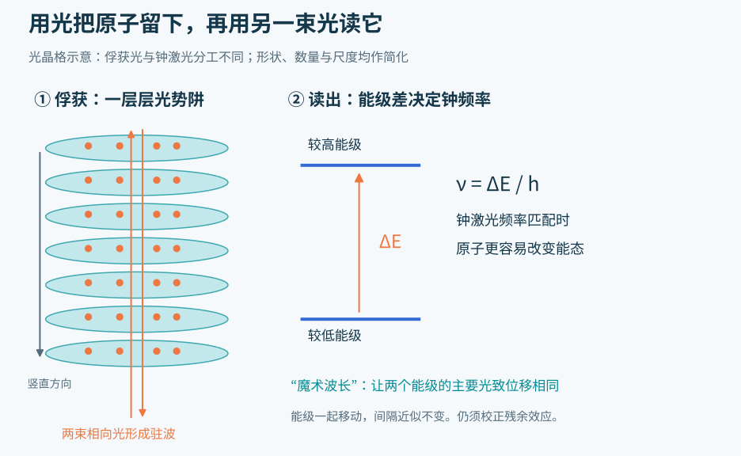
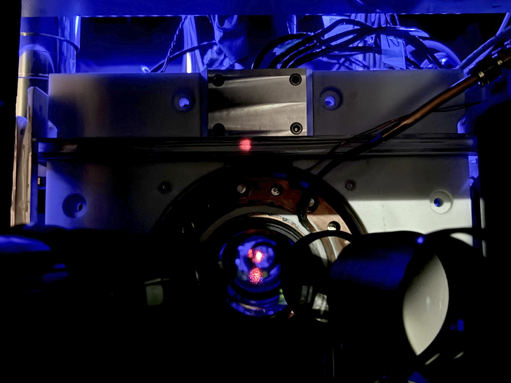
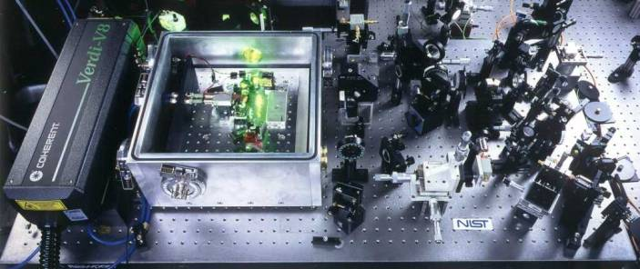
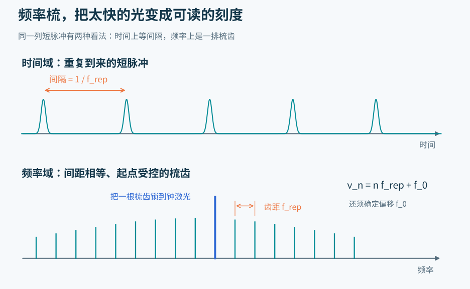
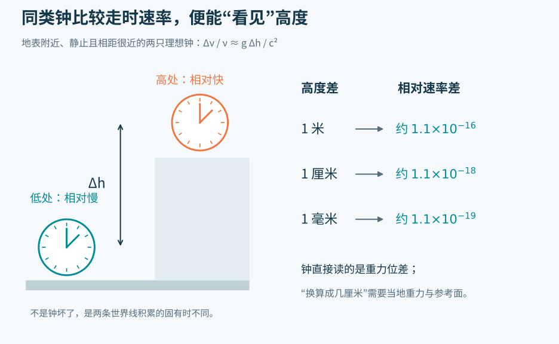
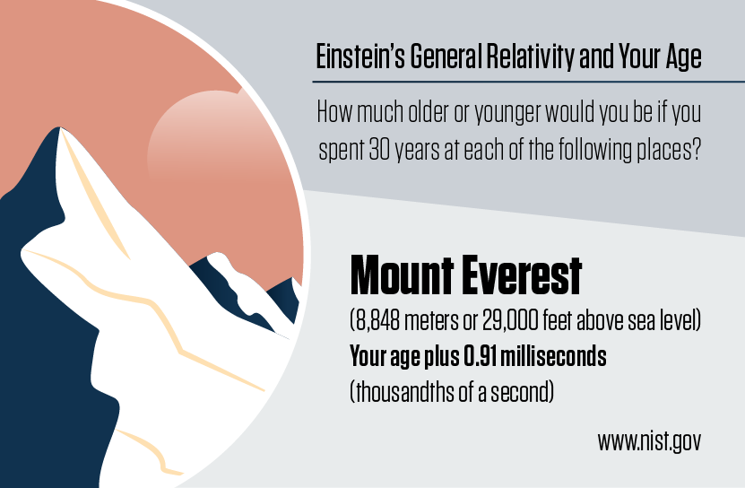
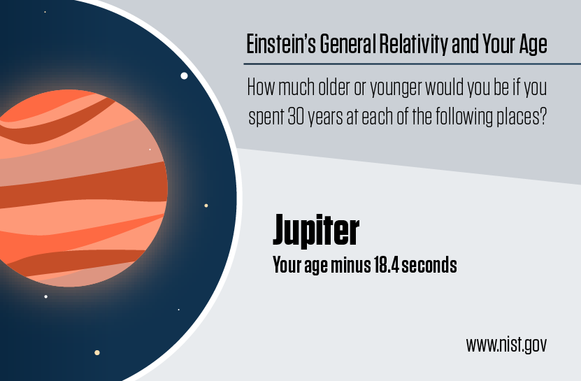
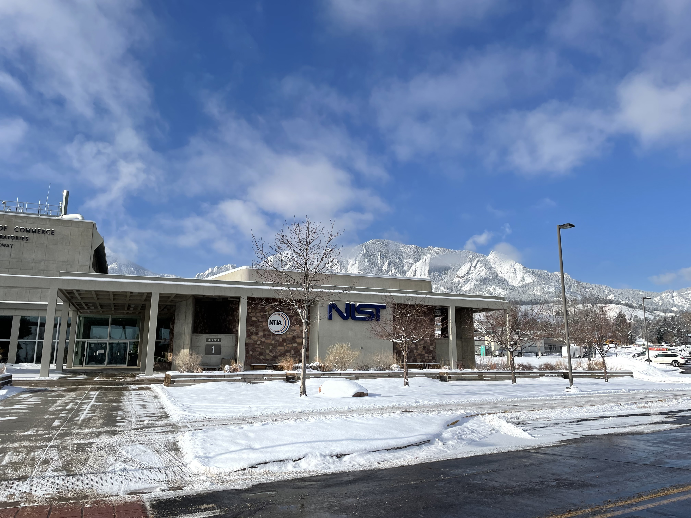

# 光学原子钟究竟在数什么？当钟足够准，时间就成了一把测高尺

把一只钟抬高一毫米，它会走得快一点。

这里的“快”不是桌面倾斜，也不是零件受了震动。对地表附近静止的钟来说，较高的位置具有较高的重力位，时间本来就会相对流逝得快一点。通常，这点差别小到可以忽略；光学原子钟却已经能把它从噪声里找出来。

原子钟是一种以原子的特定能量跃迁为参照、校准振荡频率的计时装置。2022年2月16日，JILA团队公布的一项实验把这种装置推到了一个有趣的尺度：在同一团毫米大小的锶原子中，上部与下部的“钟”走出了可测量的差异。[1](https://www.nist.gov/news-events/news/2022/02/jila-atomic-clocks-measure-einsteins-general-relativity-millimeter-scale)[2](https://www.nature.com/articles/s41586-021-04349-7)、[2·2](https://arxiv.org/abs/2109.12238)

*透过实验装置的圆形窗口，可以看到来自锶原子样品的蓝色亮光。能区分样品上下部分的走时差，不意味着照片中能直接看到一排钟。*

这一结果最值得讲的地方，不是“多少亿年才差一秒”。它把三个原本分开的东西接在了一起：原子提供可重复的频率，激光把这个频率带出来，相对论则把频率差变成空间中的信息。

顺着这条线看下去，一个问题会自然出现：如果光每秒振荡几百万亿次，我们究竟怎样数它？又为什么数得足够好之后，钟会突然变成测量高度的仪器？

## 秒不是最小格子，原子也不是不停跳动的小秒针

先看钟表最普通的工作：找一种尽可能稳定的周期运动，累计它发生了多少次。

摆钟用钟摆，石英钟用晶体振动。原子钟也需要振荡，但它多了一位严格的“校音师”：原子。相同种类、相同量子态的原子，在理想条件下具有可重复的能级结构，不必依靠工厂把每个零件磨得完全一样。

能级可以先理解为原子允许具有的几档能量。两档之间的能量差，决定了能够驱动这次跃迁的电磁波频率。光子的能量与频率成正比，关系是 ν = ΔE / h。其中ν是频率，ΔE是能级差，h是普朗克常数。这个式子要说的是：能级差越大，对应的频率越高。

这并不表示一个原子每过一个光波周期，就完整地“跳上去再跳下来”一次。实验人员让电磁波与原子相互作用，观察有多少原子改变了能态，再据此判断波的频率偏高还是偏低。**原子提供参照，被持续调准的是振荡器；计时所累计的是振荡的周期或相位。**

今天国际单位制中的秒，仍以铯-133原子的一种微波跃迁定义：把它在不受扰动条件下的频率固定为每秒9,192,631,770个周期。反过来说，这么多个周期定义了一秒。[3](https://www.bipm.org/en/history-si/second)、[3·2](https://www.nist.gov/how-do-you-measure-it/how-do-you-measure-second)

这个整数没有测量误差，因为它是定义的一部分。有误差的是现实实验：原子在动，周围有磁场，装置有温度，测量存在噪声。实验室的任务，是让实际装置尽可能接近定义所指的理想条件，并说明离它还可能差多少。

因此，“比一秒更准确”并不是找到了一种比秒更小、更神秘的单位。一秒本来就可以继续细分。真正的进步，是把“一秒有多长”实现得更稳定、更可复现。

## 从微波换成光，为什么有用？

锶-87光钟采用的一条钟跃迁，对应约698纳米的红光，频率约429太赫兹，也就是每秒约429万亿个周期。它大约是铯钟定义频率的4.7万倍。[4](https://www.bipm.org/en/publications/mises-en-pratique/standard-frequencies-second)

可以把这看作换了一把刻度更密的尺子：相同一段时间里，可利用的振荡周期更多。但刻度密，并不自动保证测量准确。一把会热胀冷缩的精密尺，仍可能把长度量错。光钟必须同时保住激光的稳定、原子的安静，以及读出信号的可靠性。

JILA位于美国科罗拉多州博尔德，是美国国家标准与技术研究院（NIST）和科罗拉多大学博尔德分校共同运营的研究机构。物理学家叶军（Jun Ye）与同事长期研究的，就是如何让这些环节一起工作。

*叶军（Jun Ye）。他的研究把超冷原子、稳定激光和精密频率测量连接在一起。*

NIST在2023年的人物报道里，把叶军的科学兴趣追溯到制造和改进测量工具。他早年既做电子电路，也做光学实验，后来参与发展频率梳。这个经历与光钟的特点很合拍：关键往往不是一个孤立的新零件，而是把一整套测量工具磨到能够互相信任。[5](https://www.nist.gov/news-events/news/2023/06/jun-ye-timely-profile)

光钟也不是一种唯一的机器。有人把单个带电原子关在电磁陷阱里，制造离子钟；有人同时控制大量中性原子，制造光晶格钟。这里要追踪的是第二条路线：为什么一群原子可以共同成为一把更稳的尺子？

## 用光造一个架子，还要让架子别碰坏刻度

自由飞行的原子不方便拿来计时。它们会离开观测区域；运动还会改变实验室看到的频率。激光冷却能减慢原子运动，光晶格则进一步把它们限制在一系列位置附近。[6](https://www.nist.gov/atomic-clocks/how-atomic-clocks-work/optical-clocks-future-time)

“光晶格”不是一张实体的网。相向传播的激光形成驻波，空间中的光强有规律地起伏。原子与光场相互作用后，会感受到一系列势阱，像小球待在碗底附近。

对2022年的实验，可以把这一维晶格想成一叠水平的薄煎饼：每一层在竖直方向上很薄，许多层叠起来，容纳一团毫米尺度的原子。真实原子当然不是画在格子里的彩色珠子；这种图像只是帮助我们理解它们受到怎样的空间约束。

*左边的光势阱负责限制运动，右边的钟激光负责探测能级差。俘获原子的光，不必与读钟的光具有相同频率。*

这里有个难题：用光控制原子，光本身又会推动原子的能级。架子搭得很稳，却把尺上的刻度挪了位置。

解决办法之一叫“魔术波长”。在合适的俘获光波长附近，两个钟能级受到的主要光致位移可以相同。两条线一起挪，线与线的间距便近似不变，钟跃迁的频率也就较少受到俘获光强的影响。[6](https://www.nist.gov/atomic-clocks/how-atomic-clocks-work/optical-clocks-future-time)[7](https://www.nist.gov/optical-physics-and-communications/optical-lattices)

这不是把所有扰动都施了魔法清零。更高阶的光致位移、原子间相互作用以及周围环境，仍然需要测量和校正。选择波长、控制光强、降低密度、保持温度均匀，都是这把“尺子”能够可信的组成部分。

*这是NIST于2024年公开的光晶格钟装置照片，用于展示真空窗口与周围光学结构。图中红点是产生俘获光的激光反射，不是一颗被相机放大的原子；也不是上文2022年实验的同一张现场照。*

现实装置里，大量看似与“数秒”无关的东西都不可少：超高真空减少原子与残余气体的碰撞，光学系统让激光足够稳定，探测系统读出原子状态，反馈系统再把激光调回正确的位置。[8](https://www.nist.gov/image/atomic-clock-optical-lattice)

甚至房间里没有发光的物体也在参与。温暖的器件会发出热辐射，这些电磁场同样可以移动原子能级。读到极小的频率变化以后，研究者必须回答：这是时间的变化，还是周围某个窗口比预想的温暖了一点？

## 每秒429万亿次，电子电路怎么接得住？

现在，原子帮助我们调准了一束钟激光。但普通电子计数器无法直接追着可见光的每一次电场振荡跑。

频率梳在这里充当一套光学“齿轮”。它不是把激光拍成慢动作视频，而是建立光学频率与较低、可由电子设备测量的频率之间的严格关系。[9](https://www.nist.gov/programs-projects/femtosecond-laser-frequency-combs-optical-clocks)

*频率梳需要激光、镜片与控制电子学共同工作。这是NIST频率梳研究项目公布的设备照片；“梳子”指输出光的频谱结构，不是桌面上某个梳状零件。*

一种常见的频率梳来自锁模激光器。它发出一列等间隔、非常短的光脉冲。从时间上看，脉冲一个接一个；换到频率上看，输出不是单一颜色，而是一排间隔相等的窄谱线，形状像梳齿。

这两种看法属于同一束光。时间上重复的节奏，决定频率上梳齿之间的距离。

*梳齿间距由脉冲重复频率 fᵣₑₚ 决定。知道齿距还不够，还必须确定整排梳齿的共同偏移 f₀，才能知道某一根齿的绝对频率。*

用一个很短的式子，就能看出它为什么好用：第 n 根梳齿的频率，是 n × fᵣₑₚ + f₀。n 是梳齿编号；fᵣₑₚ 是脉冲重复频率；f₀ 是整把梳子相对于零频率的偏移。[9](https://www.nist.gov/programs-projects/femtosecond-laser-frequency-combs-optical-clocks)

把钟激光与邻近梳齿叠加，还可以测出两者之间较慢的拍频。就像两种很接近的音调叠在一起，会出现缓慢起伏，光学上的小频差也能被转到电子设备容易读出的范围。只要梳齿编号、间距、偏移和拍频都确定，便可以还原那束快得无法直接数的光。

工作在光钟里时，也可以反过来，把频率梳锁定到原子校准过的钟激光，再从脉冲重复信号中得到较低频的输出。原子负责给准星，激光负责承载稳定振荡，频率梳负责在不同频率尺度之间传递这份稳定。

它没有凭空提高原子的准确性。它解决的是：**原子给出的光学刻度，怎样才能真正接到电子世界里。**

## “很准”究竟是哪一种准？

新闻中常把原子钟写成“几百亿年才差一秒”。这是把一个极小的相对频率偏差乘以很长的时间，换成容易想象的累计误差；并不是实验室真的等了几百亿年。

这种表达还容易把两件事揉在一起。

第一件是稳定性：反复测量时，结果抖得有多厉害？随机噪声越小，就越容易在有限时间内看见微弱信号。许多随机噪声可以通过延长测量、平均更多数据来压低。

第二件是系统性不确定度：已知影响因素校正之后，结果还可能整体偏离多少？一只钟可以每次都给出很接近的数，却因为温度估计有偏差而一直快一点。重复得再整齐，也不能自动解决这种偏差。

还要问清楚：测的是一只钟的完整表现，还是两部分之间的差？

2022年的毫米尺度实验利用了约10万个超冷锶原子。它不是把两套庞大的钟分别搬到相距一毫米的台阶上，而是成像读取同一团原子在不同位置的响应，让这些区域进行同步比较。[1](https://www.nist.gov/news-events/news/2022/02/jila-atomic-clocks-measure-einsteins-general-relativity-millimeter-scale)

这么做有一个很实用的优势：两边共同经历的激光噪声，可以在比较中大幅抵消。研究者不必先解决全部“绝对时间”的问题，才有机会发现上下部分的细微差别。

团队还把光学量子相干时间延长到约37秒。这里的“相干”可以理解为原子内部用于比较的量子相位关系能够保持多久；37秒不是说原子先后整齐地跳了37次，也不是整台钟只能工作37秒。[1](https://www.nist.gov/news-events/news/2022/02/jila-atomic-clocks-measure-einsteins-general-relativity-millimeter-scale)[2](https://www.nature.com/articles/s41586-021-04349-7)、[2·2](https://arxiv.org/abs/2109.12238)

论文报告，在两块区域间的同步比较中，累计92小时的数据得到了7.6 × 10⁻²¹的相对频率测量不确定度。这个极小数字属于特定差分测量，不能直接贴成“整台钟相对于国际标准秒的绝对准确度”。[2](https://www.nature.com/articles/s41586-021-04349-7)、[2·2](https://arxiv.org/abs/2109.12238)

原子钟最精彩的进步，往往藏在这些限定词里：控制什么、消掉什么、比较什么，以及还剩下什么。

## 当上下两层原子真的走得不一样

把干扰压低以后，实验看到的是随竖直位置变化的频率梯度，与广义相对论预言的引力红移一致。毫米尺度对应的相对差异约为10⁻¹⁹。[1](https://www.nist.gov/news-events/news/2022/02/jila-atomic-clocks-measure-einsteins-general-relativity-millimeter-scale)[2](https://www.nature.com/articles/s41586-021-04349-7)、[2·2](https://arxiv.org/abs/2109.12238)

要建立直觉，可以先采用一个地表附近的近似。两只同类钟保持静止、相距不远，高度相差 Δh 时：

**相对走时速率差 ≈ g × Δh / c²。**

这里 g 是当地重力加速度，c 是光速。取 g 约9.8米/秒²，就能估算：升高1米，走时速率相对快约1.1 × 10⁻¹⁶；升高1厘米，约快1.1 × 10⁻¹⁸；升高1毫米，约快1.1 × 10⁻¹⁹。[10](https://tf.nist.gov/general/pdf/2963.pdf)

*这张图给出地表附近的理论数量级，不是复刻某次实验的数据。相同的频率比较，一旦知道重力条件，就可以反推高度差。*

“相对”二字很重要。站在高处的人，并不会觉得自己的秒突然变短、动作突然变快。每只钟在当地都正常运行。差别在把两处的信号放在一起比较，或把两条路径上累计的时间进行比较时显现出来。

也不能把这个公式粗略理解成“哪里重力加速度更大，哪里时间就一定更慢”。严格相关的是重力位差。在复杂地形、跨越大距离，或讨论旋转地球上的位置时，要采用完整的重力位、运动状态和参考系描述；地表小高度差只是特别方便的一种情形。

NIST的科普图给了两个尺度更大的例子。按其中只考虑所在星体自身引力、忽略其他天体的简化模型与30年设定，长期待在珠峰高度的人，相对地球海平面约多积累0.91毫秒；木星的例子则约少积累18.4秒。这些是模型下的累计差异示例，不是两次载人实验，也不包含一趟实际旅行的全部运动效应。[11](https://www.nist.gov/education/resources-for-parents%252C-teachers-and-students/einsteins-general-relativity-and-your-age)

*原图采用约8,848米的珠峰高度和30年的停留时间，得到约0.91毫秒的累计差。极小的速率差，需要很长时间才积累成这样的差距。*

*木星示例展示不同引力环境下更大的累计差异。地表使用的 gΔh 近似不能直接拿来跨行星计算。*

毫米实验走的是反方向：不靠极长时间或极大空间差来放大效果，而是把测量做得足够灵敏，让同一小团原子内部也出现可以辨认的差别。

## 钟读到的首先是重力位，之后才是高度

要把光钟变成测量仪器，只需把原本的问题倒过来。

计时时，我们希望不同地点的钟对得上，所以需要知道它们所在位置的重力位差，把相对论效应校正掉。测地时，我们信任经过校正的钟，就可以利用它们剩下的走时差，估计两地重力位之差。

这种方法通常称为相对论测地，或利用钟进行的测地。测地学关心的，不只是地图上的经纬度，也包括地球的形状、重力场，以及我们说“高度”时究竟依附于哪一个参考面。[10](https://tf.nist.gov/general/pdf/2963.pdf)[12](https://www.nist.gov/atomic-clocks/a-powerful-tool-for-science/mapping-earth)

*美国科罗拉多州博尔德的NIST园区，远处是落基山脉前缘。这里展示城市中的计量研究环境；JILA是NIST与当地大学共同运营的另一研究机构，不能把这幢楼认作前述实验的具体实验室。*

山峰、地下的岩石与水，以及地球自转，都提醒我们：地球不是一颗质量均匀的静止圆球。在较远地点之间，要把钟测出的重力位差换成可用的高程，必须配合重力信息和明确的基准，不能只把一个频率数字除以“9.8”就结束。

这个区别很实际。水往哪里流，依赖重力位的高低，不只依赖到地心的几何距离。以精密钟补充现有测地方法，可以为高程基准的连接和校验提供另一种测量途径。[12](https://www.nist.gov/atomic-clocks/a-powerful-tool-for-science/mapping-earth)

但实验室能分辨毫米尺度信号，不代表一台可以随手拎走、随地读数的毫米级“钟尺”已经普及。把它带到野外，仍要面对运输、振动、温度变化、持续运行和信号传递的问题。两地之间的比较链路，也必须足够稳定，否则钟的优秀表现会被传输过程淹没。[12](https://www.nist.gov/atomic-clocks/a-powerful-tool-for-science/mapping-earth)

因此，监测地下水、地壳变化或其他重力位变化，是需要仪器工程、长期观测和地球物理解释共同推进的方向。测到变化，也不等于单凭一只钟就能确定地下发生了什么。

## 为什么还没有直接把“秒”换掉？

既然一些光学频率标准的系统性不确定度已经优于最好的铯喷泉钟，为什么国际标准还坚持用铯？

因为一种新定义必须能被世界各地重复实现。它需要可靠的频率比对、不同实验室之间的一致性、与现行秒的连续性，以及足以支撑真实时间尺度的运行能力。换掉定义，不只是选择一台分数最高的机器。[13](https://www.bipm.org/en/faq-redefinition-second)

光钟之间可以直接比较频率比，检验它们是否一致，未必每次都先绕回铯钟。可是给某个光学频率写上以现行“赫兹”为单位的绝对数值，仍然涉及现行秒的实现。这也是定义与仪器能力出现张力的地方：新的尺子可以比旧尺子更稳定，但换尺的过程仍须保证大家量的是同一段长度。[13](https://www.bipm.org/en/faq-redefinition-second)

截至2026年10月9日，本文查阅的国际计量局路线图仍把2030年视为关键决策节点；是否决定新定义及实施日期，取决于共识和必要条件是否满足，不能写成已经确定在那一年自动切换。[13](https://www.bipm.org/en/faq-redefinition-second)

即使最终采用新的定义，也不是让钟表上的一秒突然变长或变短，而是用更好的物理参照，持续实现与今天相容的同一单位。

回头看那团只有毫米尺度的原子，就能理解这场工作的意义。光钟所数的，是被原子校准过、再通过频率梳传递出来的电磁振荡；它所读出的，却不止是时间间隔。

当仪器的噪声足够低，环境不再只是需要排除的干扰。高度、重力位，以及时空本身的结构，都开始留在读数里。钟变成测高尺，不是它换了一份工作，而是我们终于读懂了它一直在记录的东西。

图片来源：[实验与科普图](https://www.nist.gov/news-events/news/2022/02/jila-atomic-clocks-measure-einsteins-general-relativity-millimeter-scale)，R. Jacobson、N. Hanacek/NIST；[叶军肖像](https://www.nist.gov/news-events/news/2023/06/jun-ye-timely-profile)，Rebecca Jacobson/NIST；[光晶格钟](https://www.nist.gov/image/atomic-clock-optical-lattice)，K. Palubicki/NIST；[频率梳](https://www.nist.gov/programs-projects/femtosecond-laser-frequency-combs-optical-clocks)，NIST；[园区](https://www.nist.gov/image-gallery/boulder-campus-photos)，R. Jacobson/NIST；中文示意为本文原创。
