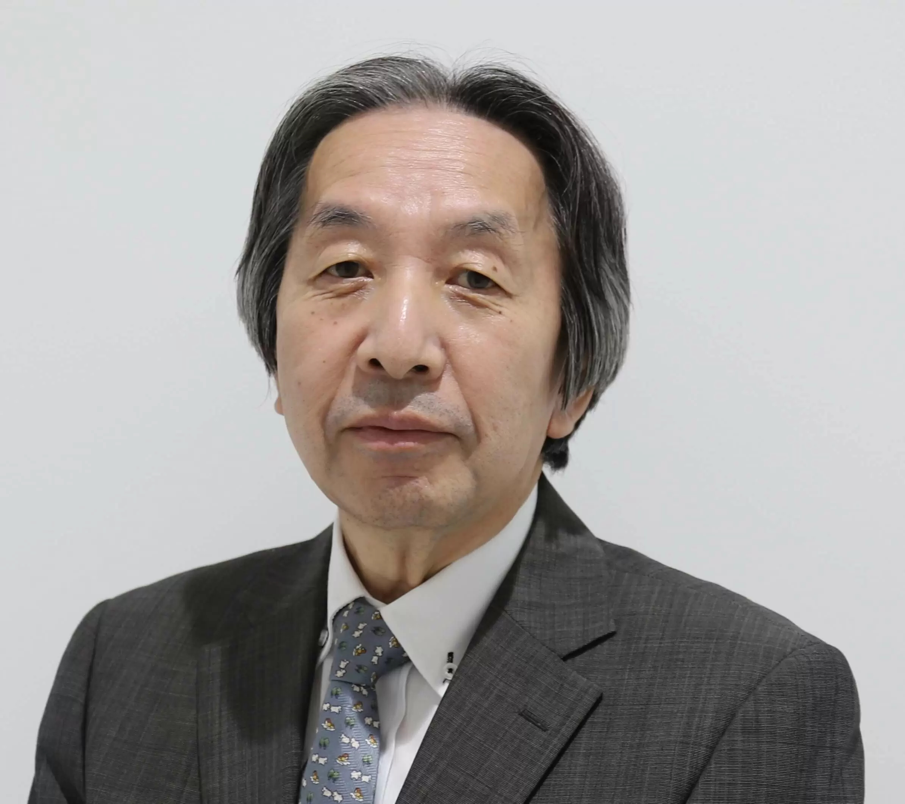
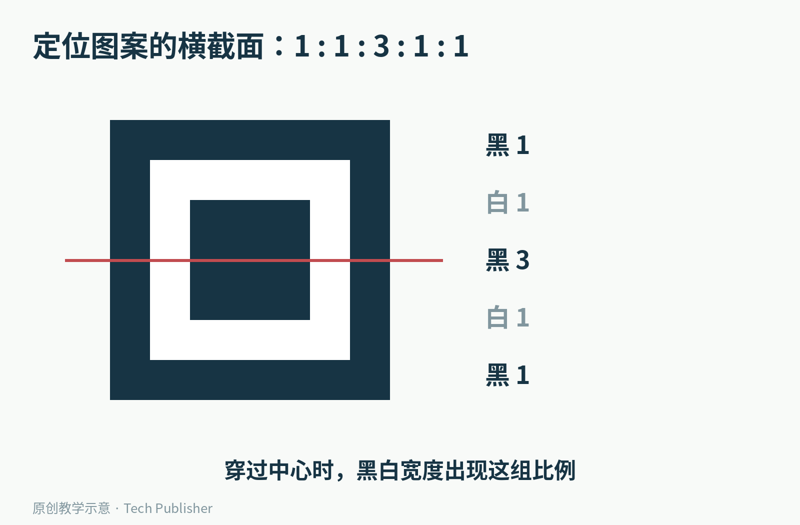
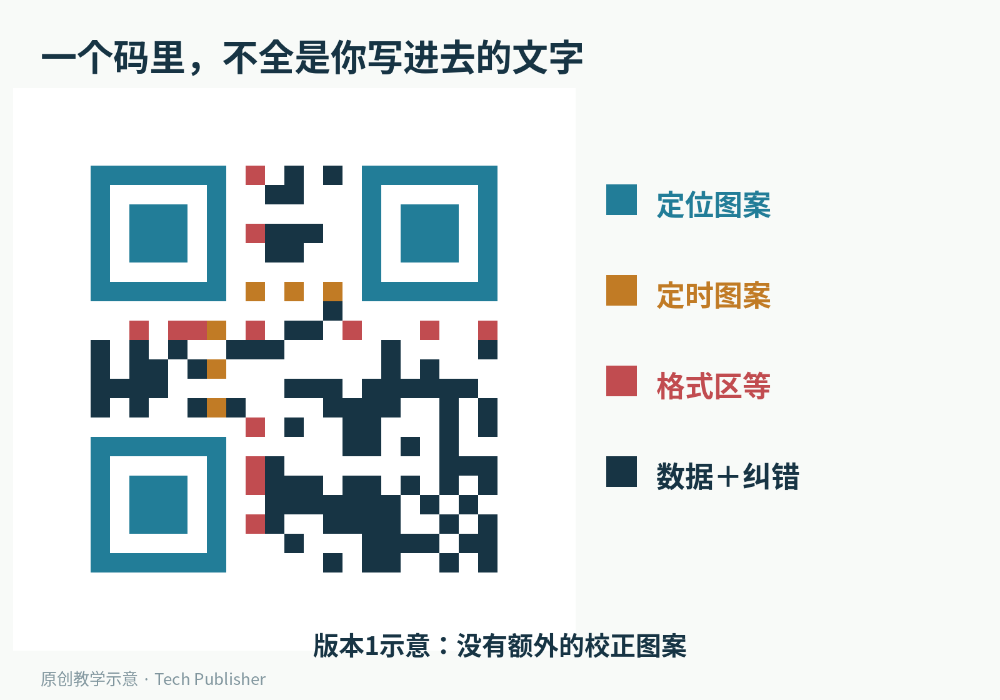
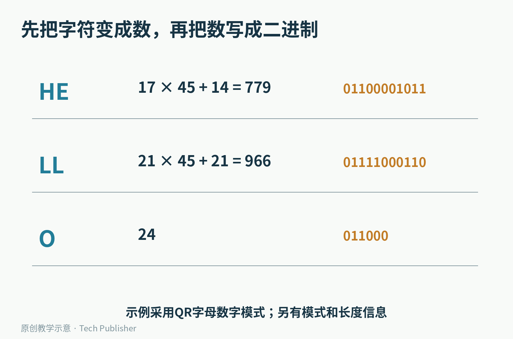
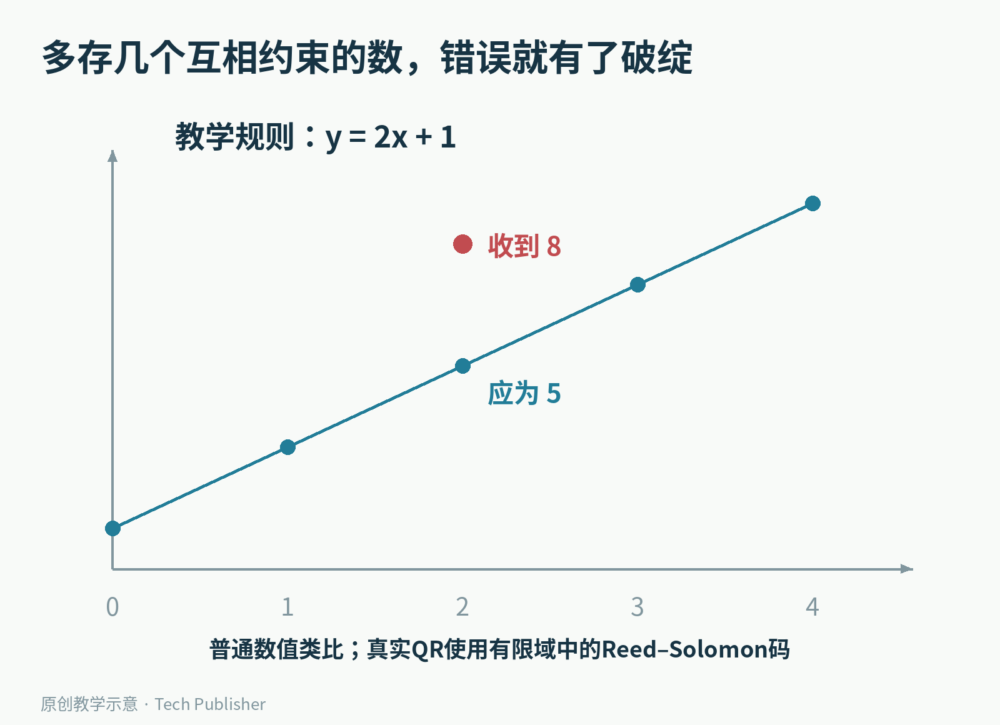
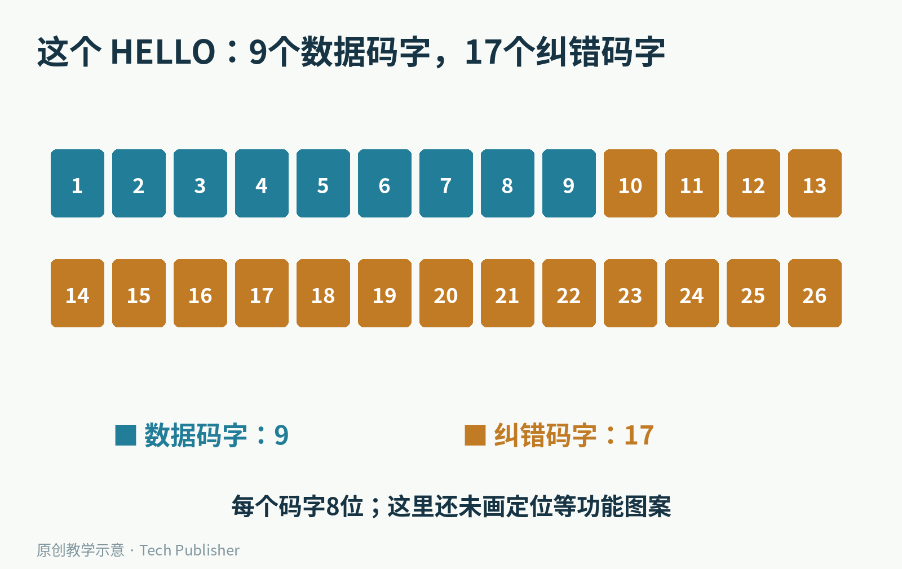
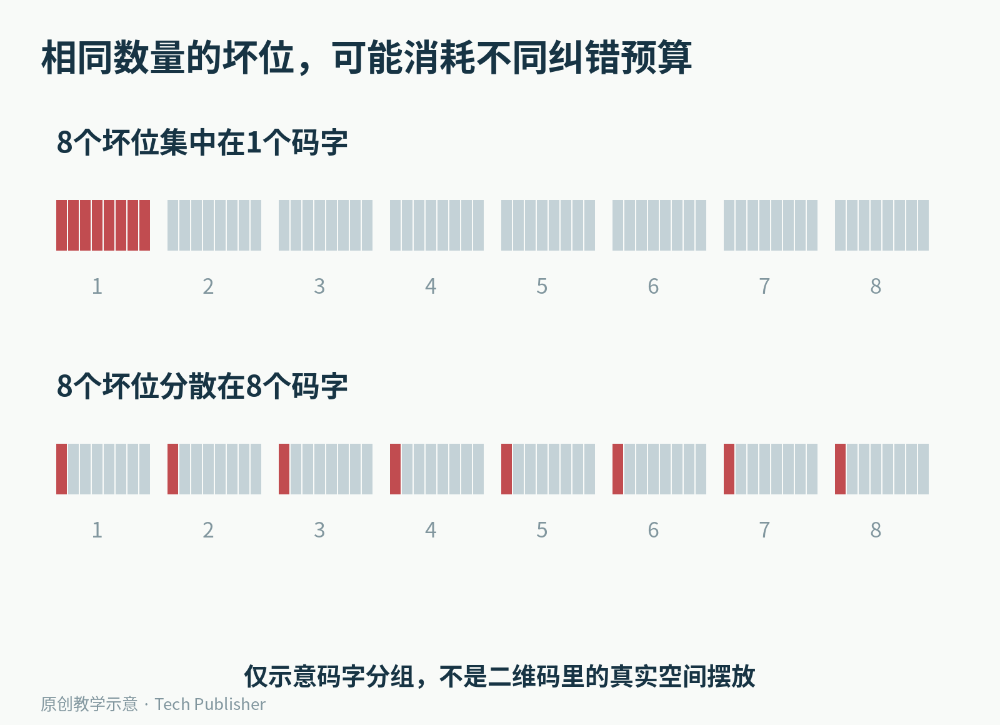
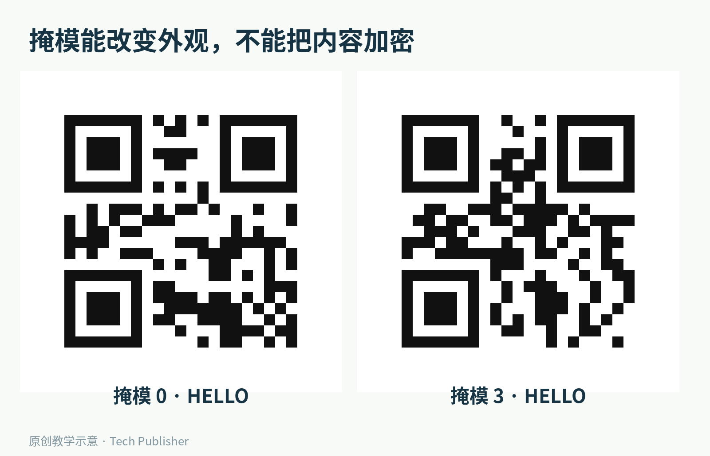

# 二维码被蹭掉一块，手机为什么还能读出来？

纸质票面磨花了，快递标签沾了污渍，手机却仍可能把二维码读出来。这看上去有点像猜字：人能从缺掉一笔的汉字认出原文，机器是不是也在“看图猜意思”？

通常不是。常见的QR二维码在生成时，就提前存入了用来发现和修复错误的信息。损坏以后，读取程序靠这些约束找回内容，而不是临时上网搜一张长得相似的图片。

但这套能力有严格边界。**“最高能恢复约30%”不等于“随便挖掉30%的画面也能扫”。** 要理解这句话，先得看看这张小方格究竟藏了什么。

这个教学二维码只编码纯文本HELLO，不含网址。它采用版本1、H级纠错；原始矩阵为21×21格，外围留有白色空白区。

## 它先解决的，是在一堆杂乱图案里找到自己

QR码并不是专为智能手机发明的。1994年，DENSO当时的相关部门发布QR Code；后来这项业务属于DENSO WAVE。它起初面对的是工业信息读取的需求，后来才进入手机和日常生活。

开发团队的核心人物原昌宏，需要同时解决两件事：放进更多信息，以及读得足够快。二维的黑白格能在横向和纵向一起承载数据，但相机先得知道：图像里的哪一块才是码？它转了多少度？一个小格究竟有多大？

原昌宏。照片来自日本学士院2023年授奖资料；这不是1994年研发现场照片。

看二维码最显眼的三个大方框，它们不是用来装饰的眼睛，而是定位图案。

沿着其中一个方框的中心横切过去，黑、白、黑、白、黑的宽度，呈现1:1:3:1:1的比例。根据DENSO WAVE对研发过程的回顾，团队调查了印刷品里黑白图形的比例，希望找到不容易与普通文字、图案混淆的特征。

中心黑块宽3格，两侧的白带和外框各宽1格。这个比例帮助读取程序在图像中寻找候选定位图案。

三个角都有标记，第四个角没有，于是图案本身就提供了方向信息。读取程序还会结合黑白交替的定时图案、较大版本中的校正图案等，估计网格、处理拍摄角度和变形。

这一步更像“先找出纸张的坐标系”，还没开始理解里面写的内容。定位失败与数据损坏，是两种不同的问题。后面的纠错再强，也不能保证从完全认不出的图案里凭空找到网格。

版本1的功能分区。蓝色帮助定位，黄色提供节奏，红色包含格式信息等，剩余区域承载数据与纠错码字。较大版本还会有额外的校正图案，不能把这幅图套到所有版本上。

## 黑一格白一格，和HELLO之间隔着什么？

二维码不是把字母缩小后印在格子里。它先把内容编码成数字，再把数字表示成二进制，最后把这些位安排到规定的位置。

不同类型的内容，可以选用不同编码模式。全是数字时，不必为每个数字浪费一个完整字节；一组限定的数字、大写字母与符号，也可以用更紧凑的“字母数字模式”。除此之外，还可以采用字节等模式。

以HELLO为例，在字母数字模式的字符表里，H对应17，E对应14。两个字符可以合成一个数：17乘45，再加14，得到779。这个数用11位就能写下。LL也两两组合；最后落单的O另行编码。

这是实际字母数字模式中的三个分组。完整数据前还须注明采用什么模式、字符数是多少，并按规定添加结束与填充信息。

为什么底数是45？因为这个模式的字符表有45种可能。把两位45进制数字合成一个数，就像十进制中的“十位乘10再加个位”；这里的11个二进制位足以容纳45×45种组合。

这些位最终以8位为一组，组成“码字”。在讨论QR码的数据纠错时，码字是一个关键单位。一个码字里坏了1位，或坏了好几位，都可能被算作同一个错误码字；坏位分散到更多码字里，消耗的纠错能力就不同了。

## 备份不必是把原文再抄一遍

最直观的防错办法，是把HELLO重复写三遍，取多数。这样确实能提供冗余，但代价很高，而且并没有充分利用数据之间可以建立的关系。

二维码使用的是Reed–Solomon纠错码。理解它的入口，不必先从一页公式开始：**让额外的信息与原数据形成足够多的约束。只要大多数约束还在，原来的内容就有机会被唯一确定。**

先做一个普通数值的教学类比。假设我们想保存一条直线的规则：y等于2x加1。它真正需要记住的自由参数只有两个，斜率2和截距1。

但我们额外保存五个对应关系：x为0、1、2、3、4时，y分别为1、3、5、7、9。

其中一个数丢了，比如不知道x为2时的y是多少，另外几个正确点仍能确定这条直线，算出丢失的是5。要是那个数没有丢，而是被改成8，事情也并非绝望：其他四个点仍落在同一条直线上，这个错点显得格格不入。

四个正确点支持同一条直线，收到的错误值8偏离了它。此图是普通数值类比，不是实际QR码的编码步骤，也不是说二维码在存一幅曲线图。

真实的Reed–Solomon码把这类思路放进了特殊的数的运算体系。QR数据纠错所用的符号范围可以装进一个字节；计算遵循有限域规则，不是普通整数的加减乘除。因此既能构造约束，也不会让运算结果不断变大、需要越来越多字节。

编码时算出纠错码字；解码时检查收到的整组码字是否满足这些关系，进一步定位和修复有限数量的错误。这里省略了算法的完整代数实现，但保留了最关键的逻辑：冗余不是装饰，是事先放进去的可核对关系。

还有一个容易混淆的区别。知道“这一项丢了”，通常比不知道“哪一项错了”更容易修。前者已经知道错误位置；后者还得把位置也找出来。代数纠错中，这两种情况的预算并不一样。

## “30%”到底在数什么？

DENSO WAVE列出的四个常见纠错等级是L、M、Q、H，对应约7%、15%、25%、30%的恢复能力。官方同时注明：这个比例是针对码字总数的恢复比例，不是画面面积百分比。

回到本文那张只存HELLO的码。它是一个具体的、可以把账算清楚的例子：版本1、H级，共26个数据区码字，其中9个是数据码字，17个是纠错码字。

26个方块对应26个8位码字；蓝色9个包含编码后的数据、必要信息与填充，金色17个是纠错码字。定位等功能图案另计，并不在这26个方块内。

在这一个纠错块里，17个纠错码字能够纠正最多8个未知位置的错误码字。这个结论有前提：定位、采样和相关格式信息已经足以正确进入数据解码过程。它不是对任意拍摄条件的成功率承诺。

8除以26约为30.8%，和H级通常说的“约30%”吻合。别据此推断所有版本都一定恰好是这个比例：更大的二维码可能分成多个纠错块，每块都有自己的预算，损坏怎样落到各块里也很重要。

现在再看面积问题。同样是8个坏位，若集中在一个8位码字里，只损坏了一个码字；若分散到8个码字里，就是8个错误码字。现实中的印刷污点怎样对应码字，又取决于位的排列、分块与交织。

上下一共都标红8位，但受影响的码字数不同。这是分组关系示意，不是QR码内部的实际空间布局。

因此，“剪掉右下角一块”“中间贴个logo”“均匀撒一些坏点”，不能仅凭面积相同就认为效果相同。更不用说，有些污损直接破坏了定位图案或周围应该留白的区域。

二维码之所以稳健，是因为它在多个层次上认真处理了不可靠的输入；这不意味着任何一种破坏都能由最后一层纠错兜住。

## 看起来随机的黑白块，还做过一次整理

还有一个有趣的问题：既然数字已经变成了二进制，直接照着0和1画格子不就行了吗？

问题在于，某些数据组合可能产生很长的同色条纹、大块同色区域，或者与定位特征相似的图案。这些情况会增加识别困难。

QR码因此引入“掩模”。编码器按候选规则，对数据与纠错区域里的部分格子翻转黑白，评估哪一种分布更合适，再把所选掩模的信息写入格式区。定位等功能图案并不跟着随意翻转。

两张码都编码HELLO，但采用不同掩模，所以外观不同。解码器读到掩模编号后，可以撤销这一步变换。

掩模不是加密。它没有一个只有收件人知道的秘密钥匙，目的也不是让旁人无法读取。换一种黑白花纹，并不会把公开信息变成机密信息。

同样，二维码的纠错不是防伪。它能帮助发现和修复读取过程中的意外损坏，却不保证这张码来自你以为的机构。有人把整张码换成另一张格式正确的码，读取程序完全可能“准确地”读出对方希望你看到的内容。

这也是为什么扫码后仍要检查实际内容和网站地址：读取准确与来源可信，是两个问题。

## 为什么不把所有码都设成最强纠错？

因为空间不会凭空增加。

纠错等级提高，需要留出更多位置存冗余。在二维码版本不变时，可用于有效载荷的空间减少；如果坚持放入同样长的内容，就可能需要更大的版本，增加格子数量。

下面四张码使用完全相同的纯文本载荷，也保持每个格子的绘制尺寸相同。它们的差别来自指定的纠错等级，不是人为把图片拉大。

本例中，L级需要25×25格，M与Q级都需要29×29格，H级需要33×33格。版本变化是一级一级跳的，并非每提高一点纠错能力就连续增大一点。

如果标签纸的物理面积也被固定，更多格子就意味着每格更小。打印机的分辨率、油墨扩散、相机距离、运动模糊，都可能因此变成新的限制。把纠错开到最高，并不保证最后最好扫。

所以真正的设计是一个配合问题：放多少内容、用多大标签、留多少空白、预期会遇到什么污损，再决定纠错等级。工业标签与屏幕上的短网址，面对的条件未必一样。

## 一张小方格，做了三次不同的准备

现在再看二维码，那些细节就不再是一团随机噪声了。

三个醒目的角标，帮助机器在画面中找到坐标；数据编码与排列，把文字变成有规则的格子；纠错码字提供额外约束，让部分内容受损之后仍可能恢复。掩模则继续调整图案，让这张码更适合被看见。

这些准备都发生在损坏之前。机器之所以常常能在污渍中读出原文，不是因为它临场猜得聪明，而是因为设计者早就承认：现实世界会把信息弄脏。

二维码的巧妙之处，恰恰在于没有要求现实世界先变得完美。

参考资料：[DENSO WAVE：QR码历史](https://www.qrcode.com/en/history/)、[纠错能力与码字口径](https://www.qrcode.com/en/about/error_correction.html)、[版本与尺寸](https://www.qrcode.com/en/about/version.html)、[Project Nayuki：逐步生成二维码](https://www.nayuki.io/page/creating-a-qr-code-step-by-step)、[开源QR编码器](https://github.com/nayuki/QR-Code-generator)。示例采用本地生成矩阵，已另行按位读取出HELLO并校验纠错关系；未将示意图中的损坏情形冒充实机扫码测试。

图片来源：原昌宏照片为[日本学士院2023年授奖资料](https://www.japan-acad.go.jp/japanese/news/2023/031301.html)，日本学士院ホームページ，[CC BY 4.0](https://creativecommons.org/licenses/by/4.0/)，照片未修改，[原文件说明](https://commons.wikimedia.org/wiki/File:Masahiro_Hara_202303.jpg)。其余为原创教学图；二维码矩阵由Project Nayuki的MIT许可编码器生成，载荷均为纯文本。
