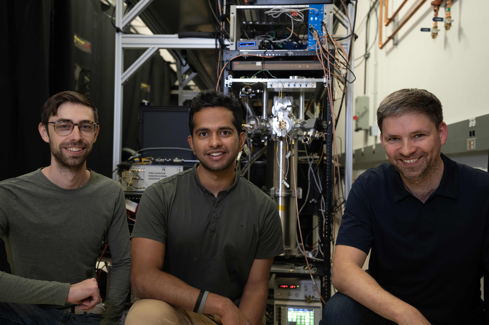
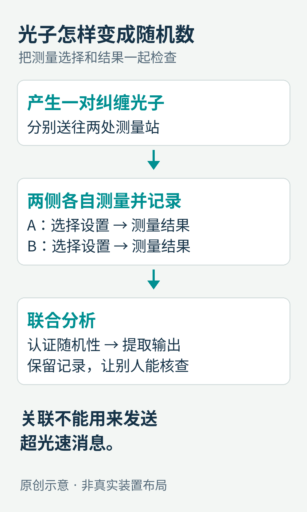
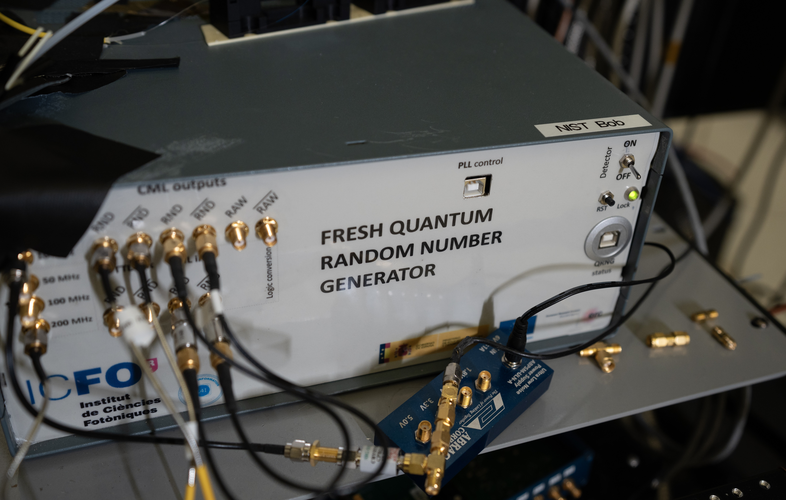
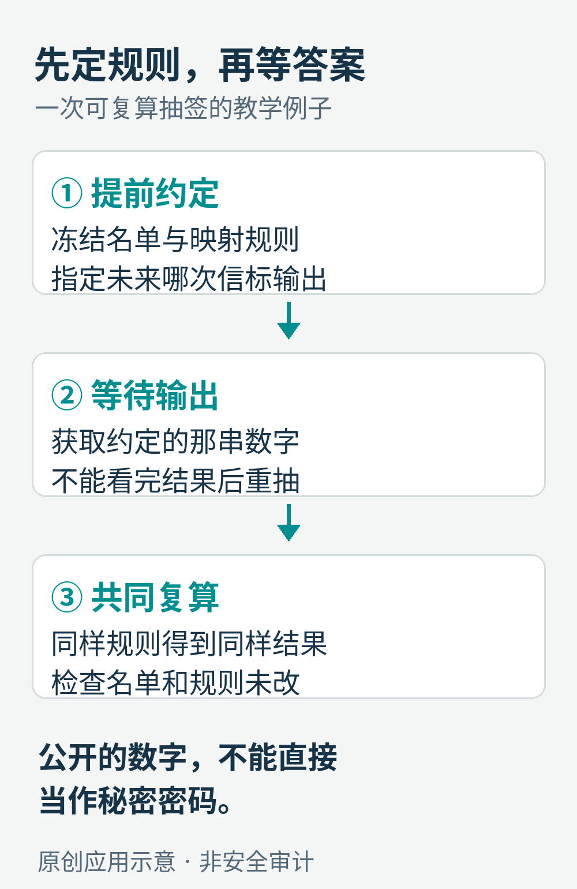

# 抽签前，连造机器的人也不知道答案：一座量子随机数工厂

假设一百个人报名，只有十个名额。主办方点击“随机抽取”，屏幕很快给出名单。

真正困难的问题发生在点击之前：这十个人，是刚刚抽出来的，还是早就选好了，只等一个像抽签的动画？

把数字打乱并不难，让别人相信自己没有挑选结果，却需要一套能被检查的过程。2025年6月11日，美国国家标准与技术研究院（NIST）与科罗拉多大学博尔德分校公布了一项工作：用纠缠光子的实验产生随机性，再把从实验记录到最终数字的处理过程留下可追溯的记录。这项服务叫 CURBy，即科罗拉多大学随机数信标；论文同日在线发表于《自然》。[1](https://www.nist.gov/news-events/news/2025/06/nist-and-partners-use-quantum-mechanics-make-factory-random-numbers)[2](https://doi.org/10.1038/s41586-025-09054-3)、[2·2](https://arxiv.org/abs/2411.05247)

它的有趣之处在于：实验室不是把一个复杂数字“算得更像随机”，而是尝试同时回答两个问题：答案能否提前知道？公布答案的过程中，有没有人动过手脚？

从左到右：Jasper Palfree、Gautam Kavuri、Krister Shalm。那串看起来普通的0和1，背后是一套需要真实光学设备、统计分析和公开记录共同工作的系统。

## 看起来杂乱，为什么还不够？

先做一个思想实验。你写下01010101，显然没人觉得它随机。换成一长串没有明显规律的数字，观感就不同了。

但观感会骗人。有人可以先用正常方法生成一串好数字，再把它存进文件，明天按顺序播放。明天的输出仍能通过不少“看起来均匀”的检查；那个拿着文件的人却早就知道答案。

统计检测擅长发现某些坏现象，例如0明显偏多、相邻数字总在重复。它不能单凭一份输出，证明这份输出在产生前无人知晓。NIST在2018年的研究介绍中特别指出了这一区别。[3](https://www.nist.gov/news-events/news/2018/04/nists-new-quantum-method-generates-really-random-numbers)

计算机常用的伪随机数也有类似的边界：给定算法和同样的初始状态，输出序列会重现。这种可重复性在调试、仿真里很有用；密码学安全的生成器则通过高质量的秘密种子和专门设计，让不知道内部状态的人难以预测。不能因为名字里有个“伪”，就把正常使用的密码学随机数都说成容易破解。[4](https://csrc.nist.gov/projects/interoperable-randomness-beacons)、[4·2](https://csrc.nist.gov/projects/random-bit-generation)

CURBy想解决的，是另一类需求：让多个互不完全信任的人，共同使用一个事前难以预测、事后可以检查的公开结果。

原创概念图。数字是否均匀、能否提前预测、处理记录能否核查，是三个不同的问题；前一项通过，不会自动证明后一项。

## 光子为什么能帮忙？

普通人理解“测量”时，常把它想成揭开一张已经写好答案的纸。温度计只是告诉你水原本有多热，秤只是读出物体原本有多重。

量子实验的麻烦，恰恰在于这种“答案预先写好”的直觉并不总能成立。

实验人员让一对具有纠缠关系的光子分别去往两处测量装置。纠缠意味着：两者的测量结果会呈现一种特殊的联合关系，不能简单理解成两个互不相关的独立对象。每一边都可以选择不同的测量方式，再记录结果。只看其中一边，是一串0和1；把两边的测量选择和结果放在一起，才有真正值得检查的东西。[5](https://www.nist.gov/blogs/taking-measure/local-realism-bells-inequality-and-t-shirts-entangled-tale)

可以把经典的“预先写好答案”设想成一张随身答题表：遇到问题甲，回答0；遇到问题乙，回答1。两边出发前可以商量好，也可以带着相关的答题表，但测量进行时不能及时互通消息。

贝尔不等式给这种设想划出了一条统计界线。在相应的测量设置下，无论预先怎样搭配答题表，某些结果组合的关联程度都不能超过界线。量子纠缠却允许越过它。这里检查的是大量实验中“选择了什么、得到了什么”的联合统计，不是看到两个光子总给出一样的答案就宣布成功。[5](https://www.nist.gov/blogs/taking-measure/local-realism-bells-inequality-and-t-shirts-entangled-tale)

这也解释了为什么装置不能只挑容易探测到的光子，不记录其他事件；为什么测量的选择需要满足独立性要求；为什么两边的时间和空间安排如此重要。否则，一台有漏洞的经典装置，也可能演出好看的关联。

原创机制示意，非实验室布置图。两侧的设置选择与测量记录都要进入分析；纠缠关联不能用来让一侧随意控制另一侧的结果，也不能借此发送超光速消息。

实际认证始终有前提，例如实验隔离、设置选择和采用的物理模型。贝尔实验并没有一次性替人类决定所有量子解释，更不意味着“所有关于宇宙的决定论都被排除”。它提供的是在明确条件下，对一类预先确定、局域的解释施加非常强的约束。把这些条件守住，才可能进一步给输出中的不可预测性一个可信下界。[2](https://doi.org/10.1038/s41586-025-09054-3)、[2·2](https://arxiv.org/abs/2411.05247)[5](https://www.nist.gov/blogs/taking-measure/local-realism-bells-inequality-and-t-shirts-entangled-tale)

## 有了随机原料，还不能直接装瓶

如果一台探测器更灵敏，另一台略差，原始记录里的0和1就可能不均衡。某些时段的探测失败、设备噪声，也会进入统计。

因此，“有量子来源”不等于“每个原始比特都可以直接当作完美硬币”。研究者先根据实验统计，估计这批数据至少含有多少不可预测性，再通过随机性提取器，把它集中到更短的一串输出里。[3](https://www.nist.gov/news-events/news/2018/04/nists-new-quantum-method-generates-really-random-numbers)

这里的“提取”可以借一个不完全精确、但有用的比喻：原料里有糖，也有水。糖水的体积，不等于其中糖的量；把它提浓以后，得到的体积会小得多。类比到此为止，软件当然不是在真的蒸馏光子。

提取器没有凭空创造随机性。原始数据、独立种子和数学保证需要配合；种子也不能偷偷与原料串通。如果认证条件不满足，正确做法是不给出这次合格输出，而不是勉强凑满一个数字。

NIST博尔德实验室中的量子随机数设备实景。机箱上的“新鲜”字样很贴切：它的目标是不断获取新的随机原料，而不是循环播放一份旧清单。

论文报告，最初40天内共尝试7454次，其中7434次成功完成协议，约为99.7%；每次成功输出512比特。[2](https://doi.org/10.1038/s41586-025-09054-3)、[2·2](https://arxiv.org/abs/2411.05247) 512比特只是64字节，比一张手机照片小得多。这里值得投入大型装置的，是这些比特的产生依据，而不是文件容量。

99.7%也要放回原来的位置：它是这段运行窗口内完成协议的比例，不是“每一个数字有99.7%的概率是真的”，更不是承诺此后永不掉线。读懂这种实验数字，往往比记住数字本身重要。

## 为什么还要给随机数留一条“来路”？

假如光子实验诚实，后面的服务器却不诚实，怎么办？

它可以算出十组结果，选自己喜欢的一组发布；也可以把原始文件换掉，再声称一直就是这样。量子物理无法替服务器解决这类操作问题。

这项工作因此加入了 Twine：用交织的哈希链记录处理过程。哈希可以理解为给数据计算一个很短的指纹。文件只要变动，指纹通常就会变化；不同环节和参与方把对方已发布的指纹写进自己的记录，让事后改写整段历史变得可察觉。[1](https://www.nist.gov/news-events/news/2025/06/nist-and-partners-use-quantum-mechanics-make-factory-random-numbers)[2](https://doi.org/10.1038/s41586-025-09054-3)、[2·2](https://arxiv.org/abs/2411.05247)

不过，“有哈希”并不等于“里面的事实一定是真的”。你给一份虚构名单算哈希，得到的仍然是虚构名单的指纹。哈希负责暴露记录是否被改变，量子实验与统计认证负责支持随机性的来源，公开的协议负责规定处理顺序。这些职责需要互相接上。

可以把整套系统看作一间有透明账目的工厂：进来的原料是什么，经过哪几步加工，何时由谁承诺了哪份记录，最后出厂的那包数字对应哪一批实验。别人不仅能看成品，还能沿着记录回查。

## 公开的随机数，怎样用于一次公平抽签？

回到开头的一百个人。一个更容易检查的做法，是先锁定参与名单、排序方法、要采用的未来某次信标输出，以及“数字怎样对应到名单”的规则。之后等输出出现，任何人都按同一规则计算结果。

这个例子是对公开随机数用途的解释，并非本文替某项真实抽签设计了经过安全审计的系统。具体实现还必须处理超时、失败、重复报名、编码差异和不均匀映射。最直观的陷阱是：如果把0到255等概率地分给100个人，直接取余数，前56个编号就会比后44个编号多一种对应方式。

规则若允许主办方“这次结果不好看，再取下一次”，即使每一次随机数都很真，整个抽签仍可被操纵。公平不只取决于那串数字，也取决于名单和规则是否在数字出现前就固定了。

原创应用示意。先固定名单与规则，再等待预定输出，最后共同复算；不能在看到结果后换名单、换输出时刻或重抽。

NIST列出的公开信标用途包括审计抽样、案件分配和资源分配等。[4](https://csrc.nist.gov/projects/interoperable-randomness-beacons)、[4·2](https://csrc.nist.gov/projects/random-bit-generation) 这些场景有一个共同点：结果出现后，大家应当能知道它；结果出现前，任何一方都不应拥有不公平的预知优势。

这与秘密密码的要求不同。公开广播的随机数，广播之后人人都能拿到。它再不可预测，也不能直接拿来当秘密密钥。NIST的项目页面对此有明确警告。[4](https://csrc.nist.gov/projects/interoperable-randomness-beacons)、[4·2](https://csrc.nist.gov/projects/random-bit-generation)

## 一串数字里，装进了多少信任？

从实用角度看，CURBy展示的并不是“所有电脑都该外接一座量子实验室”。多数日常任务无需这种成本，常规系统仍应使用经过设计和验证的随机数设施。

它更像把一个平时藏在“相信我”里的问题拆开：随机原料从哪里来？原料里有多少不可预测性？谁把它加工成输出？谁能检查加工过程？公布以后，别人能否复算？

本文截至2026年10月9日核对公开资料，介绍的是2025年发表的研究及其报告的运行窗口；没有把网页可访问等同于已经独立验证当前服务的连续在线状态，也没有亲自复现实验。

抽签按钮按下之后，公平的关键常常已经过去了。最有价值的随机数，是在答案还不存在于参与者手中时，就把事后的检查办法安排好。

图片来源：[NIST](https://www.nist.gov/news-events/news/2025/06/nist-and-partners-use-quantum-mechanics-make-factory-random-numbers)；中文示意为本文原创。
