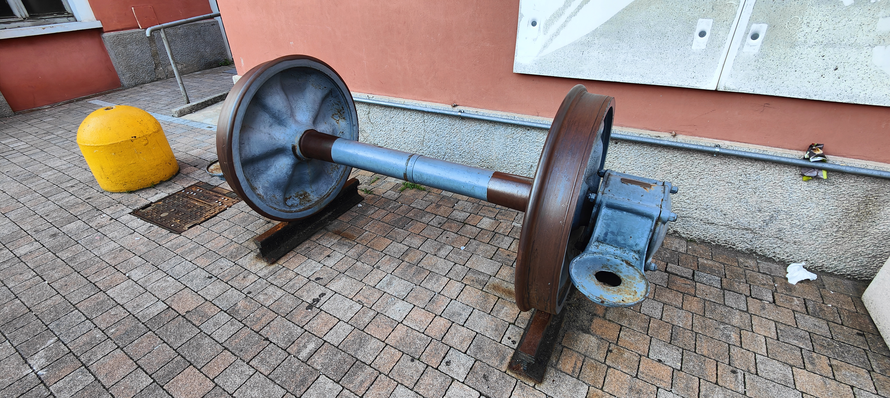
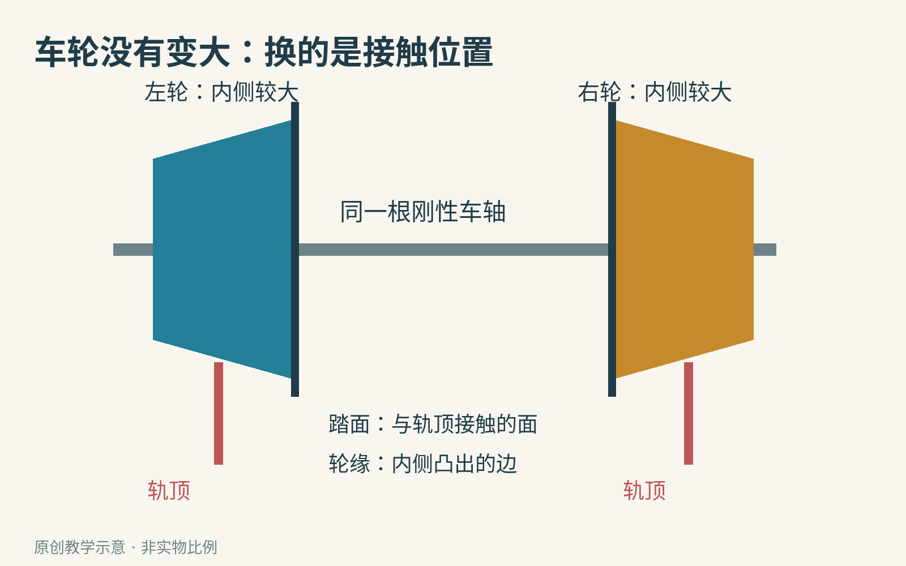
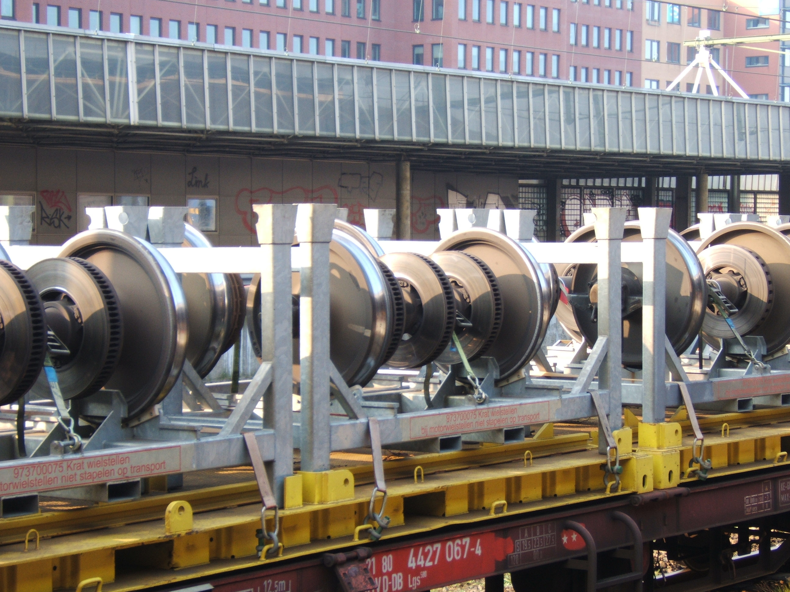
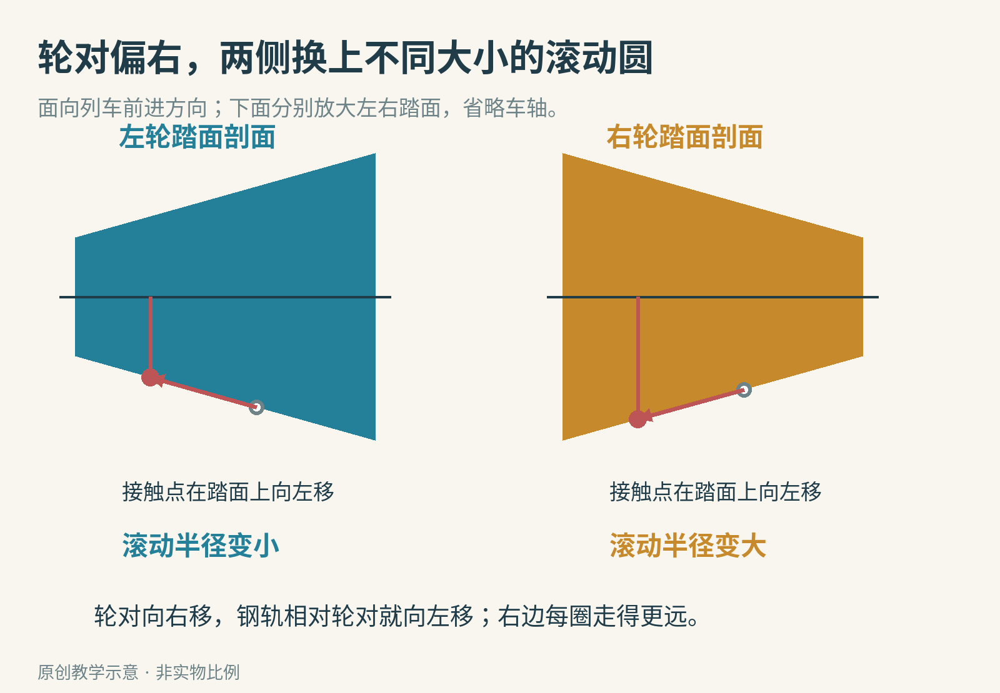
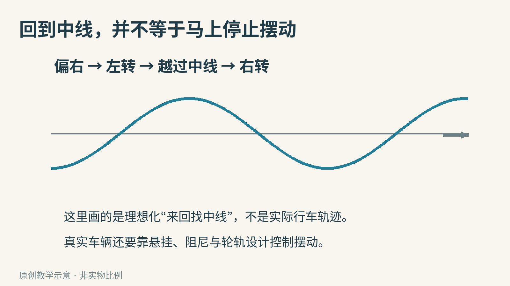
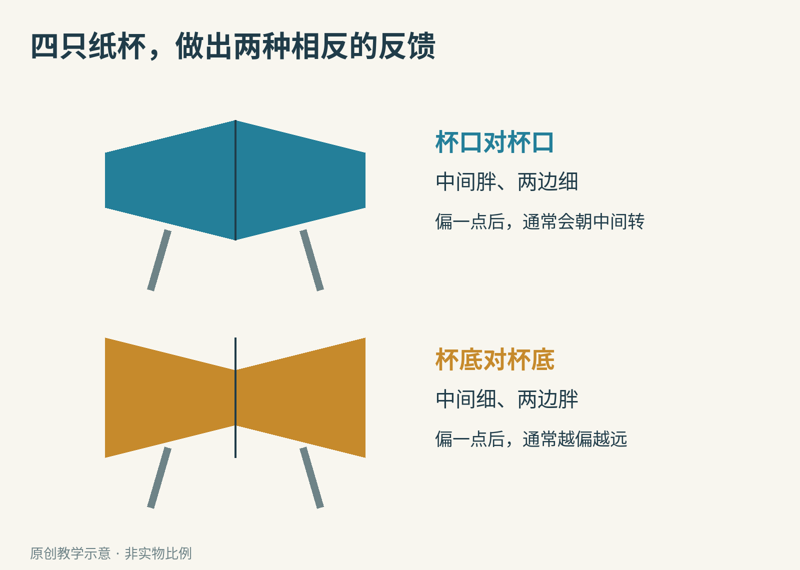

# 火车没有方向盘，两个绑在一起的轮子怎么拐弯？

把两只大小相同的瓶盖，牢牢固定在一根轴上。你得到一个很简单的玩具轮对：左轮转一圈，右轮也转一圈。

直着滚，似乎没什么问题。但把轨道弯起来，麻烦就出现了。外侧轨道比内侧长，外轮应该多走一段；同一根轴上的两个轮子，却不能各转各的。

真实火车也要解决这个矛盾。许多铁路车辆的两个车轮压装在同一根车轴上，组成一个刚性轮对。它们没有汽车那样让两边转速不同的差速器，却照样能过弯。秘密藏在车轮与钢轨接触的那一小圈上。

这是一组在意大利 Como Lago 车站展示的真实轮对。注意连接两轮的轴，以及车轮内侧凸出的边。照片给出了整体关系；下面的示意会把很小的倾斜放大。

## 外轮多走的那段路，从哪里来？

可以先离开铁路，想象两个人并排绕操场转弯。靠外的人，必须跨得更大，或者迈得更快，否则就会落后。

车轮也有两种办法：转得更快，或者每转一圈走得更远。汽车的差速器主要解决前一种问题；刚性铁路轮对利用车轮的形状，来获得后一种效果。

一只半径较大的轮子，滚一圈走的路更长。圆周长公式是 C＝2πr，其中 C 是一圈的长度，r 是轮子实际滚动那一圈的半径，π 约为 3.1416。

先用一个刻意简化的例子：一边的滚动半径是 50 毫米，另一边是 50.5 毫米。两边都转一圈，分别约走 314.16 毫米和 317.30 毫米。转速没有变，后一边每圈却多走了约 3.14 毫米，也就是 1%。

如果外侧路程恰好比内侧长 1%，这样的半径比就能在纯滚动的理想模型里配上它。这里的数字是教学例子，不是某型号火车的设计参数。

问题于是变成了：车轮是钢做的，既不会充气变大，也不会自动伸缩，怎么能随时换一个滚动半径？

## 一只轮子上，本来就有许多大小不同的圆

拿起一只侧面有斜度的纸杯。杯口是一圈较大的圆，杯底是一圈较小的圆；在两者之间，还能找到许多不同大小的圆。

铁路车轮的踏面，也就是压在轨顶上滚动的那圈表面，通常不是完美的圆柱面。入门时可以把它理解成圆锥的一小段：靠近轮对中间的一侧较大，靠外的一侧较小。真实踏面常有经过设计的曲线，并非一条无限延长的直斜线。

轮对在两根钢轨之间横向挪一点，钢轨接触到的就不再是踏面的同一位置。轮子没被改造，但承担滚动的那一圈换了。

这就像用同一只纸杯的不同部位在桌面上滚：材料和整体形状不变，接触位置却能改变运动。

照片中的踏面是承重、滚动的工作表面；凸出的轮缘与它是不同部分。轮缘确实参与导向并限制横向运动，但不能把正常行车想成“轮缘始终刮着钢轨，把车硬掰过去”。

## 偏向一边，为什么反而会转回来？

为了跟住左右关系，先约定：你站在车上，面向前进方向。

假设整个轮对稍微向右偏。右侧钢轨接触右轮的位置，会向右轮较大的内侧移动；左侧钢轨则接触到左轮较小的外侧。于是右轮的有效滚动半径变大，左轮变小。

右边每一圈想多走一点，左边想少走一点。轮对向前滚动时，就有朝左转的趋势，恰好朝着轨道中间回来。反过来，向左偏时，几何关系也反过来。

这种“偏了以后，变化反过来削弱偏移”的关系，叫作负反馈。它不一定要有摄像头、计算机和电动机；形状与接触关系也能构成反馈。

但别急着把它想成一个完美的自动回正系统。轮对回到中线时，可能已经有了转向角度，不会立刻忘掉自己的运动。它可能穿过中线，偏向另一边，再被带回来。

这就是理解轮对蛇行运动的一个入口：“蛇行”指左右来回摆动，实际动力学比这条波浪线复杂。伊利诺伊大学 RailTEC 的[铁路科普活动手册](https://railtec.illinois.edu/wp/wp-content/uploads/NURail-Guidebook-Rail-K-12-STEM-Outreach-3-Wheel-Rail-2020-12-23.pdf)把车轮锥度与这种左右运动放在一起讲，原因就在这里。

真实列车需要悬挂、阻尼、轮轨轮廓和合理速度共同工作。阻尼可以理解成把摆动能量逐渐消耗掉的作用；有回中的趋势，不等于在任何速度下都稳定，更不等于永远不会脱轨。

## 那么，进弯时究竟发生了什么？

弯道要求外轮比内轮走得远。轮对横向位置和方向发生调整后，外轮可以接触较大的滚动圆，内轮接触较小的滚动圆，让同一个转速对应两条不同长度的路径。

这幅图景解释的是一种很重要的几何机制，并不意味着只要画两个圆锥，就算设计好了一列火车。

首先，轮对能横向移动的距离有限，踏面能够提供的半径差也有限。弯道越急，需要的差异越大；某些情况下，轮缘会接触钢轨，轮轨之间也会出现局部滑动。

其次，一节车厢下面往往有不止一个轮对。把轮对组织起来、承受车体重量的框架叫作转向架。整个框架怎样转动、轮对怎样相互约束，会影响过弯表现。

最后，钢轮和钢轨不是数学里的绝对刚体。接触区域会发生很小的弹性变形，实际导向力也来自接触中的相对运动。本文的圆锥模型先回答“为什么相同转速不妨碍两边走不同距离”，完整铁路设计还要解决受力、磨耗和稳定性。

这也是工程有意思的地方：一个好点子，通常负责化解一个核心矛盾；可靠系统还要让许多条件同时成立。

## 用四只纸杯，把正反馈和负反馈摆在桌上

澳大利亚国家科学技术中心 Questacon 提供了一个很适合观察的[纸杯轮对活动](https://www.questacon.edu.au/learn-and-play/activities/train-wheels)。不需要电池，也不用靠近真实铁轨。

准备四只相同、侧壁有斜度的轻纸杯、胶带，以及两根长度相同的直尺或平直纸管。把“轨道”固定在桌面或地面上，间隔以杯子能落在两条侧壁接触处为准；一端只稍微垫高，下面留出柔软、无人走动的停止区域。

第一组把两个杯口贴在一起，看起来中间胖、两端细。第二组把两个杯底贴在一起，看起来像蝴蝶结，中间细、两端胖。胶带尽量平整，避免接缝先碰到轨道。

先让两组都从大致居中的位置轻轻释放，别额外推。接着，让起点只偏左或偏右一点，再试几次。

你要观察的不是“哪组一定成功”，而是：初始偏差会缩小，还是会扩大？杯口相接的一组，通常会出现向中间转的趋势；杯底相接的一组，往往越偏越远。后一种形状把反馈方向反了过来。

建议先把预测写下来，再记下结果。若没有出现预期现象，检查轨道是否平行、杯子是否对称、坡度是否太大，以及杯口卷边有没有先接触轨道。失败也可能来自模型制作，而不是一句“原理错了”就能解释。

这是一项依据公开科教方案整理的动手建议，本文没有宣称亲手完成了实体测试。文中的圆周长与比例数值已通过计算核对。使用轻材料，不用刀具、热胶或高速动力；全程远离运行中的列车和铁路设施。

还可以继续问三个问题：

- 把轨道变宽，接触到的是纸杯更大还是更小的圆？
- 保持杯子不变，坡度变大后，回中的趋势还来得及发挥作用吗？
- 如果左右杯子不一样，几何反馈是否还对称？

一组轮子里藏着的，并不只是“圆锥比圆柱好”。更值得带走的是一种观察办法：当你看到物体改变运动方向，除了寻找一个藏起来的控制器，也可以看看接触位置和形状，是不是已经在做计算。

图片来源：[Como Lago 展示轮对](https://commons.wikimedia.org/wiki/File:Asse_ferrov._%22sala_montata%22.jpg)，Al*from*Lig；[铁路车轮](https://commons.wikimedia.org/wiki/File:Wielen_HS.jpg)，Smiley.toerist。两图按 [CC BY-SA 4.0](https://creativecommons.org/licenses/by-sa/4.0/) 使用，画面未裁改；其余为原创教学示意。科学解释参考 [Questacon](https://www.questacon.edu.au/learn-and-play/activities/train-wheels) 与 [Illinois RailTEC](https://railtec.illinois.edu/wp/wp-content/uploads/NURail-Guidebook-Rail-K-12-STEM-Outreach-3-Wheel-Rail-2020-12-23.pdf)。
