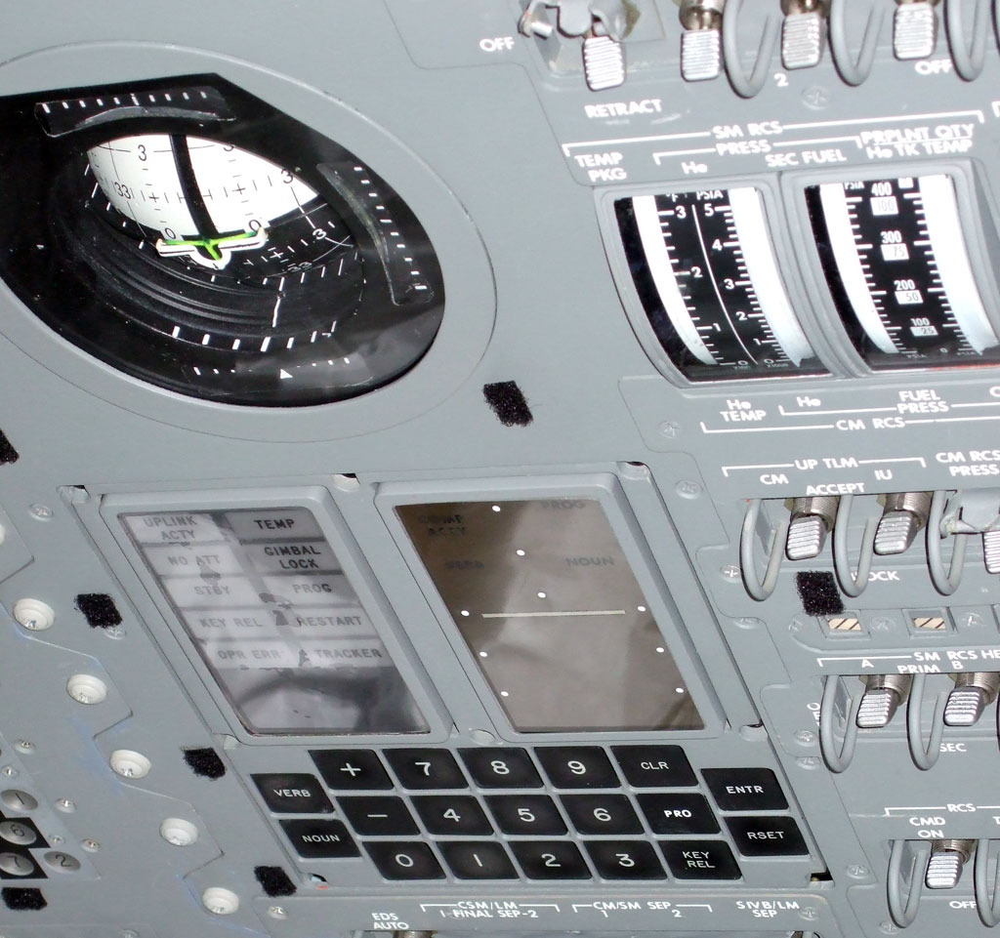
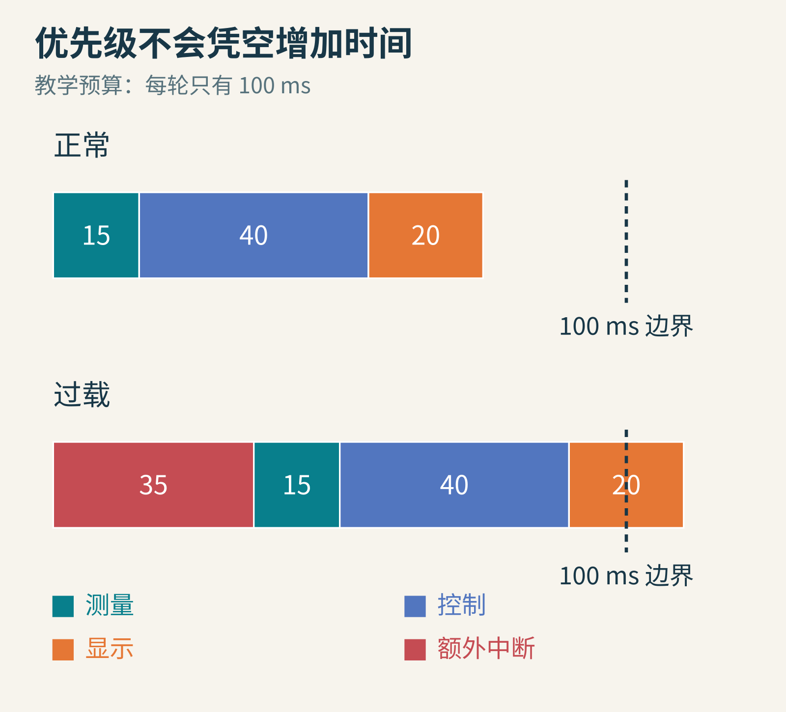
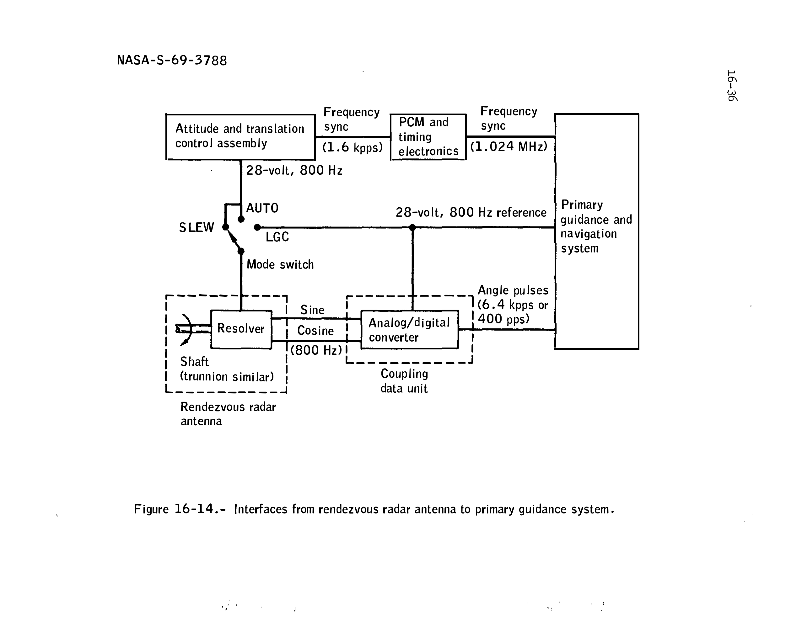
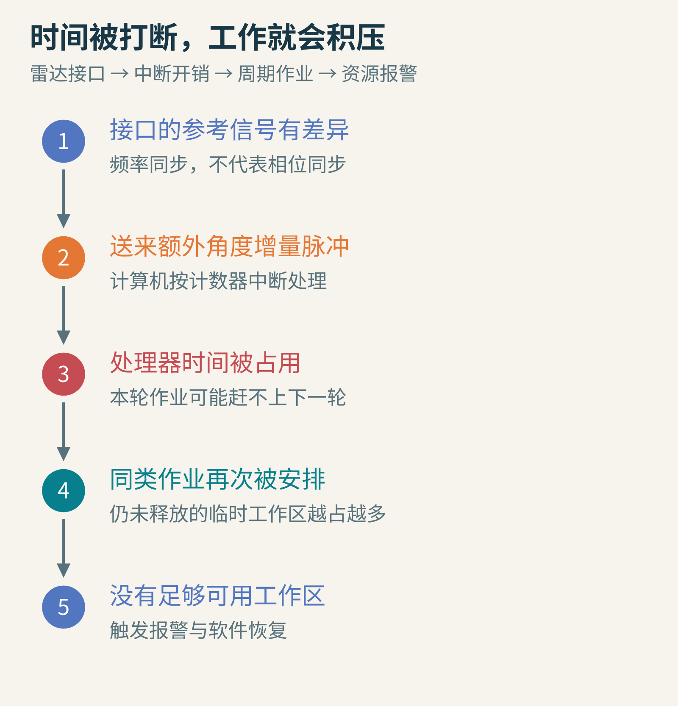
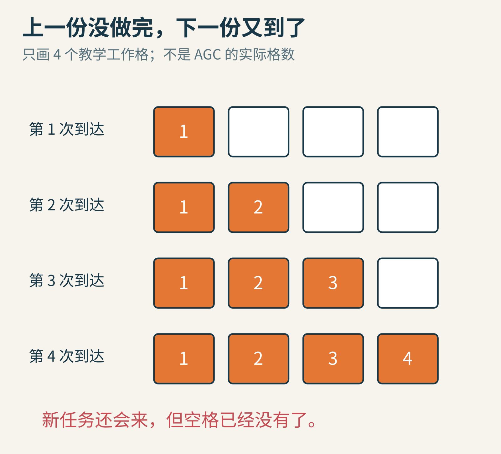
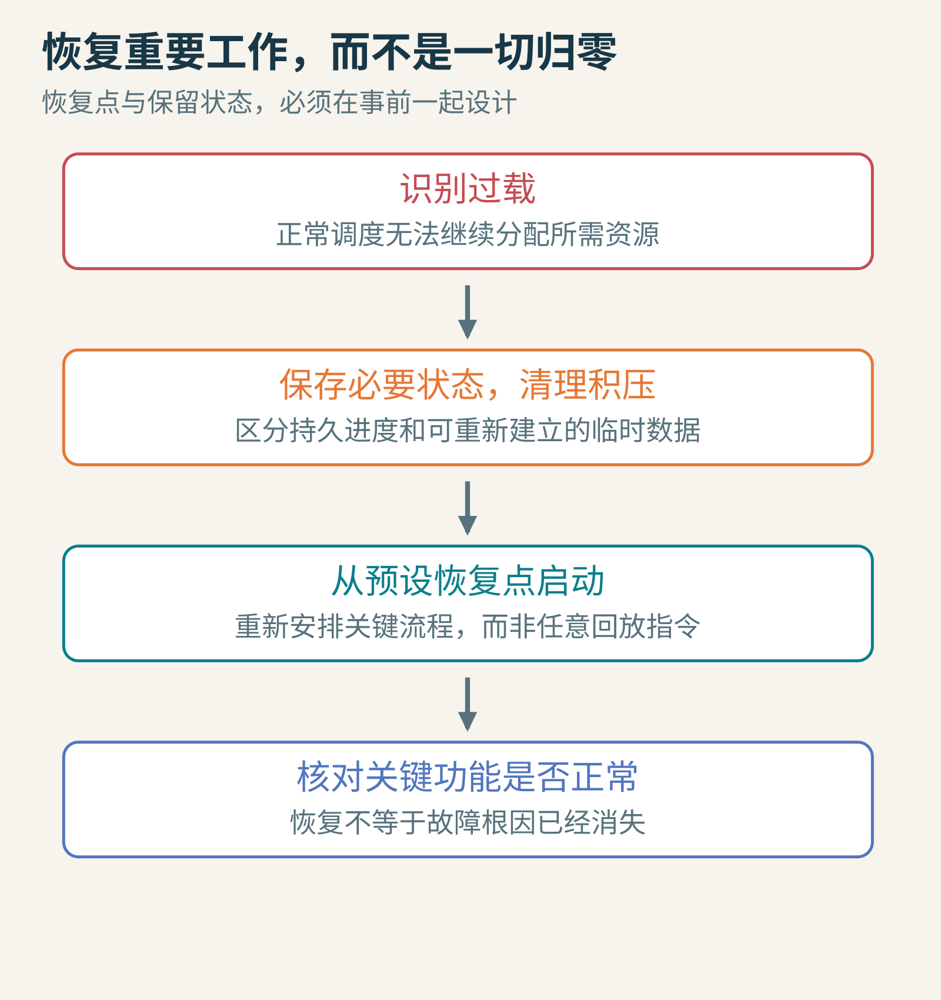
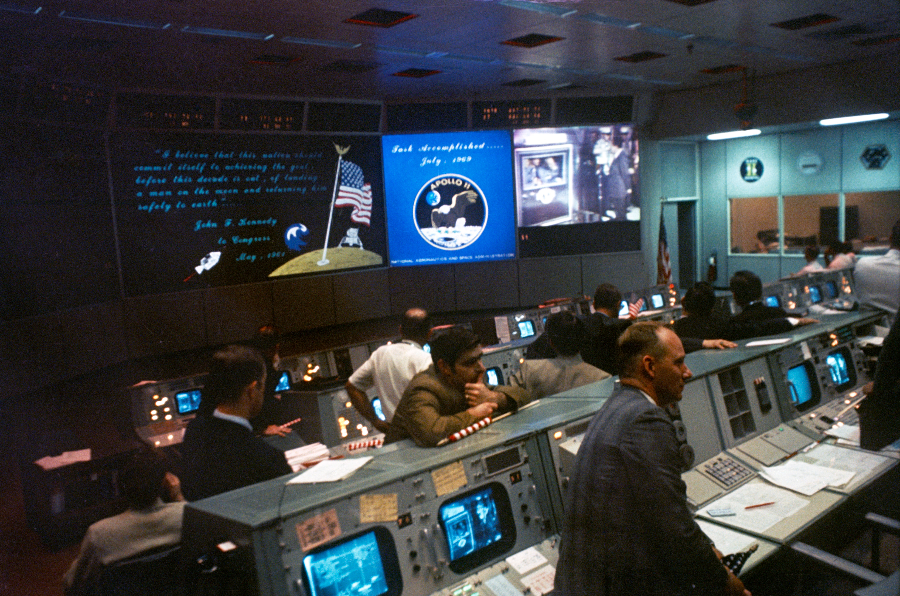

# 登月时电脑突然报警，为什么还能继续下降

1969 年 7 月 20 日，阿波罗 11 号的“鹰”号登月舱正在接近月面。就在这个不能随便停下来重来的阶段，计算机显示了一个程序报警：1202。

它不是“任务成功”的代码，也不是一条无关紧要的通知。计算机的工作已经多到有些资源安排不过来了。宇航员需要知道：是继续下降，还是中止登月？

今天我们有时会把卡住的程序关掉重开，可正在下降的飞船没有这样的余裕。更奇妙的是，这台计算机确实触发了软件重启，却没有因此忘掉所有正在做的事。

这个故事要回答的不是“老电脑究竟有多厉害”，而是一个每个程序员都可能遇见的问题：**当系统不能把所有工作都做完时，怎样保住绝对不能丢的那部分？**

## 一　先看清宇航员面对的机器

下面是阿波罗制导计算机的一种操作界面，叫 DSKY，名字来自 Display and Keyboard，即显示器与键盘。它没有今天常见的窗口和鼠标，而是用数字、指示灯以及键盘让宇航员和程序沟通。



图：Brandrodungswanderfeldhackbau，2007 年拍摄，摄影者将作品贡献至公有领域；原图未修改。这是指令舱面板上的 DSKY 实物照片，用来认识同一计算机体系的人机界面，不是“鹰”号报警时的现场照片。

你可以把 DSKY 想成一个专门工作台的面板。宇航员输入命令、选择要查看的信息，计算机把相应数值显示出来。但它不是只负责显示：同一台计算机还要参与导航、制导和控制，处理传感器输入，安排不同工作在适当时刻执行。

“实时系统”的“实时”，也不是单纯指速度快。它强调的是：**结果必须在有用的时间内出来。**一份精确得不得了、却晚到几秒的控制结果，可能已经对应过时的位置和速度。程序的正确性，既包含算得对，也包含来得及。

阿波罗 11 号的任务报告记录，下降过程中共出现五次这类程序报警，但主要制导和控制功能的表现没有因此受到影响。[报告第 16.2.5 节](https://www.nasa.gov/wp-content/uploads/static/apollo50th/pdf/A11_MissionReport.pdf)专门解释了原因。我们顺着这份事后技术分析，一层一层拆开。

## 二　单个处理器怎样同时照顾多件事

“多任务”不等于每件事都在同一瞬间执行。一个处理器可以把时间分给不同工作：先做一点这个，再做一点那个。某些输入到来时，还能暂时打断正在做的工作，先处理更紧急的事，这种机制叫中断。

像课堂上一位老师，平时按计划讲课，突然有人报告实验设备异常，就先处理异常。等处置完，再回到原来的讲解。这个比喻只帮助理解安排顺序，真实计算机必须用精确的状态保存和程序规则完成切换。

先做一个与真实阿波罗参数无关的教学预算。假设每一轮有 100 毫秒处理时间：

- 读取和整理关键测量，需要 15 毫秒。
- 计算下一步控制，需要 40 毫秒。
- 更新一部分非关键显示，需要 20 毫秒。

合计 75 毫秒，还剩 25 毫秒余量。若突然出现额外 35 毫秒的高优先级中断，这轮就需要 110 毫秒。你可以改变工作顺序，却不能把 110 毫秒真的塞进 100 毫秒。



原创教学模型，所有时间都是自设数值，不是阿波罗性能实测。这里的“显示”是示例中的可降级工作，不代表历史系统会把全部 DSKY 功能关掉。

这一步很重要。**优先级不是凭空增加算力，而是在算力不足时决定谁先得到算力。**如果最重要的工作本身已经超过全部预算，再聪明的排序也救不了它。

所以设计可靠系统，除了规定优先级，还要留出余量、识别过载、限制积压，并提前想好哪些状态可以恢复。

## 三　真正的麻烦来自雷达接口

阿波罗登月舱有不同任务的雷达。着陆雷达帮助获得与月面有关的高度和速度信息；交会雷达服务于与另一艘飞船的会合。不能因为名字里都有“雷达”，就把它们混为一谈。

根据任务报告，问题主要出在交会雷达、耦合数据单元和制导系统之间的接口。两个相关的 800 赫兹电信号频率同步，但相位没有锁定。可以先把它理解为两个节拍器敲得一样快，却不一定在同一瞬间敲下去。

接口在特定工作配置下，把相位或幅度差解释成了雷达轴角位置的变化，从而不断送出本不该有的增量脉冲。计算机必须把这些脉冲当作高优先级计数器中断处理，于是正常工作的时间被挤走了。

下面是任务报告中的原始接口图。初看不必认出每一个英文词：先沿着底部看，从左侧雷达天线轴到中间的模数转换与耦合单元，再到右侧制导导航系统；再注意，上方的参考信号也接进了这条链。



图：NASA，《Apollo 11 Mission Report》图 16-14，图号 NASA-S-69-3788。保留完整原图及原说明，未改写电路；为方便阅读从原始 PDF 图页转换成 PNG。图片用于历史技术解释，不代表 NASA 为本文背书。

原报告给出的上限估算是：两路合计每秒最多 12,800 个脉冲，每次处理约 11.7 微秒，合计约占每秒 0.15 秒，也就是约 15% 的处理时间。注意这是报告用来解释负载的估算，不是说整段下降中每一秒都恰好消耗 15%。

而报告说，动力下降活动高峰的正常负载本来就约为容量的 90%。额外开销一旦挤过余量，某些本轮工作就赶不上下一轮开始。



原创因果示意，依据任务报告解释机制；不是雷达实际波形记录。最初的问题是接口产生的额外中断开销，后面的工作区耗尽是它引发的后果。

网上常把这段故事简化成“宇航员拨错开关”或“电脑发现雷达数据没用，就不理它”。这两句话都会遮住重要细节。历史问题涉及接口设计、工作模式和负载相互作用；恢复机制也不仅是按下一个“忽略垃圾”的按钮。

## 四　为什么时间不够，最后却变成工作区不够

想象一张只有几个位置的小工作台。每开始处理一份任务，就要占用一个位置放临时材料；做完才清空，让下一个任务使用。

如果新任务每两秒来一份，原本一秒半就能完成，工作台不会越堆越满。但有了额外打断之后，一份任务可能还没完成，下一份已经按时到来。两份占两个位置，三份占三个位置……

这就是为什么一个首先表现为“计算时间被挤占”的问题，最后可能报成“没有可用工作区”。它们不是互相矛盾的诊断，而是同一条链上的不同阶段。

在阿波罗计算机的软件里，Executive 负责作业调度与临时存储分配。参与者 Peter Adler 的回顾解释了两个报警的直接含义：1202 表示没有可分配的 core set；1201 表示没有可分配的 VAC 区域。它们都是有限的临时工作资源。[Adler 的原始回顾](https://www.nasa.gov/wp-content/uploads/static/history/alsj/a11/a11.1201-pa.html)也说明了核心工作区和较大的向量累加器工作区之间的差别。



原创类比图，仅画四个工作格帮助理解积压；四不是历史 AGC 的实际工作区数量。格子代表临时存储资源，不能把它理解为四个处理器。

任务报告进一步指出，重复安排同一周期作业、为它再次保留存储位置，是产生报警的机制之一。因此我们应该区分三个层次：异常输入打断处理器，作业来不及完成，临时工作资源用尽。报警显示的是最后一层，不一定直接告诉你最初的根因。

这也是现代程序排障的一条有用经验：看到“内存不足”，不能立刻只想买内存；有时真正的问题是请求进得比处理得快。

## 五　重启为什么没有让登月从头再来

普通程序重启时，我们很容易想象整个过程从第一行重新开始。阿波罗的软件恢复不是这样。

事先设计好的恢复机制，会保留或重建必要的状态，把某些关键程序从预先安排的恢复位置继续运行。它不是保存每条指令的完美录像，再任意倒回某一帧；哪些程序需要恢复、从哪里恢复、需要哪些状态，都要在设计和测试时想清楚。

做一个小小的厨房类比。你正在烤面包、烧水和整理采购清单。突然发现桌面被无关材料堆满，需要清理工作台。如果你连“烤箱已经开了多久”“面包放在哪”也一起忘掉，清理后的系统虽然很空，却不再可靠。正确的恢复要区分：哪些临时杂物可以清掉，哪些进度必须保住，哪些动作不能重复执行。

放到飞船上，要求更严格。恢复时不能把重要导航状态随手丢弃，也不能因为“程序重新运行了”就重复触发一个只允许发生一次的动作。恢复点必须与状态保持一致，否则旧状态配上新流程，仍可能产生错误。



原创概念图。它展示“有选择地恢复”的思想，不声称复现 AGC 的全部重启指令或内存布局。

1201 和 1202 出现后，软件重启让系统从过载积压中恢复，关键制导控制工作得以继续。但请注意：这并不意味着造成额外中断的硬件接口问题在那一刻被彻底修好了。恢复是一种应对故障的机制，不等于根因消失。任务报告还说明了后续飞行软件如何改变相关处理，避免同类无意义中断继续生成。

所以“它没有崩溃”也不是最准确的理解。更值得学习的是：它识别出了无法继续照常工作的状态，并按预先验证过的方式恢复重要功能。

## 六　这不是一个人在最后一秒写出的补丁

提到阿波罗软件，很多人会想到玛格丽特·汉密尔顿。她领导的团队为阿波罗指令舱和登月舱开发机载飞行软件。可靠性、异常处理和软件工程工作，是理解这段历史不可缺少的部分。


玛格丽特·汉密尔顿，1995 年。摄影：Daphne Weld Nichols，[CC BY-SA 3.0](https://creativecommons.org/licenses/by-sa/3.0/)。采用摄影原发布版本，未作裁切或改色；不是 1969 年的登月现场照片。

但不要把这段集体工作改写成“她独自写出了所有代码”，也不要想象她在下降途中临时敲下几行补丁。调度、程序设计、测试、硬件、地面指挥和机组操作，都有不同的人承担。

例如，早期 AGC 设计文件把原始的 Executive 与 Waitlist 例程贡献归于 J. Halcombe Laning。Adler 和 Don Eyles 等工程师参与了登月舱动力飞行软件；地面还需要能解读报警、判断任务状态的人。不同角色连起来，才构成最后那次判断的基础。

在休斯敦，Jack Garman 向制导控制官 Steve Bales 提供了对报警的判断，信息再经过任务控制通信链传给机组。可以继续的依据，不是“相信电脑总会没事”，而是对报警类型、恢复机制和关键功能当前表现的理解。它也不代表所有报警都可以放任不管，或同一报警无论多密集都安全。



图：NASA，S69-40301，1969 年 7 月 24 日，休斯敦载人航天中心任务控制室。照片拍于任务结束时，用来展示地面团队的工作环境，不是 7 月 20 日报警瞬间；不据此辨认照片中哪一位正在作出报警判断。


图：NASA《News & Notes》2016 年第四季度号第 34 页。Jack Garman 接受 Chris Kraft 颁发的奖励；这是事后表彰照片，具体拍摄日期未在该图注注明，不是报警现场。

《月面日志》的无线电转录保存了当时的交谈，但也提醒读者：一些转录时间和任务报告时间存在差异。读历史时，这类差异需要保留，不能为了做漂亮的秒级时间轴而悄悄把两个来源拼成一个精确记录。

## 七　自己做一次不会伤到飞船的调度实验

我们用最简单的程序，把第二节的 100 毫秒预算重演一次。下面只模拟一个周期，不接真实设备，也不复现阿波罗的调度实现。

```python
def one_cycle(interrupt_cost):
    remaining = 100 - interrupt_cost
    done, deferred = [], []
    jobs = [("measure", 15),
            ("control", 40),
            ("display", 20)]
    for name, cost in jobs:
        if cost <= remaining:
            remaining -= cost
            done.append(name)
        else:
            deferred.append(name)
    return done, deferred, remaining

print(one_cycle(0))
print(one_cycle(35))
```

正常情况下，三件工作都完成，剩余 25 毫秒。额外中断占 35 毫秒时，测量和控制完成，显示被推迟，剩余 10 毫秒。

你可能会说：“那就一直推迟显示，不就好了？”请继续追问：这份显示是否允许永远不更新？如果推迟的请求一份也不丢，而是不断排队，队列会不会耗尽内存？它是否可以用最新的一份替换旧的一份？如果连续五轮都过载，系统应该报警、中止，还是切换模式？

这些问题没有一个适用于所有系统的答案。游戏可能减少某些视觉效果，测量仪器可能降低非关键记录频率，飞行系统则必须依据它的安全要求和经过验证的设计来处理。

**可靠性从来不只是“主流程运行成功”，也包括知道能力不足时自己会怎样失败。**

## 八　给探索者的三个追问

先把额外中断成本改成 60 毫秒。关键任务还能同时完成吗？如果已经做不到，调整最后一个显示任务的优先级为什么没有用？

再把示例扩展成十个周期，让未完成任务进入队列。分别尝试“每次新请求都保留”和“可替代的显示请求只留最新一个”，比较队列长度。明确标记哪些任务允许替代，别把一次性的付款、发射或开关动作当作可以随便丢弃的显示更新。

最后，给一个三步程序设计恢复点：读传感器、计算命令、发送命令。假如在第三步后重启，程序从第二步恢复，会不会重复发送？你需要记录什么状态，才能知道外部动作究竟有没有发生？这个问题会一路通向事务、幂等性与分布式系统。

阿波罗 11 号留下的启发，不是“只要有优先级，过载就不可怕”。它更具体，也更难：理解资源如何被消耗，识别故障如何传播，保住关键状态，安排可验证的恢复，并让人知道系统此刻还剩多少可信的能力。

有时，一台计算机最重要的本领，不是永远不报警，而是在报警以后，仍然按照事先想清楚的规则工作。

图片来源：[DSKY 实物](https://commons.wikimedia.org/wiki/File:Dsky.jpg)；[NASA 阿波罗 11 号任务报告，图 16-14](https://www.nasa.gov/wp-content/uploads/static/apollo50th/pdf/A11_MissionReport.pdf)；[汉密尔顿肖像](https://commons.wikimedia.org/wiki/File:Margaret_Hamilton_1995.jpg)；[Garman 与 Kraft，NASA 历史通讯第 34 页](https://www.nasa.gov/wp-content/uploads/2023/01/NewsNotes-33-4-Winter-2016.pdf)；[任务控制室 S69-40301](https://commons.wikimedia.org/wiki/File:Mission_Operations_Control_Room_at_the_conclusion_of_Apollo_11.jpg)。其余图为本篇原创教学示意。参考阅读：[下降过程转录](https://www.nasa.gov/wp-content/uploads/static/history/alsj/a11/a11.landing.html)、[MIT 的 AGC 早期逻辑设计报告](https://web.mit.edu/digitalapollo/Documents/Chapter6/hopkinslogical.pdf)。本文采用 AI 辅助调研、撰写与编程制图。
