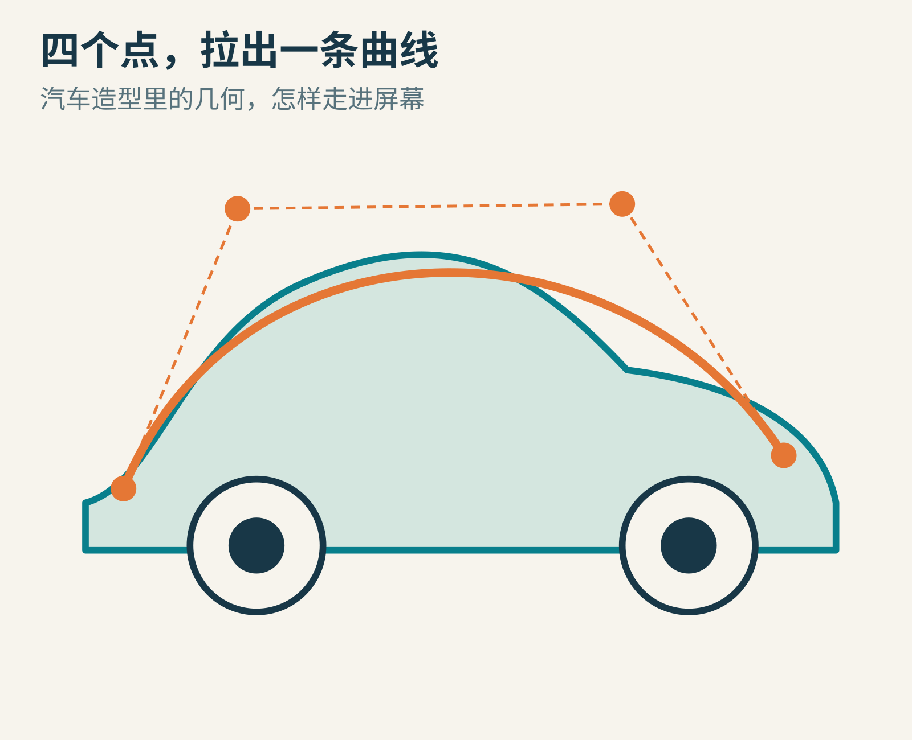
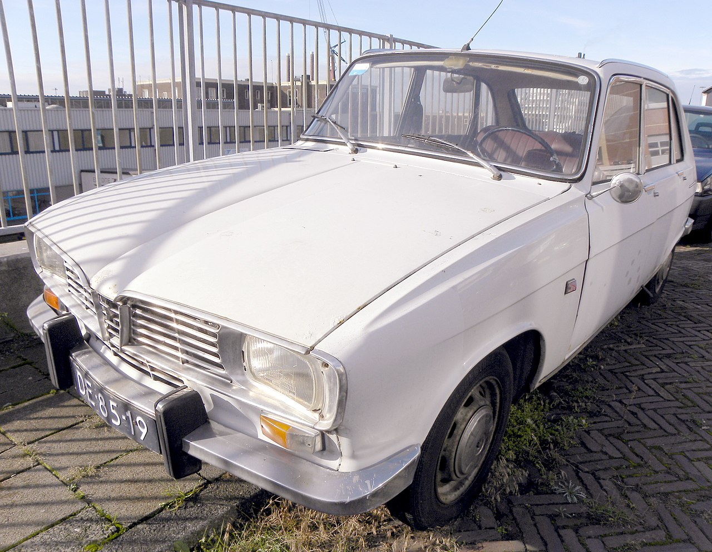
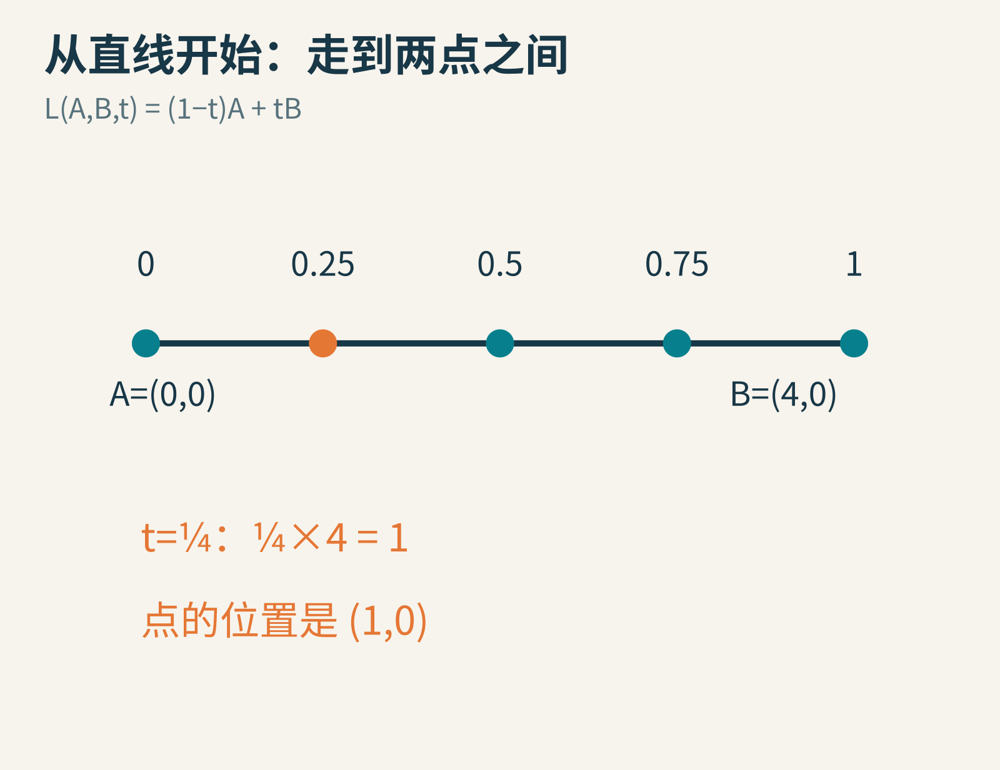
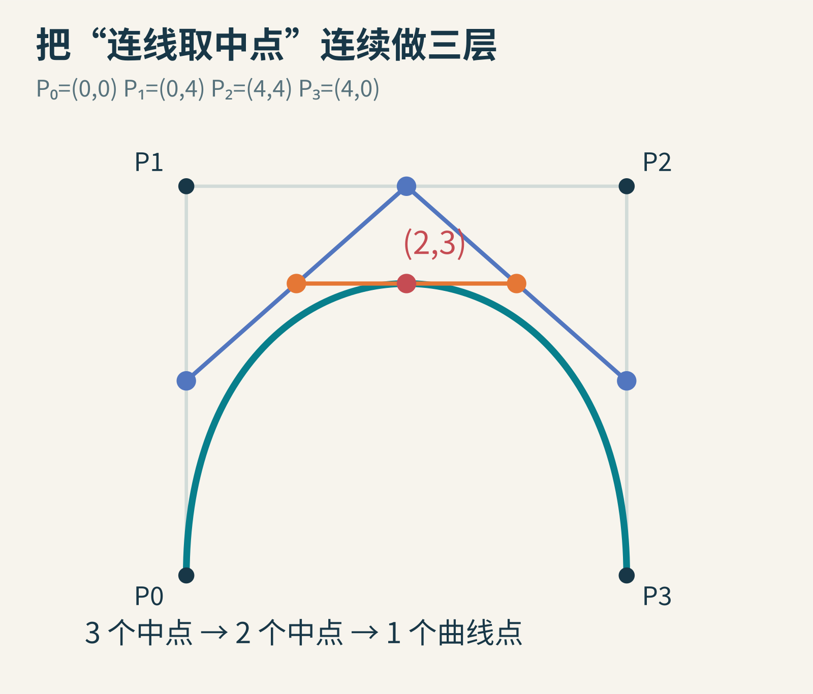
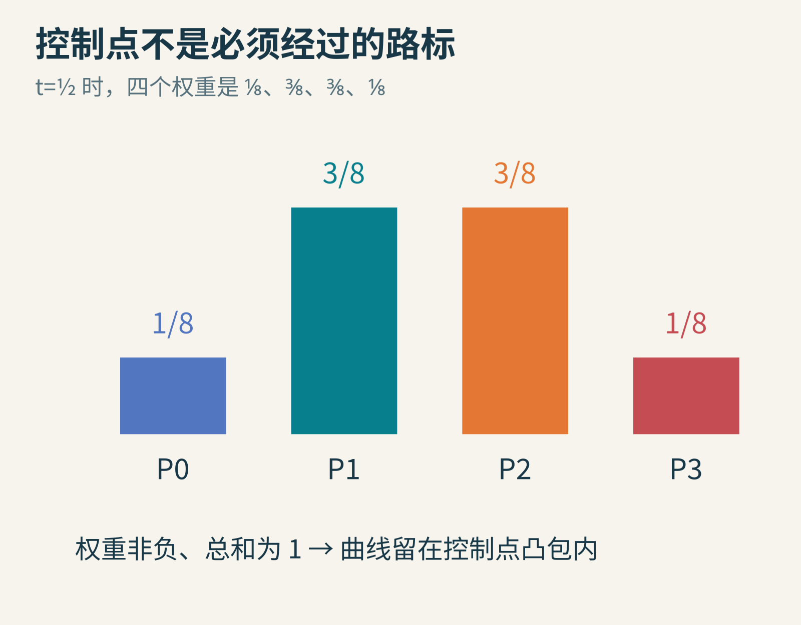
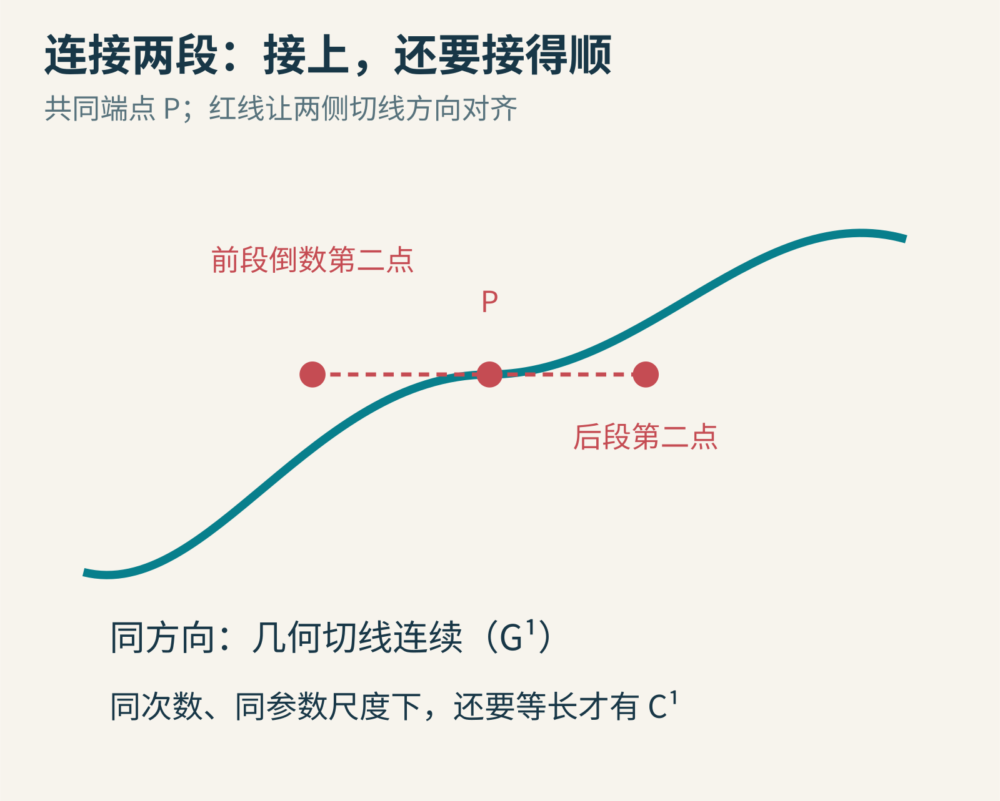
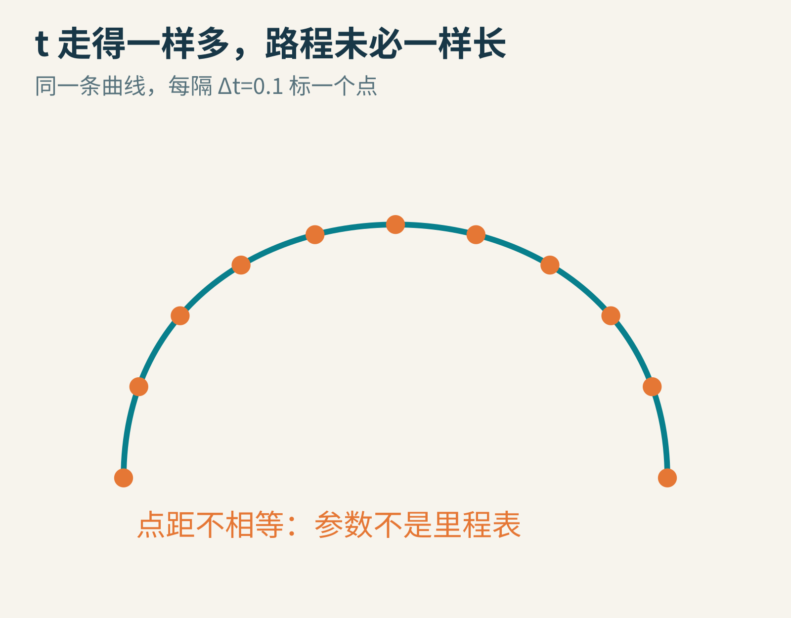
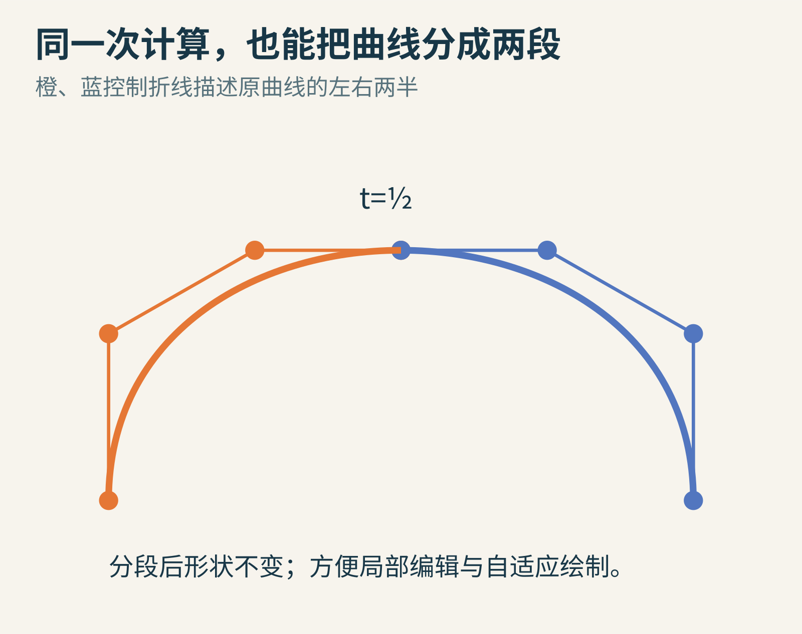
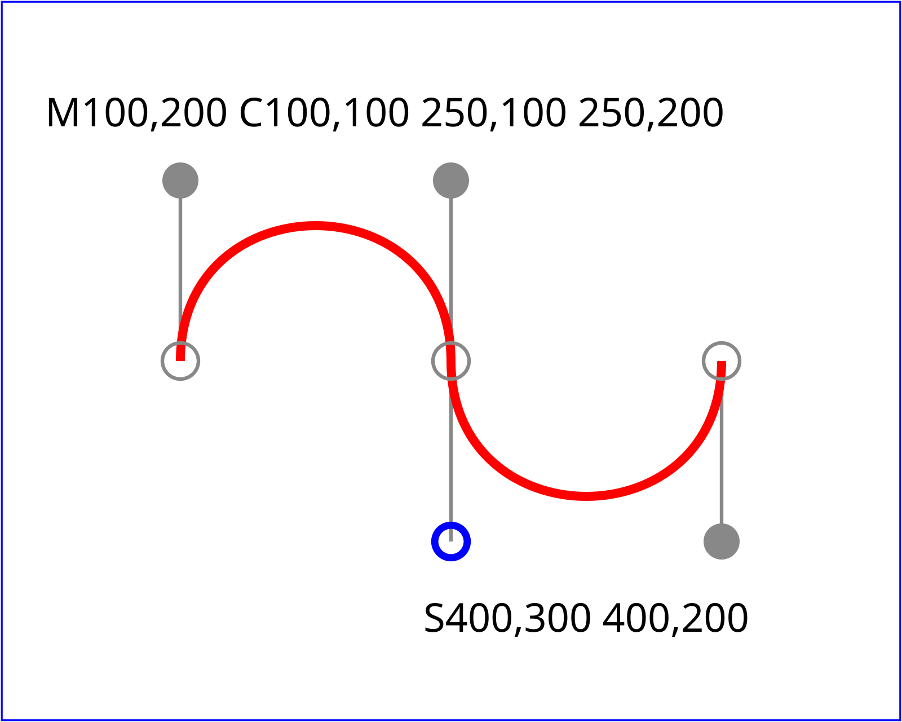
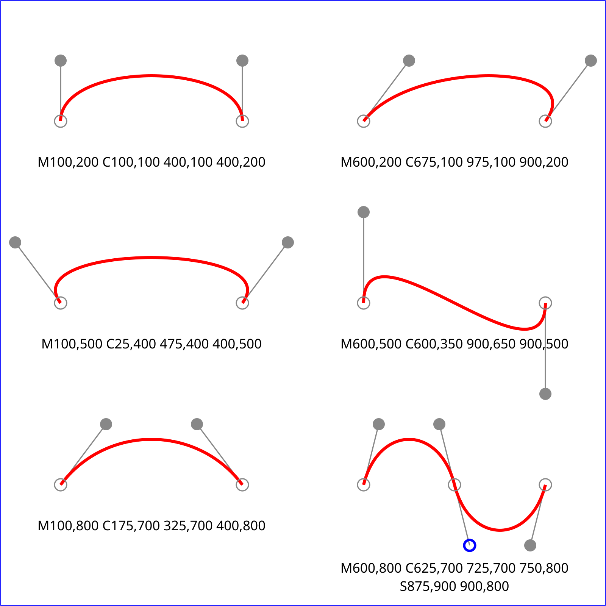

# 汽车的曲线，怎样走进屏幕：四个点里的贝塞尔世界

如果请你向远处的一家工厂描述汽车引擎盖的弧度，你会怎样说？“这里鼓一点，再慢慢落下来”，听起来有画面，却不够让机器准确加工。寄一张照片也不够：透视、光线和拍摄角度，都会影响你看见的轮廓。

设计师需要的，是一种既能直观调整，又能精确传递的形状语言。今天在绘图软件里拖动曲线把手，在网页里设计图标，甚至给动画安排运动路径时，我们仍在使用与这个工业难题密切相关的工具：贝塞尔曲线。

它的入口不是一长串高等数学，而是一件小事：**在两点之间，按比例找一个点。重复几次，曲线就出现了。**

原创概念图，汽车外形为虚构设计，不是某个历史车型的工程图。

## 一　难题不仅是画得漂亮，还要让所有人说同一种形状

皮埃尔·贝塞尔在自己的回忆文章《How a Simple System Was Born》中，描述了约 1960 年汽车工业的一类麻烦：图板上的曲线、实体主模型和加工人员最终做出的形状，可能并不完全一致。修改、争论和返工，都会花时间。

照片：Joost J. Bakker，2009 年拍摄，[CC BY 2.0](https://creativecommons.org/licenses/by/2.0/)，[来源](https://commons.wikimedia.org/wiki/File:Renault_16_(2).jpg)。这是汽车造型语境的实物照片，不据此声称照片中车型的每个曲面都由某一种算法设计。

贝塞尔参与发展的 UNISURF，把几何定义、设计和制造联系起来。他的回忆强调：如果形状能由数字明确描述，设计室、工装部门和车间就可以围绕同一份定义工作。困难还在于，使用者擅长几何造型，并不意味着愿意天天直接操作复杂代数式。[作者回忆节选](https://api.pageplace.de/preview/DT0400.9781483296999_A23889377/preview-9781483296999_A23889377.pdf)

另一条重要线索来自雪铁龙的 Paul de Casteljau，通常译作保罗·德卡斯特里奥或德卡斯特尔若。这里保留英文姓氏以便查找。他的[自传文章](https://www.kth.se/social/files/55492c7ff276542758826f0e/deCasteljau_en.pdf)讲述了把汽车零部件与车身形状数学化的经历，也保留了同事、车间人员和制造困难的存在。

所以，不能把这段历史压缩成“贝塞尔一个人突然发明了所有曲线”。几何、数值控制、设计经验和不同团队的工作相互交织。今天曲线常以 Bézier 命名，而一种特别适合计算和分割它的算法，则以 de Casteljau 命名。下面我们就从这个算法走进去。

## 二　一个旋钮，控制点走到直线上的哪里

先有两个点 A=(0,0)、B=(4,0)。让参数 t 从 0 变到 1：t=0 时在 A，t=1 时在 B，t=0.5 时走到正中间。

把这件事写成公式：

**L(A,B,t)=(1−t)A+tB。**

原创比例取点示意。L 表示线性插值，并不是需要记住的新几何对象。

为什么前面有 1−t？因为两边的权重加起来总是 1。t 越大，B 的影响越大，A 的影响越小。t=0.25 时，位置为 0.75(0,0)+0.25(4,0)=(1,0)。横坐标和纵坐标分别计算即可。

如果 A=(1,2)、B=(5,6)，四分之一处就是 (2,3)。没有任何步骤要求线必须水平。这同一个公式也能处理三维点，只需再算一个 z 坐标。

至此，我们只会画直线。但只要让“直线的端点也在移动”，就会发生有趣的变化。

## 三　四个控制点，三轮插值，一条曲线

在纸上标出 P₀=(0,0)、P₁=(0,4)、P₂=(4,4)、P₃=(4,0)。按顺序连接它们，得到一个开口向下的三边折线。这叫控制多边形，虽然在这里没有闭合。

先取最方便的 t=0.5，也就是每次都找中点。

第一轮，分别在三条边上找中点：A=(0,2)，B=(2,4)，C=(4,2)。

第二轮，连接 A、B、C，再找相邻中点：D=(1,3)，E=(3,3)。

第三轮，在 D、E 之间找中点，得到 F=(2,3)。F 就是这条三次贝塞尔曲线在 t=0.5 时的位置。

原创逐层插值图。灰色为初始控制折线，蓝色、橙色、红色依次为计算中的层次，绿色为最终曲线。

要画整条曲线，不必只会找中点。把 t 改成 0.1，每一轮都按“走十分之一”的比例取点，最后得到另一个 F。再用 0.2、0.3……一路算下去，这些 F 连起来，就描出了曲线。

特别重要：同一次计算的所有层，必须使用同一个 t。不能第一轮取一半，第二轮取三分之一，却仍声称得到了原曲线对应同一个参数的点。

这里的“三次”，不是说曲线弯了三次，也不是三维的意思。它说明展开后的坐标表达式，最高含 t 的三次方。四个控制点形成三次曲线；三个控制点形成二次曲线；两个点则退回普通线段。

## 四　公式并没有凭空出现，它藏在三轮取点里

把上一节所有 L 都展开，得到：

**B(t)=(1−t)³P₀+3(1−t)²tP₁+3(1−t)t²P₂+t³P₃。**

它看起来比“连续取中点”吓人，但表达的是同一件事。每个控制点的前面，都有一个随 t 改变的权重。这组权重是三次 Bernstein 基函数。

t=0.5 时，四个权重分别为 1/8、3/8、3/8、1/8。直接验算：横坐标是 0+0+4×3/8+4×1/8=2；纵坐标是 0+4×3/8+4×3/8+0=3。与三轮中点法完全一致。

原创权重图。柱高代表对当前曲线点的权重，不是控制点在平面上的高度。

在 0≤t≤1 时，这四个权重都非负，加起来等于 1。因此曲线点是控制点的加权平均，不会逃出它们的凸包。把控制点想成插在木板上的钉子，用橡皮筋把最外圈钉子围住，曲线会留在这圈范围内。

但“留在里面”不等于“穿过每颗钉子”。曲线一定经过首尾 P₀、P₃，通常不经过中间 P₁、P₂。这正是很多人初次用钢笔工具时的困惑：他们把控制点当路标，曲线却把它们当方向与形状的把手。

## 五　为什么拖把手，能控制出发和到达的方向

靠近 t=0 时，曲线最初的方向由 P₁−P₀ 决定；靠近 t=1 时，最终到达的方向由 P₃−P₂ 决定。更精确地说：

**B′(0)=3(P₁−P₀)，B′(1)=3(P₃−P₂)。**

初学者可以把导数暂时理解成“参数轻轻往前动时，点往哪里走、多快走”。把 P₁ 拉到 P₀ 的右边，曲线就从起点向右出发；把它拉得更远，会改变起步时对参数的速度，也通常改变整体弯曲程度。

还可以做一个小检验：在 t=0 时，后三个权重都为零，P₀ 的权重为一；在 t=1 时，情况反过来。这直接解释了为什么曲线会精确经过首尾，不必额外加“把端点贴回去”的修正。当控制点移动时，这个端点性质始终保留。

这并不是中间控制点只影响附近一小段。同一段贝塞尔曲线里的控制点，一般会影响整段内部。想进行局部编辑，常常需要多个短段，而不是把所有轮廓塞进一条特别高次的曲线。

原创连接示意。G¹ 强调几何切线方向一致；C¹ 还涉及参数导数一致，不能只凭“看着顺”就混用两个名字。

假设前段在 P 结束，后段从同一个 P 开始，这只是位置连续。如果两侧把手的方向不匹配，接点可能出现尖角。让前段倒数第二个点、P、后段第二个点共线，并且沿正确方向排列，可以让几何切线接顺。对于同为三次、参数尺度相同的两段，还需要接点两侧控制边等长，才能使一阶参数导数也相同。

汽车表面上的高光线，会敏锐地暴露不够平顺的连接。更高阶的连续性因此也很重要，但不必为了入门把所有曲率条件一次背完。

## 六　参数不是里程表：动画为什么会忽快忽慢

让一个小点沿着曲线运动，每帧把 t 加上同样的数，看起来很合理。但它通常不会以恒定的空间速度移动。

还用前面的四点例子。t=0 时位置 (0,0)；t=0.25 时位置 (0.625,2.25)；t=0.5 时位置 (2,3)。第一段端点间距离约 2.335，第二段约 1.566，已经不一样。实际弧长与直线距离不是同一个数，但这些不均匀间距足以提醒我们：同样的参数增量不保证同样的路程。

原创等参数采样图。点距变化来自曲线本身，不是随机扰动。

如果真的要匀速，可以先用许多小段近似曲线，累加段长，建立“累计长度对应 t”的查询表。运行时先根据速度决定走了多少路，再反查 t。这是数值近似，表越细一般越准确，但内存和准备工作也增加。

还要区分绘图路径与网页里的缓动曲线。缓动常把横轴当时间、纵轴当进度，需要由给定时间反求曲线参数；它不是简单把“时间”直接塞给任意二维曲线的 t。形状相似，使用问题可能不同。

## 七　一个算法，顺便给出两段完全相同的原曲线

回到 t=0.5 的三层计算。左边取 P₀、A、D、F，得到一条新的三次曲线；右边取 F、E、C、P₃，再得到一条。

神奇的是，这两条拼起来，恰好就是原曲线，没有用“看起来差不多”替代数学一致性。它们只是各自用 0 到 1，重新描述原来前半段与后半段的参数区间。

原创精确二分示意。两套控制点都来自第三节的插值层，没有重新拟合曲线。

这让绘制变得方便：如果一段弯得厉害，就继续二分；如果足够接近直线，就用短线段近似。屏幕放大时可以分得更细，缩小时少分几次。但判断“足够平”需要明确的误差准则，不能只比较首尾两点距离，否则一个绕回来的弯可能被漏掉。

数字控制点还有另一种好处：平移、旋转、缩放这些仿射变换，可以先作用在控制点上，再重新计算曲线，结果与直接变换整条曲线一致。因此一个图标放大后仍能重新算出平滑边缘，不必把旧的小位图硬拉大。

## 八　屏幕标准里，能直接找到它的名字

SVG 是一种用几何描述图形的格式。[W3C 的路径规范](https://www.w3.org/TR/SVG2/paths.html#PathDataCubicBezierCommands)直接定义了三次贝塞尔命令：从当前位置出发，给出两个中间控制点和终点即可。

W3C 规范原例 cubic01，未改变几何；仅由随规范提供的原生 SVG 在白底上渲染为 PNG。Copyright © 2026 World Wide Web Consortium，来源为 [SVG 2 候选推荐快照](https://www.w3.org/TR/2026/CR-SVG2-20261006/)，[文档使用许可](https://www.w3.org/copyright/document-license-2023/)。

图中的 C 给出完整控制点；S 是一种方便的续接写法，在满足规范条件时，把前一段相关把手关于接点反射，自动得到下一段第一个把手。它节省书写，却不能替作者决定整个造型是否美观。

W3C 原例 cubic02，许可与版权同上，[原生 SVG](https://www.w3.org/TR/SVG2/images/paths/cubic02.svg)。由矢量原件渲染兼容 PNG，没有重画或改变控制点。

你现在可以真正读懂这些例图了：灰线是控制结构，红线是曲线；相似的端点位置，只要把手不同，就能产生拱形、回转、拐折感或更复杂的形状。

## 九　给自己留三个可以动手的问题

1. 固定首尾点，只把两个中间控制点都向下移动。先预测曲线哪部分会改变，再用 exercise.py 计算 t=0.25、0.5、0.75 核对。
2. 用 de Casteljau 在 t=0.5 分割，再分别检查新曲线 t=0、0.5、1。它们是否对应原曲线 t=0、0.25、0.5、0.75、1？
3. 把所有控制点的横坐标加十。新曲线是否也恰好整体右移十？再试统一缩放与剪切，观察仿射性质。

车身当然不是只有一根轮廓线。真正的引擎盖和车门，需要二维参数的曲面，常用控制点网格来调形，还要处理曲面之间的连接、加工误差和工艺约束。这里学到的曲线是通往曲面的基础，不能拿四个点就声称完成一辆汽车的工程设计。

最后记住一个边界：普通多项式贝塞尔曲线并不能精确表示所有形状，例如非退化的整段圆弧一般需要近似，或改用带权重的有理曲线。NURBS、B 样条与曲面拼接继续扩展了这套世界，它们不是“三次贝塞尔”的另几个随意名字。

从汽车车间到屏幕，真正被传承下来的不是一辆特定汽车的轮廓，而是一个好主意：**用少量可理解的几何控制，表达精确而可重复计算的形状。**

本文由 AI 辅助研究与撰写；手算、实验脚本和原创机制图为本次独立构造。人物与工业背景根据作者回忆核对，未制造历史照片。

图片来源：[汽车照片](https://commons.wikimedia.org/wiki/File:Renault_16_(2).jpg)、[W3C 三次曲线例图](https://www.w3.org/TR/SVG2/paths.html#PathDataCubicBezierCommands)。其余为本次原创教学图。
