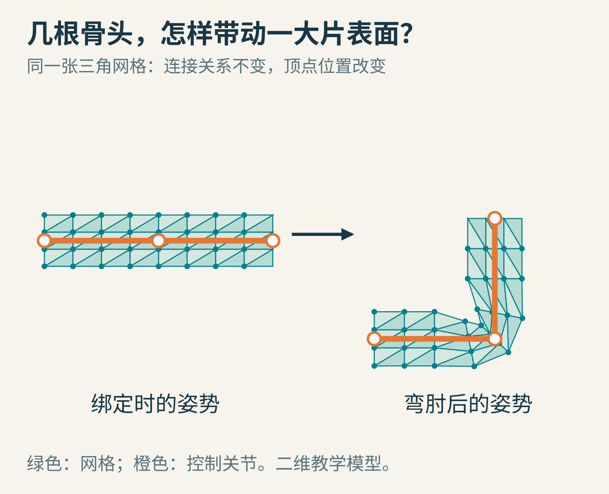
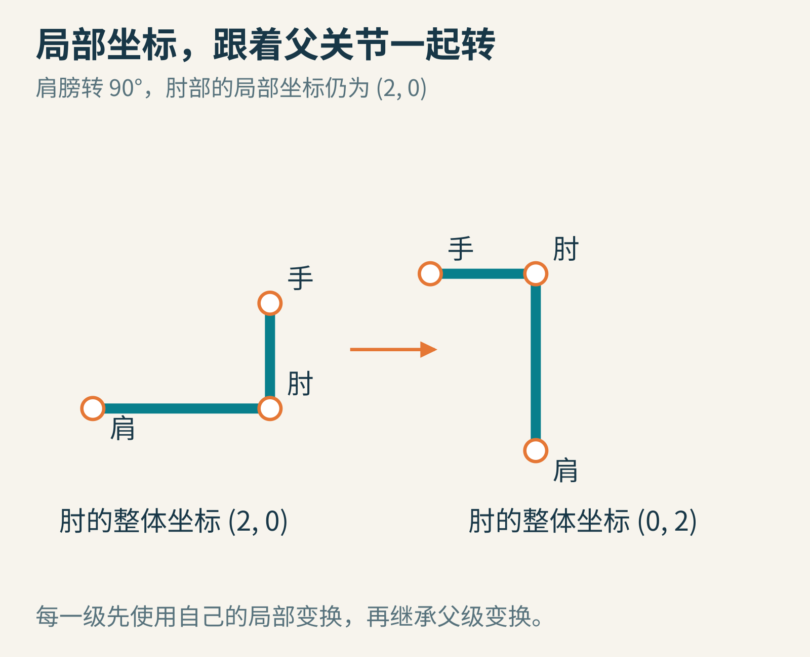
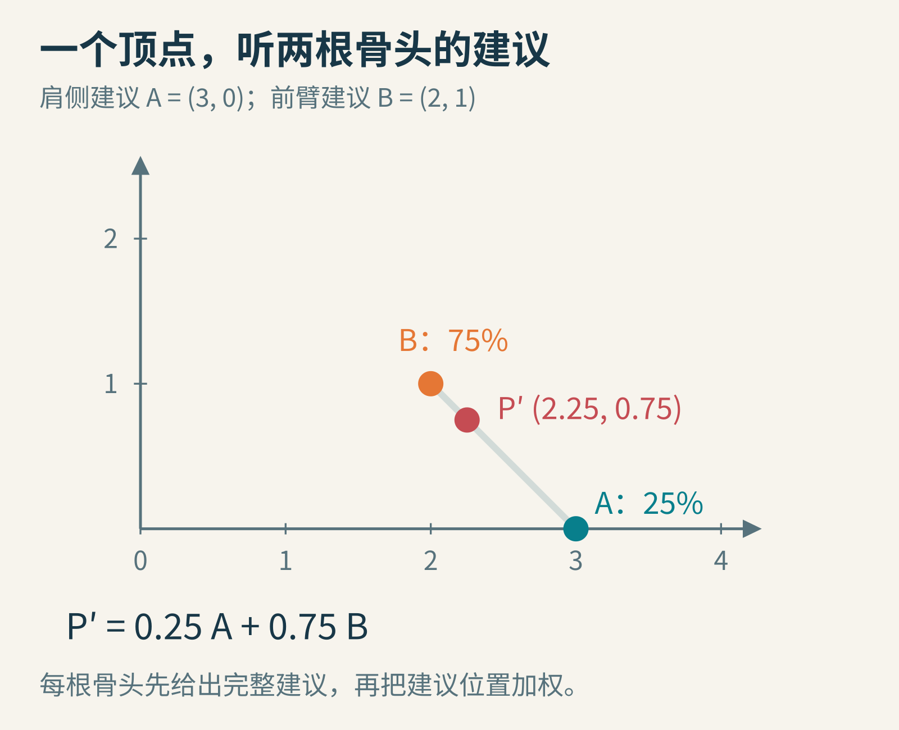
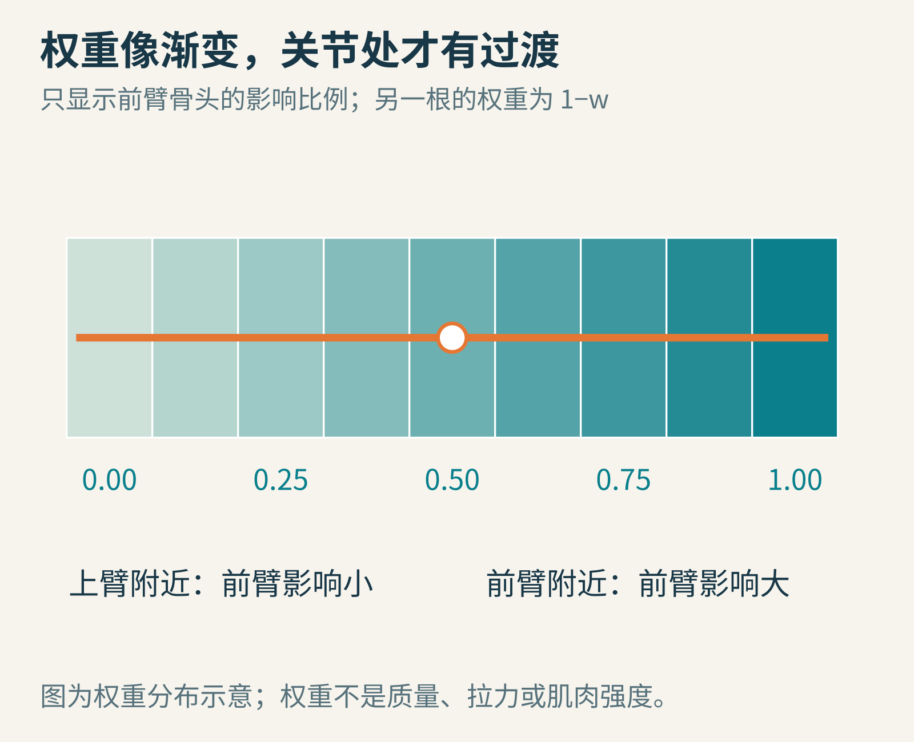
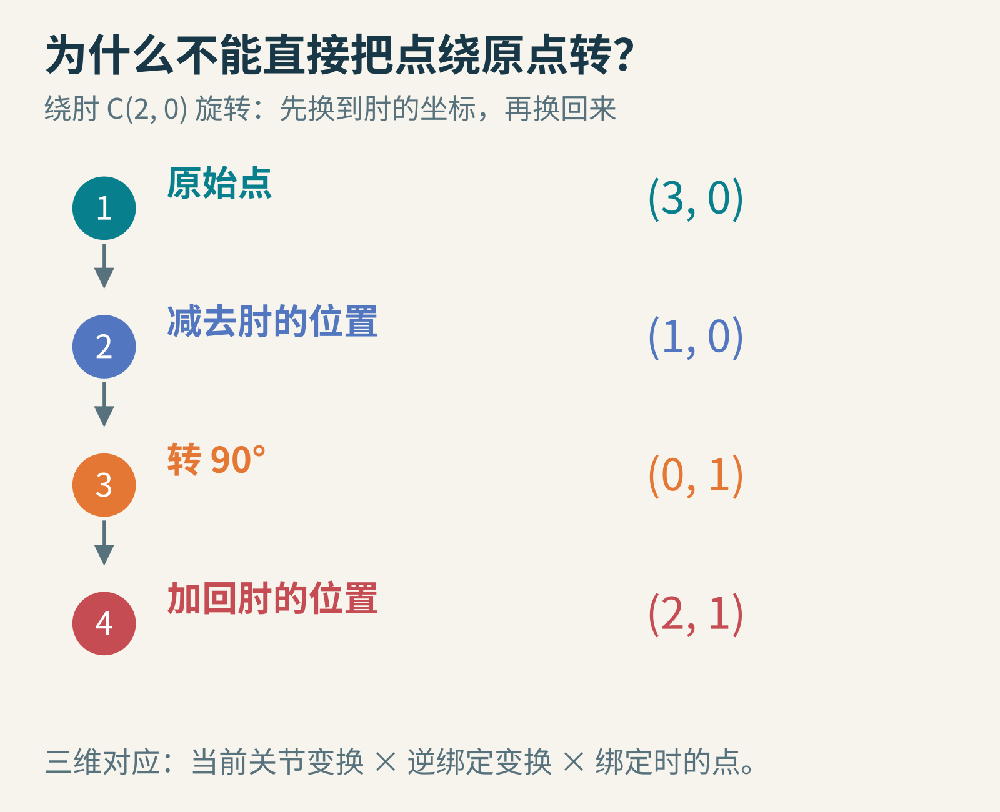
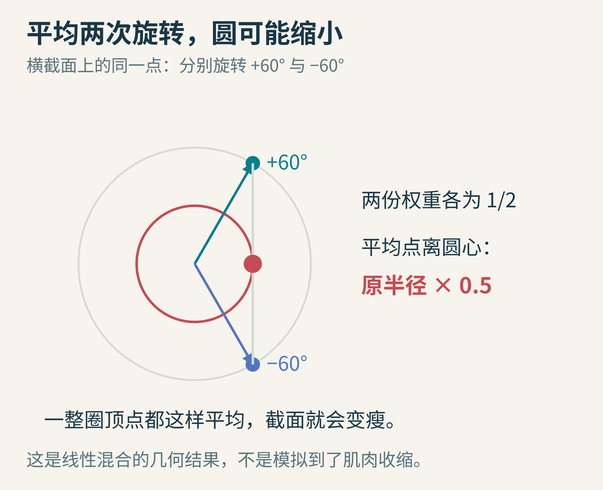
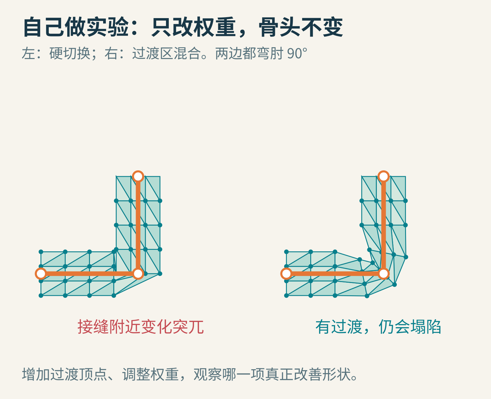

# 动画角色抬起一只手，成千上万个皮肤顶点为什么会跟着走？

游戏里的角色朝你挥手。肩膀抬起来，肘弯下去，袖口也跟着改变形状。你可能知道模型里藏着一副“骨架”，但这里有一个容易被跳过的问题：骨头只有几十根、几百根，外面的皮肤却可能有成千上万个点，它们之间到底怎样传递动作？

电脑没有真的在模型里长出肌肉。对于一种常见做法，它给每个表面顶点保存一张小小的影响清单：听哪些骨头的，以及各听多少。这套让骨架带动表面的机制，叫**骨骼蒙皮**。

今天我们只造一条能弯的手臂。先不做逼真的汗毛、肌肉和衣料，看看一张三角形织成的“袖子”，怎样被两个关节带起来。



全文图片均为原创教学示意。绿色是三角网格，橙色是控制骨架；这不是引擎截图，也不是人体组织的物理模拟。

## 先把皮肤想成一张带编号的渔网

三维角色的可见表面，通常可以由许多三角形拼成。三角形的角叫顶点；顶点除了位置，还可以携带法线、纹理坐标等信息。法线帮助描述表面朝向，纹理坐标告诉程序该去图片的哪一处取颜色。

“让模型弯起来”的第一层意思很具体：改一批顶点的位置，让原先平直的三角形带变成弯曲的带。

如果你逐个给每个顶点制作每一帧的位置，当然有可能得到动画，但编辑和存储都会很麻烦。蒙皮把工作拆开：动画师主要操纵少量控制关节，程序根据已有关系计算大量顶点。

这里的骨头也不必是长条形物体。引擎里真正参与计算的，常是关节的变换与父子关系。屏幕上画出的骨棒，只是帮助人看懂这些关系的工具。它们可以控制人，也能控制尾巴、机械臂，甚至一条会扭动的水管。

所以先记住三样不同的东西：网格负责形状，骨架负责控制，蒙皮权重负责两者怎样联系。

## 第一关：肩膀一转，肘为什么会一起移动？

伸直手臂时，设肩在(0,0)，肘在(2,0)。现在让整条上臂逆时针转90度，肘就到了(0,2)。

但从肩膀自己的坐标系看，肘仍然可以被记录为“沿肩的局部横轴走2”。变的是这根局部横轴在整个场景中的朝向。

这就是**层级变换**的直觉：孩子的坐标写在父亲的坐标系里。肩的方向变了，肘的整体位置跟着变；肘再弯一下，手还会继续跟着肘变。



图中两条手臂保持相同的肘部局部姿势，右侧把肩整体转了90度。肘相对肩的记录不变，整体位置改变。

如果只给肘保存一个固定的世界坐标，肩转了以后，肘就可能留在原地，手臂被扯断。父子关系让我们能表达“跟着上一级走”，而不必每次手动重新安排所有关节。

三维时，平移、旋转和缩放常被放进变换矩阵。你暂时不用会矩阵乘法，只需理解其职责：它是一套把某种坐标描述换成另一种坐标描述的规则，而且规则有顺序。先向前走再转身，与先转身再向前走，落点通常不同。

## 第二关：每个顶点只跟一根骨头，会怎样？

一个很省事的方案是：上臂的点全部听上臂，前臂的点全部听前臂。

对盔甲、机械零件这种本来就硬的东西，这可能很合适。可对连续皮肤，肘附近容易出现明显的折角与挤压。因为相邻两个顶点只隔很短一段距离，却突然服从完全不同的运动。

于是我们允许一个顶点同时受多根骨头影响。例如，肘附近某个点可以25%听上臂、75%听前臂。这两个比例叫权重。

重要细节来了：这里不是先执行四分之一次上臂动作，再执行四分之三次前臂动作。在线性混合蒙皮里，每根骨头先独立给出“如果完全跟我，你应当到这里”的建议位置，最后再平均这些位置。



点P′位于两份建议A、B的连线上，更靠近权重较大的B。图里的25%与75%相加为100%。

我们来真的算一次。绑定时某个顶点P在(3,0)，肘C在(2,0)。上臂不动，所以它建议A＝(3,0)。前臂绕肘逆时针转90度，建议B＝(2,1)。

如果P有25%的上臂权重、75%的前臂权重：

P′＝0.25×(3,0)＋0.75×(2,1)＝(2.25,0.75)。

横坐标是0.25×3＋0.75×2，纵坐标是0.25×0＋0.75×1。分别算，完全是小学乘加。

“线性混合蒙皮”，英文常缩写为LBS，说的就是这类加权组合。它的三维实现可以参看[Khronos的glTF蒙皮教程](https://github.khronos.org/glTF-Tutorials/gltfTutorial/gltfTutorial_020_Skins.html)。教程里的关节索引和权重属性，把这种关系明确保存在模型数据中。

## 权重的颜色，究竟在表示什么？

建模软件常用颜色显示某根骨头对网格的影响。一个点颜色很“热”，可能表示该骨头权重大；另一个点颜色较“冷”，可能表示影响小。具体配色由工具决定。

它不是肌肉强度图，也不表示骨头把多少牛顿的力传给皮肤。这里没有先计算受力、再求弹性形变。它是动画师或自动绑定工具给程序的一张变形配方。



这张图只画前臂骨头的权重w。采用两根骨头时，上臂的权重就是1−w；真实模型的过渡范围由形状和动作需求决定。

为什么通常要求一个顶点所有权重相加为1？试想角色所有骨头都没有动，各自给出的建议都是原位置P。若权重总和是1，混合后仍是P。如果加起来是1.5，直接按同样公式算，位置就变成1.5P，什么动作也没做，形状却变了。

非负且总和为1的权重，还使结果落在这些建议位置的凸包内。两根骨头时就是连线段上。这个性质方便理解，也预示了后面一个很有趣的缺陷。

自动分配权重可以节省时间，但“距离最近”不等于“应该控制”。手臂贴近身体时，躯干上的点可能离手骨很近，却不应该在挥手时被拖走。检查一张静止模型还不够，必须让关节做动作，才能看见错误影响。

## 隐藏机关：为什么要记住骨头原先在哪里？

前面我们说，P(3,0)绕肘C(2,0)转90度后变成(2,1)。如果你直接对(3,0)绕原点旋转，得到的却是(0,3)。这个错误会让前臂绕肩附近甩出去。

要绕肘转，先减去肘的位置，得到相对肘的(1,0)；转90度得到(0,1)；最后加回肘的位置，得到(2,1)。



这组数展示了“先抵消绑定时的位置，再应用当前姿态”的作用。真实三维骨架还包含父子层级与坐标空间转换。

模型绑定骨架时的那套姿势叫**绑定姿势**。你可能常看见T字站姿，但绑定姿势不必须是T字。程序需要知道骨头在绑定时怎样放置，才能算出它现在相对原先改变了什么。

把所有量约定在同一模型空间后，一根骨头对点的建议可以写成：当前关节变换×逆绑定变换×绑定时的顶点。逆绑定变换就负责“撤销这根骨头原先的变换”。在绑定姿势下，当前变换和逆绑定变换相互抵消，网格应该原样留下。

不同引擎可能把结果存于不同空间，还需要网格节点的逆变换等步骤。抄公式之前先问：“这个点现在是模型坐标、关节坐标，还是世界坐标？”漏掉这个问题，往往比算错一个三角函数更难排查。

## 平均很方便，为什么肘还会变瘦？

两根骨头各给一个正确的旋转结果，平均以后一定还是正确的旋转吗？不一定。

在圆的横截面上取一点(1,0)。分别旋转+60度和−60度，得到(0.5,约0.866)与(0.5,约−0.866)。两者各占一半，平均是(0.5,0)。它离圆心只有原来的一半远。



两个建议都在大圆上，中点却在圆里面。对一整圈点做相同计算，截面就会缩小。

这解释了常见的关节塌陷与扭转时的“糖纸”效果：像把糖果两端的包装纸拧起来，中段越拧越细。每根骨头自己的刚性变换没有把物体压扁，位置的线性平均却可能压扁它。

一种改进方法是双四元数蒙皮。名字很长，它的关键不是给权重涂得更漂亮，而是换一种更适合混合旋转和平移的数学表示。[Kavan等人的原始论文](https://users.cs.utah.edu/~ladislav/kavan07skinning/kavan07skinning.pdf)讨论了这类方法对传统线性蒙皮伪影的改善。

这也不是一键获得真实人体。复杂肩部、肌肉鼓起、衣服褶皱可能还需要辅助骨骼、修正形状或物理模拟。方法各有成本，目标是让特定角色的特定动作看起来合适。

## 用十几行代码，亲手算出那一个顶点

下面是完整的Python 3小实验，不需要引擎或额外库。它只验证二维点的位置混合，没有渲染整只角色。

```python
from math import cos, sin, radians

def rotate_around(p, pivot, degrees):
    x, y = p[0] - pivot[0], p[1] - pivot[1]
    a = radians(degrees)
    return (pivot[0] + x*cos(a) - y*sin(a),
            pivot[1] + x*sin(a) + y*cos(a))

p = (3.0, 0.0)
a = p
b = rotate_around(p, (2.0, 0.0), 90)
w = 0.75
result = tuple((1-w)*a[i] + w*b[i] for i in range(2))
print(tuple(round(v, 3) for v in result))
```

输出为(2.25, 0.75)。这是对本文自写示例的实际运行结果，不是某款引擎的性能测试。

先把w改成0，再改成1，检查它是不是分别停在A和B。随后把角度改成45、120、180度，看混合点怎样走。留意：当角度连续变化时，这个点的轨迹未必是一条绕肘的圆弧，因为它混合了两套运动。

如果愿意再多走一步，把p改成许多点组成的列表，按原来的连接关系把点连成网格。你就得到了一台最小的蒙皮实验机。



两边骨架做相同动作。右侧加入过渡权重，接缝更连续，但仍能看到线性混合的收缩。

## 最后一个判断题：为什么加密模型不一定能救它？

假设手肘很瘪，把顶点数量增加十倍，会自动鼓回来吗？未必。如果新点仍接受同样会收缩的混合规则，只是更细致地描出了同一个瘪形状。

诊断时可以依次问：骨架动作对不对？绑定姿势和坐标空间对不对？顶点有没有受错骨头影响？权重有没有正确归一？网格在关节处是否有足够且合理的连接？最后才判断是否需要改蒙皮方法或增加修正形状。

蒙皮通常也不会自动让碰撞体、衣服和头发都变得合理。它们可能有自己的运动与碰撞方案。看起来手臂弯了，不代表游戏的所有逻辑都已经理解了这次弯曲。[Unity的Skinned Mesh Renderer说明](https://docs.unity3d.com/Manual/class-SkinnedMeshRenderer.html)也区分了骨骼网格、混合形状和布料等可变形对象。

下次再看角色挥手，你可以在脑中把皮肤暂时变成一张透明网：少数关节移动，一批变换提出建议，每个顶点按自己的权重投票，最后形成整个表面。一个自然的动作，背后是一群点在认真做乘法和加法。

图片来源：本文原创教学图，按文中自设几何与数值绘制；不是照片或软件界面截图。延伸阅读见正文链接。
