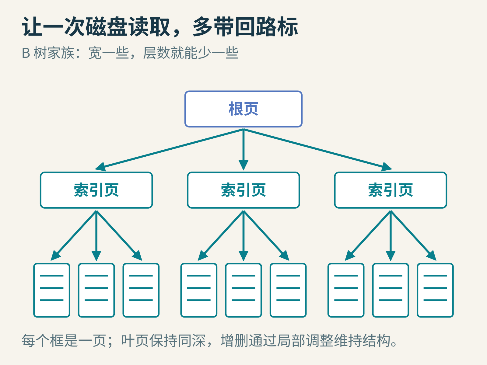
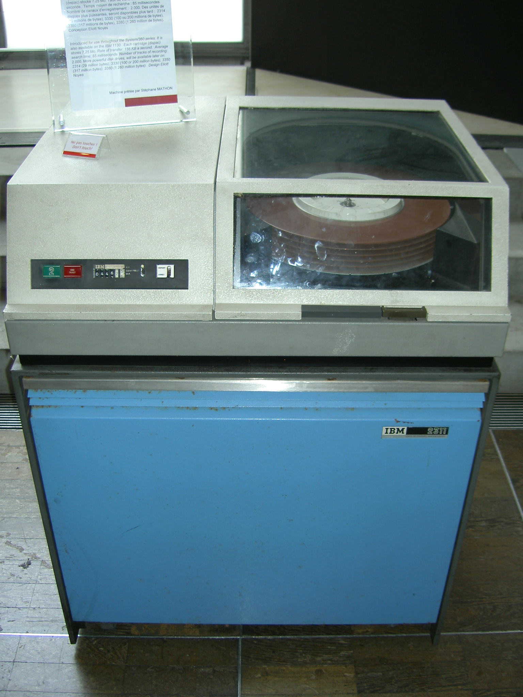
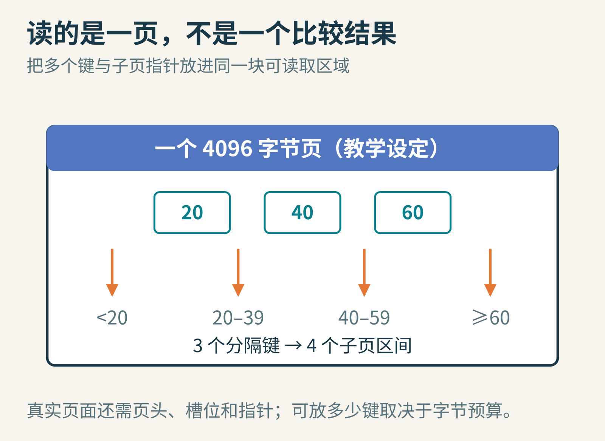
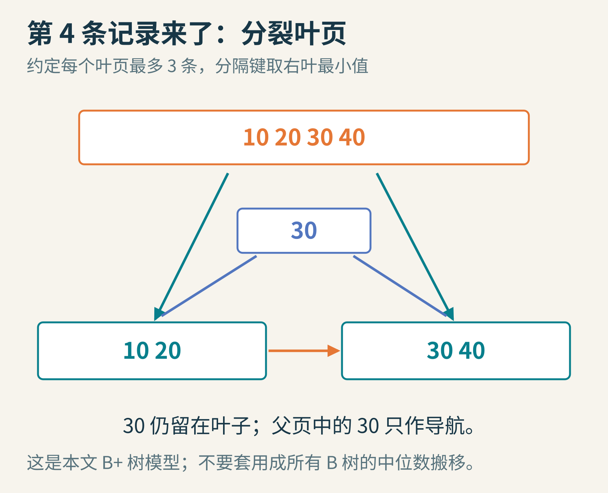
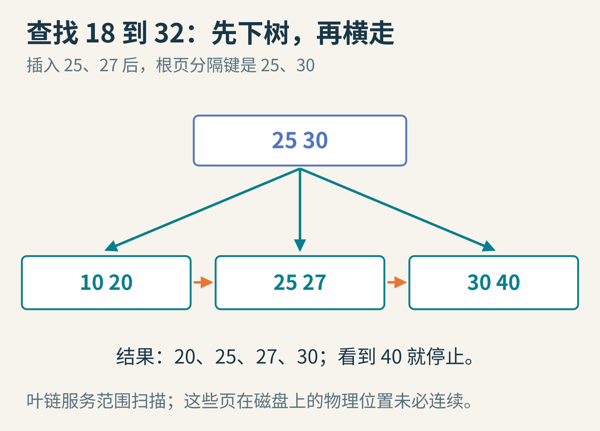
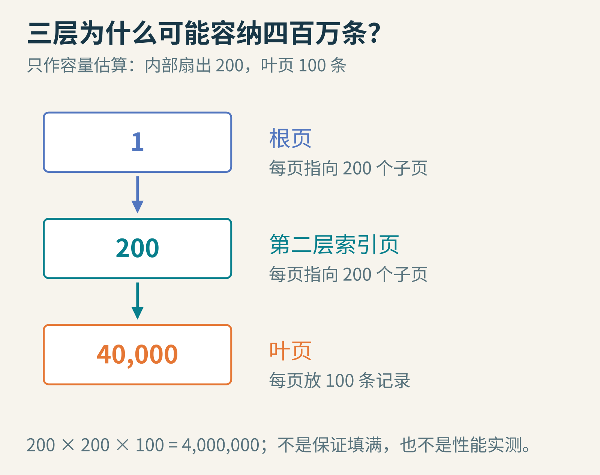
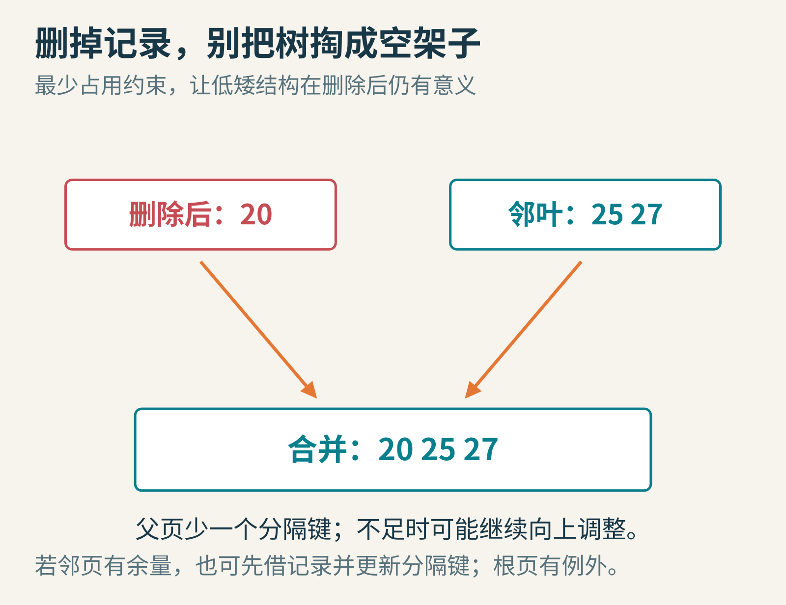

# 为什么数据库的树长得又矮又宽？B 树把“少比较”改成了“少跑磁盘”

想象学校有四百万条图书借阅记录。你要查学号 20260027 的借书情况。顺序翻四百万条显然太慢；学过二分查找后，你可能想：不断折半，二十几次比较就够了。

可是，如果每次比较都要让磁盘去另一个位置取一小块数据，二十几次“很便宜的比较”就可能变成二十几趟“很贵的读取”。计算机算法里的动作，并不是都按同一个价目表收费。

B 树的故事，从这张不均匀的价目表开始。它不执着于让每个节点只装一个键，而是让一次磁盘读取带回很多路标。树于是长得更宽、更矮，查询少走好几层。

封面示意：树的框代表页面，一页里可以有很多键。宽不是杂乱；所有叶子保持同样深度，才不会出现有的记录近在眼前、有的记录藏在长链末尾的情况。

## 一、先回到需要等磁头的年代

Rudolf Bayer 与 Edward McCreight 在波音科学研究实验室研究大型有序索引。他们的[1970 年 7 月技术报告](https://infolab.usc.edu/csci585/Spring2010/den_ar/indexing.pdf)名为《Organization and Maintenance of Large Ordered Indices》；其期刊版本发表于 1972 年《Acta Informatica》。技术报告年份与期刊年份都常出现在资料中，并不是互相矛盾的两个“发明日期”。

原研究关心的是动态文件：除了查找，还不断插入、删除。把所有索引键排成一大段连续数组，查询可以二分，但中间插一项会牵动后面很多内容；用零散的二叉节点便于局部连接，却又可能让一次查询发生太多外部存储访问。

作者实际在 IBM System/360 Model 44 与 IBM 2311 磁盘上做实验。报告中的设备参数与今天的 SSD 相差很大，但“固定读取开销加上按块传输开销”这个观察，仍值得保留。

IBM 2311 磁盘驱动器，展示了 B 树早期研究面对的设备类型。摄影 I, Deep silence，2007 年（文件页日期记录有差异），[原图](https://commons.wikimedia.org/wiki/File:IBM_2311_memory_unit.JPG)，[CC BY 2.5](https://creativecommons.org/licenses/by/2.5/)，未改动。这是同型号设备，不是声称找到了原论文实验现场。

Bayer 与 McCreight 的重要贡献，不是给字母 B 编一个漂亮的展开词，而是把页面、平衡、有序检索和动态维护组织进可分析的结构。本文不把 B 武断解释为某个确定的人名或单词；理解它并不需要先解决这个命名谜题。

## 二、为什么一次搬一页比一次搬一个数好？

机械磁盘读取数据时，有寻找位置等固定开销。既然付了这一趟代价，顺便取回相邻的一批字节，通常比只取一个键划算。数据库因此常以“页”为单位组织存储，页大小与硬件扇区不是必然相同的概念。

假定我们选择 4096 字节一页，预留 64 字节页头，再给最右边的子页指针留 8 字节。若一个“键加对应子页指针”占 20 字节，剩余 4024 字节能放 201 项，并有 202 个子页指针。这个算式不是某款数据库的实际格式，而是让你看懂扇出从哪里来。

节点中的键把值域分成多个区间。一次把页面读到内存，就能用若干次便宜的比较，决定下一次应该读哪个子页。

比如页里的分隔键是 20、40、60。它们可以把学号范围分成小于 20、20 到 40 之间、40 到 60 之间、60 及以上四段。具体“等号归左还是归右”必须由实现定义，不能在插入和查询时各用一套规则。

一次页面读取后，在页内做线性或二分搜索只是内存计算，不意味着每比较一个键都再访问一次磁盘。这正是 B 树的思路：适当多做页内工作，换取少跨几次慢边界。

## 三、B 树与 B+ 树，先把名字背后的差别分开

经典 B 树可以在内部节点中保存键及其对应信息，查到那里就能结束。B+ 树的一种常见组织方式则让内部节点主要承担导航，全部数据记录或记录引用放在叶子，叶子再按键顺序连接，便于范围扫描。

下面我们使用一个明确的教学 B+ 树模型：

- 每个叶页最多放三条记录，非根叶页至少放两条
- 内部页最多放三个分隔键，也就是四个孩子
- 分隔键采用右侧子树的最小键；相等时往右侧走
- 叶页从小到大相连；所有叶页的深度相同

这里“三条”只为能在纸上画清楚，不是实际数据库页面容量。不同教材对“阶”“度”的定义也不一致，直接声明最多几个键、几个孩子，比只说“三阶树”更不会误会。

还要记住，真实产品并不总照这张简图实现。[SQLite 文件格式说明](https://www.sqlite.org/fileformat.html#b_tree_pages)区分 table b-tree 和 index b-tree，前者的数据都在叶子，后者又有自己的索引键组织。不能仅凭名字把每种数据库索引都画成完全相同的 B+ 树。

为什么相等时往右要说得这么认真？因为我们的路标采用右子树最小值。根中的 30 表示“从右边这棵子树开始，可能找到 30”，所以查询 30 应进入右侧。另一种完全合法的约定，是用左子树最大值作分隔，再把相等的情况交给左边。二者都能正确工作，前提是维护算法与搜索算法配套。

这也是读工程文档时需要留意的细节：画面上都有几个数字和箭头，不代表它们具有完全相同的语义。把自己的测试范围放在分隔值本身及其两侧，例如 29、30、31，往往比只测远离边界的键更容易发现实现错误。

## 四、从一页长出一棵树

按顺序插入 10、20、30。它们都放在同一个叶页里；此时根页也是叶页。插入 40，页里临时出现四条记录，超过上限。

把它分成两个叶子：左边 10、20，右边 30、40。再建立根页，放入分隔键 30，并让两个孩子分别指向左右叶子。注意，30 仍留在右叶里。根中的 30 是路标，不是把这条数据从叶子搬走了。

B+ 树的叶子分裂通常把分隔键复制到父页；经典 B 树的分裂可以把中间键连同对应项提升到父节点。两种操作不能不加区分地混着讲。

继续插入 25，它进入左叶，得到 10、20、25。再插入 27，左叶变成四条，分裂为 10、20 与 25、27。父页增加路标 25，根里现在有 25、30，三个孩子分别覆盖小于 25、25 到 30 之前、30 及以后。

如果父页也满了怎么办？同样需要分裂，并把适当的分隔信息交给上一层，变化可能一直传到根。根分裂时，才在上面加一个新根，树高增加一层。其他局部分裂不会让某条路径独自多一层，所以所有叶子仍齐平。

你可能觉得“分裂”很费事。是的，它会产生额外写入；B 树并没有承诺每次插入只写一页。它保证的是结构不会因一连串不走运的插入退化成线性长链，并通过占用约束控制高度与空间。

## 五、范围查询为什么喜欢叶子排队？

现在查询 18 到 32，端点都包含。先从根找到可能含有 18 的叶页，即 10、20。跳过 10，取出 20，再沿叶子链接向右，得到 25、27、30。看到 40 超过上界，就停止。

结果是 20、25、27、30。第一次查找要从根向下，随后不必为每一条结果重新走根路径。

如果索引只存记录地址，读到键之后还可能要去别的数据页取完整记录，这通常称为回表一类的额外访问。范围索引扫描的成本，不能只数经过几个索引页而忽略真正的结果数据。

另外，“叶子在逻辑上相邻”不等于“物理上刚好连续”。页面经历长期插入、分裂和回收后，可以散布在不同位置。缓存、预读与存储布局会影响实际速度。教科书里的横向箭头给的是顺序关系，不是磁头轨迹。

## 六、三层为什么能覆盖四百万条？

做一个刻意简化的容量估算：内部页平均按 200 个孩子计算，叶页按 100 条记录计算。根可以指向 200 个第二层索引页；这些页合计指向 40,000 个叶页；每叶 100 条，就是 4,000,000 条。

这是给定占用数量下的算术模型，不是所有三层树必然放满四百万条。实际容量取决于键长度、记录大小、页头、空闲空间和实现规则。

找一条记录只要沿一条根到叶的路径走，不用读遍这 40,000 个叶页。若三层全不在缓存，模型中需要三次页面取得；若根与一部分内部页常驻缓存，需要实际访问存储的次数还会更少。

这也解释了为什么索引键太宽会伤害性能。把键从 12 字节变成几百字节，一页能容纳的分隔项变少，扇出下降，树可能变高；缓存里相同数量的字节也只能留住更少的路标。索引设计因此不仅是“有没有”，还是“键里放了多少东西”。

但不能由此得出“键越短越好、不管含义”。排序规则、唯一性、查询条件和正确比较一样重要。把必要信息丢掉以求更短，可能根本无法回答原问题。

## 七、删除比擦掉一个数字更复杂

回到三叶的例子：左叶 10、20，中叶 25、27，右叶 30、40。删除 10 后，左叶只剩 20，低于约定的两条下限。

可以先看相邻兄弟有没有多余记录可借。借记录以后，父页的分隔键也可能需要更新。若兄弟也只在最低占用，就合并。例如把左叶 20 与中叶 25、27 合成一页，得到 20、25、27，恰好没有超过三条上限；父页删去相应分隔键和一个孩子指针。

局部合并可能让父页占用不足，调整便继续向上传播。根页有特殊规则：若最终只剩一个孩子，可以让孩子接任根，树高减少。

为什么不允许所有空页一直留下？因为那样会出现一棵很高、每页只剩一两条记录的树。查询和空间成本就不再受到原来的约束。维护“不能太空”，与维护“不能太满”同样重要。

真实数据库也可能延迟合并，用不同填充策略减轻写入抖动。这是工程取舍，不应反过来说经典结构的占用规则毫无意义。理解抽象保证，才知道具体实现放松了哪一条、换来了什么。

## 八、换成 SSD，这棵树就过时了吗？

SSD 没有机械寻道，但读取、写入、擦除、控制器调度和缓存访问的成本仍不相同。数据仍常按页或块组织。B 树的外存思路并不会因为机械磁头消失就自动失效，不过最合适的页大小、填充比例、批量写入策略可能改变。

另一个不能省略的问题是故障。叶页分裂需要更新新页、旧页和父页；如果中间断电，只写完其中一部分，结构可能不一致。B 树本身的几何性质不能代替事务机制。日志、写时复制等设计负责把这些修改组织成可恢复的动作。

并发也一样。一个查询正在沿父指针向下走时，另一个线程可能正在分裂页面。锁、锁存器或专门的并发树算法，需要保证读者不会掉进刚被移动的结构缝隙。只实现“纸上插入正确”，距离生产数据库还隔着这些问题。

## 九、给自己造一台按次收费的磁盘

最有意思的练习，是把成本模型演出来。请同学替你保管各张“页”，每拿一张就收费一枚筹码。页内比较随便做，不再收费。先用一个键一个节点的二叉搜索树找目标，再用每页多个键的 B+ 树找目标，比较需要拿多少张纸。

随后按 10、20、30、40、25、27 的顺序插入，画出每一步。最后执行 18 到 32 的范围查询，再删除 10。检查四件事：记录有没有丢；同一记录有没有莫名重复；路标是否把范围分对；所有叶子深度是否相同。

还可以把“读一页收费十枚，页内每次比较收费一枚”改成其他价格。哪种结构更合算，可能随价格改变。这正是 B 树历史给人的启发：算法不是脱离机器的咒语。找准真正昂贵的动作，再安排数据靠近它，往往比只追求少写几个比较符号更有力量。

图片来源：[I, Deep silence 的 IBM 2311 实物照片](https://commons.wikimedia.org/wiki/File:IBM_2311_memory_unit.JPG)；其余为原创教学示意。

本文由 AI 辅助资料整理、写作与制图；页面容量、键序列与筹码实验为教学模型，未冒充设备性能实测。
