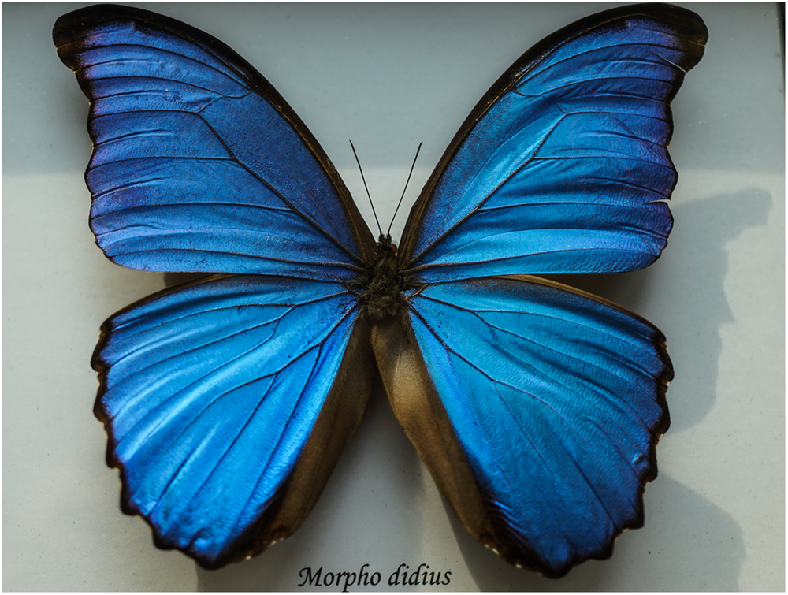
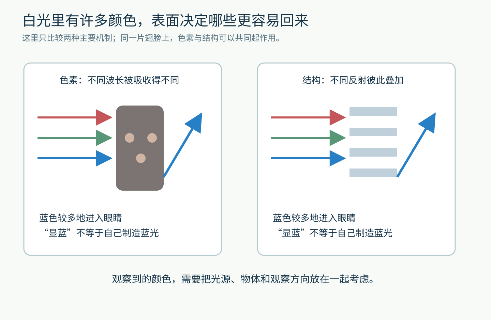
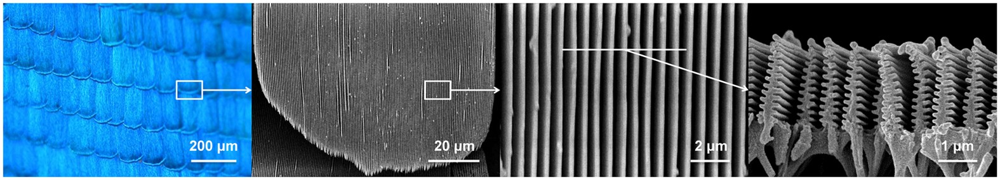
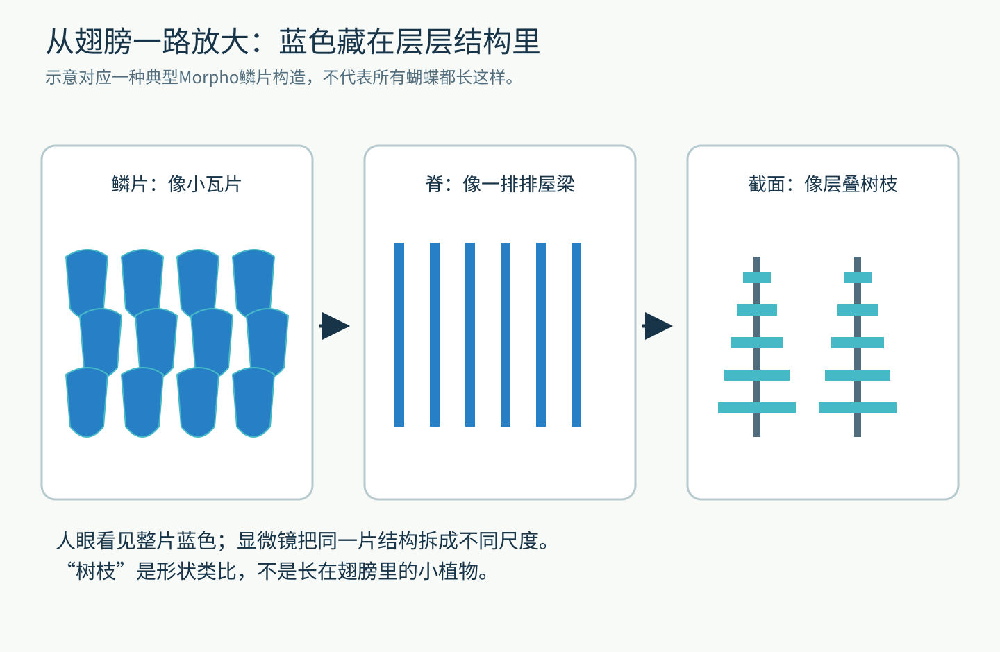
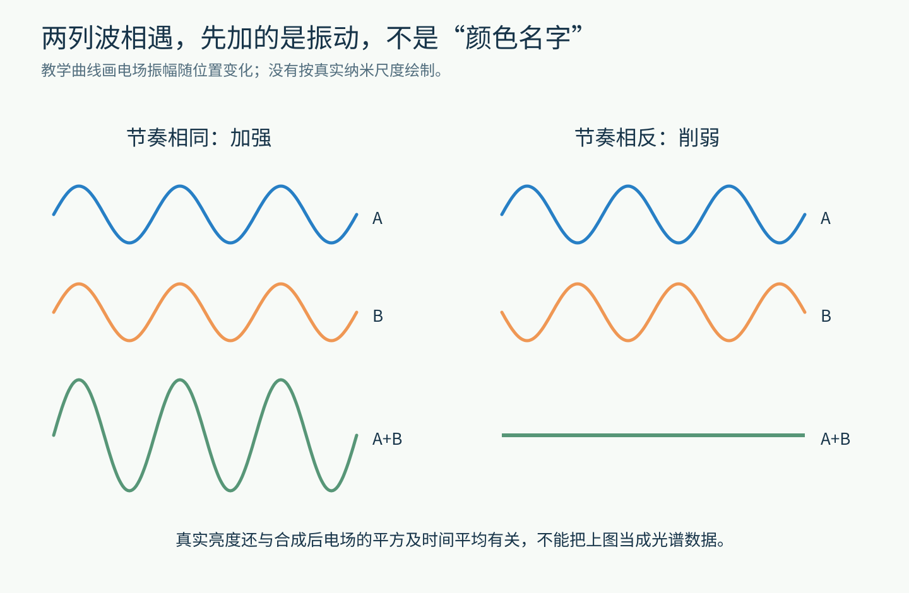
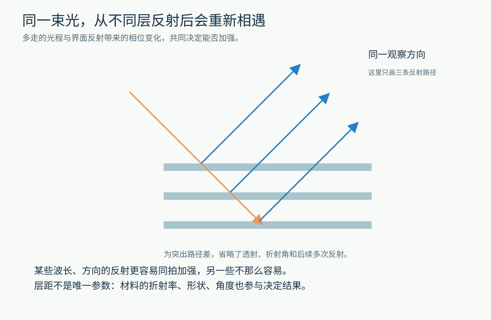
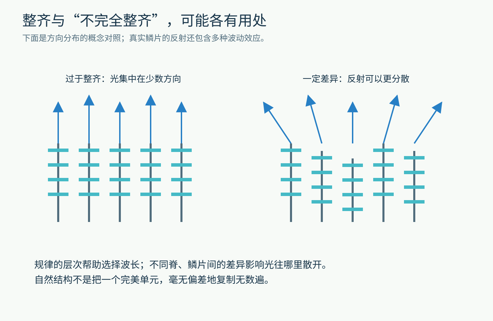
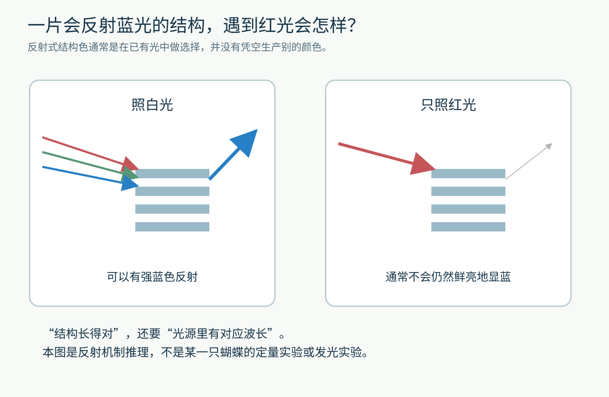

# 没涂蓝色颜料，蝴蝶的翅膀为什么蓝得发亮？

一只蓝色闪蝶飞过，翅膀像有人突然打开、又关上了一盏蓝灯。

你可能会想：它体内一定藏着某种特别厉害的蓝色颜料。

但如果把问题交给显微镜，答案会越来越像一项精密工程：小瓦片、一排排细脊、层叠的薄片，还有一些恰到好处的不整齐。

**有些颜色，主要不是由“用了什么颜料”决定的，而是由“材料怎样排列”决定的。**

这听起来很神奇。不过，只要先弄懂一件普通的事：我们看见一件东西的颜色，到底看见了什么？后面的路就能一步步走通。

图1｜真实的 Morpho didius 标本照片，来自 Didari 与 Mengüç 2018 年论文图1。它展示了需要解释的颜色，不是本文绘制的效果图。CC BY 4.0，原图未改。

## 先把“蓝色”从物体里拿出来想

晚上关掉所有灯，一张蓝色卡纸不会继续蓝得发亮。

不是卡纸突然换了材料，而是没有足够的光从它那里进入你的眼睛。

白光里包含多种波长的光。你可以暂时把波长理解成光波相邻两个“波峰”之间的距离；在可见光范围内，不同波长对应不同的颜色感觉。蓝光波长较短，红光较长。

当白光照到物体上，有些光被吸收，有些透过去，还有些被反射或散射出来。最后进入眼睛的那一部分，参与决定你看见什么颜色。

比如，一种蓝色颜料对不同波长的吸收程度不同，让返回眼睛的光里蓝色占了较大比例。

而蓝色闪蝶的某些鳞片，可以通过另一种方式做选择：让许多微小界面反射出来的光互相叠加，特别加强某些波长和方向的反射。

这就是结构色的入口。

图2｜两种机制的原创概念对照。箭头表示光的输入与输出，不按实际光线路径绘制。色素与结构不是互相排斥的选项：同一片翅膀上，两者可以共同起作用。

先留一个小问题：既然结构主要是在光里“挑选”，如果只给它红光，没有蓝光可挑，它还能蓝得那么鲜亮吗？稍后我们再回来。

## 第一轮放大：一片翅膀，其实铺了很多“小瓦片”

蝴蝶翅膀表面并非光滑的塑料薄片，而是覆盖着许多细小鳞片。

不要为了观察它们去摸活蝴蝶。脱落鳞片可能影响翅膀，我们直接看研究者的显微图。

下面这组图从左向右，像一次接力放大：

- 最左边能看见彼此覆盖的蓝色鳞片，像屋顶瓦片。
- 再近一点，一块鳞片上有密集的平行细脊。
- 继续放大，可以看见脊之间的间隔。
- 最右边看截面，脊两侧伸出一层层薄片，像小树伸出的枝条。

图3｜真实显微图，来自 Song 等人2017年论文图1；对象是 Morpho rhetenor，与图1不是同一种、同一只标本。左图是光学显微图，后三图是扫描电子显微图。标尺依次为200、20、2和1微米。CC BY 4.0，原图未改；横图可点开放大。

1微米是1毫米的千分之一。最右边的细节，已经远远小于肉眼可以分清的范围。

这里的黑白图不是“翅膀洗掉颜色后的照片”。电子显微镜的成像方式与普通彩色相机不同，黑白本身不能证明有没有色素。它主要告诉我们：**结构确实存在，而且形状可以被测量。**

图4｜原创层级示意，把图3中的主要构造拆开看，尺度与间距经过夸张；这是一类典型闪蝶鳞片的结构，不是所有蝴蝶的统一模板。

现在，真正的问题出现了：这些小薄片为什么能决定颜色？

## 第二轮放大：光不是一粒粒彩色油漆

想象两个人同时推动一架秋千。

如果他们总在合适的时刻朝同一方向推，秋千容易越荡越高。如果一个向前推，另一个恰好向后推，效果可能互相削弱。

这个类比只用来帮助理解“节奏关系”。光不是秋千，但光波也有振动的节奏。

当两列同频率的光波在同一个位置相遇，首先相加的是电场的振动。若它们在这个位置几乎总是同方向，合成振动会增强；若几乎总是方向相反，则会减弱。

这叫干涉。

图5｜原创波形示意。蓝线与橙线代表两列电场波，绿线代表相加结果；没有模拟真实蝴蝶的光谱。上面两列波画在不同高度，只是为了便于比较。

别把右下方的直线理解为“光的能量被魔法删除了”。真实光学系统里，不同位置、方向的加强和削弱要一起考虑；能量还可能通过透射或吸收等途径分配。

所以干涉不是简单地说“两束光相遇就变亮”，而是要问：**相遇时，它们的振动到底对得有多齐？**

## 第三轮放大：多走一点路，就可能换一个节奏

想象两个人从同一地点出发，步子完全同步。

一个直接走到终点，另一个绕了一段路。两人再次碰面时，未必还同时迈左脚。

光从不同薄片界面反射回来，也会经历不同的路径。多走的光程，加上反射本身可能带来的相位变化，会改变这些反射光相遇时的节奏。

这里的“光程”不只是尺子量出的几何距离，也和光经过什么材料有关。同样长的一段路，在不同材料里，对振动节奏的影响可以不同。

图6｜原创路径示意。它只突出不同深度的反射路径，省略折射、透射和后续多次反射，不是完整的光线追迹计算。

关键来了：同一段光程差，对不同波长意味着不同的“差几拍”。

因此，一组特定的层距和材料，可以使某些波长在某些方向上的反射更容易加强，而让另一些波长不那么突出。大量小结构一起工作，宏观上就能出现鲜明的颜色。

这也是为什么“把材料磨成粉，再重新糊回去”，未必还能得到原来的结构色。化学成分可能还在，负责安排光程和方向的微观结构却已经变了。

对闪蝶来说，多层薄片的干涉是重要的一部分。但如果在这里就结束，我们仍然少解释了一个现象。

## 为什么它没有像光盘那样，只在某个角度闪一下？

看到结构色，很容易得出一个过快的结论：只要是结构产生的颜色，就一定随着角度剧烈变成彩虹。

事情没那么整齐。

闪蝶属于一个很有意思的例子：有些种类的蓝色可以在较宽的观察角度内保持明显，但强弱、色调和方向性仍会变化，并非从任何方向看都完全一样。

如果把一排排完全相同的结构，以非常严格的间距排列起来，光可能强烈集中到特定方向，出现明显的角度选择。

而真实鳞片的脊不是无限延伸的大镜面。它们很窄，会让光产生衍射；相邻结构的高度、位置或内部形状也可能存在差异。这些因素会一起改变反射光的方向分布。

图7｜原创概念对照，用箭头帮助理解反射的方向分布。实际结果需要波动光学计算；不能把图中的每根箭头当作对应某条脊的实验测量。

2017年的一项仿生研究，就专门讨论了结构之间的差异怎样帮助获得宽角度的蓝色反射，并制作了人工薄膜进行验证。

这带来一个很值得记住的认识：**规律的层次帮助选颜色，一定程度的差异帮助安排颜色出现在哪些方向。**

自然界有时并不需要把所有零件造得一模一样。

当然，这不是说越乱越好。乱到把层次破坏掉，原本的选色能力也可能消失。有效的是具体结构中的具体差异，需要测量和模型判断。

## 回答开头的问题：只有红光，还能蓝吗？

现在你可以先自己推理。

如果一种结构主要通过反射来显蓝，它需要从入射光中得到对应波长。只照红光时，没有足够的蓝光可以被它反射回来，通常就不会保持白光下那种鲜亮蓝色。

它可能显得很暗，也可能仍有一部分红光反射，具体取决于材料、结构和观察方向。这与“光一照上去，它就自动制造蓝光”不同。

图8｜原创思考实验，不是针对某只蝴蝶的实测结果。此处只讨论反射机制；荧光等会改变出射光谱的机制，需要另外分析。

再补上一块拼图：结构色并不意味着翅膀里没有色素。

某些闪蝶鳞片中的黑色素可以吸收没有被有效反射回来的光，减少杂散背景，让蓝色显得更纯。准确的说法是，这些鲜明蓝色的重要来源是微纳结构，而不是把整片翅膀描述成一块“完全无色素的材料”。

这也是科学解释有趣的地方。第一个答案“是结构色”，打开了门；第二个答案“结构、色素、光源、角度共同参与”，才让房间逐渐完整。

## 用一层肥皂膜，把问题带回自己手里

不必购买蝴蝶标本，更不必捕捉或损伤蝴蝶。用一个塑料环和少量肥皂水，就能观察一个相关现象。

在漫射白光下拉起一层薄膜，先保持视角不动，观察颜色是否随时间改变；再尽量保持其他条件不变，换一个观察角度。

图9｜原创观察方案，颜色排列仅为示意。不要将肥皂水吹向眼睛；不用激光，也不要对着太阳观察。

为什么时间也会影响颜色？薄膜里的水在排流、蒸发，膜厚会变化。为什么角度会影响颜色？光在膜中的路径关系也会变化。

肥皂膜不是闪蝶鳞片的复制品，它没有那一排排树枝状细脊。不过，它能让你亲眼看见一个共同的核心：**即使没有更换颜料，几何条件改变，也能改变光怎样叠加。**

如果愿意多走一步，可以记录三个问题：颜色是整片一起变，还是局部先变？换视角之后还能找到原来的颜色吗？在比较昏暗的光线下，现象又有什么变化？

你不必一次就给出所有答案。先把观察条件写清楚，才有可能分辨是物体变了、光源变了，还是观看方式变了。

下次再见到一只闪着蓝光的蝴蝶，可以想象那片翅膀上铺满了肉眼看不清的小结构。它们没有一块屏幕，也没有一盏蓝灯，却在光到达的瞬间，安排好了很多束反射光的相遇。

图片来源

- 图1：[Didari、Mengüç，Scientific Reports，2018，图1](https://www.nature.com/articles/s41598-018-35082-3)，[CC BY 4.0](https://creativecommons.org/licenses/by/4.0/)，未修改。
- 图3：[Song、Johansen、Sigmund、Shin，Scientific Reports，2017，图1](https://www.nature.com/articles/srep46023)，[CC BY 4.0](https://creativecommons.org/licenses/by/4.0/)，未修改。
- 图2、4—9：原创教学示意。

延伸阅读：[英国自然历史博物馆的蓝色闪蝶介绍](https://www.nhm.ac.uk/discover/spotlight-blue-morpho.html)；[Wang等，2013年结构色与角度关系研究](https://www.nature.com/articles/srep03427)。
