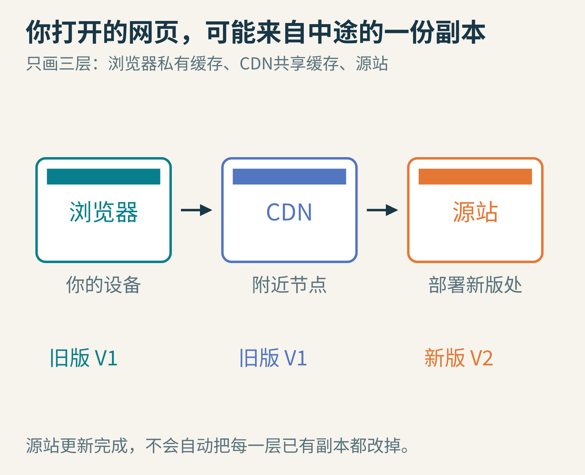
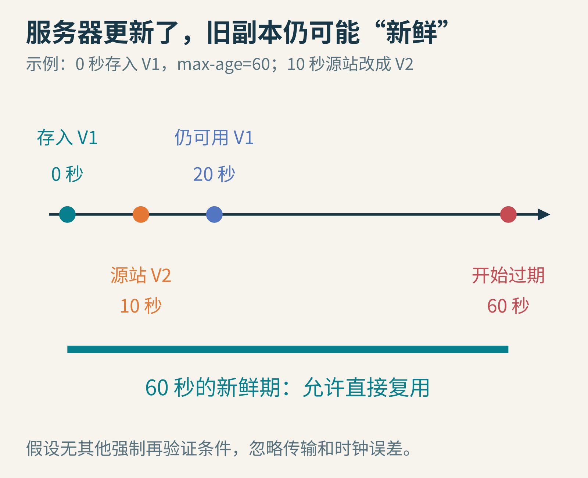
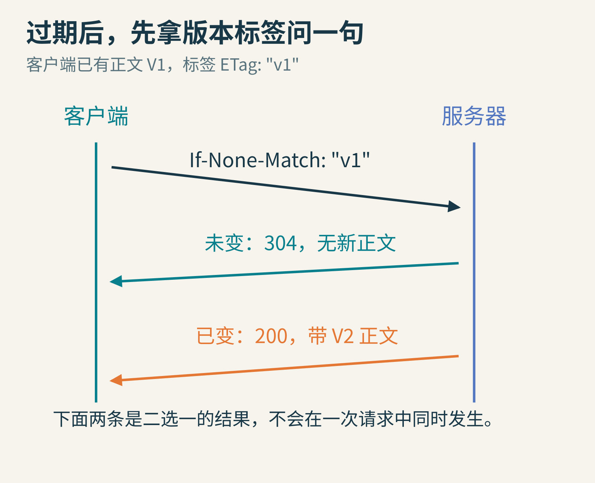
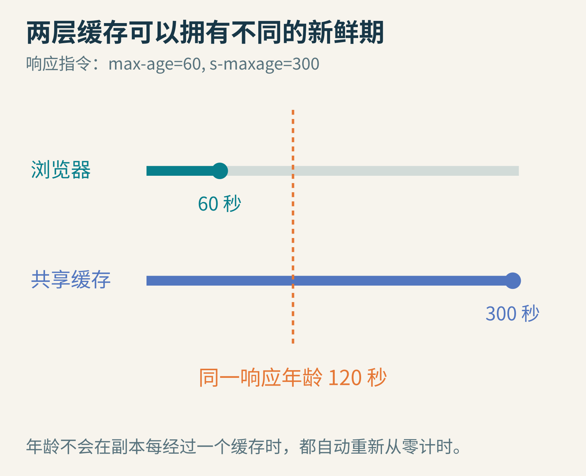
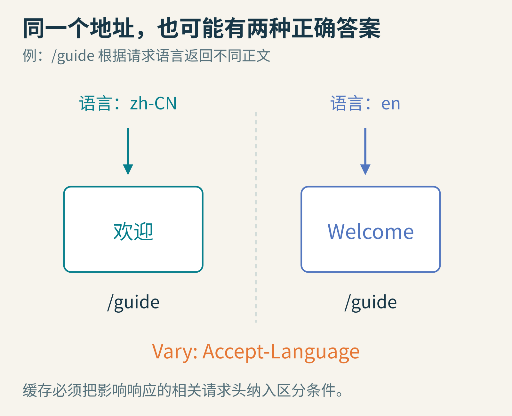
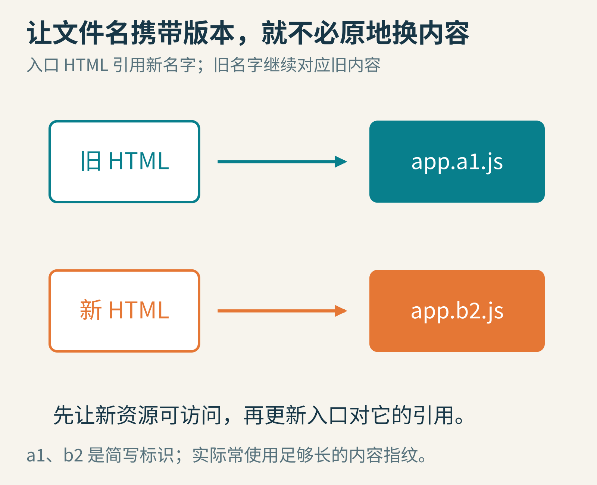
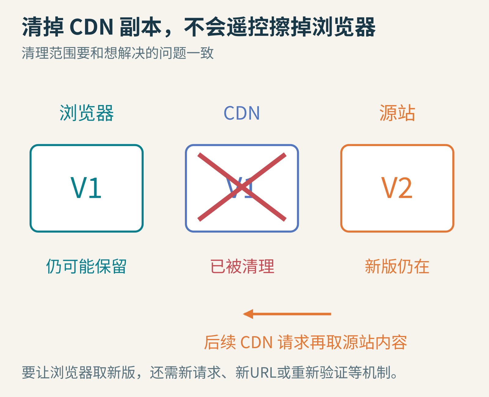

# 网页明明更新了，为什么你的浏览器还在认真显示旧版？

你把网站按钮从蓝色改成橙色，部署成功，打开网页：蓝色。

再刷新：还是蓝色。你开始怀疑自己改错了文件，朋友却发来截图：“我这边已经是橙色了。”同一个网址，怎么像通往两个平行世界？

先别急着清空所有东西。网站的内容可能经过多层缓存，每层都保存着一份过去收到的响应。旧版仍被使用，有时候不是它们忘了更新，而是它们正在遵守你之前写下的规则。

今天我们沿着一次网页请求往回走，看看一份旧内容怎样被合法地留下，以及怎样设计更新，让它在该换的时候换掉。

## 先画出地图：你拿到的内容，不一定来自源站

源站可以先理解成提供网站原始响应的服务器。CDN则把内容分布到不同地区的节点，尽量从离访问者较近的地方提供副本。浏览器自己的内存或磁盘里，也可能保存副本。

访问一个资源时，浏览器可能在本地就找到了能复用的响应，根本没有发网络请求。若需要联网，CDN又可能直接回答，于是请求没有继续到源站。



全文配图均为原创教学示意。三层是为了建立直觉；真实系统还可能有反向代理、应用缓存及其他中间层。

“部署完成”通常只说明新内容已在某个发布位置生效。它不会自动伸出一只手，把所有用户设备里存着的旧副本改写掉。

我们今天主要讲HTTP缓存：缓存保存的不只是一个文件，还包括响应状态、响应头和正文等信息。用哪份响应、能保存多久、何时要询问服务器，都与这些元数据有关。[RFC 9111](https://www.rfc-editor.org/rfc/rfc9111.html)定义了这套缓存语义。

## 第一条规则：新鲜，只是允许复用，不是保证源站没变

假设浏览器在第0秒收到一份V1响应，里面写着：

```http
Cache-Control: max-age=60
```

先忽略传输耗时、已有Age值与时钟校正。它告诉缓存：这份响应的新鲜期是60秒。在其他复用条件也满足时，年龄还不到60秒的副本可以直接使用。

第10秒，源站更新成V2。第20秒，你再次需要这个资源。浏览器一看，V1才20秒，仍处于允许直接复用的期限，于是继续使用V1。



这里的“新鲜”是协议状态。它不意味着缓存刚刚问过源站，也不意味着源站绝对没有新版本。

这是一种明确的取舍：你允许一定时间内不再确认变化，换取更少网络请求、更快响应和更低服务器负担。如果页面内容需要立刻反映更新，就不能随意许诺一个很长的新鲜期。

反过来，60秒到了也不表示缓存必须立刻删除文件，更不表示第60秒会自动联网下载。通常是下一次需要使用它时，缓存才判断该不该重新验证或获取新响应。

把“过期”理解为“默认不能再像新鲜响应那样直接复用”，比理解成“到了钟点，文件自动消失”更准确。规范还允许一些有明确条件的旧响应复用方式，本文暂不展开这些扩展。

## 第二条规则：过期了，先问一句“还是这个版本吗？”

假设这份V1带有一个版本标签：

```http
ETag: "v1"
```

ETag是服务器提供的实体标签。它可以来自内容指纹，也可以由其他规则生成；看到它，不要自动认定它一定是文件的MD5值。

缓存需要验证时，可以带上自己的标签发请求：

```http
If-None-Match: "v1"
```

可以把它读成：“如果当前版本与我这份标签不同，请把新内容给我。”

如果资源没变，服务器可以返回304 Not Modified。这个响应不携带新的资源正文，客户端复用已有正文，并根据收到的元数据更新缓存信息。如果资源已经变了，则通常返回200 OK与新正文、新标签。



304仍然发生了网络交互，只是省去了重新传输完整正文。它与“完全从本地新鲜缓存读取”是两种不同的节省。

因此，“我看到304，所以浏览器出错了”并不成立。304表达的是本次条件请求的验证结果。若更新后仍不断得到304，应检查验证标签是否正确更新、请求究竟到了哪个节点、部署的是否是对应资源，而不是把304本身当成错误代码。[RFC 9110中的304定义](https://www.rfc-editor.org/rfc/rfc9110.html#section-15.4.5)给出了正式语义。

## 三个名字很像的指令，最好用动作来记

`max-age=60`：满足其他条件时，年龄小于60秒可以直接复用。

`no-cache`：允许存，但未经成功验证，不能直接拿来满足后续请求。这里讨论不带字段名参数的形式。

`no-store`：要求相关缓存不要存储这次请求或响应的信息，具体要求取决于指令所在位置。

最容易踩的坑是把no-cache翻译成“根本不缓存”。事实上，它保留了“存下正文、之后用304确认”的可能性。no-store才是面向不存储的约束，但也不是远程橡皮擦：你今天才在源站加上它，不会自动擦掉用户此前已经保存、暂时还没来重新请求的旧副本。

另外，`private`表示响应不能由共享缓存存储，并不等于禁止浏览器自己的私有缓存，也不等于内容已经加密。涉及个人内容时，缓存策略还需要配合正确的鉴权、访问控制和应用设计，不能只靠一个单词解决所有问题。

[MDN的HTTP缓存指南](https://developer.mozilla.org/en-US/docs/Web/HTTP/Guides/Caching)对这些区别有系统说明。读响应头时先问它要求“能不能存”“能不能直接复用”还是“哪些缓存能存”，许多混淆就会消失。

## 浏览器与CDN，可以拿到不同的期限

对一份允许公开缓存的响应，可以写出这样的教学配置：

```http
Cache-Control: public, max-age=60, s-maxage=300
```

max-age给出60秒新鲜期；对于共享缓存，s-maxage会覆盖max-age，因此CDN这一类共享缓存按300秒处理。浏览器私有缓存不使用s-maxage。



当响应年龄是120秒时，对浏览器已经过期，对按此规则工作的共享缓存仍可能新鲜。图只比较期限，不代表所有CDN默认按同一配置缓存所有资源。

这里还有一个反直觉细节：年龄并不是“刚进入我这台设备，就重新从零开始”。中间缓存可以通过Age响应头传递已有年龄，接收方还需要按协议考虑日期、驻留时间和传输等因素。

例如，忽略额外耗时，一份max-age=60的响应从上游带着Age: 40到达浏览器，剩余新鲜时间大约是20秒，而不是再奖励60秒。如果每层都无条件重新计时，一份内容经过足够多层缓存，就可能老得离谱却仍自称年轻。

托管CDN还可能有后台规则、专用响应头或边缘程序覆盖默认行为。排查时要同时检查实际响应头和服务的有效配置，不能只看源代码里你以为发出去的那行文本。

## 同一个网址，凭什么给别人不同的内容？

假设/guide根据请求里的Accept-Language返回中文版或英文版。如果缓存只按URL存一份，先来的中文用户可能把“欢迎”留在缓存里，后来的英文用户也拿到中文。

服务器可以用下面的响应头告诉缓存，选择响应时需要考虑这个请求头：

```http
Vary: Accept-Language
```



图中两个响应都可以是正确答案，区别在于请求条件。缓存键要区分的是“什么请求可共享这份响应”。

最基本的缓存选择涉及请求方法、目标URI以及相关的Vary条件，实际CDN还可能定义自己的缓存键。随便改变查询参数不一定能绕过每一种托管缓存规则，因为某些配置会忽略或规范化查询参数。

个性化页面更要谨慎。不要因为URL相同，就认为不同登录用户一定能共享正文；也不要把“把所有请求头都塞进缓存键”当成万能方案。区分得不够会用错内容，区分得过细又会让几乎每个请求都无法复用。

## 比“清缓存”更可预测的更新：让新内容住进新地址

对于打包后的JavaScript、CSS或图片，一种常见做法是给文件名带上内容版本。例如，旧入口引用app.a1.js，新入口引用app.b2.js。这里a1、b2只是短示意，实际内容指纹通常长得多。

两个名字对应两份不同资源。发布新版时，不修改app.a1.js的内容，而是新增app.b2.js，再让入口HTML引用新名字。



部署顺序很重要：先确保新资源已经可访问，再发布引用它的新入口。否则用户可能先拿到新HTML，却找不到对应脚本。

这类不会在原URL下改动内容的资源，适合较长新鲜期，并可使用immutable指令，告知缓存其在新鲜期内不会变化。[RFC 8246](https://www.rfc-editor.org/rfc/rfc8246.html)说明了这种指令与带版本URL的配合。

但入口HTML本身需要能发现新版本。常见策略是让入口重新验证，而让带指纹的静态资源长期缓存。不能把入口也永久锁在旧版，再指望它神奇地知道新脚本叫什么。

旧资源也不要刚上线新版就全部删掉。已经打开的旧页面，可能过一会儿才按需加载一个旧名字的代码块。保留一段与发布策略匹配的兼容窗口，有助于避免“首页能打开，点进某个功能却404”。这是一项部署一致性设计，不是缓存头能独自保证的。

## 清了CDN，为什么你的浏览器还是旧的？

因为清理动作有边界。CDN的purge通常处理服务方持有的缓存副本。浏览器本地那份没有因此被远程擦除。



图里的CDN下一次需要获取资源时，可以再取源站内容；但浏览器如果直接复用自己的新鲜副本，请求甚至不会走到CDN。

以[Cloudflare的按URL清理说明](https://developers.cloudflare.com/cache/how-to/purge-cache/purge-by-single-file/)为例，清理对象与缓存键、请求变体有关。若清的是重定向地址，也不能自动等同于清理重定向目标的正文。

还有几类“看起来像缓存”的情况需要分开：Service Worker可以用Cache API按程序逻辑保存和返回响应；返回上一页可能恢复整个历史页面状态；应用自己也可能保留接口结果。[Cache API说明](https://developer.mozilla.org/en-US/docs/Web/API/Cache)明确指出，它的缓存条目不会自动按HTTP缓存头执行通常的缓存更新规则。

所以强制刷新很适合临时诊断，却不是能修好每一层存储的魔法按钮。不要把它当成网站正确发布的长期依赖。

## 写一个小缓存，让它亲口解释为什么拿旧版

下面的完整Python 3程序只在内存里模拟单层缓存。它不联网，忽略HTTP年龄的完整计算、CDN、Vary和异常情况，只保留新鲜、重新获取、验证未变化三条路径。

```python
cache = None
origin = "v1"

def get(now):
    global cache
    if cache and now - cache["saved"] < 60:
        return "local", cache["body"]
    if cache and cache["etag"] == origin:
        cache["saved"] = now
        return "304", cache["body"]
    cache = {"body": origin, "etag": origin, "saved": now}
    return "200", cache["body"]

print(0, get(0))
origin = "v2"  # 假设第10秒，源站更新
print(20, get(20))
print(70, get(70))
print(131, get(131))
```

实际输出依次是：第0秒200、v1；第20秒local、v1；第70秒200、v2；第131秒304、v2。注意最后一次没有变回v1，只是确认当前存着的v2仍然有效。

试着把60改成5，再改成600。你会看到旧版可被直接复用的窗口怎样变化。再把origin更新那一行去掉，第70秒会走哪条路？先预测，再运行。

这个玩具也暴露了缓存的核心问题：保存一份副本很容易，难的是决定哪一次请求能相信它，以及原件变了以后如何发现。

## 下次排查，沿请求路径问四个问题

第一，旧的到底是哪一个资源？HTML、脚本、样式、图片，还是接口结果？页面看起来旧，不代表每个请求都旧。

第二，它有没有真正发出网络请求？开发者工具里的本地缓存提示、请求头和响应头能提供线索，但显示方式随浏览器而异。

第三，返回的是哪一个版本，年龄和新鲜期是什么？检查内容标识、ETag、Cache-Control、Age，以及服务商定义的缓存状态头。单看200或304，不足以判断请求是否真正到达了源站。

第四，入口引用的URL是否已经变了，CDN规则和浏览器存储是否符合你的预期？先定位层级，再决定重新验证、改资源版本名或清理具体缓存。

当你把每份副本的身份、期限和验证方式都画清楚，“为什么还是旧版”就不再像随机故障。缓存的速度来自少问几次；可靠的更新，则来自事先约定好什么时候必须再问。

图片来源：本文原创HTTP机制图，所有版本、时刻和期限均为教学设定；不是浏览器或CDN实测截图。延伸阅读见正文链接。
