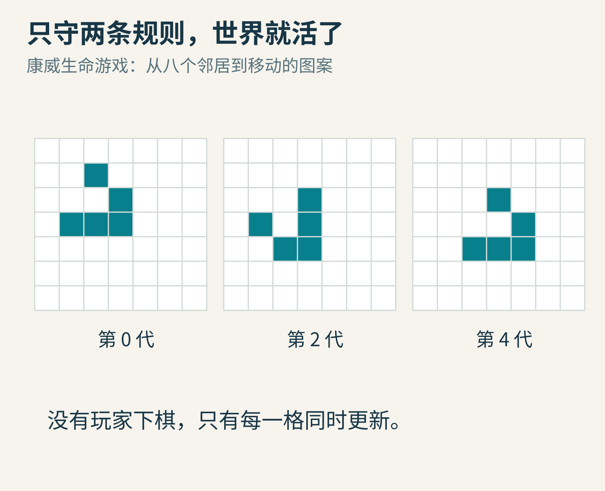
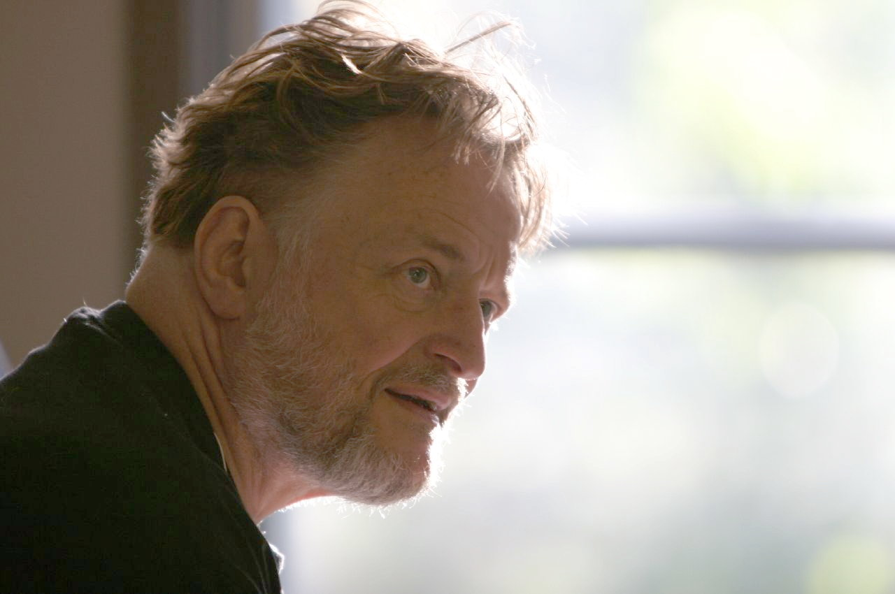
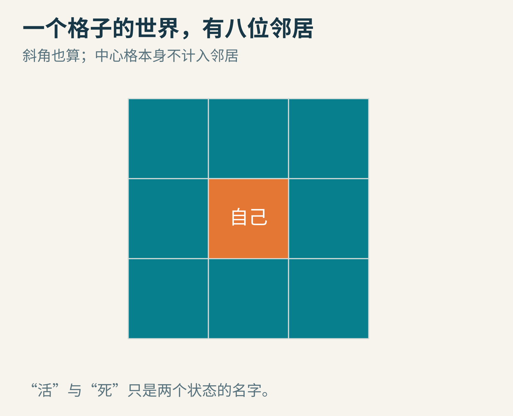
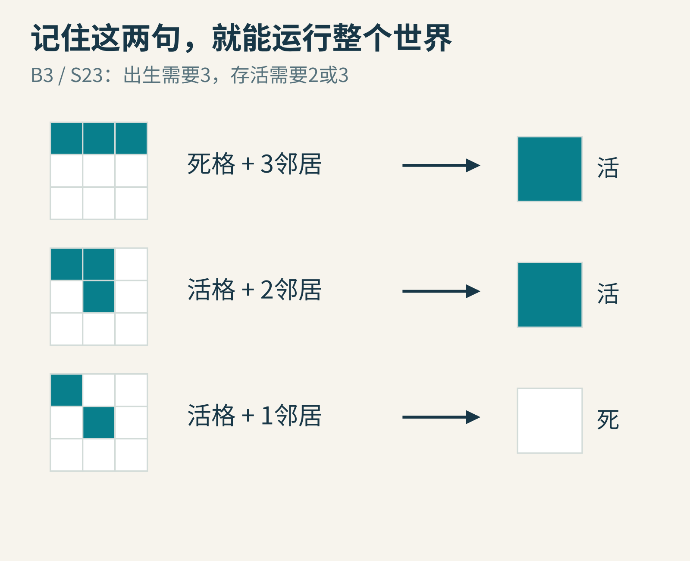
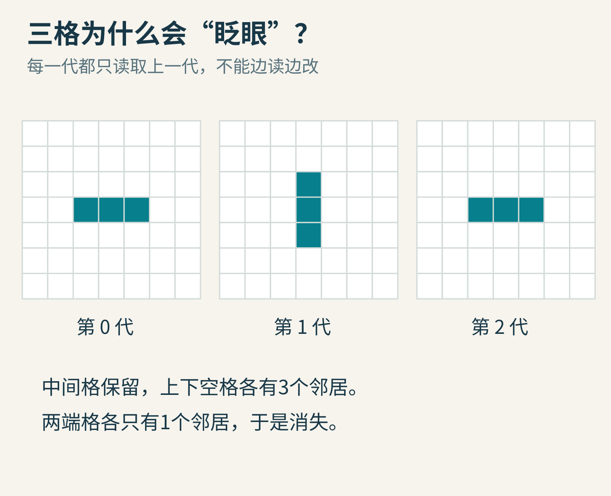
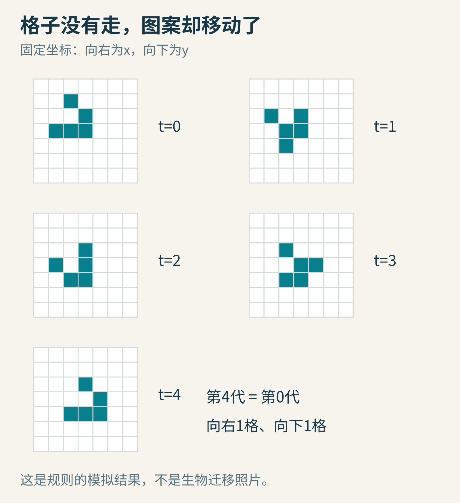
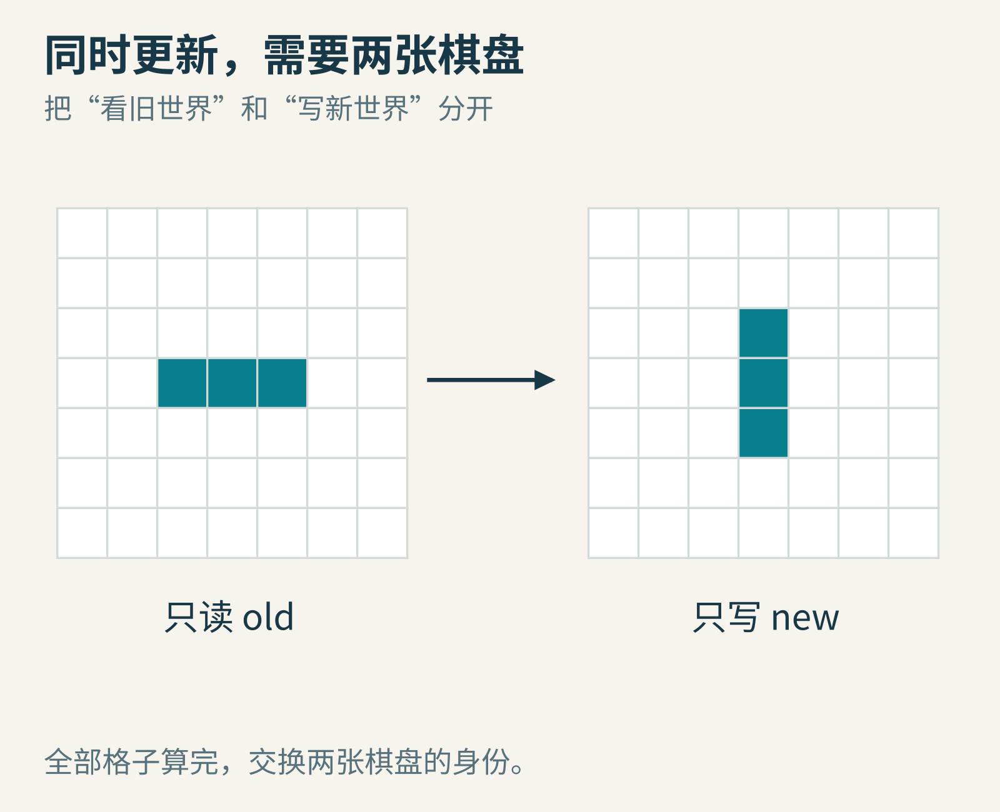
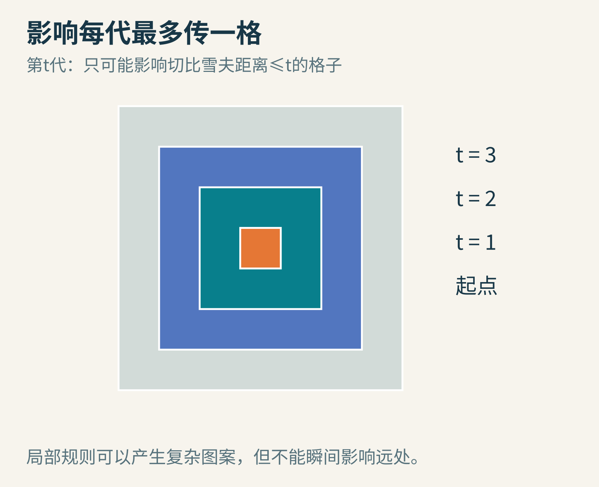
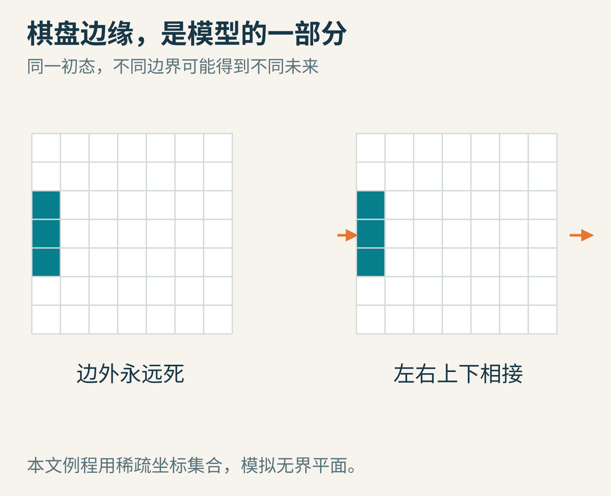

# 没有玩家的游戏，为什么能长出“会走路”的图案？

把棋子摆在方格纸上，然后宣布：谁也不许再动手。棋盘上的每一个格子，只能看看自己的邻居，决定下一秒要不要亮起来。

你可能以为，这样的世界很快就会无聊。可是有的图案会一闪一闪，有的仿佛向前爬行，有的与另一团图案相撞后消失，还有的能不断制造新的图案。

这里没有藏在后台的“小动物移动指令”。所有奇妙现象，都来自同一套短到能写在纸条上的规则。这就是约翰·霍顿·康威设计的生命游戏（Game of Life）。今天，我们从三枚棋子开始，亲手追踪它如何产生复杂性，也看看程序员怎样避免把这个世界算错。

## 一、先认识发明游戏的人，再拆掉一个误会

图1：康威，2005年6月19日，班夫国际研究站。Thane Plambeck 摄，CC BY 2.0；采用Commons现存1280×850完整版本，文件历史注明已有对比度调整，本文未再裁切。[图片与许可](https://commons.wikimedia.org/wiki/File:John_H_Conway_2005.jpg)

康威是一位数学家，研究远不止这个游戏。普林斯顿大学的纪念文章提到，他常用硬币、绳子、纸牌等道具向学生展示数学；生命游戏经过马丁·加德纳在《科学美国人》1970年10月的数学游戏专栏介绍，走向更广的读者。[普林斯顿大学](https://www.princeton.edu/news/2020/04/14/mathematician-john-horton-conway-magical-genius-known-inventing-game-life-dies-age)

“生命”这个名字很有诱惑力，却不能直接理解成真实生命的模型。这里没有营养、基因、细胞膜，也没有实验数据拟合。“活”和“死”只是两个状态的形象名字，和灯泡的亮、灭一样。

它更像一道严肃的数学问题：如果每个小部件都只遵守局部规则，整体会出现什么？冯·诺依曼等人在更早的自动机研究中探索过相关方向，但康威的规则不是所有细胞自动机的共同规则。换掉邻居范围、状态数量或更新办法，就会得到另一个模型。

## 二、世界的法律，只有两句话

想象一张向四周无限延伸的方格纸。每个格子有两种状态：活或死。它周围的八个格子都是邻居，包括斜角；自己不算自己的邻居。

图2：八邻域，也叫摩尔邻域。图中颜色用于区分位置，不表示生命游戏存在第三种状态。

把时间切成一代一代。每次更新，执行：

1. 当前死着的格子，恰好有3个活邻居，下一代出生。
2. 当前活着的格子，有2个或3个活邻居，下一代继续活；其他情况都死去。

这种规则常写成B3/S23。B表示出生，S表示存活，数字是活邻居数量。Golly的官方规则说明采用这个记法，并把康威规则列为B3/S23。[Golly规则文档](https://golly.sourceforge.io/Help/Algorithms/QuickLife.html)

图3：中心格与八个邻居一起决定结果。三个例子只解释局部判断；完整棋盘上的每一格都要分别判断。

注意“恰好”。死格旁边有4个活邻居，不会出生。活格旁边有4个活邻居，也不会继续活。这个世界不是“朋友越多越好”。“孤独”和“拥挤”只是帮助记忆的比喻，规则本身只是计数。

还有一个比这两句话更容易漏掉的条件：所有格子必须同时更新。也就是说，计算第10代时，所有判断都只能依据第9代，不能有人偷看已经写出的第10代。

## 三、三枚棋子，足够做一个时钟

在第3行连续放3枚棋子，坐标设为(2,3)、(3,3)、(4,3)。坐标从左到右增加x，从上到下增加y。

先看中间的(3,3)。它左右各有一个活邻居，总数2，所以下一代保留。

再看两端的(2,3)和(4,3)。它们各只有1个活邻居，下一代消失。

接着看中间格上方的空格(3,2)：三枚棋子都在它的八邻域内，所以它有3个活邻居，出生。下方(3,4)同理。其余空格没有恰好3个活邻居，不出生。

结果是：横着的三格，变成竖着的三格。

图4：闪烁器的三帧。第2代与第0代完全相同，因此它的周期是2。

把刚才的推理旋转90度，再做一次，竖排又变回横排。我们没有给它写“闪烁”指令，闪烁是多次应用规则后的结果。

这叫振荡器。另一个简单图案是2×2的方块：每个活格都有3个活邻居，外围死格又都不足3个，因此它保持不变，叫静物。

你可以先不打开电脑，在纸上验证方块。真正理解规则的标志，不是背下“B3/S23”，而是能解释某个格子为什么留下、某个格子为什么消失。

## 四、“滑翔机”没有一格真正搬家

现在摆五枚棋子：(2,1)、(3,2)、(1,3)、(2,3)、(3,3)。这就是一种朝右下方运动的滑翔机初态。

图5：根据正文规则逐代计算的原创示意。四代以后，图案恢复原来的形状，同时向右、向下各偏移一格。

仔细看：单个格子从来没有“搬去隔壁”。它只能保持状态，或者从活变死、从死变活。移动的是形状，而不是组成形状的固定格子。

这和体育场里的“人浪”有点相似：观众不必绕场奔跑，起立和坐下的模式就能绕场传播。类比只帮助我们想象；生命游戏的具体变化仍必须按照八邻域计数，而不是依靠人浪规则。

为什么说四代移动一次？因为前几代的外形不相同，只看两帧很容易把“扭了一下”误认成平移。可靠做法是比较坐标集合：第4代的每一个活格，都等于第0代某个活格的坐标加上(1,1)，而且没有多余格子。

附带的教学脚本正是这样检查，不靠肉眼猜测。这里的图是规则模拟，不是显微镜照片，也不是生物实验。

## 五、程序里最大的陷阱：刚算出的结果污染了邻居

最直观的程序，似乎是从左上角开始扫描：算完一个格子，马上改它；再算下一个。

问题来了。下一个格子数邻居时，会看到一部分旧状态、一部分新状态。这样实现的已经不是“同时更新”的生命游戏，扫描方向甚至可能改变结果。

就拿闪烁器来说，最左端格子应当死亡。如果你立即删掉它，中间格数邻居时就会少看到一个原本存在的邻居。后续错误还会继续传播。

图6：双缓冲。先完整读旧棋盘生成新棋盘，最后交换身份。

解决办法叫双缓冲。准备old和new两份状态：

- 读取时只读old。
- 判断结果只写进new。
- 所有格子算完以后，让new成为新的old。

这不是为了让画面更漂亮才增加的技巧，而是在保护模型的时间含义。相似的“读一份完整快照，再生成下一份”思想，也常用于图像处理、网格模拟和游戏状态更新；具体系统是否必须双缓冲，要看它的依赖关系。

我们的例程采用另一种等价写法：用一个集合保存所有活格的坐标，生成一个全新的集合。它仍然没有一边读取一边改原集合。

## 六、无限棋盘，怎样装进有限电脑？

数学定义允许棋盘无限延伸；电脑内存当然有限。这里必须区分“定义的世界”和“实现怎样保存它”。

如果初始只有有限多个活格，而且只运行有限代，可能受影响的区域也是有限的。因为一格只看一圈邻居，影响每代最多向外扩一格。实现时可以只保存活格和它们周围需要检查的候选格，不必真的申请无限内存。

图7：影响范围的上界示意。以横纵坐标差的最大值衡量距离，即切比雪夫距离。图中有颜色的区域表示“可能受影响”，不是每格都会存活。

假如当前有L个活格，每个活格给它的8个邻居计数，最多做8L次计数累加，再检查候选位置。用哈希集合和计数表，在通常的平均操作成本假设下，一代工作量随活格数量及候选数量增长。它比每次扫描巨大空白棋盘更合适，但不是对所有密集图案都更快；容器开销、内存布局和图案密度都会影响实际性能。本文没有做引擎性能基准。

如果你直接使用有限二维数组，就需要决定边界：边外永远是死格？左右边相接、上下边也相接？还是在快碰到边时扩展数组？

图8：边界条件会改变模型。首尾相接的有限棋盘拓扑类似环面，不能直接当成无限平面。

这不是小小的实现细节。一个滑翔机到达边界，可能被截断，也可能从另一侧出现。两个程序运行结果不同，未必是哪一个算错，可能是它们根本没有模拟同一个世界。

## 七、它复杂，是因为随机吗？

不是。给定完整初态、规则和边界，下一代是确定的。即使初态是随机生成的，一旦初态固定，演化也固定。

“难以一眼预测”和“含有随机步骤”是两回事。乘法没有随机性，但看一眼两个很长的整数，你也未必能立即说出乘积。生命游戏把这种差别变成了可观看的图案。

同样，不要因为图案看上去像小动物，就直接认定它有目的。滑翔机没有寻找食物，也没有规划路线。我们看到的是局部规则反复执行后形成的稳定传播结构。

不过，这并不削弱它的价值。相反，它提醒我们：描述每一步的规则很短，不代表长期行为就容易概括。研究者可以从“这一格下一代怎样”逐步走向“某类结构怎样相互作用”。这种从局部构件建立整体解释的习惯，对学习算法、物理模拟和复杂系统都很重要。

## 八、你的探索任务

先做一个不需要电脑的任务：在纸上画出闪烁器的前3代，给每个出生或死亡的格子标出邻居数量。然后验证2×2方块为什么不动。

再运行同目录的exercise.py。它只依赖Python标准库，输出方块不变、闪烁器周期2、滑翔机四代平移三个检查结果。脚本没有界面，也没有调用第三方模拟器。

接下来可以尝试：

1. 把滑翔机初态删掉一枚棋子。四代后还会平移吗？先猜，再算。
2. 写一个故意边读边改的版本，与正确双缓冲版本比较。换扫描方向，结果会不会变？
3. 把规则改成B36/S23。哪些局部情况与原规则不同？先检查“死格恰好6个活邻居”的情况。
4. 在20×20棋盘上分别使用死边界和环绕边界。同一个滑翔机最早在哪一代出现差异？记录边界定义，而不只记录截图。

最后一个挑战：如果两个初态只差一个格子，运行t代后，相距超过t格的地方会不会已经不同？用“每代只看一圈”的逻辑给出解释，比盲目跑很多例子更有力量。

生命游戏最迷人的地方，也许不是它“像生命”，而是它让你亲眼看见：一条精确的小规则，经过时间，就能成为一个值得认真探索的世界。

---

本文为AI辅助研究、写作与制图的原创科普；程序图是明确规则下的教学模拟，不是生物实验或原作者软件实测。人物照片来源与许可逐图注明，完整资料及图片取舍见[sources.md](sources.md)。

图片来源：[康威真实肖像](https://commons.wikimedia.org/wiki/File:John_H_Conway_2005.jpg)；其余为本文原创教学图。
