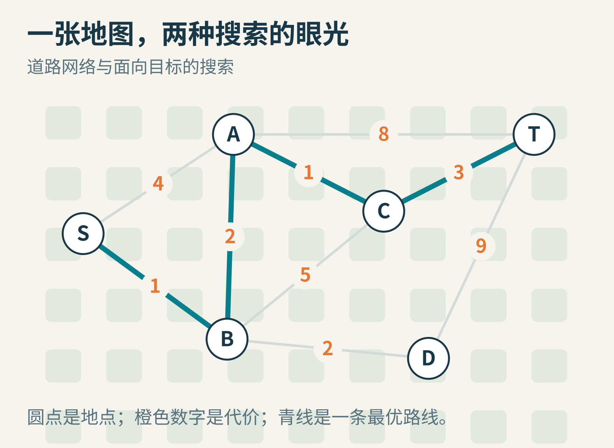
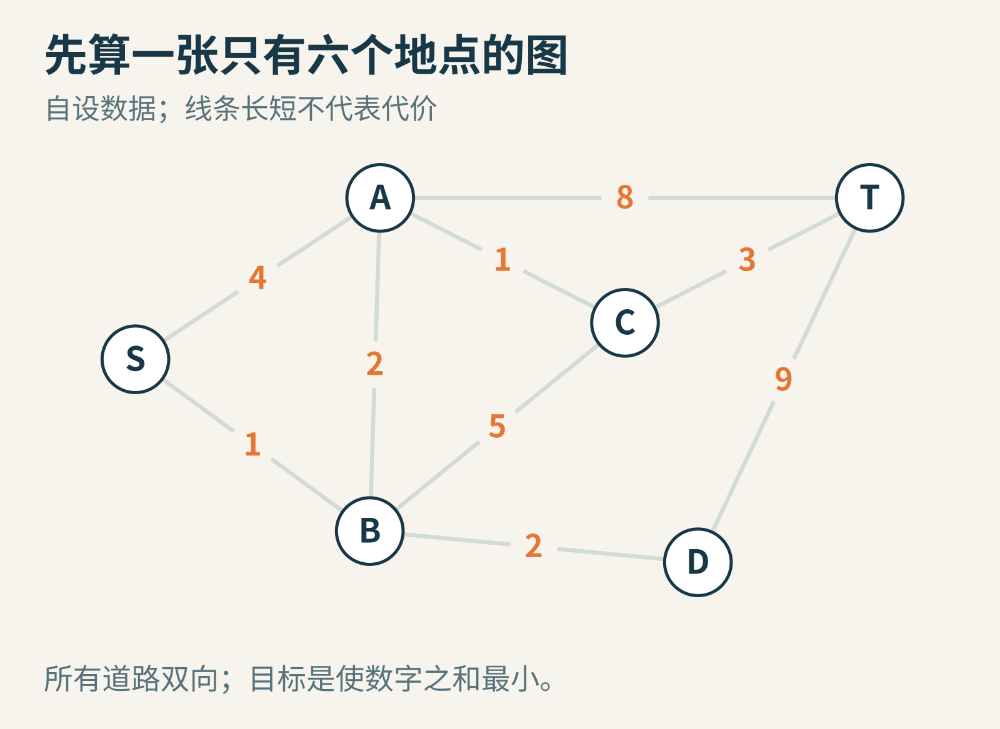
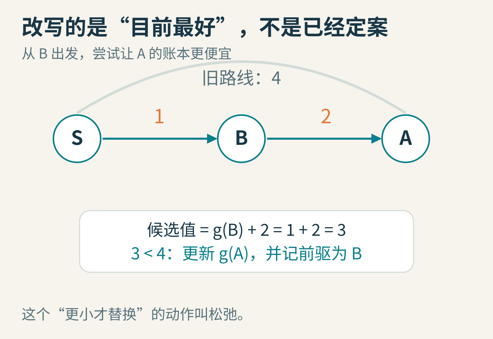
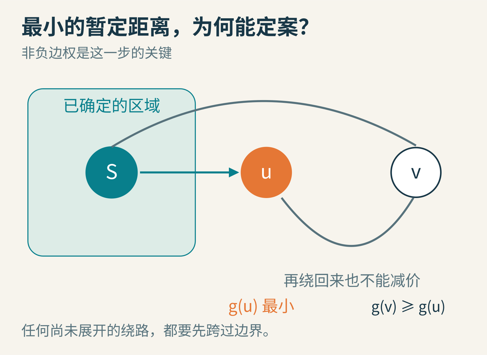
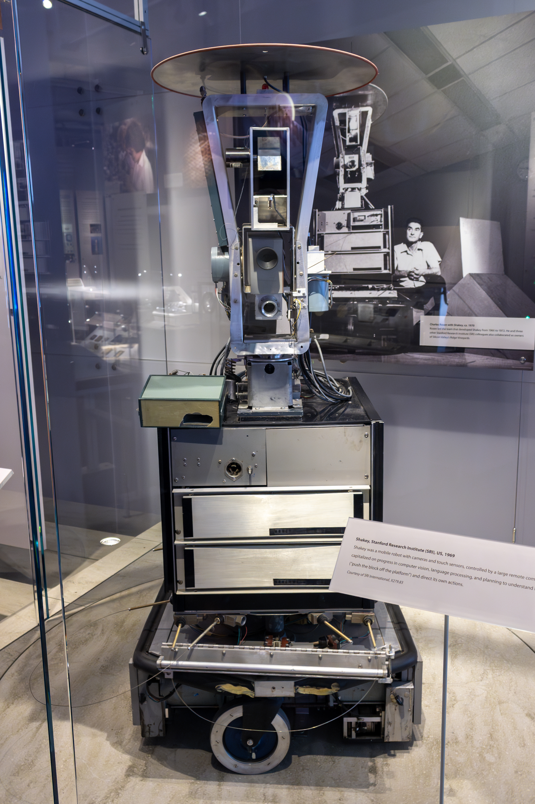
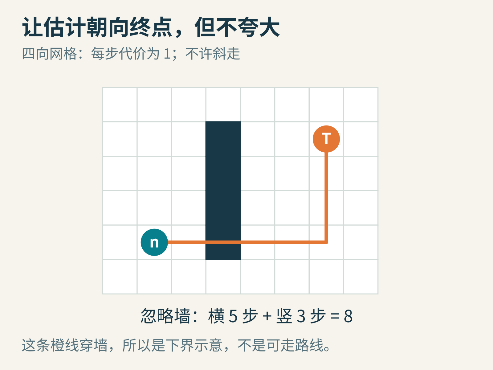
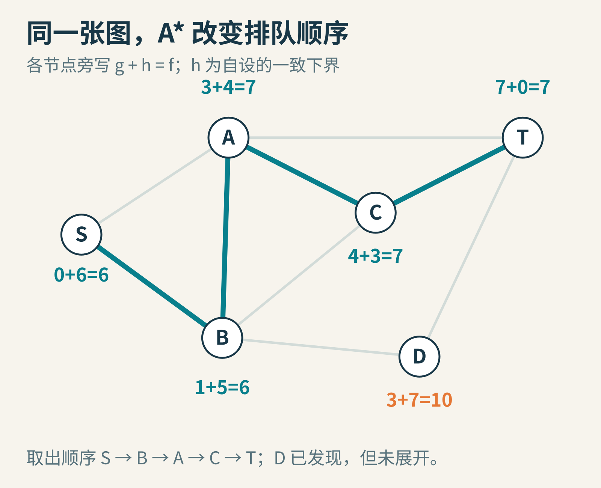
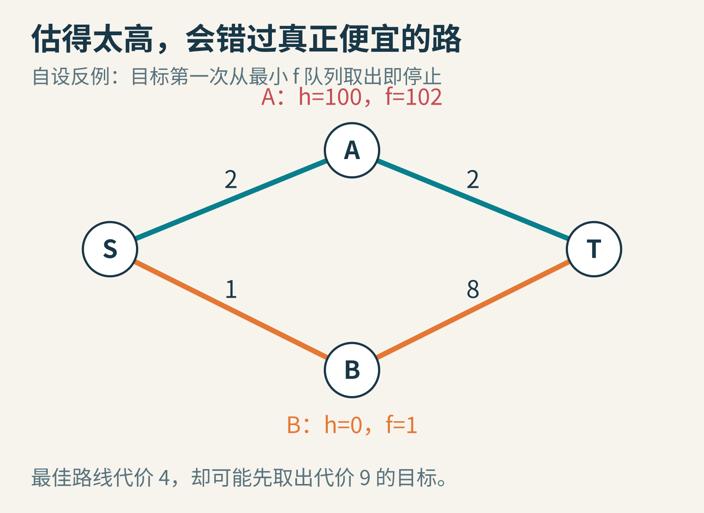

# 从地图到 A*：电脑怎样知道哪条路值得先找

*原创概念图。橙色数字表示自设的通行代价，青线表示一条最优路线；不是城市实测地图。*

你在游戏里点了一下远处的门。角色没冲向门的直线方向，而是先绕过一堵墙，再沿走廊走过去。屏幕上的动作看起来很自然，背后的问题却不小：如果岔路有一百个，电脑难道要把所有走法都试一遍？

更麻烦的是，“路短”不一定“来得快”。石板路绕一点，却比泥地好走；楼梯距离短，却不适合推车。寻路算法首先需要的，不是聪明的方向感，而是一份清楚的约定：允许去哪里，每次移动要付出多少代价，以及我们到底想让什么最小。

这篇文章从一张六个地点的小图开始。你只需要会加法、比较大小，就能跟着走完 Dijkstra 算法，再亲眼看见 A* 怎样利用关于终点的知识。

## 先把地图变成可以计算的东西

把地点画成点，把允许通行的道路画成线，就得到一个“图”。这里的图不是照片，而是一种关系模型。点叫节点，线叫边，边上的数字叫权重。权重可以是米、秒、耗电量，也可以是游戏设计者规定的行动点。

如果道路只能单向通行，边就有方向；如果两个方向走起来一样难，也可以画成一条双向边。真实道路会拐弯，而模型只需要记住两端和代价。一条画得很短的线，权重完全可能很大。

*原创教学示意。所有道路双向，权重均非负；线的长度和角度没有地理含义。*

从 S 到 T，有一条看起来很直接的走法：S→A→T，代价是 4+8=12。换条路 S→B→A→C→T，代价是 1+2+1+3=7。后者经过更多地点，总代价反而更小。

这解释了为什么“每次选眼前最便宜的边”不可靠。局部便宜，可能把你带入后面很贵的道路；也解释了为什么按经过地点多少来排队，不能解决任意加权地图。只有当每一步代价相同，少走几步才等于少花代价。

## Dijkstra 的办法：先把最近的地点弄清楚

1959 年，Edsger W. Dijkstra 在一篇仅三页的论文里讨论了两个图问题：连接全部节点的最小总长度树，以及指定两点间的最短路径。今天常说的 Dijkstra 最短路算法，来自第二个问题。论文开头的“树”不是本文要算的路线，别因为它们出现在同一篇文章里，就把最小生成树和最短路径混为一谈。[原论文信息](https://doi.org/10.1007/BF01386390)

*Edsger W. Dijkstra。摄影：Hamilton Richards；采用得克萨斯大学 Dijkstra 档案页提供的照片版本，本文未作改动；[CC BY-SA 3.0](https://creativecommons.org/licenses/by-sa/3.0/)。这是一张晚年照片，并非 1959 年工作现场。*

他的关键做法可以理解成建立两本账：一本是“已经确定的最短距离”，另一本是“目前发现的最好距离”。我们用 g(n) 表示到节点 n 的暂定距离。

开始时，g(S)=0。其他地点还没找到路，暂记为无穷大。无穷大在这里是“尚无已知路线”的记号，不是一段真的无限长的道路。再给每个节点留一个“前驱”位置，记录目前最便宜的路线是从谁过来的。

整个过程反复做两件事：从尚未确定的节点里，取出 g 最小的一个；检查它相邻的道路，看看能不能让别人的账本变小。第二件事有个常见名字，叫“松弛”。

## 六个地点，亲手走一遍

第一步取出 S。走 S→A，需要 4，所以把 A 记成 4；走 S→B，需要 1，把 B 记成 1。两者前驱都是 S。

第二步取出 B，因为 1 比 4 小。从 B 去 A 的新候选值是 1+2=3，比原来的 4 更小，于是改写 A 的距离和前驱。去 C 的候选值是 1+5=6；去 D 是 1+2=3。

*原创教学示意。松弛只比较“旧最好值”和“经当前节点过来的新候选值”，不会把一个较好的值改差。*

第三步，A 和 D 的暂定距离都为 3。平局怎么处理不会改变最短距离；为方便演示，这里先取 A。经 A 到 C 的候选值是 3+1=4，因此 C 从 6 改为 4。经 A 到 T 是 3+8=11，先把 T 记成 11。

第四步取 D，距离为 3。经 D 到 T 是 3+9=12，比已知的 11 差，不更新。第五步取 C，距离为 4。经 C 到 T 是 4+3=7，比 11 好，更新为 7。

最后，T 以距离 7 被取出。沿前驱倒着走，是 T←C←A←B←S，倒过来就是我们需要的路线。

注意两个容易混淆的时刻：A 在第一步就被“发现”，却到第三步才被“确定”；T 在第三步被发现时的代价是 11，后来才改善为 7。所以，第一次看见终点就停下，通常是错的。对这里的 Dijkstra 实现，应在终点成为当前最小暂定距离并被取出时停止。

## 它凭什么敢说“以后不会更便宜”？

这一步最值得停下来想。假设眼下 g 最小的未确定节点是 u。你担心：会不会存在一条尚未发现的绕路，先经过别的地点，再低价回到 u？

沿那条绕路，从 S 出发，一定会第一次离开已经确定的区域。把这个出口节点叫 v。由于 u 已经是候选里最便宜的，v 的暂定代价不会比 u 小。后面再沿非负代价的边走，只会维持或增加总账单，不可能绕一圈把账单减下来。因此，u 可以定案。

*原创教学示意。绿色区域代表已经确定的节点；任何还没考察的绕路都必须跨出这个边界。*

这里的条件不是装饰。如果允许负权边，比如“到某地就奖励你 10 点代价”，刚刚的理由就失效了。某条暂时很贵的路线，后面可能突然得到负代价补偿。负权问题有别的方法处理；不能把“Dijkstra 很常用”当成它适用一切的理由。

图还必须描述完整的状态。假设走到同一个门口，一种状态有钥匙，另一种没有钥匙，后续可走路线显然不同。此时节点不能只记“门口位置”，还要记“是否持有钥匙”。算法不会替你修正一个丢掉重要信息的模型。

## A* 多问一句：剩下的路至少还要多少？

Dijkstra 很可靠，但它只看“从起点已经花了多少”。如果终点在东边，它仍可能先考察西边一片便宜的地方。能不能利用终点的位置，让搜索更有方向？

1968 年，Peter Hart、Nils Nilsson 和 Bertram Raphael 发表了关于启发式最小代价路径搜索的论文，把问题知识纳入有条件保证的搜索框架。A* 是三人共同工作的成果，而不是某个人独自在脑海里发明的神奇捷径。[1968 年原论文](https://www.cs.auckland.ac.nz/courses/compsci709s2c/resources/Mike.d/astarNilsson.pdf)

这段历史也与 SRI 的 Shakey 机器人研究相关。机器人要把房间里的障碍、可达区域和行动变成可搜索的问题；只有“朝目标方向走”的直觉远远不够。今天在博物馆看到的 Shakey 提醒我们：看起来抽象的图搜索，也来自让真实设备在真实空间里行动的需要。[SRI 项目回顾](https://www.sri.com/press/story/75-years-of-innovation-shakey-the-robot/)

*Shakey 机器人实物，2023 年摄于计算机历史博物馆。摄影：The wub；[CC BY-SA 4.0](https://creativecommons.org/licenses/by-sa/4.0/)，未改动。照片不是 1960 年代的实验现场。*

A* 给每个候选节点增加一个数 h(n)：从这里到终点的估计剩余代价。然后按照 f(n)=g(n)+h(n) 排队。g 是已经找到的路线账单；h 是对剩余账单的估计；f 是两者之和。把所有 h 都设成 0，排队规则就退回了 Dijkstra 的规则。

这里最重要的词是“估计”。A* 没有先知道答案，否则根本不用搜索。它只是能利用一些不必走完地图就知道的限制。

## 一个好估计，常常来自故意忽略困难

在只许上下左右移动、每步代价为 1 的网格里，从当前位置到目标，横向还差 5 格，纵向还差 3 格。那么无论怎么走，至少需要 8 步。中间有墙，只会让路更长，不会让这 8 步的下界失效。

*原创教学示意。橙线用于数横竖差，穿过了墙，因此不是实际可走的路线。*

这种横竖差之和叫曼哈顿距离。它的可靠性来自移动规则：如果允许斜着一步走一格，它就可能高估；如果某种传送门能瞬间跨过地图，它也可能失效。启发式函数不是一条放哪儿都适用的公式，而是对这个世界规则的表达。

同样，若代价是米，直线距离可以在合适条件下作下界；若代价是秒，不能把米直接加到秒上。要估时间，可以在有可靠速度上限时，用距离除以这个上限。单位不一致的 g+h，即使程序能算出数字，也没有正确的物理含义。

回到六个地点的例子，为 S、A、B、C、D、T 分别设 h 为 6、4、5、3、7、0。这组数是专为教学设计的下界，不是根据图上几何距离测出来的。

*原创教学示意。图中显示搜索过程中相应节点得到的最好 g 值，以及预先给定的 h 值。*

A* 先取 S，再取 B。随后 A 的 f 为 3+4=7，D 为 3+7=10，C 暂时为 6+3=9，于是先考察 A。A 又把 C 改进到 g=4、f=7；取 C 后，T 的 g=7、h=0、f=7。于是终点先于 D 被取出，仍得到代价 7 的最优路线。

D 不是消失了，也不是被证明永远没用。它已经被发现，但在这次寻找最短路线的过程中，不需要展开它。这才是 A* 节省工作的具体含义。

## “绝不高估”还要配合正确的实现

如果对每个节点，h 都不超过到终点的真实最小剩余代价，我们说这个估计具有“可采纳性”。在有限图、非负边权、目标 h=0、正确更新距离，并在需要时重新打开节点等条件下，A* 可以保证找到最优路线。

为什么估计低一点仍然安全？假设队列里即将取出一条很贵的终点路线，但真正更便宜的路线还没找完。那条便宜路线的前沿上，必然还有一个候选节点；只要它的 h 不夸大，它的 f 就足够小，理应比昂贵终点先被取出。两件事不能同时成立。

工程里常用更强的“一致性”条件：对每条 u→v，要求 h(u)≤边权(u,v)+h(v)。可以把它理解成估计也遵守三角不等式，不能走了一小步，剩余估计却无缘无故暴跌一大截。终点估计为 0 时，一致性沿路线累加会给出下界；同时，已经以最小 f 取出的节点不必因为更便宜的路线而重新打开。

若 h 只满足不高估，却不一致，关闭节点后永不再看它，可能破坏保证。1968 年论文的算法本身就包含重新打开节点的步骤。学习 A* 时，不要只记住 f=g+h，而忘了配套的账本更新规则。

*原创教学反例。A 的真实剩余代价只有 2，却被估成 100；过高的估计把好路压在队列后面。*

图里的正确路线 S→A→T 代价为 4。如果把 h(A) 乱设成 100，h(B) 和 h(T) 设成 0，算法会先取 B，再取代价为 9 的 T。如果此时停止，就返回了较差路线。这个错误不是加法算错，而是“有保证的估计”被一个随意打分替换了。

## 你可以把它做成一个小实验

先别画几千格的大迷宫。用纸片写六个节点，另用一张纸记录 g、前驱、是否确定。每取出一个节点，就圈出它；每次改进，就划掉旧值而保留改动痕迹。你会发现，真正帮助理解的是“为什么改了这一个”，而不是看一片格子快速变色。

接着试三件事：

1. 把 A→C 的权重从 1 改成 10，重新求最短路线。先手算，再比较程序的结果。原来的 h 是否仍满足条件？
2. 把所有边权改为 1，比较按层搜索和 Dijkstra。你会看见：等代价世界里，距离顺序就是层数顺序。
3. 在四向网格中分别用 h=0、曼哈顿距离，以及故意过大的 h，记录展开节点数和最终路线代价。分清“在这个例子少展开了几个”与“所有情况下都更快”。

实际实现常用优先队列来高效取最小值。用二叉堆等结构，可以避免每次都扫描全部候选；如果把改进后的条目再次放入堆里，还要在弹出旧条目时识别它已经过期。图的规模、数据结构、平局规则，以及计算 h 本身的成本，都会影响运行时间。少展开节点并不自动等于总耗时最低。

Dijkstra 和 A* 留给我们的，不只是两套寻路步骤。它们展示了一种很有力量的思考方式：把“不知道的部分”明确放在账本里；只在有理由时宣布确定；再把对世界的知识写成可以检查的条件。电脑之所以看起来会认路，是因为我们终于把“值得先找哪里”说清楚了。

本文由 AI 辅助研究、撰写和制作原创教学示意，示例数据均为自设。

图片来源：[Dijkstra 肖像](https://commons.wikimedia.org/wiki/File:Edsger_Wybe_Dijkstra.jpg)、[Shakey 实物](https://commons.wikimedia.org/wiki/File:SRI_Shakey_robot,_1969,_Computer_History_Museum.jpg)；其余为本文原创教学图。
