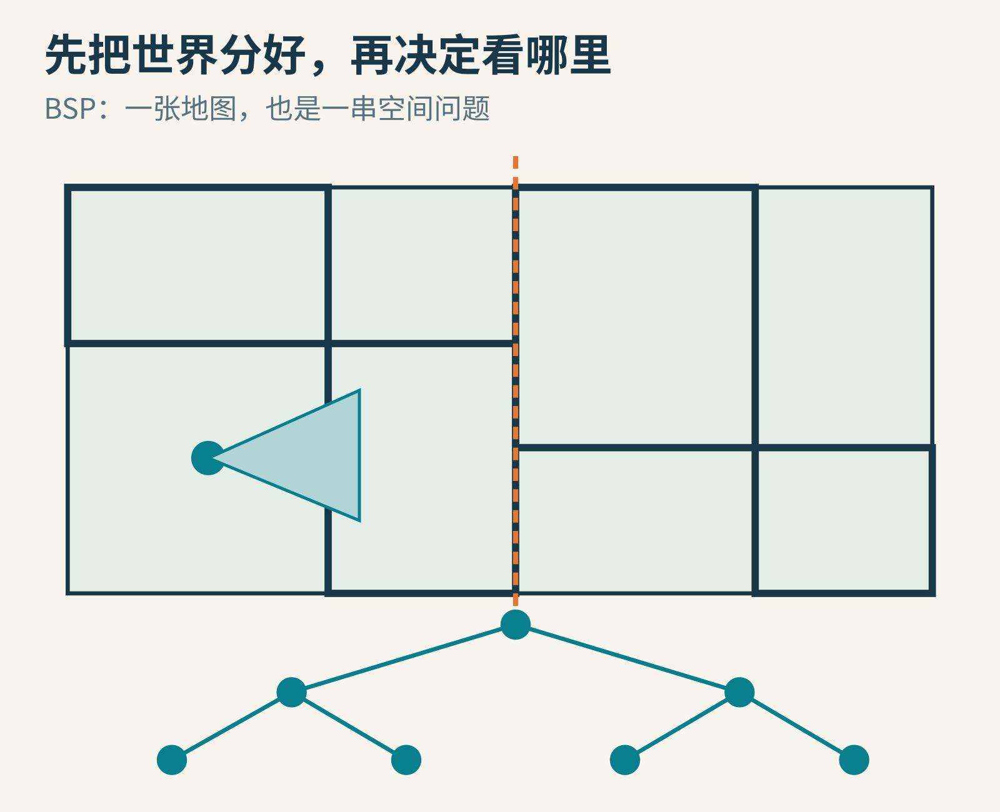
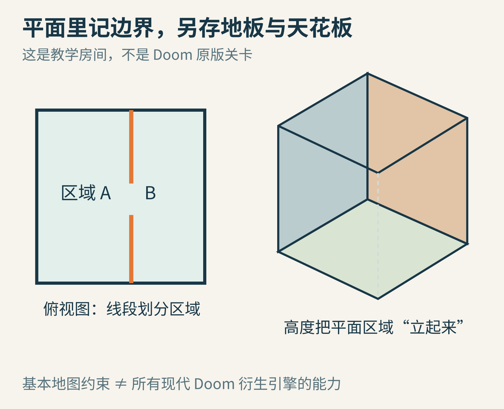
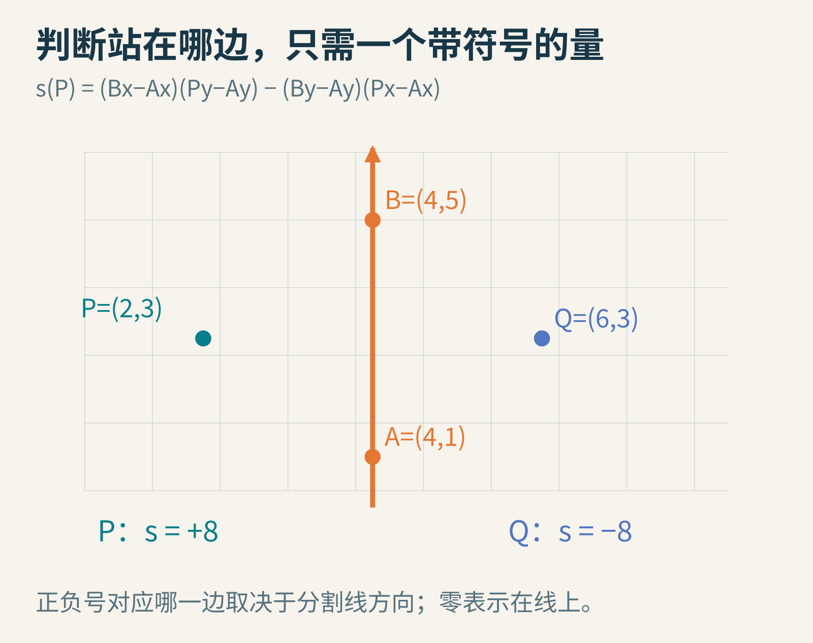
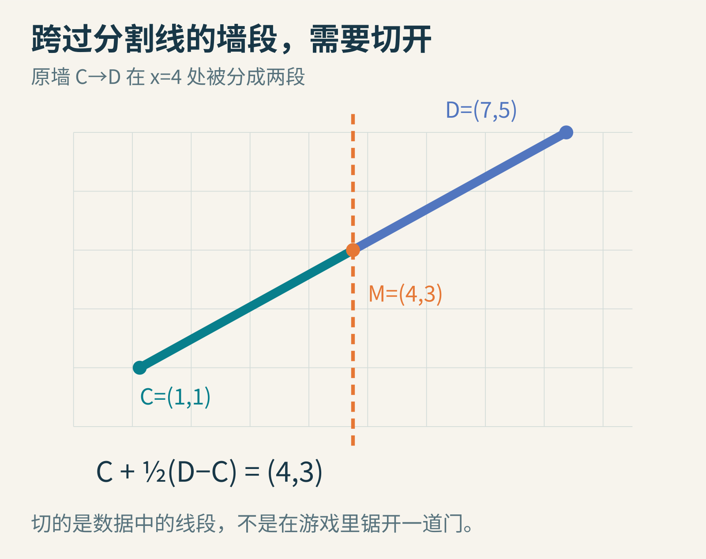
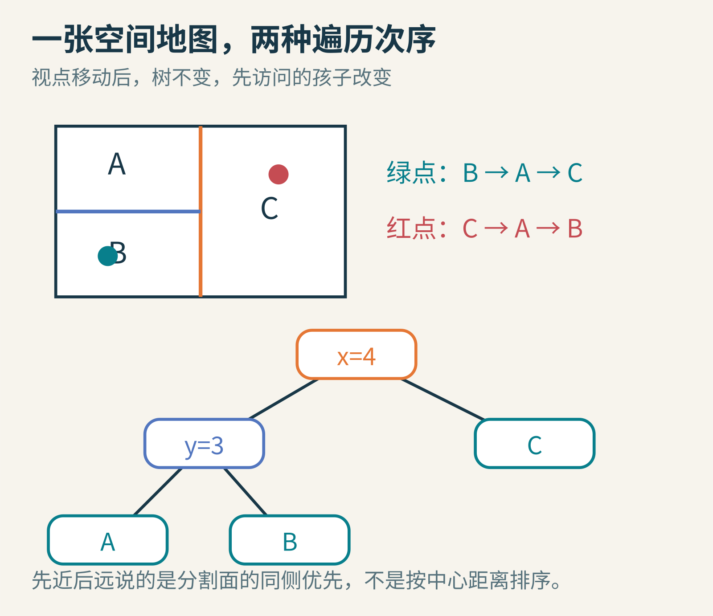
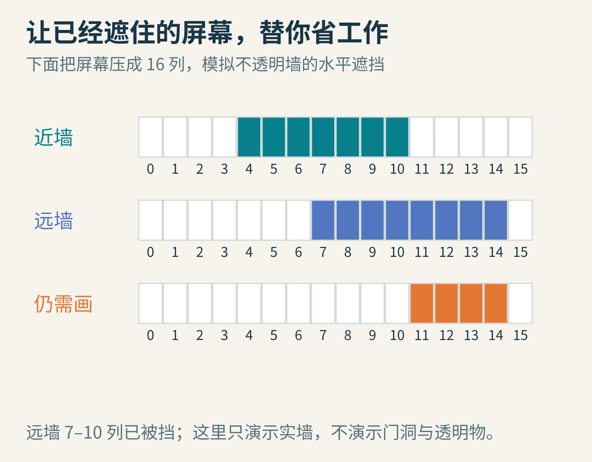
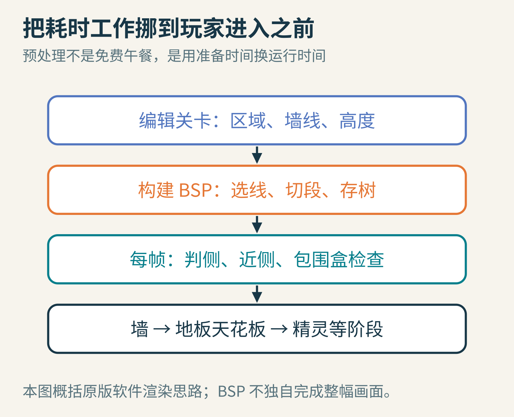

# Doom 怎样组织世界：先把地图切开，再决定看哪里

你站在一条拐弯的走廊里。前方有门，门后有房间，房间后还有整座基地。电脑是否需要先把整座基地画完，才知道你面前的墙挡住了什么？

如果这样做，许多努力会白费：墙后的东西最后根本看不见。1993 年的《Doom》要在当时的个人电脑上制造流畅的空间感，一个重要办法是提前整理地图，让程序在运行时更快决定“先处理哪里，还有哪里值得处理”。

这个整理办法叫 BSP，Binary Space Partitioning，二叉空间划分。名字很长，起点却只是一个问题：**你在这条线的哪一边？**

原创概念图；不是《Doom》截图，也不是原版关卡复刻。

## 一　先认识这位主角，但别把算法变成个人神话

约翰·卡马克是《Doom》引擎的重要开发者。下面的照片拍于 2010 年游戏开发者大会的颁奖现场，比游戏问世晚了很多年。

照片：Official GDC，[CC BY 2.0](https://creativecommons.org/licenses/by/2.0/)。采用 Wikimedia Commons 提供的裁切版本，本文未再裁切；[文件及来源](https://commons.wikimedia.org/wiki/File:John_Carmack_GDC_2010.jpg)。照片不表示人物为本文背书。

但 BSP 并不是卡马克在制作《Doom》时凭空发明的。Henry Fuchs、Zvi Kedem 和 Bruce Naylor 在 1980 年发表的[原论文](https://www.cs.unc.edu/~fuchs/publications/VisSurfaceGeneration80.pdf)，已经研究如何预先把场景组织成树，以便从不同位置观看时快速得到可见性顺序。论文也承认更早研究的基础。

《Doom》的价值之一，是把这种空间组织思想，和自己的地图结构、屏幕裁剪、纹理绘制结合起来。算法的历史常常如此：前人提供一种结构，后来的人发现它特别适合眼前的机器和问题，再做大量细致的工程工作。

本文以 id Software 公开的 Linux Doom 1.10 源码为核对对象。它不是 1993 年 DOS 发行版源码逐字不差的照片，也不是所有现代 Doom 衍生引擎的共同说明书。

## 二　看起来是房间，数据里先是一张平面图

暂时把天花板掀掉。地图上有顶点、连线以及区域。一个区域可以记住地板高度、天花板高度、纹理和亮度等信息。连线告诉程序区域的边界在哪里；在渲染时，边界配合高度差形成墙面。

原创教学示意。右侧仅说明“平面边界加高度”的概念，不是左侧地图的精确透视重建。

例如区域 A 的地板是 0，区域 B 的地板是 1，两边天花板都是 3。它们之间可以出现一段台阶侧面。如果某条边界后面没有可以穿过去的区域，它就可以表现为实墙。门的开合也能通过改变有关高度实现。

这里藏着一个重要取舍：原版地图的平面区域结构，不像现代任意三维网格那样自由。它不能直接把两个完全独立的可通行房间，以一般的“楼上楼下”方式堆叠在同一平面位置。后来各种引擎扩展、视觉技巧是另外的话题。

“2.5D”因此是人们描述这类结构的方便说法，但不要把它误解成屏幕没有真正的透视，或游戏没有高度。关键在于**世界怎样存储、允许什么结构**，而不是眼睛看见几维。

## 三　一条无限长的线，可以当一个分拣问题

现在拿出方格纸，画一条从 A=(4,1) 指向 B=(4,5) 的线。虽然纸上只画出一段，我们把它想象成上下无限延长。它把整个平面分成两边。

原创坐标示意。图中坐标值用于计算，绘图距离只帮助辨认关系。

怎样让程序判断点 P=(2,3) 在哪边？不需要凭眼睛，也不必求角度。计算：

**s(P) = (Bx−Ax)(Py−Ay) − (By−Ay)(Px−Ax)。**

先算分割线的方向：B−A=(0,4)。再算 A 到 P：P−A=(−2,2)。代进去就是 0×2−4×(−2)=8，是正数。

另一个点 Q=(6,3)，Q−A=(2,2)，结果是 0×2−4×2=−8。符号不同，说明它们在两边。零则表示点落在直线上。这个量是二维叉积的标量形式；初学时只要把它当成可靠的“判边器”即可。

正号一定叫“前面”吗？不一定。把 A 和 B 交换，正负号会一起翻转。只要建树与查询时遵守同一套约定，名字并不重要。实际 Doom 使用自己的定点数表示与优化过的判侧代码；上面是便于手算的数学版本。

## 四　如果一面墙同时在两边呢？

把另一条墙段画成 C=(1,1) 到 D=(7,5)。它穿过 x=4，不能整个塞进左边或右边，否则某一边的空间关系就会失真。

办法是把数据里的墙段切成两段。沿着 C 到 D 走一半，得到：

**M = C + 0.5(D−C) = (1,1)+0.5(6,4) = (4,3)。**

于是原来一条 C→D，变成 C→M 和 M→D。两段仍然属于同一条原始墙线的几何部分，纹理等关系需要保留；这不是在游戏里锯出一个洞。

原创手算例。一般交点不一定恰好在一半，这里特意选择整数结果。

接着对左边再选一条分割线，对右边也做同样的事。每问一个问题，答案只有两种去向，所以形成一棵二叉树。内部节点存“用哪条线分”，树叶指向最终的小区域。Doom 的渲染会到达称为 subsector 的叶子，并处理其中的墙段。

注意“区域”和“树叶”不是同义词。地图设计中的 sector 关心地板、天花板等属性；BSP 的 subsector 是为划分和遍历服务的。一个 sector 可能涉及多个 subsector，不能简单说“一间房就是一个树节点”。

## 五　树怎样随你的站位改变处理顺序

看一个极小的例子：先用 x=4 把地图分成左右两边；左边再用 y=3 分为 A、B，右边叫 C。

原创示意；绿色视点在 B，红色视点在 C 的上半部。箭头次序只讨论这个教学空间的树遍历。

站在 B 时，第一次回答“在左边”，程序就先进入左子树。下一问是“在 y=3 哪边”，于是先到 B，再回头看 A，最后才考虑 C。站到红点，根节点的答案变成“在右边”，顺序就变成 C、A、B。

树没有重建，墙也没有重新按距离排一遍。变化的只是每个节点先走哪条分支。

这里的“近侧优先”必须理解准确：它指视点所在的半空间优先，不是所有墙段中心离你越近就越早。两个中心的距离，不能可靠地说明整面墙之间的遮挡。BSP 通过分割，把难处理的交叉关系预先拆开，取得可用于可见性处理的顺序。

还要分清两种使用方式：一般 BSP 可以配合由远到近的“画家算法”，后画的近物体盖住远物体；原版 Doom 的这段遍历采用视点同侧优先，并利用已经获得的遮挡信息减少后续工作。不要把所有 BSP 渲染都说成一种固定方向。

## 六　为什么先处理近处，可能省掉整片远处

想象屏幕只有 16 列，编号 0 到 15。近处一面完全不透明的墙，已经挡住第 4 到 10 列。远墙投影占第 7 到 14 列，还需画多少？

它与近墙重叠的 7、8、9、10 四列可以跳过；11、12、13、14 四列仍然可能露出来。我们不是因为“远”就放弃它，而是因为某些屏幕位置已经被确定遮住。

原创简化裁剪例。这里只演示实墙的水平区间；真实渲染还要处理竖直范围、门洞、上下墙段和遮罩纹理等。

现在把“远墙”换成一整个子树。该子树有一个包围盒，像给里面所有几何套上一个大盒子。程序先检查盒子：它是否落在视野外？它在屏幕上的相关范围，是否已经被实墙挡住？若检查可以安全排除，就不必逐个访问里面的区域。

包围盒是粗检查。通过检查只表示“还可能看见”，不是保证每件东西都可见；粗检查绝不能随意把实际上可见的东西扔掉。这样的保守性，是快速算法保持画面正确的关键。

在[官方 r_bsp.c](https://github.com/id-Software/DOOM/blob/master/linuxdoom-1.10/r_bsp.c) 的 R_RenderBSPNode 中，可以直接核对这个骨架：判定视点在哪侧，递归处理该侧，然后由 R_CheckBBox 决定是否进入另一侧。达到叶子时则调用 R_Subsector。这比“卡马克用一棵树画出了整个世界”的说法准确得多。

## 七　BSP 很聪明，但聪明也有账单

第一笔账是准备时间。选哪条分割线，墙要切成多少片，树会不会一边特别深，都影响结果。把墙切得过碎会增加数据；树太不均衡也会增加遍历成本。BSP 不是天然保证每次查询都只需对数时间。

第二笔账是变化。对于提前构建好的静态地图，这种结构很合适；如果所有墙都自由移动、破碎、重新组合，维护它就更麻烦。不要据此说“BSP 不能处理任何动态物体”，而应说：动态物体的表示与查询，需要另外设计。

第三笔账是其他渲染任务。墙面的纹理如何取样，地板和天花板如何补齐，敌人等精灵如何排序与裁剪，都没有被一棵树自动解决。原版源码还有专门处理这些工作的模块。

原创流程概括。历史引擎的墙、平面和精灵阶段有更细的交叉与缓存，这里只保留主线。

卡马克在署名 1997 年 12 月 23 日的[源码发布说明](https://github.com/id-Software/DOOM/blob/master/README.TXT)里，甚至坦率地反思当年某些实现，指出渲染和环境测试还有更好的组织方式。真正的工程史不只有成功瞬间，也包含作者后来认出的局限。

## 八　一个容易误会的地方：树并不等于“看见”

假如从房间 A 到房间 B 有一扇门，B 在树上位于另一条分支，是否就说明它不可见？当然不是。树的分支表达空间划分，门洞表达几何通路，而可见性还取决于视点、朝向与遮挡。分支不是一堵自动存在的墙。

同样，穿过空旷广场时，几乎所有区域都可能露在视野里。此时 BSP 仍能提供处理顺序，却不能凭空让需要画的东西消失。性能收益应当放到具体场景和实现里衡量，不能把“小房间省掉很多工作”推广成任何关卡都具有相同加速比例。

还有一个常见混淆：BSP 与深度缓冲不是同一件事。深度缓冲通常给每个像素记住当前最近的深度，用来判断后来的片元该不该留下；BSP 主要组织几何空间，帮助决定访问关系。它们可以服务相似的遮挡目标，却处在不同层面，也不必总是互相排斥。理解这一区别，就不会把某个年代的工程取舍误当成图形学唯一正确的路线。

## 九　拿纸、剪刀和十分钟，做一次自己的 BSP

先画四到六条不互相重合的墙段。选一条所在的直线作为第一次分割，把跨线墙段的交点算出来。用两种颜色标出两侧，再为每侧继续分割。最后把“问题”和“小区域”画成树。

接下来做三个挑战：

1. 在地图上选两个视点，各走一遍“同侧先访问”。记录叶子的次序，检查哪些变化来自第一问，哪些来自更深的节点。
2. 把第一条分割线换掉。树高和切出的墙段数量是否改变？这会让你理解为什么“怎么建树”本身就是一个值得优化的问题。
3. 在 16 列纸条上涂出近墙区间，再放两面远墙。只消去有充分遮挡证据的部分。若近墙中间是门洞，你还能把整列都判为不需要吗？

本文附带的 exercise.py 验证了判侧、交点、树遍历和区间裁剪四个小例子。它只使用 Python 标准库，不包含 Doom 游戏资产，也不试图成为完整引擎。

BSP 最值得带走的思想，是**把重复发生的困难，提前整理成一连串容易回答的小问题**。你每转一次头，都不需要让电脑从头理解整个世界。它只需要沿着已经准备好的问题，一步步找到眼前可能看见的部分。

## 继续追根究底

- Fuchs、Kedem、Naylor，1980，On Visible Surface Generation by A Priori Tree Structures，尤其是预处理与遍历部分。[论文](https://www.cs.unc.edu/~fuchs/publications/VisSurfaceGeneration80.pdf)
- id Software，Linux Doom 1.10：[渲染遍历](https://github.com/id-Software/DOOM/blob/master/linuxdoom-1.10/r_bsp.c)、[数据结构](https://github.com/id-Software/DOOM/blob/master/linuxdoom-1.10/r_defs.h)。建议先找函数名，再读细节。
- [源码发布说明](https://github.com/id-Software/DOOM/blob/master/README.TXT)：注意历史原文中的旧许可措辞与仓库如今标明的 GPL 2.0，不能混为同一时间的声明。

本文由 AI 辅助研究与撰写；数学例子和机制图为本次原创，并以公开论文、官方源码和独立运行的示例交叉核对。未使用 AI 生成人物照片。

图片来源：[Official GDC 的卡马克照片](https://commons.wikimedia.org/wiki/File:John_Carmack_GDC_2010.jpg)。其余配图为本次原创教学图。
