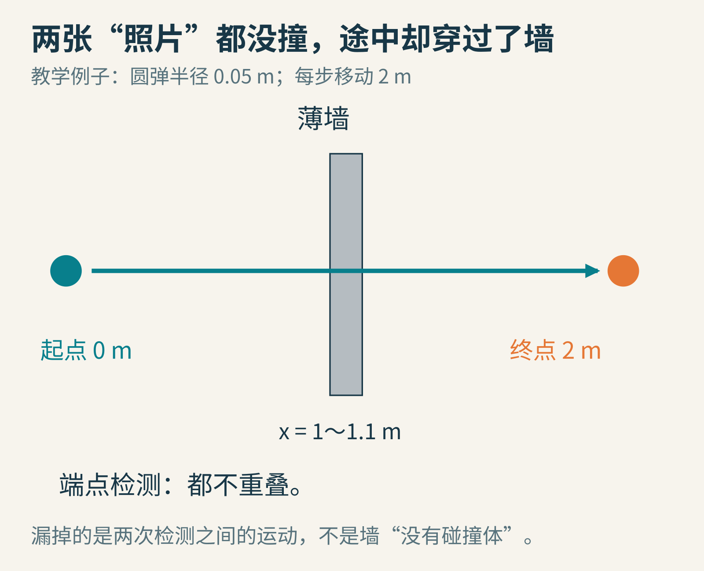
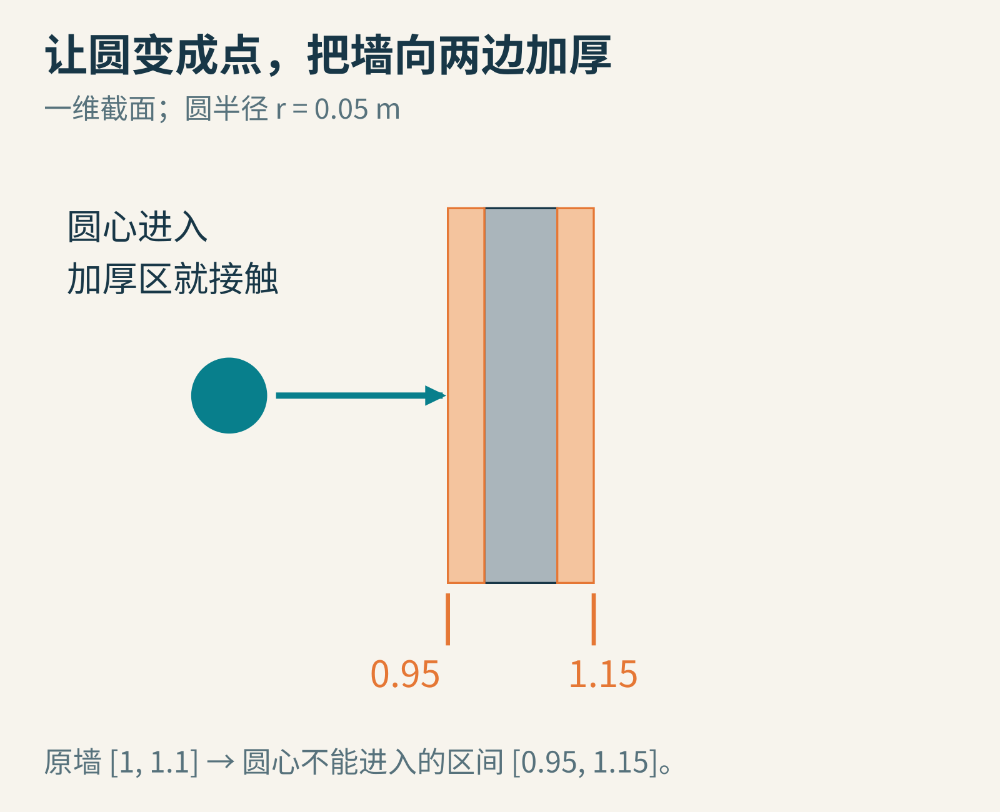
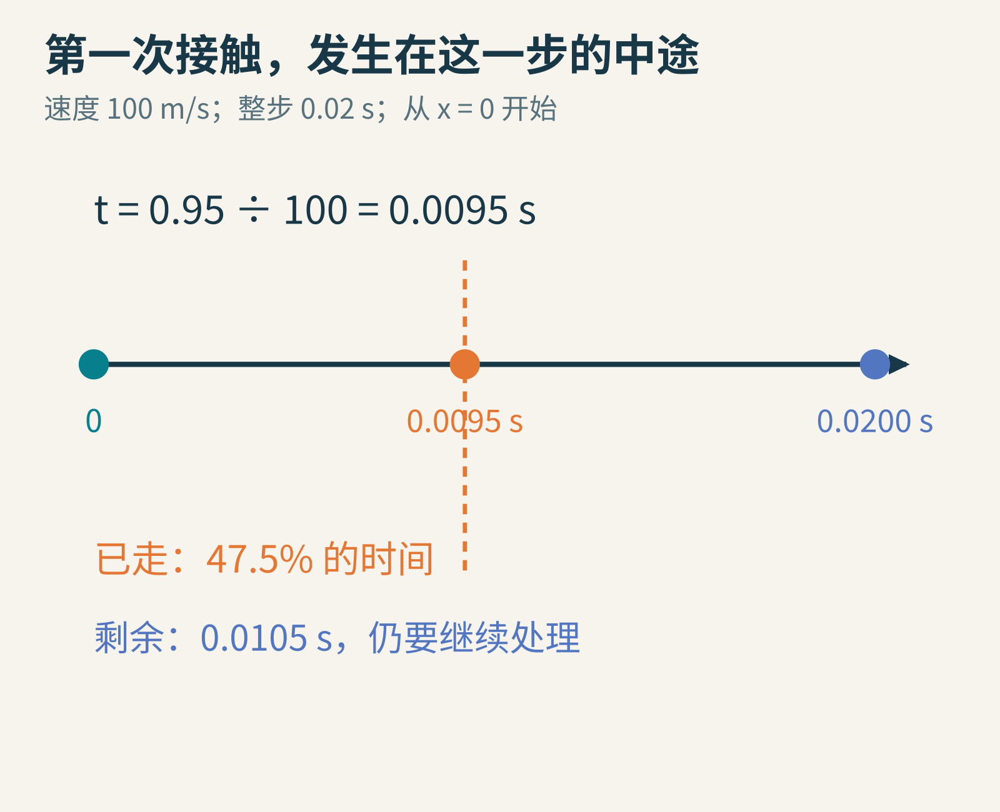
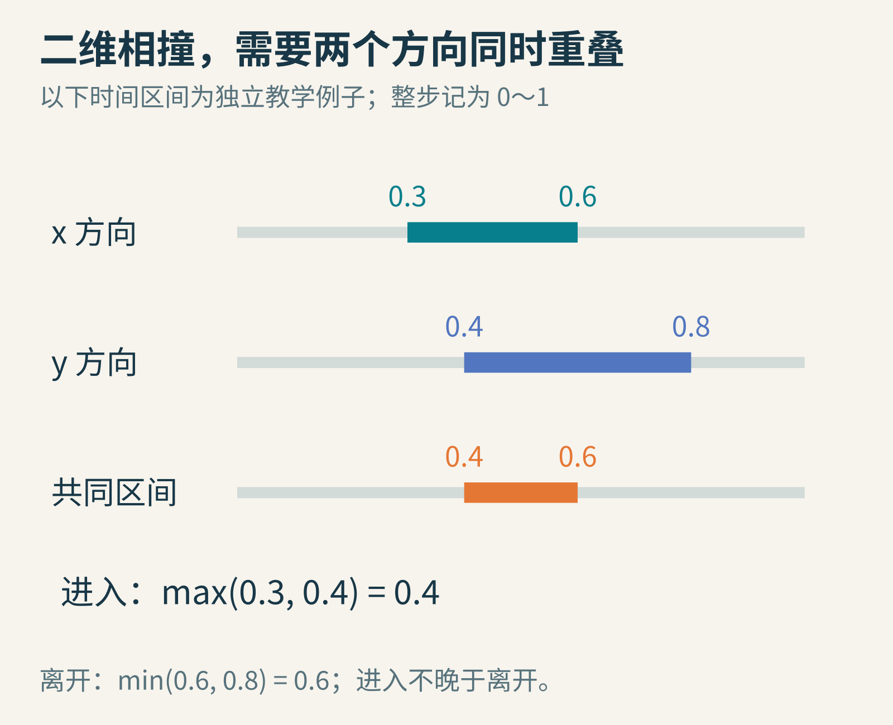
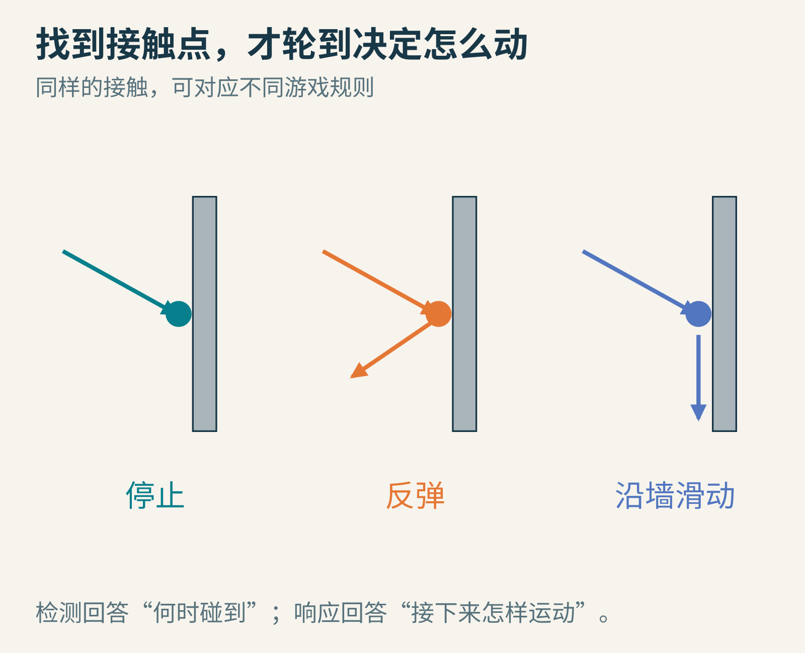
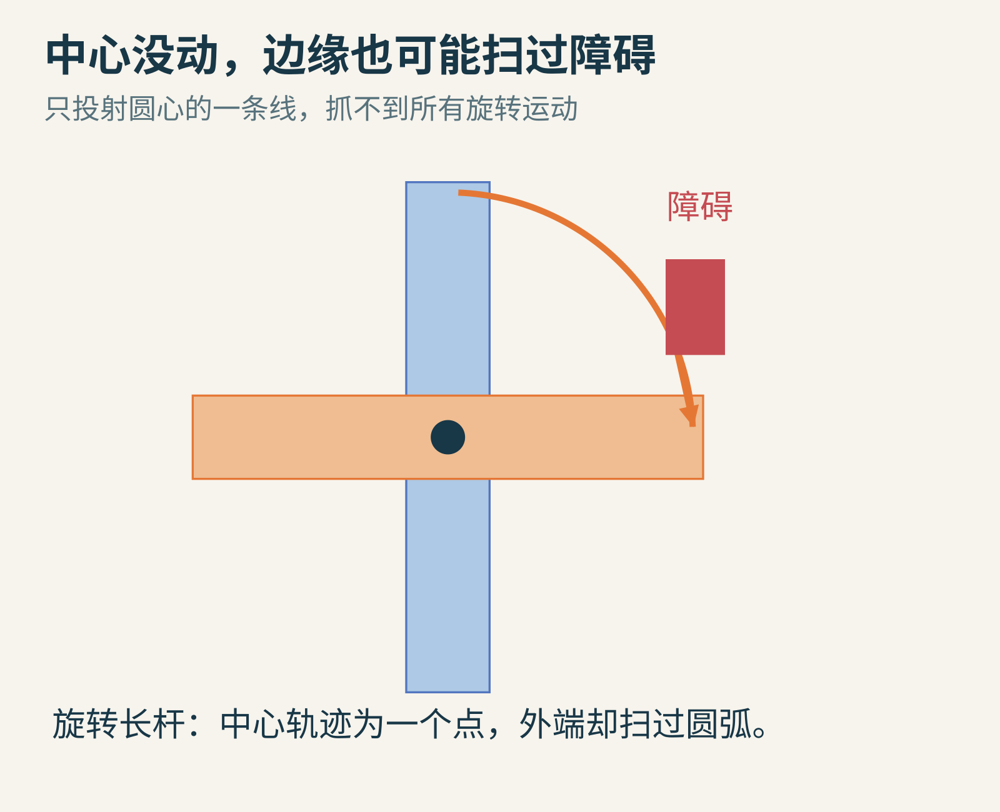

# 墙明明在那里，游戏里的高速子弹为什么会穿过去？

你给墙加了碰撞体，也给子弹加了碰撞体。慢慢推过去，会撞；把速度调高，子弹却直接到了墙后面。

这个现象常叫**穿隧**。它不一定意味着引擎忘了墙。更可能的原因是：引擎检查到的两次位置之间，发生了一段没有被端点检查捕捉的接触。

我们先做一场可以手算的小实验。今天只讨论平面里的圆形弹丸和静止的薄墙，不把真实弹道、空气阻力和复杂形变都塞进来。



原创教学示意。墙、圆弹、尺寸与时间全部是自设算例，不是某款引擎的错误截图。

## 两张没有接触的照片，不能证明中间没有撞过

设墙占据横坐标1米到1.1米之间，厚10厘米。弹丸半径是5厘米，从x＝0出发，以100米/秒向右运动。物理模拟每0.02秒更新一次。

一小步走多远？

100×0.02＝2米。

刚开始，圆弹最右侧只有0.05米，当然没有碰墙。下一次检查，圆心已经到了2米，最左侧是1.95米，也没碰墙。于是，只查这两个端点的程序会得出“没有重叠”。

这个结论对它检查的两张“照片”完全正确。漏掉的是照片之间的过程。

这里的0.02秒是**物理步长**，不一定等于显示器两帧之间的时间。即使画面很流畅，某个模拟步内的位移仍可能大于细小障碍。反过来，提高显示帧率，也不保证物理检测的步长跟着变小。

[Box2D的模拟文档](https://box2d.org/documentation/md_simulation.html)把这类端点间的大位移与穿隧问题放在高速物体讨论中。不同引擎的默认行为不同，不能从这个玩具例子推断某个产品默认一定会漏检。

## 把时间切细，确实有用，但不是无限保险

如果把步长从0.02秒缩短到0.001秒，每一步移动0.1米。现在更容易在某一步看见弹丸与墙重叠。

代价也很直观：同样一秒钟，要更新的次数增多。即使当前墙不再漏，换成更薄的障碍、更快的物体或另一种运动，原来的步长仍可能不够。

还有一种看起来省事的补丁：把墙碰撞体做厚。对于允许这种设计的游戏，它也许有效。可你同时改变了游戏的几何规则，角色可能会在离可见墙面还有一段距离时被挡住。

更直接的思路是：别只问“最后重叠了吗”，改问“这一整段运动中，最早什么时候会接触”。这就是连续碰撞检测，通常缩写为CCD，试图解决的核心问题。

## 先把一个圆，变成一个更容易检查的点

点穿过线段容易判断，可圆有半径。怎么办？

我们把圆的体积转交给障碍：把墙向左、向右各加厚0.05米，然后把弹丸当成没有大小的圆心。

原墙区间是[1,1.1]，加厚后的区间就是[0.95,1.15]。圆心第一次到达0.95米时，圆的最右端刚好到达1米，接触原来的墙。



这个变换在本文的一维截面中精确成立。完整二维圆与矩形的“加厚区”在角部是圆角，不能无条件把外接大矩形当作精确碰撞形状。

这种“把一个物体的形状算进另一个物体”的办法，与构型空间和Minkowski和有关。先记住能用的直觉：如果玩家有肩宽，那么可供玩家中心走的空间，就应该比眼睛看到的空地窄一些。

我们暂时不推导一般曲线与多边形。当前模型已经足够把第一次接触算出来。

## 碰撞发生的时间，是一个可以计算的数

从0到0.95米，速度是100米/秒，需要：

t＝0.95÷100＝0.0095秒。

一整步有0.02秒，所以第一次接触发生在这一步的47.5%处。它既不在开始，也不在结束，而在两次端点检查之间。



第一次接触时间常称为TOI，time of impact。图中只表示匀速平移与静止墙面的教学模型。

下面是可以实际运行的Python 3小例子。它只处理“从墙左侧向右走、墙静止、速度为正”的情况：

```python
x0 = 0.0
speed = 100.0
step = 0.02
radius = 0.05
wall_left = 1.0

contact_x = wall_left - radius
hit_time = (contact_x - x0) / speed

if 0 <= hit_time <= step:
    print(f"接触时间：{hit_time:.4f} 秒")
    print(f"接触圆心：{contact_x:.2f} 米")
    print(f"剩余时间：{step - hit_time:.4f} 秒")
else:
    print("本步没有从左侧撞上墙")
```

代码已在Python中执行，结果为0.0095秒、0.95米和0.0105秒。

如果物体一开始就在墙内，速度为零，或从右往左运动，这段程序就不够用了。把输入前提写清楚，是教学代码可以放心拿来改的第一步。

## 到了二维，关键变成“两个时间窗有没有重合”

考虑一个沿直线运动、方向保持不变的轴对齐矩形，以及另一只静止的轴对齐矩形。所谓轴对齐，就是边始终平行于横轴和纵轴。

你可以分别检查横向和纵向：

- 横向投影从本步的0.3到0.6之间重叠。
- 纵向投影从本步的0.4到0.8之间重叠。

仅仅“某时横向重叠过”和“某时纵向重叠过”还不够。矩形真正相交，需要两个条件在同一时刻成立。

共同区间从较晚的进入时刻开始，到较早的离开时刻结束：

进入＝max(0.3,0.4)＝0.4；离开＝min(0.6,0.8)＝0.6。

因此，第一次接触发生在0.4。



这些0到1的数是“占整步的比例”，不是秒。若进入晚于离开，两个时间窗没有交集，就不会在这一小步中同时重叠。

这也是很多扫掠算法背后的朴素结构：先把复杂空间问题，转成沿各个方向的约束，再看这些约束能不能同时满足。某个方向相对速度为零时，不能直接除以零，而要单独判断该方向是否一直重叠。

如果两个物体都在动，还可以先看相对速度。例如子弹100米/秒、墙也向右20米/秒，子弹追上墙的相对速度就是80米/秒。这里只允许匀速平移，旋转还会增加新的麻烦。

## 找到碰撞，不等于已经处理完这一帧

在0.0095秒处找到墙之后，剩下0.0105秒怎么办？

不同游戏会有不同答案：弹丸可能消失；物体可能停止；小球可能反弹；角色可能保留沿墙方向的速度，继续滑动。



检测与响应要分开理解。接触法线、恢复系数、摩擦和多个接触共同作用，才决定更完整的物理响应。

如果是反弹，剩余时间里还可能撞到第二面墙。因此，通常不能“把位置移到第一次接触点”就宣布整步模拟完成。

真实引擎要在精度、稳定性和计算成本之间做选择。它可能限制一小步里处理连续事件的次数，也可能用推测接触提前施加约束。连续检测是一组方法，而不是打开后就对所有形状、所有速度、所有事件都绝对有效的开关。

例如，Box2D当前文档区分了普通动态物体、高速bullet标记及传感器等情形；传感器并不因为物体启用了某种连续碰撞处理，就自动拥有完全相同的连续事件语义。应查具体版本和对象组合，不能只看设置名称。

## 为什么用一条射线，也不总能救场？

把起点到终点连成线，做一次射线检测，很适合近似没有体积的高速弹丸。可一条线没有肩膀，也没有轮子。

一个很宽的箱子，中心线可能擦着障碍通过，箱子的边却早已撞上。要考虑体积，需要合适的形状扫掠，或者采用与运动条件匹配的几何变换。

旋转更能暴露这点：一根长杆绕中心转动，中心位置完全不变，杆的末端却扫过很大一片区域。只查中心从哪儿移动到哪儿，会得到一条长度为零的线。



蓝色和橙色表示两个姿态，弧线表示外端的一段扫掠方向；图中没有模拟真实刚体求解器。

[Unity的连续碰撞检测说明](https://docs.unity3d.com/Manual/ContinuousCollisionDetection.html)区分了不同连续检测方法及适用范围。使用哪种方法，要看高速运动主要是平移还是旋转、碰撞体形状是什么，以及目标引擎具体支持什么。

## 给自己的游戏做一张“穿墙诊断卡”

别一上来就把所有物体改成最昂贵的碰撞模式。先缩小问题。


可以按下面的顺序做一次实验，不需要下载未知项目：

1. 用纸记录三项数字：物体速度、模拟步长、障碍厚度。算出速度×步长，看看一次移动是不是已经越过整个障碍。
2. 用上面的Python例子，把速度改成20、50、100，保持步长不变。分别算末端位置和首次接触时间。判断“本步没撞到”与“穿过但漏检”有什么不同。
3. 保持速度100，把步长改为0.005秒。第一步还没有撞墙；从第一步终点继续算下一步，才能知道后续何时接触。不要每一步都错误地把起点重置为0。
4. 在自己熟悉的引擎里搭两块静止墙和一个简单弹丸，先确认碰撞层、碰撞体和对象启用状态，再比较离散与连续模式。记录版本、形状、步长与速度，不把一个场景的结果推广给整个引擎。

穿墙最有启发的地方，是它揭示了模拟的一个边界：连续运动被计算机分成许多小步之后，端点信息会丢失途中发生的事。

理解了这个缺口，再看CCD，就不再只是记一个选项名称。你知道它是在努力找回哪一段被漏掉的时间。

图片来源：全部为原创几何与时间示意，依据文中自设算例绘制。技术参阅[Box2D Simulation](https://box2d.org/documentation/md_simulation.html)与[Unity连续碰撞检测](https://docs.unity3d.com/Manual/ContinuousCollisionDetection.html)。
