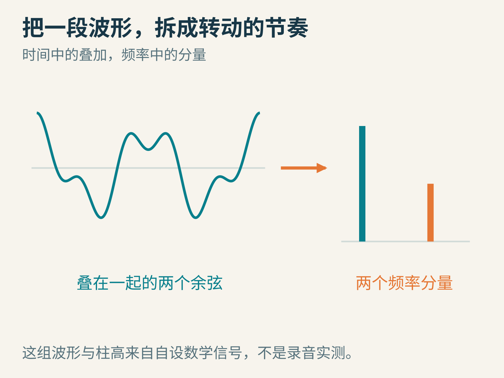
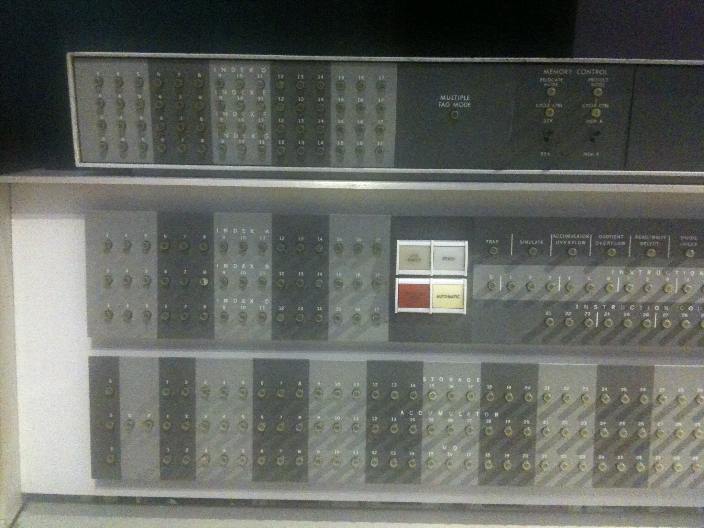
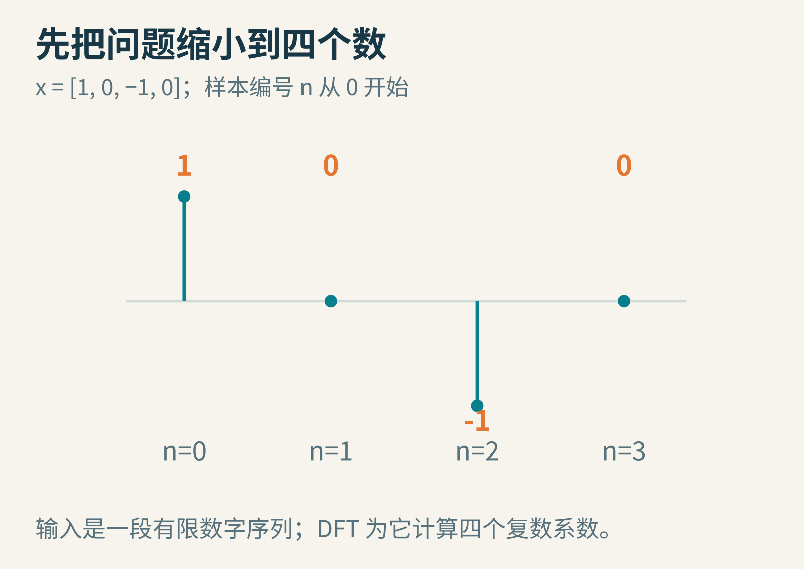
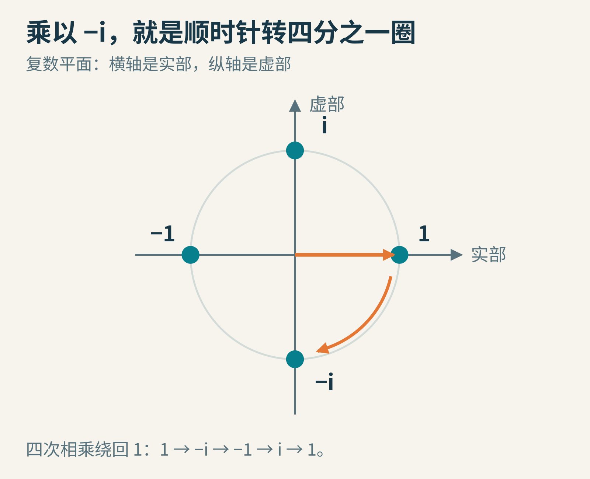
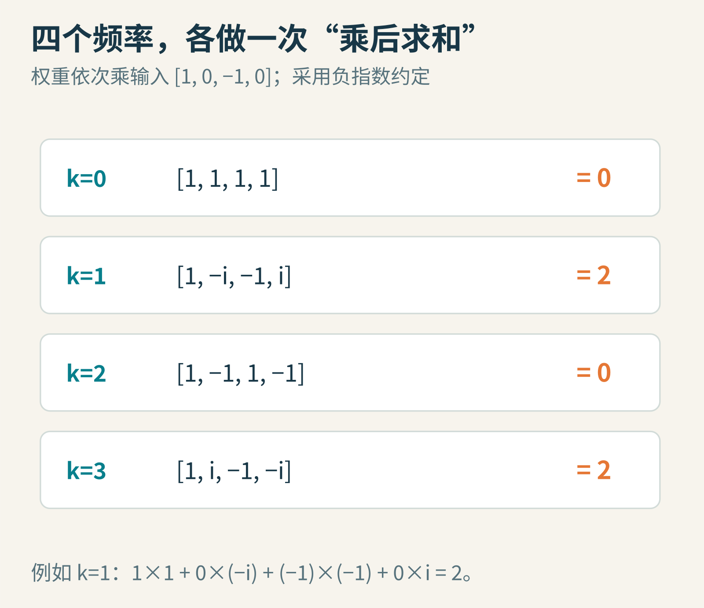
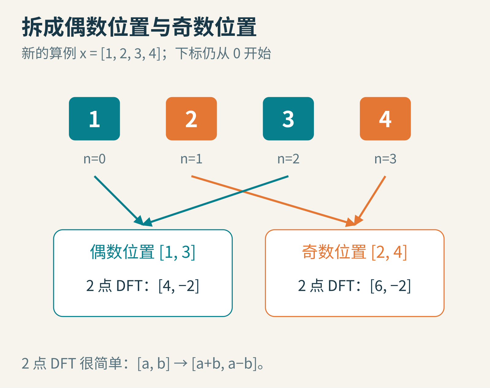
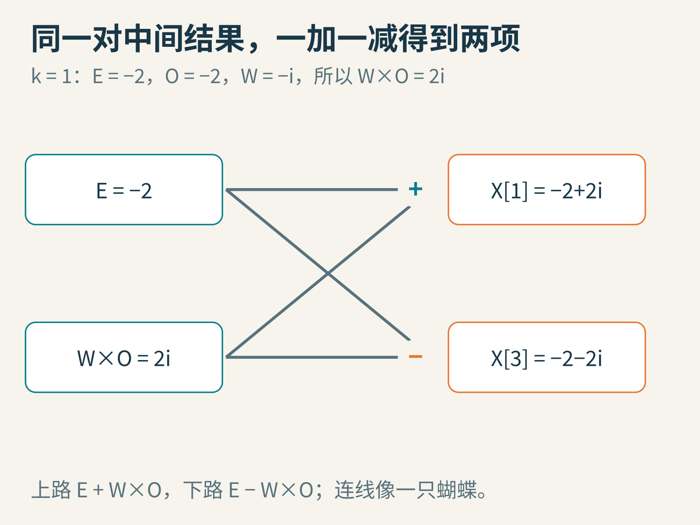
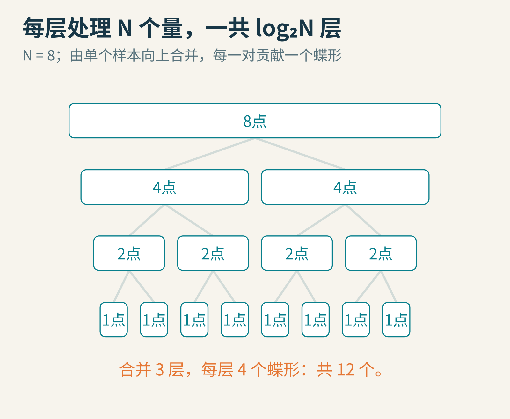
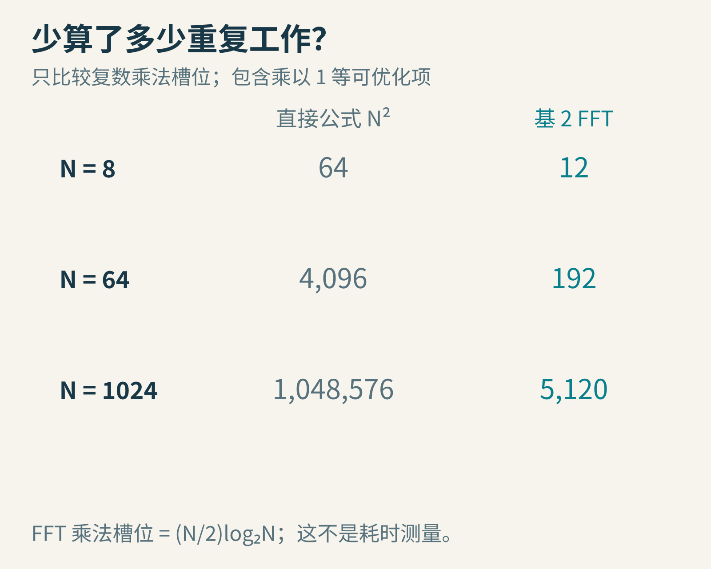
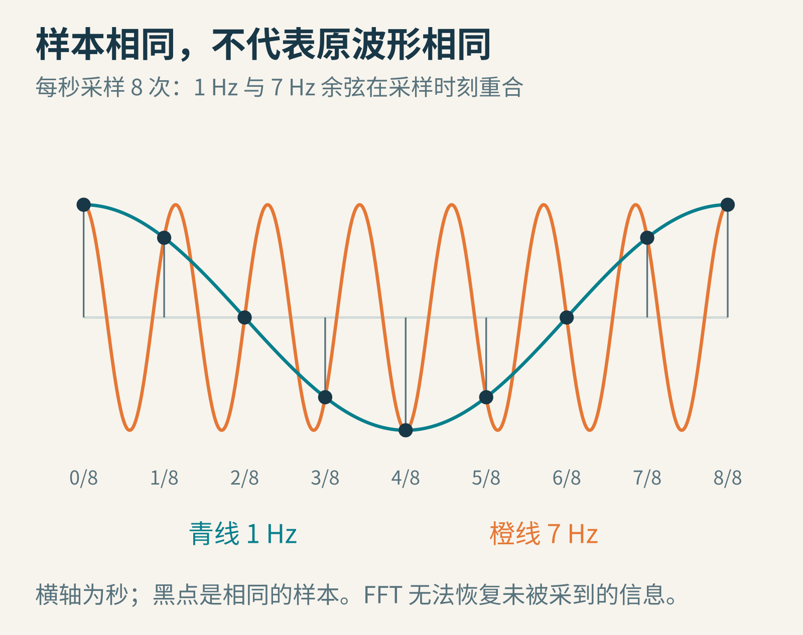

# 同一个答案，为什么能少算那么多？从四个数走进 FFT



*原创概念示意。左边由两个余弦相加，右边突出两个分量；采用自设数学信号，不是录音测量。*

音乐软件能把一段声音画成跳动的频谱柱。你也许会猜：它是不是给每一种音高装了一个小耳朵，分别听出“这里有多少低音、多少高音”？

这个比喻有一点接近。但计算机收到的，首先是一串按时间排列的数字。它必须通过计算，把“每一刻的变化”换成“不同转动节奏的分量”。如果每一种节奏都从头检查所有数字，数据一长，重复工作就会很多。

快速傅里叶变换，也就是 FFT，解决的核心问题正是：怎样利用这项计算本身的结构，得到同样的答案，却少做大量重复运算。先别被名字吓住。我们从四个数开始，而且会亲手算到结果。

## 先分清两个名字：DFT 与 FFT

离散傅里叶变换，简称 DFT，是一个确定的数学运算：给它 N 个输入数，它输出 N 个复数系数。正变换、反变换的符号和归一化有不同约定，只要前后一致，原始序列就可以恢复。

FFT 是快速计算 DFT 的一类算法。一个是要算的东西，一个是怎样算。它们的关系，类似“两个大整数相乘”与“某种快速乘法”，不应该理解为 FFT 故意丢掉部分答案来换速度。

声音只是应用之一。只要有规则排列的数字，图像、振动信号、某些方程计算也可能用到傅里叶方法。但“能送进变换”不等于“变换后的每一个峰都已有明确物理含义”。采样方式、单位与数据来源仍然重要。

## 1965 年的突破，不是从零发明一切

1965 年 4 月，James W. Cooley 与 John W. Tukey 的论文《An Algorithm for the Machine Calculation of Complex Fourier Series》发表，给出了利用因子分解降低运算量的办法，并讨论了二进制计算机上长度为二的幂的情况。论文开头直接谈到 Yates、Good 等人的相关工作，已经说明它处在一条较长的思想脉络中。[1965 年原论文](https://web.stanford.edu/class/cme324/classics/cooley-tukey.pdf)

两人在 1993 年的共同回顾中，还讲到 Richard Garwin 如何推动算法走向程序实现与传播：他关注傅里叶计算的巨大需求，把 Tukey 的思路带到 IBM，促成 Cooley 的进一步推导和编程。回顾也提到 Gordon Sande 的相关工作以及更早的分组计算方法。这个故事的重点不只是“有人想到公式”，还有把思想写成能运行、能交流、能被更多人采用的方法。[作者共同回顾](https://garfield.library.upenn.edu/classics1993/A1993MJ84400001.pdf)



*IBM 7094 控制台，ArnoldReinhold 于 2011 年 1 月 28 日在 Computer History Museum 拍摄；[CC BY-SA 3.0](https://creativecommons.org/licenses/by-sa/3.0/)，原件未改动。1965 年论文报告过 IBM 7094 上的计算；本图展示同型号设备，不是论文实验现场或那一台机器的身份证明。*

为什么这类方法会在电子计算时代格外重要？因为规模大了。把一百个数变成一千个数，直接两两配对的计算会增长一百倍，而不是十倍。算法结构上的节省，可能比单纯把同一条指令执行得更快更有力量。

## 四个样本，先不急着谈声音

取这段输入：x = [1, 0, −1, 0]。样本编号从 0 开始，分别是 x[0] 到 x[3]。



*原创自设数据。竖线是样本值，不表示两个采样时刻之间真实发生了什么；没有先假定采样率。*

我们想把这四个数，与四种不同的转动节奏比较。第 0 种不转，第 1 种每个样本转四分之一圈，第 2 种每次转半圈，第 3 种每次转四分之三圈。

为了把“转动”写成数，需要一个小工具：复数。把 a+bi 看成平面中的一支箭头，横向分量是 a，纵向分量是 b，i 满足 i²=−1。它并不是神秘的新材料，只是方便地同时记录两个方向。

乘以 i，会逆时针转四分之一圈；乘以 −i，会顺时针转四分之一圈。连续乘四次，就转回原处。



*原创教学示意。本文正变换采用负指数约定，因此基础旋转是顺时针；逆变换则反向旋转并除以 N。*

对于 N 个样本，把一次基础转动记为 W_N，它等于 cos(2π/N) − i sin(2π/N)。乘一次转一小格，乘两次转两小格，乘 N 次绕一整圈，得到 1。

这里最有用的性质不是三角函数的写法，而是转动会周期性重复。FFT 的节省，就藏在这种重复里。

## DFT 实际上怎样算？

按本文的约定，第 k 个输出为：

```text
X[k] = Σ x[n] × W_N^(k×n)     n 从 0 到 N−1
```

别急着背公式。固定一个 k，让各个输入乘上对应的旋转权重，再把它们全部相加。k 决定每一步转多快，n 决定这是第几个样本。“Σ”只是在说把这些项加起来。

对于四个样本，W_4=−i。因此 k=1 使用的权重依次是 1、−i、−1、i。乘上输入 [1,0,−1,0]，得到 1、0、1、0，求和就是 2。

k=0 时全部权重都是 1，所以结果是 1+0−1+0=0。k=2 的权重是 1、−1、1、−1，结果仍为 0。k=3 的权重是 1、i、−1、−i，结果为 2。



*原创计算表。四组输出按 k=0、1、2、3 排列，最终为 [0,2,0,2]。这是未归一化的正变换系数。*

为什么一个简单起伏，在结果中却有两个非零项？因为实数余弦可以由方向相反的两个复数旋转分量组成。在这组实数输入中，k=1 与 k=3 是一对。不能直接把它们解释成“录音里有两个独立乐器”。频谱的数学表示与声音来源的分离，不是一回事。

也要注意数值尺度。这里输出的 2，不代表输入振幅变成了 2。正变换没有除以 N，反变换要除以 N；实际频谱软件还可能采用单边显示、幅度或功率等不同标度。没有约定，就不能直接比较两张图的柱高。

## 如果照公式硬算，会做多少工作？

N 个输出，每个输出都查看 N 个输入。直接实现需要 N² 个复数乘法槽位，以及 N(N−1) 次复数加法。所谓槽位，是按公式逐项执行来计数；乘以 1 或 0 这样的特殊情况，本来就可以优化掉。

当 N=1024，乘法槽位有 1,048,576 个。单看一个求和并不复杂，困难来自一千多个彼此相似的求和，被各自从头算了一遍。

我们能不能让它们共享中间结果？这就到了 FFT 的关键一步。

## 把偶数位置和奇数位置分开

现在换一组更能看出合并过程的数据：x=[1,2,3,4]。按下标分组，偶数位置 0、2 得到 [1,3]，奇数位置 1、3 得到 [2,4]。分的是位置，不是判断数值是奇数还是偶数。

二点 DFT 特别简单：输入 [a,b]，权重只有 1 和 −1，输出就是 [a+b,a−b]。

所以，偶数组的二点变换 E=[4,−2]；奇数组的二点变换 O=[6,−2]。我们先把这两个小答案算好。



*原创自设算例。E 和 O 分别代表两组的小变换结果；不要把输入中的数值奇偶与下标奇偶混淆。*

为什么这种分组有用？把大公式中的 n 分成 2m 和 2m+1。偶数项的旋转因子变成 W_N^(2km)，正好是长度 N/2 的旋转因子；奇数项也有同样的小变换，只比它多一个 W_N^k。

换句话说，大问题里藏着两个完全同类的小问题，而不是随便把数据切开就会变快。

## 一对小答案，合出两个大答案

对前半段的 k，可以这样合并：

```text
X[k]       = E[k] + W_N^k × O[k]
X[k+N/2]   = E[k] − W_N^k × O[k]
```

第二项为什么是减法？因为从 k 走到 k+N/2，奇数位置对应的旋转多了半圈，相当于乘以 −1；偶数位置多出的则是整圈，保持不变。于是同一个 E[k] 和同一个旋转后的 O[k]，只需一加一减，就能给出两个输出。

算我们的四点例子。k=0 时，E[0]=4，O[0]=6，W_4^0=1，所以 X[0]=4+6=10，X[2]=4−6=−2。

k=1 时，E[1]=−2，O[1]=−2，W_4=−i。先算 (−i)×(−2)=2i，再合并：X[1]=−2+2i，X[3]=−2−2i。

最终答案是 [10, −2+2i, −2, −2−2i]。你可以把这四个输出逐个代回直接公式核对，它们没有丢失精度定义上的任何一项。



*原创蝶形示意，展示 k=1 的实际合并。交叉线共享同一个中间乘积 2i，不是再次独立计算一整组求和。*

这里“同样的答案”指精确算术中的数学结果。实际计算机通常用有限精度的浮点数，乘法和加法会舍入；换一种运算次序，最后几个数字可能略有不同。因此两种程序的结果比较，往往要采用适合数据尺度的误差容限，不能要求所有位都相同。FFT 也不会保证对任意输入完全没有舍入误差。

这种连线形状像蝴蝶，所以常叫蝶形运算。名字很轻巧，真正的价值是共享：一个中间乘积被两个输出共同使用。

## 再拆一次，再拆一次

如果 N 是二的幂，两个半长问题还可以继续按偶数、奇数位置拆分。八点变成两个四点，四点变成两个二点，二点变成单个样本。单个样本的变换就是它自己，不需要再拆。

然后自底向上合并。每一层共有 N/2 个蝶形，每个蝶形产生两个结果。总共需要 log₂N 层，因为连续对半分这么多次，长度才降到 1。



*原创教学结构图。N=8 时有 3 层合并，每层 4 个蝶形，共 12 个蝶形；方框表示子问题规模，不是实际内存布局。*

按这套未省略特殊因子的基 2 合并流程计数，复数乘法槽位是 (N/2)log₂N，复数加法是 Nlog₂N。因此工作量的增长趋势是 O(NlogN)，比直接公式的 O(N²) 慢得多。



*原创理论计数。N=1024 时，直接公式有 1,048,576 个乘法槽位，基 2 FFT 为 5,120；并未把这个比值冒称实测加速倍数。*

现实机器还有访存、缓存、线程调度和向量指令等成本。很小的输入上，准备工作也可能占主要部分。运算数量显著减少，不代表任何机器、任何长度都恰好快同一个倍数。

“长度必须是二的幂”也只是我们这一版算法的条件。1965 年论文就讨论了更一般的因子分解，今天 FFT 更是一整个算法家族。某个实现偏爱某些长度，不等于 DFT 只对这些长度有定义。

## 算得快，不能补回没测到的信息

如果采样率是每秒 f_s 个点，N 点 DFT 的相邻频率编号相差 f_s/N。比如每秒采 1024 点，取 1024 个点，相邻格子相差 1 Hz；只取 256 点，相邻格子就是 4 Hz。这里说的是变换格点间隔，不能不加条件地等同于区分两个真实信号的能力。

有限记录也有边界：DFT 可把这 N 个数看成一段重复延续的序列。真实振动若没有在记录内恰好走完整数圈，首尾拼接可能不平滑，一个分量的结果就会分散到多个格子。这常被称为频谱泄漏。窗口函数可以改变边界影响，但也会改变峰形与幅度标度，不是无代价地把一切修好。

更根本的是采样歧义。每秒采 8 次时，1 Hz 与 7 Hz 的余弦，在所有整数采样编号 n 上分别给出 cos(2πn/8) 和 cos(2π7n/8)。利用余弦的周期性与对称性，这两个数恰好相等。



*原创精确数学示例。图中 0 至 1 秒共有 9 个标出的时刻，用来展示每秒 8 次的采样间隔；它不是前面四点 DFT 的输入。两条连续曲线不同，黑点却重合。*

既然交给算法的数据完全相同，FFT 再快，也不能仅凭这些数据分辨原来是哪条波形。采样前的带宽限制与采样率选择，必须在采集阶段考虑。

同样，在末尾补很多零，会让显示的频率格点更密，却不会凭空延长真实观测时间。更细的画格，不自动意味着获得了更多测量信息。

## 自己改三个小地方

先把四点输入全部加 1，得到 [2,1,0,1]。试算哪个输出改变了：只有 k=0 增加 4，其余不变。这一项记录了平均水平的相关信息，常叫直流分量。

再把 [1,2,3,4] 的四点结果，用反方向的旋转权重求和并除以 4，检查是否回到原输入。遇到 i 的乘法时，始终记住 i²=−1。

最后把理论计数从 N=1024 改成 N=2048。直接公式乘法槽位增长四倍；基 2 FFT 从 5,120 变成 11,264，大约是 2.2 倍。规模增长带来的差别，比盯着一次小例子的绝对数字更能说明算法的价值。

FFT 的精妙，来自认出计算中可以共享的结构。它并没有召唤更快的数字，而是发现许多表面不同的问题，其实正在重复问同一个小问题。把这些小答案保存、旋转、组合，原本庞大的工作就有了层次。这也是理解算法时很值得保留的一种眼光：先别急着让每一步更快，先问有没有一些步骤根本不必再做一遍。

本文由 AI 辅助研究、撰写与制图；算例、波形与运算数量图均为原创教学数据，不是设备性能实测。

图片来源：[IBM 7094 控制台原件与许可](https://commons.wikimedia.org/wiki/File:IBM_7094_console.agr.JPG)；其余为本文原创教学图。
