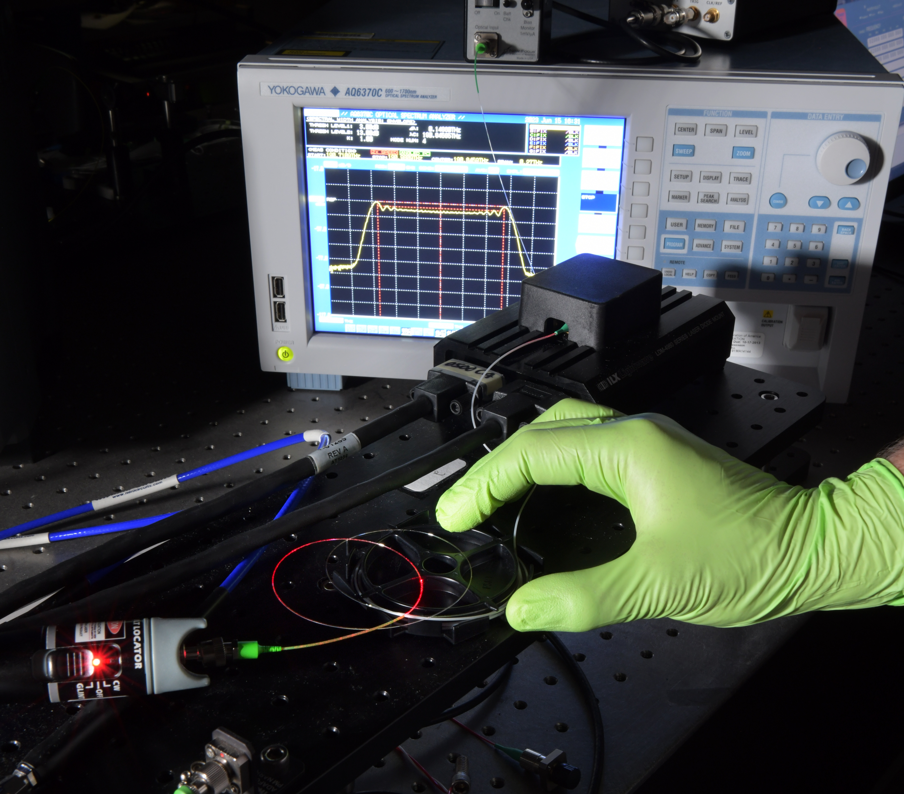
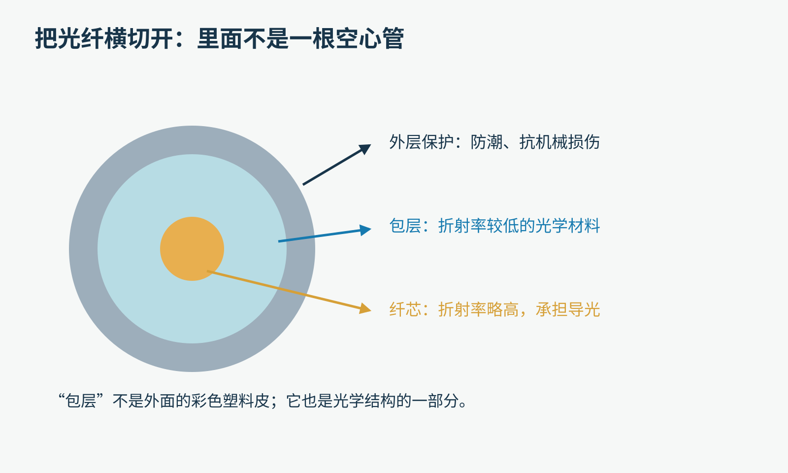
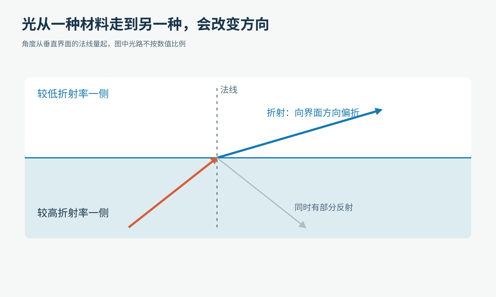
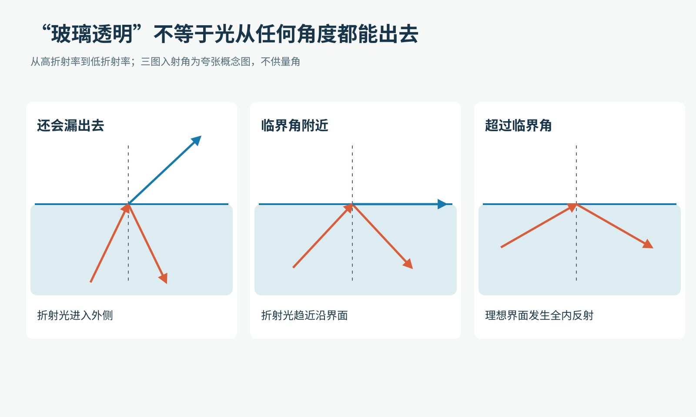
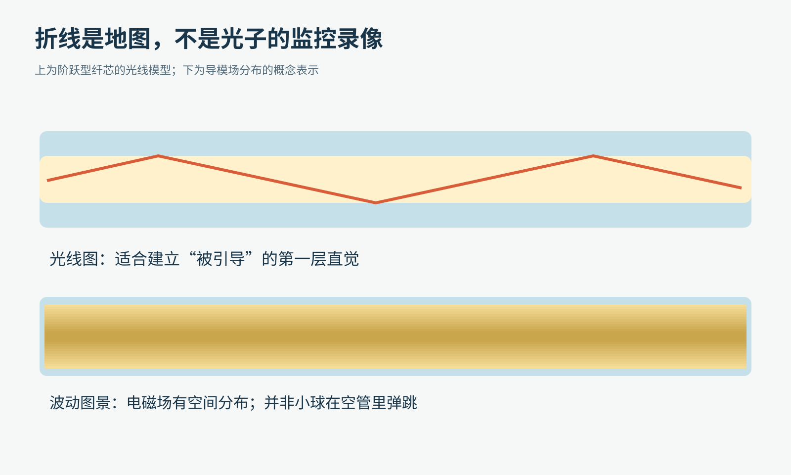
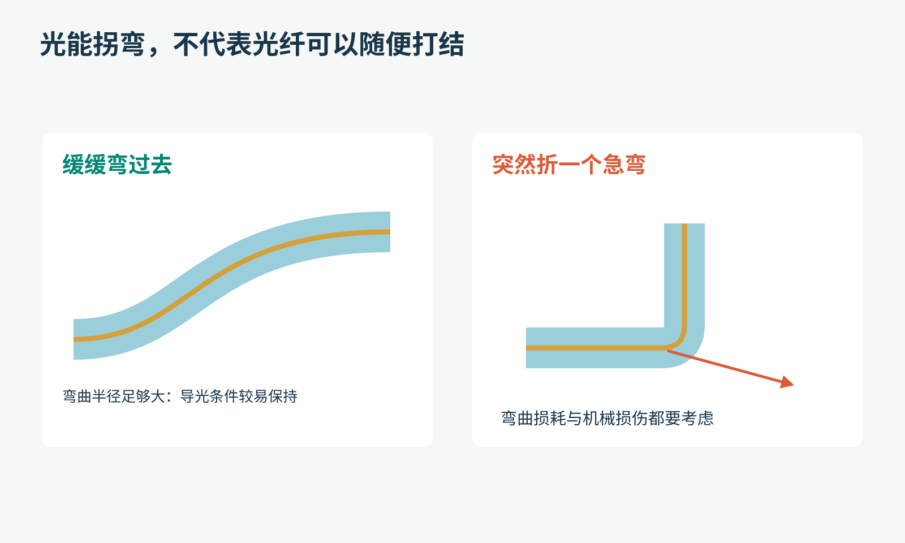
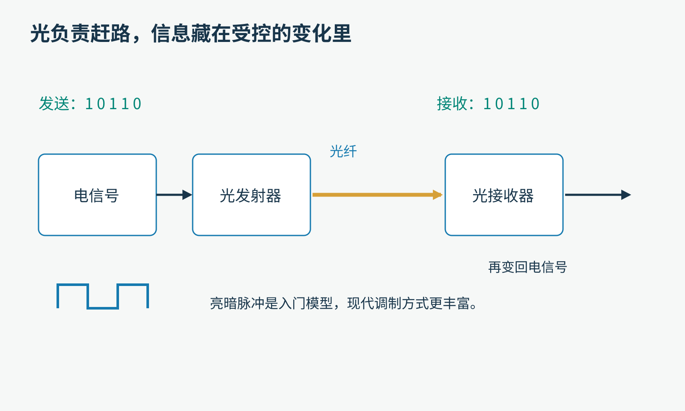
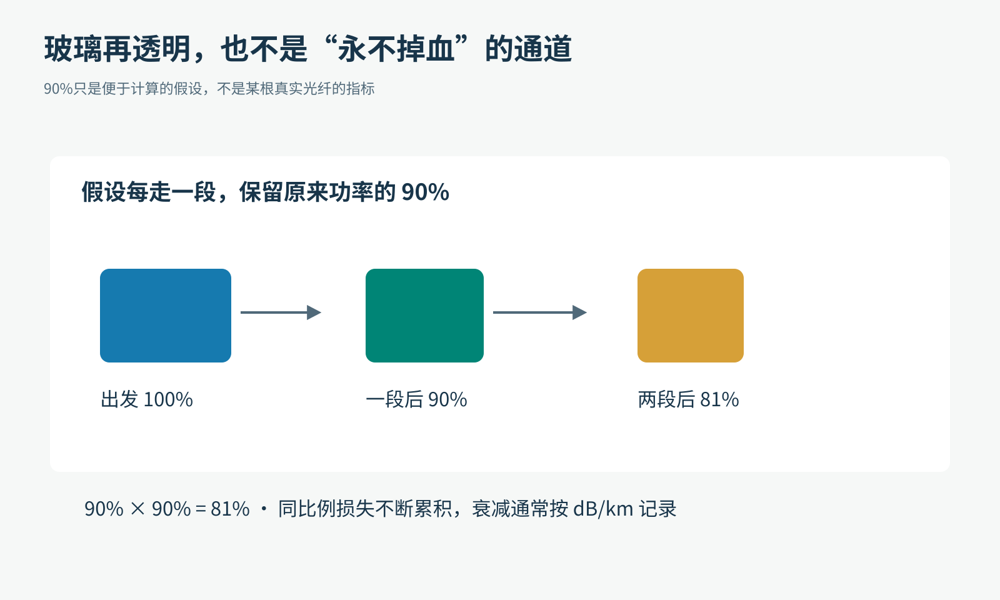
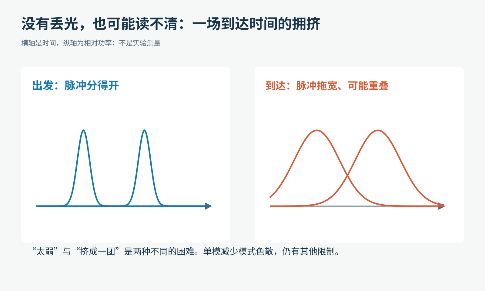
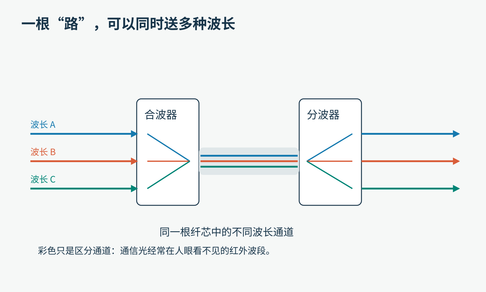

# 光明明走直线，为什么一根弯弯的光纤能把它送到远方？

假如给你一束光，再给你一根绕了几个圈的细线，请你把光从这头送到另一头。

不能沿路摆镜子，不能让光穿过房间抄近路，还要让这束光带着一句话。

听起来像魔术。但你加载一张图片、接通一次视频通话时，通信网络中的某一段路，很可能已经在做这样的事。

真实光纤缆线，照片中的红光用于演示；它出自NIST光子温度传感研究的介绍，不是某条互联网骨干线路。摄影：Jennifer Lauren Lee/NIST，2023年。原PNG为适应文件限制转为JPEG，完整画面保留。

先约定范围：下面先讨论常见的实心玻璃光纤。特殊的空芯光纤等，还有不同的导光机制；不能把一张入门图解释成所有光纤的统一说明书。

## 先拆掉一个想象：它不是装着光的吸管

“光纤”这个名字容易让人想成一根中空小管子，光在里面跑。常见通信玻璃光纤的中心，恰恰也是玻璃。

横切开看，最重要的是两部分：中心的纤芯，外面的包层。再往外，才是用于保护的涂覆层，以及光缆里的其他防护结构。

原创教学示意，比例经过夸大。彩色塑料外皮主要负责保护，不能把它与决定导光的光学包层混为一谈。

纤芯和包层看起来都透明，为什么非要分成两种？

因为它们对光有一个微小但关键的差别：折射率不同。先不用记公式，把折射率理解成描述光在材料中传播特征的一个数。对这里的普通透明材料，折射率越高，光的相位传播速度越低。

常见导光设计让纤芯的折射率略高于包层。这个“略高”，就是我们接下来需要的机关。

## 光遇到边界时，并不只会做一件事

你从岸边看水里的吸管，吸管好像折了一下。不是吸管变形，而是来自水下部分的光跨过水与空气的边界时改变了方向。

这叫折射。

但是，光遇到界面时，也可以有一部分反射回来。比如隔着窗户既能看到外面，又能看到自己淡淡的倒影。

原创光路示意。“法线”是垂直于界面的参考线；下文说的入射角，都从这条线量起，而不是从界面量起。

现在做一个脑内实验。让光从玻璃内部射向外面，逐渐把方向放得更斜。

从高折射率一侧走向低折射率一侧时，折射光会偏得更靠近界面。当入射角到达某个门槛，折射方向趋近于沿着界面前进。再超过这个门槛，在理想无吸收界面的光线模型中，就不再有普通的折射光束向外传播，能量被反射回去。

这就是全内反射。门槛叫临界角。

原创概念示意。三幅图强调状态变化，光线角度作了简化，不能拿量角器从图里读临界角。

要得到它，必须同时满足两个条件：

1. 光从折射率较高的一侧走向较低的一侧。
2. 入射角相对法线足够大，超过临界角。

“任何光照到玻璃都会被关住”显然不对。你正面看窗户能看透，就是一个随手可得的反例。

## 给想多走一步的人：临界角到底多大？

它取决于两种材料，不是一个通用的45度。

若高折射率一侧为n₁，低折射率一侧为n₂，那么临界角θ满足：sin θ = n₂ / n₁。

例如，用便于计算的理想值n₁=1.50、n₂=1.00表示玻璃到空气，临界角约为41.8度。这是教学数值，不是你家某块玻璃的实测参数。

光纤的包层通常不是空气，纤芯与包层的折射率还很接近，所以不能把这41.8度直接搬过去当通信光纤的答案。

你会发现：我们只改变了材料配对，允许留在内部的光路就变了。工程师设计光纤，很大一部分工作就在精确控制这种差别。

## 把一面界面卷成细长通道，光就能远行了吗？

在最容易画图的“阶跃型”模型里，纤芯内部折射率大致均匀，到了包层突然降低。以合适角度进入的光，就能在边界上连续发生全内反射，沿着纤芯前进。

原创教学示意。上图是帮助理解的光线模型；下图提醒我们：光也要按电磁波的空间分布来理解。两幅都不是光子的实际轨迹照片。

这时你可能会问：光不是走直线吗？

更准确地说，在均匀介质中，几何光学用直线描述光的传播；遇到边界或折射率发生变化，方向可以改变。光纤没有违反这条规则，它给光安排了连续的约束。

不过，折线图只是第一块踏脚石。尤其对很细的单模光纤，更完整的描述是电磁场在纤芯和包层共同构成的结构中，以特定的场分布传播。这种允许的传播状态叫“模式”。

模式并不是“同时只能有一颗光子”，也不是纤芯里画出的一条实体轨道。部分场分布会延伸到包层，不能把包层想成一道光完全碰不到的硬墙。

还有渐变折射率光纤：纤芯从中央往外的折射率逐渐变化，光线模型里的路径可以平滑弯曲，而不是一律画成尖锐折线。

科学图最有用的时刻，不是让你相信“世界就长这样”，而是让你知道：这一张图在哪一层近似上成立。

## 那根线本身弯了，光为什么不飞出去？

把一条笔直的走廊，缓慢弯成一条大弧线。只要弯曲足够温和，导光结构仍可能让光主要留在内部，跟着纤芯前进。

但“能弯”不等于“怎么弯都行”。

原创概念示意。急弯可能增加泄漏损耗，也可能造成材料损伤；具体允许的弯曲半径必须看光纤和光缆规格。

弯得太急，会改变导光条件，让更多能量泄漏；同时，细玻璃也要承受机械应力。现代有专门降低弯曲敏感性的设计，但它们仍有适用边界。

所以不要为了验证本文，把家里的入户光纤折成直角、缠在铅笔上，或者用订书钉固定。线还没断，不代表光学性能就没有变化。

这也是光纤安装看起来很“温柔”的原因：转弯留余量、接头注意清洁、拉力受到控制。保护外壳是为了让那条很细的光学结构长久保持合适的状态。

## 光在赶路，可你发的“你好”在哪里？

光纤自己并不认识汉字。

“你好”先经过编码，变成设备能处理的数据。发射器再控制光，让它携带这些信息。最简单的入门想象，是用不同时间段里的亮和暗表示0与1。

另一头的接收器检测光的变化，将它转换成电信号，再由电子系统解码。

原创链路示意。亮暗脉冲是教学模型；真实系统也会利用光的幅度、相位等信息，不能把所有高速光通信都画成手电筒开关。

想象两个人用手电筒隔窗发暗号：光不是信件本身，受控制的变化才是编码。光纤的作用，是给这些变化提供稳定而高效的传输路径。

因此，网络速度也不能只用“光跑得快”来解释。光的传播速度影响延迟；每秒能可靠区分多少符号、每个符号携带多少信息，则影响数据速率。两者有关，但不是一回事。

一辆车每秒行驶多少米，与一条路每秒能通过多少乘客，是两个不同的问题。

## 第一种麻烦：到了终点，光太弱了

玻璃非常透明，仍不等于完全无损。材料会吸收部分能量，细微结构会散射光；接头、弯曲等环节也会产生损耗。

路越长，这些损失越值得认真计算。

原创算例。“每段保留90%”是便于理解的假设，并非实际产品指标。

假设每走一段就保留90%的功率。第一段后是90%，第二段后不是80%，而是90%×90%=81%。再走一段，就剩72.9%。

这不是每段扣掉相同的一小块，而是每段按当时剩下的量乘一个比例。

工程上常用分贝每千米，dB/km，来表示光纤的衰减系数。分贝把连乘变成便于相加的数值，但本文先抓住直觉就够了：一点点比例损失，走得远也会积累成大问题。

长距离系统会安排放大、再生和信号处理。具体方案取决于链路，并不是每隔任意距离放一面镜子，就能让光永远跑下去。

## 第二种麻烦：光还在，却挤成了一团

设想两位同学同时出发，一个走短路，一个走弯路。即使都到终点，抵达时刻也可能不同。

在某些多模光纤里，不同模式的传播时延不同，会使原本较窄的光脉冲到达时展宽。这种机制叫模式色散。

还有一种问题：不同波长的光，传播时延也可能不同。即使在单模光纤里，也仍会有这类色散等限制。

原创概念曲线。横轴为时间，纵轴为相对功率，未采用实验数据；为了突出展宽，各曲线做了示意化处理，不用它比较能量守恒。

如果前一个“亮一下”拖着长尾巴，后一个已经来了，接收器就难以判断边界。

这说明两个问题需要分开解决：

- 衰减：信号变弱了。
- 色散：信号在时间上变模糊了。

增大音量能让一句话更响，却未必能把叠在一起的两句话重新分开；同样，放大光功率也不等于修好了所有色散。

单模光纤减少了多种空间模式之间的时延差，适合很多长距离高速系统。但单模也有其他限制，“单模等于无限带宽”仍然是过头的结论。

## 为什么同一根纤芯能承载那么多信息？

除了把每个通道做得更快，工程师还可以让不同波长共享一根光纤，再在另一端把它们分开。这叫波分复用。

原创教学示意。蓝、红、绿只是区分通道；很多通信波长在人眼看不见的红外区域，不能直接把它们当作照片里的可见彩虹。

类似同一片空气里有多个广播频道，接收机调到不同频率就能选择不同节目。光学系统也需要相应的合波、分波与接收设备，通道不能不受限制地无限堆叠。

读到这里，你已经能把一条链路拆成几个问题了：

材料能不能把光留住？弯曲是否合适？光到了还有多强？脉冲是否仍能分清？不同通道会不会互相干扰？

所谓“光纤通信”，不是一个全内反射现象自动长成了互联网，而是围绕这个现象，逐一解决了传输、制造、编码和接收的问题。

## 一个不用拆家里网络的探索任务

找一根明确用于教学、配有低功率可见LED光源的导光条或塑料光纤，在老师指导下观察端面亮度。保持光源、入射位置和环境光不变，比较平直与缓弯时的表现，记录观察条件。

不要拆运营商设备，不要剪玻璃光纤，不要直视任何光纤端口，也不要把“我看不见光”当成安全证据。通信设备可能使用不可见光；教学演示也应按光源说明操作。

如果暂时没有器材，纸上也能做一个问题：假设一段光纤保留90%的功率，连续十段剩下多少？再猜一猜，五十段呢？

答案约为34.9%和0.52%。同一个不起眼的比例，一旦不断重复，结果会很不一样。

你会发现，这根细线教会我们的，不只是“光怎样拐弯”，还有一种做工程的方法：先找到能工作的原理，再认真对待每一点看似微小的损失。

事实延伸：[Corning的光纤结构介绍](https://www.corning.com/worldwide/en/innovation/the-glass-age/science-of-glass/how-it-works-optical-fiber.html)、[Fiber Optic Association光纤技术参考](https://www.thefoa.org/tech/ref/basic/fiber.html)、[全内反射与临界角](https://www.edmundoptics.com/knowledge-center/application-notes/optics/introduction-to-optical-prisms/)、[波分复用](https://www.thefoa.org/tech/dwdm.htm)。

图片来源：真实缆线照片，[Jennifer Lauren Lee/NIST，fiber optic cable，2023](https://www.nist.gov/image/fiber-optic-cable)，依[NIST作品使用条款](https://www.nist.gov/open/license)署名使用。其余为本文原创教学示意。
