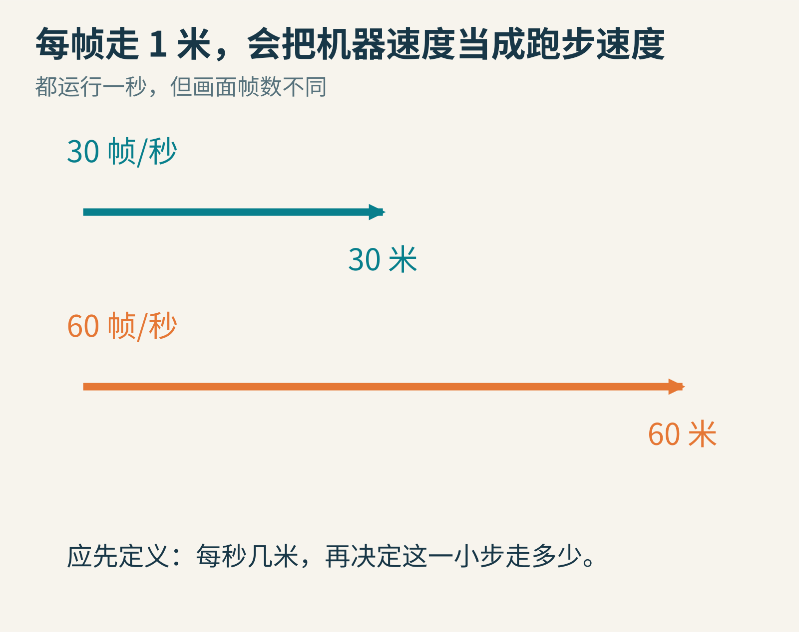
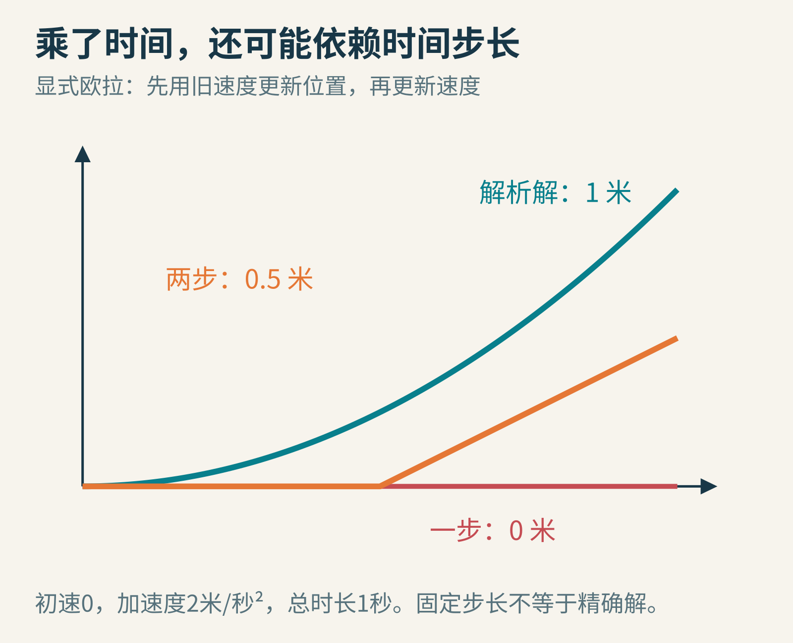
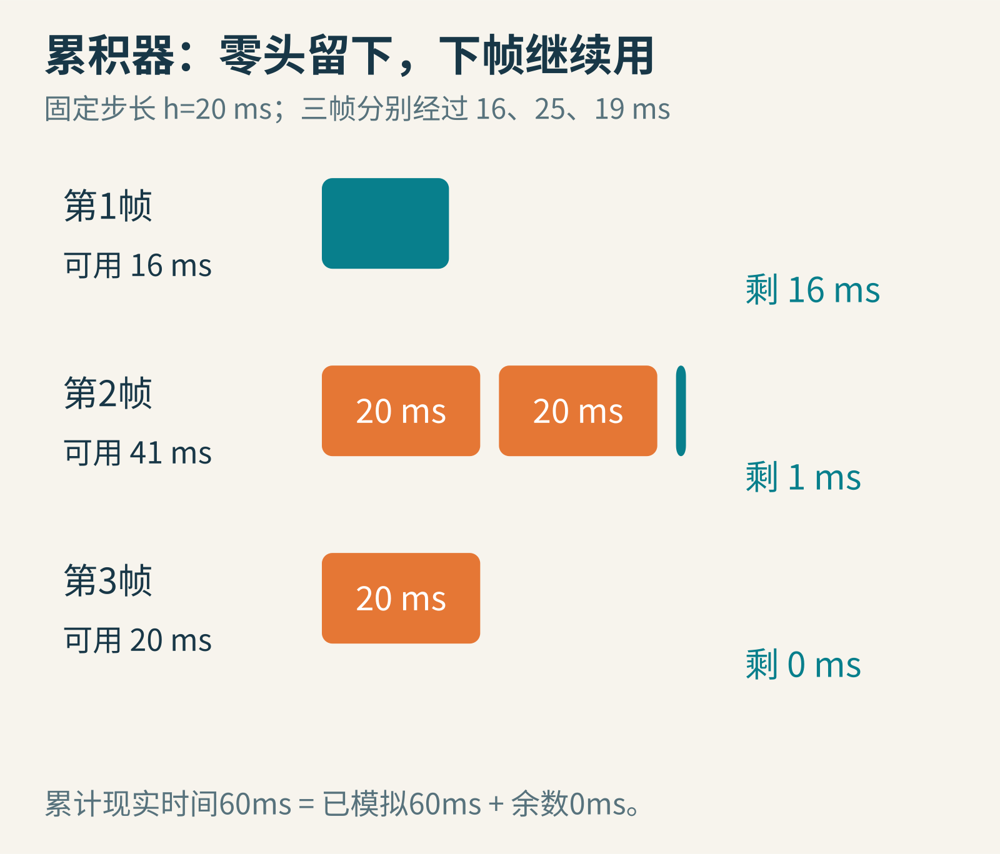
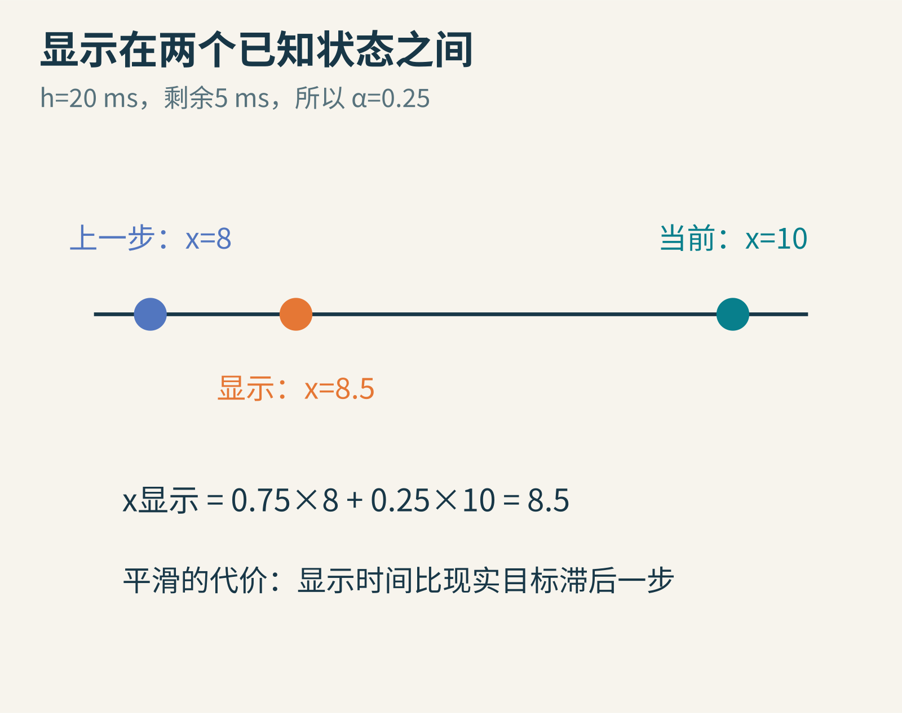
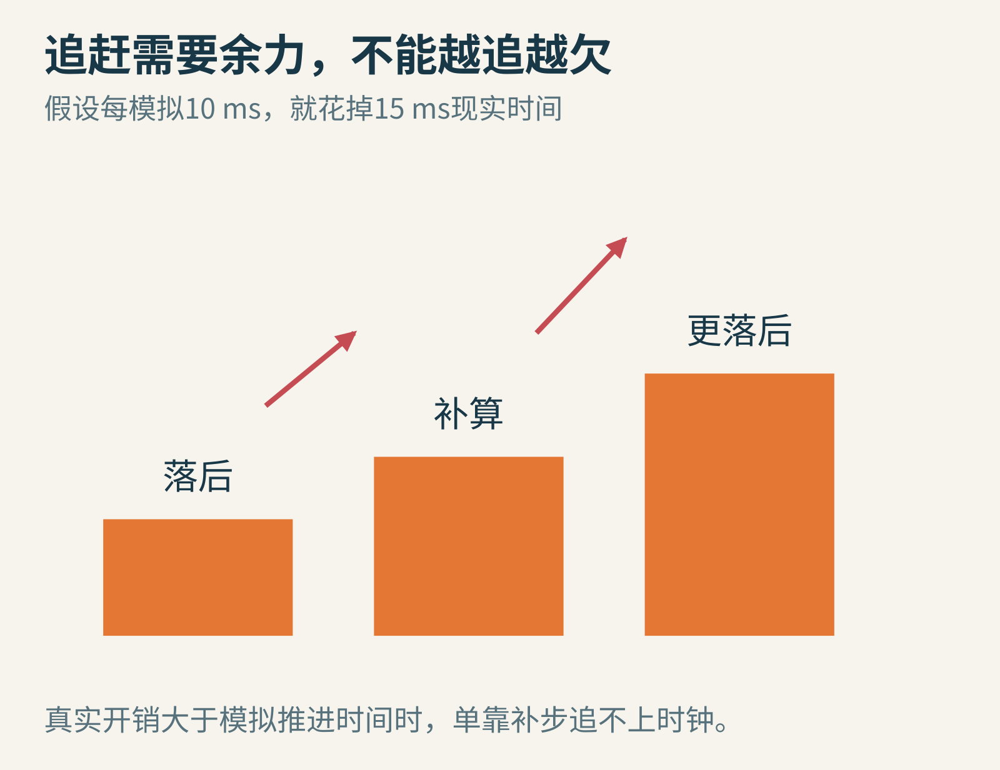
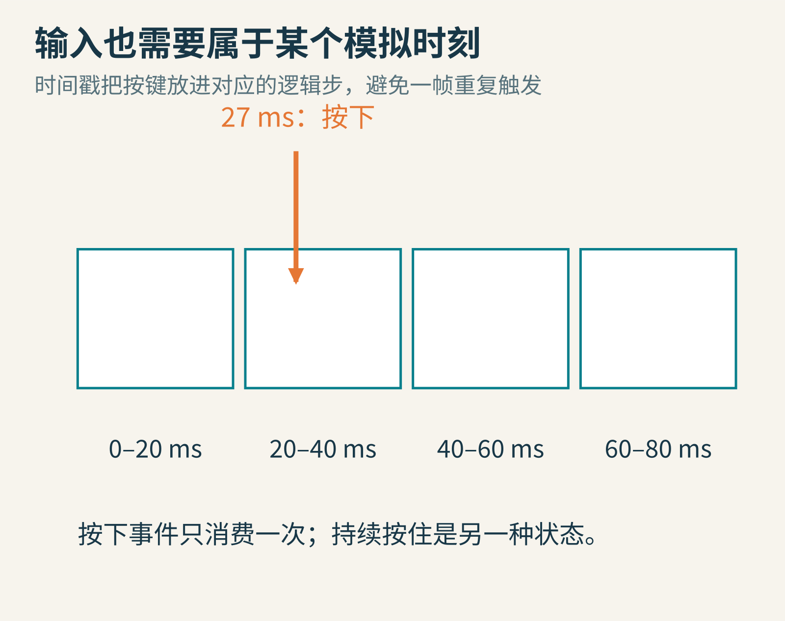

# 屏幕变快了，世界不能乱跑：游戏循环与固定时间步

你写了一个小球游戏：每画一帧，小球向右移动一格。自己的电脑每秒画三十帧，一切正常。把程序交给朋友，朋友的电脑每秒画一百二十帧，小球突然快了四倍。

这不是朋友获得了隐藏加速器，而是你把两个原本不同的问题绑在一起了：**电脑多久画一次画面，游戏世界多久往前走一步。**

固定时间步，就是把这两个节奏认真分开。它听起来像一个普通循环的细节，却决定了物理模拟、输入响应、动画与重放是否容易理解和控制。

原创时间概念图。上方间隔可变，下方间隔固定；点表示处理时刻，不表示同一秒内的实际固定帧数。

## 一　游戏并不是等你按键以后才向前走

普通命令行程序可以问一个问题，停下来等你回答，再继续执行。但游戏里的敌人、水流、倒计时和声音，往往不能因为你没有按键就停止。

因此许多游戏会反复执行一组工作：读取输入，推进游戏状态，生成画面，再进入下一轮。这叫游戏循环。实际引擎可能把部分工作交给不同线程，或由平台事件循环驱动，但“输入、状态更新、显示”仍是可以分开思考的职责。

状态是什么？小球的位置和速度，门是否打开，玩家还剩多少生命，上一条输入是否已处理，都是状态。画面是把这些状态转成玩家看得见的图像。更新状态和显示状态，既有关联，也不是同一个动作。

假如每次显示都让角色固定走一米，一秒显示三十次就走三十米，一秒显示六十次就走六十米。程序没有出错，只是我们写下的规则，本来就在奖励更快的机器。

原创反例。“一米”特意取大，方便看出错误；它不是推荐的游戏移动单位。

## 二　乘上经过的时间，不就解决了吗

对匀速直线运动，一个自然修正是：位置增加量=速度×经过时间。若速度是每秒六米，上一帧到现在过去 1/30 秒，就走 0.2 米；过去 1/60 秒，就走 0.1 米。只要总时间相同，总路程也相同。

这个办法非常重要，但它不是所有模拟问题的万能补丁。因为游戏里的速度也可能随时间改变，碰撞与约束还可能改变运动过程。程序通常是在用一串离散计算近似连续变化，结果会受步长影响。

做一个可以手算的实验：小球初始位置和速度都是零，加速度固定为每秒平方两米。我们采用最简单的显式欧拉规则：先用旧速度更新位置，再把加速度乘步长，加到速度上。

用一整秒作为一步：旧速度是零，所以位置仍为零；速度更新为每秒两米。最终位置是零米。

改成两步，每步半秒：第一步位置仍是零，速度变成每秒一米；第二步位置增加 1×0.5=0.5 米，速度再变成每秒两米。相同的一秒，得到的位置却是半米。

原创手算曲线。绿色是精确解析位置，橙色为两步显式欧拉的分段位置近似，红色为一步结果。

连续运动的解析答案是位移 0.5×加速度×时间平方，也就是一米。两种离散结果都不精确。这不是说显式欧拉“连移动都不会”，而是提醒我们：数值算法、步长与系统动态，必须放在一起看。

更好的积分方法能改善误差；较小步长往往也有帮助。但突然把一小步变成一大步，可能改变能量、约束效果乃至稳定性。固定时间步的第一份礼物，就是让模拟每次面对同样大小的问题。

## 三　历史上早就有自己的“游戏时钟”

固定逻辑节奏并不是某篇现代教程突然创造的。《Doom》官方公开源码中，doomdef.h 明确写着 TICRATE=35；卡马克在 1997 年发布说明里，也提到它的 35 Hz 时间基准。[源码定义](https://github.com/id-Software/DOOM/blob/master/linuxdoom-1.10/doomdef.h)

这个数字表示每秒三十五个游戏时间刻度，不能随口改写成“任何情况下画面都以三十五帧刷新”，更不意味着所有游戏都应该采用同一个频率。

2004 年，Glenn Fiedler 的《Fix Your Timestep!》把可变步长、半固定步长、累积器、追赶失控和显示插值讲成一条清晰的工程路线。[作者原文](https://gafferongames.com/post/fix_your_timestep/)。本文沿着同一类问题，以自设数字重新做实验，不把作者称为固定时间步的唯一发明者。

如今的物理库也仍然强调步长选择。例如 Box2D 3.1 的[官方模拟文档](https://box2d.org/documentation/md_simulation.html)建议使用固定时间步，并区分主时间步与内部子步。我们下面使用二十毫秒，只为了算得清楚，不是给所有游戏下统一参数处方。

## 四　画面慢一下，模拟为什么可以走两步

把固定步长记为 h=20 毫秒，也就是模拟频率每秒五十次。再准备一个变量，记录现实时间中还没有被模拟消费掉的部分，叫累积器。

每轮显示前，先测量距离上一轮经过了多久，把它加入累积器。只要累积器至少还有二十毫秒，就推进一次恰好二十毫秒的模拟，并减去二十。剩下不足一步的零头，留给下一轮。

设连续三帧的现实间隔是 16、25、19 毫秒。

第一帧，累积器得到 16，不够一步，所以模拟走零步，余数 16。

第二帧，又加入 25，总共 41。模拟走两步，消费 40，余数 1。

第三帧，再加入 19，总共 20。模拟走一步，余数 0。

原创累积器手算图。橙块是一整步，绿色是尚未消费的时间；每帧结束都满足余数小于一步。

三帧共经过六十毫秒，模拟共走三步，也就是六十毫秒，账目对上了。画面可以显示三次，而模拟更新次数为零、二、一，不必一一对应。

这里的精髓不是“每帧走几步”的特殊表格，而是一条不变量：没有人为丢弃时间时，**累计现实时间=已模拟时间+累积器余数**。一旦程序出现莫名其妙的加速或减速，检查这笔账，往往比盯着帧率数字更有效。

## 五　零头不能扔掉，也不能随意当作最后一小步

如果每帧结束都把不足二十毫秒的余数清零，前面的第一帧十六毫秒就消失了。持续重复这种做法，游戏时钟会慢下来。

另一种选择，是每帧先走若干整步，再把零头也用一个较小步长模拟完。这能限制最大步长，常被称为半固定方案，但它不再是所有模拟步完全相等。不同显示节奏会产生不同的最后小步序列。

这两种方案并非善恶之分。它们解决的问题和代价不同。若你特别需要固定数值步长，就保留余数；若采用可变或半固定方案，就应当明确积分器及系统是否能承受这种变化，而不是只因为“看起来不抖”就默认正确。

附带的 exercise.py 用整数毫秒做累积器实验，避免读者先被浮点小数干扰。实际程序可使用平台高精度的单调时钟；单调指它适合测量时间差，不会因校准日历时钟而突然倒退。

## 六　模拟固定了，画面为什么仍然可能轻微顿挫

显示时刻不一定刚好落在模拟刻度上。如果上一轮没有足够时间走新的一步，直接画“当前状态”，画面就会重复。下一轮走了一步，物体又跳到新位置。即使平均速度对，视觉节奏也可能不均匀。

一种常用办法是保存上一个状态 previous 和当前状态 current。模拟结束后，用余数除以 h，得到 0≤α<1，再在两个已知状态之间插值。

位置插值为：**显示位置=(1−α)×上一步位置+α×当前位置。**

假设 h=20 毫秒，余数为 5 毫秒，所以 α=0.25。上一步位置为 8，当前位置为 10，显示位置就是 0.75×8+0.25×10=8.5。

原创时间插值例。数字为自设位置单位；显示状态不写回物理模拟。

这里有一个经常被漏掉的代价：这种“在 previous 与 current 之间插值”的显示时间，比现实目标时刻落后一个固定步长。假设当前模拟时间是 t，现实目标是 t+余数，插值对应的却是 t−h+余数。

它用一点延迟换取平滑。另一种做法是根据当前速度向未来外推，但未来若出现碰撞或输入改变，预测可能错，需要修正。不同游戏会做不同权衡，不能说插值永远免费、外推永远错误。

位置可以线性混合，但生命值、对象是否存在、武器是否开火等离散状态，不能无脑取平均。传送前后插值也可能让角色穿过半个地图；这类跳变通常要重置历史状态或另作处理。

## 七　电脑追不上时钟，会发生“越追越欠”

假如模拟十毫秒的游戏世界，需要花十五毫秒现实时间。程序本来落后了一步，于是赶紧多算；多算又消耗更多现实时间，时钟继续往前走，于是又欠下更多步。

这就是常说的“死亡螺旋”。它不是某个神秘异常，而是工作需求大于处理能力的反馈。

原创因果示意，不是某台电脑的性能测量。柱形强调积欠增长，没有给出实测比例。

因此一个能追赶的系统，需要在正常负载下留出余力。偶尔卡一下，可以多走几步补上；长期每步都比对应现实时间更贵，就必须优化、减轻工作或改变策略。

还可以设置每轮最多补算几步，避免无限卡住界面。但达到上限后怎么办，必须说清楚。若保留全部欠账，可能长期落后；若丢弃部分时间，游戏世界相对现实变慢或跳过了本应经历的时间；若降低模拟精度，则改变了数值行为。没有一个分支叫“免费恢复所有时间”。

暂停、系统挂起或拖动调试器，也可能产生巨大的时间差。程序往往会专门处理恢复事件，或限制单次纳入模拟的时间。这是产品策略，不能把被舍弃的时间藏起来，再声称现实与模拟完全同步。

## 八　按键也要进入正确的那一步

假设某次画面循环需要连续模拟三步，而你刚刚收到了一个“开火”按下事件。若每一步都把它当新按下处理，同一事件就可能开三枪。

反过来，如果只在显示帧采样一次输入，再盲目把最新状态用于所有历史补算步，也可能把后来发生的按键提前应用到过去。

原创输入排队示意。区间端点的归属规则需由实现统一；图采用左闭右开的时间桶。

一种更明确的做法，是记录输入事件的时间戳或目标逻辑步，把事件按规则排入模拟队列，消费一次就标记完成。“按下瞬间”和“持续按住”的状态需要分开：前者是一次事件，后者可以连续影响多步移动。

这仍然涉及延迟取舍。相机鼠标视角、界面反馈等，可能在显示侧更快响应；会影响游戏规则的状态，则必须保持自己的时间约定。关键不是所有工作都必须进入一个五十赫兹的盒子，而是哪些状态在哪里更新，要有清楚边界。

## 九　固定步长有助于重现，但不是确定性的全部

把步长固定，再输入相同指令，会减少一种重要的差异来源。但两个程序是否得到逐位相同结果，还取决于随机数种子、浮点计算顺序、平台、并行调度，以及容器遍历等细节。

因此不能把“固定时间步”直接等同于“任何电脑都能完美确定性重放”。它提供有用条件，不自动提供全部保证。类似地，固定步长也不保证稳定：如果 h 相对于系统变化仍然太大，固定地算错也是算错。

如果你的角色移动使用自写规则，物理引擎又有独立内部子步，还要避免误把渲染时间重复传入，或在两个地方各推进一次。先画清楚谁拥有模拟时钟，再追求复杂优化，通常更稳妥。

## 十　用一段小实验检查自己的直觉

运行 exercise.py，先核对 16、25、19 毫秒三帧得到的零、二、一步。再把它们改成六帧，每帧十毫秒：显示次数变化，但总模拟时间仍应是六十毫秒。

接着试试把余数故意清零，看看模拟丢掉多少时间。最后比较一步、两步、十步显式欧拉的恒加速度位置；随着步长减小，结果应更接近解析解，但不会因为用了固定步长就瞬间变得精确。

这些小实验不需要做完整游戏，也不需要高端显卡。你只是在训练一种非常重要的习惯：让时间有单位，让每一笔时间都能解释，让画面看到的状态与游戏真正采用的状态各司其职。

**屏幕可以快一点、慢一点，游戏世界怎样前进，却应该是你明确写下的规则。**

本文由 AI 辅助研究与撰写；全部配图和复算脚本为本次原创。历史与工程边界根据官方源码、Fiedler 原文及 Box2D 文档核对。图片来源：本次原创教学图。进一步阅读：[游戏循环的完整讨论](https://gameprogrammingpatterns.com/game-loop.html)。
