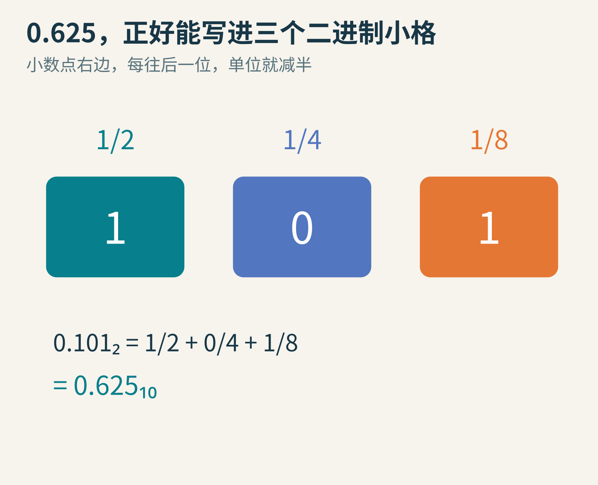
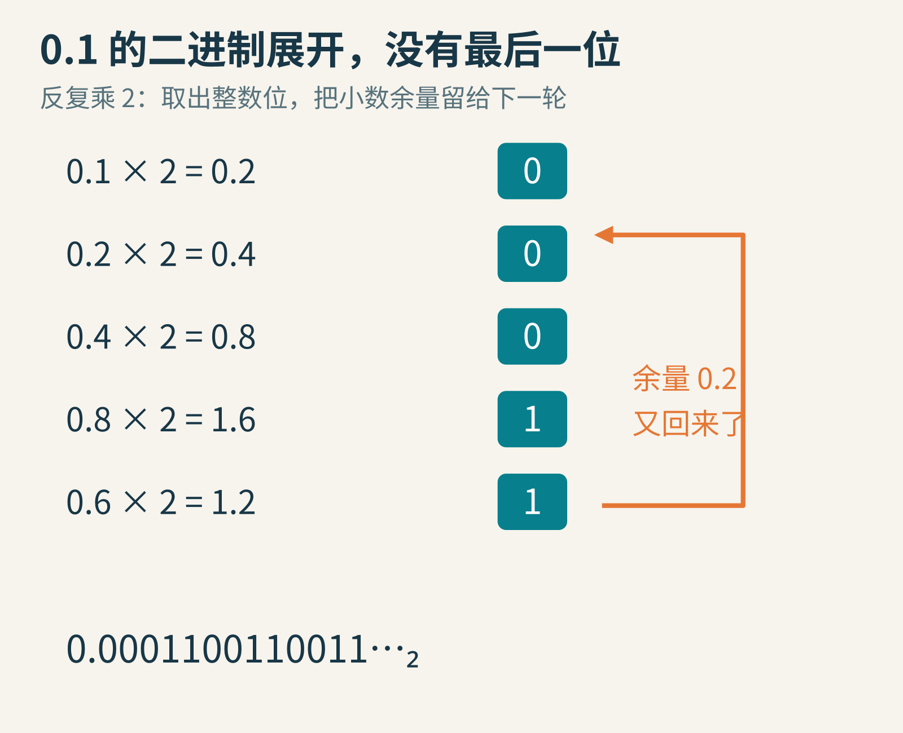
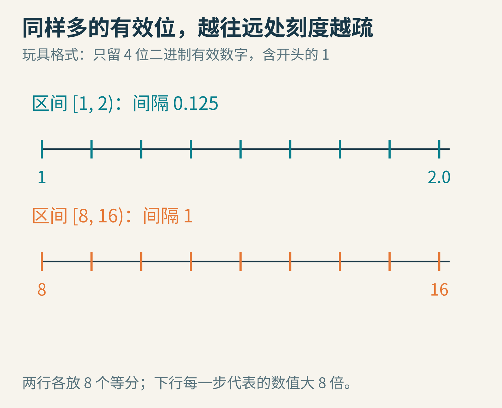
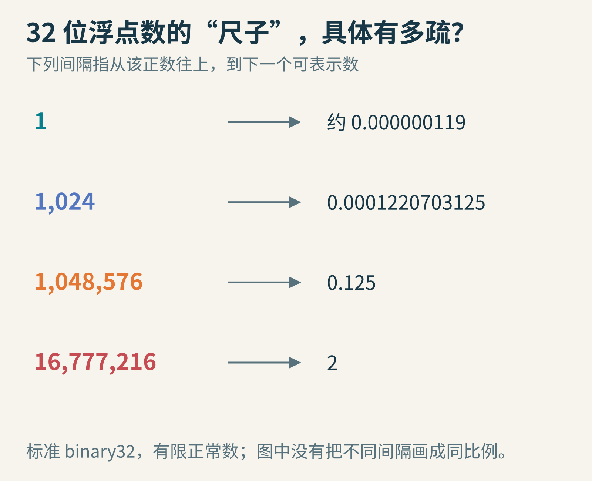
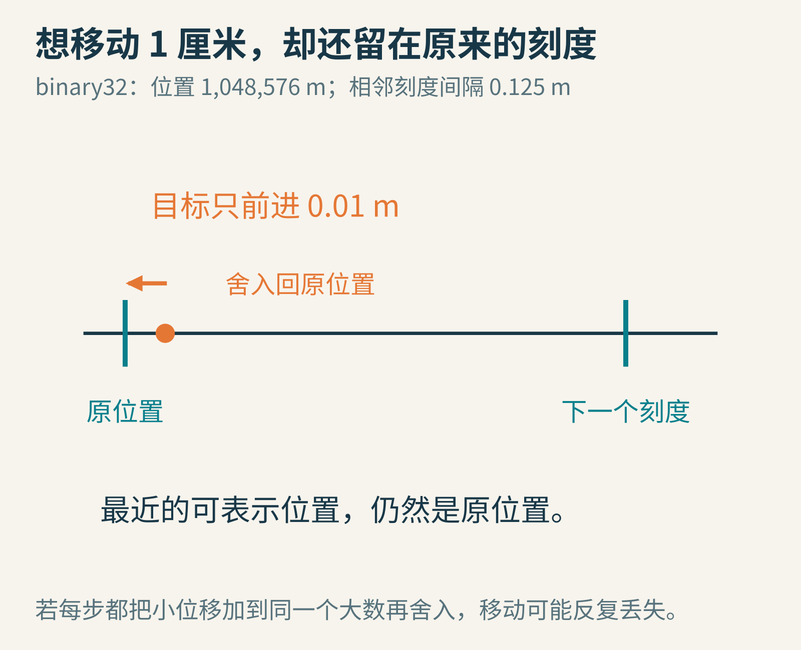
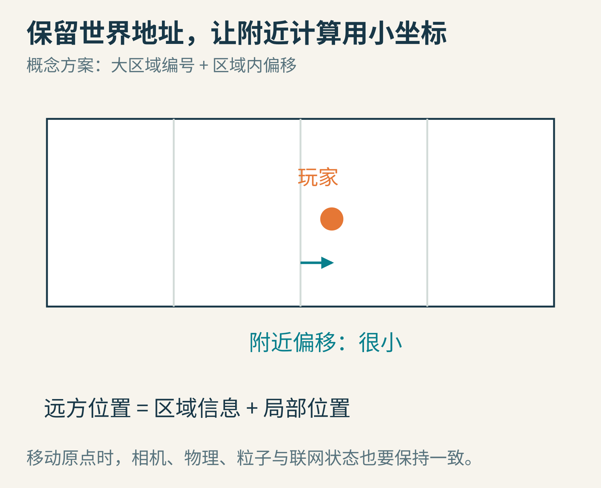
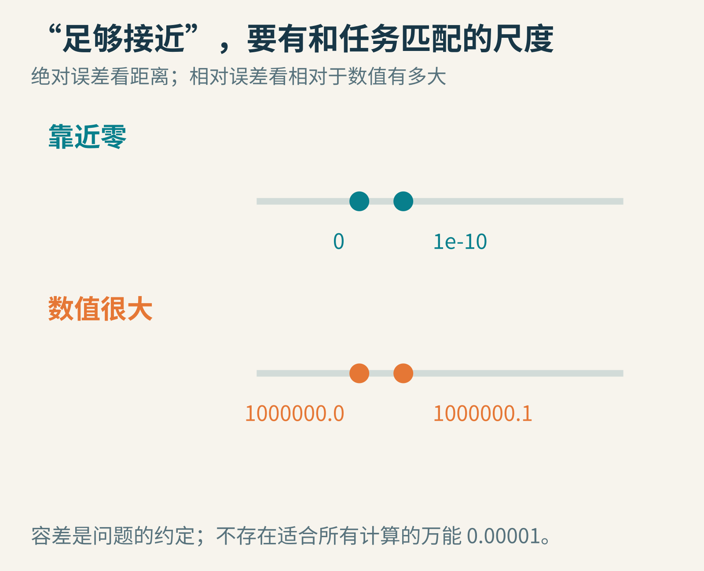

# 0.1＋0.2为什么不正好等于0.3？这件事还会让游戏角色抖动

在许多常见编程环境里，输入0.1＋0.2，会看到0.30000000000000004。

这个多出来的小尾巴，乍看像一道小学算术题把计算机难住了。可同一种数值表示方式，也在支撑游戏里的位置、旋转、速度和光照。它速度快，能容纳很大的数，也能容纳很小的数；代价是，有些值只能记成附近的近似值。

我们来做一把刻度很特别的尺子。先看它怎样写小数，再看为什么玩家走到巨大地图的远处，脚下可能开始发抖。

## 十进制写得短，不代表二进制也写得短

十进制小数点右边依次是十分之一、百分之一、千分之一。二进制则依次是二分之一、四分之一、八分之一。

因此，二进制0.101表示：1/2＋0/4＋1/8＝0.625。它只用了三个小数位，就准确表达了一个十进制小数。



原创教学示意。下标2与10分别表示二进制、十进制；它们描述的是同一个数。

现在换成0.1，也就是1/10。把一个分数写成有限位二进制，意味着它可以写成“某个整数除以2的若干次方”。

可1/10约分后，分母仍含因子5，无法变成纯粹的2的幂。因此，它的二进制小数不会有限终止。

这与十进制写1/3时不停出现3很像。不是1/3这个数有问题，而是我们选定的记数方式，无法用有限个小数位把它写完。

## 可以亲手追踪：那串0011是怎么来的？

把小数反复乘以2，每次取出整数部分，留下小数部分继续乘。

0.1×2＝0.2，取出0；0.2×2＝0.4，再取0；0.4×2＝0.8，再取0；0.8×2＝1.6，取1并留下0.6；0.6×2＝1.2，取1并留下0.2。

看，0.2又出现了。接下来会重复已经走过的路。



这组推导把0.1等十进制数当作数学上的精确值。不能拿普通二进制浮点运算的中间输出，反过来当作精确分数推导的证明。

于是，0.1的二进制形式是0.0001100110011……。存储空间有限，必须在某处停止并按规则舍入。

你写入的0.1、0.2和0.3，都可能分别变成附近可表示的二进制数。再做加法时，还可能经历一次舍入，所以加法得到的值不一定与单独写入0.3得到的值相同。[Python官方浮点教程](https://docs.python.org/3/tutorial/floatingpoint.html)解释了这种表示误差，以及为什么简短的显示文本可能隐藏了真实存储值的尾数。

因此，格式化成“0.30”能让显示更合适，但没有把底层存储自动变成精确的十分之三。显示与数值是两个层面。

## “浮点”的点，为什么要浮起来？

如果小数点位置完全固定，想同时容纳微小粒子和星际距离，就得准备很长的一排数字。

浮点数借用了科学计数法的想法：把数拆成一段有效数字和一个尺度。例如十进制123000可以写成1.23×10⁵；二进制也可以写成类似的形式，只是底数换成2。

在标准的32位二进制浮点格式binary32里，通常的正常数有24位二进制有效精度，其中最高的一位1不必逐次显式存储。另有符号和指数位。这里讨论的是有限正常数，零、极小的非正常数、无穷和NaN有各自规则。

先做一把玩具尺子：只允许4位二进制有效数字。在1到2之间，可以放下1、1.125、1.25……，刻度间隔是1/8。把尺度放大8倍，到8至16这一段，刻度就变成8、9、10……，间隔成了1。



图中上下两行都只有同样多的刻度，但它们覆盖的数值范围不同。这是玩具格式，不是把binary32画成只有4位精度。

这就是浮点数的一个核心取舍：它把相近的“有效数字位数”带到许多尺度上，而不是在所有位置都提供相同的绝对间隔。

## 数能存得很大，不代表还能保留很小的移动

对binary32的正常数，落在[2ᵉ,2ᵉ⁺¹)里的相邻间隔是2ᵉ⁻²³。你不必先背公式，可以把它看成“这一段区间宽度，分给固定数量的刻度”。

由此能算出几把不同位置的尺子：

- 从1往上的相邻间隔约为0.000000119。
- 从1024往上，间隔是0.0001220703125。
- 从1,048,576往上，间隔已经是0.125。
- 从16,777,216往上，间隔是2。



这些是可表示数的数学间距，单位由应用决定。如果位置单位是米，0.125就对应12.5厘米；如果单位不同，物理长度也会不同。

现在，把游戏角色放到x＝1,048,576米的位置，让它向前移动1厘米。目标位置是1,048,576.01。

可这一带的两个相邻刻度相差0.125米。按舍入到最近可表示值的规则，目标更靠近原来的位置，于是它仍被记成1,048,576。



这解释了一种可能的“走不动”：如果每一步都在这个大坐标上加0.01，然后立即存回binary32，微小位移会反复丢失。用独立的高精度累计量则可能产生不同结果。

[Godot的大世界坐标文档](https://docs.godotengine.org/en/stable/tutorials/physics/large_world_coordinates.html)讨论了远离原点时的位置精度、可见抖动与物理问题。并非所有游戏远处抖动都由浮点精度导致，但在大坐标场景里，它是值得检查的原因。

## 用Python做一场可重复的小实验

普通Python的float在常见平台上是64位双精度，不能直接把它的表现当成32位游戏坐标。我们用标准库struct明确转成binary32，再转回来观察。

```python
import struct
import math

def f32(value):
    return struct.unpack("f", struct.pack("f", value))[0]

print(0.1 + 0.2)
print((0.1 + 0.2) == 0.3)
print(math.isclose(0.1 + 0.2, 0.3))

position = f32(1048576.0)
print(f32(position + 0.01) - position)
print(f32(position + 0.125) - position)
```

这段代码已在本文制作环境实际执行，输出依次为：

```text
0.30000000000000004
False
True
0.0
0.125
```

前半段观察双精度的小数表示，后半段强制观察单精度大坐标。它没有运行游戏引擎，也不能替代引擎中相机、物理和渲染整条链路的检查。

试着把position改为1024，再比较同样的0.01。这个位移不会完整消失，但存回后差值仍可能不是精确的0.01。把尺度变化和存储精度分开控制，实验会更有说服力。

## 修复办法，不只“全部换成更大的数字类型”

双精度提供更多有效位，能显著改善很多大坐标问题。不过，CPU数据、GPU着色器、物理库和网络协议未必统一采用同一种精度；只改一个变量，其他环节仍可能把它舍回较低精度。

另一类方案是：保留较大的世界地址，让附近交互使用小坐标。例如记录“区域编号＋区域内位置”，或在玩家走远后移动计算原点。玩家和附近道具的相对位置，可以继续保持在精细刻度附近。



图示只表达坐标分层思路。移动原点需要同步处理相机、碰撞体、粒子、拖尾与联网状态等依赖，不能只把玩家坐标减掉一个大数。

注意减法时机。如果两个巨大坐标早已分别被低精度舍入，之后再相减，丢掉的小数细节不会自动回来。要改善精度，应尽量在信息损失之前，选择合适的表示和运算顺序。

至于必须精确处理的货币或计数，可能应该使用整数最小单位、十进制定点或适当的十进制库；坐标与财务计算不必共享同一把尺子。[Python decimal文档](https://docs.python.org/3/library/decimal.html)提供了精确十进制表示及可配置精度的路径，但有限精度下的某些运算仍然需要舍入。

## 既然有误差，还能用等号吗？

可以，但要先问你在比较什么。若在比较两个按设计应完全一致的整数值，或检查确切的状态标记，精确相等仍然有用。若在判断两个经过不同浮点计算路径的测量值“是否足够接近”，通常需要容差。

**绝对容差**关心相差多少，比如位置差是否小于某个距离。**相对容差**关心误差相对于数值规模有多大。



接近零时，只给相对容差可能不够；比较百万量级的数时，某个极小的固定绝对容差也可能不符合任务需要。

[math.isclose的官方定义](https://docs.python.org/3/library/math.html#math.isclose)同时考虑相对和绝对容差。默认值不等于适合所有物理模拟。游戏里1毫米是否算接触、测量里0.1是否能忽略，都需要应用来决定。

可以再做两个小实验：给isclose设置abs_tol，比较0与1e-10；随后比较1,000,000与1,000,000.1，并改变rel_tol。每次先说清“我允许多大的差”，再看程序结果。

浮点数很像一把能迅速切换量程的测量尺。它不是每一段都刻着同样密的毫米线。知道尺子的刻度在哪里，程序中的小尾巴与巨大世界的抖动，就能放进同一张清楚的图里。

图片来源：全部为原创记数、刻度与坐标示意；binary32间隔由其标准表示结构计算，代码输出来自文中自写Python小实验。参阅[Python浮点教程](https://docs.python.org/3/tutorial/floatingpoint.html)与[Godot大世界坐标说明](https://docs.godotengine.org/en/stable/tutorials/physics/large_world_coordinates.html)。
