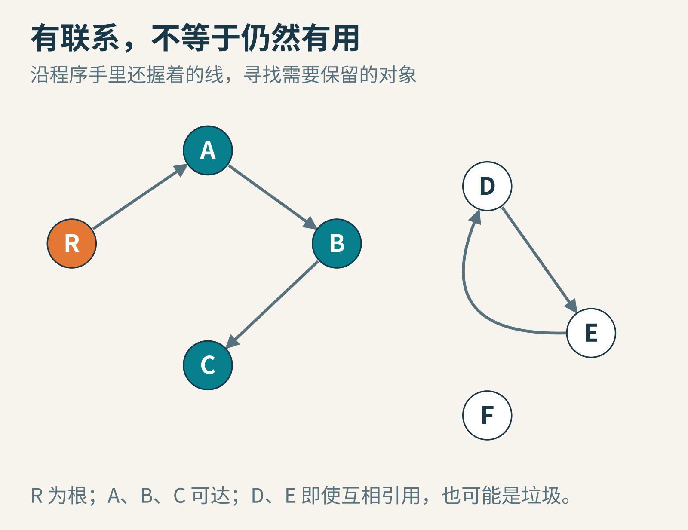
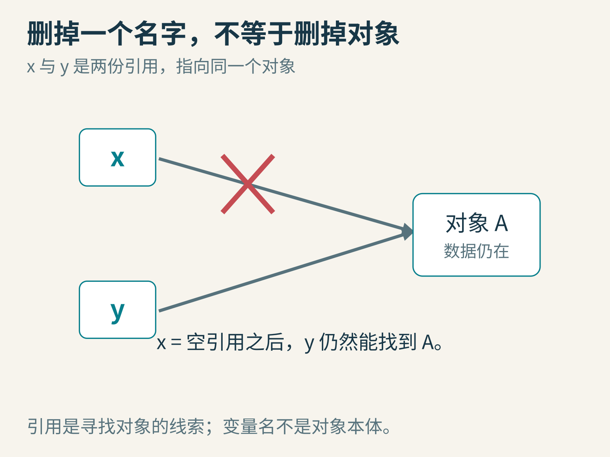
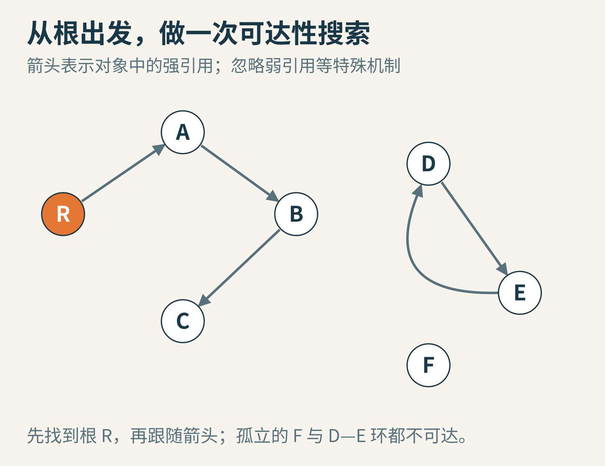
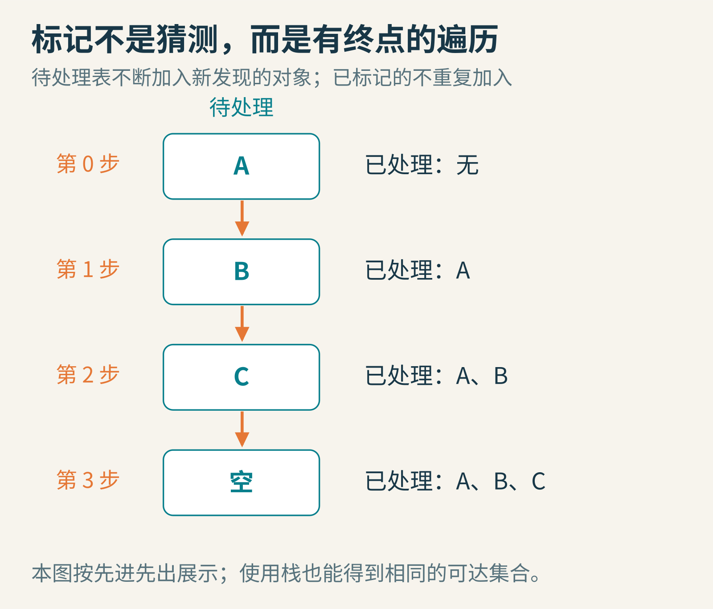
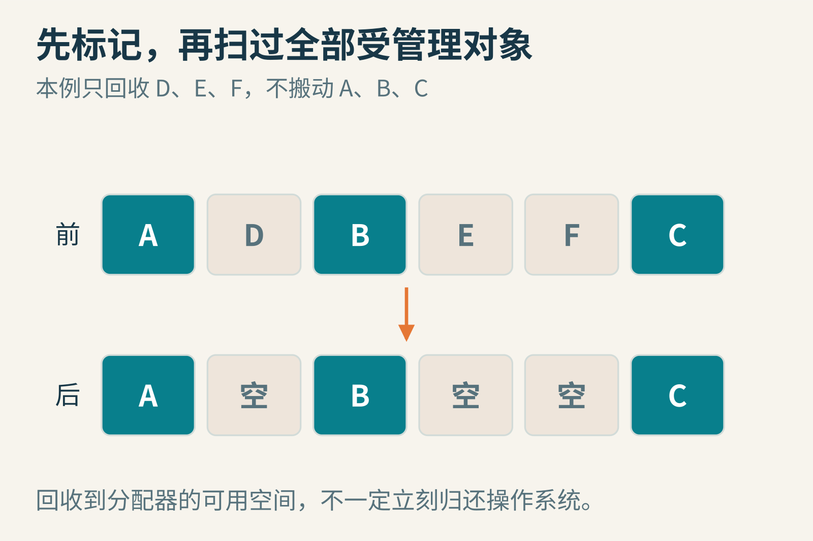
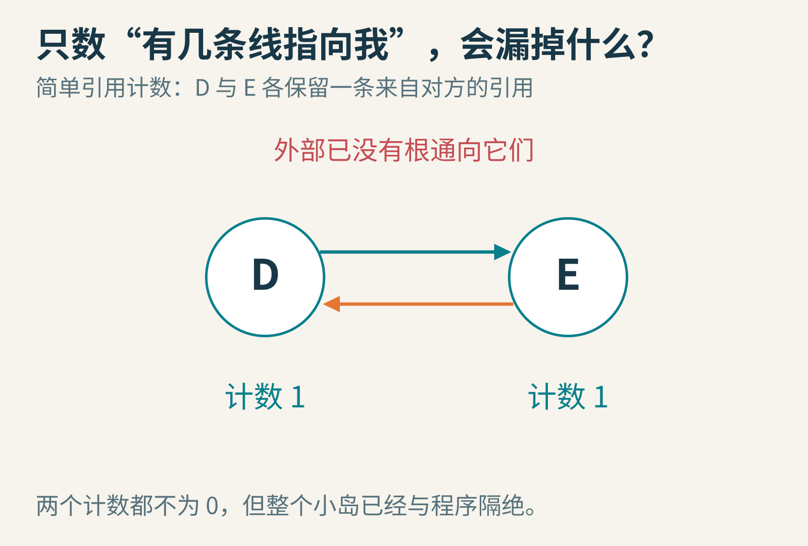
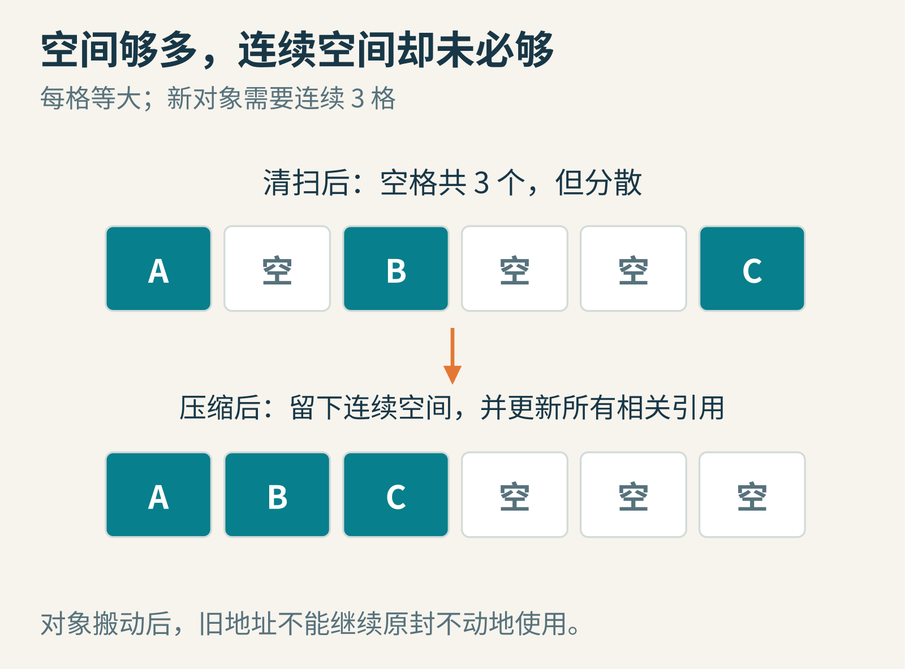

# 谁还找得到这个对象？从 LISP 到垃圾回收的可达性



*原创教学示意。橙色 R 是根，青色对象能从根找到；另一组对象虽彼此连接，却没有接入这条链。*

你在游戏里打开一个背包窗口，程序创建了窗口、按钮、图标和说明文字。窗口关闭后，这些东西是不是就该从内存里消失？如果另一个界面还在使用同一张图标，又该怎么办？

“看起来用完了”不是一个足够精确的指令。程序需要知道：哪些内存可以安全地重新使用，哪些对象仍可能被访问。释放太早，会把还需要的内容拆掉；一直不释放，程序又可能越占越多。

垃圾回收，通常简称 GC，就是自动内存管理的一部分。它不负责清理桌面垃圾桶，也不判断一个文件有没有价值。我们要讨论的是程序运行时创建的对象，以及程序还能不能通过引用找到它们。

## 先把名字、引用和对象分开

假设 x 指向一张很大的图片。执行“y = x”时，在这里讨论的引用模型中，y 也指向同一个图片对象，并没有自动复制第二张图片。

现在把 x 设为空引用。图片是不是垃圾？还不是。y 仍然握着它的地址线索，程序还可以通过 y 读取图片。如果这时把对象的空间重新分给别的东西，y 就会指向已经被破坏的内容。



*原创简化引用模型。红叉表示去掉 x 的引用；y 到 A 的引用仍在。实际语言的赋值与值类型规则可能不同。*

所以，“删掉一个变量名”和“销毁一个对象”不能画等号。一个对象可以被许多地方共同引用。更麻烦的是，这些引用又可能藏在别的对象里：窗口指向按钮，按钮指向图标，图标指向像素数组。

问题开始像一张地图。每个对象是一个地点，一条引用是一条有方向的路。程序手里直接握着的入口，是这张地图上的起点。

## 早期 LISP 为什么特别需要它？

1960 年，John McCarthy 发表《Recursive Functions of Symbolic Expressions and Their Computation by Machine, Part I》。论文描述了用 LISP 处理符号表达式，以及在 IBM 704 上的实现思路。相比只在固定变量里存几个数，符号处理会不断拼接、共享、丢弃列表结构。要求程序员处处手算每一块何时能释放，会让表达式计算本身变得难以管理。

论文的存储管理部分给出一种自动回收办法：当可用单元耗尽，从当时仍被使用的起点追踪列表，把能找到的单元作标记；随后扫描存储区，把没有标记的单元重新接入可用链表。这个核心结构，就是后来广泛讨论的“标记与清扫”。论文同时介绍了团队实现工作，不宜把整个系统描述成一个人独自完成的成品。[McCarthy 原论文，§4c](https://www-formal.stanford.edu/jmc/recursive.pdf)


*1957 年 3 月 21 日，NACA Langley 的 IBM 704。NASA/NACA 档案 GPN-2000-001881（L-1957-00989），美国政府公务作品；来源 NASA，未改动。本图说明当时的机器类型，不是 MIT 的 LISP 开发机，也不把图中人员认作 McCarthy。*

历史细节值得保留：那篇论文讨论的列表表示有自己的限制，不能直接等同于今天任意带环的对象图。下面的 A、B、C 与循环引用例子，是我们为理解一般原理新建的模型，不是把现代系统功能倒写回 1960 年。

## 根：搜索从哪里开始？

垃圾回收器不能凭空说“从所有对象开始找”。如果每个对象都算起点，当然每个对象都能找到自己，什么也回收不了。

它需要一组由运行时识别的根。你可以先把根理解为程序当前直接持有的入口，例如活动调用里仍需保留的对象引用、静态存储中的引用，以及运行时管理的某些句柄。具体哪些位置是根，由语言、编译器和运行时协作决定，不是“凡是在源码里出现过的变量名永远算根”。

.NET 的官方说明就把栈中的引用、寄存器、静态数据和运行时句柄等列为根来源；随后由这些入口建立可达对象图。这里借它说明一种真实实现，其他运行时的细节并不必然相同。[.NET 垃圾回收基础](https://learn.microsoft.com/en-us/dotnet/standard/garbage-collection/fundamentals)

例如窗口刚关闭时，一个正在执行的回调函数可能还握着图标的引用。即使全局窗口列表已删掉窗口，这个活动调用也可能继续保住图标。判断对象能否回收，需要查看这一刻的全部有效入口，不能只检查自己刚刚改过的那一个变量。反过来，源码中的名字还在作用域里，也不保证优化后的机器状态仍必须保留它；我们应依赖语言和运行时的约定，而不是猜测一行赋值会立即触发什么。



*原创自设对象图。R 是外部根，不是待回收对象。R→A→B→C；D 与 E 相互引用；F 没有引用。所有箭头均按强引用理解，暂不引入弱引用和终结器。*

手算一次：从 R 出发到 A，再从 A 到 B，从 B 到 C。C 没有下一条边，搜索结束。可达集合就是 A、B、C。

D 能找到 E，E 又能找到 D，可是根找不到它们。它们形成了一座与程序隔绝的小岛。F 更简单，单独待在一边。按照这个模型，D、E、F 都可以回收。

注意箭头方向：如果某个垃圾对象能指向活对象，不代表活对象也能反过来找到它。“两点之间有线”和“沿允许方向能走过去”是不同的条件。

## 第一遍：标记所有能找到的对象

你可以拿纸、笔和一个待处理列表，扮演回收器。

第一步，把根直接指向的 A 标记为“已发现”，放入待处理列表。取出 A，查看它的引用，发现 B；把未标记的 B 标记并放入列表。再取出 B，发现 C，同样处理。最后取出 C，没有新对象可加入，列表变空。



*原创教学步骤。列表里只放已发现但尚未处理完的对象。图右侧“已处理”不等于“已标记”：进入待处理表时就已标记，以免重复加入。*

为什么需要检查“是否已经标记”？试着让 C 再指向 A。如果不记已经来过，搜索就会 A、B、C、A、B、C 地永远绕圈。标记既记录存活候选，又阻止重复遍历。

待处理表可以按先进先出使用，也可以用后进先出的栈。访问顺序会变，最后的可达集合不变。因为我们要的是“能否找到”，不是最短路径。

可以用很短的伪代码表达：

```text
marked = 空集合
work = 根直接指向的对象
把 work 中的对象加入 marked
当 work 不空：
    取出一个对象 u
    对 u 的每个强引用所指对象 v：
        如果 v 不在 marked：
            把 v 加入 marked
            把 v 放入 work
```

这里假设程序在本轮检查期间不改引用关系。如果另一个线程一边让 A 指向新对象，一边删除旧引用，搜索看到的就可能不是同一个时刻的图。先采用暂停应用的简化模型，才能把基本算法说清；并发回收必须额外协调这些改变，不能只是把同一段循环搬到后台。

## 第二遍：清扫不在集合里的对象

标记完成后，还需要检查受管理的分配区域。只遍历活对象，不会自动告诉分配器哪些旧空间可以再次分配。

假设六个对象在内存中的顺序为 A、D、B、E、F、C。扫描这六个位置：A 有标记，保留；D 没标记，回收；B 保留；E 和 F 回收；C 保留。



*原创等大槽位模型。清扫只改变哪些空间可用，并未移动存活对象；“空”表示分配器可以重用的空间。*

一轮以后，程序又有空间创建新对象了。但任务管理器上的内存数字未必立即下降。回收器可以先把空闲空间留给当前进程下次使用；是否把整块区域退还操作系统，是另一层策略。不要只凭进程占用没有立刻变小，就断言本轮回收失败。

在这个基本模型中，标记阶段的工作与根和可达引用有关，清扫阶段还要查看被管理的分配区域。活对象很多、引用很多或者堆很大时，回收本身也需要成本。自动不等于免费。

## 为什么只数引用，还不够？

另一种直观思路是给每个对象配一个计数器：每增加一个需要计入的强引用，就加一；每移除一个，就减一。计数降到零时，对象便可以释放。对象释放又会移除它持有的引用，于是可能引发一串释放。

这种思路叫引用计数。它能让很多对象在最后一份引用消失时及时释放，但要持续维护计数，也会遇到循环引用。



*原创反例。外部已没有引用，D 和 E 各剩一条来自对方的强引用；简单引用计数不会让任何一个先变成零。*

把 D 和 E 想成两个互留地址、却已与外界断联的人。每个人都说“还有人知道我的地址”，并不能证明当前程序还找得到任何一个。

所以，引用计数与追踪可达性可以合作。CPython 的官方 gc 文档就明确说明，其循环垃圾收集器补充已有的引用计数机制。不能因为 Python 有引用计数，就推断所有循环对象都永远无法回收；也不能反过来把某个实现的策略当成所有语言的规定。[Python gc 文档](https://docs.python.org/3/library/gc.html)

## 清扫之后，还可能留下碎片

回收 D、E、F 后，六个槽位变成 A、空、B、空、空、C。空位总共三个。假设新对象需要连续三个槽位，放得下吗？

这张简化图里放不下。最大的连续空段只有两个槽位。总剩余空间与最大连续空间，是两个不同的数。



*原创等大槽位示意。压缩把 A、B、C 搬到一起，留下连续空段；不表示实际回收器必须按这个顺序移动。*

一种办法是移动存活对象，把空隙合并。这类过程通常称为压缩。可是对象搬家后，原来指向旧地址的引用也必须正确更新，否则只是把“内存不够”换成“地址错误”。

这解释了为什么移动对象需要运行时知道引用在哪里。现实系统还可能有固定地址对象、大对象、与外部代码交互的指针等限制。因此有些区域会移动，有些不移动；有的回收器选择另一种组织空间的办法。标记、清扫、复制和压缩，是可以组合的机制，不是一个单一品牌的同义词。

## 可达，不等于你真的还想要

回到背包窗口。你关掉窗口，却忘记把它从某个全局“所有窗口列表”中删除。全局列表仍然是根能到达的对象，列表又指向旧窗口，窗口接着指向一大串图标。

从回收器眼里看，这些对象都可达。它不能擅自推断“用户已经关了窗口，所以程序肯定再也不需要它”。也许你是想保留窗口，稍后恢复原样。

这就是有垃圾回收的程序仍可能出现内存持续增长的原因：保留了自己并不想保留的强引用。缓存没有容量上限，事件订阅忘记解除，历史记录无限增长，都可能形成这样的路径。调查时要问“是哪条根到对象的链把它留住了”，而不是只反复要求回收器多跑几次。

还有一条边界：内存回收不是及时关闭文件、释放锁或提交数据的承诺。一个包装文件句柄的对象何时变得不可达、何时被处理，未必符合业务所需的时刻。应按语言和库提供的明确资源管理约定及时关闭资源，不能把“将来可能被回收”当作完成操作的保证。

## 换三条箭头，再算一次

先在原图增加 R→D。现在 D 与 E 都可达，循环本身不再是垃圾。循环不是错误，无法从根到达才是我们模型里的判据。

再删除 A→B。若没有其他引用，B 和 C 一起变成不可达；A 仍然保留。你删除的是一条引用，影响的可能是一整片对象。

最后只增加 F→A。F 会活过来吗？不会。箭头从 F 指向 A，却没有任何根能走到 F。把这题答清楚，你就真正分清了有向可达性与“看起来连在一起”。

垃圾回收最有力量的地方，是把一个难以逐个判断的问题，改写成可执行的图搜索：从程序仍握着的入口出发，保留能到达的对象，再把剩余空间交还给分配器。理解了这张图，你就不仅知道垃圾怎样消失，也更容易查明那些本该消失的东西，为什么仍被某一条线牢牢牵住。

本文由 AI 辅助研究、撰写与制图；对象图与数值为原创教学模型，非性能实测。

图片来源：[IBM 704 档案照片](https://commons.wikimedia.org/wiki/File:IBM_Electronic_Data_Processing_Machine_-_GPN-2000-001881.jpg)；其余为本文原创教学图。
