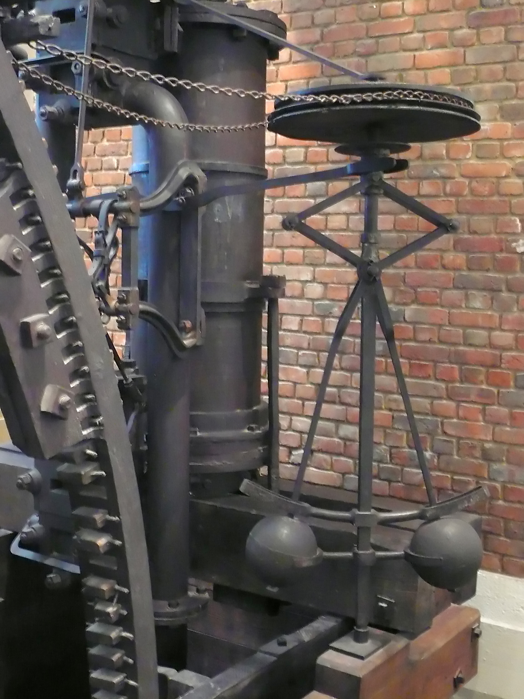
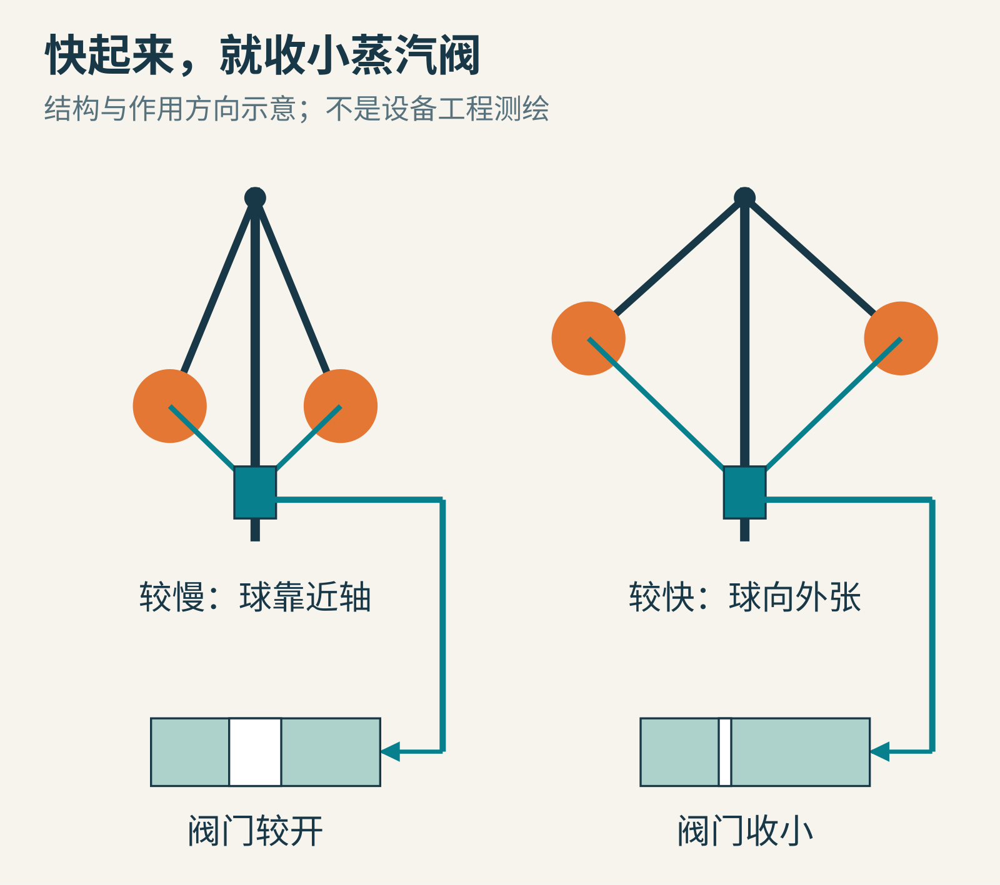
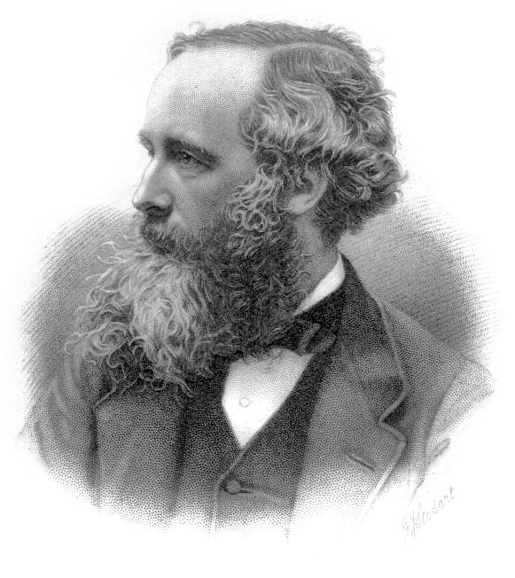
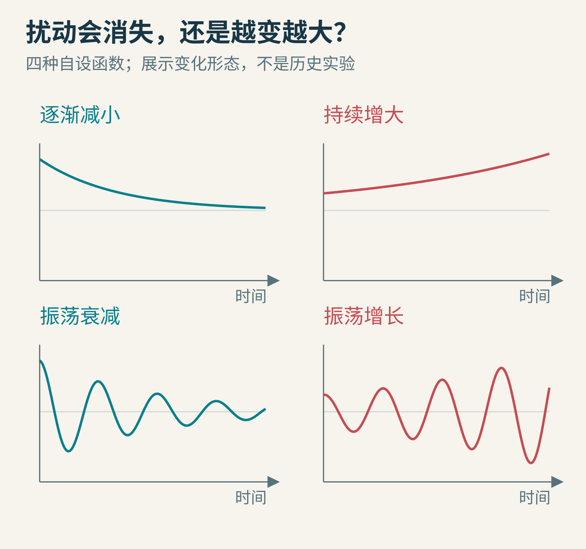
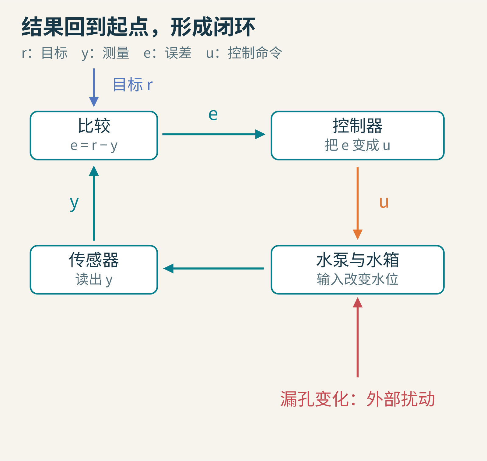
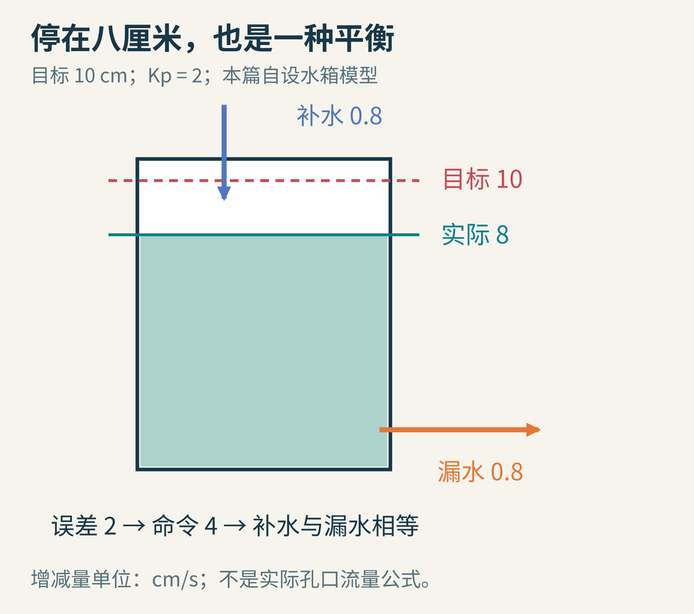
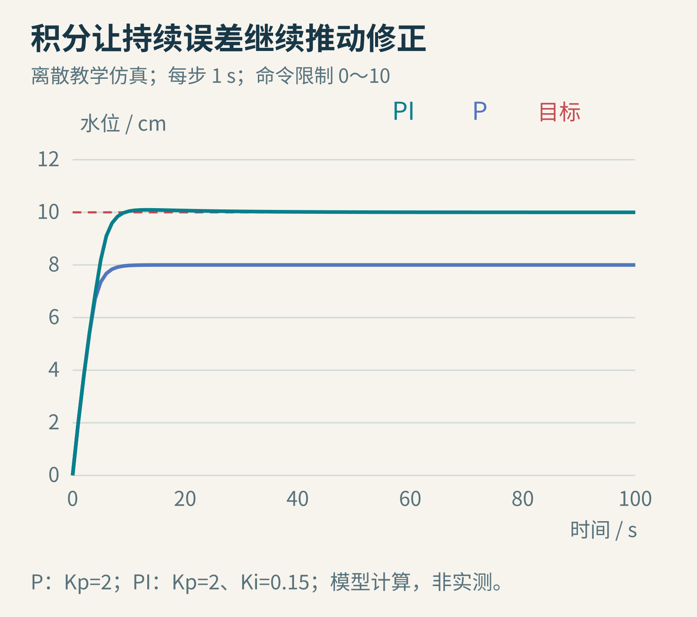
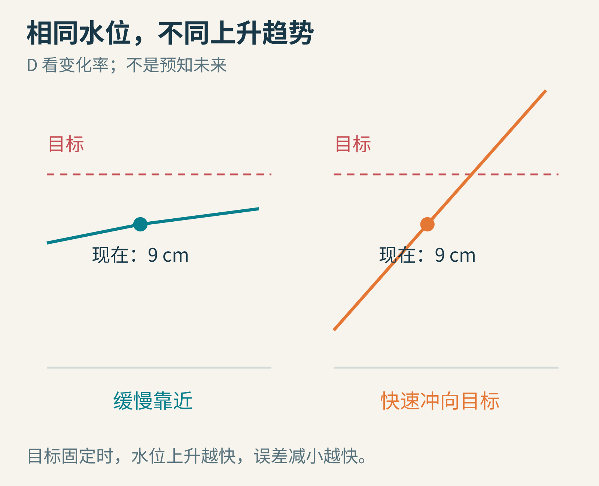
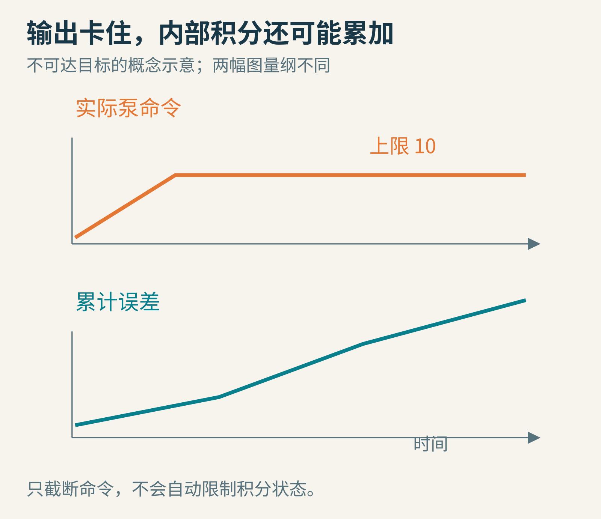

# 机器怎样自己稳住：从旋转的铁球到 PID 控制

你在给一只漏水的水箱加水。目标很简单：水位保持在十厘米。

如果你把水龙头拧到一个固定位置，水位未必刚好停在十厘米。漏孔变大了，水位会下降；水压突然升高，它又会漫上来。你可以一直盯着刻度，低了就开大，高了就关小。但如果这件事要持续一整天呢？

所谓自动控制，就是把“观察结果，再修正动作”的工作交给机器。它不一定需要人工智能，甚至不一定需要电。两颗会旋转的铁球，就曾经承担过这种工作。

今天我们从它们出发，自己算出一个小水箱的控制过程，再认识机器人、温控器和电机程序里常见的三个字母：PID。我们也会看到一个很反直觉的结论：**纠正得更用力，不一定能让机器更稳定。**

## 一　蒸汽机为什么需要两颗铁球

先看下面这张真实照片。中间的竖轴转动时，两侧的球绕着轴旋转；连杆把球的位置变化传到其他机构。这是伦敦科学博物馆一台博尔顿与瓦特蒸汽机上的瓦特式离心调速器。



图：Dr. Mirko Junge，2008 年摄于伦敦科学博物馆，[CC BY 3.0](https://creativecommons.org/licenses/by/3.0/)，原图未修改。照片是历史设备的现代拍摄，不是十八世纪的现场影像。

设想蒸汽机正在带动一台机器。负载突然减小，同样的蒸汽推动较轻的负担，转速就可能升高。调速器跟着转得更快，球向外张开，经连杆让蒸汽阀门收小，输入动力于是减弱。反过来，转速下降时，球收拢，阀门可以开大。

它形成了一条闭合的因果链：转速影响铁球位置，位置影响阀门，阀门影响动力，动力又影响转速。结果被送回去影响原因，这就叫“反馈”。这里的反馈在抵消转速变化，所以叫负反馈。



原创结构示意，省略实际齿轮、套筒和连杆细节；不是对照片中设备的工程测绘。箭头表达作用方向，不表示尺寸或力的大小。

不过，请留意：“负反馈”只说明纠正的方向，不是稳定保证书。铁球有惯性，阀门不会瞬间动作，蒸汽机也不会瞬间减速。等纠正真正起效，机器可能已经跨过目标；下一次又反方向纠正过头，于是开始一快一慢地摆动。

这就像调淋浴温度：感觉冷，拧热一点；热水还没到，就继续拧；等它到达时，又烫得赶紧拧回去。每次动作的方向都有道理，合在一起却可能越来越糟。

## 二　麦克斯韦问的不是“方向对不对”

许多人认识詹姆斯·克拉克·麦克斯韦，是因为他研究电磁学。但他在 1868 年的论文《On Governors》中，也讨论了调速器为什么会稳定或“跳舞”。[原文](https://en.wikisource.org/wiki/On_Governors)把扰动区分为不断增长、不断减小、振幅增长的振荡以及振幅减小的振荡。



麦克斯韦肖像：G. J. Stodart 根据 Fergus of Greenock 的照片制作的版画，1882 年出版，公有领域。

请把注意力放在“扰动”两个字上。机器原本好好转着，被碰了一下以后，会发生什么？一次偏离本身并不可怕。重要的是，它会越来越小，还是越来越大。

我们可以画出四条教学曲线。它们不是那台历史蒸汽机的实测记录，只是把麦克斯韦讨论的几种行为变成直观图像。



原创概念图。横轴是时间，纵轴是相对平衡状态的偏离；线条用自设数学函数绘制，没有实物测量单位。

现代控制理论可以用微分方程、极点和频率响应深入回答这些问题。我们暂时不需要全部学会，但要带走一种看问题的方式：**控制器和被控制的机器必须放在一起看，动作延迟、惯性、测量噪声以及执行能力，都属于系统的一部分。**

麦克斯韦的论文不是现代数字 PID 的使用说明，也不能被概括成“他一个人发明了自动控制”。它是这条漫长历史中，把调速器的动态行为明确变成数学研究问题的重要一站。

## 三　给水箱搭一个最小闭环

回到我们的漏水水箱。把目标水位叫作 r，把传感器测到的水位叫作 y。两者的差就是误差：

**e = r − y。**

目标十厘米，实际七厘米，误差就是正三厘米：我们希望补水。实际十二厘米，误差是负二厘米：我们希望少补水。注意，误差只是一个比较结果，还不是水泵命令。

控制器把误差变成命令 u；水泵按命令送水；水箱里的水位变化；传感器再测量。下面的回路里，每条箭头都承担不同的工作。



原创信号流示意。外部扰动可以是漏孔变化；传感器也可能读错。现实系统中，传感器和执行器不是无误差的透明通道。

为了能亲手算，我们自设一个离散教学模型：

- 每隔一秒读一次水位并更新水泵命令。
- u 只能在 0 到 10 之间，数字越大，泵越有力。
- 一秒内，泵让水位增加 0.2u 厘米，漏水让水位减少 0.1y 厘米。
- 所以下一秒水位：**y_next = y + 0.2u − 0.1y。**

这个公式是本篇特意简化的模型，不是从真实水箱辨识出来的参数，也不完整描述真实孔口流量。我们选择它，是为了把反馈算清楚，而不是声称现实漏水一定与水位成正比。

如果水位已经是十厘米，保持不变要求增加量等于减少量，也就是 0.2u = 1，因此 u = 5。你现在已经发现一个重要细节：**到达目标不等于可以停止用力。**这个水箱一直漏水，所以到达目标后仍要补水。

## 四　P：差得越远，就越用力

最容易想到的办法是：把误差乘上一个系数。

**u = Kp × e。**

P 是 proportional，即比例。先取 Kp = 2，再把超出 0～10 的命令限制在这个范围内。水箱初始为空：

第一秒，e = 10，计算命令是 20，但泵最多只能执行 10。水位从 0 变成 2。

第二秒，e = 8，命令仍被限制为 10。水位变成 2 + 2 − 0.2 = 3.8。

第三秒，e = 6.2，命令还是 10。水位变成 3.8 + 2 − 0.38 = 5.42。

随着水位靠近目标，误差减小，泵的命令也减小。听起来很合理，然而这次它会停在八厘米附近，而不是十厘米。

为什么？在八厘米时，误差是 2，比例控制器给出 u = 4。泵每秒补高 0.8 厘米，漏水也每秒降低 0.8 厘米，恰好平衡。水箱稳定了，却稳定在错误的位置。

你也可以把这个平衡代入公式：0.2 × 2 × (10 − y) = 0.1y，解得 y = 8。这是该教学模型和这些参数下的结果，并不是所有比例控制器都会有同样偏差。



原创教学图。这里展示的“差一点”不是计算机算错，而是控制规律决定的平衡。

把 Kp 调大可以缩小这个模型的稳态误差，但不能据此一路拧到最大。在有惯性和延迟的系统里，过大的增益可能造成振荡，甚至失稳；执行器也可能一直卡在上限。控制不是单纯追求大数字。

## 五　I：把一直没解决的小误差记下来

八厘米处的误差虽然只有两厘米，却一直存在。我们给控制器加一份“累计账”：每次把误差乘上时间间隔，再加到过去的总和里。

如果连续三秒都差两厘米，这份累计量就从 0 变成 2、4、6，单位是“厘米·秒”。这就是积分的直观含义：把误差随时间积累起来。I 是 integral。

现在让输出包含两部分：

**u = Kp × 当前误差 + Ki × 累计误差。**

只要系统持续偏低，累计量就继续增加，水泵就多得到一点命令。这会破坏刚才那个“八厘米也挺稳定”的平衡。等水位达到十厘米，当前误差可以为零，但累计量不必为零；它可以留下恰好抵消漏水所需要的输出。

这不是机器“记仇”，也不是积分项会神奇地知道正确答案。它只是持续累加尚未消失的误差。在闭环稳定、目标可达等条件下，这个机制可以消除一类持续偏差；如果条件不满足，积累也可能变成麻烦。



原创离散仿真，使用正文水箱模型；P 为 Kp=2，PI 为 Kp=2、Ki=0.15，命令均限制在 0～10。曲线来自模型计算，不是实测。完整更新顺序见后面的代码。

## 六　D：现在还没到，但正在冲过去

想象两次测量，水位都是九厘米。第一种情况，过去一秒只上升了 0.01 厘米；第二种情况，过去一秒上升了 2 厘米。它们的当前误差一样，却显然不该总是使用同一种动作。

D 是 derivative，即微分，它关心变化速度。在理想写法里，D 项是 Kd × 误差变化率。如果目标不变，水位快速上升意味着误差快速减小，D 项就会给出负贡献，帮助提前减少输入。

举个只演示计算的例子：目标保持十厘米，水位在 0.1 秒内从 8 变成 9，误差就从 2 变成 1。误差变化率为 (1−2)/0.1 = −10 厘米/秒。取 Kd=0.2，D 项贡献就是 −2。这个数只是控制命令的一部分，最后还要和 P、I 相加并受泵的范围限制。



原创教学示意。D 利用当前变化趋势，不会真的看见未来；它也不能单独保证没有过冲。

D 还有一个脾气：对噪声敏感。假如水面根本没动，传感器却在 0.01 秒内跳动了 0.1 厘米，差分得到的“速度”仍有 10 厘米/秒。于是一个小测量毛刺可能变成较大的控制动作。实际系统往往需要滤波，也常对测量值而非目标误差求导，避免目标突然改变带来的微分冲击。

到这里，你已经能理解 PID 三个部分各自看什么：P 看当前差多少，I 看过去积了多少，D 看变化有多快。实际控制器不一定三项全用。许多问题用 P 或 PI 就合适，增加字母并不自动增加效果。

## 七　水泵已经全开，积分却还在加

设想把目标从十厘米临时改成一百厘米。我们的水泵即使一直执行最大命令 10，这个模型的平衡水位也只有二十厘米：0.2×10 = 0.1×20。

所以一百厘米是根本达不到的目标。控制器却可能不断累加正误差，积分项越来越大。后来把目标改回十厘米，它仍背着一大笔过去的累计量，继续猛加水。这叫积分饱和或积分累积过度，常用英文 windup。



原创概念示意。命令上限和累计误差是不同的量；把输出截断，不等于同时阻止内部积分增长。

一种简单的处理是：当输出已经饱和，而且当前误差还会推动它更严重地饱和时，暂停那一方向的积分；另一种是把实际输出与未限幅输出的差反馈到积分状态。不同方法各有适用条件。[WPILib 的实现说明](https://docs.wpilib.org/en/stable/docs/software/advanced-controls/controllers/pidcontroller.html)也特别讨论了积分限制、重置和固定调用周期。

请不要把“清零积分”当成无条件按钮。正常工作时积累下来的量，可能正好承担抵消重力、摩擦或漏水的任务。清掉它会改变输出，什么时候清、怎么切换，需要根据具体设备设计。

## 八　用十几行程序观察一个控制器

下面是生成图中 P 和 PI 轨迹的完整小实验。它只在数字水箱里运行，不连接电机、加热器或其他真实设备。为了让积分的作用容易观察，代码没有加入 D 和抗积分饱和，后者正好可以留作扩展。

```python
def simulate(ki, steps=100):
    y = 0.0
    integral = 0.0
    levels = [y]
    dt = 1.0
    for _ in range(steps):
        error = 10.0 - y
        integral += error * dt
        command = 2.0 * error + ki * integral
        u = max(0.0, min(10.0, command))
        y += dt * (0.2 * u - 0.1 * y)
        levels.append(y)
    return levels

p = simulate(0.0)
pi = simulate(0.15)
print(round(p[-1], 3), round(pi[-1], 3))
```

把结果画出来时，要同时画目标线、实际水位，最好再画命令 u。只看“最后到了没有”，可能看不见中途剧烈过冲，也可能看不见水泵长期顶在上限。

这里 dt 不只是“程序休息一会儿”。积分要乘它，差分求导要除它，模型更新也要遵守同样的时间含义。若控制程序原本每 20 毫秒运行一次，却忽然变成每 200 毫秒运行一次，仍使用旧的时间假设，控制器的行为就可能改变。

## 九　留给探索者的三个小挑战

第一，把 Ki 设成 0，只改 Kp。先不用运行，解出这个教学模型的平衡水位：它应该满足 0.2Kp(10−y)=0.1y。再与程序结果比较。为什么很大的 Kp 下，限幅和离散更新会让过程不能只靠这个平衡公式判断？

第二，在第 30 秒把漏水系数从 0.1 改成 0.15。目标不变，观察 P 和 PI 如何应对。你能解释“受到扰动后回到原目标”和“重新稳定在另一个水位”的区别吗？

第三，把测量故意延迟三步：控制器只能看到三秒前的水位。先保持参数不变，再逐渐增大 Kp。注意这是一项数字实验，不是现实设备调参建议。你可能会亲眼看到：正确的纠正方向，碰上迟到的信息，仍会带来来回摆动。

从蒸汽机上的铁球，到机器人里的几行循环代码，材料和实现变了，核心问题却一直存在：我知道自己偏了多少吗？我的动作多久后才有效？我能施加多大的力？这次修正会让下一次偏差更小，还是更大？

学会 PID 的起点，不是记住三个缩写，而是开始对整条回路负责。

图片来源：[离心调速器实物与摄影许可](https://commons.wikimedia.org/wiki/File:Boulton_and_Watt_centrifugal_governor-MJ.jpg)；[麦克斯韦肖像与版画署名](https://commons.wikimedia.org/wiki/File:James_Clerk_Maxwell_big.jpg)。其余图片为本篇原创教学示意或明确标注的模型仿真。参考阅读：[麦克斯韦《On Governors》](https://en.wikisource.org/wiki/On_Governors)、[WPILib 的 PID 控制说明](https://docs.wpilib.org/en/stable/docs/software/advanced-controls/controllers/pidcontroller.html)。本文采用 AI 辅助调研、撰写与编程制图。
